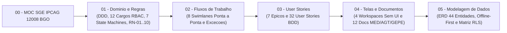

# MOC — Sistema de Gestão Escolar (SGE) | IPCAG N.º 12008 / BGO

> [!abstract] Navegação Central do Projeto
> - **Painel Principal do Vault:** [[Inicio|Início do Vault]]
> - **Plano de Definição (fase atual):** [[00.1 - Plano de Engenharia de Requisitos]]
> - **Mapa Visual da Arquitetura:** [[Arquitetura SGE IPCAG 12008 BGO.canvas]]
> - **Painel Dinâmico (Base):** [[Painel Documentacao SGE.base]]
> - **Áreas Relacionadas:** [[Arquitetura de Software e DDD]] | [[Governacao Escolar Ensino Tecnico MED]]
> - **Recursos Oficiais:** [[Quadro Legal MED AGT e APD Angola]] | [[Quadros de Arquitetura no Figma]]

---

## 1. Ficha Institucional do Projeto

- **Instituição:** Instituto Politécnico Católico de Administração e Gestão (IPCAG) N.º 12008 / BGO – *"Nossa Senhora do Rosário"*
- **Localização:** Bairro Modular do Panguila, Município do Dande, Província do Bengo, Angola
- **Natureza e Tutela:** Escola Católica Comparticipada (Ministério da Educação de Angola — MED / Governo Provincial do Bengo & Diocese de Caxito)
- **Subsistema de Ensino:** Ensino Secundário Técnico-Profissional — II Ciclo (**10ª, 11ª, 12ª e 13ª Classes**)
- **Infraestrutura Alvo:** 12 Salas de Aula / Laboratórios operando em 2 Turnos (**Manhã** e **Tarde**) com arquitetura resiliente ***Offline-First***

---

## 2. Arquitetura Documental do Sistema (`DOC-01` a `DOC-05`)

> [!tip] 🎨 Acesso Visual Imediato no Figma / FigJam
> Todos os diagramas arquiteturais estão modelados e sincronizados na equipa oficial `angeloaqp1997's team`:
> - 🌐 **Ficheiro Geral Unificado (Secções 01 a 05.6):** [Abrir Ficheiro Geral no FigJam (OneLIwLlc2kuM1koaIeXG0)](https://www.figma.com/board/OneLIwLlc2kuM1koaIeXG0)
> - 📋 **Catálogo Central com Metadados:** [[Quadros de Arquitetura no Figma|Ver Todos os Links do Figma]]

| Ordem | Nota no Vault | Escopo Técnico Principal | Quadro Dedicado FigJam | Quadro Geral Unificado | Estado |
| :---: | :--- | :--- | :---: | :---: | :---: |
| **`DOC-00`** | **[[00 - MOC SGE IPCAG 12008 BGO]]** | Índice mestre (Map of Content) e visão executiva do projeto | — | [Ver MOC no Geral](https://www.figma.com/board/OneLIwLlc2kuM1koaIeXG0) | `ativo` |
| **`PLN-00`** | **[[00.1 - Plano de Engenharia de Requisitos]]** | Diagnóstico de lacunas, mapa de 20 capacidades de um SGE, fases de definição e validação, entregas guiadas pelo calendário e decisões pendentes | — | — | `ativo` |
| **`DOC-01`** | **[[01 - Dominio e Regras]]** | Glossário DDD, 6 Contextos Delimitados, 12 Perfis RBAC (DP n.º 93/21), 7 Máquinas de Estado e 10 Regras de Negócio (`RN-01` a `RN-10`, incluindo `RN-01.2` Mínimo de Admissão e Repescagem) | [Abrir DOC-01](https://www.figma.com/board/l8fbIkk7SlJXCc3poCnExT) | [Secção 01 no Geral](https://www.figma.com/board/OneLIwLlc2kuM1koaIeXG0) | `concluido` |
| **`DOC-02`** | **[[02 - Fluxos de Trabalho]]** | 8 Fluxos Operacionais Críticos (Swimlanes), Caminhos Felizes, Exceções (`E1.1` a `E8.3`) e Rollbacks | [Abrir DOC-02](https://www.figma.com/board/klMnPKkxorDv9NEfvvpSRq) | [Secção 02 no Geral](https://www.figma.com/board/OneLIwLlc2kuM1koaIeXG0) | `concluido` |
| **`DOC-03`** | **[[03 - User Stories]]** | User Story Mapping completo: 7 Épicos (`EP-GOV` a `EP-DOC-AUD`) e 32 User Stories com critérios BDD | [Abrir DOC-03](https://www.figma.com/board/PZgRkbRHrNR6UfehirGDPd) | [Secção 03 no Geral](https://www.figma.com/board/OneLIwLlc2kuM1koaIeXG0) | `concluido` |
| **`DOC-04`** | **[[04 - Telas e Documentos]]** | Arquitetura da Informação (4 Workspaces + Portal QR Code) e Especificação de 12 Documentos Oficiais (MED / AGT / GEPE) | [Abrir DOC-04](https://www.figma.com/board/ceE1mzcDmB2bT9RUAZxOcN) | [Secção 04 no Geral](https://www.figma.com/board/ceE1mzcDmB2bT9RUAZxOcN) | `concluido` |
| **`DOC-05`** | **[[05 - Modelagem de Dados]]** | Organização Lógica em 6 Domínios, Sincronização *Offline-First*, ERD de 44 Entidades (incluindo `quadros_vagas_admissao` e as tabelas de sincronização `operacoes_sincronizacao` / `conflitos_sincronizacao`) e Matriz de Isolamento RLS | [Abrir DOC-05](https://www.figma.com/board/lGrzPwEBaxgExyewDXnEAt) | [Secção 05 no Geral](https://www.figma.com/board/OneLIwLlc2kuM1koaIeXG0) | `concluido` |

### 2.1 Fase de Definição (PLN-00) — Notas Produzidas em 2026-11-02 (`rascunho`, por validar com a escola)

| Código | Nota | Conteúdo | Lacunas / Capacidades |
| :---: | :--- | :--- | :--- |
| **`VIS-06`** | [[06 - Visao e Ambito]] | Objetivos, partes interessadas, âmbito dentro/fora por capacidade | L1 |
| **`RNF-08`** | [[08 - Requisitos Nao Funcionais]] | 125 requisitos não funcionais com métrica, meta e verificação | L5 |
| **`OPS-09`** | [[09 - Integracoes, Infraestrutura e Operacao]] | Integrações, infraestrutura alvo, backups, suporte | L7, L10, C18 |
| **`MIG-10`** | [[10 - Migracao de Dados e Implantacao]] | Dados a migrar, modelos de importação, plano de arranque e formação | L9, C17 |
| **`APD-11`** | [[11 - Protecao de Dados (APD)]] | Inventário de tratamentos, consentimentos, prazos de conservação | L8, C19 |
| **`REG-12`** | [[12 - Registo de Decisoes e Questoes em Aberto]] | Decisões `DEC-001`–`DEC-008` e questões `Q-001`–`Q-036` | L4, §7 |
| **`LEG-VER`** | [[Verificacao das Referencias Legais]] | Verificação dos diplomas citados e das regras do DOC-01 | L3, L7 |
| **`CAP-C03`** | [[C03 - Processo Individual do Aluno]] | Processo individual, documentos do aluno | C03 |
| **`CAP-C04`** | [[C04 - Horarios e Distribuicao de Servico Docente]] | Horário registado à mão com deteção de choques | C04 |
| **`CAP-C10`** | [[C10 - Cobranca, Relatorios Financeiros e Conciliacao]] | Dívidas, relatórios financeiros, conciliação | C10 |
| **`CAP-C12`** | [[C12 - Comunicacao com Encarregados e Alunos]] | Central de avisos (impresso, SMS), convocatórias, contactos verificados, portal na E5 | C12 |
| **`CAP-C13`** | [[C13 - Disciplina e Comportamento]] | Tipos de falta, ocorrências, medidas, processo disciplinar, comportamento trimestral | C13 |
| **`CAP-C14`** | [[C14 - Gestao de Contas e Acesso]] | Ciclo de vida das contas, autenticação, administração técnica | C14 |
| **`CAP-C15`** | [[C15 - Paineis de Gestao da Direcao]] | Indicadores e alertas por cargo | C15 |
| **`CAP-C16`** | [[C16 - Passagem de Ano Letivo]] | Fecho do ano, promoção em massa, transporte de pendências | C16 |
| **`DESC-L1`** | [[Achados dos Documentos Reais - Lote 1]] | 15 documentos reais da escola e 16 divergências com a especificação | L2 |
| **`DESC-RESP`** | [[Sintese das Respostas da Fase B]] | Respostas das entrevistas G-01 a G-14: fórmulas, organização, calendário, 31 requisitos novos ou confirmados | L2 |
| **`DSC-01`…`03`, `VAL-01`** | [[Guiao de Entrevistas por Cargo]] · [[Pedido de Artefactos a Escola]] · [[Questionario de Volumetria e Infraestrutura]] · [[Plano de Validacao de Pautas]] | Kit para as Fases B e D | L2 |

---

## 3. Pilares Arquiteturais e Invariantes de Negócio

> [!warning] Regras em revisão (2026-11-02)
> A [[Verificacao das Referencias Legais]] e os [[Achados dos Documentos Reais - Lote 1]] põem em causa as fórmulas da `RN-01` (a escola usa Prova Global e `CA = MT3 × 0,6 + PG × 0,4`), o mínimo de admissão da `RN-01.2`, partes da `RN-02`, o diploma da `RN-09` (DP n.º 292/18 revogado; fatura e nota de crédito em vez de recibo e nota de estorno) e os cargos do DP n.º 93/21 (a escola é dirigida por uma Comissão de Gestão). As regras abaixo **não devem ser implementadas** até serem validadas com a escola.

> [!important] As 10 Regras de Negócio Invioláveis (Definidas em [[01 - Dominio e Regras]])
> 1. **`RN-01` (Fórmulas MED, Escala 0–20 e `round_med`):** Cálculo estrito de `MT`, `MFD` e Recurso (`40% MFD + 60% NEE`) com arredondamento *half-up*; inclui `RN-01.1` (Dispensa `DISP`) e `RN-01.2` (Mínimo de Admissão e Repescagem).
> 2. **`RN-02` (Transição, Retenção e Cadeiras em Atraso):** Veto absoluto `Língua Portuguesa + Disciplina Nuclear`, retenção automática na 12ª ou com nota `< 7`, transição com deficiências e bloqueio da 13ª Classe com cadeiras pendentes; inclui `RN-02.1` (Aluno Repetente).
> 3. **`RN-03` (Retenção por Faltas Injustificadas):** Limite proporcional aos tempos letivos semanais (`3 × tempos_letivos_semanais`); só o Director de Turma justifica faltas, nunca o próprio professor.
> 4. **`RN-04` (Desacoplamento Professor ↔ Notas):** Notas pertencem à turma/disciplina; substituição de professor preserva 100% do histórico; inclui `RN-04.1` (Avocação pela `SUB_PED`).
> 5. **`RN-05` (Dupla Numeração e Congelamento da Chamada):** `N.º de Processo Individual` vitalício; após o I Trimestre, saídas por transferência ou anulação não renumeram a chamada.
> 6. **`RN-06` (Histórico Externo e `MFC` da 13ª Classe):** Transcrição obrigatória de médias de transferidos de entrada (`RN-06.1`) e cálculo da Média Final do Curso (DP n.º 167/23).
> 7. **`RN-07` (Motor de Bolsas, Isenções e Descontos Familiares):** Benefícios com vigência temporal `1:N` por matrícula, aplicados automaticamente antes do vencimento.
> 8. **`RN-08` (Semáforo Financeiro Interdepartamental):** A Secretaria Pedagógica vê apenas `VERDE (Apto)` ou `VERMELHO (Bloqueado)`, sem acesso a saldos bancários.
> 9. **`RN-09` (Tesouraria Anti-Fraude e Imutabilidade AGT):** Controlo de Borderô por saldo (`N:N`), proibição de `DELETE` em recibos e estorno exclusivo via **Nota de Estorno (`NE`)**.
> 10. **`RN-10` (Auditoria APD, Livro/Folha/Termo, QR Code e Offline-First):** Trilha `audit_logs` *append-only* (incluindo reaberturas de pauta por despacho da Direção), registo físico obrigatório em Certificados/Diplomas, assinatura `HMAC-SHA256` e servidor central como autoridade sobre o estado do trimestre.
>
> *A trava temporal dos trimestres e a reabertura auditada de pautas são regidas pela Máquina de Estado `3.1` do DOC-01 (3 níveis) em conjunto com `RN-10`.*

---

## 4. Base de Dados de Notas do Projeto (`Obsidian Base`)

![[Painel Documentacao SGE.base]]

---

## 5. Próximos Passos do Projeto (Backlog de Engenharia)

> [!todo] Completar — Fase de Implementação Técnica
> - [ ] **Fase de Definição (em curso):** Fechar âmbito, validação com a escola, requisitos não funcionais e prioridades conforme [[00.1 - Plano de Engenharia de Requisitos]]. As etapas seguintes só começam com a especificação `v2.0` aprovada.
> - [ ] **Etapa 6 (Base de Dados Física):** Gerar scripts SQL (`CREATE TABLE`, `CREATE TRIGGER`, `ROW LEVEL SECURITY`) baseados em [[05 - Modelagem de Dados]].
> - [ ] **Etapa 7 (Motor de Domínio e API):** Implementar serviços de domínio para as regras `RN-01` a `RN-10` e endpoints REST/RPC para sincronização *Offline-First*.
> - [ ] **Etapa 8 (Motor de Impressão Oficial PDF/A4):** Implementar gerador dos 12 documentos oficiais (`DOF-01` a `DOF-12`) especificados em [[04 - Telas e Documentos]].
