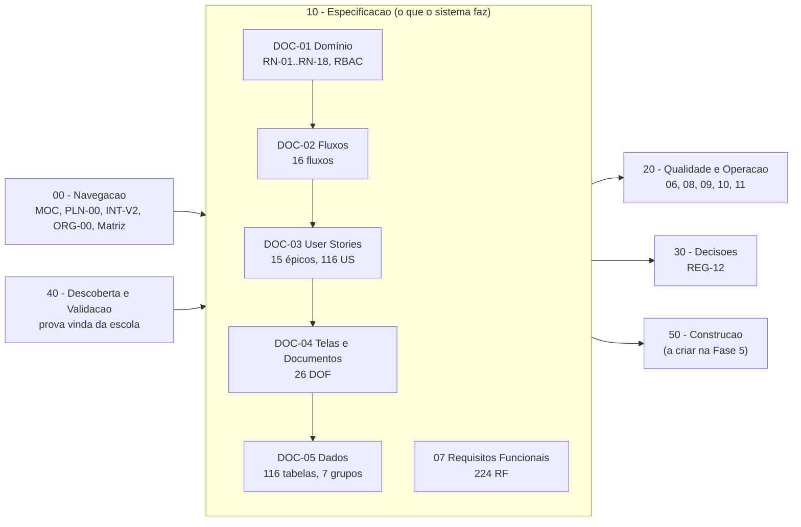

# MOC — Sistema de Gestão Escolar (SGE) | IPCAG N.º 12008 / BGO

> [!abstract] Navegação Central do Projeto
> - **Painel Principal do Vault:** [[Inicio|Início do Vault]]
> - **Plano de Definição (fase atual):** [[00.1 - Plano de Engenharia de Requisitos]]
> - **Mapa Visual da Arquitetura:** [[Arquitetura SGE IPCAG 12008 BGO.canvas]]
> - **Painel Dinâmico (Base):** [[Painel Documentacao SGE.base]]
> - **Áreas Relacionadas:** [[Arquitetura de Software e DDD]] | [[Governacao Escolar Ensino Tecnico MED]]
> - **Recursos Oficiais:** [[Quadro Legal MED AGT e APD Angola]] | [[Quadros de Arquitetura no Figma]]

---

## 1. Ficha Institucional do Projeto

- **Instituição:** Instituto Politécnico Católico de Administração e Gestão (IPCAG) N.º 12008 / BGO – *"Nossa Senhora do Rosário"*
- **Localização:** Bairro Modular do Panguila, Município do Dande, Província do Bengo, Angola
- **Natureza e Tutela:** Escola Católica Comparticipada (Ministério da Educação de Angola — MED / Governo Provincial do Bengo & Diocese de Caxito)
- **Subsistema de Ensino:** Ensino Secundário Técnico-Profissional — II Ciclo (**10ª, 11ª, 12ª e 13ª Classes**)
- **Infraestrutura Alvo:** 12 Salas de Aula / Laboratórios operando em 2 Turnos (**Manhã** e **Tarde**) com arquitetura resiliente ***Offline-First***

---

## 2. Arquitetura Documental do Sistema

> [!info] Organização das pastas (desde 2026-11-05, ver [[00.3 - Proposta de Organizacao Documental|ORG-00]])
> Cada tipo de informação tem **uma única casa**. As pastas seguem a ordem de leitura:
> `00 - Navegacao` → `10 - Especificacao` → `20 - Qualidade e Operacao` → `30 - Decisoes` → `40 - Descoberta e Validacao` → `50 - Construcao`.
> As 8 notas de capacidades (C03–C16) já foram integradas nos DOC e estão em `99 - Arquivo/Fontes Integradas v2.0/`.

> [!tip] 🎨 Quadros no Figma / FigJam
> Os quadros continuam na `v1.2` e só serão atualizados depois do congelamento da `v2.0` (INT-V2 §5).
> - 🌐 **Ficheiro Geral Unificado:** [Abrir no FigJam (OneLIwLlc2kuM1koaIeXG0)](https://www.figma.com/board/OneLIwLlc2kuM1koaIeXG0)
> - 📋 **Catálogo com metadados:** [[Quadros de Arquitetura no Figma|Ver todos os links do Figma]]

### 2.1 `00 - Navegacao` — Índices e planos

| Código | Nota | Para que serve | Estado |
| :---: | :--- | :--- | :---: |
| `MOC-00` | [[00 - MOC SGE IPCAG 12008 BGO]] | Este índice | `ativo` |
| `PLN-00` | [[00.1 - Plano de Engenharia de Requisitos]] | Lacunas, mapa de 20 capacidades, fases, entregas E1–E5, *Definition of Ready* | `ativo` |
| `INT-V2` | [[00.2 - Mapa de Integracao v2.0]] | Numeração final (RN-11..18, DOF-13..26, épicos) e convenções da v2.0 | `ativo` |
| `ORG-00` | [[00.3 - Proposta de Organizacao Documental]] | Onde vive cada informação e as 5 fases até à construção | `ativo` |
| `VER-01` | [[00.4 - Relatorio de Verificacao v2.0-rc1]] | Verificação de consistência da v2.0-rc1: 10 grupos de problemas e issues #1–#10 | `ativo` |
| `MTR-07` | [[Matriz de Rastreabilidade]] | Objetivo → Capacidade → RF → RN → US → Módulo/DOF → Tabela | `rascunho` |
| — | [[Painel Documentacao SGE.base]] · [[Arquitetura SGE IPCAG 12008 BGO.canvas]] | Vista dinâmica e mapa visual | — |

### 2.2 `10 - Especificacao` — O que o sistema faz (fonte de verdade)

| Código | Nota | Conteúdo | FigJam (v1.2) | Versão |
| :---: | :--- | :--- | :---: | :---: |
| `DOC-01` | [[01 - Dominio e Regras]] | Glossário (linguagem ubíqua), contextos DDD, 12 papéis + perfil técnico (RBAC), máquinas de estado, regras `RN-01` a `RN-18` | [DOC-01](https://www.figma.com/board/l8fbIkk7SlJXCc3poCnExT) | `2.0-rc1` |
| `DOC-02` | [[02 - Fluxos de Trabalho]] | 16 fluxos ponta a ponta com exceções | [DOC-02](https://www.figma.com/board/klMnPKkxorDv9NEfvvpSRq) | `2.0-rc1` |
| `DOC-03` | [[03 - User Stories]] | 15 épicos e 116 user stories com critérios BDD, distribuídas por E1–E5 | [DOC-03](https://www.figma.com/board/PZgRkbRHrNR6UfehirGDPd) | `2.0-rc1` |
| `DOC-04` | [[04 - Telas e Documentos]] | 5 workspaces, alertas, portal QR, portal do encarregado; 26 documentos oficiais `DOF-01`–`DOF-26` | [DOC-04](https://www.figma.com/board/ceE1mzcDmB2bT9RUAZxOcN) | `2.0-rc1` |
| `DOC-05` | [[05 - Modelagem de Dados]] | 116 tabelas em 7 grupos, sincronização *offline-first*, integridade, RLS | [DOC-05](https://www.figma.com/board/lGrzPwEBaxgExyewDXnEAt) | `2.0-rc1` |
| `RF-07` | [[07 - Catalogo de Requisitos Funcionais]] | 224 requisitos `RF-Cxx-nn` por capacidade, prioridade e entrega | — | `2.0-rc1` |

### 2.3 `20 - Qualidade e Operacao` — Como e onde tem de funcionar

| Código | Nota | Conteúdo | Versão |
| :---: | :--- | :--- | :---: |
| `VIS-06` | [[06 - Visao e Ambito]] | Problema, objetivos, partes interessadas, âmbito dentro/fora | `0.1` |
| `RNF-08` | [[08 - Requisitos Nao Funcionais]] | 125 requisitos não funcionais com métrica, meta e verificação | `0.1` |
| `OPS-09` | [[09 - Integracoes, Infraestrutura e Operacao]] | Integrações, infraestrutura, backups, suporte | `0.1` |
| `MIG-10` | [[10 - Migracao de Dados e Implantacao]] | Dados a migrar, importação, arranque, formação | `0.1` |
| `APD-11` | [[11 - Protecao de Dados (APD)]] | Tratamentos, consentimentos, conservação, direitos dos titulares | `0.2` |

### 2.4 `30 - Decisoes` — Decisões e questões em aberto

| Código | Nota | Conteúdo |
| :---: | :--- | :--- |
| `REG-12` | [[12 - Registo de Decisoes e Questoes em Aberto]] | Decisões `DEC-001`–`DEC-009` e questões `Q-001`–`Q-039`. Na Fase 3 da ORG-00 recebe também as questões que ainda estão nas notas de capacidades e as lacunas da Matriz |

### 2.5 `40 - Descoberta e Validacao` — Prova vinda da escola

| Código | Nota | Conteúdo |
| :---: | :--- | :--- |
| `DESC-L1` | [[Achados dos Documentos Reais - Lote 1]] | 15 documentos reais e 16 divergências com a especificação |
| `DESC-RESP` | [[Sintese das Respostas da Fase B]] | Entrevistas G-01 a G-14: fórmulas, organização, calendário, R1–R31 |
| `DSC-01`…`03`, `VAL-01` | [[Guiao de Entrevistas por Cargo]] · [[Pedido de Artefactos a Escola]] · [[Questionario de Volumetria e Infraestrutura]] · [[Plano de Validacao de Pautas]] | Kit das Fases B e D |

> [!warning] Privacidade
> Os PDFs das entrevistas e as fotos dos documentos da escola **não vão para o GitHub** (repositório público, ver `.gitignore`).

### 2.6 `50 - Construcao` — A criar

Vai receber o `13 - Arquitetura Tecnica` e os planos por entrega (E1–E5) na Fase 5 da [[00.3 - Proposta de Organizacao Documental|ORG-00]].

### 2.7 Fontes integradas (arquivo)

As notas [[C03 - Processo Individual do Aluno|C03]], [[C04 - Horarios e Distribuicao de Servico Docente|C04]], [[C10 - Cobranca, Relatorios Financeiros e Conciliacao|C10]], [[C12 - Comunicacao com Encarregados e Alunos|C12]], [[C13 - Disciplina e Comportamento|C13]], [[C14 - Gestao de Contas e Acesso|C14]], [[C15 - Paineis de Gestao da Direcao|C15]] e [[C16 - Passagem de Ano Letivo|C16]] estão em `99 - Arquivo/Fontes Integradas v2.0/`. **Só para consulta**: as correções fazem-se nos DOC.

---

## 3. Pilares Arquiteturais e Invariantes de Negócio

> [!warning] Regras em revisão (2026-11-02)
> A [[Verificacao das Referencias Legais]] e os [[Achados dos Documentos Reais - Lote 1]] põem em causa as fórmulas da `RN-01` (a escola usa Prova Global e `CA = MT3 × 0,6 + PG × 0,4`), o mínimo de admissão da `RN-01.2`, partes da `RN-02`, o diploma da `RN-09` (DP n.º 292/18 revogado; fatura e nota de crédito em vez de recibo e nota de estorno) e os cargos do DP n.º 93/21 (a escola é dirigida por uma Comissão de Gestão). As regras abaixo **não devem ser implementadas** até serem validadas com a escola.

> [!important] As 10 Regras de Negócio de Base (Definidas em [[01 - Dominio e Regras]]; as famílias `RN-11` a `RN-18` das capacidades novas estão no mesmo DOC)
> 1. **`RN-01` (Fórmulas MED, Escala 0–20 e `round_med`):** Cálculo estrito de `MT`, `MFD` e Recurso (`40% MFD + 60% NEE`) com arredondamento *half-up*; inclui `RN-01.1` (Dispensa `DISP`) e `RN-01.2` (Mínimo de Admissão e Repescagem).
> 2. **`RN-02` (Transição, Retenção e Cadeiras em Atraso):** Veto absoluto `Língua Portuguesa + Disciplina Nuclear`, retenção automática na 12ª ou com nota `< 7`, transição com deficiências e bloqueio da 13ª Classe com cadeiras pendentes; inclui `RN-02.1` (Aluno Repetente).
> 3. **`RN-03` (Retenção por Faltas Injustificadas):** Limite proporcional aos tempos letivos semanais (`3 × tempos_letivos_semanais`); só o Director de Turma justifica faltas, nunca o próprio professor.
> 4. **`RN-04` (Desacoplamento Professor ↔ Notas):** Notas pertencem à turma/disciplina; substituição de professor preserva 100% do histórico; inclui `RN-04.1` (Avocação pela `SUB_PED`).
> 5. **`RN-05` (Dupla Numeração e Congelamento da Chamada):** `N.º de Processo Individual` vitalício; após o I Trimestre, saídas por transferência ou anulação não renumeram a chamada.
> 6. **`RN-06` (Histórico Externo e `MFC` da 13ª Classe):** Transcrição obrigatória de médias de transferidos de entrada (`RN-06.1`) e cálculo da Média Final do Curso (DP n.º 167/23).
> 7. **`RN-07` (Motor de Bolsas, Isenções e Descontos Familiares):** Benefícios com vigência temporal `1:N` por matrícula, aplicados automaticamente antes do vencimento.
> 8. **`RN-08` (Semáforo Financeiro Interdepartamental):** A Secretaria Pedagógica vê apenas `VERDE (Apto)` ou `VERMELHO (Bloqueado)`, sem acesso a saldos bancários.
> 9. **`RN-09` (Tesouraria Anti-Fraude e Imutabilidade AGT):** Controlo de Borderô por saldo (`N:N`), proibição de `DELETE` em recibos e estorno exclusivo via **Nota de Estorno (`NE`)**.
> 10. **`RN-10` (Auditoria APD, Livro/Folha/Termo, QR Code e Offline-First):** Trilha `audit_logs` *append-only* (incluindo reaberturas de pauta por despacho da Direção), registo físico obrigatório em Certificados/Diplomas, assinatura `HMAC-SHA256` e servidor central como autoridade sobre o estado do trimestre.
>
> *A trava temporal dos trimestres e a reabertura auditada de pautas são regidas pela Máquina de Estado `3.1` do DOC-01 (3 níveis) em conjunto com `RN-10`.*

---

## 4. Base de Dados de Notas do Projeto (`Obsidian Base`)

![[Painel Documentacao SGE.base]]

---

## 5. Próximos Passos (segundo a [[00.3 - Proposta de Organizacao Documental|ORG-00]])

> [!todo] Do estado atual à construção
> - [x] **Fase 1 — Arrumar:** pastas por função, capacidades arquivadas, ficheiros vazios removidos, índices atualizados (2026-11-05).
> - [x] **Fase 2 — Verificar:** feita a 2026-11-05 — [[00.4 - Relatorio de Verificacao v2.0-rc1|VER-01]] com 10 grupos de problemas, cada um uma issue no GitHub (#1 a #10). Falta corrigir.
> - [ ] **Fase 3 — Fechar o que está em aberto:** todas as questões e lacunas num mapa no GitHub; questionários para a escola; decisões da equipa.
> - [ ] **Fase 4 — Congelar a v2.0:** versões a `2.0`, ata de homologação com a Direção, etiqueta `v2.0` no git.
> - [ ] **Fase 5 — Ponte para o código:** `13 - Arquitetura Tecnica`, depois especificação e tickets por entrega, a começar pela E1.
