# Plano de Engenharia de Requisitos — SGE IPCAG N.º 12008 / BGO

> [!abstract] Navegação
> - **Painel Principal:** [[Inicio|Início do Vault]] | **Índice do Projeto:** [[00 - MOC SGE IPCAG 12008 BGO|MOC]]
> - **Especificação Atual (v1.2):** [[01 - Dominio e Regras]] → [[02 - Fluxos de Trabalho]] → [[03 - User Stories]] → [[04 - Telas e Documentos]] → [[05 - Modelagem de Dados]]

> [!important] Objetivo deste plano
> Fechar a definição completa do SGE **antes de escrever código**, para que o desenvolvimento comece com tudo decidido, validado com a escola e priorizado. Este documento define **o que falta**, **como vamos trabalhar** e **quando a definição está pronta** para passar a desenvolvimento.

> [!success] Estado em 2026-11-02 — primeira execução do plano
> | Lacuna | Estado | Onde |
> | :---: | :--- | :--- |
> | L1, L4 | 🟡 Rascunho; 7 decisões tomadas pelo analista (homologação da Direção pendente), `DEC-002` (AGT) aguarda Direção | [[06 - Visao e Ambito]], [[12 - Registo de Decisoes e Questoes em Aberto]] |
> | L2 | 🟡 Kit pronto; 1.º lote de documentos analisado (só modelos em branco); entrevistas G-01 a G-14 consolidadas (19 questões do REG-12 respondidas ou parciais) | [[Achados dos Documentos Reais - Lote 1]], [[Sintese das Respostas da Fase B]] |
> | L3, L7 | 🟡 Verificado online; várias regras sem fonte publicada e diploma da RN-09 revogado | [[Verificacao das Referencias Legais]] |
> | L5 | 🟡 Rascunho com 125 requisitos | [[08 - Requisitos Nao Funcionais]] |
> | L6 | 🟡 C03, C04, C10, C12, C13, C14, C15, C16 especificadas (rascunho, por validar) | pasta `Capacidades Novas/` |
> | L8 | 🟡 Rascunho; validar com jurista e APD | [[11 - Protecao de Dados (APD)]] |
> | L9, L10 | 🟡 Rascunho | [[10 - Migracao de Dados e Implantacao]], [[09 - Integracoes, Infraestrutura e Operacao]] |
> | L11 | ✅ Resolvida | [[04 - Telas e Documentos]] |
>
> **Decisão `DEC-009` (2026-11-02):** o regulamento interno, o recálculo de pautas preenchidas e a homologação das decisões são resolvidos **durante o projeto**. As regras que dependem deles ficam **parametrizáveis e marcadas como provisórias**, com pontos de controlo: homologação antes da **E1**, recálculo de pautas antes da **E2**, regulamento interno antes da **E3**.
>
> **Próximo passo:** integrar nos DOC-01 a DOC-05 as alterações das notas de `Capacidades Novas/`, dos achados reais e das entrevistas, criar o `07 - Catalogo de Requisitos Funcionais` e a matriz de rastreabilidade, e congelar a especificação `v2.0`.

---

## 1. Diagnóstico da Especificação Atual (v1.2)

### 1.1 O que já está forte
- **Domínio e regras do MED** muito detalhados: fórmulas de avaliação, transição, faltas, 13ª Classe, numeração do aluno ([[01 - Dominio e Regras]]).
- **8 fluxos ponta a ponta com exceções e rollbacks** ([[02 - Fluxos de Trabalho]]).
- **32 user stories com critérios BDD** ([[03 - User Stories]]).
- **12 documentos oficiais especificados** ([[04 - Telas e Documentos]]).
- **Modelo de dados com 44 tabelas, RLS e travas de integridade** ([[05 - Modelagem de Dados]]).

### 1.2 O que falta para ser uma definição "pronta a construir"

| # | Lacuna | Situação atual | Risco se ficar por definir |
| :---: | :--- | :--- | :--- |
| L1 | **Visão e Âmbito** | Não existe: sem objetivos mensuráveis, sem lista do que fica **fora** do sistema, sem métricas de sucesso. | O âmbito cresce sem controlo e não há critério para dizer "está concluído". |
| L2 | **Validação com a escola** | As regras foram escritas a partir da legislação. Não há registo de entrevistas, de documentos reais recolhidos nem de aprovação pelos cargos. | Construir um sistema "correto pela lei" que não corresponde à prática diária da Secretaria, da Tesouraria e dos professores. |
| L3 | **Confirmação das referências legais** | Diplomas citados (ex.: DE n.º 361/26, DE n.º 136/24, DP n.º 167/23) e valores como `3 × tempos semanais` ou nota mínima `7` ainda não foram confrontados com o texto oficial do Diário da República nem com a prática da Direção Provincial do Bengo. | Fórmulas erradas na pauta: o erro mais caro e mais visível de um SGE. |
| L4 | **Priorização** | As 32 user stories estão todas no "MVP", sem prioridade nem plano de entregas. | Não é possível planear entregas nem decidir o que cortar se o prazo apertar. |
| L5 | **Requisitos não funcionais** | Só existe a estratégia *Offline-First*. Faltam metas mensuráveis de desempenho, disponibilidade, backup, segurança, dispositivos e usabilidade. | Sistema que funciona na demonstração mas falha na escola real (energia, rede, telemóveis modestos). |
| L6 | **Módulos essenciais de um SGE em falta** | Horários, distribuição de serviço docente, comunicação com encarregados, disciplina/ocorrências, gestão de contas de utilizador, fecho e abertura do ano letivo (ver §2). | O sistema não cobre o ciclo completo e a escola mantém processos em papel ao lado. |
| L7 | **Faturação AGT** | Os recibos estão especificados como documentos imutáveis, mas não está decidido se o SGE será **software de faturação certificado pela AGT** (com exportação SAF-T AO) ou se integra com um software já certificado. | Decisão com impacto legal e de custo; muda o desenho da Tesouraria. |
| L8 | **Proteção de dados (APD)** | Existe a trilha de auditoria, mas não estão definidos: base legal do tratamento, consentimento do encarregado (alunos menores), prazos de conservação, direitos de acesso/retificação e eventual registo junto da APD. | Incumprimento da Lei n.º 22/11 com dados de menores. |
| L9 | **Migração e arranque** | Não está definido como entram no sistema os alunos atuais, as notas de anos anteriores, as dívidas de propinas e os registos de Livro/Folha/Termo já existentes. | O arranque falha por falta de dados históricos (ex.: impossível emitir certificado de um aluno da 12ª). |
| L10 | **Operação** | Não estão definidos backups, recuperação de desastre, suporte, formação nem atualizações. | Perda de dados após falha do servidor local. |
| L11 | **Colisão de identificadores** — ✅ *resolvida em 2026-11-02* | Os documentos oficiais impressos passaram a `DOF-01`…`DOF-12` (convenção registada em [[04 - Telas e Documentos]]); `DOC-00`…`DOC-05` ficam reservados às notas da especificação. O §2 de [[Quadro Legal MED AGT e APD Angola]] foi alinhado com o DOC-04. Falta apenas atualizar os quadros do FigJam. | — |

---

## 2. Como Funciona um SGE — Mapa de Capacidades

Um SGE é governado pelo **calendário do ano letivo**. Cada capacidade só faz sentido no momento do ano em que a escola precisa dela; por isso o ciclo anual é a espinha dorsal de toda a organização dos requisitos.

```mermaid
flowchart LR
    A["1. Preparação do Ano<br>(Jul–Ago)<br>Calendário, matrizes,<br>tabelas de preços, vagas"] --> B["2. Admissão 10ª<br>(Ago–Set)<br>Inscrição, prova,<br>pauta de admitidos"]
    B --> C["3. Matrícula<br>(Set)<br>Novas e confirmações,<br>bolsas, propinas"]
    C --> D["4. Arranque<br>(Set)<br>Turmas, horários,<br>distribuição docente"]
    D --> E["5. Rotina Trimestral<br>(Set–Jun)<br>Sumários, faltas, notas,<br>pagamentos, documentos"]
    E --> F["6. Fecho de Trimestre<br>Mini-pautas, conselhos,<br>boletins"]
    F -->|"I e II Trim."| E
    F -->|"III Trim."| G["7. Fecho do Ano<br>(Jun–Jul)<br>Recurso, transição,<br>exames extraordinários,<br>13ª Classe / PAP"]
    G --> H["8. Certificação e Estatística<br>Certificados, diplomas,<br>mapas GEPE"]
    H --> I["9. Passagem de Ano<br>Promoção em massa,<br>arquivo, novo ano"]
    I --> A
```

### 2.1 Capacidades e cobertura atual

Legenda: ✅ coberto · 🟡 parcial · ❌ ausente

| # | Capacidade | O que um SGE precisa de fazer | Cobertura | Onde está / O que falta |
| :---: | :--- | :--- | :---: | :--- |
| C01 | Estrutura académica e calendário | Ano letivo, trimestres, cursos, classes, matrizes, salas, turnos, turmas | ✅ | DOC-01 §1.1; `US-GOV-01` a `03` |
| C02 | Admissão à 10ª Classe | Vagas, inscrição, anonimato, prova, pauta, repescagem | ✅ | Fluxo 01; `EP-ADM` |
| C03 | Matrícula e processo do aluno | Matrícula nova, confirmação, transferências, processo individual, encarregados | 🟡 | Fluxo 02; `EP-MAT`. **Falta:** lista de documentos obrigatórios do processo individual (BI/cédula, atestado, fotografias, certificado da 9ª) e cartão de estudante |
| C04 | **Horários e distribuição de serviço docente** | Distribuir carga horária pelos professores, grelha semanal por turma e sala, deteção de choques | ❌ | Existe `alocacoes_docentes`, mas **não há horário semanal**. Sem ele, o registo de sumários e faltas por tempo letivo não tem base |
| C05 | Assiduidade de alunos | Sumário, faltas por tempo letivo, justificação, retenção | ✅ | Fluxo 03; `US-PED-02`; RN-03 |
| C06 | Avaliação e pautas | MAC/NPP/NPT, mini-pautas, offline, substituição docente | ✅ | Fluxo 03; `US-PED-01` a `05`; RN-01, RN-04 |
| C07 | Conselho de notas, transição e exames | Conselho, recurso, deliberação, cadeiras em atraso, exame extraordinário | ✅ | Fluxos 04–05; `US-PED-06`, `US-DEF-01` a `02`; RN-02 |
| C08 | Regime da 13ª Classe | Estágio, PAP, júri, MFC | ✅ | Fluxo 06; `US-13C-01` a `02`; RN-06 |
| C09 | Emissão documental e certificação | Declarações, boletins, certificados, diplomas, Livro/Folha/Termo, QR | ✅ | Fluxo 08; `US-DOC-01` a `03`; RN-10 |
| C10 | Tesouraria | Propinas, emolumentos, bolsas, borderôs, recibos, estornos, fecho de caixa | 🟡 | Fluxo 07; `EP-TES`. **Falta:** gestão de dívidas e avisos de cobrança, relatórios financeiros de gestão, conciliação bancária, decisão AGT/SAF-T (L7) |
| C11 | Recursos humanos | Cadastro, ponto, faltas de funcionários | 🟡 | `US-DOC-04`. **Decidir:** processamento salarial dentro ou fora do âmbito |
| C12 | **Comunicação com encarregados e alunos** | Avisos, consulta de notas/faltas/dívidas, convocatórias, SMS | ❌ | Não especificado |
| C13 | **Disciplina e comportamento** | Participações disciplinares, ocorrências, medidas e sanções do regulamento interno | ❌ | Apenas mencionado no papel do `COORD_TURNO` |
| C14 | **Gestão de contas e acesso** | Criar, desativar e suspender contas; login, recuperação de palavra-passe, MFA, sessões, troca de cargo | 🟡 | RBAC e RLS definidos; **ciclo de vida da conta não** |
| C15 | Relatórios e indicadores | Mapas GEPE, painéis da Direção (aproveitamento, assiduidade, receitas, dívida) | 🟡 | `US-DOC-05` cobre GEPE; **faltam painéis de gestão** |
| C16 | **Passagem de ano letivo** | Promoção em massa, criação das turmas do ano seguinte, transporte de dívidas e cadeiras em atraso, arquivo | 🟡 | Apenas o evento `concluirAnoLetivo`; falta o fluxo completo |
| C17 | **Migração de dados e arranque** | Importar alunos, histórico, dívidas e registos de Livro/Folha/Termo | ❌ | L9 |
| C18 | **Operação do sistema** | Backups, recuperação, suporte, formação, atualizações | ❌ | L10 |
| C19 | Proteção de dados | Consentimento, conservação, direitos dos titulares, auditoria | 🟡 | `audit_logs` (RN-10); L8 |
| C20 | Recursos e património | Biblioteca, inventário, laboratórios | ❌ | Provavelmente **fora do âmbito inicial** (decisão D8) |

---

## 3. Princípios da Estratégia

1. **O calendário manda.** Os requisitos são organizados e priorizados pelo momento do ano letivo em que a escola precisa deles. O arranque em produção só acontece no **início de um ano letivo** (ou, no mínimo, no início de um trimestre), nunca a meio de um período de avaliação.
2. **Validar antes de detalhar mais.** A especificação já é profunda. O maior risco deixou de ser "falta detalhe" e passou a ser "não corresponde à realidade". **Os documentos reais da escola são a fonte de verdade**: pautas, recibos, livros de termos, regulamento interno.
3. **Uma única fonte por facto.** Cada regra vive num só sítio (as regras em [[01 - Dominio e Regras]]) e os outros documentos apenas a referenciam pelo código. Foi a cópia de regras para o MOC que gerou a inconsistência de numeração já corrigida.
4. **Rastreabilidade completa.** Cada requisito liga-se nos dois sentidos: `Objetivo → Capacidade (C) → Requisito (RF/RNF) → Regra (RN) → Fluxo → User Story → Ecrã/Documento → Tabela`. Um requisito sem objetivo é cortado; um objetivo sem requisito é uma lacuna.
5. **Entregar por necessidade do calendário, não por módulo.** A primeira entrega é o mínimo para a escola operar o **I Trimestre** sem papel em paralelo; o resto entra antes de ser preciso (ver §6).
6. **Linha de base e controlo de alterações.** Quando a definição for aprovada, fica congelada como `v2.0`. Qualquer alteração posterior passa por um pedido de alteração registado, com impacto e decisão.

---

## 4. Fases do Trabalho de Definição

| Fase | Nome | O que fazemos | Entregáveis | Critério de saída |
| :---: | :--- | :--- | :--- | :--- |
| **A** | Fundamentos | Tomar as decisões estratégicas (§7), definir objetivos, métricas, partes interessadas e fronteiras do âmbito | `06 - Visao e Ambito` | Decisões D1–D8 tomadas e registadas |
| **B** | Descoberta na escola | Entrevistas por cargo, recolha de documentos reais, levantamento de números (volumetria) e da infraestrutura existente | Notas de entrevista no `00 - Inbox`; inventário de artefactos recolhidos | Cada um dos 12 cargos entrevistado ou representado; artefactos da lista §5.2 recolhidos |
| **C** | Completar a especificação | Fechar as lacunas L5–L11 e as capacidades ❌/🟡 do §2; corrigir as regras com base na Fase B | `07` a `11` (§5.1) e atualização de DOC-01 a DOC-05 | Todas as capacidades dentro do âmbito com cobertura ✅ |
| **D** | Validação | Percorrer os fluxos com os utilizadores reais usando protótipos no Figma; **recalcular as pautas reais do ano anterior** com as fórmulas do RN-01/RN-02 e comparar com os resultados oficiais | Atas de validação; lista de divergências resolvidas | Zero divergências por resolver nos cálculos; aprovação por `SUB_PED`, `SUB_ADM` e `DIR_GERAL` |
| **E** | Priorização e entregas | Classificar cada requisito (MoSCoW) e distribuí-lo pelas entregas do §6 | Coluna de prioridade e de entrega no catálogo `07` | Entrega 1 fechada e aprovada pela Direção |
| **F** | Linha de base | Congelar a definição como `v2.0`; aplicar a *Definition of Ready* (§8) a cada user story da Entrega 1 | Especificação `v2.0` | Todas as user stories da Entrega 1 cumprem a *Definition of Ready* |

> [!tip] A técnica de validação mais valiosa
> Pedir à Secretaria Pedagógica as **mini-pautas e pautas gerais oficiais de 2–3 turmas do ano anterior** e recalcular tudo com as regras do DOC-01. Cada diferença revela uma regra mal interpretada, uma exceção não documentada ou uma prática local. É barato, objetivo e evita o erro mais grave de um SGE.

---

## 5. Estrutura Documental Alvo

### 5.1 Documentos novos a criar

| Nota | Conteúdo | Fecha as lacunas |
| :--- | :--- | :--- |
| `06 - Visao e Ambito` | Problema, objetivos com métricas, partes interessadas, âmbito **dentro/fora**, restrições, pressupostos | L1, L4 |
| `07 - Catalogo de Requisitos Funcionais` | Um requisito `RF-Cxx-nn` por funcionalidade, agrupado pelas capacidades C01–C20, com prioridade, entrega, origem (lei, entrevista, documento) e ligação à user story | L4, L6 |
| `08 - Requisitos Nao Funcionais` | Metas mensuráveis por categoria (§5.3) | L5 |
| `09 - Integracoes, Infraestrutura e Operacao` | Bancos/Multicaixa, AGT/SAF-T, SMS, servidor local, energia, backups, suporte, atualizações | L7, L10 |
| `10 - Migracao de Dados e Implantacao` | O que se importa, de onde, com que qualidade; plano de arranque; formação por cargo | L9 |
| `11 - Protecao de Dados (APD)` | Tratamentos de dados, base legal, consentimentos, prazos de conservação, direitos dos titulares | L8 |
| `12 - Registo de Decisoes e Questoes em Aberto` | Cada decisão `DEC-nnn` (contexto, opções, escolha, data, quem decidiu) e cada questão por responder | Transversal |
| `Matriz de Rastreabilidade.base` | Vista Obsidian Base que lê as propriedades das notas de requisitos | Princípio 4 |

As notas DOC-01 a DOC-05 continuam a ser a especificação detalhada; os novos documentos dão-lhe **âmbito, prioridade, qualidade e operação**.

### 5.2 Artefactos reais a recolher na escola (Fase B)

- [ ] Mini-pautas, pautas gerais e boletins do ano letivo anterior (2–3 turmas, incluindo uma da 12ª e uma da 13ª)
- [ ] Pauta e edital do último concurso de admissão à 10ª Classe
- [ ] Ficha de matrícula atual e lista de documentos exigidos ao aluno
- [ ] Recibos, talões/borderôs e mapa de fecho de caixa atuais; tabela de propinas e emolumentos em vigor
- [ ] Regras atuais de bolsas, isenções diocesanas e descontos de irmãos (por escrito)
- [ ] Livro de termos: formato de Livro/Folha/Termo, último número usado por tipo de documento
- [ ] Modelos atuais de declaração, certificado, diploma e guia de transferência
- [ ] Regulamento interno (faltas, disciplina, avaliação)
- [ ] Matrizes curriculares oficiais de cada curso, por classe
- [ ] Horário semanal atual das turmas e distribuição de serviço docente
- [ ] Último mapa estatístico enviado ao GEPE / Direção Provincial
- [ ] Números reais: alunos por classe e curso, turmas, professores, funcionários, pagamentos por dia em época de matrícula
- [ ] Inventário da infraestrutura: computadores, impressoras, rede, internet, energia/gerador, telemóveis dos professores

### 5.3 Requisitos não funcionais a quantificar (ponto de partida para validar)

| Categoria | Pergunta a responder | Meta inicial proposta (a validar) |
| :--- | :--- | :--- |
| Capacidade | Quantos alunos, utilizadores e anos de histórico? | 1.500 alunos ativos; 150 utilizadores; 15 anos de histórico consultável |
| Desempenho | Quanto tempo aceitam esperar no balcão? | Emitir recibo ou declaração em < 3 s; abrir mini-pauta de 50 alunos em < 2 s num telemóvel Android básico |
| Disponibilidade | Quando é que o sistema tem de estar disponível? | Rede local: 99% entre 07h00 e 18h30 nos dias letivos |
| Offline | Quanto tempo pode um professor trabalhar sem rede? | Até 7 dias sem perder lançamentos |
| Backup e recuperação | Quanto se pode perder, e em quanto tempo se recupera? | Backup diário com cópia fora do edifício; perda máxima de 24 h de dados; recuperação em < 4 h |
| Segurança | Que proteção por cargo? | MFA obrigatório para Direção e Tesouraria; sessão expira após 15 min de inatividade nos balcões |
| Dispositivos | Em que equipamentos funciona? | Navegador moderno em PC (Secretaria/Tesouraria) e Android ≥ 10 (professores); impressão A4 |
| Usabilidade | Que formação é aceitável? | Cada cargo executa as suas tarefas principais após ≤ 2 h de formação |
| Língua e formatos | Que convenções? | Português; datas `DD/MM/AAAA`; moeda `AOA` com separador de milhares |
| Auditabilidade | O que tem de ficar provado? | 100% das ações críticas em `audit_logs` (RN-10) |

---

## 6. Proposta de Entregas Guiadas pelo Calendário

Proposta inicial a confirmar na Fase E. A ideia é que cada entrega esteja em produção **antes** do momento do ano em que é precisa.

| Entrega | Tem de estar pronta antes de | Capacidades | Porquê nesta ordem |
| :---: | :--- | :--- | :--- |
| **E1 — Arrancar o ano** | Início das matrículas | C01, C03, C10 (propinas, bolsas, recibos, caixa), C14, C17 | Sem estrutura, alunos e cobrança não há escola a funcionar |
| **E2 — I Trimestre** | Primeira semana de aulas | C04, C05, C06, C09 (declarações), C18 | Professores começam a dar faltas e notas no primeiro dia |
| **E3 — Fecho de trimestre** | Fim do I Trimestre | C07 (conselho), C09 (boletins), C15 (painéis) | Conselhos de notas e boletins do I Trimestre |
| **E4 — Fecho do ano** | Maio–Junho | C07 (recurso, transição, extraordinários), C08, C09 (certificados, diplomas), C15 (GEPE), C16 | Deliberação anual, 13ª Classe e certificação |
| **E5 — Próximo ciclo** | Julho–Agosto | C02, C12, C13 | Concurso de admissão do ano seguinte; comunicação e disciplina |

> [!warning] Atenção à 13ª Classe e aos certificados
> Se a escola já tem alunos na 12ª e 13ª Classes no arranque, a E4 depende de a migração (C17) ter importado o **histórico completo da 10ª à 12ª** e os registos de Livro/Folha/Termo existentes. Por isso a migração é definida logo na E1.

---

## 7. Decisões Estratégicas Pendentes

Estas decisões cabem à equipa e à Direção do IPCAG. Cada uma muda o desenho do sistema e deve ficar registada em `12 - Registo de Decisoes`.

| ID | Decisão | Opções | Impacto |
| :---: | :--- | :--- | :--- |
| **D1** | O sistema é só para o IPCAG ou um produto para várias escolas? | (a) Instalação única IPCAG · (b) Multi-instituição desde o início | (b) obriga a separar dados por escola, a parametrizar regras e documentos, e a ter outro modelo de alojamento |
| **D2** | Faturação AGT | (a) SGE certificado como software de faturação, com SAF-T AO · (b) Integrar com software de faturação já certificado | (a) dá controlo total mas exige processo de certificação; (b) é mais rápido mas cria dependência |
| **D3** | Portal ou app para encarregados e alunos | (a) Na E1/E2 · (b) Mais tarde (E5) · (c) Só SMS | Muda os requisitos de segurança, carga e comunicação |
| **D4** | Horários | (a) O SGE gera horários automaticamente · (b) O SGE só regista o horário feito à mão | (a) é um problema de otimização complexo; (b) é suficiente para faltas e sumários |
| **D5** | Pagamentos | (a) Registo manual de borderôs (como especificado) · (b) Integração com referências Multicaixa / gateway de pagamento | (b) elimina fraude de talões e acelera o balcão, mas exige contrato e integração |
| **D6** | Alojamento | (a) Servidor local + réplica na nuvem · (b) Só nuvem · (c) Só local | Define custo, operação e o desenho *Offline-First* |
| **D7** | Data de arranque | Ano letivo e trimestre alvo | Define a data-limite de cada entrega do §6 |
| **D8** | Fora do âmbito | Processamento salarial, biblioteca, inventário, cantina, transporte… | Lista explícita evita crescimento de âmbito |

---

## 8. Definition of Ready (quando um requisito está pronto para desenvolver)

Um requisito ou user story só passa a desenvolvimento quando:

- [ ] Está ligado a um objetivo do `06 - Visao e Ambito` e a uma capacidade C01–C20
- [ ] Tem prioridade MoSCoW e entrega atribuídas
- [ ] As regras que usa existem no DOC-01 e foram **validadas na Fase D** — ou, segundo a `DEC-009`, estão marcadas como **provisórias**, são parametrizáveis e têm um ponto de controlo antes da entrega
- [ ] Os critérios de aceitação BDD incluem pelo menos um caso de exceção e exemplos com **números reais**
- [ ] O ecrã ou documento está desenhado (DOC-04 / Figma) e as tabelas existem no DOC-05
- [ ] Os requisitos não funcionais aplicáveis estão identificados
- [ ] Não tem questões em aberto no `12 - Registo de Decisoes e Questoes em Aberto`
- [ ] Foi aprovado pelo cargo responsável pelo processo

---

## 9. Próximos Passos

- [x] **Decidir D1 a D8** (§7) — 7 decididas pelo analista; `DEC-002` aguarda Direção; homologação de todas pendente
- [x] Criar `06 - Visao e Ambito` com base nas decisões
- [x] Preparar o guião de entrevistas por cargo e pedir os artefactos do §5.2
- [x] Resolver a colisão de identificadores (L11): documentos oficiais passam a `DOF-01`…`DOF-12`
- [x] Confirmar as referências legais (L3) online — falta confirmar com a Direção Provincial da Educação do Bengo o que não tem fonte publicada
- [x] Especificar C03, C04, C10, C14, C15, C16, C17, C18
- [x] Fazer as entrevistas (Fase B) — [[Sintese das Respostas da Fase B]]
- [ ] *(durante o projeto — `DEC-009`, antes da E1)* Obter a homologação das decisões pela Comissão de Gestão do IPCAG
- [ ] *(durante o projeto — `DEC-009`, antes da E2)* Recolher pautas **preenchidas** do ano anterior e executar o [[Plano de Validacao de Pautas]]
- [ ] *(durante o projeto — `DEC-009`, antes da E3)* Obter o regulamento interno e configurar os parâmetros da C13
- [x] Especificar C12 Comunicação e C13 Disciplina — falta decidir `Q-C12-01` (SMS antes da E5) e `Q-C13-01` (núcleo da C13 na E2/E3)
- [ ] Integrar nos DOC-01 a DOC-05 as alterações validadas e criar `07 - Catalogo de Requisitos Funcionais` e a matriz de rastreabilidade
- [ ] Retirar do vault a avaliação de desempenho fotografada (dados pessoais)
