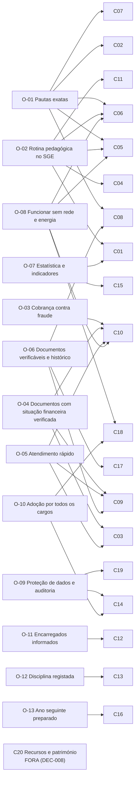

# Matriz de Rastreabilidade — SGE IPCAG N.º 12008 / BGO

> [!abstract] Navegação
> - **Catálogo:** [[07 - Catalogo de Requisitos Funcionais|RF-07]] (detalhe de cada RF: origem, prioridade, entrega, estado) | **Plano:** [[00.1 - Plano de Engenharia de Requisitos|PLN-00]] §3 (princípio 4) | **Mapa:** [[00.2 - Mapa de Integracao v2.0|INT-V2]]
> - **Objetivos e âmbito:** [[06 - Visao e Ambito|VIS-06]] | **Regras:** [[01 - Dominio e Regras|DOC-01]] | **US:** [[03 - User Stories|DOC-03]] | **Ecrãs e documentos:** [[04 - Telas e Documentos|DOC-04]] | **Tabelas:** [[05 - Modelagem de Dados|DOC-05]]

> [!important] Como foi feita
> - Gerada a partir das tabelas do [[07 - Catalogo de Requisitos Funcionais|RF-07]] `2.0-rc1` (224 RF). Cada linha do catálogo é a ligação RF → objetivo, regra, US, módulo, documento e tabela; esta nota agrega-as por objetivo e por capacidade e verifica a cobertura nos dois sentidos (PLN-00 §3, princípio 4: "um requisito sem objetivo é cortado; um objetivo sem requisito é uma lacuna").
> - **Universo de US:** as 32 US da v1.2 e as 84 dos épicos novos (`EP-PIN` 9, `EP-HOR` 11, `EP-COB` 15, `EP-COM` 8, `EP-DIS` 6, `EP-CTA` 15, `EP-PNL` 12, `EP-PAS` 8) = **116**, lidas nos títulos do DOC-03 e das notas de capacidade.
> - **Verificações automáticas feitas em 2026-11-03:** todas as regras citadas existem no DOC-01 `2.0-rc1`; todos os módulos existem no DOC-04; todas as tabelas existem no DOC-05 v1.2 ou numa nota-fonte (ver §3.6). **Atualização 2026-11-05 ([[00.4 - Relatorio de Verificacao v2.0-rc1|VER-01]]):** o DOC-05 `2.0-rc1` já tem as 116 tabelas; todas as tabelas citadas existem, exceto `avaliacoes_desempenho` (condicional).
> - Se o catálogo mudar, esta nota tem de ser regenerada.

---

## 1. Objetivos e Capacidades

Ligações tiradas da VIS-06 §3 (coluna "Capacidades"). A C20 não tem objetivo nem RF (fora do âmbito).

---

## 2. Matriz

### 2.1 Objetivo → Capacidade → RF

| Objetivo | Capacidades (VIS-06 §3) | RF por capacidade | Total RF |
| :---: | :--- | :--- | :---: |
| **O-01** | C02, C05, C06, C07, C08 | **C01**: 04 · **C02**: 01, 02, 03, 04, 05, 06, 07 · **C05**: 02, 04, 05 · **C06**: 01, 03, 04, 05, 08 · **C07**: 01, 02, 03, 04, 05, 06, 07 · **C08**: 01, 03, 04, 05, 06, 07 · **C15**: 08 · **C17**: 09 | 31 |
| **O-02** | C01, C04, C05, C06, C11 | **C01**: 01, 03, 05, 06 · **C03**: 05 · **C04**: 01, 02, 03, 04, 05, 06, 07, 08, 09, 10, 11, 12, 13, 14 · **C05**: 01, 03 · **C06**: 02, 06 · **C11**: 01, 02, 03, 04 | 27 |
| **O-03** | C10 | **C10**: 01, 02, 04, 05, 06, 07, 08, 09, 12, 15, 17, 18, 19, 20, 21, 22, 23, 24, 25, 26 · **C17**: 13 | 21 |
| **O-04** | C03, C09, C10 | **C03**: 06, 07, 08, 09, 10, 11, 12, 15 · **C09**: 02, 05 · **C10**: 03, 11, 13, 14 | 14 |
| **O-05** | C03, C09, C10 | **C03**: 01, 02, 03, 13 · **C09**: 01, 03, 04 · **C10**: 16 | 8 |
| **O-06** | C08, C09, C17 | **C03**: 04 · **C08**: 02 · **C09**: 06, 07, 08, 09, 10, 11, 12 · **C17**: 01, 02, 03, 04, 05, 06, 07, 08, 10, 11, 12, 14, 15 | 22 |
| **O-07** | C01, C15 | **C01**: 02, 07 · **C15**: 01, 02, 03, 04, 05, 06, 07, 10, 11, 12 | 12 |
| **O-08** | C05, C06, C10, C18 | **C06**: 07 · **C10**: 10 · **C14**: 10 · **C15**: 09 · **C18**: 01, 02, 03, 04, 05 | 9 |
| **O-09** | C14, C19 | **C03**: 14 · **C14**: 01, 02, 03, 04, 05, 06, 07, 08, 11, 12, 13, 14, 16 · **C17**: 16 · **C19**: 01, 02, 03, 04, 05, 06, 07, 08, 09, 10, 11, 12, 13, 14, 15, 16, 17, 18, 19, 20, 21, 22, 23, 24, 25, 26, 27, 28, 29, 30, 31, 32, 33 | 48 |
| **O-10** | C14, C18 | **C14**: 09 · **C18**: 06, 07 | 3 |
| **O-11** | C12 | **C12**: 01, 02, 03, 04, 05, 06, 07, 08, 09 · **C14**: 15 | 10 |
| **O-12** | C13 | **C13**: 01, 02, 03, 04, 05, 06, 07, 08 | 8 |
| **O-13** | C16 | **C16**: 01, 02, 03, 04, 05, 06, 07, 08, 09, 10, 11 | 11 |

> Os números depois de cada capacidade são o `nn` do `RF-Cxx-nn` (ex.: **C06**: 03 = `RF-C06-03`).

### 2.2 Capacidade → RF → RN → US → Módulo / DOF → Tabelas

#### C01 — Estrutura académica e calendário

| Elo | Ligações |
| :--- | :--- |
| Objetivos | `O-01`, `O-02`, `O-07` |
| RF (7) | RF-C01-01, RF-C01-02, RF-C01-03, RF-C01-04, RF-C01-05, RF-C01-06, RF-C01-07 |
| Regras | `RN-01`, `RN-02`, `RN-05`, `RN-10.6`, `RN-10.7`, `RN-12.2`, `RN-18.1` |
| User stories (3) | `US-GOV-01`, `US-GOV-02`, `US-GOV-03` |
| Módulos | `MOD-GOV-01`, `MOD-GOV-02`, `MOD-GOV-03` |
| Documentos | `todos os DOF (cabeçalho e assinaturas)` |
| Tabelas | `anos_letivos`, `cursos_tecnicos`, `disciplinas`, `matriz_disciplinas`, `matrizes_curriculares`, `salas_fisicas`, `trimestres_letivos`, `turma_disciplinas`, `turmas` |

#### C02 — Admissão à 10ª Classe

| Elo | Ligações |
| :--- | :--- |
| Objetivos | `O-01` |
| RF (7) | RF-C02-01, RF-C02-02, RF-C02-03, RF-C02-04, RF-C02-05, RF-C02-06, RF-C02-07 |
| Regras | `RN-01.2`, `RN-08`, `RN-09` |
| User stories (4) | `US-ADM-01`, `US-ADM-02`, `US-ADM-03`, `US-ADM-04` |
| Módulos | `MOD-PED-ADM` |
| Documentos | `DOF-01`, `DOF-02` |
| Tabelas | `candidaturas_10a`, `codigos_anonimato`, `quadros_vagas_admissao` |

#### C03 — Matrícula e processo do aluno

| Elo | Ligações |
| :--- | :--- |
| Objetivos | `O-02`, `O-04`, `O-05`, `O-06`, `O-09` |
| RF (15) | RF-C03-01, RF-C03-02, RF-C03-03, RF-C03-04, RF-C03-05, RF-C03-06, RF-C03-07, RF-C03-08, RF-C03-09, RF-C03-10, RF-C03-11, RF-C03-12, RF-C03-13, RF-C03-14, RF-C03-15 |
| Regras | `RN-05`, `RN-05.1`, `RN-06.1`, `RN-07`, `RN-08.1`, `RN-08.3`, `RN-10.3`, `RN-10.6`, `RN-11.1`, `RN-11.2`, `RN-11.3`, `RN-11.4`, `RN-11.5`, `RN-11.6`, `RN-11.7`, `RN-11.8`, `RN-11.9`, `RN-11.10`, `RN-11.11`, `RN-11.12`, `RN-11.13`, `RN-11.14`, `RN-18.6` |
| User stories (14) | `US-DOC-02`, `US-MAT-01`, `US-MAT-02`, `US-MAT-03`, `US-MAT-04`, `US-PIN-01`, `US-PIN-02`, `US-PIN-03`, `US-PIN-04`, `US-PIN-05`, `US-PIN-06`, `US-PIN-07`, `US-PIN-08`, `US-PIN-09` |
| Módulos | `MOD-PED-DOC`, `MOD-PED-HIST`, `MOD-PED-MAT`, `MOD-PIN-01`, `MOD-PIN-02`, `MOD-PIN-03`, `MOD-PIN-04`, `MOD-PIN-05` |
| Documentos | `DOF-03`, `DOF-09`, `DOF-10`, `DOF-13`, `DOF-14`, `DOF-26` |
| Tabelas | `alunos`, `audit_logs`, `cartoes_estudante`, `documentos_oficiais_emitidos`, `documentos_processo_aluno`, `encarregados_educacao`, `ficheiros_digitalizados`, `historico_externo_transcricoes`, `informacao_saude_matricula`, `matriculas_anuais`, `pedidos_alteracao_dados`, `requisitos_documentais`, `series_numeracao_documental`, `tipos_documento_processo`, `vinculos_encarregado_aluno` |

#### C04 — Horários e distribuição de serviço docente

| Elo | Ligações |
| :--- | :--- |
| Objetivos | `O-02` |
| RF (14) | RF-C04-01, RF-C04-02, RF-C04-03, RF-C04-04, RF-C04-05, RF-C04-06, RF-C04-07, RF-C04-08, RF-C04-09, RF-C04-10, RF-C04-11, RF-C04-12, RF-C04-13, RF-C04-14 |
| Regras | `RN-03`, `RN-04`, `RN-10.4`, `RN-12.1`, `RN-12.2`, `RN-12.3`, `RN-12.4`, `RN-12.5`, `RN-12.6`, `RN-12.7`, `RN-12.8`, `RN-12.9`, `RN-12.10`, `RN-12.11`, `RN-12.12`, `RN-12.13`, `RN-12.14`, `RN-12.15`, `RN-12.16`, `RN-12.17`, `RN-12.18` |
| User stories (11) | `US-HOR-01`, `US-HOR-02`, `US-HOR-03`, `US-HOR-04`, `US-HOR-05`, `US-HOR-06`, `US-HOR-07`, `US-HOR-08`, `US-HOR-09`, `US-HOR-10`, `US-HOR-11` |
| Módulos | `MOD-HOR-01`, `MOD-HOR-02`, `MOD-HOR-03`, `MOD-HOR-04`, `MOD-HOR-05`, `MOD-HOR-06` |
| Documentos | `DOF-15`, `DOF-16` |
| Tabelas | `acumulacoes_docentes`, `alocacoes_docentes`, `aulas_horario`, `aulas_registadas`, `dias_nao_letivos`, `funcionarios_docentes`, `habilitacoes_docentes`, `horarios_turma`, `indisponibilidades_docentes`, `planos_distribuicao_servico`, `regras_carga_letiva`, `sumarios_e_faltas_alunos`, `tempos_letivos_turno` |

#### C05 — Assiduidade de alunos

| Elo | Ligações |
| :--- | :--- |
| Objetivos | `O-01`, `O-02` |
| RF (5) | RF-C05-01, RF-C05-02, RF-C05-03, RF-C05-04, RF-C05-05 |
| Regras | `RN-03.1`, `RN-03.4`, `RN-03.5`, `RN-03.6`, `RN-10.6`, `RN-12.13`, `RN-17.8` |
| User stories (4) | `US-COM-08`, `US-HOR-06`, `US-PED-02`, `US-PNL-08` |
| Módulos | `MOD-ALR`, `MOD-DOC-FAL`, `MOD-HOR-04` |
| Documentos | — |
| Tabelas | `alertas_gestao`, `avaliacoes_trimestrais`, `documentos_saude`, `series_numeracao_documental`, `sumarios_e_faltas_alunos` |

#### C06 — Avaliação e pautas

| Elo | Ligações |
| :--- | :--- |
| Objetivos | `O-01`, `O-02`, `O-08` |
| RF (8) | RF-C06-01, RF-C06-02, RF-C06-03, RF-C06-04, RF-C06-05, RF-C06-06, RF-C06-07, RF-C06-08 |
| Regras | `RN-01`, `RN-01.1`, `RN-01.3`, `RN-01.4`, `RN-04`, `RN-04.1`, `RN-10`, `RN-10.4`, `RN-16.15` |
| User stories (6) | `US-CTA-09`, `US-GOV-04`, `US-PED-01`, `US-PED-03`, `US-PED-04`, `US-PED-05` |
| Módulos | `MOD-DOC-DOS`, `MOD-DOC-FAL`, `MOD-DOC-PAU`, `MOD-GOV-04` |
| Documentos | `DOF-04` |
| Tabelas | `alocacoes_docentes`, `audit_logs`, `avaliacoes_trimestrais`, `conflitos_sincronizacao`, `dispensas_medicas`, `documentos_saude`, `dosificacoes_trimestrais`, `operacoes_sincronizacao`, `reaberturas_pauta_direcao` |

#### C07 — Conselho de notas, transição e exames

| Elo | Ligações |
| :--- | :--- |
| Objetivos | `O-01` |
| RF (7) | RF-C07-01, RF-C07-02, RF-C07-03, RF-C07-04, RF-C07-05, RF-C07-06, RF-C07-07 |
| Regras | `RN-01`, `RN-02`, `RN-02.1`, `RN-02.2`, `RN-02.3`, `RN-08`, `RN-10.2`, `RN-10.7` |
| User stories (4) | `US-13C-01`, `US-DEF-01`, `US-DEF-02`, `US-PED-06` |
| Módulos | `MOD-DOC-CON`, `MOD-PED-DEF` |
| Documentos | `DOF-04`, `DOF-05`, `DOF-07` |
| Tabelas | `avaliacoes_trimestrais`, `cadeiras_em_atraso`, `documentos_oficiais_emitidos`, `exames_extraordinarios`, `resultados_anuais_disciplina` |

#### C08 — Regime da 13ª Classe

| Elo | Ligações |
| :--- | :--- |
| Objetivos | `O-01`, `O-06` |
| RF (7) | RF-C08-01, RF-C08-02, RF-C08-03, RF-C08-04, RF-C08-05, RF-C08-06, RF-C08-07 |
| Regras | `RN-02.2`, `RN-06.2`, `RN-06.3`, `RN-08` |
| User stories (2) | `US-13C-01`, `US-13C-02` |
| Módulos | `MOD-DOC-13C` |
| Documentos | `DOF-08`, `DOF-08A`, `DOF-08B`, `DOF-10` |
| Tabelas | `avaliacoes_trimestrais`, `cadeiras_em_atraso`, `conta_corrente_propinas`, `documentos_oficiais_emitidos`, `empresas_parceiras`, `processos_13_classe` |

#### C09 — Emissão documental e certificação

| Elo | Ligações |
| :--- | :--- |
| Objetivos | `O-04`, `O-05`, `O-06` |
| RF (12) | RF-C09-01, RF-C09-02, RF-C09-03, RF-C09-04, RF-C09-05, RF-C09-06, RF-C09-07, RF-C09-08, RF-C09-09, RF-C09-10, RF-C09-11, RF-C09-12 |
| Regras | `RN-08`, `RN-08.1`, `RN-08.2`, `RN-10`, `RN-10.2`, `RN-10.3`, `RN-10.5`, `RN-10.6`, `RN-10.7`, `RN-11.10`, `RN-11.14`, `RN-13.8`, `RN-15.7`, `RN-16.20` |
| User stories (7) | `US-13C-02`, `US-CTA-15`, `US-DEF-02`, `US-DOC-01`, `US-DOC-02`, `US-DOC-03`, `US-PIN-09` |
| Módulos | `MOD-GOV-06`, `MOD-PED-DOC`, `MOD-PUB-QR` |
| Documentos | `DOF-03`, `DOF-06`, `DOF-07`, `DOF-08`, `DOF-09`, `DOF-09A`, `DOF-09B`, `DOF-09C`, `DOF-09D`, `DOF-10`, `DOF-10A`, `DOF-10B`, `DOF-13`, `DOF-21`, `todos os DOF (cabeçalho e assinaturas)` |
| Tabelas | `atribuicoes_cargo`, `avaliacoes_trimestrais`, `cargos_institucionais`, `cartoes_estudante`, `comportamento_trimestral`, `consultas_portal_verificacao`, `conta_corrente_propinas`, `documentos_oficiais_emitidos`, `processos_13_classe`, `requerimentos_declaracao`, `series_numeracao_documental` |

#### C10 — Tesouraria

| Elo | Ligações |
| :--- | :--- |
| Objetivos | `O-03`, `O-04`, `O-05`, `O-08` |
| RF (26) | RF-C10-01, RF-C10-02, RF-C10-03, RF-C10-04, RF-C10-05, RF-C10-06, RF-C10-07, RF-C10-08, RF-C10-09, RF-C10-10, RF-C10-11, RF-C10-12, RF-C10-13, RF-C10-14, RF-C10-15, RF-C10-16, RF-C10-17, RF-C10-18, RF-C10-19, RF-C10-20, RF-C10-21, RF-C10-22, RF-C10-23, RF-C10-24, RF-C10-25, RF-C10-26 |
| Regras | `RN-07`, `RN-07.1`, `RN-07.2`, `RN-08`, `RN-09`, `RN-09.1`, `RN-09.2`, `RN-09.3`, `RN-09.4`, `RN-09.5`, `RN-13.1`, `RN-13.2`, `RN-13.3`, `RN-13.4`, `RN-13.5`, `RN-13.6`, `RN-13.7`, `RN-13.8`, `RN-13.9`, `RN-13.10`, `RN-13.11`, `RN-13.12`, `RN-13.13`, `RN-13.14`, `RN-13.15`, `RN-13.16`, `RN-13.17`, `RN-13.18`, `RN-13.19`, `RN-13.20`, `RN-13.21`, `RN-14.4`, `RN-18.10` |
| User stories (20) | `US-COB-01`, `US-COB-02`, `US-COB-03`, `US-COB-04`, `US-COB-05`, `US-COB-06`, `US-COB-07`, `US-COB-08`, `US-COB-09`, `US-COB-10`, `US-COB-11`, `US-COB-12`, `US-COB-13`, `US-COB-14`, `US-COB-15`, `US-TES-01`, `US-TES-02`, `US-TES-03`, `US-TES-04`, `US-TES-05` |
| Módulos | `MOD-TES-COB`, `MOD-TES-CON`, `MOD-TES-CXA`, `MOD-TES-EST`, `MOD-TES-REL`, `MOD-TES-TAB` |
| Documentos | `DOF-11`, `DOF-11A`, `DOF-11B`, `DOF-11C`, `DOF-17`, `DOF-18`, `DOF-19`, `DOF-20` |
| Tabelas | `acordos_pagamento`, `ajustes_conta_corrente`, `alocacoes_saldo_bordero`, `avisos`, `avisos_cobranca`, `beneficios_bolsas_matricula`, `borderos_bancarios`, `comunicacoes_destinatarios`, `conta_corrente_propinas`, `correspondencias_conciliacao`, `documentos_oficiais_emitidos`, `extratos_bancarios`, `itens_recibo`, `linhas_extrato_bancario`, `notas_estorno`, `parametros_cobranca`, `parcelas_acordo`, `parcelas_acordo_prestacoes`, `periodos_conciliacao`, `recibos_oficiais`, `sessoes_fecho_caixa`, `tabelas_precos_emolumentos` |

#### C11 — Recursos humanos

| Elo | Ligações |
| :--- | :--- |
| Objetivos | `O-02` |
| RF (4) | RF-C11-01, RF-C11-02, RF-C11-03, RF-C11-04 |
| Regras | `RN-12.14`, `RN-16.2` |
| User stories (2) | `US-DOC-04`, `US-HOR-07` |
| Módulos | `MOD-GER-RH`, `MOD-HOR-05` |
| Documentos | — |
| Tabelas | `assiduidade_funcionarios`, `aulas_registadas`, `funcionarios_docentes` |

#### C12 — Comunicação com encarregados e alunos

| Elo | Ligações |
| :--- | :--- |
| Objetivos | `O-11` |
| RF (9) | RF-C12-01, RF-C12-02, RF-C12-03, RF-C12-04, RF-C12-05, RF-C12-06, RF-C12-07, RF-C12-08, RF-C12-09 |
| Regras | `RN-03.5`, `RN-08`, `RN-10.6`, `RN-14.1`, `RN-14.2`, `RN-14.3`, `RN-14.4`, `RN-14.5`, `RN-14.6`, `RN-14.7`, `RN-14.8`, `RN-14.9`, `RN-14.10` |
| User stories (9) | `US-COM-01`, `US-COM-02`, `US-COM-03`, `US-COM-04`, `US-COM-05`, `US-COM-06`, `US-COM-07`, `US-COM-08`, `US-CTA-14` |
| Módulos | `MOD-COM-01`, `MOD-COM-02`, `MOD-COM-03`, `MOD-COM-04` |
| Documentos | `DOF-06`, `DOF-11`, `DOF-21`, `DOF-22` |
| Tabelas | `alunos`, `avisos`, `consentimentos`, `contactos_encarregado`, `convocatorias`, `modelos_mensagem`, `series_numeracao_documental`, `usuarios_sistema` |

#### C13 — Disciplina e comportamento

| Elo | Ligações |
| :--- | :--- |
| Objetivos | `O-12` |
| RF (8) | RF-C13-01, RF-C13-02, RF-C13-03, RF-C13-04, RF-C13-05, RF-C13-06, RF-C13-07, RF-C13-08 |
| Regras | `RN-03.2`, `RN-03.3`, `RN-15.1`, `RN-15.2`, `RN-15.3`, `RN-15.4`, `RN-15.5`, `RN-15.6`, `RN-15.7`, `RN-15.8` |
| User stories (7) | `US-DIS-01`, `US-DIS-02`, `US-DIS-03`, `US-DIS-04`, `US-DIS-05`, `US-DIS-06`, `US-PED-02` |
| Módulos | `MOD-DIS-01`, `MOD-DIS-02`, `MOD-DIS-03`, `MOD-DIS-04`, `MOD-DIS-05`, `MOD-DOC-FAL` |
| Documentos | `DOF-06`, `DOF-23`, `DOF-24` |
| Tabelas | `atrasos_alunos`, `comportamento_trimestral`, `medidas_aplicadas`, `medidas_disciplinares_catalogo`, `ocorrencias_disciplinares`, `processos_disciplinares`, `sumarios_e_faltas_alunos`, `tipos_ocorrencia` |

#### C14 — Gestão de contas e acesso

| Elo | Ligações |
| :--- | :--- |
| Objetivos | `O-08`, `O-09`, `O-10`, `O-11` |
| RF (16) | RF-C14-01, RF-C14-02, RF-C14-03, RF-C14-04, RF-C14-05, RF-C14-06, RF-C14-07, RF-C14-08, RF-C14-09, RF-C14-10, RF-C14-11, RF-C14-12, RF-C14-13, RF-C14-14, RF-C14-15, RF-C14-16 |
| Regras | `RN-10.7`, `RN-14.10`, `RN-16.1`, `RN-16.2`, `RN-16.3`, `RN-16.4`, `RN-16.5`, `RN-16.6`, `RN-16.7`, `RN-16.8`, `RN-16.9`, `RN-16.10`, `RN-16.11`, `RN-16.12`, `RN-16.13`, `RN-16.14`, `RN-16.15`, `RN-16.16`, `RN-16.17`, `RN-16.18`, `RN-16.19`, `RN-16.20` |
| User stories (15) | `US-CTA-01`, `US-CTA-02`, `US-CTA-03`, `US-CTA-04`, `US-CTA-05`, `US-CTA-06`, `US-CTA-07`, `US-CTA-08`, `US-CTA-09`, `US-CTA-10`, `US-CTA-11`, `US-CTA-12`, `US-CTA-13`, `US-CTA-14`, `US-CTA-15` |
| Módulos | `MOD-COM-03`, `MOD-GOV-06`, `MOD-SEG-01`, `MOD-SEG-02`, `MOD-SEG-03`, `MOD-SEG-04` |
| Documentos | — |
| Tabelas | `atribuicoes_cargo`, `audit_logs`, `cargos_institucionais`, `codigos_acesso_presencial`, `dispositivos_autorizados`, `eventos_autenticacao`, `fatores_autenticacao`, `funcionarios_docentes`, `operacoes_sincronizacao`, `parametros_seguranca`, `sessoes_utilizador`, `usuarios_sistema` |

#### C15 — Relatórios e indicadores

| Elo | Ligações |
| :--- | :--- |
| Objetivos | `O-01`, `O-07`, `O-08` |
| RF (12) | RF-C15-01, RF-C15-02, RF-C15-03, RF-C15-04, RF-C15-05, RF-C15-06, RF-C15-07, RF-C15-08, RF-C15-09, RF-C15-10, RF-C15-11, RF-C15-12 |
| Regras | `RN-02`, `RN-02.3`, `RN-10`, `RN-10.4`, `RN-17.1`, `RN-17.2`, `RN-17.3`, `RN-17.4`, `RN-17.5`, `RN-17.6`, `RN-17.7`, `RN-17.9`, `RN-17.10`, `RN-17.11`, `RN-17.12`, `RN-17.13`, `RN-17.14` |
| User stories (13) | `US-DOC-05`, `US-PNL-01`, `US-PNL-02`, `US-PNL-03`, `US-PNL-04`, `US-PNL-05`, `US-PNL-06`, `US-PNL-07`, `US-PNL-08`, `US-PNL-09`, `US-PNL-10`, `US-PNL-11`, `US-PNL-12` |
| Módulos | `MOD-ALR`, `MOD-DOC-CON`, `MOD-DOC-PAU`, `MOD-DOC-PNL`, `MOD-GOV-05`, `MOD-GOV-07`, `MOD-GOV-08` |
| Documentos | `DOF-04`, `DOF-05`, `DOF-12` |
| Tabelas | `alertas_gestao`, `alunos`, `audit_logs`, `avaliacoes_trimestrais`, `comunicacoes_destinatarios`, `conflitos_sincronizacao`, `indicadores_catalogo`, `instantaneos_indicadores`, `matriculas_anuais`, `resultados_anuais_disciplina` |

#### C16 — Passagem de ano letivo

| Elo | Ligações |
| :--- | :--- |
| Objetivos | `O-13` |
| RF (11) | RF-C16-01, RF-C16-02, RF-C16-03, RF-C16-04, RF-C16-05, RF-C16-06, RF-C16-07, RF-C16-08, RF-C16-09, RF-C16-10, RF-C16-11 |
| Regras | `RN-03.6`, `RN-05.2`, `RN-07.3`, `RN-08.3`, `RN-10.8`, `RN-18.1`, `RN-18.2`, `RN-18.3`, `RN-18.4`, `RN-18.5`, `RN-18.6`, `RN-18.7`, `RN-18.8`, `RN-18.9`, `RN-18.10`, `RN-18.11`, `RN-18.12`, `RN-18.13`, `RN-18.14`, `RN-18.15`, `RN-18.16` |
| User stories (8) | `US-PAS-01`, `US-PAS-02`, `US-PAS-03`, `US-PAS-04`, `US-PAS-05`, `US-PAS-06`, `US-PAS-07`, `US-PAS-08` |
| Módulos | `MOD-PAS-01`, `MOD-PAS-02`, `MOD-PAS-03`, `MOD-PAS-04`, `MOD-PAS-05` |
| Documentos | `DOF-25`, `DOF-26` |
| Tabelas | `alunos`, `anos_letivos`, `audit_logs`, `beneficios_bolsas_matricula`, `cadeiras_em_atraso`, `conta_corrente_propinas`, `encerramentos_ano_letivo`, `execucoes_passagem_ano`, `matriculas_anuais`, `propostas_confirmacao_matricula`, `propostas_renovacao_beneficio`, `turmas` |

#### C17 — Migração de dados e arranque

| Elo | Ligações |
| :--- | :--- |
| Objetivos | `O-01`, `O-03`, `O-06`, `O-09` |
| RF (16) | RF-C17-01, RF-C17-02, RF-C17-03, RF-C17-04, RF-C17-05, RF-C17-06, RF-C17-07, RF-C17-08, RF-C17-09, RF-C17-10, RF-C17-11, RF-C17-12, RF-C17-13, RF-C17-14, RF-C17-15, RF-C17-16 |
| Regras | `RN-01`, `RN-02`, `RN-05`, `RN-06`, `RN-09`, `RN-10`, `RN-10.5`, `RN-16.17` |
| User stories (0) | — |
| Módulos | — |
| Documentos | — |
| Tabelas | `ajustes_conta_corrente`, `alunos`, `audit_logs`, `conta_corrente_propinas`, `documentos_oficiais_emitidos`, `encarregados_educacao`, `ficheiros_digitalizados`, `historico_externo_transcricoes`, `resultados_anuais_disciplina`, `usuarios_sistema` |

#### C18 — Operação do sistema

| Elo | Ligações |
| :--- | :--- |
| Objetivos | `O-08`, `O-10` |
| RF (7) | RF-C18-01, RF-C18-02, RF-C18-03, RF-C18-04, RF-C18-05, RF-C18-06, RF-C18-07 |
| Regras | `RN-10`, `RN-10.4`, `RN-17.12` |
| User stories (0) | — |
| Módulos | `MOD-ALR`, `MOD-SEG-01` |
| Documentos | — |
| Tabelas | `alertas_gestao`, `conflitos_sincronizacao`, `operacoes_sincronizacao` |

#### C19 — Proteção de dados

| Elo | Ligações |
| :--- | :--- |
| Objetivos | `O-09` |
| RF (33) | RF-C19-01, RF-C19-02, RF-C19-03, RF-C19-04, RF-C19-05, RF-C19-06, RF-C19-07, RF-C19-08, RF-C19-09, RF-C19-10, RF-C19-11, RF-C19-12, RF-C19-13, RF-C19-14, RF-C19-15, RF-C19-16, RF-C19-17, RF-C19-18, RF-C19-19, RF-C19-20, RF-C19-21, RF-C19-22, RF-C19-23, RF-C19-24, RF-C19-25, RF-C19-26, RF-C19-27, RF-C19-28, RF-C19-29, RF-C19-30, RF-C19-31, RF-C19-32, RF-C19-33 |
| Regras | `RN-01.1`, `RN-01.2`, `RN-02`, `RN-03.4`, `RN-08`, `RN-09`, `RN-10`, `RN-10.3`, `RN-10.4`, `RN-10.5`, `RN-10.6`, `RN-11.2`, `RN-11.8`, `RN-11.9`, `RN-11.11`, `RN-11.12`, `RN-16.2`, `RN-16.15`, `RN-17.11` |
| User stories (18) | `US-13C-01`, `US-ADM-04`, `US-COM-06`, `US-CTA-02`, `US-CTA-09`, `US-DOC-01`, `US-DOC-03`, `US-DOC-05`, `US-PED-02`, `US-PED-03`, `US-PED-06`, `US-PIN-01`, `US-PIN-06`, `US-PIN-07`, `US-PIN-08`, `US-PIN-09`, `US-PNL-11`, `US-TES-04` |
| Módulos | `MOD-COM-03`, `MOD-DOC-13C`, `MOD-DOC-CON`, `MOD-DOC-FAL`, `MOD-GER-RH`, `MOD-GOV-05`, `MOD-GOV-09`, `MOD-PED-ADM`, `MOD-PED-DOC`, `MOD-PED-MAT`, `MOD-PIN-03`, `MOD-PIN-04`, `MOD-PIN-05`, `MOD-PUB-QR`, `MOD-SEG-02`, `MOD-SEG-03`, `MOD-TES-EST` |
| Documentos | `DOF-02`, `DOF-03`, `DOF-08`, `DOF-09`, `DOF-13` |
| Tabelas | `alunos`, `audit_logs`, `avaliacoes_desempenho`, `avisos_entregues`, `avisos_privacidade`, `borderos_bancarios`, `candidaturas_10a`, `comunicacoes_destinatarios`, `consentimentos`, `consultas_portal_verificacao`, `conta_corrente_propinas`, `dispensas_medicas`, `dispositivos_autorizados`, `documentos_oficiais_emitidos`, `documentos_saude`, `encarregados_educacao`, `execucoes_conservacao`, `incidentes_seguranca`, `informacao_saude_matricula`, `operacoes_sincronizacao`, `pedidos_alteracao_dados`, `pedidos_titulares`, `politicas_conservacao`, `requerimentos_declaracao`, `requisitos_documentais`, `resultados_anuais_disciplina`, `sumarios_e_faltas_alunos`, `usuarios_sistema` |

---

## 3. Verificação de Cobertura

### 3.1 Resultado

| Verificação | Resultado | Situação |
| :--- | :---: | :---: |
| Objetivos (`O-01` a `O-13`) sem RF | **0** de 13 | ✅ |
| Capacidades dentro do âmbito (C01–C19) sem RF | **0** de 19 | ✅ |
| US sem RF | **0** de 116 | ✅ |
| RF sem objetivo | **0** de 224 | ✅ |
| RF sem US | **40** de 224 | ⚠️ ver §3.2 |
| RF sem módulo no DOC-04 | **22** (C17 16, C18 5, `RF-C10-26` fora) | ⚠️ ver §3.3 |
| Objetivos fracos (menos de 5 RF) | **1** — `O-10` (3 RF) | ⚠️ ver §3.4 |

### 3.2 RF sem US (40)

| Capacidade | RF | Leitura |
| :---: | :--- | :--- |
| C17 | `RF-C17-01` a `RF-C17-16` (16) | A MIG-10 propõe os RF, mas o DOC-03 não tem épico de migração. **Lacuna:** criar um épico (ex.: `EP-MIG`) ou aceitar que a migração se aceita pelos critérios do MIG-10 §6.4 e §8.6. |
| C18 | `RF-C18-01` a `RF-C18-07` (7) | Operação: sem épico no DOC-03. Os critérios estão no RNF-08 e no OPS-09. **Lacuna:** decidir se a C18 se aceita por RNF (proposta) ou por US. |
| C19 | `RF-C19-01`, `-04`, `-08`, `-09`, `-12`, `-13`, `-20`, `-23`, `-33` (9) | Funções próprias da proteção de dados (avisos, maioridade, pedidos dos titulares, relatório de acesso, bloqueio, conservação, leitura de dados de saúde, incidentes). **Lacuna:** a APD-11 não tem épico; propõe-se um `EP-APD` no DOC-03 com o `MOD-GOV-09`. `RF-C19-33` é condicional (`Q-036`). |
| C01 | `RF-C01-07` | Parâmetros institucionais (número 12008/8009, cabeçalho, rótulos): não há US que os configure. **Lacuna:** acrescentar um cenário à `US-GOV-01` ou uma US nova. |
| C03 | `RF-C03-15` | Devolução de originais na saída (`RN-11.13`): sem US. Depende da `Q-C03-14`. |
| C09 | `RF-C09-11` | Plataforma Nacional de Certificação: sem US enquanto a `Q-020` não for respondida. |
| C10 | `RF-C10-10`, `RF-C10-24`, `RF-C10-25` | Contingência AGT (só com `DEC-002` (a)), RUPE (`Q-034`) e mapas para a Diocese: sem US. |
| C13 | `RF-C13-02` | Parâmetros do regulamento interno (`MOD-DIS-05`): sem US. Necessária para o ponto de controlo da E3. |
| C15 | `RF-C15-01` | Catálogo de indicadores (`MOD-GOV-08`): sem US. |

### 3.3 RF sem módulo no DOC-04
- **C17 (16):** a consola de migração não tem `MOD-…` no DOC-04. Lacuna a fechar no DOC-04 (ou a aceitar como ferramenta técnica temporária, fechada pelo `RF-C17-16`).
- **C18 (5):** `RF-C18-01`, `-02`, `-03`, `-06`, `-07` são operação e infraestrutura, sem ecrã próprio (o `MOD-SEG-01` cobre só a consola técnica).
- `RF-C10-26` está fora da linha de base (`DEC-005`).

### 3.4 Objetivos com cobertura fraca
- **`O-10` — Adoção por todos os cargos (3 RF: `RF-C14-09`, `RF-C18-06`, `RF-C18-07`).** O objetivo mede-se sobretudo por formação e acompanhamento (MIG-10 §9), não por funções do sistema. Não é lacuna de requisitos, mas a medição do indicador (utilizadores ativos por cargo) pode vir do `RF-C14-14` e de um indicador da C15.
- `O-05` (8 RF) e `O-08` (9 RF) dependem também de RNF (tempos de resposta, *offline*), que estão no [[08 - Requisitos Nao Funcionais|RNF-08]].

### 3.5 RF ligados a um objetivo fora da lista da VIS-06 §5.2
Não são erros: o RF serve mais diretamente outro objetivo do que os listados para a sua capacidade. Propõe-se acrescentar estas ligações à VIS-06 na revisão da Fase E.

| Capacidade | Objetivo usado no RF e não listado na VIS-06 §5.2 | RF |
| :---: | :---: | :--- |
| C01 | O-01 | RF-C01-04 |
| C03 | O-02 | RF-C03-05 |
| C03 | O-06 | RF-C03-04 |
| C03 | O-09 | RF-C03-14 |
| C14 | O-08 | RF-C14-10 |
| C14 | O-11 | RF-C14-15 |
| C15 | O-01 | RF-C15-08 |
| C15 | O-08 | RF-C15-09 |
| C17 | O-01 | RF-C17-09 |
| C17 | O-03 | RF-C17-13 |
| C17 | O-09 | RF-C17-16 |

### 3.6 Tabelas citadas que ainda não estão no DOC-05
> [!success] Fechado em 2026-11-05
> O DOC-05 `2.0-rc1` integrou as 72 tabelas novas (116 no total; DOC-05 §6). A divergência da C15 ficou resolvida no DOC-05 §7.1 #1 (3 tabelas no Grupo 6), e os parâmetros institucionais estão em `parametros_instituicao`. A única tabela citada que não existe é `avaliacoes_desempenho`, condicional à `Q-036` (`ALT-05-24`). O texto abaixo fica como histórico.

O [[05 - Modelagem de Dados|DOC-05]] ainda está na v1.2 (44 tabelas) em 2026-11-03. **68 tabelas** citadas no catálogo existem só nas notas de capacidade e na APD-11 (`ALT-05-nn`) e têm de entrar no DOC-05 pela integração do mapa INT-V2 §2.4: C03 (8), C04 (10), C10 (10), C12 (5), C13 (7), C14 (8), C15 (3), C16 (4) e APD-11 (`avisos_privacidade`, `avisos_entregues`, `consentimentos`, `pedidos_titulares`, `politicas_conservacao`, `execucoes_conservacao`, `comunicacoes_destinatarios`, `incidentes_seguranca`, `documentos_saude`, `informacao_saude_matricula`, `consultas_portal_verificacao`, `requerimentos_declaracao`, `avaliacoes_desempenho`).
- **Divergência a resolver:** o mapa INT-V2 §2.4 diz que a C15 não tem tabelas; a CAP-C15 §9 propõe `indicadores_catalogo`, `instantaneos_indicadores` e `alertas_gestao`.
- O `RF-C01-07` (parâmetros institucionais) não tem tabela em nenhuma fonte: o INT-V2 §3.2 exige que o DOC-05 tenha onde os guardar.

---

## 4. Lacunas a Fechar (resumo)

| # | Lacuna | Onde se fecha | Bloqueia |
| :---: | :--- | :--- | :--- |
| L-RF-01 | Migração (C17) sem US *(o módulo `MOD-MIG-01` foi criado em 2026-11-05 — `DEC-010`)* | DOC-03 (épico novo) e DOC-04 | E1 (*Definition of Ready*) |
| L-RF-02 | Operação (C18) sem US | DOC-03 ou aceitação por RNF-08 | E1/E2 |
| L-RF-03 | Funções próprias da APD (9 RF) sem US | DOC-03 (`EP-APD`) | E1/E2 |
| L-RF-04 | Parâmetros institucionais sem US *(a tabela já existe: `parametros_instituicao` — fechado em 2026-11-05)* | DOC-03 (`US-GOV-01`) | E1 |
| L-RF-05 | Catálogo de indicadores e parâmetros do regulamento sem US | DOC-03 (`EP-PNL`, `EP-DIS`) | E3 |
| ~~L-RF-06~~ | ~~68 tabelas novas por integrar no DOC-05; divergência das tabelas da C15~~ — **fechada em 2026-11-05**: o DOC-05 tem as 116 tabelas ([[00.4 - Relatorio de Verificacao v2.0-rc1\|VER-01]]) | DOC-05 §6 | — |
| L-RF-07 | Entregas pendentes: central de avisos (`Q-037`, 7 RF) e núcleo da C13 (`Q-038`, 3 RF) | REG-12; VIS-06 (pedido de alteração) | E3 |
| L-RF-08 | Expediente geral fora do mapa C01–C20 (`Q-039`) | VIS-06; REG-12 | Âmbito |

---

## 5. Histórico

| Versão | Data | Alteração |
| :---: | :---: | :--- |
| 2.0-rc1 | 2026-11-03 | Criação a partir do [[07 - Catalogo de Requisitos Funcionais|RF-07]] `2.0-rc1`: objetivos → capacidades, cadeia por capacidade, verificação de cobertura (0 objetivos sem RF, 0 capacidades sem RF, 0 US sem RF, 40 RF sem US) e lacunas. |
