# Documento 01: Engenharia de Domínio (DDD), Estrutura Orgânica (RBAC), Máquinas de Estado e Regras de Negócio Invioláveis

> [!abstract] Navegação & Rastreabilidade no Vault
> - **Painel Principal:** [[Inicio|Início do Vault]] | **Índice do Projeto:** [[00 - MOC SGE IPCAG 12008 BGO|MOC — SGE IPCAG N.º 12008 / BGO]]
> - **Sequência Arquitetural:** **01 - Domínio e Regras** $\rightarrow$ [[02 - Fluxos de Trabalho]] $\rightarrow$ [[03 - User Stories]] $\rightarrow$ [[04 - Telas e Documentos]] $\rightarrow$ [[05 - Modelagem de Dados]]
> - **Integração v2.0:** [[00.2 - Mapa de Integracao v2.0|Mapa de Integração (INT-V2)]] · [[12 - Registo de Decisoes e Questoes em Aberto|Decisões e Questões (REG-12)]] · [[Verificacao das Referencias Legais|Verificação Legal (LEG-VER)]] · [[Achados dos Documentos Reais - Lote 1|Achados (DESC-L1)]] · [[Sintese das Respostas da Fase B|Entrevistas (DESC-RESP)]] · [[11 - Protecao de Dados (APD)|APD-11]]
> - **Capacidades integradas:** [[C03 - Processo Individual do Aluno|C03]] · [[C04 - Horarios e Distribuicao de Servico Docente|C04]] · [[C10 - Cobranca, Relatorios Financeiros e Conciliacao|C10]] · [[C12 - Comunicacao com Encarregados e Alunos|C12]] · [[C13 - Disciplina e Comportamento|C13]] · [[C14 - Gestao de Contas e Acesso|C14]] · [[C15 - Paineis de Gestao da Direcao|C15]] · [[C16 - Passagem de Ano Letivo|C16]]
> - **Quadros Visuais no Figma:** 🎨 [Quadro Dedicado DOC-01 no FigJam](https://www.figma.com/board/l8fbIkk7SlJXCc3poCnExT) \| 🌐 [Quadro Geral Unificado](https://www.figma.com/board/OneLIwLlc2kuM1koaIeXG0) \| 📋 [[Quadros de Arquitetura no Figma\|Ver Todos os Links]] *(os quadros continuam na v1.2 até ao congelamento — INT-V2 §5)*
> - **Áreas e Recursos:** [[Arquitetura de Software e DDD]] \| [[Governacao Escolar Ensino Tecnico MED]] \| [[Quadro Legal MED AGT e APD Angola]]

> [!warning] Versão 2.0-rc1 — regras provisórias (`DEC-009`)
> Esta versão integra as capacidades novas, as correções legais e a prática real da escola. As regras cujo valor ainda depende de validação estão marcadas com 🟡 **Provisória**: são **parâmetros configuráveis**, nunca constantes, e cada uma cita o ponto de controlo e a questão que a bloqueia. Pontos de controlo: **E1** — homologação das decisões pela Comissão de Gestão; **E2** — recálculo de pautas preenchidas ([[Plano de Validacao de Pautas]]); **E3** — regulamento interno. O que mudou face à v1.2 está na secção [[#5. Alterações da v2.0|Alterações da v2.0]].

**Projeto:** Sistema de Gestão Escolar (SGE) — Ensino Secundário Técnico-Profissional (II Ciclo)  
**Instituição Alvo:** Instituto Politécnico Católico de Administração e Gestão (IPCAG) N.º 12008 / BGO – *"Nossa Senhora do Rosário"*  
**Número da Instituição:** 🟡 os documentos reais usam **N.º 12008** (matrícula, Pauta Geral) e **N.º 8009** (boletins, Mini-Pauta, declarações, justificações). O sistema guarda os dois como **parâmetros da instituição** e escolhe o número **por tipo de documento** (A3, `Q-027`). Neste documento, "IPCAG N.º 12008 / BGO" é só a designação de trabalho.  
**Localização:** Bairro Modular do Panguila (Sector 9, Tecto Vermelho), Município do Dande, Província do Bengo, Angola  
**Tutela:** Governo da Província do Bengo / Gabinete Provincial da Educação (cabeçalho real dos documentos — A14) e Diocese de Caxito (Escola Católica Comparticipada; prestação de contas mensal e trimestral à Diocese — DESC-RESP §2). Cabeçalho e rodapé impressos são **parâmetros** (A14, `Q-035`).

**Enquadramento Legal Principal** (verificado na [[Verificacao das Referencias Legais|LEG-VER]], 2026-11-02):
- **Lei n.º 17/16, de 7 de Outubro**, alterada e republicada pela **Lei n.º 32/20, de 12 de Agosto** — Lei de Bases do Sistema de Educação e Ensino (ESTP com 4 anos, 10ª–13ª). *A escala 0–20 não vem desta lei* (`COR-LEG-24`).
- **Decreto Presidencial n.º 167/23, de 8 de Agosto** — Regime Jurídico do Subsistema de Ensino Secundário Técnico-Profissional: estrutura 10ª–13ª e 28 a 32 tempos semanais (art. 9.º), componentes curriculares (art. 25.º e 27.º), idade mínima (art. 23.º), admissão (art. 49.º e 52.º), matrículas e faltas (art. 50.º), projecto tecnológico, estágio e PAP (art. 27.º, 32.º, 33.º), certificado e diploma (art. 54.º e 55.º). **Remete as normas de avaliação para o Ministro** (art. 30.º, n.º 4) e **não define** fórmulas de avaliação, disciplinas nucleares nem a `MFC`.
- **Decreto Executivo n.º 361/26, de 22 de Julho** — Regulamento do Teste de Selecção para a Admissão aos Institutos Técnicos e Politécnicos (em vigor; antecessores: DE n.º 684/25 e DE n.º 136/24). Trata **só** da admissão (`COR-LEG-07`).
- **Calendário Escolar Nacional** — um decreto executivo **por ano letivo** (2025/2026: DE n.º 686/25; o de 2026/2027 não foi encontrado — `Q-005`).
- **Avaliação das aprendizagens no ESTP** — **não foi encontrado regulamento publicado**. As fórmulas deste documento vêm da prática da escola (A1, DESC-RESP §1) e são 🟡 provisórias até ao ponto de controlo E2. O DE n.º 106/26 (RAA do Ensino Geral) **não se aplica** ao ESTP e serve só de termo de comparação (`COR-LEG-13`, `COR-LEG-26`).
- **Decreto Presidencial n.º 93/21, de 16 de Abril** — Regime Jurídico para o Exercício de Cargos de Direcção e Chefia das Instituições Públicas de Educação Pré-Escolar, Ensino Primário e Secundário. Aplica-se a **instituições públicas**; a aplicação ao IPCAG comparticipado está por confirmar (`Q-LEG-13`). Serve de **referência** aos papéis do §2, não de fundamento da segregação de funções (`COR-LEG-21`).
- **Decreto Presidencial n.º 71/25, de 20 de Março** — Regime Jurídico das Facturas (revogou o DP n.º 292/18 — art. 40.º), com o **DE n.º 683/25** (estrutura de dados do software e faturação eletrónica) e o **Código do IVA, art. 12.º, n.º 1, alínea l)** (isenção do ensino), na redação da Lei n.º 14/23 (`COR-LEG-01`).
- **Decreto Presidencial n.º 227/25, de 14 de Novembro** — Regulamento sobre a Atribuição e Emissão de Títulos Escolares (Certificado pela escola, Diploma pelo Ministério, Plataforma Nacional de Certificação, prazos).
- **Lei n.º 22/11, de 17 de Junho** — Lei da Protecção de Dados Pessoais (pormenor na [[11 - Protecao de Dados (APD)|APD-11]]).
- **Mapas estatísticos (GEPE):** não foi encontrado normativo publicado; o modelo vem do último mapa enviado e do Gabinete Provincial (`COR-LEG-25`, `Q-LEG-15`).

---

## 0. Arquitetura Estratégica de Domínio (DDD Context Mapping)

> [!tip] 🎨 Diagrama Interativo no FigJam
> Explore o mapa de contextos e a hierarquia dos cargos RBAC no Figma: [Abrir Quadro DOC-01 no FigJam](https://www.figma.com/board/l8fbIkk7SlJXCc3poCnExT) ou [Ver Secção 01 no Ficheiro Geral](https://www.figma.com/board/OneLIwLlc2kuM1koaIeXG0). *(Quadro ainda na v1.2: 6 contextos.)*

O domínio do **IPCAG N.º 12008 / BGO** é decomposto em **7 Contextos Delimitados (*Bounded Contexts*)** que refletem os fluxos operacionais da escola e uma **separação de funções decidida como controlo interno** do SGE (não imposta pelo DP n.º 93/21 — `COR-LEG-21`). Os nomes nos nós são **papéis no sistema**; o título impresso de cada cargo é configurável (§2, `RN-16.20`).

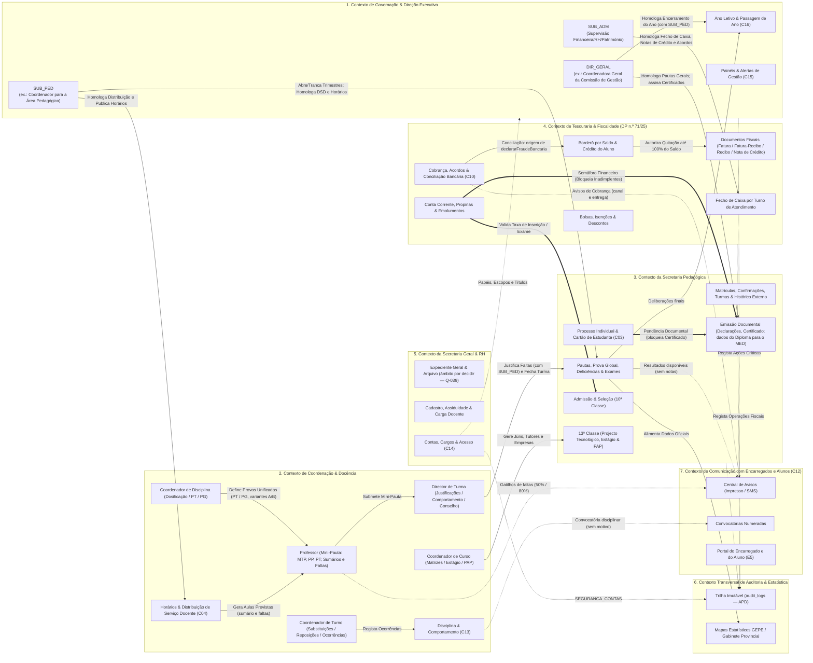

### Relações entre Contextos (*Upstream / Downstream*)
1. **Tesouraria (`Upstream`) $\rightarrow$ Secretaria Pedagógica (`Downstream` — *Customer/Supplier com Semáforo de Conformidade*):** A Secretaria Pedagógica depende de um sinal de conformidade financeira emitido em tempo real pela Tesouraria antes de liberar inscrições em exames extraordinários, defesas de PAP ou documentos oficiais (Declarações, Boletins, Certificado e pedido do Diploma). Se o semáforo pode reter a **confirmação de matrícula**, que a lei torna automática, é parâmetro (`RN-08.3`, `Q-LEG-05`).
2. **Coordenação & Docência (`Upstream`) $\rightarrow$ Secretaria Pedagógica (`Downstream`):** Os professores lançam `MTP`, `PP` e `PT` (e a `PG` no fim do ano) e as faltas por tempo letivo a partir das aulas do horário publicado; o Director de Turma consolida justificações e o comportamento e submete a turma ao Conselho de Notas; a Secretaria Pedagógica custodia a Pauta Geral homologada.
3. **Secretaria Geral & RH (`Upstream`) $\rightarrow$ Coordenação & Docência (`Downstream`):** Fornece o cadastro de docentes habilitados, a carga de referência, as acumulações e as indisponibilidades para a Distribuição de Serviço Docente (`RN-12`), mantendo o desacoplamento entre a identidade do professor e a persistência das notas (`RN-04`). Fornece também a identidade das contas: nenhuma conta interna existe sem cadastro (`RN-16.2`).
4. **Comunicação (`Downstream` — *Conformist*):** A central de avisos **não decide**: recebe eventos dos outros contextos (faltas, propina vencida, resultados homologados, documento pronto, convocatórias), aplica os modelos aprovados e os limites de conteúdo da APD e regista o canal e a prova de entrega (`RN-14`). Os avisos de cobrança da Tesouraria usam esta central para canal e entrega (`RN-13.5`).
5. **Auditoria & Estatística (transversal):** Os painéis da Direção leem os outros contextos **com a RLS de quem os abre** e nunca redefinem números oficiais (`RN-17.1`, `RN-17.2`).

---

## 1. Glossário de Linguagem Ubíqua Angolana (DDD & MED)

Todos os módulos, tabelas de base de dados, classes de código, APIs, relatórios e interfaces do SGE do **IPCAG N.º 12008 / BGO** devem utilizar estritamente os termos definidos neste glossário oficial, sendo proibido o uso de sinónimos estrangeiros ou de outros sistemas educativos (ex.: não usar *"Série"*, *"Bimestre"*, *"Boleto"*, *"Mensalidade Escolar"*, *"Recuperação Final"* ou *"TCC"*). Os **sinónimos usados pela escola nos impressos** (ex.: "Período", "Cadeira", `MAC`) são aceites **só como rótulos impressos**, com um único termo no sistema (§1.10).

### 1.1 Estrutura Académica

| Termo Oficial (Linguagem Ubíqua) | Sigla / Código | Definição Técnica e Regra de Existência no IPCAG N.º 12008 / BGO |
| :--- | :---: | :--- |
| **Ano Letivo** | `ANO_LETIVO` | Período temporal oficial definido pelo Calendário Escolar Nacional, fixado por **decreto executivo anual** (ex.: `2026/2027`, tipicamente de Setembro a Julho — `COR-LEG-07`, `Q-005`). É a entidade agregadora de topo da hierarquia operacional. Nenhuma turma, matrícula, pauta ou tabela de emolumentos existe fora de um Ano Letivo. Segue a máquina de estado do §3.19 (`Planeado` → `Em Curso` → `Em Encerramento` → `Encerrado` → `Arquivado`); no máximo 1 ano `Em Curso` (`RN-18.1`). |
| **Trimestre Letivo** | `TRIMESTRE` | Subdivisão pedagógica do Ano Letivo para a 10ª, 11ª e 12ª classes: **I**, **II** e **III Trimestre**, cada um com janelas independentes de abertura e fecho de lançamento. No I e II Trimestres há Prova Trimestral (`PT`); no **III Trimestre não há `PT`** e a avaliação final do ano faz-se pela **Prova Global (`PG`)** (A1; 🟡 `RN-01`). |
| **Área de Formação** | `AREA_FORMACAO` | *(novo — A5)* Agrupamento oficial de cursos técnicos a que pertence um curso. Todos os cursos recebidos do IPCAG pertencem à área **"Administração e Serviços"** (`Q-029`). |
| **Especialidade** | `ESPECIALIDADE` | *(novo — A5)* Atributo do curso (e impresso na Pauta Geral) que identifica a especialidade técnica (ex.: `ADM_GESTÃO`). 🟡 Lista real por confirmar (`Q-029`). |
| **Curso Técnico** | `CURSO` | Eixo de formação técnico-profissional de nível médio (II Ciclo do ESTP — DP n.º 167/23), pertencente a uma Área de Formação. **Cursos reais do IPCAG** (planos curriculares recebidos — A5; `Q-029` respondida, a confirmar): **Técnico de Contabilidade e Gestão**, **Técnico de Gestão de Recursos Humanos**, **Técnico de Gestão Empresarial** e **Técnico de Estatística e Planeamento**. *Outros cursos possíveis, só como exemplo de parametrização:* Informática de Gestão, Finanças. A fonte de cada curso é o **decreto executivo de criação do curso** (DP n.º 167/23, art. 14.º — `COR-LEG-29`). |
| **Classe** | `CLASSE` | Grau académico anual dentro de um Curso Técnico. O ESTP compreende **4 anos** (Lei n.º 17/16, art. 41.º; DP n.º 167/23, art. 9.º): **10ª**, **11ª** e **12ª Classes** (regime trimestral) e **13ª Classe** (classe terminal com **Projecto Tecnológico** e **Estágio Curricular Supervisionado**, concluída pela **defesa da PAP** — §1.4; `COR-LEG-16/28`, A6). |
| **Turno** *(impresso: "Período")* | `TURNO` | Período diário de funcionamento das atividades letivas: **Manhã** e **Tarde**. Nos documentos impressos usa-se o rótulo **"Período"** (A9, `Q-033`); no sistema mantém-se `TURNO`. 🟡 As janelas da v1.2 (Manhã 07h30–12h35; Tarde 13h00–18h05) e os **6 tempos letivos por turno** (DESC-RESP R22) **não comportam** as 32 horas curriculares semanais dos planos reais (`RN-12.1.4`): a grelha real tem de ser recolhida (`Q-C04-01`, `Q-C04-18`). Capacidade declarada: mais de 1.120 alunos. Não confundir com o **turno de atendimento** da sessão de caixa (`RN-13.11.5`). |
| **Turma** | `TURMA` | Agrupamento de alunos matriculados no mesmo `Ano Letivo + Curso Técnico + Classe + Turno`, associado a uma sala física fixa e identificado por código padronizado (ex.: `CG10A-M` = Contabilidade e Gestão, 10ª Classe, Turma A, Manhã). Turmas reais de **40–45 alunos** (A16, DESC-RESP §5). Possui um único **Director de Turma** nomeado. |
| **Matriz Curricular (Plano de Estudos)** | `MATRIZ` | Grelha de cada par `Curso Técnico + Classe`, tirada do **plano curricular oficial** recebido (MED/DNESTP) e do decreto de criação do curso (`COR-LEG-29`), com o elenco de disciplinas, a componente curricular, o caráter nuclear ou não-nuclear, a carga semanal (**horas curriculares semanais**: 32 na 10ª–12ª; 28 na 13ª — A5) e se a disciplina tem Prova Global (🟡 `RN-01`). |
| **Componente Curricular** | `COMP_CURR` | Classificação das disciplinas da Matriz segundo o **DP n.º 167/23, art. 25.º** (pesos aproximados 15% / 25% / 60% — art. 27.º): <br>1. **Componente Sócio-Ambiental-Cultural** (`COR-LEG-23`; ex.: Língua Portuguesa, Língua Estrangeira, Educação Física — só na 10ª e 11ª nos planos reais, A7); <br>2. **Componente Científica** (ex.: Matemática, Economia, Direito); <br>3. **Componente Técnica, Tecnológica e Prática** (disciplinas profissionalizantes, Projecto Tecnológico e Estágio). |
| **Disciplina** *(impresso também: "Cadeira")* | `DISCIPLINA` | Unidade curricular da Matriz. "Cadeira" é sinónimo aceite nos impressos (A9). |
| **Disciplina Nuclear (Específica)** | `DISC_NUCLEAR` | Flag (`is_nuclear = TRUE`) atribuída na Matriz às disciplinas estruturantes da especialidade. 🟡 O conceito **não aparece** no DP n.º 167/23 (`COR-LEG-13`); é prática da escola: o aluno da **10ª ou 11ª Classe** não transita com deficiências se reprovar ao mesmo tempo a Língua Portuguesa e pelo menos uma disciplina nuclear (DESC-RESP §1; `RN-02`). A composição do veto é parametrizável. |
| **Tempos Letivos Semanais** | `TEMPOS_SEM` | Número de aulas semanais de uma disciplina na Matriz. 🟡 Duração de **45 ou 50 minutos** por confirmar (`Q-012`); equivalência com a hora curricular semanal por confirmar (`Q-C04-18`). Determina o limite de faltas do `RN-03`. Cada tempo letivo em falta conta **1 falta**; um tempo duplo conta **2** (DESC-RESP R1). |
| **Encerramento do Ano Letivo** | `ENCERRAMENTO_ANO` | *(C16)* Ato homologado pela `SUB_PED` e pelo `DIR_GERAL` que, cumprida a lista de verificação, passa o Ano Letivo a `Encerrado`, tornando os seus dados pedagógicos só de leitura (`RN-18.3`, `RN-18.12`). |
| **Passagem de Ano** | `PASSAGEM_ANO` | *(C16)* Cálculo, para cada aluno do ano `N`, do seu destino em `N+1` (classe, curso, turno sugerido), conforme a deliberação final e o processo da 13ª Classe (`RN-18.5`). |
| **Dossiê de Encerramento** | `DOSSIE_ENCERRAMENTO` | *(C16)* Documentos oficiais finais do ano (Mini-Pautas, Pautas Gerais e Mapa Estatístico) registados com código de verificação em `documentos_oficiais_emitidos` antes do encerramento (`RN-18.15`). |

---

### 1.2 Registo e Vínculo do Estudante

| Termo Oficial (Linguagem Ubíqua) | Sigla / Código | Definição Técnica e Regra de Existência no IPCAG N.º 12008 / BGO |
| :--- | :---: | :--- |
| **Candidato** | `CANDIDATO` | Cidadão inscrito no **Teste de Selecção para Admissão à 10ª Classe** (DE n.º 361/26). Tem registo temporário independente do cadastro de alunos, indica **1ª e 2ª Opção de Curso/Turno** e é corrigido **sob regime de anonimato** (art. 15.º; o código de anonimato é escolha de implementação). Só se torna `Aluno` se for `Admitido` e efetivar a matrícula. A **repescagem na 2ª opção** é 🟡 prática interna sem base nos diplomas lidos (`COR-LEG-10`, `Q-LEG-12`). |
| **Quadro de Vagas e Parâmetros de Admissão** | `QUADRO_VAGAS` | Parametrização anual (`quadros_vagas_admissao`) por `Ano Letivo + Curso Técnico + Turno`: `total_vagas_disponiveis`, `vagas_preenchidas`, **`nota_minima_por_prova` = `10`** valores na escala `0–20` (padrão legal — DP n.º 167/23, art. 52.º, n.º 1; `COR-LEG-08`), **idade mínima de 15 anos completados no ano da matrícula** (art. 23.º; DE n.º 361/26, art. 4.º) e 🟡 `idade_maxima_ingresso_regular` **sem fonte legal**, desligada por omissão (`COR-LEG-11`, `Q-LEG-09`). Não existe redução do limiar por despacho. |
| **Média Final de Admissão (`MFA`)** | `MFA` | Classificação usada para **ordenar** os candidatos que têm pelo menos 10 em cada prova: `MFA = round_med((Nota_LP + Nota_Mat) / 2)` (DP n.º 167/23, art. 52.º, n.º 2: "média aritmética… se forem mais do que uma"). 🟡 Se as secções do teste único contam como provas separadas está indeterminado (`Q-LEG-10`). Resultados: `ADMITIDO`, `NÃO ADMITIDO (Fora das Vagas)` ou `NÃO ADMITIDO (Nota Inferior ao Mínimo)` (`RN-01.2`). |
| **Aluno (Estudante)** | `ALUNO` | Entidade civil e académica vitalícia após a primeira matrícula (Bilhete de Identidade / Cédula Pessoal e **N.º de Processo Individual**). Mantém o mesmo registo da 10ª à 13ª classe (inclusive em repetência, reingresso ou regresso por transferência — `RN-18.14`). Tem uma **Situação Académica** vitalícia (§1.9). |
| **Encarregado de Educação** | `ENCARREGADO` | Responsável pelo aluno perante a escola e a Tesouraria; pode não ser o **representante legal** (o registo indica se é e com que título — `RN-11.9`, APD-11). Um mesmo encarregado (BI e telefone) pode estar ligado a **vários educandos**, viabilizando o **Desconto Familiar**, a liquidação conjunta num só borderô e o agrupamento de avisos. O boletim real recolhe **dois telefones** do encarregado (A12). |
| **N.º de Processo Individual** | `NUM_PROCESSO` | Identificador **único, sequencial e vitalício** atribuído no primeiro ingresso (ex.: `PROC-2026-00412`, ilustrativo). Nunca é reutilizado (`RN-05`). |
| **Processo Individual do Aluno** | `PROCESSO_INDIVIDUAL` | *(C03)* Conjunto vitalício, físico e digital, de dados, documentos entregues e documentos emitidos de um aluno, com vista digital única e pasta física com localização registada (`RN-11.1`). |
| **Documento do Processo** | `DOC_PROCESSO` | *(C03)* Documento entregue pelo aluno ou encarregado (ex.: BI, certificado da 9ª Classe), com estado próprio (em falta, entregue, validado, rejeitado, caducado, dispensado — §3.8). Não confundir com os **documentos oficiais** emitidos pela escola (`DOF-xx`). |
| **Pendência Documental** | `PENDENCIA_DOC` | *(C03)* Documento obrigatório não validado nem dispensado, ou caducado. Gera alerta ou bloqueia um ato (ex.: Certificado), conforme o catálogo (`RN-11.7`). Distingue-se da **Pendência Financeira** do `RN-08`. |
| **Cartão de Estudante** | `CARTAO_ESTUDANTE` | *(C03)* Identificação escolar do aluno com matrícula ativa (fotografia, n.º de processo, curso, classe, turno e QR — DESC-RESP R29), sujeita a emolumento, com validade e verificação por QR (`RN-11.10`, §3.9). |
| **N.º de Ordem na Turma (N.º de Chamada)** | `NUM_ORDEM` | Número sequencial (`1` a `N`) do aluno na `Turma` num Ano Letivo, gerado por **ordem alfabética do nome completo tal como consta no BI** (DESC-RESP R6). **Congela após o fecho do I Trimestre**: transferidos ou anulados mantêm a linha e o número; entradas tardias recebem `N + 1` (`RN-05`). Não transita para o ano seguinte (`RN-18.8`). |
| **Matrícula (Ingresso Inicial)** | `MATRICULA_INI` | Ato pelo qual um candidato `Admitido` na 10ª classe ou um `Transferido de Entrada` estabelece pela primeira vez o vínculo com o IPCAG, gerando o `N.º de Processo Individual`. No II Ciclo a matrícula inicial faz-se na 10ª Classe (DP n.º 167/23, art. 50.º, n.º 6–7). |
| **Boletim de Matrícula / de Confirmação** | `BOLETIM_MAT` | *(C03 — A12, A13)* Formulário numerado por Ano Letivo (`N.º nnn/AAAA-AAAA`), com **comprovativo destacável** a conservar "para efeito de reclamação", sem dados de saúde. Corresponde ao `DOF-03` (`RN-11.14`). |
| **Confirmação de Matrícula** | `CONF_MATRICULA` | Ato anual que renova o vínculo de um aluno do IPCAG para o novo Ano Letivo (classe seguinte, repetição ou 13ª), preservando o `N.º de Processo`. Por lei é **automática e da responsabilidade da escola** (DP n.º 167/23, art. 50.º, n.º 4 — `COR-LEG-15`); a escola pratica hoje a confirmação ao balcão. 🟡 Modo `BALCAO` ou `AUTOMATICA` é parâmetro do Ano Letivo (`RN-18.6.4`, `Q-LEG-05`). Parte de uma **Proposta de Confirmação** pré-preenchida (§1.9). A matrícula incompleta é anulada **60 dias após o início do ano letivo** (art. 50.º, n.º 8). Quem reprova por faltas injustificadas **perde o direito à confirmação** no ano seguinte, salvo justificação (art. 50.º, n.º 2 — `RN-03.6`). |
| **Transcrição de Histórico Externo** | `HIST_EXTERNO` | Registo auditado das classificações finais anuais (`CA` ou equivalente do documento de origem) das disciplinas da 10ª, 11ª ou 12ª classe obtidas noutra escola, comprovadas por **Guia de Transferência** e **Certificado de Habilitações Parcial**. Necessário para apurar a `MFC` na 13ª classe sem lacunas (`RN-06.1`). |

---

### 1.3 Avaliação e Pautas (10ª à 12ª Classe)

> [!note] Nomenclatura canónica (A1, A2, `COR-LEG-26/27`, `Q-026`)
> No sistema usam-se **`MTP`, `PP`, `PT`, `PG`, `M1`–`M3`, `CF`, `CA`**. As siglas da v1.2 `MAC`, `NPP`, `NPT` e `MT`/`MT1`–`MT3` passam a **rótulos alternativos de impressão** (o modelo da escola usa `MAC`/`NPP`/`NPT`; o do Gabinete Provincial usa `MTP`/`PP`/`PT`). `MTP` ≡ `MAC`, `PP` ≡ `NPP`, `PT` ≡ `NPT`: **um só campo, com rótulo configurável por modelo de documento**. A `MFD` da v1.2 é substituída pela `CF`. Todas as fórmulas são 🟡 provisórias (ponto de controlo **E2**).

| Termo Oficial (Linguagem Ubíqua) | Sigla / Código | Definição Técnica e Regra de Existência no IPCAG N.º 12008 / BGO |
| :--- | :---: | :--- |
| **Média de Trabalho Prático** *(impresso também: Média de Avaliações Contínuas, `MAC`)* | `MTP` | Nota de `0` a `20` que sintetiza o desempenho contínuo do aluno no trimestre (participação, trabalhos práticos, tarefas, perguntas). Lançada pelo professor na Mini-Pauta. |
| **Prova do Professor** *(impresso também: `NPP`)* | `PP` | Nota de `0` a `20` da prova parcelar elaborada e aplicada pelo docente da disciplina na turma. |
| **Prova Trimestral** *(impresso também: `NPT`)* | `PT` | Nota de `0` a `20` da prova trimestral **unificada** do I e II Trimestres, elaborada pelo **Coordenador de Disciplina** em **variante A (Manhã), variante B (Tarde)** e uma variante de **2.ª chamada**, com visto do Coordenador para a Área Pedagógica (`RN-01.4`). Não existe no III Trimestre. |
| **Prova Global** | `PG` | *(novo — A1)* Prova final do ano, realizada no lugar da prova do III Trimestre, elaborada como a `PT` (variantes A/B e 2.ª chamada). 🟡 Se se aplica a todas as disciplinas e classes está por confirmar (`Q-025`). |
| **Média Trimestral** *(impresso também: `MT`, `MT1`–`MT3`)* | `M1`, `M2`, `M3` | Média do aluno na disciplina num trimestre, arredondada por `round_med`. `M1`, `M2` a partir de `MTP`, `PP`, `PT`; `M3` a partir de `MTP` e `PP` (🟡 fórmula por confirmar — `RN-01`). |
| **Classificação de Frequência** *(impresso: coluna "`M3/CF`" ou "`MT3`")* | `CF` | *(novo — substitui a `MFD`)* Média dos três trimestres: `CF = round_med((M1 + M2 + M3) / 3)`. O "MT3" impresso na fórmula da Mini-Pauta é a `CF` (DESC-RESP §1). |
| **Classificação Anual** | `CA` | *(novo — A1)* `CA = round_med(CF × 0,6 + PG × 0,4)`. Aprovação na disciplina com `CA ≥ 10` (🟡 `RN-01`). |
| **Exame de Recurso** | `EXAME_REC` | Prova realizada em **julho** pelos alunos com `CA < 10` e `CF ≥ 7`. 🟡 A fórmula da nota depois do recurso está por confirmar (`Q-025`); a ponderação 40% / 60% da v1.2 foi retirada por não ter fonte e inverter os pesos da prática real (`COR-LEG-26`). |
| **Prova de 2.ª Chamada** | `SEGUNDA_CHAMADA` | *(novo — prática real)* Prova feita por quem faltou a uma `PP`, `PT` ou `PG` por motivo justificado, validado pelo Director de Turma e pela Coordenação Pedagógica. Até à sua realização, a célula fica **pendente** (`RN-01.3`). |
| **Disciplina em Atraso (Deficiência / Cadeira em Atraso)** | `DEFICIENCIA` | Disciplina da 10ª ou 11ª classe com classificação final reprobatória entre `7` e `9` valores com a qual a regra de transição deixou o aluno passar (**até 2** — `RN-02`). Pendência ativa no histórico até ser aprovada (`≥ 10`) em **Exame Extraordinário**. Não existe na 12ª Classe. |
| **Exame Extraordinário** | `EXAME_EXTRA` | Prova em época especial (realizada em **maio**), mediante **taxa paga por disciplina**, destinada a eliminar Cadeiras em Atraso até à conclusão da 12ª classe. Nota `≥ 10` elimina a deficiência (🟡 limiares — `Q-025`). |
| **Dispensa Médica** | `DISP` | Isenção de avaliação prática/física concedida pelo `SUB_PED` mediante atestado arquivado, em disciplinas elegíveis (ex.: Educação Física). Na pauta mostra `DISP`, não entra no denominador, não gera reprovação nem deficiência (`RN-01.1`). O atestado segue a APD-11 (compartimento de saúde). |
| **Mini-Pauta** | `MINI_PAUTA` | Mapa de avaliação de **uma disciplina numa turma**: lista congelada dos alunos (`N.º de Ordem`, `N.º de Processo`, Nome, Género), `MTP`, `PP`, `PT`, `M1`, `M2`, `MTP`, `PP`, `M3`/`CF`, `PG`, `CA`, faltas por tipo e o rodapé estatístico (`IND-28`). Pertence ao vínculo `Turma + Disciplina + Ano Letivo`, não ao professor (`RN-04`). Corresponde ao `DOF-04`. |
| **Pauta Geral (Pauta de Aproveitamento Geral)** | `PAUTA_GERAL` | Documento consolidado de uma `Turma` com, por disciplina, `FALT`, `CF`, `PG`, `CA`, e a **Situação Final Anual** de cada aluno. Na impressão, as deliberações agrupam-se nas **quatro categorias reais** (A10): **Transita**, **Transita com deficiência**, **Não transita** e **Desistente** (`RN-02.3`), com estatística por género (`IND-29`). Corresponde ao `DOF-05`. |
| **Registo dos Títulos (Livro de Registo)** | `REGISTO_TITULOS` | A lei exige **"um livro de registo e/ou uma base de dados"**, número sequencial e código alfanumérico dos títulos (DP n.º 227/25, art. 8.º e 13.º). A escola usa **livros separados** de Termos de Exame, de Certificados e de Atas da PAP (DESC-RESP R17). 🟡 A tripla `Livro / Folha / Termo` da v1.2 é **prática a confirmar**, não exigência legal (`COR-LEG-19`, `RN-10.2`). |
| **Estatísticas Impressas** | `MT`/`AV`/`AP`/`RP`/`NV` | *(C15 — A10)* Contagens impressas na Mini-Pauta: **Matriculados**, **Avaliados**, **Aprovados**, **Reprovados**, **Não avaliados**, por género. No sistema o indicador chama-se **"Matriculados"**, nunca `MT` (colisão com a média trimestral — `RN-17.14`). |

---

### 1.4 13ª Classe, Certificação e Títulos (DP n.º 167/23; DP n.º 227/25)

| Termo Oficial (Linguagem Ubíqua) | Sigla / Código | Definição Técnica e Regra de Existência no IPCAG N.º 12008 / BGO |
| :--- | :---: | :--- |
| **Projecto Tecnológico** | `PROJ_TEC` | *(novo — A6, `COR-LEG-16/28`)* Disciplina avaliada da componente técnica, com **2 h/semana na 12ª** e **8 h/semana na 13ª** nos planos reais. A aprovação no Projecto Tecnológico é condição do diploma (DP n.º 167/23, art. 32.º e 33.º, n.º 1). 🟡 Forma de avaliação na 12ª e na 13ª por confirmar (`Q-030`). |
| **Estágio Curricular Supervisionado** | `ESTAGIO_13` | Componente prática em contexto real de trabalho na **13ª Classe**, com **20 tempos letivos semanais** (DP n.º 167/23, art. 27.º, n.º 2; planos reais), avaliada de `0` a `20` (`Nota_Estagio`, sigla `NE`). Empresas parceiras com cartas de apresentação (DESC-RESP R21). |
| **Tutor Interno (Professor de Estágio)** | `TUTOR_ESTAGIO` | Docente do IPCAG designado pela Coordenação de Curso para acompanhar o estagiário e validar os relatórios de estágio. |
| **Supervisor de Empresa** | `SUPERVISOR_EXT` | Profissional da entidade de acolhimento que atesta a assiduidade e emite o parecer e a nota de desempenho do estagiário. |
| **Prova de Aptidão Profissional** | `PAP` | **Apresentação e defesa do relatório de estágio** perante um júri, no fim do curso (DP n.º 167/23, art. 33.º — `COR-LEG-16/28`); a classificação considera também a qualidade do desempenho profissional atingido no estágio. **Não é uma disciplina** nem um projeto técnico-científico autónomo. Avaliada de `0` a `20` (`Nota_PAP`, sigla `NPAP`); 🟡 o mínimo de `10` não tem fonte no texto lido. O termo *Prova de Aptidão Técnica* fica reservado à Formação Profissional Básica, fora do âmbito. |
| **Professor Orientador** | `ORIENTADOR_PAP` | Docente nomeado pela Coordenação de Curso para orientar o relatório de estágio e o Projecto Tecnológico; o seu **parecer positivo** é condição da defesa (`RN-06.3`). |
| **Júri da PAP** | `JURI_PAP` | Órgão de avaliação da defesa, **integrado por professores e por representantes dos trabalhadores e dos empregadores** do setor (DP n.º 167/23, art. 33.º, n.º 2; membros externos de empresas — DESC-RESP R21). 🟡 Número de membros e funções (presidente, arguente, orientador) por confirmar (`Q-LEG-07`). A avaliação gera a **Ata da Defesa da PAP**. |
| **Média Final do Curso** | `MFC` | Classificação final de conclusão do II Ciclo do ESTP, de `10` a `20` no Certificado e nos dados do Diploma. Hoje junta a **Média do Plano Curricular (10ª–12ª)**, a nota de Estágio, a de Projecto Tecnológico e a da defesa da PAP (DESC-RESP §1). 🟡 **Pesos sem fonte e por obter** (`COR-LEG-17`, `Q-030`, `Q-LEG-06`); risco de contar o estágio duas vezes (`RN-06`). |
| **Certificado de Habilitações** | `CERTIFICADO` | Título **emitido pela escola**, assinado pelo Director e pelo Subdirector Pedagógico, com carimbo ou selo branco (DP n.º 167/23, art. 54.º; DP n.º 227/25, art. 8.º). 🟡 Na prática, o Coordenador para a Área Pedagógica **não** assina certificados (DESC-RESP §2): quem assina cada documento é parâmetro (`RN-10.5`, `Q-028`). |
| **Diploma** | `DIPLOMA` | Título de fim de curso **emitido e assinado pelo Ministro da Educação**, com o nível do Quadro Nacional de Qualificações (DP n.º 167/23, art. 55.º; DP n.º 227/25, art. 4.º, h)). **O SGE prepara e exporta os dados e o pedido**; não emite o diploma (`COR-LEG-18`, `Q-021`). |
| **Plataforma Nacional de Certificação** | `PNC` | Plataforma onde os títulos escolares são registados (até 30 dias após o fim do ano letivo) e que fornece o **QR Code** oficial dos títulos (DP n.º 227/25, art. 8.º, n.º 3, e 13.º). 🟡 Âmbito e forma de integração por decidir (`Q-020`, `RN-10.3`). |
| **Declaração** | `DECLARACAO` | Documento numerado emitido pela escola a pedido, em **≤ 5 dias úteis** (DP n.º 227/25, art. 9.º). Pedido por **requerimento numerado com talão destacável** ("Recibo de Pedido de Declaração") dirigido ao `DIR_GERAL` (A11, DESC-RESP R16). |

---

### 1.5 Financeiro, Tesouraria e Fiscalidade (DP n.º 71/25)

| Termo Oficial (Linguagem Ubíqua) | Sigla / Código | Definição Técnica e Regra de Existência no IPCAG N.º 12008 / BGO |
| :--- | :---: | :--- |
| **Comparticipação Mensal (Propina)** | `PROPINA` | Prestação mensal em Kwanzas (`AOA`) devida pelo Encarregado de Educação: **10 prestações (Setembro a Junho)**, com Setembro pago na matrícula e vencimento fixo (dia 10 ou 15) com multa por mora (DESC-RESP R9). 🟡 Regra da multa por obter (`RN-13.3`, `Q-C10-01`). |
| **Emolumento Escolar** | `EMOLUMENTO` | Taxa tabelada de um ato académico (inscrição no teste de seleção, matrícula/confirmação, cartão, declaração, boletim, exame extraordinário por disciplina, defesa da PAP, certificado). 🟡 Os **emolumentos estatais** pagam-se por **RUPE** ao Estado; os **internos** às contas da escola (DESC-RESP R15, `Q-034`, `Q-C10-17`). Os emolumentos não geram dívida: pagam-se antes do ato (`RN-08`). |
| **Bolsa de Estudo, Isenção Diocesana e Desconto Familiar** | `BENEFICIO_FIN` | Abatimento percentual ou fixo (`100%`, `50%`, protocolo da Diocese de Caxito, desconto de irmãos, filho de funcionário) ligado à matrícula anual e autorizado pela Direção; deduz o valor base das propinas (`RN-07`). Não se prolonga automaticamente para o ano seguinte (`RN-07.3`). 🟡 Regras escritas por receber. |
| **Conta Corrente do Aluno** | `CONTA_CORRENTE` | Livro-razão financeiro do aluno por Ano Letivo: débitos (propinas líquidas, multas, emolumentos), créditos (documentos de quitação) e anulações por Nota de Crédito, determinando o estado **Adimplente** ou **Inadimplente**. As dívidas de anos anteriores ficam na matrícula de origem e continuam liquidáveis ("Dívida de Exercício Anterior" — `RN-18.10`). |
| **Borderô / Talão Bancário (Comprovativo de Operação)** | `BORDERO` | Registo único de um comprovativo de pagamento (Talão de Depósito, Transferência IBAN, TPA ou Multicaixa Express), com número de operação `UNIQUE` e controlo de saldo (`valor_total_talao`, `saldo_utilizado`, `saldo_disponivel`), que pode quitar vários meses ou irmãos até 100% do depósito (`RN-09.1`). Tem também um **estado de conciliação** separado (§3.7, `RN-13.14`). |
| **Crédito do Aluno** | `CREDITO_ALUNO` | *(novo — DESC-RESP R10)* Excedente de um talão sobre o valor quitado, que fica disponível para o mês seguinte. Não é receita (`RN-09.3`). Um talão de valor inferior à prestação **não quita** o mês. |
| **Documento Fiscal** | `DOC_FISCAL` | Documento previsto no DP n.º 71/25 (art. 3.º, 4.º, 6.º, 8.º): **Fatura**, **Fatura-Recibo**, **Recibo** e **Nota de Crédito** (talvez Nota de Débito). Substitui o "Recibo Oficial" da v1.2. Numeração **sequencial e cronológica por tipo e por ano fiscal**; leva o **NIF do IPCAG** e a **menção do motivo de isenção de IVA** (CIVA, art. 12.º, n.º 1, l)). 🟡 Modelo de emissão (fatura mensal + recibo, ou fatura-recibo) por decidir (`Q-LEG-16`). A emissão pode vir de **software certificado externo** (`DEC-002` pendente): este documento descreve o documento, não quem o emite (`RN-09`). |
| **Nota de Crédito** | `NC` | *(substitui a "Nota de Estorno" `NE` da v1.2 — `COR-LEG-03`)* Único instrumento para anular ou retificar, total ou parcialmente, um documento fiscal emitido, com a menção "anulação" ou "rectificação" e a referência ao documento original. Exige justificação e autorização do `SUB_ADM`, devolve a dívida à Conta Corrente e recompõe (ou invalida por fraude) o saldo do borderô. A sigla `NE` fica livre para a Nota do Estágio. |
| **Fecho de Caixa por Turno de Atendimento** | `FECHO_CAIXA` | Encerramento do movimento de um operador no fim do seu turno de atendimento (Manhã ou Tarde), com o **Mapa de Fecho de Caixa** por canal (**TPA**, **Transferência/Depósito**, **Multicaixa Express**), conferido pela Secretaria Geral e homologado pelo `SUB_ADM` (DESC-RESP R13; `RN-09.2`). Pode ser **administrativo** quando o operador não o pode fazer (`RN-09.4`). |
| **Dívida Exigível** | `DIVIDA_EXIGIVEL` | *(C10)* Soma do valor líquido e da multa (menos a multa perdoada) das prestações `Em Atraso (com Multa)`, à data de referência (`RN-13.1`). |
| **Dívida Reescalonada** | `DIVIDA_REESCALONADA` | *(C10)* Prestações vencidas abrangidas por um Acordo de Pagamento ativo (estado `Em Acordo de Pagamento`). |
| **Antiguidade da Dívida** | `ANTIGUIDADE` | *(C10)* Dias desde a data limite de vencimento de uma prestação até à data de referência, agrupados em escalões (`RN-13.2`). |
| **Aviso de Cobrança** | `AVISO_COBRANCA` | *(C10)* Comunicação formal e registada ao encarregado sobre prestações em atraso, em 3 níveis (`RN-13.5`), entregue através da central de avisos (`RN-14`). |
| **Acordo de Pagamento** *(prática: "plano de pagamento")* | `ACORDO_PAGAMENTO` | *(C10 — DESC-RESP R11)* Compromisso escrito entre o encarregado e o IPCAG, homologado pela Subdireção Administrativa, que fixa novas datas para liquidar prestações vencidas, agrupadas em parcelas (`RN-13.7`). |
| **Parcela do Acordo** | `PARCELA_ACORDO` | *(C10)* Conjunto de uma ou mais **prestações inteiras** vencidas a liquidar até uma nova data. |
| **Perdão de Multa** | `PERDAO_MULTA` | *(C10)* Dispensa total ou parcial da multa de uma prestação ainda não paga, autorizada por despacho; nunca abrange a propina (`RN-13.4`). |
| **Extrato Bancário** | `EXTRATO` | *(C10)* Lista de movimentos de uma conta bancária do IPCAG num período, importada ou registada no SGE. |
| **Conciliação Bancária** | `CONCILIACAO` | *(C10)* Confronto entre as linhas de crédito do extrato e os borderôs registados, para confirmar que cada borderô corresponde a dinheiro recebido (`RN-13.14`). |
| **Receita Reconhecida** | `RECEITA` | *(C10)* Valor dos documentos de quitação emitidos num período menos o das Notas de Crédito do mesmo período (critério de caixa — `RN-13.11`). |

---

### 1.6 Horários e Serviço Docente (C04)

| Termo Oficial (Linguagem Ubíqua) | Sigla / Código | Definição Técnica e Regra de Existência no IPCAG N.º 12008 / BGO |
| :--- | :---: | :--- |
| **Grelha de Tempos do Turno** | `GRELHA_TURNO` | Sequência ordenada de Tempos Letivos e Intervalos, com hora de início e fim, por `Ano Letivo + Turno`, contida na janela do turno (`RN-12.1`). |
| **Distribuição de Serviço Docente** | `DSD` | Conjunto homologado, por Ano Letivo, das alocações de professores às Mini-Pautas (`turma_disciplinas`), com a carga semanal de cada professor e os cargos que acumula (`RN-12.3`). |
| **Carga Letiva Semanal** | `CARGA_LETIVA` | Tempos letivos por semana de um professor: soma dos `TEMPOS_SEM` das disciplinas de que é titular vigente (`RN-12.4`). |
| **Horário Semanal da Turma** | `HORARIO_TURMA` | Versão datada (com vigência) da distribuição das disciplinas da turma pelos dias e tempos do turno, com o espaço de cada aula (`RN-12.8`). |
| **Aula Prevista / Aula Lecionada** | `AULA` | Ocorrência concreta, numa data, de um bloco de tempos consecutivos de uma disciplina numa turma: nasce **Prevista** do horário e passa a **Lecionada** com o sumário (§3.12). |
| **Substituição Pontual** | `SUBST_PONTUAL` | Designação de outro professor para aulas concretas de um titular ausente, **sem** alterar `alocacoes_docentes` e **sem** acesso às notas. Distingue-se da **Substituição Docente** prolongada do `RN-04` (`RN-12.14`). |
| **Aula de Reposição** | `REPOSICAO` | Aula fora do horário semanal que compensa uma aula não lecionada da mesma turma e disciplina, dentro do mesmo trimestre (`RN-12.15`). |
| **Acumulação** | `ACUMULACAO` | (1) **Interna:** docência e um cargo (Director de Turma, Coordenador de Curso, de Disciplina ou de Turno); (2) **Externa:** funções docentes noutra instituição, declaradas e autorizadas (mais de metade dos professores — DESC-RESP R23). |
| **Choque de Horário** | `CHOQUE` | O mesmo **professor**, **espaço** ou **turma** em duas aulas no mesmo dia, turno e tempo (`RN-12.9`). |
| **Hora Curricular Semanal** | `HORAS_CURR_SEM` | Unidade da carga semanal nos planos curriculares oficiais (32 na 10ª–12ª, 28 na 13ª — A5). 🟡 Equivalência com o Tempo Letivo por confirmar (`Q-C04-18`); o sistema guarda os dois valores. |

---

### 1.7 Assiduidade, Disciplina e Comunicação (C13, C12)

| Termo Oficial (Linguagem Ubíqua) | Sigla / Código | Definição Técnica e Regra de Existência no IPCAG N.º 12008 / BGO |
| :--- | :---: | :--- |
| **Falta por Não Comparência** | `FALTA_NAO_COMPARENCIA` | Ausência do aluno a um tempo letivo; pode ser justificada (`RN-03`). |
| **Falta por Indisciplina** | `FALTA_INDISCIPLINA` | Falta marcada quando o professor manda o aluno sair da sala por comportamento; liga-se sempre a uma ocorrência e não é justificável (`RN-15.1`). |
| **Justificação de Faltas** | `JUSTIFICACAO` | Formulário **numerado** (`N.º __/IPCAG/ano`) preenchido pelo aluno ou encarregado, com intervalo de dias, motivo, documentos e professores/cadeiras afetados, assinado pelo **Director de Turma e pelo Coordenador para a Área Pedagógica** (A8). Aprovada, abate a falta em todas as disciplinas afetadas (`RN-03.4`). |
| **Ocorrência Disciplinar** | `OCORRENCIA` | Registo de um facto de comportamento contrário ao regulamento, em sala ou no recinto, com data, local, relator e descrição factual (`RN-15.3`). |
| **Medida Disciplinar** | `MEDIDA` | Consequência aplicada a uma ocorrência (ex.: advertência, repreensão registada, suspensão), conforme o regulamento interno (`RN-15.5`). |
| **Processo Disciplinar** | `PROC_DISC` | Procedimento formal para ocorrências graves, com instrução, audição do aluno e do encarregado e decisão da Direção (`RN-15.6`). |
| **Comportamento Trimestral** | `COMPORTAMENTO` | Avaliação do comportamento do aluno no trimestre, proposta pelo Director de Turma e confirmada no Conselho de Notas; impressa no boletim (`RN-15.7`). 🟡 Escala por definir (`Q-C13-02`). |
| **Aviso** | `AVISO` | *(C12)* Mensagem curta ao encarregado, a partir de um modelo aprovado, por um canal, com estado de entrega (§3.14). |
| **Gatilho** | `GATILHO` | *(C12)* Acontecimento do sistema que gera um aviso automaticamente (ex.: 80% do limite de faltas — `RN-14.5`). |
| **Convocatória** | `CONVOCATORIA` | *(C12)* Chamada formal e numerada do encarregado à escola, com data, hora, local e quem convoca; o motivo detalhado fica só no sistema (`RN-14.7`). |
| **Contacto Verificado** | `CONTACTO_VERIFICADO` | *(C12)* Telefone do encarregado confirmado nos últimos 12 meses (presencialmente ou por código SMS — `RN-14.3`). |
| **Modelo de Mensagem** | `MODELO_MSG` | *(C12)* Texto aprovado pela Direção, só com os campos substituíveis permitidos (APD-11 §7.4 — `RN-14.4`). |
| **Portal do Encarregado** | `PORTAL_ENC` | *(C12 — E5, `DEC-003`)* Área autenticada na internet onde o encarregado consulta a informação dos seus educandos (`RN-14.10`). |

---

### 1.8 Contas, Cargos e Acesso (C14)

| Termo Oficial (Linguagem Ubíqua) | Sigla / Código | Definição Técnica e Regra de Existência no IPCAG N.º 12008 / BGO |
| :--- | :---: | :--- |
| **Conta de Utilizador** | `CONTA` | Identidade de acesso de **uma única pessoa** ao SGE; para o pessoal interno liga-se 1:1 a `funcionarios_docentes`. Nunca é partilhada nem reutilizada (`RN-16.1`). |
| **Papel no Sistema** | `PAPEL` | Conjunto fechado de permissões RBAC identificado por um dos 12 códigos do §2 (`DIR_GERAL` … `PROF`) ou pelo perfil técnico `ADMIN_TEC`. É interno: **nunca aparece impresso** (`RN-16.20`). |
| **Título do Cargo** | `TITULO_CARGO` | Designação do cargo tal como a escola a usa e imprime (ex.: *Coordenadora Geral da Comissão de Gestão*, *Coordenador para a Área Pedagógica*, *Coordenador de Turma*). Configurável; cada título liga-se a exatamente um papel (`RN-16.20`). |
| **Atribuição de Cargo** | `ATRIB_CARGO` | Ligação entre uma Conta e um Título do Cargo (e, por ele, um Papel), com **escopo**, **início**, **fim** e despacho de nomeação. Uma conta pode ter várias atribuições ativas (`RN-16.3`). |
| **Escopo do Cargo** | `ESCOPO` | Parte da escola onde o cargo atua: `INSTITUICAO`, `CURSO`, `DISCIPLINA`, `TURNO`, `TURMA` ou `ALOCACOES_DOCENTES`. Corresponde ao `R*` da matriz do §2.2. |
| **Administrador Técnico** | `ADMIN_TEC` | Perfil técnico, fora dos 12 papéis e da estrutura orgânica, que gere contas, sessões e dispositivos **sem acesso a notas, faltas, dados financeiros ou processos de alunos** (`RN-16.17`). |
| **Dispositivo Autorizado** | `DISPOSITIVO` | Telemóvel ou computador registado por um utilizador para guardar dados cifrados e trabalhar *offline* (Mini-Pauta e faltas — `RN-16.15`). |
| **PIN Local** | `PIN` | Código numérico curto que desbloqueia a sessão local cifrada num Dispositivo Autorizado sem rede; nunca substitui a palavra-passe no servidor. |
| **Segundo Fator** | `MFA` | Prova adicional de identidade (aplicação autenticadora, SMS ou código de recuperação) exigida aos papéis de risco elevado (`RN-16.12`). |
| **Reautenticação** | `REAUT` | Confirmação da identidade imediatamente antes de uma ação crítica, mesmo com sessão aberta (`RN-16.14`). |
| **Código de Acesso Presencial** | `COD_PRESENCIAL` | Código de uso único entregue em mão ao titular, após conferência do BI, para ativar a conta ou repor o acesso (`RN-16.16`). |

---

### 1.9 Passagem de Ano, Situação Académica e Indicadores (C16, C15)

| Termo Oficial (Linguagem Ubíqua) | Sigla / Código | Definição Técnica e Regra de Existência no IPCAG N.º 12008 / BGO |
| :--- | :---: | :--- |
| **Proposta de Confirmação de Matrícula** | `PROPOSTA_CONF` | Registo pré-preenchido, gerado pela Passagem de Ano, que a Secretaria (modo `BALCAO`) ou o sistema (modo `AUTOMATICA`) converte em Confirmação de Matrícula. **Não é matrícula**: não ocupa lugar na turma nem conta nos mapas GEPE (`RN-18.6`, §3.20). |
| **Situação Académica do Aluno** | `SITUACAO_ACADEMICA` | Estado vitalício do aluno no IPCAG: `Ativo`, `Aguarda Confirmação`, `Interrompido`, `Transferido (Saída)`, `Desistente / Anulado`, `Concluiu o Curso` (`RN-18.14`, §3.21). Não se confunde com o estado de conservação dos dados da APD-11. |
| **Indicador** | `IND-nn` | *(C15)* Medida definida uma só vez no catálogo (`indicadores_catalogo`), com fórmula, fontes, frequência, cargos e versão (`RN-17.1`). |
| **Instantâneo de Indicador** | `INSTANTANEO` | *(C15)* Valor calculado e guardado (*append-only*) de um indicador num momento, com a versão da fórmula (`RN-17.10`). |
| **Alerta de Gestão** | `ALERTA` | *(C15)* Pendência automática dirigida a um **cargo + escopo**, numa caixa única (`alertas_gestao`), com estados próprios (`RN-17.12`, §3.18). |

---

### 1.10 Sinónimos Aceites e Rótulos Impressos (A2, A9, A10, `Q-033`)

| Termo no sistema | Rótulo aceite nos impressos | Onde aparece | Nota |
| :--- | :--- | :--- | :--- |
| `TURNO` (Manhã/Tarde) | **Período** | Quase todos os documentos (A9) | "Turno" aparece só na Mini-Pauta. |
| `DISCIPLINA` | **Cadeira** | "Disciplinas ou cadeiras"; "cadeiras em atraso" | — |
| `MTP`, `PP`, `PT` | `MAC`, `NPP`, `NPT` | Boletim do modelo da escola (A2) | Um campo; rótulo por modelo de documento. |
| `M1`, `M2`, `M3`, `CF` | `MT`, `MT1`–`MT3`, "`M3/CF`" | Boletins e Mini-Pauta | O "MT3" da fórmula da `CA` é a `CF`. |
| Indicador "Matriculados" | `MT` (na estatística) | Rodapé da Mini-Pauta (A10) | Nunca `MT` no sistema (`RN-17.14`). |
| Ano Letivo | "Ano Lectivo" | Grafia pré-acordo nos impressos (A9) | Rótulo do modelo. |
| Papel `DIR_TURMA` | **Director de Turma** / **Coordenador de Turma** | Boletins (A4); "Coordenador de Turma" é o nome no DP n.º 93/21, art. 5.º (`COR-LEG-22`) | Títulos configuráveis (`RN-16.20`). |
| Papéis `DIR_GERAL`, `SUB_PED` | **Coordenadora Geral da Comissão de Gestão**, **Coordenador para a Área Pedagógica** | Declarações, boletins, pautas (A4) | Hipótese de mapeamento (`Q-028`, `Q-C14-14`). |
| Nota de Crédito (`NC`) | — | — | "Nota de Estorno" deixa de ser usada (`COR-LEG-03`). |
| Acordo de Pagamento | "Plano de pagamento" | Entrevistas (R11) | — |

---

## 2. Estrutura Orgânica, Papéis no Sistema e Matriz de Permissões (RBAC)

O SGE do IPCAG N.º 12008 / BGO implementa **Controlo de Acesso Baseado em Papéis e Escopo (`RBAC + ABAC`)**. A regra de que nenhum operador acumula funções incompatíveis (ex.: quem cobra propinas não altera notas nem emite certificados; quem lança notas não valida borderôs) é uma **decisão de controlo interno do SGE** (`COR-LEG-21`), concretizada na matriz de incompatibilidades do `RN-16.5`.

> [!info] Enquadramento legal dos papéis (`COR-LEG-21/22`, LEG-VER §3.10)
> - O **DP n.º 93/21, de 16 de Abril** — *Regime Jurídico para o Exercício de Cargos de Direcção e Chefia das Instituições Públicas de Educação Pré-Escolar, Ensino Primário e Secundário* — aplica-se às **instituições públicas** e não menciona as comparticipadas; a aplicação ao IPCAG (obrigação, convénio ou analogia) está por confirmar (`Q-LEG-13`). O decreto **não** trata da segregação de funções nem de sistemas informáticos.
> - Serve de **referência** aos papéis: Director coadjuvado por dois subdirectores (art. 4.º, n.º 6); o **Subdirector Pedagógico** orienta a formação das turmas e a elaboração e distribuição dos horários (art. 17.º, a)); o **Subdirector Administrativo** tem o inventário do património e vela pela assiduidade dos trabalhadores (art. 18.º, a) e b)); dois Chefes de Secretaria, Geral e Pedagógico (art. 5.º, n.º 3); o cargo legal do Director de Turma chama-se **"Coordenador de Turma"** (art. 5.º, n.º 1, e)). As restantes competências da matriz são práticas internas.
> - O decreto prevê também um **Coordenador para a Inserção na Vida Activa (GIVA)** (art. 5.º, n.º 1, h)), que a escola tem ou acumula no Coordenador de Curso (DESC-RESP §2). 🟡 Nesta versão não é um papel próprio: as suas funções nos estágios ficam no `COORD_CURSO` até decisão (`Q-LEG-13`).

> [!important] Papéis no sistema e títulos impressos (A4, `RN-16.20`)
> Os **12 códigos abaixo são papéis no sistema** (permissões, RLS, MFA, reautenticação, incompatibilidades) e **nunca aparecem impressos**. O **título do cargo** que sai nos ecrãs e nos blocos de assinatura dos `DOF-xx` é **configurável** (`cargos_institucionais`) e ligado a exatamente um papel; vários títulos podem ligar-se ao mesmo papel. Mudar um título não muda permissões. Mapeamento inicial 🟡 a confirmar com a Comissão de Gestão (validar em **E1** — `Q-028`, `Q-C14-14`):
>
> | Título impresso nos documentos reais (A4) | Papel no sistema |
> | :--- | :--- |
> | Coordenadora Geral da Comissão de Gestão | `DIR_GERAL` |
> | Coordenador para a Área Pedagógica | `SUB_PED` |
> | Chefe da Secretaria Pedagógica | `CHEFE_SEC_PED` |
> | Director de Turma / Coordenador de Turma | `DIR_TURMA` |
> | *(sem equivalente visto nos documentos)* | `SUB_ADM` |
>
> Na prática, o Coordenador para a Área Pedagógica substitui a Coordenadora Geral no expediente pedagógico corrente, mas **não** assina certificados, pautas gerais finais nem despachos financeiros (DESC-RESP §2). Quem assina cada tipo de documento é parâmetro (`RN-10.5`); uma eventual homologação colegial da Comissão de Gestão fica por decidir (`RN-16.20.7`).

### 2.1 Papéis Oficiais no Sistema (12 Papéis + Perfil Técnico)

1. **Direção Executiva:**
   - `DIR_GERAL` — **Director (ex.: Coordenadora Geral da Comissão de Gestão):** autoridade máxima da instituição. Homologa Pautas Gerais finais, **assina Certificados** (o Diploma é emitido e assinado pelo Ministro da Educação — `COR-LEG-18`), assina declarações, guias, atas da PAP e mapas GEPE, aprova bolsas e isenções, homologa com a `SUB_PED` o encerramento do ano (`RN-18.16`) e é o único papel com visão conjunta pedagógica e financeira nos painéis (`RN-17.3`).
   - `SUB_PED` — **Subdirector Pedagógico (ex.: Coordenador para a Área Pedagógica):** gere a abertura e o fecho dos trimestres, homologa Matrizes Curriculares, **orienta a formação das turmas e homologa a Distribuição de Serviço Docente e os horários** (DP n.º 93/21, art. 17.º, a) — `RN-12.3`, `RN-12.11`), dá o visto nas provas unificadas (`RN-01.4`), **co-assina as justificações de faltas** com o Director de Turma (A8 — `RN-03.4`), autoriza dispensas médicas (`DISP`), preside ao Conselho de Notas e é, com o `DIR_GERAL`, o único papel que pode autorizar a **reabertura temporária de uma pauta fechada** (com `audit_logs`).
   - `SUB_ADM` — **Subdirector Administrativo:** autoridade administrativa e financeira. Configura tabelas de propinas e emolumentos e os parâmetros de cobrança, aprova **Notas de Crédito**, homologa acordos de pagamento, perdões de multa e o fecho mensal da conciliação (`RN-13`), homologa os **Mapas de Fecho de Caixa** e supervisiona a assiduidade do pessoal e o **património** (DP n.º 93/21, art. 18.º, a) e b)).
2. **Secretaria Pedagógica:**
   - `CHEFE_SEC_PED` — **Chefe da Secretaria Pedagógica:** coordena os serviços académicos, mantém o catálogo e valida os documentos do processo individual (`RN-11`), valida transcrições de histórico externo, gere épocas de Exames Extraordinários, controla o registo dos títulos, prepara as turmas do ano seguinte (`RN-18.7`) e valida a emissão de Certificados, Declarações e dos dados do Diploma.
   - `OP_PED` — **Operador da Secretaria Pedagógica:** inscrições do teste de seleção, matrículas e conversão de propostas de confirmação, entrega e digitalização de documentos do processo, cartão de estudante, verificação de contactos e impressão de declarações e boletins (quando liberados pelo semáforo financeiro e documental).
3. **Secretaria Geral e Tesouraria:**
   - `CHEFE_SEC_GER` — **Chefe da Secretaria Geral:** gere o expediente geral, o cadastro do pessoal (dono do cadastro e dos **pedidos de conta** — `RN-16.2`), a assiduidade laboral, propõe os títulos dos cargos (`RN-16.20.8`), **confere o fecho de caixa** (DESC-RESP R13), emite os avisos de cobrança em lote e confirma as correspondências da conciliação bancária (`RN-13.14.5`).
   - `OP_TES` — **Operador de Caixa / Tesouraria:** regista e valida borderôs, liquida propinas e emolumentos, emite os **documentos fiscais** de quitação (ou regista os emitidos pelo software certificado — `DEC-002`), regista propostas de acordo e executa o fecho de caixa do seu turno de atendimento.
4. **Coordenações Intermédias e Docentes:**
   - `COORD_CURSO` — **Coordenador de Curso:** supervisiona um curso, **propõe a distribuição de serviço docente** do curso (`RN-12.3`), gere a 13ª Classe (empresas de estágio, tutores, orientadores, júri da PAP com membros externos) e, até decisão, as funções GIVA.
   - `COORD_DISC` — **Coordenador de Disciplina:** coordena os professores de uma disciplina, regista a dosificação e **elabora as provas unificadas `PT` e `PG`** com as variantes A (Manhã), B (Tarde) e de 2.ª chamada (`RN-01.4`).
   - `COORD_TURNO` — **Coordenador de Turno (Manhã / Tarde):** fiscaliza a pontualidade e assiduidade no seu turno, regista as **faltas dos professores por tempo letivo** (DESC-RESP R24), **designa substitutos pontuais e autoriza reposições** (`RN-12.14`, `RN-12.15`), gere a ocupação das salas e regista ocorrências disciplinares do recinto (`RN-15.3`).
   - `DIR_TURMA` — **Director de Turma (título legal: Coordenador de Turma):** professor designado para uma turma. **Regista e aprova as justificações de faltas** da sua turma, sujeitas ao visto do `SUB_PED` (`RN-03.4`), propõe o **comportamento trimestral** (`RN-15.7`), consolida as Mini-Pautas e submete a Pauta Geral ao Conselho de Notas.
   - `PROF` — **Professor (Docente):** acesso às **notas** das Mini-Pautas das alocações vigentes (`RN-04`) e ao **sumário e faltas** das aulas do **horário publicado** de que é professor efetivo (`RN-12.17`), enquanto o trimestre estiver aberto.
5. **Perfil técnico (C14):**
   - `ADMIN_TEC` — **Administrador Técnico:** fora dos 12 papéis e da estrutura orgânica. Gere contas, códigos presenciais, MFA, sessões e dispositivos, **sem acesso a notas, faltas, dados financeiros ou processos de alunos**, sem aprovar atribuições nem alterar títulos (`RN-16.17`). Tem `—` em todas as linhas 1–26 da matriz, exceto a linha 26 (auditoria `SEGURANCA_CONTAS`).
6. **Perfis externos (E5 — `DEC-003`):** `ENCARREGADO` e `ALUNO`, só leitura dos próprios educandos ou do próprio processo, com ativação presencial e sem acesso aos workspaces internos (`RN-14.10`; C14 §11).

**Acumulação de papéis (`RN-16.3`):** uma conta pode ter várias atribuições ativas (ex.: `PROF` + `DIR_TURMA`); as permissões efetivas são a união das permissões de cada atribuição, **cada uma limitada ao seu escopo**, salvo as combinações proibidas do `RN-16.5`.

---

### 2.2 Matriz Completa de Permissões (RBAC)

**Legenda de Operações:**
- **`C`** = Criar / Registar (`Create`)
- **`R`** = Ler / Consultar (`Read` — `R*` indica leitura restrita ao próprio escopo: curso, turno, turma ou disciplina atribuída)
- **`U`** = Editar / Atualizar (`Update` — apenas enquanto o registo não estiver trancado/homologado)
- **`H`** = Homologar / Trancar / Reabrir / Aprovar Exceção (`Homologate / Lock / Unlock`)
- **`A`** = Anular / Estornar com Justificativa Auditada (`Annul / Reverse`)
- **`P`** = Imprimir Documento Oficial / Exportar Mapa (`Print / Export`)
- **`—`** = Sem Acesso (Bloqueado ao nível da API e de *Row-Level Security*)

| Módulo / Recurso / Ação do Sistema | `DIR_GERAL` | `SUB_PED` | `SUB_ADM` | `CHEFE_SEC_PED` | `OP_PED` | `CHEFE_SEC_GER` | `OP_TES` | `COORD_CURSO` | `COORD_DISC` | `COORD_TURNO` | `DIR_TURMA` | `PROF` | `ADMIN_TEC` |
| :--- | :---: | :---: | :---: | :---: | :---: | :---: | :---: | :---: | :---: | :---: | :---: | :---: | :---: |
| **1. Configuração de Ano Letivo e Calendário de Trimestres** | `R, H` | `C, R, U, H` | `R` | `R` | `R` | `R` | `R` | `R` | `R` | `R` | `R` | `R` | `R` *(parâmetros, sem dados de alunos)* |
| **2. Áreas de Formação, Cursos, Classes e Matrizes Curriculares** | `R, H` | `C, R, U, H` | `R` | `R, P` | `R` | `R` | `—` | `R*, U*` | `R*` | `R` | `R*` | `R*` | `—` |
| **3. Turmas, Turnos, Salas e Atribuição Docente** *(desdobrada em H1–H8)* | `R, H` | `C, R, U, H` | `R` | `C, R, U, P` | `R, P` | `R` | `R` *(dados básicos: nome, classe, turma)* | `R*, U*` | `R*` | `R*, U*` | `R*` | `R*` | `—` |
| **4. Teste de Seleção à 10ª Classe (Candidatos e Anonimato)** | `R, H, P` | `R, U, H, P` | `R` | `C, R, U, H, P` | `C, R, U, P` | `R` | `R` *(Taxa)* | `R*` | `R*` | `R*` | `—` | `—` | `—` |
| **5. Matrícula, Confirmação e Processo Individual do Aluno** *(desdobrada em D1–D10)* | `R, P` | `R, H, P` | `R` | `C, R, U, H, A, P` | `C, R, U, P` | `R` | `R` *(Básico)* | `R*` | `—` | `R*` | `R*` | `R*` *(Chamada)* | `—` |
| **6. Congelamento da Lista de Chamada (`N.º de Ordem`)** | `R, H` | `R, H` | `—` | `R, H, P` | `R, P` | `—` | `—` | `R*` | `—` | `R*` | `R*, P` | `R*, P` | `—` |
| **7. Transcrição de Histórico Externo (Guia de Transferência)** | `R, H` | `R, H` | `—` | `C, R, U, P` | `C, R` | `—` | `—` | `R*` | `—` | `—` | `R*` | `—` | `—` |
| **8. Dispensas Médicas (`DISP` - ex.: Educação Física)** | `R, H` | `R, H` | `—` | `C, R, U, P` | `C, R` | `—` | `—` | `R*` | `R*` | `R*` | `R*` | `R*` | `—` |
| **9. Dosificação e Provas Unificadas (`PT`, `PG`, variantes A/B e 2.ª chamada)** | `R` | `R, H` | `—` | `R` | `—` | `—` | `—` | `R*` | `C, R*, U*, H` | `—` | `R*` | `R*` | `—` |
| **10. Mini-Pauta: Lançamento de Notas (`MTP`, `PP`, `PT`, `PG`)** | `R, P` | `R, H, P` | `—` | `R, P` | `R, P` | `—` | `—` | `R*` | `R*` | `—` | `R*` | `C*, R*, U*, P*` | `—` |
| **11. Registo de Faltas de Alunos por Tempo Letivo** *(ver H5)* | `R` | `R` | `—` | `R` | `R` | `—` | `—` | `R*` | `—` | `R*, U*` | `R*` | `C*, R*, U*` | `—` |
| **12. Justificação de Faltas de Alunos (formulário numerado)** | `R` | `R, H` | `—` | `C, R, U` *(regista pedidos ao balcão)* | `C, R` *(regista pedidos ao balcão)* | `—` | `—` | `R*` | `—` | `R*` | `C*, R*, U*, H*` | `R*` | `—` |
| **13. Pauta Geral e Fecho de Conselho de Notas** | `R, H, P` | `R, H, P` | `—` | `R, P` | `R, P` | `—` | `—` | `R*, P*` | `R*` | `R*` | `R*, U*, H*, P*` | `R*` | `—` |
| **14. Reabertura Excecional de Pauta Pós-Fechamento (`Audit`)** | `H` | `H` | `—` | `R` | `—` | `—` | `—` | `—` | `—` | `—` | `—` | `—` | `—` |
| **15. Cadeiras em Atraso (Deficiências) e Exame Extraordinário** | `R, H, P` | `R, H, P` | `—` | `C, R, U, H, P` | `C, R, P` | `—` | `R` *(Taxa)* | `R*` | `R*` | `—` | `R*` | `C*, R*` *(Júri)* | `—` |
| **16. 13ª Classe: Projecto Tecnológico, Estágio e Defesa da PAP** | `R, H, P` | `R, H, P` | `—` | `C, R, U, H, P` | `C, R, U, P` | `—` | `R` *(Taxa)* | `C*, R*, U*, H*, P*` | `—` | `—` | `—` | `R*, U*` *(Orient./Júri)* | `—` |
| **17. Declarações, Boletins, Certificados e Dados do Diploma (exportação para o MED)** | `R, H, P` | `R, H, P` | `—` | `C, R, U, H, A, P` | `C, R, P` | `—` | `—` | `R*` | `—` | `—` | `R*` *(Boletim)* | `—` | `—` |
| **18. Tabelas de Propinas, Emolumentos e Multas (`AOA`)** | `R, H` | `R` | `C, R, U, H` | `R` | `R` | `R` | `R` | `R` | `R` | `R` | `R` | `R` | `—` |
| **19. Bolsas de Estudo, Isenções Diocesanas e Descontos** | `C, R, U, H, A` | `—` *(só semáforo)* | `C, R, U, H` | `—` *(só semáforo)* | `—` *(só semáforo)* | `R` | `R` | `—` | `—` | `—` | `—` | `—` | `—` |
| **20. Registo e Validação de Borderô/Talão Bancário (Saldo)** | `R` | `—` | `R, H, A` | `—` | `—` | `R, U` | `C, R, U` | `—` | `—` | `—` | `—` | `—` | `—` |
| **21. Liquidação de Propinas/Emolumentos e Documento Fiscal de Quitação** | `R, P` | `—` | `R, P` | `R` *(Status)* | `R` *(Status)* | `R, P` | `C, R, P` | `—` | `—` | `—` | `—` | `—` | `—` |
| **22. Nota de Crédito (anulação / retificação — DP n.º 71/25)** | `R, H, A` | `—` | `C, R, H, A, P` | `—` | `—` | `R, P` | `R, P` *(Solicita)* | `—` | `—` | `—` | `—` | `—` | `—` |
| **23. Fecho de Caixa por Turno de Atendimento** | `R, P` | `—` | `R, H, P` | `—` | `—` | `R, H, P` *(confere)* | `C, R, P` | `—` | `—` | `—` | `—` | `—` | `—` |
| **24. Cadastro de Funcionários/Docentes e Controlo de Ponto** | `R, H` | `R` *(Docentes)* | `C, R, U, H, P` | `R` *(Docentes)* | `—` | `C, R, U, P` | `—` | `R*` | `R*` | `R*, U*` *(Ponto)* | `—` | `R*` *(Próprio)* | `—` |
| **25. Mapas Estatísticos Oficiais (GEPE / Gabinete Provincial)** | `R, H, P` | `R, H, P` | `R, P` | `C, R, P` | `R` | `R, P` | `—` | `R*` | `—` | `—` | `—` | `—` | `—` |
| **26. Logs de Auditoria (`audit_logs` - APD Lei n.º 22/11)** | `R, P` *(incl. `SEGURANCA_CONTAS`)* | `R` *(Pedag.)* | `R` *(Financ. e `SEGURANCA_CONTAS`)* | `—` | `—` | `—` | `—` | `—` | `—` | `—` | `—` | `—` | `R*` *(só `SEGURANCA_CONTAS`)* |
| **27. Sincronização *Offline* (`operacoes_sincronizacao`, `conflitos_sincronizacao`)** *(`DEC-012`)* | `R, U` *(resolve ou descarta)* | `R, U` *(resolve ou descarta)* | `—` | `—` | `—` | `—` | `—` | `—` | `—` | `—` | `R*` *(conflitos da turma)* | `C*, R*` *(próprias)* | `R` *(só metadados, sem conteúdo)* |

---

### 2.3 Linhas Novas das Capacidades (v2.0)

Legenda igual à do §2.2. Onde a nota de origem não tinha uma coluna, a célula fica `—` (a validar). A coluna `ADMIN_TEC` é `—` em todas as linhas fora do bloco C14 (C14 §9).

#### 2.3.1 Processo Individual do Aluno — C03 (desdobra a linha 5)

| Recurso / Ação | `DIR_GERAL` | `SUB_PED` | `SUB_ADM` | `CHEFE_SEC_PED` | `OP_PED` | `CHEFE_SEC_GER` | `OP_TES` | `COORD_CURSO` | `COORD_DISC` | `COORD_TURNO` | `DIR_TURMA` | `PROF` | `ADMIN_TEC` |
| :--- | :---: | :---: | :---: | :---: | :---: | :---: | :---: | :---: | :---: | :---: | :---: | :---: | :---: |
| **D1. Catálogo de documentos do processo** | `R` | `R, H` | `—` | `C, R, U` | `R` | `—` | `—` | `—` | `—` | `—` | `—` | `—` | `—` |
| **D2. Registo de entrega e digitalização** | `R` | `R` | `—` | `C, R, U` | `C, R, U` | `—` | `—` | `—` | `—` | `—` | `—` | `—` | `—` |
| **D3. Validação, rejeição e dispensa** | `R` | `R, H` *(dispensa)* | `—` | `R, H` *(valida/rejeita; propõe dispensa)* | `R` | `—` | `—` | `—` | `—` | `—` | `—` | `—` | `—` |
| **D4. Cópias de documentos de identificação (BI/cédula)** | `R` | `R` | `—` | `R` | `R` | `—` | `—` | `—` | `—` | `—` | `—` | `—` | `—` |
| **D4a. Informação de saúde (atestados, "problema de saúde") — RF-C19-05** | *só estado* | `R` | `—` | `R` | `C` *(carrega, não reabre)* | `—` | `—` | *só estado* | *só estado* | *só estado* + alerta de emergência | *só estado* + alerta de emergência | *só estado* | `—` |
| **D5. Estado das pendências (sem ficheiros)** | `R, P` | `R, P` | `—` | `R, P` | `R, P` | `—` | `—` | `R*` | `—` | `R*` | `R*, P*` | `—` | `—` |
| **D6. Dados de contacto do aluno e do encarregado** | `R` | `R` | `R` *(benefícios)* | `C, R, U` | `C, R, U` | `—` | `R` *(básico)* | `R*` | `—` | `R*` | `R*` | `—` | `—` |
| **D7. Dados de identificação civil (pedidos de alteração)** | `R` | `R` | `—` | `R, U, H` | `C, R` | `—` | `—` | `—` | `—` | `—` | `—` | `—` | `—` |
| **D8. Mudança de encarregado** | `R` | `R` | `R` | `C, R, U, H` | `C` *(pedido)*, `R` | `—` | `R` | `—` | `—` | `—` | `R*` | `—` | `—` |
| **D9. Cartão de estudante** | `R` | `R` | `—` | `C, R, A, P` | `C, R, P` | `—` | `R` *(emolumento)* | `—` | `—` | `R*` | `R*` | `—` | `—` |
| **D10. Boletim de matrícula/confirmação e numeração anual** | `R` | `R` | `—` | `C, R, U, A, P` | `C, R, P` | `—` | `R` *(n.º do boletim)* | `—` | `—` | `—` | `R*` | `—` | `—` |

*Isolamento (DOC-05 §5):* `ficheiros_digitalizados` da categoria `IDENTIFICACAO` só é legível pelos perfis da linha D4; a informação de saúde fica no compartimento separado da APD-11; o `DIR_TURMA` lê `documentos_processo_aluno` só dos alunos ativos da sua turma e sem o ficheiro; o `PROF` continua só com a lista de chamada.

#### 2.3.2 Horários e Distribuição de Serviço Docente — C04 (desdobra a linha 3)

| Recurso / Ação | `DIR_GERAL` | `SUB_PED` | `SUB_ADM` | `CHEFE_SEC_PED` | `OP_PED` | `CHEFE_SEC_GER` | `OP_TES` | `COORD_CURSO` | `COORD_DISC` | `COORD_TURNO` | `DIR_TURMA` | `PROF` | `ADMIN_TEC` |
| :--- | :---: | :---: | :---: | :---: | :---: | :---: | :---: | :---: | :---: | :---: | :---: | :---: | :---: |
| **H1. Grelha de tempos e dias não letivos** | `R, H` | `C, R, U, H` | `R` | `R` | `R` | `R` | `—` | `R` | `R` | `R` | `R` | `R` | `—` |
| **H2. Carga de referência, habilitações, acumulações e indisponibilidades** | `R, H` *(autoriza acumulação — `Q-C04-05`)* | `R` | `R, H` | `R*` | `—` | `C, R, U` | `—` | `R*` | `R*` | `R*` | `—` | `R*` *(próprio)* | `—` |
| **H3. Plano de Distribuição de Serviço Docente** | `R, H, P` *(visto)* | `C, R, U, H, P` | `R, P` | `R, P` | `R` | `R, P` | `—` | `C*, R*, U*` *(proposta do seu curso)* | `R*` | `R*` | `R*` | `R*` *(própria carga)* | `—` |
| **H4. Horário semanal (elaboração e publicação)** | `R, P` | `C, R, U, H, P` | `R` | `R, P` | `R, P` | `R` | `—` | `R*` | `R*` | `R*, U*` *(espaços do turno, só proposta)*, `P*` | `R*, P*` | `R*, P*` | `—` |
| **H5. Livro de sumários e chamada por tempo letivo** | `R` | `R, H` | `—` | `R` | `R` | `—` | `—` | `R*` | `R*` | `R*, U*` | `R*` | `C*, R*, U*` *(aulas em que é professor efetivo)* | `—` |
| **H6. Substituições pontuais, aulas não lecionadas e reposições** | `R` | `R, H` | `—` | `R` | `—` | `R` *(ponto)* | `—` | `R*` | `R*` | `C*, R*, U*, H*` *(do seu turno)* | `R*` | `C*, R*` *(pede reposição)* | `—` |
| **H7. Mapa de cumprimento de aulas** | `R, P` | `R, P` | `R` | `R` | `—` | `R` | `—` | `R*, P*` | `R*` | `R*, P*` | `R*` | `R*` *(próprio)* | `—` |
| **H8. Importação do horário (folha de cálculo)** | `R` | `C, R` | `—` | `R` | `—` | `—` | `—` | `—` | `—` | `—` | `—` | `—` | `—` |

*Isolamento:* o `PROF` só lê as `aulas_registadas` de que é professor efetivo e os horários das turmas onde leciona; o `COORD_TURNO` só escreve nas aulas do seu turno; o substituto pontual só escreve na aula para que foi designado, sem acesso a `avaliacoes_trimestrais`; o `OP_TES` não acede a nenhuma tabela desta capacidade.

#### 2.3.3 Cobrança, Relatórios Financeiros e Conciliação — C10

| Recurso / Ação | `DIR_GERAL` | `SUB_PED` | `SUB_ADM` | `CHEFE_SEC_PED` | `OP_PED` | `CHEFE_SEC_GER` | `OP_TES` | `COORD_CURSO` | `COORD_DISC` | `COORD_TURNO` | `DIR_TURMA` | `PROF` | `ADMIN_TEC` |
| :--- | :---: | :---: | :---: | :---: | :---: | :---: | :---: | :---: | :---: | :---: | :---: | :---: | :---: |
| **C10-a. Dívida e antiguidade (nominal)** | `R, P` | `—` | `R, P` | `—` *(só semáforo)* | `—` *(só semáforo)* | `R, P` | `R*` *(aluno atendido)* | `—` | `—` | `—` | `—` | `—` | `—` |
| **C10-b. Avisos de cobrança** | `R` | `—` | `R, H` *(modelos)* | `—` | `—` | `C, R, P` | `C*, R, P` *(individual)* | `—` | `—` | `—` | `—` | `—` | `—` |
| **C10-c. Acordo de pagamento** | `R, H, A` | `—` | `R, H, A, P` | `—` | `—` | `C, R, P` | `C, R, P` | `—` | `—` | `—` | `—` | `—` | `—` |
| **C10-d. Perdão de multa** | `C, H` | `—` | `C, H` | `—` | `—` | `R` | `R` | `—` | `—` | `—` | `—` | `—` | `—` |
| **C10-e. Extrato de conta corrente** | `R, P` | `—` | `R, P` | `—` | `—` | `R, P` | `C, P` | `—` | `—` | `—` | `—` | `—` | `—` |
| **C10-f. Relatórios financeiros agregados** | `R, P` | `—` | `R, P` | `—` | `—` | `R, P` | `R*` *(próprio caixa)* | `—` | `—` | `—` | `—` | `—` | `—` |
| **C10-g. Conciliação bancária** | `R, H*` | `—` | `R, U, H` | `—` | `—` | `C, R, U` | `—` | `—` | `—` | `—` | `—` | `—` | `—` |
| **C10-h. Borderô não encontrado → decisão** | `H, A` | `—` | `H, A` | `—` | `—` | `R` | `—` | `—` | `—` | `—` | `—` | `—` | `—` |
| **C10-i. Fecho administrativo de caixa** | `H` | `—` | `C, H` | `—` | `—` | `C, P` | `—` | `—` | `—` | `—` | `—` | `—` | `—` |
| **C10-j. Parâmetros de cobrança** | `H` | `—` | `C, R, U` | `—` | `—` | `R` | `R` | `—` | `—` | `—` | `—` | `—` | `—` |

#### 2.3.4 Comunicação com Encarregados e Alunos — C12

| Recurso / Ação | `DIR_GERAL` | `SUB_PED` | `SUB_ADM` | `CHEFE_SEC_PED` | `OP_PED` | `CHEFE_SEC_GER` | `OP_TES` | `COORD_CURSO` | `COORD_DISC` | `COORD_TURNO` | `DIR_TURMA` | `PROF` | `ADMIN_TEC` |
| :--- | :---: | :---: | :---: | :---: | :---: | :---: | :---: | :---: | :---: | :---: | :---: | :---: | :---: |
| **COM-a. Aprovar modelos de mensagem e gatilhos** | `H` | `H*` *(pedagógicos)* | `H*` *(financeiros)* | `—` | `—` | `—` | `—` | `—` | `—` | `—` | `—` | `—` | `—` |
| **COM-b. Relatório de envios e custos** | `R` | `R` | `R` | `—` | `—` | `—` | `—` | `—` | `—` | `—` | `—` | `—` | `—` |
| **COM-c. Emitir convocatória** | `C` | `C` | `C` | `—` | `—` | `—` | `—` | `—` | `—` | `C*` | `C*` *(sua turma)* | `—` | `—` |
| **COM-d. Verificar contactos e consentimentos** | `—` | `—` | `—` | `C, R, U` | `C, R, U` | `—` | `—` | `—` | `—` | `—` | `R*, U*` *(correção sinalizada)* | `—` | `—` |
| **COM-e. Ativar conta do portal (E5)** | `—` | `—` | `—` | `C` | `C` | `—` | `—` | `—` | `—` | `—` | `—` | `—` | `—` |
| **COM-f. Ver avisos de um aluno** | `R` | `R` | `R*` *(financeiros)* | `R` | `R` | `—` | `R*` *(financeiros)* | `—` | `—` | `R*` | `R*` *(sua turma)* | `—` | `—` |

#### 2.3.5 Disciplina e Comportamento — C13

| Recurso / Ação | `DIR_GERAL` | `SUB_PED` | `SUB_ADM` | `CHEFE_SEC_PED` | `OP_PED` | `CHEFE_SEC_GER` | `OP_TES` | `COORD_CURSO` | `COORD_DISC` | `COORD_TURNO` | `DIR_TURMA` | `PROF` | `ADMIN_TEC` |
| :--- | :---: | :---: | :---: | :---: | :---: | :---: | :---: | :---: | :---: | :---: | :---: | :---: | :---: |
| **DIS-a. Registar ocorrência** | `C` | `C` | `—` | `—` | `—` | `—` | `—` | `—` | `—` | `C*` | `C*` | `C*` *(em sala)* | `—` |
| **DIS-b. Ver ocorrências** | `R` | `R` | `—` | `—` | `—` | `—` | `—` | `—` | `—` | `R*` *(seu turno)* | `R*` *(sua turma)* | `R*` *(só as que registou)* | `—` |
| **DIS-c. Aplicar medida simples** | `C` | `C` | `—` | `—` | `—` | `—` | `—` | `—` | `—` | `C*` | `C*` | `C*` *(advertência oral)* | `—` |
| **DIS-d. Instaurar e decidir processo disciplinar** | `C, H` | `U` *(instrução)* | `—` | `—` | `—` | `—` | `—` | `—` | `—` | `—` | `—` | `—` | `—` |
| **DIS-e. Propor comportamento trimestral** | `—` | `—` | `—` | `—` | `—` | `—` | `—` | `—` | `—` | `—` | `C*` | `—` | `—` |
| **DIS-f. Confirmar comportamento (Conselho de Notas)** | `—` | `H` *(preside ao Conselho)* | `—` | `—` | `—` | `—` | `—` | `—` | `—` | `—` | `—` | `—` | `—` |
| **DIS-g. Parâmetros do regulamento (tipos, medidas, escala)** | `C, U, H` | `C, U` | `—` | `—` | `—` | `—` | `—` | `—` | `—` | `—` | `—` | `—` | `—` |

#### 2.3.6 Contas e Acesso — C14

| Recurso / Ação | `DIR_GERAL` | `SUB_PED` | `SUB_ADM` | `CHEFE_SEC_PED` | `OP_PED` | `CHEFE_SEC_GER` | `OP_TES` | `COORD_CURSO` | `COORD_DISC` | `COORD_TURNO` | `DIR_TURMA` | `PROF` | `ADMIN_TEC` |
| :--- | :---: | :---: | :---: | :---: | :---: | :---: | :---: | :---: | :---: | :---: | :---: | :---: | :---: |
| **C14-a. Pedido de conta e proposta de atribuição** | `R` | `R` | `R` | `—` | `—` | `C, R, U` | `—` | `—` | `—` | `—` | `—` | `—` | `R` |
| **C14-b. Aprovação de atribuição de cargo** | `H` *(todas)* | `H*` *(pedagógicas)* | `H*` *(administrativas)* | `—` | `—` | `—` | `—` | `—` | `—` | `—` | `—` | `—` | `—` |
| **C14-c. Emissão de código presencial (ativação/reposição)** | `H` *(2.º)* | `—` | `H` *(2.º)* | `—` | `—` | `C*` *(não privilegiadas)* | `—` | `—` | `—` | `—` | `—` | `—` | `C` |
| **C14-d. Suspensão / reativação de conta** | `H` | `H*` *(contas pedagógicas)* | `H` | `—` | `—` | `—` | `—` | `—` | `—` | `—` | `—` | `—` | `H*` *(emergência 24 h)* |
| **C14-e. Desativação de conta / registo de saída** | `H` | `—` | `H` | `—` | `—` | `C` *(saída)* | `—` | `—` | `—` | `—` | `—` | `—` | `—` |
| **C14-f. Desbloqueio por tentativas e fim de sessões de terceiros** | `U` | `—` | `U` | `—` | `—` | `U*` *(não privilegiadas)* | `—` | `—` | `—` | `—` | `—` | `—` | `U` |
| **C14-g. Registo e remoção de MFA** | `—` | `—` | `—` | `—` | `—` | `—` | `—` | `—` | `—` | `—` | `—` | `—` | `C, U` |
| **C14-h. Dispositivos autorizados e PIN** | `R` | `R, A*` *(docentes)* | `R` | `—` | `—` | `—` | `—` | `—` | `—` | `—` | `C*, A*` *(próprios)* | `C*, A*` *(próprios)* | `R, A`, sincronização assistida |
| **C14-i. Parâmetros de segurança** | `H` *(limites)* | `—` | `R` | `—` | `—` | `—` | `—` | `—` | `—` | `—` | `—` | `—` | `U` *(dentro dos limites)* |
| **C14-j. Auditoria `SEGURANCA_CONTAS` e `eventos_autenticacao`** | `R, P` | `—` | `R` | `—` | `—` | `—` | `—` | `—` | `—` | `—` | `—` | `—` | `R` |
| **C14-k. Lista de Revisão de Acessos** | `H, P` | `R` | `H, P` | `—` | `—` | `R` | `—` | `—` | `—` | `—` | `—` | `—` | `R` |
| **C14-l. A Minha Conta (sessões, histórico, dispositivos próprios)** | `R, U*` | `R, U*` | `R, U*` | `R, U*` | `R, U*` | `R, U*` | `R, U*` | `R, U*` | `R, U*` | `R, U*` | `R, U*` | `R, U*` | `R, U*` |
| **C14-m. Títulos dos cargos e ligação aos papéis (`RN-16.20`)** | `H` | `R` | `R` | `R` | `R` | `C, R, U` | `R` | `R` | `R` | `R` | `R` | `R` | `R` |

#### 2.3.7 Painéis de Gestão da Direção — C15

| Recurso / Ação | `DIR_GERAL` | `SUB_PED` | `SUB_ADM` | `CHEFE_SEC_PED` | `OP_PED` | `CHEFE_SEC_GER` | `OP_TES` | `COORD_CURSO` | `COORD_DISC` | `COORD_TURNO` | `DIR_TURMA` | `PROF` | `ADMIN_TEC` |
| :--- | :---: | :---: | :---: | :---: | :---: | :---: | :---: | :---: | :---: | :---: | :---: | :---: | :---: |
| **C15-a. Indicadores pedagógicos e de assiduidade (`IND-01` a `14`, `26`)** | `R, P` | `R, P` | `—` | `—` | `—` | `—` | `—` | `R*, P*` | `R*` *(sem faltas)* | `R*` *(só faltas)* | `R*, P*` | `—` | `—` |
| **C15-b. Efetivos e resultados GEPE (`IND-15`)** | `R, P` | `R, P` | `R, P` | `R, P` | `—` | `R, P` | `—` | `R*` | `—` | `—` | `—` | `—` | `—` |
| **C15-c. Estrutura e pessoal (`IND-16`, `17`)** | `R, P` | `R` *(docentes)* | `R, P` | `R` *(salas)* | `—` | `R, P` *(pessoal)* | `—` | `—` | `—` | `R*` | `—` | `—` | `—` |
| **C15-d. Indicadores financeiros (`IND-18` a `24`)** | `R, P` | `—` | `R, P` | `—` | `—` | `R, P` | `—` | `—` | `—` | `—` | `—` | `—` | `—` |
| **C15-e. Higiene de contas (`IND-25`)** | `R` | `—` | `R` | `—` | `—` | `—` | `—` | `—` | `—` | `—` | `—` | `—` | `—` |
| **C15-f. Catálogo de indicadores e limiares** | `H` | `C, U` *(pedagógicos)* | `C, U` *(financeiros)* | `R` | `R` | `R` | `R` | `R` | `R` | `R` | `R` | `R` | `—` |
| **C15-g. Alertas de gestão** | `R, U` *(todos)* | `R, U` *(pedagógicos)* | `R, U` *(financeiros)* | `R*, U*` | `—` | `R*, U*` | `—` | `R*` | `—` | `R*, U*` | `R*, U*` | `—` | `R*` *(só alertas técnicos)* |
| **C15-h. Cumprimento de aulas (`IND-27`, com o C04)** | `R, P` | `R, P` | `R` *(por professor)* | `—` | `—` | `—` | `—` | `R*` | `R*` | `R*` | `R*` | `—` | `—` |
| **C15-i. Estatísticas impressas da Mini-Pauta e da Pauta Geral (`IND-28`, `29`)** | `R, P` | `R, P` | `—` *(só via `IND-15`)* | `R, P` | `R, P` | `—` | `—` | `R*, P*` | `R*` *(sua disciplina)* | `—` | `R*, P*` | `R*, P*` *(sua Mini-Pauta)* | `—` |

#### 2.3.8 Passagem de Ano Letivo — C16

| Recurso / Ação | `DIR_GERAL` | `SUB_PED` | `SUB_ADM` | `CHEFE_SEC_PED` | `OP_PED` | `CHEFE_SEC_GER` | `OP_TES` | `COORD_CURSO` | `COORD_DISC` | `COORD_TURNO` | `DIR_TURMA` | `PROF` | `ADMIN_TEC` |
| :--- | :---: | :---: | :---: | :---: | :---: | :---: | :---: | :---: | :---: | :---: | :---: | :---: | :---: |
| **P1. Painel e lista de verificação do encerramento** | `R, H` | `C, R, H` | `R` *(itens financeiros)* | `R` | `R` | `—` | `—` | `R*` | `—` | `—` | `R*` *(sua turma)* | `—` | `—` |
| **P2. Motor de passagem (simulação e definitiva)** | `R, H` *(definitiva)* | `C, R, H` | `R` | `R, U` *(ajustes)*, `P` | `R, P` | `—` | `R` *(só bloqueio financeiro)* | `R*` | `—` | `—` | `R*` | `—` | `—` |
| **P3. Turmas do ano seguinte** | `R, H` | `C, R, U, H` | `R` | `C, R, U, P` | `R, P` | `R` | `—` | `R*, U*` | `R*` | `R*, U*` | `R*` | `R*` | `—` |
| **P4. Renovação de bolsas e benefícios** | `R, H` | `R` | `C, R, U, H` | `R` | `R` | `R` | `R` | `—` | `—` | `—` | `—` | `—` | `—` |
| **P5. Homologação do encerramento** | `H, P` | `H, P` | `R` | `R, P` | `—` | `—` | `—` | `—` | `—` | `—` | `—` | `—` | `—` |
| **P6. Conversão da proposta em Confirmação** | `R, P` | `R, H, P` | `R` | `C, R, U, H, A, P` | `C, R, U, P` | `R` | `R` *(básico)* | `R*` | `—` | `R*` | `R*` | `—` | `—` |
| **P7. Situação académica, saídas e arquivo** | `R, H` | `R, H` *(reingresso)* | `—` | `C, R, U, H, P` | `R, U` *(localização)*, `P` | `—` | `—` | `R*` | `—` | `—` | `R*` | `—` | `—` |
| **P8. Retificação depois do encerramento** | `H` *(conjunta)* | `H` *(conjunta)* | `—` | `R` | `—` | `—` | `—` | `—` | `—` | `—` | `—` | `—` | `—` |

*Isolamento:* o `OP_TES` só vê das propostas o estado e o motivo `DIVIDA_VENCIDA`; o `DIR_TURMA` só vê as propostas dos alunos da turma que dirigiu no ano `N`; nenhum perfil escreve nas tabelas pedagógicas de um ano `ENCERRADO` fora das exceções do `RN-18.12.2`.

---

## 3. Máquinas de Estado (Ciclo de Vida das Entidades)

Nenhuma entidade crítica do SGE pode mudar de estado de forma arbitrária. Toda transição de estado é governada por uma Máquina de Estados Finita (*Finite State Machine - FSM*) validada na camada de domínio e protegida por triggers no PostgreSQL. As ações críticas exigem **reautenticação** imediatamente antes (`RN-16.14`).

| # | Máquina | Origem |
| :---: | :--- | :--- |
| 3.1 – 3.7 | Trimestre/Turma/Mini-Pauta; Candidatura; Matrícula; Situação na Disciplina; 13ª Classe; Propina; Borderô | v1.2, corrigidas |
| 3.8 – 3.9 | Documento do Processo; Cartão de Estudante | C03 |
| 3.10 – 3.12 | Plano de Distribuição de Serviço Docente; Versão do Horário; Aula | C04 |
| 3.13 | Acordo de Pagamento (+ Período de Conciliação e Aviso de Cobrança) | C10 |
| 3.14 | Aviso | C12 |
| 3.15 | Ocorrência (+ Processo Disciplinar) | C13 |
| 3.16 – 3.17 | Conta de Utilizador; Atribuição de Cargo (+ Dispositivo) | C14 |
| 3.18 | Alerta de Gestão | C15 |
| 3.19 – 3.21 | Ano Letivo; Proposta de Confirmação; Situação Académica | C16 |

---

### 3.1 Máquina de Estado: Hierarquia de 3 Níveis — Trimestre Global, Conselho da Turma e Mini-Pauta (`TRIMESTRE` / `TURMA` / `MINI_PAUTA`)

Para evitar que a reabertura de uma única disciplina afete toda a escola, o controlo de estado opera em **3 níveis desacoplados**:
1. **Nível 1 (Calendário Macro — `trimestres_letivos`):** `Planeado` $\rightarrow$ `Janela Letiva Aberta` $\rightarrow$ `Epoca de Conselhos` $\rightarrow$ `Encerrado Oficialmente`. O encerramento oficial do III Trimestre passa o Ano Letivo a `Em Encerramento` (§3.19).
2. **Nível 2 (Conselho da Turma — `turmas`):** `Em Lancamento` $\rightarrow$ `Em Conselho de Notas` $\rightarrow$ `Pauta Geral Homologada`.
3. **Nível 3 (Mini-Pauta da Disciplina — `turma_disciplinas`):** `Aberta para Docente` $\rightarrow$ `Submetida ao Director de Turma` $\rightarrow$ `Fechada / Homologada` $\leftrightarrow$ `Reaberta Temporariamente (Despacho)`.

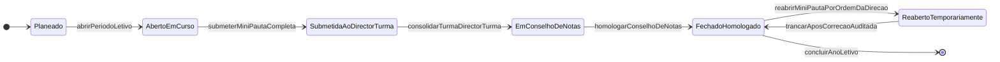

| Estado Origem | Evento / Gatilho | Estado Destino | Quem Dispara (RBAC) | Condições de Guarda (Bloqueios Obrigatórios) |
| :--- | :--- | :--- | :--- | :--- |
| `Planeado` | `abrirPeriodoLetivo` | `Aberto / Em Curso` | `SUB_PED`, `DIR_GERAL` | Matrizes curriculares ativas; turmas criadas; para o II ou III Trimestre, o trimestre anterior em `Encerrado Oficialmente`; **para o I Trimestre, o Ano Letivo anterior `Encerrado`** (`RN-18.1.4`); horários das turmas publicados para gerar as aulas previstas (`RN-12.11.5`). |
| `Aberto / Em Curso` | `submeterMiniPautaCompleta` | `Submetida ao Director de Turma` | `PROF` (ou `SUB_PED` em avocação) | 100% dos alunos ativos com as componentes do trimestre preenchidas — I e II: `MTP`, `PP`, `PT`; III: `MTP`, `PP` (e `PG` na época da Prova Global) — ou `DISP`, sem células nulas. 🟡 Uma célula `PENDENTE_2A_CHAMADA` impede a submissão até à nota da 2.ª chamada (`RN-01.3`). Reposições do trimestre já registadas (`RN-12.15.3`). Bloqueia edição pelo `PROF`. |
| `Submetida ao Director de Turma` | `consolidarTurma` | `Em Conselho de Notas` | `DIR_TURMA`, `SUB_PED` | **Todas** as Mini-Pautas da turma `Submetida ao Director de Turma`; comportamento trimestral proposto para todos os alunos (`RN-15.7`). |
| `Em Conselho de Notas` | `homologarConselhoDeNotas` | `Fechado / Homologado` | `SUB_PED` + `DIR_GERAL` | Ata do Conselho validada pelo `DIR_TURMA`; comportamento confirmado (`RN-15.7`); sem conflitos de sincronização pendentes no escopo (`IND-13`); identidades de controlo das estatísticas verificadas (`RN-17.14.4`); reautenticação (`RN-16.14`). No I Trimestre, dispara o **Congelamento do `N.º de Ordem` (`RN-05`)**; no fim do ano, grava o instantâneo oficial dos indicadores (`RN-17.4`). |
| `Fechado / Homologado` | `reabrirMiniPautaPorOrdemDaDirecao` | `Reaberto Temporariamente` | Exclusivo `SUB_PED` ou `DIR_GERAL` (**ambos**, se o Ano Letivo já estiver `Encerrado` — `RN-18.12.2c`) | Opera sobre a `Turma + Disciplina` (e opcionalmente `Aluno`) sem abrir as restantes turmas. Exige: (1) N.º do Despacho, (2) Motivo, (3) Prazo de expiração (`1h–48h`), (4) reautenticação. Grava em `audit_logs`. Num ano encerrado, passa pela análise de impacto do `RN-18.13`. |
| `Reaberto Temporariamente` | `trancarAposCorrecaoAuditada` | `Fechado / Homologado` | `SUB_PED`, `DIR_GERAL` ou Job de Expiração | Regista em `audit_logs` `old_value` e `new_value` de cada nota alterada, recalcula `M1`–`M3`, `CF` e `CA` e incrementa a versão da Mini-Pauta e da Pauta Geral; os indicadores voltam a `PROVISÓRIO` até novo fecho (`RN-17.4.3`). |

> [!note] Correção de um sumário (C04)
> Uma aula `Lecionada` pode ter o sumário e as faltas corrigidos pelo próprio professor enquanto a Mini-Pauta estiver `Aberta para Docente`. Depois, a correção segue a reabertura auditada, tal como as notas.

---

### 3.2 Máquina de Estado: Candidatura à 10ª Classe (`CANDIDATURA`) — DP n.º 167/23 e DE n.º 361/26

> [!tip] 🎨 Diagrama Visual da Admissão no FigJam
> [Quadro Secção 05.6 no Figma](https://www.figma.com/board/OneLIwLlc2kuM1koaIeXG0) *(ainda na v1.2, com o estado de ajuste de limiar que esta versão retira)*.

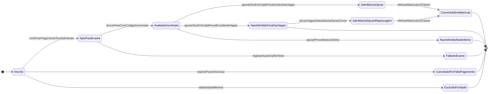

| Estado Origem | Evento / Gatilho | Estado Destino | Quem Dispara (RBAC) | Condições de Guarda (Bloqueios Obrigatórios) |
| :--- | :--- | :--- | :--- | :--- |
| `Inscrito` | `validarIdadeMinima` | `Excluído (Idade)` | Sistema | Idade inferior a **15 anos completados no ano da matrícula** (DP n.º 167/23, art. 23.º; DE n.º 361/26, art. 4.º). 🟡 Idade máxima: sem fonte legal, parâmetro desligado por omissão (`Q-LEG-09`). |
| `Inscrito` | `confirmarPagamentoTaxaAdmissao` | `Apto para Exame (Taxa Paga)` | `OP_TES` (documento fiscal de quitação) | Comprovativo de pagamento da taxa de inscrição (DE n.º 361/26, art. 12.º); conclusão da 9ª Classe (DP n.º 167/23, art. 22.º). Aloca a sala e gera o **Código de Anonimato** (escolha de implementação compatível com o art. 15.º). |
| `Apto para Exame` | `lancarNotaComCodigoAnonimato` | `Avaliado (Código Anonimato)` | `CHEFE_SEC_PED`, `SUB_PED` | Lançamento cego de `Nota_LP` e `Nota_Mat` (teste único com secções de Língua Portuguesa e Matemática — DE n.º 361/26, art. 10.º). Calcula a `MFA` para ordenação (`RN-01.2`). |
| `Avaliado (Código Anonimato)` | `publicarResultados` | `Admitido (1ª Opção)`, `Não Admitido (Fora das Vagas)` ou `Não Admitido (Nota Inferior ao Mínimo)` | `SUB_PED` + `DIR_GERAL` (descodificação com reautenticação) | Após trancamento de 100% das notas, confronto com `quadros_vagas_admissao`:<br>• **`ADMITIDO`:** **cada prova $\ge 10$** (DP n.º 167/23, art. 52.º, n.º 1) **e** classificado, por ordem decrescente da `MFA`, dentro de `total_vagas_disponiveis`; empate na última vaga → **menor idade** (DE n.º 361/26, art. 16.º, n.º 2, c));<br>• **`NÃO ADMITIDO (Fora das Vagas)`:** cada prova $\ge 10$, mas depois da última vaga da 1ª Opção;<br>• **`NÃO ADMITIDO (Nota Inferior ao Mínimo)`:** alguma prova $< 10$ — **não é admitido mesmo que fiquem vagas por preencher**.<br>Lista de selecionados **72 h** após o teste; reclamação **até 24 h** após a publicação, decidida em **24 h**; lista definitiva após homologação do Director (art. 17.º–19.º — `RN-01.2`). |
| `Não Admitido (Fora das Vagas)` | `alocarVagasSobrantes2aOpcao` | `Admitido (2ª Opção / Repescagem)` | `SUB_PED` + `DIR_GERAL` | 🟡 **Prática interna sem base legal** (`COR-LEG-10`, `Q-LEG-12`): se sobrarem vagas noutro Curso/Turno, os excedentes com cada prova $\ge 10$ que o indicaram como **2ª Opção** são repescados por ordem decrescente de `MFA`. |
| `Admitido` *(1ª ou 2ª Opção)* | `efetivarMatricula10Classe` | `Convertido em Matrícula` | `OP_PED`, `CHEFE_SEC_PED` | Incrementa `vagas_preenchidas`, cria o registo de `Aluno`, gera o `N.º de Processo Individual` e abre a `Matrícula` na 10ª classe em `Pendente`, com o número anual do Boletim de Matrícula (`RN-11.14`); os documentos já entregues na candidatura entram como `Entregue` (§3.8). |

> [!warning] Retirado nesta versão (`COR-LEG-08`)
> O estado `Admitido (Por Despacho de Ajuste de Limiar)` e a transição `homologarReducaoLimiarCursoComVagas` foram **retirados**: o DP n.º 167/23, art. 52.º, n.º 1, proíbe admitir abaixo de 10 valores em cada prova "mesmo que fiquem vagas por preencher". O parâmetro só volta se o Gabinete Provincial confirmar exceções por escrito (`Q-LEG-10`).

---

### 3.3 Máquina de Estado: Matrícula Anual (`MATRICULA`)

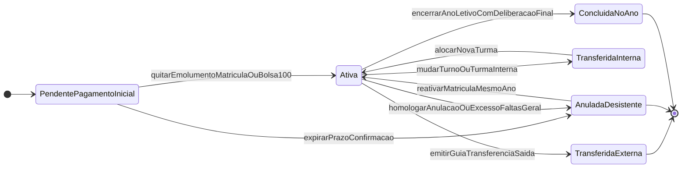

| Estado Origem | Evento / Gatilho | Estado Destino | Quem Dispara (RBAC) | Condições de Guarda (Bloqueios Obrigatórios) |
| :--- | :--- | :--- | :--- | :--- |
| `[Criação]` | `efetivarMatricula10Classe` / `confirmarMatricula` | `Pendente (Aguardando Pagamento Inicial)` | `OP_PED` / Sistema (modo `AUTOMATICA` — `RN-18.6.4`) | Recebe o número anual do Boletim de Matrícula ou de Confirmação (`RN-11.14`); gera os requisitos documentais em `Em Falta` (§3.8). Na confirmação, parte de uma Proposta `Apta a Confirmar` (§3.20). |
| `Pendente (Aguardando Pagamento Inicial)` | `quitarEmolumentoMatricula` | `Ativa` | Sistema (via `OP_TES`) ou `SUB_ADM` (Bolsa 100%) | Documento fiscal de quitação da Taxa de Matrícula/Confirmação + 1ª Propina (Setembro), **ou** Bolsa de 100% homologada. Aloca na `Turma` e gera as 10 prestações. **Uma pendência documental não impede a ativação** (`RN-11.7.1`). |
| `Pendente` | `expirarPrazoConfirmacao` | `Anulada / Desistente` | Tarefa diária | 🟡 Prazo do Ano Letivo; valor proposto **60 dias após o início do ano letivo** (DP n.º 167/23, art. 50.º, n.º 8 — `COR-LEG-15`; DESC-RESP R5). O aluno fica `Interrompido` (§3.21). |
| `Ativa` | `emitirGuiaTransferenciaSaida` | `Transferida (Externa)` | `CHEFE_SEC_PED` + `SUB_PED` | **Dívida exigível e dívida reescalonada iguais a zero** (`RN-08`, `RN-13.8.3`); cancela as propinas vincendas; anula o cartão de estudante (`RN-11.10.5`); após o I Trimestre, mantém a linha e o `N.º de Ordem` fixos com a marcação `TRANSFERIDO`. |
| `Ativa` | `mudarTurnoOuTurmaInterna` | `Transferida (Interna)` $\rightarrow$ `Ativa` | `CHEFE_SEC_PED` + `SUB_PED` | Após o I Trimestre (`RN-05.1`), mantém a posição congelada na turma de origem (`TRANSFERIDO INTERNO`) e aloca na turma de destino com `num_ordem = max + 1`, migrando as notas do I Trimestre. |
| `Ativa` | `homologarAnulacaoOuDesistencia` | `Anulada / Desistente` | `CHEFE_SEC_PED` + `SUB_PED` | Requerimento do encarregado ou abandono formalizado; cancela propinas futuras; anula o cartão; preserva a linha e o `N.º de Ordem` como `ANULADO/DESISTENTE`. |
| `Anulada / Desistente` | `reativarMatriculaMesmoAno` | `Ativa` | `SUB_PED` + `DIR_GERAL` | Reingresso excecional na mesma turma e Ano Letivo (`RN-05.1`): restaura o `N.º de Ordem` original e reativa as propinas vincendas. |
| `Ativa` | `encerrarAnoLetivoComDeliberacao` | `Concluída` | Sistema (Fecho da Pauta Geral) | **10ª–12ª:** Pauta Geral anual (depois da Prova Global e/ou do recurso) homologada com deliberação final (`RN-02`). **13ª:** 🟡 processo da 13ª em `Defendido e Homologado` (ou `Certificado Emitido`), ou, no encerramento do ano, em `Reprovado em PAP` ou sem estágio concluído (`RN-18.4.2`, `Q-C16-08`). |

> [!info] Perda do direito à confirmação (`COR-LEG-14`)
> O aluno que reprova por faltas injustificadas **perde o direito à confirmação de matrícula** no ano seguinte (DP n.º 167/23, art. 50.º, n.º 2); com justificação, a escola confirma nos **5 dias úteis** seguintes (n.º 3). Sem justificação, o reingresso é por despacho (`RN-03.6`, `RN-18.14.3`).

---

### 3.4 Máquina de Estado: Situação na Disciplina e Cadeiras em Atraso (`SITUACAO_DISCIPLINA`)

> 🟡 **Provisória** — parâmetro configurável; validar em E2 (`DEC-009`). Fonte: [[Sintese das Respostas da Fase B|DESC-RESP]] §1, [[Achados dos Documentos Reais - Lote 1|DESC-L1]] A1, A7 (`Q-025`, `Q-031`).

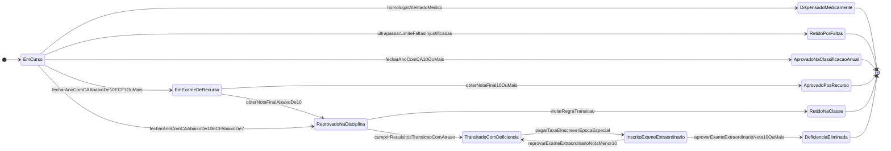

| Estado Origem | Evento / Gatilho | Estado Destino | Quem Dispara (RBAC) | Condições de Guarda (Bloqueios Obrigatórios) |
| :--- | :--- | :--- | :--- | :--- |
| `Em Curso` | `homologarAtestadoMedico` | `Dispensado (DISP)` | `SUB_PED` (atestado carregado pelo `OP_PED` e conferido pelo `CHEFE_SEC_PED` — matriz D4a) | Disciplinas elegíveis (ex.: Educação Física) com atestado válido (compartimento de saúde da APD-11). Impede reprovação e retira a disciplina do divisor. |
| `Em Curso` | `ultrapassarLimiteFaltas` | `Retido por Faltas` | Sistema (ao gravar faltas) + `DIR_TURMA` | `Total_Faltas_Injustificadas > Limite_Faltas` da disciplina (`RN-03`). Bloqueia a `CA` e o acesso a recurso; gera perda do direito à confirmação (`RN-03.6`). |
| `Em Curso` | `fecharAno` | `Aprovado (CA ≥ 10)`, `Em Recurso` ou `Reprovado` | Sistema (Conselho de Notas final) | `CF = round_med((M1 + M2 + M3) / 3)`; `CA = round_med(CF × 0,6 + PG × 0,4)`. `CA ≥ 10` → aprovado; `CA < 10` e `CF ≥ 7` → `Em Recurso` (julho); `CA < 10` e `CF < 7` → reprovado (`RN-01`). |
| `Em Recurso` | `lancarNotaRecurso` | `Aprovado Pós-Recurso` ou `Reprovado` | `CHEFE_SEC_PED` + `SUB_PED` | 🟡 Fórmula da nota depois do recurso por confirmar (`Q-025`); até lá é parâmetro obrigatório da Matriz do ano. |
| `Reprovado na Disciplina` | `deliberarConselhoFinal` | `Transitado com Deficiência (Cadeira em Atraso)` | Motor de Regras do Conselho de Notas | **Só 10ª e 11ª classes**: (1) classificação final entre `7` e `9`; (2) total de disciplinas reprovadas no ano `≤ max_deficiencias_transicao` (**2**); (3) **não** reprovou ao mesmo tempo Língua Portuguesa e uma disciplina nuclear (`RN-02`). Na 12ª não há transição com deficiência. |
| `Transitado com Deficiência` | `pagarTaxaEInscreverExame` | `Inscrito em Exame Extraordinário` | `OP_PED` + Semáforo `OP_TES` | Época extraordinária (maio) aberta pelo `SUB_PED`; **taxa paga por disciplina** (DESC-RESP §1). |
| `Inscrito em Exame Extraordinário` | `lancarNotaExameExtra` | `Deficiência Eliminada` (`≥ 10`) ou volta a `Transitado com Deficiência` (`< 10`) | `CHEFE_SEC_PED` + `SUB_PED` | Registo do Termo de Exame no livro de registo (`RN-10.2`). Enquanto não for eliminada, **bloqueia a conclusão da 12ª e a matrícula na 13ª** (`RN-02.6`). |

---

### 3.5 Máquina de Estado: Processo da 13ª Classe — Projecto Tecnológico, Estágio e PAP (`PROCESSO_13_CLASSE`)

```mermaid
stateDiagram-v2
    direction LR
    [*] --> BloqueadoCadeirasEmAtraso
    BloqueadoCadeirasEmAtraso --> AptoPara13Classe: validar10a12ConcluidasSemDeficiencias
    AptoPara13Classe --> EmEstagioEProjectoTecnologico: alocarEmpresaTutorEOrientador
    EmEstagioEProjectoTecnologico --> AptoParaDefesaPAP: concluirEstagioComParecerETaxaPaga
    AptoParaDefesaPAP --> DefendidoEHomologado: registarAtaJuriECalcularMFC
    AptoParaDefesaPAP --> ReprovadoEmPAP: obterNotaPAPAbaixoDoMinimo
    ReprovadoEmPAP --> AptoParaDefesaPAP: reinscreverNovaEpocaDefesaPAP
    DefendidoEHomologado --> CertificadoEmitido: registarTituloEImprimirComQR
    CertificadoEmitido --> [*]
```

| Estado Origem | Evento / Gatilho | Estado Destino | Quem Dispara (RBAC) | Condições de Guarda (Bloqueios Obrigatórios) |
| :--- | :--- | :--- | :--- | :--- |
| `Bloqueado (Possui Cadeiras em Atraso)` | `validar10a12Concluidas` | `Apto para 13ª Classe` | Sistema (Validador de Currículo) | 100% das disciplinas da 10ª–12ª aprovadas (ou com Transcrição Externa validada) e **ZERO** cadeiras em `Transitado com Deficiência` (`RN-02.6`). |
| `Apto para 13ª Classe` | `alocarEstagioEProjecto` | `Em Estágio / Projecto Tecnológico` | `COORD_CURSO` + `CHEFE_SEC_PED` | Matrícula na 13ª ativa; designação de: (1) Empresa parceira + Supervisor de Empresa + Tutor Interno (Estágio, 20 tempos semanais); (2) tema do Projecto Tecnológico + Professor Orientador. |
| `Em Estágio / Projecto Tecnológico` | `prepararDefesaPublica` | `Apto para Defesa` | `COORD_CURSO` + Semáforo `OP_TES` | Cumulativamente (DESC-RESP R20 — `RN-06.3`): (1) **estágio concluído** com nota homologada; (2) **parecer positivo do Orientador**; (3) **0 cadeiras em atraso**; (4) **propinas e taxa de defesa pagas**; (5) júri constituído com professores **e representantes dos trabalhadores e dos empregadores** (DP n.º 167/23, art. 33.º, n.º 2), data e sala. |
| `Apto para Defesa` | `registarAtaDefesaPAP` | `Defendido e Homologado` | `COORD_CURSO` + `SUB_PED` + `DIR_GERAL` | Ata da defesa do relatório de estágio assinada; 🟡 `Nota_PAP` igual ou superior ao mínimo parametrizado (`10` sem fonte); **aprovação no Projecto Tecnológico e em todas as disciplinas do plano** (art. 33.º, n.º 1); calcula a `MFC` (🟡 pesos — `RN-06`). A Situação Académica passa a `Concluiu o Curso` (`RN-18.14.2`). |
| `Apto para Defesa` | `obterNotaPAPAbaixoDoMinimo` | `Reprovado em PAP` | Júri via `COORD_CURSO` | Nova época na 13ª Classe no ano seguinte (`NOVA_EPOCA_13A` — `RN-18.5`). |
| `Defendido e Homologado` | `emitirCertificado` | `Certificado Emitido` | `CHEFE_SEC_PED` + `DIR_GERAL` | Emolumento pago; **sem pendência documental bloqueante** (`RN-11.7`, `RN-08.1`); registo no livro de registo/base de dados com número sequencial e código alfanumérico; QR da Plataforma Nacional de Certificação ou QR próprio (`RN-10.2`, `RN-10.3`). O **Diploma** não é emitido aqui: o SGE **exporta os dados e o pedido** ao Ministério (`RN-10.5`). |

---

### 3.6 Máquina de Estado: Propina / Mensalidade (`PROPINA_MENSAL`)

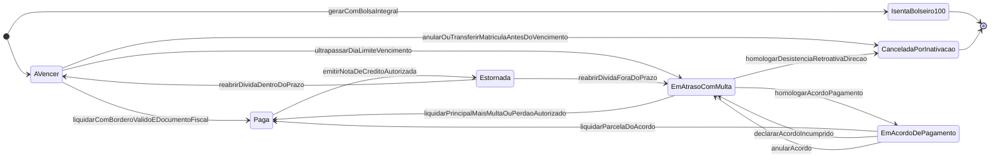

| Estado Origem | Evento / Gatilho | Estado Destino | Quem Dispara (RBAC) | Condições de Guarda (Bloqueios Obrigatórios) |
| :--- | :--- | :--- | :--- | :--- |
| `[Criação da Matrícula]` | `gerarPlanoPropinas` | `A Vencer` ou `Isenta (Bolseiro 100%)` | Motor Financeiro | 10 prestações (Setembro a Junho). Bolsa de 100% → nasce `Isenta (0,00 Kz)`; bolsa parcial ou desconto → nasce `A Vencer` pelo valor líquido (`RN-07`). Se a renovação do benefício ainda não foi decidida, nasce pelo valor bruto (`RN-18.11.3`). |
| `A Vencer` | `ultrapassarDiaLimiteVencimento` | `Em Atraso (com Multa)` | Job Diário | Data atual `> Data_Limite_Vencimento` (🟡 dia 10 ou 15 — DESC-RESP R9). **Semáforo Vermelho** e multa 🟡 pela regra parametrizada (`RN-13.3`, `Q-C10-01`). |
| `A Vencer` / `Em Atraso` | `liquidarPropina` | `Paga` | `OP_TES` | Borderô(s) com `saldo_disponivel >= valor_a_pagar` (um talão de valor inferior **não quita** o mês — `RN-09.3`), gerando o documento fiscal de quitação (Fatura-Recibo ou Recibo — 🟡 `Q-LEG-16`). |
| `Em Atraso (com Multa)` | `liquidarPrincipalMaisMultaOuPerdaoAutorizado` | `Paga` | `OP_TES` (perdão autorizado por `SUB_ADM` / `DIR_GERAL`) | O perdão de multa é anterior à liquidação, com despacho, justificação e reautenticação (`RN-13.4`). |
| `Em Atraso (com Multa)` | `homologarAcordoPagamento` | `Em Acordo de Pagamento` | `SUB_ADM` / `DIR_GERAL` | Acordo homologado com documento assinado anexado; a multa fica congelada (`RN-13.7`, `RN-13.8`). |
| `Em Acordo de Pagamento` | `liquidarParcelaDoAcordo` | `Paga` | `OP_TES` | O documento de quitação liquida **todas** as prestações da parcela. |
| `Em Acordo de Pagamento` | `declararAcordoIncumprido` / `anularAcordo` | `Em Atraso (com Multa)` | *Job* diário / `SUB_ADM`, `DIR_GERAL` | Parcela vencida há mais de `dias_tolerancia_acordo` (`RN-13.9`), ou anulação com motivo. |
| `Paga` | `emitirNotaDeCredito` | `Estornada` | `SUB_ADM` / `DIR_GERAL` | Proibido apagar o documento original. A **Nota de Crédito** marca a prestação como `Estornada` e reabre a obrigação (`A Vencer` ou `Em Atraso`). |
| `A Vencer` | `anularOuTransferirMatricula` | `Cancelada (por Anulação/Transferência)` | Sistema | Só as prestações **futuras** são canceladas; as vencidas e não pagas continuam dívida do encarregado (`RN-13.10`). |

---

### 3.7 Máquina de Estado: Borderô / Talão Bancário Anti-Fraude (`BORDERO_BANCARIO`)

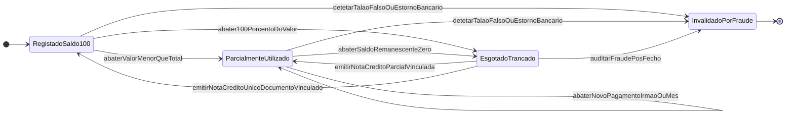

| Estado Origem | Evento / Gatilho | Estado Destino | Quem Dispara (RBAC) | Condições de Guarda (Bloqueios Obrigatórios) |
| :--- | :--- | :--- | :--- | :--- |
| `[Novo Talão]` | `registarBorderoBancario` | `Registado (Saldo Disponível = 100%)` | `OP_TES` | `UNIQUE (banco_id, numero_operacao_bordero)`; `valor_total_talao > 0`, `saldo_utilizado = 0`, `saldo_disponivel = valor_total_talao`. Estado de conciliação inicial `POR_CONCILIAR`. |
| `Registado (100%)` / `Parcialmente Utilizado` | `alocarSaldoEmDocumento` | `Parcialmente Utilizado` (`saldo_disponivel > 0`) ou `Esgotado / Trancado` (`= 0`) | `OP_TES` | `SELECT ... FOR UPDATE`: `valor_alocado <= saldo_disponivel`. Um talão pode pagar vários meses ou **irmãos**; o excedente fica como **crédito do aluno** (`RN-09.3`). **Proibido** alocar saldo de um borderô em conciliação `NAO_ENCONTRADO` ou `DIVERGENTE` (`RN-13.16.3`). |
| `Registado` / `Parcialmente Utilizado` / `Esgotado` | `declararFraudeBancaria` | `Invalidado por Fraude` | `SUB_ADM`, `DIR_GERAL` | Comprovativo adulterado ou falso detetado — **em particular pela conciliação bancária** (`RN-13.16`): bloqueia o borderô, gera **Notas de Crédito** (ou 🟡 a anulação dos documentos, a confirmar — `COR-LEG-03`) para todos os documentos que o usaram, reabre as dívidas e grava alerta crítico em `audit_logs`. |

**Dimensão de conciliação (C10 — `RN-13.14.3`), separada do saldo:** `POR_CONCILIAR` → `CONCILIADO` | `DIVERGENTE` | `NAO_ENCONTRADO`. As duas dimensões evoluem de forma independente.

---

### 3.8 Máquina de Estado: Documento do Processo (`DOC_PROCESSO`) — C03

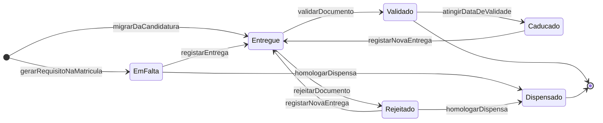

| Estado Origem | Evento | Estado Destino | Quem Dispara | Condições de Guarda |
| :--- | :--- | :--- | :--- | :--- |
| `[Matrícula]` | `gerarRequisitoNaMatricula` | `Em Falta` | Sistema | Requisito aplicável ao tipo de ingresso e à classe (`RN-11.2`). |
| `Em Falta` / `Rejeitado` / `Caducado` | `registarEntrega` | `Entregue` | `OP_PED`, `CHEFE_SEC_PED` | Se exigido: original conferido e digitalização anexada (`RN-11.4`, `RN-11.5`). |
| `Entregue` | `validarDocumento` | `Validado` | `CHEFE_SEC_PED` | Dados coerentes com o registo do aluno (ex.: n.º do BI igual ao de `alunos`). |
| `Entregue` | `rejeitarDocumento` | `Rejeitado` | `CHEFE_SEC_PED` | Motivo obrigatório (ilegível, incompleto, dados divergentes, caducado, outro). |
| `Validado` | `atingirDataDeValidade` | `Caducado` | Tarefa diária | Só para documentos com validade. |
| `Em Falta` / `Rejeitado` | `homologarDispensa` | `Dispensado` | `SUB_PED` (proposta `CHEFE_SEC_PED`) | Despacho e motivo; `audit_logs`. |

### 3.9 Máquina de Estado: Cartão de Estudante (`CARTAO_ESTUDANTE`) — C03

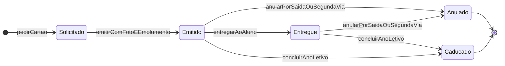

| Estado Origem | Evento | Estado Destino | Quem Dispara | Condições de Guarda |
| :--- | :--- | :--- | :--- | :--- |
| `Solicitado` | `emitirComFotoEEmolumento` | `Emitido` | `OP_PED` | Matrícula `Ativa`; fotografia `Validado`; emolumento pago e não consumido ou isenção (`RN-11.10.2`). Regista em `documentos_oficiais_emitidos` como `DOF-13`. |
| `Emitido` | `entregarAoAluno` | `Entregue` | `OP_PED` | Data de entrega e quem recebeu. |
| `Emitido` / `Entregue` | `anularPorSaidaOuSegundaVia` | `Anulado` | Sistema (saída do aluno) ou `CHEFE_SEC_PED` (2ª via) | Motivo (`TRANSFERENCIA`, `ANULACAO_MATRICULA`, `PERDA`, `ROUBO`, `DANO`, `ERRO`). O QR passa a "inválido". |
| `Emitido` / `Entregue` | `concluirAnoLetivo` | `Caducado` | Sistema (C16) | Ano Letivo `Encerrado` (🟡 se a validade for anual — `Q-C03-08`). |

---

### 3.10 Máquina de Estado: Plano de Distribuição de Serviço Docente (`PLANO_DSD`) — C04

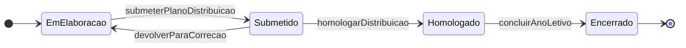

| Estado Origem | Evento | Estado Destino | Quem Dispara | Condições de Guarda |
| :--- | :--- | :--- | :--- | :--- |
| `Em Elaboração` | `submeterPlanoDistribuicao` | `Submetido` | `SUB_PED` (com propostas dos `COORD_CURSO`) | Todas as `turma_disciplinas` da 10ª à 12ª com titular proposto **ou** a marca "Sem Docente Atribuído". |
| `Submetido` | `devolverParaCorrecao` | `Em Elaboração` | `SUB_PED`, `DIR_GERAL` | Motivo obrigatório. |
| `Submetido` | `homologarDistribuicao` | `Homologado` | `SUB_PED` (+ visto `DIR_GERAL`, 🟡 `Q-C04-03`) | Nenhum professor acima do limite sem despacho de exceção (`RN-12.4`). As alocações passam de `PROPOSTA` a `VIGENTE`. Evento `DISTRIBUICAO_HOMOLOGADA`. |
| `Homologado` | `concluirAnoLetivo` | `Encerrado` | Sistema (C16) | Ano Letivo `Encerrado`. |

### 3.11 Máquina de Estado: Versão do Horário da Turma (`HORARIO_TURMA`) — C04

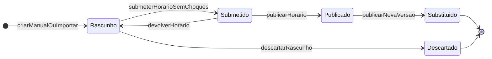

| Estado Origem | Evento | Estado Destino | Quem Dispara | Condições de Guarda |
| :--- | :--- | :--- | :--- | :--- |
| `Rascunho` | `submeterHorarioSemChoques` | `Submetido` | Quem elabora o horário (`SUB_PED` ou delegado — 🟡 `Q-C04-03`, `Q-011`) | 0 choques bloqueantes (`RN-12.9`) e completude (`RN-12.8`). |
| `Submetido` | `publicarHorario` | `Publicado` | `SUB_PED` | `data_inicio_vigencia >= hoje` (exceto correção do `RN-12.11.4`). Gera as aulas `PREVISTA`. Evento `HORARIO_PUBLICADO`. |
| `Publicado` | `publicarNovaVersao` | `Substituído` | Sistema | Define `data_fim_vigencia`; regenera as aulas previstas futuras (`RN-12.11.3`). |

### 3.12 Máquina de Estado: Aula (`AULA` — Livro de Sumários) — C04

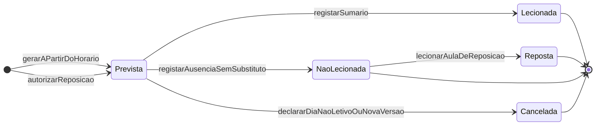

| Estado Origem | Evento | Estado Destino | Quem Dispara | Condições de Guarda |
| :--- | :--- | :--- | :--- | :--- |
| `Prevista` | `registarSumario` | `Lecionada` | Professor efetivo (`PROF`) | Trimestre `Aberto / Em Curso`; data da aula `<=` hoje; sumário não vazio. Regista as faltas por tempo e por tipo (`RN-12.13`, `RN-03`). |
| `Prevista` | `registarAusenciaSemSubstituto` | `Não Lecionada` | `COORD_TURNO` (ou `SUB_PED`) | Motivo de lista fechada. Sem faltas de alunos. |
| `Prevista` | `declararDiaNaoLetivoOuNovaVersao` | `Cancelada` | Sistema | Dia não letivo (`RN-12.12`) ou nova versão do horário (`RN-12.11`). |
| `Não Lecionada` | `lecionarAulaDeReposicao` | `Reposta` | Sistema | Reposição autorizada no mesmo trimestre ficou `Lecionada` (`RN-12.15`). |

---

### 3.13 Máquina de Estado: Acordo de Pagamento (`ACORDO_PAGAMENTO`) — C10

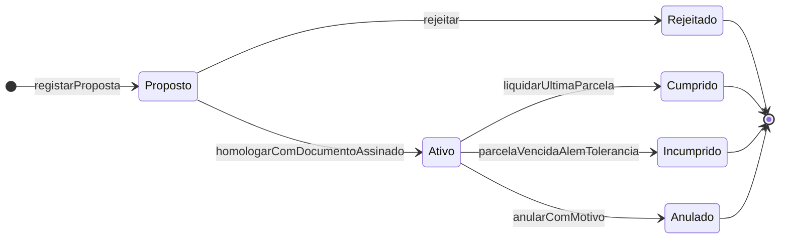

| Estado Origem | Evento | Estado Destino | Quem Dispara | Condições de Guarda |
| :--- | :--- | :--- | :--- | :--- |
| `[novo]` | `registarProposta` | `PROPOSTO` | `OP_TES`, `CHEFE_SEC_GER` | Encarregado sem outro acordo ativo; só prestações `Em Atraso`; parcelas por prestações inteiras (`RN-13.7`). |
| `PROPOSTO` | `homologar` | `ATIVO` | `SUB_ADM` (ou `DIR_GERAL` acima dos limites) | Reautenticação; homologador ≠ quem registou; `DOF-18` (Acordo de Pagamento) assinado e digitalizado. |
| `PROPOSTO` | `rejeitar` | `REJEITADO` | `SUB_ADM` / `DIR_GERAL` | Motivo obrigatório. |
| `ATIVO` | `liquidarUltimaParcela` | `CUMPRIDO` | Sistema | Todas as prestações do acordo `Paga`. |
| `ATIVO` | `parcelaVencidaAlemTolerancia` | `INCUMPRIDO` | *Job* diário | `RN-13.9`. |
| `ATIVO` | `anularComMotivo` | `ANULADO` | `SUB_ADM` / `DIR_GERAL` | Motivo; prestações voltam a `Em Atraso`. |

**Período de conciliação bancária:** `ABERTO` → (`importarExtrato`) → `EM_CONCILIACAO` → (`homologarConciliacao`, `RN-13.19`) → `FECHADO_HOMOLOGADO`. Sem transição de volta.

**Aviso de cobrança:** `GERADO` → `ENTREGUE` (data, a quem, canal) | `NAO_ENTREGUE` (motivo) | `ANULADO` (dívida paga antes da entrega, ou gerado por erro). O canal e a entrega seguem a máquina do Aviso (§3.14).

---

### 3.14 Máquina de Estado: Aviso (`AVISO`) — C12

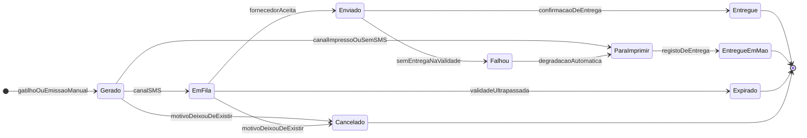

| Origem | Evento | Destino | Quem | Guarda |
| :--- | :--- | :--- | :--- | :--- |
| `Gerado` | encaminhar | `EmFila` / `ParaImprimir` | Sistema | Contacto verificado e consentimento para SMS; senão impresso (`RN-14.1`, `RN-14.9`). |
| `EmFila` | enviar | `Enviado` | Sistema | Janela 07h–20h; tetos semanal e mensal (`RN-14.6`). |
| `Enviado` | confirmar | `Entregue` / `Falhou` | Fornecedor SMS | — |
| `Falhou` | degradar | `ParaImprimir` | Sistema | Incrementa as falhas do telefone (`RN-14.3.3`). |
| `ParaImprimir` | registar entrega | `EntregueEmMao` | `DIR_TURMA`, `OP_PED` | Indica a quem foi entregue. |
| `EmFila` | validade ultrapassada | `Expirado` | Sistema | Validade do aviso atingida antes do envio (`RN-14.8.2`). |
| qualquer não final | cancelar | `Cancelado` | Sistema / emissor | Ex.: propina paga antes do envio. |

---

### 3.15 Máquina de Estado: Ocorrência Disciplinar (`OCORRENCIA`) — C13

> 🟡 **Provisória** — parâmetro configurável; validar em E3 (`DEC-009`). Fonte: [[C13 - Disciplina e Comportamento]] (`Q-C13-06`).

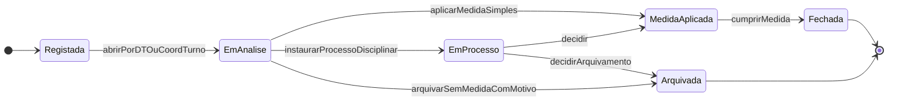

**Processo Disciplinar (`PROC_DISC`):** `Instaurado` → `EmInstrucao` → `AudicaoRealizada` → `Decidido` → (`EmRecurso` → `Decidido`) → `Concluido`. A transição para `Decidido` exige a audição registada (ou a recusa do aluno/encarregado em comparecer, com prova da convocatória). Instaurado e decidido pela Direção (`RN-15.6`).

---

### 3.16 Máquina de Estado: Conta de Utilizador (`CONTA`) — C14

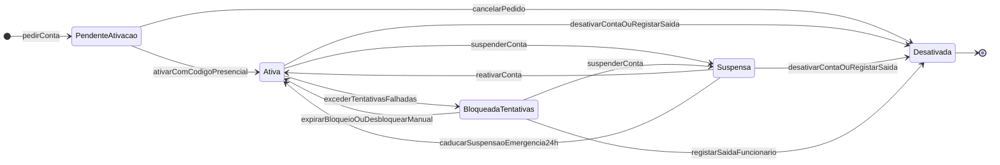

| Estado Origem | Evento | Estado Destino | Quem Dispara | Condições de Guarda |
| :--- | :--- | :--- | :--- | :--- |
| `[novo]` | `pedirConta` | `PENDENTE_ATIVACAO` | `CHEFE_SEC_GER` | Cadastro ativo com Nome, BI e Telefone; pelo menos uma atribuição proposta (`RN-16.2`). |
| `PENDENTE_ATIVACAO` | `ativarComCodigoPresencial` | `ATIVA` | Titular | Pelo menos uma atribuição **aprovada**; código presencial válido; palavra-passe conforme `RN-16.11`; MFA registado se alguma atribuição o exigir (`RN-16.12`). |
| `PENDENTE_ATIVACAO` | `cancelarPedido` | `DESATIVADA` | `CHEFE_SEC_GER` ou Sistema | Todas as atribuições rejeitadas, ou pedido cancelado com motivo. |
| `ATIVA` | `excederTentativasFalhadas` | `BLOQUEADA_TENTATIVAS` | Sistema | 🟡 5 falhas consecutivas. |
| `BLOQUEADA_TENTATIVAS` | `expirarBloqueio` / `desbloquearManual` | `ATIVA` | Sistema (15 min) / `ADMIN_TEC` ou `CHEFE_SEC_GER` | No 2.º bloqueio do dia só o desbloqueio manual é aceite. |
| `ATIVA` / `BLOQUEADA_TENTATIVAS` | `suspenderConta` | `SUSPENSA` | `DIR_GERAL`, `SUB_ADM`, `SUB_PED` (contas pedagógicas), `ADMIN_TEC` (emergência) | Motivo; reautenticação (`RN-16.10`, `RN-16.14`). |
| `SUSPENSA` | `reativarConta` | `ATIVA` | `DIR_GERAL`, `SUB_ADM` (ou `SUB_PED` se foi quem suspendeu) | Reautenticação; a suspensão de emergência caduca às 24 h se não for confirmada. |
| `ATIVA` / `SUSPENSA` / `BLOQUEADA_TENTATIVAS` | `desativarConta` / `registarSaidaFuncionario` | `DESATIVADA` | `DIR_GERAL`, `SUB_ADM`, ou Sistema | Efeitos do `RN-16.7` e pendências do `RN-16.8`. **Irreversível.** |

### 3.17 Máquina de Estado: Atribuição de Cargo (`ATRIB_CARGO`) — C14

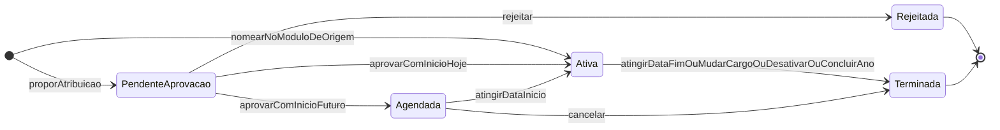

| Estado Origem | Evento | Estado Destino | Quem Dispara | Condições de Guarda |
| :--- | :--- | :--- | :--- | :--- |
| `[nova]` | `proporAtribuicao` | `PENDENTE_APROVACAO` | `CHEFE_SEC_GER` | Escopo válido para o papel (`RN-16.3`). |
| `[nova]` | `nomearNoModuloDeOrigem` | `ATIVA` | `SUB_PED` / `CHEFE_SEC_PED` | A nomeação (Director de Turma, Coordenador) já é um ato homologado no módulo de origem. |
| `PENDENTE_APROVACAO` | `aprovar` | `AGENDADA` ou `ATIVA` | Aprovador do `RN-16.2` | Aprovador ≠ requerente ≠ titular; sem incompatibilidade (`RN-16.5`); categoria `Docente` quando exigida; despacho preenchido. |
| `ATIVA` | `atingirDataFim` / `mudarCargo` / `desativarConta` / `concluirAnoLetivo` | `TERMINADA` | Sistema ou aprovador | `data_fim` preenchida; nunca se apaga a linha. |

**Dispositivo Autorizado:** `AUTORIZADO` → `REVOGADO` (pelo titular, `ADMIN_TEC`, `SUB_PED`, ou automaticamente na suspensão/desativação). Um dispositivo `REVOGADO` só volta com um **novo registo**, nunca reativando a linha antiga.

---

### 3.18 Máquina de Estado: Alerta de Gestão (`ALERTA`) — C15

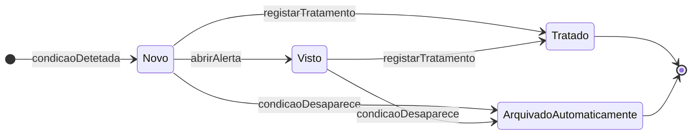

| Estado Origem | Evento | Estado Destino | Quem Dispara | Condições de Guarda |
| :--- | :--- | :--- | :--- | :--- |
| `[novo]` | `condicaoDetetada` | `NOVO` | Sistema | Não existe alerta aberto do mesmo tipo para a mesma entidade e destinatário. |
| `NOVO` | `abrirAlerta` | `VISTO` | Titular do cargo + escopo destinatário | Regista quem e quando. |
| `NOVO` / `VISTO` | `registarTratamento` | `TRATADO` | Titular do cargo destinatário (ou superior: `SUB_PED` nos pedagógicos, `SUB_ADM` nos financeiros, `DIR_GERAL` em todos) | Nota de tratamento obrigatória. |
| `NOVO` / `VISTO` | `condicaoDesaparece` | `ARQUIVADO_AUTOMATICAMENTE` | Sistema | Ex.: falta justificada baixa o consumo; aluno transferido; conflito decidido; borderô conciliado. |

---

### 3.19 Máquina de Estado: Ano Letivo (`ANO_LETIVO`) — C16

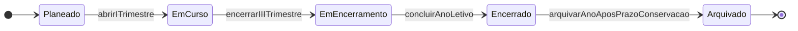

| Estado Origem | Evento | Estado Destino | Quem Dispara | Condições de Guarda |
| :--- | :--- | :--- | :--- | :--- |
| `Planeado` | `abrirITrimestre` | `Em Curso` | `SUB_PED`, `DIR_GERAL` | Guardas do §3.1 (`abrirPeriodoLetivo`) **e** ano anterior `Encerrado` (`RN-18.1.4`). |
| `Em Curso` | `encerrarIIITrimestre` | `Em Encerramento` | `SUB_PED` | III Trimestre `Encerrado Oficialmente`. |
| `Em Encerramento` | `concluirAnoLetivo` | `Encerrado` | `SUB_PED` + `DIR_GERAL` | Bloqueantes B1–B8 cumpridos (`RN-18.3`); passagem definitiva executada; cópia anual de fecho verificada. Ativa o modo só de leitura (`RN-18.12`), termina as atribuições de cargo do ano (`RN-16.19.2`), caduca os cartões anuais e encerra o plano de distribuição. Evento `ANO_LETIVO_ENCERRADO`; emite o `DOF-25`. |
| `Encerrado` | `arquivarAnoAposPrazoConservacao` | `Arquivado` | `DIR_GERAL` | Lotes de conservação do ano aprovados e executados (APD-11, RF-C19-13). Depende da `C19`. |

> [!note] Sem reabertura do ano
> Não existe `Encerrado` → `Em Encerramento`. As correções fazem-se pela reabertura auditada de uma pauta (`RN-18.12.2c`, `RN-18.13`).

### 3.20 Máquina de Estado: Proposta de Confirmação de Matrícula (`PROPOSTA_CONF`) — C16

```mermaid
stateDiagram-v2
    direction LR
    [*] --> AptaAConfirmar: gerarSemImpedimentos
    [*] --> Bloqueada: gerarComImpedimento
    Bloqueada --> AptaAConfirmar: removerImpedimento
    AptaAConfirmar --> Bloqueada: surgirImpedimento
    AptaAConfirmar --> ConvertidaEmMatricula: confirmarMatricula
    AptaAConfirmar --> NaoConfirmada: expirarPrazoConfirmacao
    Bloqueada --> NaoConfirmada: expirarPrazoConfirmacao
    AptaAConfirmar --> Substituida: novaExecucaoOuRetificacao
    Bloqueada --> Substituida: novaExecucaoOuRetificacao
    AptaAConfirmar --> Cancelada: registarSaidaDoAluno
    Bloqueada --> Cancelada: registarSaidaDoAluno
    ConvertidaEmMatricula --> [*]
    NaoConfirmada --> [*]
    Substituida --> [*]
    Cancelada --> [*]
```

| Estado Origem | Evento | Estado Destino | Quem Dispara | Condições de Guarda |
| :--- | :--- | :--- | :--- | :--- |
| `[Execução]` | `gerarComImpedimento` | `Bloqueada` | Motor de passagem | Motivos: `DIVIDA_VENCIDA` (`RN-08`, só se o bloqueio por dívida estiver ligado — `RN-18.6.4`), `CADEIRAS_PENDENTES_13A` (`RN-02.6`), `TRANSCRICAO_EXTERNA_PENDENTE`, `AGUARDA_DESPACHO` (ex.: perda do direito por faltas — `RN-03.6`). |
| `Bloqueada` | `removerImpedimento` | `Apta a Confirmar` | Sistema | Todos os motivos resolvidos (ex.: dívida liquidada ou acordo que liberta o semáforo; deficiência eliminada). |
| `Apta a Confirmar` | `confirmarMatricula` | `Convertida em Matrícula` | `OP_PED`, `CHEFE_SEC_PED` (modo `BALCAO`) ou Sistema na passagem definitiva (modo `AUTOMATICA`) | Turma de destino com lotação; cria a matrícula `Pendente` (§3.3) com o número anual do Boletim de Confirmação. |
| `Apta a Confirmar` / `Bloqueada` | `expirarPrazoConfirmacao` | `Não Confirmada` | Tarefa diária | Data `>` prazo de confirmação (🟡 `Q-C16-01`). O aluno passa a `Interrompido`. |
| `Apta a Confirmar` / `Bloqueada` | `registarSaidaDoAluno` | `Cancelada` | `CHEFE_SEC_PED` | Transferência de saída ou desistência antes de confirmar. |

> [!note] Confirmação depois do prazo
> Uma proposta `Não Confirmada` pode ser reaberta pelo `CHEFE_SEC_PED` (nova proposta `Apta a Confirmar`) se houver vaga, com `audit_logs`.

### 3.21 Máquina de Estado: Situação Académica do Aluno (`SITUACAO_ACADEMICA` — vitalícia) — C16

```mermaid
stateDiagram-v2
    direction LR
    [*] --> Ativo: primeiraMatricula
    Ativo --> AguardaConfirmacao: concluirMatriculaComProposta
    AguardaConfirmacao --> Ativo: confirmarMatricula
    AguardaConfirmacao --> Interrompido: expirarPropostaSemConfirmacao
    Interrompido --> Ativo: reingressarComDespacho
    Ativo --> TransferidoSaida: emitirGuiaTransferenciaSaida
    Ativo --> DesistenteAnulado: homologarAnulacao
    DesistenteAnulado --> Ativo: reingressarComDespacho
    TransferidoSaida --> Ativo: regressarPorTransferenciaEntrada
    Ativo --> ConcluiuCurso: homologarDefesaPAP
    ConcluiuCurso --> [*]
```

As regras de cada estado estão no `RN-18.14`.

---

## 4. Regras de Negócio Invioláveis (As Leis do Sistema)

As regras abaixo constituem invariantes de domínio do **SGE — IPCAG N.º 12008 / BGO**. Devem ser implementadas tanto na camada de domínio da aplicação (serviços/use cases) quanto ao nível de constraints, triggers e funções no banco de dados PostgreSQL.

> [!important] Regras provisórias e parâmetros (`DEC-009`)
> Uma regra marcada 🟡 **Provisória** é um **parâmetro configurável** (por Ano Letivo, Curso, Classe ou Disciplina, conforme o caso), guardado no [[05 - Modelagem de Dados|DOC-05]], nunca uma constante no código. Uma divergência encontrada no ponto de controlo muda **parâmetros**, não a arquitetura. As regras sem a marca têm fonte legal confirmada ou são decisões de desenho do sistema.

| Família | Tema | Origem |
| :--- | :--- | :--- |
| `RN-01` a `RN-10` | Avaliação, transição, faltas, desacoplamento docente, numeração, 13ª Classe, benefícios, semáforo, fiscalidade, auditoria e certificação | v1.2, corrigidas na v2.0 |
| `RN-11` | Processo Individual do Aluno | [[C03 - Processo Individual do Aluno\|C03]] |
| `RN-12` | Horários e Distribuição de Serviço Docente | [[C04 - Horarios e Distribuicao de Servico Docente\|C04]] |
| `RN-13` | Cobrança, Relatórios Financeiros e Conciliação | [[C10 - Cobranca, Relatorios Financeiros e Conciliacao\|C10]] |
| `RN-14` | Comunicação com Encarregados e Alunos | [[C12 - Comunicacao com Encarregados e Alunos\|C12]] |
| `RN-15` | Disciplina e Comportamento | [[C13 - Disciplina e Comportamento\|C13]] |
| `RN-16` | Contas, Autenticação e Acesso | [[C14 - Gestao de Contas e Acesso\|C14]] |
| `RN-17` | Painéis, Indicadores e Alertas de Gestão | [[C15 - Paineis de Gestao da Direcao\|C15]] |
| `RN-18` | Passagem de Ano Letivo | [[C16 - Passagem de Ano Letivo\|C16]] |

---

### RN-01: Fórmulas de Avaliação e Arredondamento (`10ª à 12ª Classe`)

> 🟡 **Provisória** — parâmetro configurável; validar em E2 (`DEC-009`). Fonte: [[Achados dos Documentos Reais - Lote 1|DESC-L1]] A1/A2; [[Sintese das Respostas da Fase B|DESC-RESP]] §1; `COR-LEG-13`, `COR-LEG-26/27`. Bloqueada por `Q-025` (fórmulas) e `Q-LEG-21` (instrumento que aprova o modelo). **Não há regulamento de avaliação publicado para o ESTP**: as fórmulas abaixo são a prática descrita pela escola, a confirmar com o recálculo de pautas preenchidas ([[Plano de Validacao de Pautas]]).

1. **Escala de Avaliação:** todas as componentes (`MTP`, `PP`, `PT`, `PG`), médias (`M1`–`M3`, `CF`, `CA`), exames (recurso, extraordinário), estágio, Projecto Tecnológico e PAP usam a escala de **`0` a `20` valores** (escala confirmada noutros diplomas, não na Lei n.º 32/20 — `COR-LEG-24`; ex.: DE n.º 136/24, antecessor do regulamento de seleção, art. 11.º, n.º 1 — LEG-VER §3.1).
2. **Arredondamento (`round_med` — *Half-Up*):** `M1`, `M2`, `M3`, `CF` e `CA` são arredondados às unidades; parte decimal `≥ 0,5` sobe (confirmado pela escola — DESC-RESP §1).
   - Definição formal para $x \ge 0$: $$\text{round\_med}(x) = \lfloor x + 0,5 \rfloor$$
   - *Exemplos:* `9,49` $\rightarrow$ `9`; `9,50` $\rightarrow$ `10`; `13,666...` $\rightarrow$ `14`.
3. **Componentes e rótulos:** I e II Trimestres: `MTP`, `PP`, `PT`. III Trimestre: `MTP` e `PP` (**sem `PT`**). Fim do ano: `PG`. Os rótulos impressos (`MAC`/`NPP`/`NPT` ou `MTP`/`PP`/`PT`) são parâmetro de cada modelo de documento; o campo é o mesmo (`Q-026`).
4. **Médias do I e II Trimestres:**
   $$M_t = \text{round\_med}\left(\frac{MTP_t + PP_t + PT_t}{3}\right), \quad t \in \{1, 2\}$$
5. **Média do III Trimestre (`M3`):** calculada a partir de `MTP₃` e `PP₃`. 🟡 **A fórmula exata está por confirmar** (`Q-025`); o sistema exige que seja configurada na Matriz do ano antes de abrir o III Trimestre. Hipótese em análise, **não usada como valor por omissão**: `M3 = round_med((MTP₃ + PP₃) / 2)`. Se a `PG` se aplica a **todas** as disciplinas e classes, ou só a algumas, é atributo da disciplina na Matriz (`tem_prova_global`, 🟡 A1 §3).
6. **Classificação de Frequência (`CF`):** usa os valores inteiros já arredondados de `M1`, `M2`, `M3` (como impressos na Mini-Pauta):
   $$CF = \text{round\_med}\left(\frac{M_1 + M_2 + M_3}{3}\right)$$
7. **Classificação Anual (`CA`):** o "MT3" impresso na fórmula da Mini-Pauta é a `CF` (DESC-RESP §1):
   $$CA = \text{round\_med}\left(CF \times 0,6 + PG \times 0,4\right)$$
   - **Aprovação:** $CA \ge 10$ (e o aluno não retido por faltas). Pesos `0,6` / `0,4` são parâmetros.
8. **Exame de Recurso:** acesso quando $CA < 10$ **e** $CF \ge 7$; realizado em **julho**. 🟡 **A fórmula da nota depois do recurso está por confirmar** (`Q-025`): é parâmetro obrigatório da Matriz do ano. A ponderação `40% MFD + 60% Exame` da v1.2 foi **retirada** (sem fonte e com pesos invertidos face à prática e à regra das classes de exame do antigo RAA do Ensino Geral, DE n.º 424/25, já revogado — `COR-LEG-26`).
9. **Tratamento Matemático da Dispensa Médica (`DISP` — `RN-01.1`):**
   - Com `DISP` homologada nos 3 trimestres (ou em 2 dos 3 por incapacidade prolongada), as componentes e médias assumem `NULL` numérico e apresentação `'DISP'`; no cálculo da média anual da classe (para a `MFC`), o denominador é reduzido no número de disciplinas com `DISP` ($D_{\text{efetivo}} = D_{\text{total}} - D_{\text{DISP}}$).
   - **Dispensa parcial de 1 único trimestre (`RN-01.1`):** se o aluno foi avaliado em 2 trimestres e tem `DISP` num só, a `CF` é apurada dividindo a soma dos trimestres avaliados por **`2`** (ex.: $CF = \text{round\_med}((M_1 + M_3) / 2)$). 🟡 O efeito da `DISP` na `PG` e na `CA` segue a mesma lógica, a confirmar (`Q-025`).

#### RN-01.2: Admissão à 10ª Classe (DP n.º 167/23, art. 23.º, 49.º e 52.º; DE n.º 361/26)

1. **Idade mínima:** **15 anos completados no ano da matrícula** (DP n.º 167/23, art. 23.º; DE n.º 361/26, art. 4.º). 🟡 **Idade máxima:** sem fonte legal (`COR-LEG-11`); o parâmetro `idade_maxima_ingresso_regular` fica **desligado por omissão** até à resposta à `Q-LEG-09`.
2. **Teste e anonimato:** teste único com secções de **Língua Portuguesa** e **Matemática** (DE n.º 361/26, art. 10.º), corrigido **sob regime de anonimato** (art. 15.º). O Código de Anonimato é a forma de implementação adotada.
3. **Mínimo legal — `nota_minima_por_prova` = `10`:** só é selecionável o candidato com **pelo menos 10 valores em cada prova** (DP n.º 167/23, art. 52.º, n.º 1). Abaixo disso **não há admissão, mesmo que fiquem vagas por preencher**. A redução do limiar por despacho e o estado `Admitido (Por Despacho de Ajuste de Limiar)` foram **retirados** (`COR-LEG-08`); o parâmetro só se reabre com confirmação escrita do Gabinete Provincial (`Q-LEG-10`).
4. **Ordenação (`MFA`):** os candidatos com o mínimo em cada prova são ordenados por ordem decrescente de
   $$MFA = \text{round\_med}\left(\frac{\text{Nota\_LP} + \text{Nota\_Mat}}{2}\right)$$
   (art. 52.º, n.º 2: "média aritmética… se forem mais do que uma"). 🟡 Se as secções do teste único contam como provas separadas está indeterminado (`Q-LEG-10`).
5. **Desempate na última vaga:** **menor idade** (DE n.º 361/26, art. 16.º, n.º 2, c)). Os critérios da v1.2 (maior nota em LP/nuclear → média da 9ª) só voltam se o Gabinete Provincial os validar (`COR-LEG-09`, `Q-LEG-11`). 🟡 Persistindo o empate, a regra é por confirmar (o DE n.º 136/24 previa nova prova).
6. **Resultados oficiais:** `ADMITIDO` (cada prova $\ge 10$ e dentro das vagas); `NÃO ADMITIDO (Fora das Vagas)` (cada prova $\ge 10$, depois da última vaga da 1ª Opção); `NÃO ADMITIDO (Nota Inferior ao Mínimo)` (alguma prova $< 10$).
7. **Listas e reclamações (`COR-LEG-12`):** lista de selecionados **72 h** após o teste (art. 17.º); reclamação **até 24 h** após a publicação, decidida em **24 h** (art. 18.º); lista definitiva **após homologação do Director** (art. 19.º).
8. 🟡 **Repescagem na 2ª Opção — prática interna** (`COR-LEG-10`, `Q-LEG-12`; validar em E1): se sobrarem vagas num Curso/Turno após a 1ª chamada, a Direção (`SUB_PED` + `DIR_GERAL`) pode alocar os candidatos `NÃO ADMITIDO (Fora das Vagas)` que indicaram esse curso como **2ª Opção**, por ordem decrescente de `MFA`, gravando a operação em `audit_logs`. Nunca abrange candidatos com alguma prova abaixo de 10.

#### RN-01.3: Prova de 2.ª Chamada

> 🟡 **Provisória** — parâmetro configurável; validar em E2 (`DEC-009`). Fonte: [[Sintese das Respostas da Fase B|DESC-RESP]] §1.

1. O aluno que falta a uma `PP`, `PT` ou `PG` **por motivo justificado** — justificação validada pelo `DIR_TURMA` **e** pela Coordenação Pedagógica (`SUB_PED`) — tem direito a **prova de 2.ª chamada**.
2. Enquanto não a realiza, a célula da componente fica no estado **`PENDENTE_2A_CHAMADA`** (nem nota, nem zero) e a Mini-Pauta não pode ser submetida (§3.1).
3. Sem justificação aprovada, a ausência à prova não dá direito a 2.ª chamada; o valor a lançar nesse caso é parâmetro do regulamento (🟡 `Q-025`).
4. A prova de 2.ª chamada usa a variante própria das provas unificadas (`RN-01.4`). O prazo para a realizar é parâmetro do trimestre.

#### RN-01.4: Provas Unificadas com Variantes

> 🟡 **Provisória** — parâmetro configurável; validar em E2 (`DEC-009`). Fonte: [[Sintese das Respostas da Fase B|DESC-RESP]] §1.

1. A `PT` (I e II Trimestres) e a `PG` são **elaboradas pelo `COORD_DISC`**, com **variante A (Turno da Manhã)**, **variante B (Turno da Tarde)** e uma **variante de 2.ª chamada**, e recebem o **visto do Coordenador para a Área Pedagógica** (`SUB_PED`) antes da aplicação.
2. Cada nota de `PT`/`PG` regista a variante aplicada ao aluno (`A`, `B` ou `2A_CHAMADA`), para auditoria e para a análise de equivalência entre variantes.

---

### RN-02: Regra de Transição de Classe, Retenção e Cadeiras em Atraso (Deficiências)

> 🟡 **Provisória** — parâmetro configurável; validar em E2 (`DEC-009`). Fonte: [[Sintese das Respostas da Fase B|DESC-RESP]] §1; [[Achados dos Documentos Reais - Lote 1|DESC-L1]] A7, A10; `COR-LEG-13`. Bloqueada por `Q-025` e `Q-031`. Os valores (`7`, `2`, veto LP + nuclear) **não têm fonte publicada** para o ESTP; o único regulamento comparável (RAA do Ensino Geral) usa valores diferentes.

No encerramento do Conselho de Notas final (depois da Prova Global e do Exame de Recurso), o motor de deliberação executa, para cada aluno da **10ª, 11ª e 12ª classes**:

1. **Contagem de Reprovações ($N_{\text{rep}}$):** disciplinas da Matriz da classe com classificação final (`CA`, ou nota depois do recurso) $< 10$, ou `Retido por Faltas`.
2. **Caso 1 — Aprovação Limpa ($N_{\text{rep}} = 0$):**
   - 10ª e 11ª classes: **`Transita (Aprovado)`**.
   - 12ª classe: se o aluno também tiver **`0` Cadeiras em Atraso** de anos anteriores, **`Aprovado (Apto para a 13ª Classe)`**; se tiver cadeiras pendentes, ver `RN-02.2`.
3. **Caso 2 — 12ª Classe e notas abaixo de 7:**
   - Na **12ª Classe** não existe transição com deficiência (confirmado pela escola — `Q-031`): qualquer reprovação não sanada retém o aluno na 12ª.
   - Na **10ª e 11ª**, se alguma disciplina reprovada tiver nota final $< 7$ (ou `Retido por Faltas`), ou se $N_{\text{rep}} >$ `max_deficiencias_transicao` (padrão **`2`**; o boletim real de confirmação tem só dois campos para cadeiras em atraso — `RN-18.9.5`), a deliberação é **`Não Transita (Retido)`**. A hipótese "3 quando autorizado" da v1.2 fica só como valor possível do parâmetro, sem uso por omissão (`Q-C16-17`).
4. **Caso 3 — Veto Língua Portuguesa + Disciplina Nuclear (só 10ª e 11ª):**
   - A Língua Portuguesa só existe na 10ª e 11ª nos planos reais (A7); o veto não se aplica na 12ª.
     $$\text{Veto\_Nuclear} = (\text{Reprovou em Língua Portuguesa}) \land (\exists d \in \text{Reprovadas} : d.\text{is\_nuclear} = \text{TRUE})$$
   - Se $\text{Veto\_Nuclear} = \text{TRUE}$, a deliberação é **`Não Transita (Retido por LP + Nuclear)`**. A composição do veto (LP + *n* disciplinas de um conjunto) é parâmetro (`COR-LEG-13`).
5. **Caso 4 — Transição com Deficiências (Cadeiras em Atraso):**
   - Aluno da 10ª ou 11ª com $1 \le N_{\text{rep}} \le$ `max_deficiencias_transicao`, todas com nota final entre `7` e `9`, e $\text{Veto\_Nuclear} = \text{FALSE}$ → **`Transita com Deficiência`**.
   - O sistema cria os registos em **`cadeiras_em_atraso`** ligados ao `N.º de Processo Individual`.
6. **Eliminação de Cadeiras em Atraso e Bloqueio da 13ª Classe:**
   - As Cadeiras em Atraso eliminam-se em **Exame Extraordinário** (maio; taxa paga por disciplina; nota $\ge 10$) até ao encerramento da 12ª classe. 🟡 O prazo é parâmetro (o RAA do Ensino Geral manda eliminar até ao I Trimestre do ano seguinte).
   - **Trava Inviolável:** nenhum aluno passa a `Apto para 13ª Classe` enquanto existir $\ge 1$ Cadeira em Atraso não eliminada.
7. **Regime do Aluno Repetente (`RN-02.1`):** o aluno `Não Transita (Retido)` **repete a classe inteira** (DESC-RESP §1): frequenta todo o plano curricular da classe numa nova matrícula anual, preservando as classificações das classes anteriores concluídas e mantendo ativas as `cadeiras_em_atraso` de classes anteriores até à sua eliminação.

#### RN-02.2: 12ª Classe Aprovada com Cadeiras em Atraso Pendentes

> 🟡 **Provisória** — validar em E2 (`DEC-009`). Fonte: [[C16 - Passagem de Ano Letivo|C16]] (`RN-18.5`); `Q-C16-06`, `Q-031`.

O aluno da 12ª que aprova todas as disciplinas da 12ª mas ainda tem cadeiras em atraso da 10ª/11ª recebe a deliberação **`CONCLUIU_12_COM_CADEIRAS_PENDENTES`** (nome a validar). A passagem gera uma proposta `CONDICIONADA_13A`, bloqueada até à eliminação das cadeiras (`RN-18.9.3`). O vínculo do aluno no ano seguinte (só para exames?) é a `Q-C16-06`.

#### RN-02.3: Categorias Impressas na Pauta Geral

A Pauta Geral real agrupa as situações finais em **quatro categorias** (A10): **Transita** (`TRANSITA_APROVADO`, `APTO_PARA_13_CLASSE`), **Transita com deficiência** (`TRANSITA_COM_DEFICIENCIA`), **Não transita** (`NAO_TRANSITA_RETIDO_NOTAS`, `NAO_TRANSITA_VETO_LP_NUCLEAR`, `NAO_TRANSITA_RETIDO_FALTAS`) e **Desistente** (`ANULADO_DESISTENTE`). 🟡 A categoria impressa de `CONCLUIU_12_COM_CADEIRAS_PENDENTES` e dos transferidos não aparece na estatística real (`Q-C16-18`). A soma das categorias é igual ao número de linhas da pauta (`RN-17.14.4`).

---

### RN-03: Faltas, Justificação e Retenção por Faltas Injustificadas

> 🟡 **Provisória** — parâmetro configurável; validar em E2 (faltas) e E3 (tipos de falta e atrasos, regulamento interno) (`DEC-009`). Fonte: `COR-LEG-13/14`; [[Sintese das Respostas da Fase B|DESC-RESP]] R1–R4; [[Achados dos Documentos Reais - Lote 1|DESC-L1]] A8; `Q-032`, `Q-C13-03`, `Q-LEG-04`.

1. **Limite por disciplina:** o limite de faltas injustificadas ($\text{Limite\_Faltas}_d$) é um parâmetro da Matriz do Ano Letivo. Modelo da v1.2, mantido como opção: $\text{Limite\_Faltas}_d = F_{\text{mult}} \times T_{\text{sem}}$. **Sem fonte publicada** (`COR-LEG-13`): o regime (anual ou por trimestre; multiplicador ou escalões por n.º de tempos semanais, como no RAA do Ensino Geral) é parametrizável.
2. **Unidade de falta (`RN-03.1`):** cada **tempo letivo** em falta conta **1 falta**; uma ausência a um **tempo duplo** conta **2 faltas** (DESC-RESP R1). As faltas só se registam em **aulas `Lecionada`** do horário publicado ou em reposições autorizadas (`RN-12.13`); uma aula `Não Lecionada` ou `Cancelada` não admite faltas.
3. **Tipos de falta (`RN-03.2`):** cada falta é **por não comparência** ou **por indisciplina** (A8). A falta por indisciplina liga-se a uma ocorrência e **não é justificável** (`RN-15.1`). 🟡 Se as duas contam para o mesmo limite é a `Q-C13-03` (proposta: ambas contam). O boletim e a pauta somam os dois tipos em separado.
4. **Atrasos (`RN-03.3`):** no 1.º tempo letivo de cada turno há uma tolerância (🟡 10–15 min na prática; 15 min por omissão — `RN-15.2`); depois dela, o aluno leva falta de não comparência nesse tempo.
5. **Justificação de faltas (`RN-03.4`):**
   - O professor regista a ausência por tempo letivo na chamada da aula.
   - A justificação é pedida num **formulário numerado** (`N.º __/IPCAG/ano`, série anual — `RN-10.6`) pelo aluno ou encarregado, com intervalo de dias, motivo, documentos anexos e lista dos professores e cadeiras afetados (A8).
   - O **`DIR_TURMA`** regista e aprova; a aprovação fica efetiva com o **visto do Coordenador para a Área Pedagógica (`SUB_PED`)** (🟡 parâmetro `exige_visto_sub_ped`, ligado por omissão — `Q-032`). A Secretaria Pedagógica pode registar o pedido, mas não aprova.
   - **Efeito automático:** a justificação aprovada **abate a falta em todas as disciplinas afetadas** no intervalo, sem o aluno ter de a mostrar a cada professor (DESC-RESP R3).
   - O prazo para justificar é parâmetro do regulamento (`Q-LEG-04`). O atestado médico segue a APD-11.
6. **Efeito do excesso de faltas (`RN-03.6`):**
   - Quando $\text{Total\_Faltas\_Injustificadas}_d > \text{Limite\_Faltas}_d$, a disciplina passa a **`Retido por Faltas (RF)`**, sem `CA` nem acesso a recurso.
   - **Perda do direito à confirmação de matrícula** (DP n.º 167/23, art. 50.º, n.º 2 — `COR-LEG-14`): o aluno que reprova por faltas injustificadas perde o direito à matrícula ou à sua confirmação no ano seguinte. Com justificação aceite, a escola confirma a matrícula nos **5 dias úteis** seguintes (n.º 3). Sem ela, o reingresso faz-se por despacho (DESC-RESP R4; `RN-18.14.3`). 🟡 O prazo de justificação aplicável ao II Ciclo é a `Q-LEG-04`.
7. **Alertas precoces (`RN-03.5`):** ao atingir **80%** do limite numa disciplina (e, se a escola quiser, **50%**), o sistema cria um alerta de gestão para o `DIR_TURMA`, o `COORD_TURNO` e o `SUB_PED` (`RN-17.8`) e um aviso ao encarregado (`RN-14.5`). 🟡 Limiares parametrizáveis.

---

### RN-04: Desacoplamento Professor ↔ Notas (Continuidade em Substituição Docente e Avocação)

1. **Propriedade Estrutural das Avaliações:** nenhum registo de nota (`MTP`, `PP`, `PT`, `PG`) ou falta tem chave estrangeira de propriedade para a tabela de professores. A chave única de qualquer avaliação é:
   $$\text{UNIQUE}(\text{matricula\_id}, \text{turma\_disciplina\_id}, \text{trimestre})$$
2. **Rastreabilidade de Autoria por Metadados:** `lancado_por_usuario_id`, `atualizado_por_usuario_id` e `professor_titular_no_momento_id` são apenas atributos de auditoria. Uma conta desativada continua a aparecer como autora (`RN-16.7.3`).
3. **Substituição Docente Prolongada:** o `SUB_PED` encerra a alocação do `Professor A` em `alocacoes_docentes` (`data_fim`) e cria a do `Professor B` (`data_inicio`) na mesma `turma_disciplina_id`. O `Professor B` vê e edita a **mesma Mini-Pauta** com o histórico intacto. **A nova alocação é validada de imediato contra os horários publicados**: se o Professor B ficar com choques, a substituição é bloqueada até o `SUB_PED` publicar, na mesma operação, uma nova versão do horário que os resolva (`RN-12.14.4`). A **substituição pontual** de aulas concretas é outra coisa: não altera a alocação nem dá acesso às notas (`RN-12.14.1`).
4. **Avocação Excecional de Mini-Pauta pela Subdireção Pedagógica (`RN-04.1`):** se o professor titular saiu (abandono, transferência, doença grave ou falecimento) sem substituto ativo no Conselho de Notas ou numa janela de reabertura, o **`SUB_PED`** pode avocar temporariamente a Mini-Pauta e lançar/corrigir a partir das provas arquivadas, gravando `AVOCACAO_LANCAMENTO_SUB_PED` e o despacho em `audit_logs`. A desativação da conta de um professor com alocações ativas gera esta pendência para o `SUB_PED` (`RN-16.8`).

---

### RN-05: Dupla Numeração do Aluno e Congelamento da Lista de Chamada

1. **N.º de Processo Individual (`num_processo`):** gerado uma única vez na vida académica do estudante no IPCAG (`UNIQUE NOT NULL`). Nunca muda com a turma, o turno ou a classe, nem na passagem de ano, no reingresso ou no regresso por transferência (`RN-18.8`, `RN-18.14`).
2. **N.º de Ordem na Turma (`num_ordem_turma`):**
   - Enquanto o I Trimestre não fecha, a lista da turma é ordenada pela **ordem alfabética do nome completo tal como consta no BI** (DESC-RESP R6), atribuindo `1..N`.
   - **Gatilho de Congelamento (`lista_chamada_congelada = TRUE`):** no fecho do I Trimestre (ou por comando da Secretaria Pedagógica após o fim das matrículas iniciais), `num_ordem_turma` torna-se **imutável**. A prática da escola fixa a lista nos conselhos do I Trimestre (DESC-RESP §3).
   - **Transferidos ou Desistentes Pós-Congelamento:** o aluno **não é removido** da Mini-Pauta nem da Pauta Geral; a linha fica na posição `k`, com as células seguintes bloqueadas e a indicação `TRANSFERIDO` ou `ANULADO`.
   - **Entradas Tardias Pós-Congelamento:**
     $$\text{num\_ordem\_novo} = \max(\text{num\_ordem\_turma}) + 1$$
   - **Transferência Interna e Reativação no Mesmo Ano Letivo (`RN-05.1`):**
     - *Mudança Interna de Turma/Turno Pós-Congelamento:* a linha e o `N.º de Ordem` na turma de origem ficam congelados com `TRANSFERIDO INTERNO (PARA TURMA B)`; na turma de destino o aluno recebe `num_ordem = max + 1` e herda as notas do I Trimestre.
     - *Reativação de Matrícula Anulada na Mesma Turma:* com despacho da Direção, o sistema restaura o **`N.º de Ordem` original** e reativa as propinas.
3. **Passagem de ano (`RN-05.2`):** o `N.º de Ordem` **não transita** para o ano seguinte; cada turma nova começa com `lista_chamada_congelada = FALSE` (`RN-18.8`).

---

### RN-06: Transcrição de Histórico Externo, 13ª Classe e Média Final do Curso (`MFC`)

1. **Transcrição Obrigatória para Transferidos de Entrada (`RN-06.1`):**
   - Quando um aluno ingressa na 11ª, 12ª ou 13ª classe vindo de outra escola técnica (com Guia de Transferência), a Secretaria Pedagógica regista as **classificações finais** de cada disciplina das classes anteriores (a `CA`, ou a classificação equivalente do documento de origem) e anexa a digitalização do certificado/guia (`ficheiros_digitalizados` — `RN-11.5.5`).
   - **Transferência tardia no decurso do ano:** se o aluno entrar no início do II ou III Trimestre, o módulo transcreve também as médias trimestrais (`M1` e/ou `M2`) da Guia de Transferência para `avaliacoes_trimestrais` (`origem_nota = 'GUIA_TRANSFERENCIA_EXTERNA'`), permitindo calcular a `CF` e a `CA`.
   - A vista `vw_curriculo_consolidado_aluno` unifica as notas internas, as deficiências eliminadas e as notas transcritas.
2. **Estrutura da 13ª Classe (`RN-06.2` — `COR-LEG-16/28`, A6):**
   - **Projecto Tecnológico:** disciplina avaliada na **12ª (2 h/semana)** e na **13ª (8 h/semana)**, com critérios prévios (DP n.º 167/23, art. 32.º). A sua aprovação é condição do diploma (art. 33.º, n.º 1).
   - **Estágio Curricular Supervisionado:** **20 tempos letivos semanais** na 13ª (art. 27.º, n.º 2), com Tutor Interno e Supervisor de Empresa.
   - **PAP:** **apresentação e defesa do relatório de estágio** perante um júri de **professores e representantes dos trabalhadores e dos empregadores** (art. 33.º); a classificação considera o desempenho profissional no estágio. Não é uma disciplina.
   - 🟡 A avaliação do Projecto Tecnológico na 12ª e na 13ª e a composição exata do júri estão por confirmar (`Q-030`, `Q-LEG-07`; validar em E1).
3. **Pré-requisitos da defesa da PAP (`RN-06.3`):** estágio concluído, parecer positivo do orientador, **0 cadeiras em atraso**, propinas em dia e **taxa de defesa paga** (DESC-RESP R20). O júri inclui membros externos (empresas).
4. **Média Final do Curso (`MFC`):**
   > 🟡 **Provisória** — parâmetro configurável; validar em E2 (`DEC-009`). Fonte: [[Sintese das Respostas da Fase B|DESC-RESP]] §1; `COR-LEG-16/17`. Bloqueada por `Q-030` e `Q-LEG-06`. **Não há fórmula** no DP n.º 167/23 nem no DP n.º 227/25.
   - Sejam $MA_{10}$, $MA_{11}$, $MA_{12}$ as médias das classificações finais das disciplinas válidas (excluindo `DISP`) de cada classe. A **Média do Plano Curricular (`MPC`)** — 🟡 forma de cálculo também por confirmar:
     $$MPC = \text{round\_med}\left(\frac{MA_{10} + MA_{11} + MA_{12}}{3}\right)$$
   - Componentes da `MFC` segundo a prática descrita: `MPC`, **Nota do Estágio (`NE`)**, **Nota do Projecto Tecnológico (`NPTEC`)** e **Nota da PAP (`NPAP`)**:
     $$MFC = \text{round\_med}\left(\frac{MPC \cdot P_{MPC} + NE \cdot P_{NE} + NPTEC \cdot P_{NPTEC} + NPAP \cdot P_{NPAP}}{P_{MPC} + P_{NE} + P_{NPTEC} + P_{NPAP}}\right)$$
   - **Os pesos não têm valor por omissão**: são parâmetros obrigatórios da Matriz do curso, a preencher com a fórmula oficial. Os exemplos da v1.2 (`(2·MPC + NE + NPAP)/4`, `(MPC + NE + NPAP)/3`) foram **retirados** (`COR-LEG-17`). Atenção ao risco de **contar o estágio duas vezes**, porque a PAP já integra o desempenho no estágio (`COR-LEG-16`).
   - A `MFC` é expressa de `10` a `20` no Certificado e nos dados do Diploma enviados ao Ministério.

---

### RN-07: Gestão de Bolsas de Estudo, Isenções Diocesanas e Descontos Familiares (Vigência Temporal `1:N`)

> 🟡 **Provisória** — percentagens, critérios e tipos são parâmetros; validar em E1 (`DEC-009`). As regras escritas de bolsas, isenções e descontos ainda não foram recebidas ([[Achados dos Documentos Reais - Lote 1|DESC-L1]] §6; `Q-C16-11`).

1. **Tipologia de Benefícios Suportados (`RN-07.1`):**
   - `BOLSA_100`: isenção integral de propinas (ex.: mérito, órfãos assistidos pela Diocese de Caxito).
   - `BOLSA_50` / `BOLSA_PARCIAL`: abatimento percentual configurável.
   - `ISENCAO_DIOCESE_CAXITO`: protocolo da Diocese (a escola envia à Diocese a lista nominal dos bolseiros diocesanos — DESC-RESP §2).
   - `DESCONTO_IRMAOS`: abatimento automático quando 2 ou mais alunos ativos partilham o mesmo `encarregado_educacao_id` no mesmo Ano Letivo; uma mudança de encarregado recalcula-o **só nas prestações vincendas** (`RN-11.9.3`).
   - `FILHO_FUNCIONARIO`: desconto para dependentes de docentes e funcionários ativos.
2. **Cálculo Transparente e Histórico de Vigência (`RN-07.2`):**
   - Cada prestação guarda três valores imutáveis: $\text{Valor\_Liquido\_A\_Pagar} = \text{Valor\_Bruto\_Tabela} - \text{Valor\_Desconto\_Bolsa}$.
   - Uma matrícula pode ter histórico de benefícios ao longo do ano (`1:N` em `beneficios_bolsas_matricula`, com `mes_inicio_vigencia` e `mes_fim_vigencia`, só `1` ativo por mês). Uma concessão, alteração ou revogação a meio do ano aplica-se **apenas às prestações vincendas**, preservando os documentos fiscais já emitidos.
3. **Renovação entre anos letivos (`RN-07.3`):** os benefícios **não se prolongam automaticamente**. A passagem de ano gera uma proposta de renovação por benefício ativo, decidida pelo `SUB_ADM` e pelo `DIR_GERAL` (renovar, alterar a percentagem ou não renovar); `DESCONTO_IRMAOS` é recalculado e `FILHO_FUNCIONARIO` só se renova com o funcionário ativo (`RN-18.11`).

---

### RN-08: Interligação Tesouraria ↔ Secretaria Pedagógica (Semáforo Financeiro Automático)

O SGE aplica a função `fn_verificar_aptidao_financeira(aluno_id, tipo_servico)` antes de qualquer ato da Secretaria Pedagógica:

1. **Condição 1 — Adimplência de Propinas** (reescrita — `RN-13.8.2`):
   - O aluno **não tem** prestações em `Em Atraso (com Multa)` (incluindo dívidas de anos anteriores e dívidas reabertas por Nota de Crédito), **nem** prestações em `Em Acordo de Pagamento` abrangidas por acordo com `liberta_semaforo = Não`.
   - *Exceção Automática:* alunos com `BOLSA_100` ativa têm as prestações `Isenta` e retornam sempre `Adimplente = TRUE`.
   - *Exceções independentes de `liberta_semaforo`:* a **Guia de Transferência** (`DOF-09C`) exige **dívida reescalonada igual a zero**; 🟡 propõe-se a mesma exigência para o **Certificado** (`DOF-10`) e para o pedido do Diploma ao Ministério (`Q-C10-03`; validar em E1).
2. **Condição 2 — Liquidação do Emolumento Específico:**
   - Para atos sujeitos a taxa (Declaração, 2ª via de Boletim, Certificado, Inscrição em Exame Extraordinário, Defesa de PAP, Cartão de Estudante), exige um item pago e não anulado correspondente ao pedido (salvo documento coletivo/isento ou isenção integral de emolumentos homologada).
   - 🟡 Se o emolumento for **estatal e pago por RUPE**, a prova é o comprovativo da RUPE e não um documento fiscal do IPCAG (DESC-RESP R15; DP n.º 227/25, art. 10.º, n.º 4; `Q-034`, `Q-C10-17`). Os formulários reais de declaração não têm campo de pagamento (A11).
3. **Efeito do Bloqueio:**
   - Se `Condição 1 = FALSE` ou `Condição 2 = FALSE`, a emissão/impressão fica **bloqueada ao nível de API (`HTTP 403 Forbidden - Pendência Financeira`)**, mostrando só o código da pendência. A Secretaria Pedagógica nunca vê valores (`RN-13.6`).
4. **Pendência Documental — verificação distinta (`RN-08.1`):** antes do **Certificado** (`DOF-10`), o sistema verifica também os documentos do processo marcados `BLOQUEIA_CERTIFICACAO` (`RN-11.7`), com resposta distinta: `HTTP 422 — Pendência Documental` e a lista dos documentos em falta. As três verificações (financeira, documental, registo do título) são independentes.
5. **Boletins retidos por dívida (`RN-08.2`):** 🟡 na prática da escola, o boletim (`DOF-06`) de um aluno com dívida fica **retido na reunião de entrega** (DESC-RESP R12). O sistema marca esses boletins como `RETIDO_POR_DIVIDA` na lista de entrega do `DIR_TURMA`, sem mostrar o motivo nem o valor; no portal (E5), a descarga do boletim segue o mesmo semáforo (`RN-14.10.4`, `Q-C12-03`). Validar em E1.
6. **Confirmação de matrícula e dívida (`RN-08.3`):** a lei torna a confirmação **automática e da responsabilidade da escola** (DP n.º 167/23, art. 50.º, n.º 4 — `COR-LEG-15`). 🟡 Se o semáforo pode reter a confirmação é a `Q-LEG-05`; até lá, o **bloqueio por dívida** é parâmetro do Ano Letivo (ligado ou desligado — `RN-18.6.4`). Desligado, a dívida fica no ano de origem e o semáforo continua a bloquear os documentos.

---

### RN-09: Documentos Fiscais (DP n.º 71/25), Anti-Fraude de Borderô por Saldo e Fecho de Caixa

> [!info] Base legal (`COR-LEG-01` a `06`)
> **DP n.º 71/25, de 20 de Março** (Regime Jurídico das Facturas; revogou o DP n.º 292/18 — art. 40.º), **DE n.º 683/25** e **Código do IVA, art. 12.º, n.º 1, alínea l)**. A emissão dos documentos pode vir do **software de faturação certificado externo** (`DEC-002` pendente — proposta (b), atrás de um adaptador): esta regra descreve **o documento e as invariantes**, não quem o emite.

1. **Tipos de documento (`COR-LEG-02`):** **Fatura**, **Fatura-Recibo**, **Recibo** e **Nota de Crédito** (e talvez Nota de Débito), mesmo para entidades sem fins lucrativos e com isenção de IVA. 🟡 O modelo de emissão — fatura mensal da propina seguida de recibo, ou fatura-recibo no momento do pagamento — está por decidir (`Q-LEG-16`, `Q-001`; validar em E1).
2. **Imutabilidade absoluta:**
   - As tabelas de documentos fiscais têm uma *trigger* PostgreSQL que bloqueia qualquer `DELETE` e qualquer `UPDATE` nos campos fiscais (`valor_total`, adquirente, `data_emissao`, `numero_sequencial`, tipo).
   - Qualquer erro só se corrige por **Nota de Crédito (`NC`)** autorizada pelo `SUB_ADM`, com a menção **"anulação"** ou **"rectificação"** e a referência ao documento original (art. 8.º, n.º 4–5 — `COR-LEG-03`). A "Nota de Estorno" da v1.2 deixa de existir. 🟡 Para o talão falso, prevê-se a **anulação** do documento (a confirmar).
3. **Numeração (`COR-LEG-04`):** **sequencial e cronológica, por tipo de documento e por ano fiscal**, sem buracos (art. 10.º, n.º 1, b)). Com a `DEC-002` (b), é a numeração do software certificado. 🟡 Formato concreto por fixar (`Q-004`); exemplos como `FR 2027/000001` são ilustrativos. Os documentos fiscais **não** usam as séries anuais por Ano Letivo dos documentos escolares (`RN-10.6`).
4. **Conteúdo obrigatório (`COR-LEG-05`):** **NIF do IPCAG** e **menção do motivo de isenção de IVA** com a norma (CIVA, art. 12.º, n.º 1, l)). 🟡 Quem figura como adquirente (aluno ou encarregado) e se a isenção cobre emolumentos e multas: `Q-003`, `Q-LEG-17`.
5. **Motor Anti-Fraude de Borderô com Controlo de Saldo (`1:N` e `N:M` — `RN-09.1`):**
   - `(banco_id, numero_operacao_bordero)` é `UNIQUE`.
   - Invariante: $$\sum_{i=1}^{k} \text{Valor\_Alocado}_i = \text{saldo\_utilizado} \le \text{valor\_total\_talao}, \qquad \text{saldo\_disponivel} = \text{valor\_total\_talao} - \text{saldo\_utilizado}$$
   - **Caso 1 — Vários irmãos ou meses (`1 Borderô -> N Documentos`):** se a propina custa `15.000,00 Kz` e o encarregado deposita `30.000,00 Kz` para os 2 filhos, o 1.º documento aloca `15.000,00 Kz` (borderô `Parcialmente Utilizado`) e o 2.º os restantes `15.000,00 Kz` (borderô `Esgotado / Trancado`). Valores ilustrativos.
   - **Caso 2 — Sobra:** ver `RN-09.3`.
   - **Caso 3 — Pagamento Combinado (`N Borderôs -> 1 Documento`):** `alocacoes_saldo_bordero` permite somar o saldo de 2 ou mais comprovativos para um documento.
   - Um borderô `Esgotado / Trancado` é rejeitado com alerta de **Tentativa de Reutilização de Talão Esgotado**; um borderô em conciliação `NAO_ENCONTRADO` ou `DIVERGENTE` não pode ser alocado (`RN-13.16.3`).
6. **Fecho de Caixa por Turno de Atendimento (`RN-09.2`):**
   - Cada `OP_TES` opera numa sessão de caixa do seu turno de atendimento (`Manhã` ou `Tarde`), aberta a partir de uma sessão de utilizador `BALCAO` (`RN-16.13.3`).
   - No fecho, o sistema totaliza os documentos de quitação e as Notas de Crédito do período, em 4 subtotais: **TPA**, **Transferência / Depósito Bancário**, **Multicaixa Express / Referência** e **RUPE** (`DEC-011`). Os pagamentos por RUPE são emolumentos do Estado: entram no caixa como **canal próprio**, registados com o comprovativo RUPE e **sem documento fiscal do IPCAG**; ficam fora da conciliação bancária e da receita do IPCAG (`RN-13.11.2`, `RN-13.11.9`).
   - O mapa é **conferido pela Secretaria Geral (`CHEFE_SEC_GER`)** e **homologado pelo `SUB_ADM`** (DESC-RESP R13).
   - **Imutabilidade do Caixa Fechado:** depois de fechado e homologado, nenhum documento altera o mapa. Uma Nota de Crédito emitida hoje sobre um documento antigo conta na **sessão aberta na data da Nota de Crédito**, e a dívida reabre de imediato.
7. **Crédito do Aluno com o Excedente do Talão (`RN-09.3`):** 🟡 (DESC-RESP R10, validar em E1)
   - Se o talão excede o valor quitado (ex.: `20.000,00 Kz` para uma propina de `15.000,00 Kz`), o excedente fica em `saldo_disponivel` do borderô e é mostrado como **crédito do aluno** (e do encarregado) na conta corrente, para abater no mês seguinte.
   - Um talão com **valor inferior** à prestação **não quita** o mês: não há pagamento parcial de uma prestação (parcelas por prestações inteiras — `RN-13.7.4`); o saldo fica como crédito até ser completado por outro borderô (Caso 3).
   - O crédito **não é receita** (não há documento de quitação) e entra na conciliação (`RN-13.11.7`). Não depende do Ano Letivo (`RN-18.10.4`).
8. **Fecho Administrativo de Caixa (`RN-09.4`):** quando o operador não pode fechar a sua sessão, aplica-se o `RN-13.18` (execução por `CHEFE_SEC_GER` ou `SUB_ADM`, homologação por cargo diferente, menção no `DOF-11C`).
9. **Contingência e comunicação à AGT (`RN-09.5` — `COR-LEG-06`):** **só se o SGE for o emissor** (`DEC-002` (a)): comunicação dos documentos à AGT, **modo de contingência** (documentos marcados e submetidos depois) e **bloqueio após 60 dias** sem comunicar (art. 17.º–18.º). Com a `DEC-002` (b), estas obrigações são do software certificado.

---

### RN-10: Auditoria Imutável (APD), Registo e Certificação de Títulos, QR Code, Numeração Documental e Resiliência Offline-First

1. **Trilha de Auditoria Imutável (`audit_logs`):**
   - A tabela é *append-only* (proibido `UPDATE` e `DELETE`).
   - Qualquer ação crítica — reabertura de pauta, alteração de nota após fecho, concessão/alteração de bolsa, Nota de Crédito, invalidação de borderô, 2ª via de certificado, **e as operações de conta** (aprovar atribuição, suspender, desativar, repor acesso, MFA, dispositivos — `RN-16.18`) — grava: `id`, `timestamp_utc`, `usuario_id`, `cargo_rbac`, **`atribuicao_cargo_id`**, **sessão**, **`reautenticado`** e método, `ip_origem`, `entidade_afetada`, `registo_id`, `acao`, `valor_antigo_jsonb`, `valor_novo_jsonb`, `motivo_justificativa` e a **categoria** (incl. `SEGURANCA_CONTAS`).
   - As consultas ao processo individual, aos atestados e à conta corrente também ficam registadas (RNF-PRV-02 — `RN-11.12.4`).
2. **Registo dos Títulos (`RN-10.2` — `COR-LEG-19`):**
   - A lei exige **"um livro de registo e/ou uma base de dados"**, **número sequencial** e **código alfanumérico** de cada título (DP n.º 227/25, art. 8.º, n.º 3, e 13.º, n.º 1).
   - A escola mantém **livros separados** de Termos de Exame, de Certificados e de Atas da PAP (DESC-RESP R17).
   - 🟡 A coordenada `Livro n.º / Folha n.º / Termo n.º` da v1.2 é **prática a confirmar**, não exigência legal ("folha" e "termo" não aparecem no decreto); mantém-se como atributo parametrizável por tipo de livro (`Q-LEG-14`; validar em E1).
   - Nenhum Certificado, Termo de Exame ou Ata da PAP passa a `Emitido` sem o registo único no livro/base de dados respetivo.
3. **QR Code e Verificação Pública (`RN-10.3`):**
   - Os títulos escolares levam o **QR Code da Plataforma Nacional de Certificação** e são **registados nessa plataforma até 30 dias após o fim do ano letivo** (DP n.º 227/25, art. 8.º, n.º 3, e 13.º, n.º 2). 🟡 Âmbito, entrega e forma de integração (automática ou manual) por decidir (`Q-020`; nova integração na C18).
   - Os documentos **sem QR nacional** (declarações, boletins, cartão de estudante, pautas) recebem o **código de verificação próprio** (`codigo_verificacao_hash`, `HMAC-SHA256` sobre `num_processo + tipo_documento + classificação + registo + data_emissao`) e um QR no rodapé, consultável no portal público com a resposta mínima da APD-11 (`RN-11.10.7`).
   - Resposta rápida a pedidos de autenticidade de universidades e empregadores (DESC-RESP R19).
4. **Operação Resiliente (*Offline-First* — `RN-10.4`):** para enfrentar cortes de energia e de internet no Panguila, o **lançamento de Mini-Pautas, sumários e faltas** (`IndexedDB` / *Service Worker* com fila idempotente, em dispositivos autorizados com PIN e prazo *offline* — `RN-16.15`) e o **atendimento na Tesouraria e nas Secretarias** (servidor local na LAN com réplica assíncrona — `DEC-006`) funcionam sem internet, resolvendo conflitos por *timestamps* assinados e versão de registo (`optimistic locking`). A emissão fiscal *offline* segue o `RN-09.5`.
5. **Certificação (`RN-10.5` — `COR-LEG-18`, `COR-LEG-20`):**
   - **Certificado:** emitido pela escola, assinado pelo Director e pelo Subdirector Pedagógico, com carimbo ou selo branco (DP n.º 167/23, art. 54.º; DP n.º 227/25, art. 8.º, n.º 1, q)). 🟡 Na prática o Coordenador para a Área Pedagógica não assina certificados (DESC-RESP §2): **os signatários de cada tipo de documento são parâmetro** (`Q-028`; validar em E1).
   - **Diploma:** emitido e assinado pelo **Ministro da Educação**, com o nível do QNQ (DP n.º 167/23, art. 55.º; DP n.º 227/25, art. 4.º, h)). **O SGE prepara e exporta os dados e o pedido**; não emite nem assina o diploma (`Q-021`).
   - **Declarações:** pedidas por **requerimento numerado com talão destacável** (Recibo de Pedido de Declaração), num único balcão que já conhece o semáforo do aluno, e emitidas em **≤ 5 dias úteis**; a **2ª via por erro da escola** também em ≤ 5 dias úteis (DP n.º 227/25, art. 9.º; A11; DESC-RESP R16).
6. **Numeração Documental Anual por Tipo (`RN-10.6` — A13):**
   - Os documentos escolares usam séries **por tipo de documento e por Ano Letivo**, no padrão real `N.º ___/IPCAG N.º <n.º> BGO/<ano>` (requerimentos, declarações, justificações de faltas, convocatórias, boletins de matrícula e confirmação — `N.º nnn/AAAA-AAAA`).
   - A tabela `series_numeracao_documental` é **a única fonte** de numeração documental (INT-V2 §2.4). O número nunca é reutilizado; um documento anulado mantém o seu.
   - O **número da instituição** impresso (12008 ou 8009) é parâmetro **por tipo de documento** (🟡 `Q-027`), tal como o **cabeçalho** e o **rodapé** reais (insígnia, "República de Angola / Governo da Província do Bengo / Gabinete Provincial da Educação", endereço, código do documento — A14, 🟡 `Q-035`).
   - Os documentos fiscais seguem a numeração fiscal do `RN-09` (ponto 3), não estas séries.
7. **Títulos impressos nos blocos de assinatura (`RN-10.7`):** cada documento imprime o **título configurado** e o **nome** de quem tinha a atribuição ativa na data da assinatura, e guarda esse texto **congelado** no documento emitido (`RN-16.20.6`).
8. **Dossiê de Encerramento (`RN-10.8`):** antes de encerrar o ano, cada turma tem as versões finais da Mini-Pauta (`DOF-04`) e da Pauta Geral (`DOF-05`) registadas com código de verificação (`RN-18.15.1`).

---

### RN-11: Processo Individual do Aluno (C03)

> 🟡 **Provisória** — parâmetro configurável; validar em E1 (`DEC-009`). Fonte: [[C03 - Processo Individual do Aluno]] (`RN-P-C03-01` a `14` → `RN-11.1` a `RN-11.14`). Questões: `Q-C03-01` a `Q-C03-20`. Lista real de documentos a entregar ainda não recebida (DESC-L1 §6).

#### RN-11.1 — Composição do Processo Individual
1. **Um único processo por aluno**, vitalício, identificado pelo `N.º de Processo Individual` (`RN-05`), da 10ª Classe ao Certificado, inclusive em repetência, reingresso e regresso por transferência (`RN-18.14`).
2. A **vista digital** agrega, sem duplicar: identificação civil e fotografia; encarregado atual e histórico (`RN-11.9`); matrículas, deliberações e situação académica; documentos do processo e ficheiros (`RN-11.3`, `RN-11.5`); histórico externo, dispensas médicas, cadeiras em atraso, benefícios; documentos oficiais emitidos e cartões; situação financeira resumida (só o semáforo do `RN-08`, sem valores, para quem não é da Tesouraria).
3. **Pasta física:** regista a localização (arquivo corrente ou histórico) e as mudanças. Passa ao arquivo histórico quando a situação académica é `Transferido (Saída)`, `Desistente / Anulado` ou `Concluiu o Curso` (`RN-18.15.2`).

#### RN-11.2 — Catálogo Parametrizável de Documentos do Processo
1. O `CHEFE_SEC_PED` mantém o catálogo (`tipos_documento_processo`) e os requisitos por **tipo de ingresso** (`MATRICULA_INICIAL_10A`, `CONFIRMACAO_INTERNA`, `TRANSFERENCIA_ENTRADA`) e por classe (`requisitos_documentais`); a `SUB_PED` homologa.
2. Cada requisito define: obrigatório?; exige conferência do original?; exige digitalização?; tem validade (e qual)?; prazo de entrega após a matrícula; efeito da falta (`ALERTA` ou `BLOQUEIA_CERTIFICACAO` — `RN-11.7`); categoria de dados (`IDENTIFICACAO`, `ACADEMICO`, `SAUDE`, `FOTOGRAFIA`, `OUTRO`) para o controlo de acesso (`RN-11.12`).
3. **Proposta inicial a validar** (quantidades e validades em branco): BI ou Cédula do aluno (obrigatório na matrícula inicial e na transferência; na confirmação só se caducou ou mudou — `Q-C03-12`); Certificado da 9ª Classe (obrigatório na matrícula inicial — `Q-C03-04`); Atestado Médico **só como indicador entregue / não entregue, sem ficheiro** (RF-C19-07 — `Q-C03-03`, `Q-APD-05`); Fotografias (`Q-C03-02`); Guia de Transferência e Certificado de Habilitações Parcial (obrigatórios na transferência de entrada — `RN-06.1`); documento do encarregado e, se não for pai nem mãe, documento de representação (`Q-C03-05`, `Q-C03-17`, `Q-APD-13`); Boletim (`DOF-03`) assinado, gerado pelo sistema (arquivo digitalizado? — `Q-C03-13`).
4. Documentos que já têm tabela própria (atestado da `DISP`, comprovativo de bolsa, guia de transferência) **continuam nas suas tabelas** e aparecem na vista; o catálogo não os duplica (`RN-11.5.5`).
5. Alterar o catálogo a meio do ano só afeta as matrículas futuras; as exigências já geradas mantêm-se, salvo dispensa (`RN-11.3.5`).

#### RN-11.3 — Estado de Cada Documento do Processo
1. Ao criar uma matrícula, o sistema gera uma linha `EM_FALTA` em `documentos_processo_aluno` por requisito aplicável; na conversão de candidato em aluno, os documentos já entregues entram como `ENTREGUE` (§3.8).
2. O `OP_PED` regista a **entrega**, indica se viu o original e anexa a digitalização se exigida.
3. O `CHEFE_SEC_PED` **valida** ou **rejeita** (motivo: ilegível, incompleto, dados divergentes, caducado, outro); rejeitado volta a contar como pendência.
4. Documentos com validade passam a `CADUCADO` na data de fim, com alerta prévio a uma antecedência parametrizada.
5. A `SUB_PED` pode **dispensar** um documento obrigatório, com despacho e motivo, sob proposta do `CHEFE_SEC_PED`.
6. Cada mudança grava utilizador, data e hora; validações, rejeições e dispensas vão também para `audit_logs`.
7. Documentos de **saúde** não usam `ficheiros_digitalizados`: o atestado da matrícula é só um indicador; se a `Q-APD-05` admitir o ficheiro, vai para `documentos_saude`, no compartimento de saúde da APD-11 (ALT-05-09).

#### RN-11.4 — Conferência do Original
1. Quando o requisito exige o original, a entrega só fica completa com a marca "original conferido", o utilizador e a data.
2. Regista **onde está o original** (`ARQUIVO_ESCOLA` ou `DEVOLVIDO_AO_ENCARREGADO`); se fica retido ou é devolvido é a `Q-C03-04`.

#### RN-11.5 — Digitalização e Ficheiros
1. Formatos PDF, JPEG e PNG; tamanho máximo por ficheiro é parâmetro (hipótese H5 do [[08 - Requisitos Nao Funcionais|08]]: 5 ficheiros até 500 KB por processo).
2. Ao carregar: **SHA-256**, tipo, tamanho, quem e quando, ligação ao aluno e ao documento (`ficheiros_digitalizados`).
3. **Imutabilidade:** nenhum ficheiro é editado nem apagado pelos utilizadores; uma nova digitalização cria **nova versão** (`substitui_ficheiro`); a anterior fica até a política de conservação da `C19` dizer o contrário.
4. A digitalização funciona sobre o servidor local (`RN-10.4`), sem internet.
5. Todos os anexos "PDF" já previstos (histórico externo, dispensas médicas, benefícios, habilitações docentes) passam a usar `ficheiros_digitalizados`, com o mesmo controlo de acesso, resumo e versões.

#### RN-11.6 — Alertas de Documentos em Falta
1. **Pendências** = requisitos obrigatórios aplicáveis não `VALIDADO` nem `DISPENSADO`, mais os `CADUCADO`.
2. Os alertas aparecem: (a) ao abrir o processo (lista e prazo); (b) no balcão de matrícula e confirmação, substituindo o `documentos_entregues_checklist` (`JSONB`) por registos estruturados; (c) no relatório de pendências por turma — para `OP_PED`/`CHEFE_SEC_PED` com ficheiros, para o `DIR_TURMA` **só nome do documento e estado, sem ficheiros**; (d) no `DOF-26` (Aviso de Confirmação de Matrícula) e no `DOF-14` (Aviso de Pendências Documentais).
3. Passado o prazo de entrega, a pendência sobe de nível. 🟡 Tolerância praticada: **60 dias** (DESC-RESP R7), coerente com a anulação da matrícula incompleta do DP n.º 167/23, art. 50.º, n.º 8.

#### RN-11.7 — Efeitos de uma Pendência Documental
1. Uma pendência documental **não bloqueia a ativação da matrícula** (o aluno não deixa de estudar por falta de papel). A anulação legal da matrícula incompleta aos 60 dias (`RN-08.3`, §3.3) é a única consequência sobre a matrícula.
2. Os requisitos `BLOQUEIA_CERTIFICACAO` impedem a emissão do **Certificado (`DOF-10`)** e o pedido do Diploma enquanto estiverem em pendência. Proposta: BI/Cédula e Certificado da 9ª Classe (`Q-C03-07`).
3. A verificação junta-se às já feitas antes de emitir (`RN-08` financeiro, `RN-10.2` registo), com resposta distinta `HTTP 422 — Pendência Documental` e a lista dos documentos (`RN-08.1`).

#### RN-11.8 — Campos Reais da Matrícula e Atualização dos Dados Pessoais
**Campos do boletim real (A12):** nome; filiação; data de nascimento; naturalidade; sexo; n.º do BI e **data de emissão** (novo, com finalidade registada — ALT-05-21); **dois telefones do encarregado** (o boletim não identifica o encarregado por nome nem BI — `Q-C03-17`); ocupação ou local de trabalho do pai **só se a Direção confirmar a finalidade**, nunca impresso (`Q-APD-29`); residência e município (novos); escola, classe, ano e resultado anteriores (só na matrícula inicial); na confirmação, classe, turma, sala e curso do ano anterior e até duas cadeiras em atraso **derivados, nunca digitados** (`RN-18.6.3`, `RN-18.9.5`); "problema de saúde" em `informacao_saude_matricula`, no compartimento de saúde, facultativo, com consentimento, válido só para o ano e **nunca no comprovativo destacável**; classe, curso e período pretendidos; assinaturas (a APD-11 pede a do representante legal — ALT-04-04).

1. **Identificação civil** (nome, data de nascimento, género, filiação, naturalidade, nacionalidade, tipo e n.º de documento): altera-se por **pedido de alteração** com comprovativo digitalizado; o `OP_PED` regista, o `CHEFE_SEC_PED` aprova ou rejeita; a aprovação grava `valor_antigo`/`valor_novo` em `audit_logs`.
2. **Documentos já emitidos não mudam** (resumo congelado): ao aprovar, o sistema lista os documentos emitidos com o dado antigo para eventual reemissão; a reemissão passa o anterior a `SUBSTITUIDO`; uma 2ª via usa os dados novos (`Q-C03-11`).
3. **Unicidade:** se o novo n.º de BI já pertencer a outro aluno, a alteração é bloqueada e cria-se um alerta de possível duplicado para a `SUB_PED` (fusão na `C17`).
4. **Cédula → BI:** o número da cédula fica no histórico de identificação.
5. **Contactos** (telefone, morada, contacto de emergência — `Q-C03-15`): o `OP_PED` atualiza diretamente, com `audit_logs` (direito de retificação da Lei n.º 22/11).
6. **Nacionalidade:** acrescentada a `alunos`, porque o `DOF-10` a imprime e o boletim não a pede (`Q-C03-20`).

#### RN-11.9 — Encarregado de Educação
1. Cada aluno tem **um encarregado atual** e um **histórico de vínculos** com datas (`vinculos_encarregado_aluno`). O registo indica se o encarregado é **representante legal** e com que título (ALT-05-01, `Q-APD-13`).
2. **Mudança:** o `CHEFE_SEC_PED` regista o novo encarregado (pesquisado pelo BI, reutilizando o registo se existir), data de início, motivo e comprovativo (`Q-C03-05`); o vínculo anterior recebe data de fim; evento `MUDANCA_ENCARREGADO`.
3. **Efeitos financeiros:** o desconto de irmãos (`RN-07.1`) é recalculado **só nas prestações vincendas**; os documentos fiscais já emitidos mantêm o encarregado da altura (`RN-09`); antes de gravar, o `OP_PED` vê o efeito previsto.
4. **Encarregado partilhado:** alterar o contacto altera-o para todos os educandos; o ecrã mostra os educandos afetados antes de gravar.
5. **Maioridade:** lista diária dos alunos que fazem 18 anos para reconfirmar consentimentos (RF-C19-04); se o aluno maior pode ser o próprio responsável é a `Q-C03-10` — até lá, o encarregado é sempre obrigatório.

#### RN-11.10 — Cartão de Estudante
1. **Direito:** aluno com matrícula `Ativa` no Ano Letivo corrente.
2. **Requisitos:** fotografia `VALIDADO` (`RN-11.11`) e, se o cartão não estiver incluído na taxa de matrícula (`Q-C03-08`), o emolumento "Cartão de Estudante" pago e não consumido (`RN-08`, Condição 2); bolseiros com isenção integral de emolumentos ficam dispensados.
3. **Numeração e registo:** número sequencial por Ano Letivo (série própria — `RN-11.14`, `RN-10.6`), registado em `documentos_oficiais_emitidos` como `DOF-13`, com código de verificação (`RN-10.3`); o item do emolumento fica `Consumido`.
4. **Validade:** proposta, o Ano Letivo da matrícula (`Q-C03-08`); no encerramento do ano os cartões passam a `CADUCADO`.
5. **Anulação automática:** com a matrícula `Transferida (Externa)` ou `Anulada / Desistente`, o cartão passa a `ANULADO` e o QR passa a "inválido".
6. **2ª via:** perda, roubo ou dano → o cartão anterior é anulado antes de emitir o novo, sujeito a emolumento próprio se existir (`Q-C03-08`); eventos `CARTAO_ANULADO` e `CARTAO_EMITIDO`.
7. **Verificação pública:** tipo, número, data de emissão, estado (`VÁLIDO`, `ANULADO`…), nome, curso, classe e Ano Letivo; **nunca** fotografia, n.º de processo, BI, contactos ou saúde (`Q-C03-09`, `Q-APD-18`).
8. **Identidade impressa:** conteúdo real pedido — fotografia, n.º de processo, curso, classe, turno e QR (DESC-RESP R29); nome e número da instituição (`Q-027`), cabeçalho (`Q-035`), título de quem assina (`Q-028`) e rótulo "Período" (`Q-033`) são parâmetros, não texto fixo.

#### RN-11.11 — Fotografia do Aluno
1. Uma **fotografia atual**, com versões; a nova substitui a anterior no cartão seguinte, não no já emitido. Cada fotografia guarda a **finalidade** (identificação ou divulgação); exportá-la para divulgação exige o consentimento CON-03.
2. Digitalizada da fotografia entregue ou captada ao balcão; requisitos (fundo, enquadramento) na `Q-C03-02`.
3. Fotografia ilegível ou fora dos requisitos é `REJEITADO` pelo `CHEFE_SEC_PED`.

#### RN-11.12 — Acesso a Dados Sensíveis do Processo
1. Ficheiros `IDENTIFICACAO` só visíveis a `OP_PED`, `CHEFE_SEC_PED`, `SUB_PED` e `DIR_GERAL` (proposta — `Q-C03-16`).
2. **Saúde** (RF-C19-05): detalhe só para `CHEFE_SEC_PED` e `SUB_PED`; o `OP_PED` regista e carrega, mas não reabre; os restantes, incluindo o `DIR_GERAL`, veem só o estado. Com consentimento, o **alerta de emergência** resumido aparece ao `DIR_TURMA` e ao `COORD_TURNO`. 🟡 A escola pede que o "problema de saúde" seja visível à Direção, à Secretaria Pedagógica e ao Director de Turma (DESC-RESP R8): a diferença é a resolver na `C19`.
3. `DIR_TURMA`, `COORD_CURSO` e `COORD_TURNO` veem **só o estado** das pendências; `PROF`, `OP_TES`, `CHEFE_SEC_GER` e `SUB_ADM` não veem documentos do processo.
4. **Registo das consultas:** cada consulta ao processo fica em `audit_logs` (RNF-PRV-02); ver/descarregar um ficheiro `IDENTIFICACAO` grava `ACESSO_ANEXO_SENSIVEL`; ler dados de saúde grava `ACESSO_DADOS_SAUDE`.
5. O atestado usado na justificação de faltas segue as regras do módulo de faltas e da APD-11; esta regra aplica-se aos documentos do processo.

#### RN-11.13 — Saída do Aluno e Devolução de Documentos
1. Na transferência de saída (`DOF-09C`) ou na anulação, o processo regista os originais devolvidos ao encarregado, se for prática (`Q-C03-14`), com data e quem entregou.
2. O processo digital mantém-se completo e passa ao arquivo histórico (`RN-11.1.3`).

#### RN-11.14 — Numeração Anual dos Boletins de Matrícula e de Confirmação (A12, A13)
1. Cada Boletim de Matrícula e de Confirmação recebe um número de uma **série anual própria** desse tipo, formato real `N.º nnn/AAAA-AAAA`; a série reinicia em cada Ano Letivo (`Q-C03-18`).
2. Atribuído **pelo sistema** na criação da matrícula (`Pendente`); nunca reutilizado nem alterado; uma matrícula anulada mantém o número.
3. O **comprovativo destacável** leva o mesmo número, nome, curso, período e data, e a menção "para efeito de reclamação"; **nunca** dados de saúde (ALT-04-17).
4. Usa a tabela única `series_numeracao_documental` (`RN-10.6`), reutilizada pelo cartão, pelas declarações e pelas convocatórias.
5. No arranque, o último número usado de cada série no ano corrente é carregado como ponto de partida (migração — [[10 - Migracao de Dados e Implantacao|MIG-10]]).

---

### RN-12: Horários e Distribuição de Serviço Docente (C04)

> 🟡 **Provisória** — parâmetro configurável; validar em E1 (`DEC-009`). Fonte: [[C04 - Horarios e Distribuicao de Servico Docente]] (`RN-P-C04-01` a `18` → `RN-12.1` a `RN-12.18`). Questões: `Q-C04-01` a `Q-C04-18`, `Q-011`, `Q-012`. Onde a regra depende de um número ainda não confirmado (duração do tempo, limites de carga, prazos), é **parâmetro sem valor inventado**. Horário manual com importação e deteção de choques; geração automática fora do âmbito (`DEC-004`, `DEC-008`).

#### RN-12.1 — Grelha de Tempos Letivos por Turno
1. Para cada `Ano Letivo + Turno`, a `SUB_PED` define a grelha ordenada de tempos e intervalos (`tempos_letivos_turno`).
2. **Contenção:** o primeiro elemento começa `>=` início do turno e o último termina `<=` fim do turno; sem sobreposições nem buracos não declarados.
3. A duração do tempo letivo é parâmetro do turno (45 ou 50 min — `Q-012`).
4. **Aritmética de validação com os dados reais (A5):** cada janela da v1.2 tem **305 min**; os planos pedem **32 horas curriculares semanais** na 10ª–12ª. Se 1 hora curricular = 1 tempo e a semana tiver 5 dias, são precisos pelo menos 2 dias com 7 tempos; com 45 min, 7 tempos ocupam 315 min (> 305, mesmo sem intervalos); com 50 min, 32 × 50 = 1.600 min > 5 × 305 = 1.525 min; só tempos de até 43 min ou um 6.º dia tornam a carga possível. **Pelo menos um dos dados está errado ou incompleto** (janelas, duração, dias letivos ou equivalência): a grelha real tem de ser recolhida (`Q-C04-01`, `Q-C04-18`) e o sistema **não assume nenhuma**.
5. Os **dias letivos da semana** são parâmetro do Ano Letivo (proposta: segunda a sexta; o ponto 4 mostra que o sábado pode ser necessário — `Q-C04-02`).
6. A grelha só se altera enquanto nenhuma versão `PUBLICADO` a usar; depois, exige nova grelha com vigência e republicação dos horários afetados.

#### RN-12.2 — Capacidade Semanal da Turma
1. Para cada turma da 10ª à 12ª (e da 13ª, se o Projecto Tecnológico tiver horário): $\sum \text{tempos\_letivos\_semanais}_{\text{matriz}} \le N_{\text{dias letivos}} \times N_{\text{tempos do turno}}$.
2. Se exceder, o sistema avisa a `SUB_PED` na homologação da matriz ou da grelha e **bloqueia a publicação** de qualquer horário dessa turma.
3. **Caso real:** com 5 dias × 6 tempos = 30 lugares, todas as turmas da 10ª–12ª dos quatro cursos (32 h) ficariam impossíveis; é a primeira verificação a correr com a grelha real (`Q-C04-18`).
4. Na 13ª (28 h), as 20 h de Estágio são fora da escola; só as horas presenciais de Projecto Tecnológico contam (`Q-C04-14`).

#### RN-12.3 — Distribuição de Serviço Docente Homologada
1. Plano por Ano Letivo (`planos_distribuicao_servico`) que agrupa as alocações propostas em `alocacoes_docentes`.
2. O `COORD_CURSO` propõe as alocações do seu curso; a `SUB_PED` consolida, corrige e **homologa** (DP n.º 93/21, art. 17.º, a), como referência); o `DIR_GERAL` apõe visto (🟡 `Q-C04-03`, `Q-011`). Na prática o Coordenador para a Área Pedagógica consolida o horário em Excel em agosto (`Q-011`).
3. Na homologação, cada alocação passa a vigente com `data_inicio` = início das aulas, mantendo **no máximo 1 titular vigente por `turma_disciplina`** (`RN-04`).
4. Uma `turma_disciplina` sem titular pode ser homologada com a marca **"Sem Docente Atribuído"**: alerta permanente para a `SUB_PED`; as suas aulas registam-se como não lecionadas (`RN-12.14`).
5. Depois da homologação, as alterações individuais seguem o `RN-04` (substituição prolongada), não uma nova versão do plano.

#### RN-12.4 — Carga Letiva Semanal e Limites
1. $\text{Carga}(p, d) = \sum \text{tempos\_letivos\_semanais}$ das `turma_disciplinas` de que $p$ é titular vigente na data $d$.
2. O **limite máximo** vem de `regras_carga_letiva` (por categoria ou vínculo — Estatal MED ou Comparticipado Diocese), **menos as reduções** por cargos acumulados (`RN-12.6`; o DP n.º 93/21, art. 12.º, n.º 6, prevê redução de 2 tempos ao Coordenador de Turma), salvo valor individual dos RH.
3. **Enquanto a escola não fornecer os limites** (`Q-C04-04`), o sistema só mostra a carga e não bloqueia. Com limites: exceder **bloqueia** a homologação da alocação; a `SUB_PED` pode autorizar a exceção com despacho e justificação (`EXCECAO_CARGA_LETIVA`).
4. Carga abaixo da carga de referência gera só aviso para a `SUB_PED` e a `CHEFE_SEC_GER`.

#### RN-12.5 — Habilitação para a Disciplina
1. Os RH registam as disciplinas para que cada professor está habilitado (`habilitacoes_docentes`).
2. Alocar sem habilitação registada **não bloqueia**, mas exige justificação da `SUB_PED` no plano (`Q-C04-06`).

#### RN-12.6 — Acumulações
1. **Internas (derivadas):** o sistema identifica `DIR_TURMA`, `COORD_CURSO`, `COORD_DISC` e `COORD_TURNO` pelas atribuições de cargo (`RN-16.3`) e aplica as reduções parametrizadas.
2. **Externas (declaradas):** o professor que leciona noutra instituição declara entidade, carga e horário externos (`acumulacoes_docentes`), com autorização por despacho (autorizador — `Q-C04-05`). Mais de metade dos professores está neste caso (DESC-RESP R23).
3. O horário externo autorizado gera **indisponibilidades** automáticas (`RN-12.7`).
4. Se a carga externa conta para o limite global é a `Q-C04-05`; até lá, só é mostrada.

#### RN-12.7 — Indisponibilidades do Professor
1. Cada indisponibilidade identifica `professor + dia + turno + tempo inicial + tempo final + motivo + vigência`.
2. Uma aula numa indisponibilidade do titular é **choque bloqueante**, que só a `SUB_PED` pode autorizar com justificação.

#### RN-12.8 — Composição e Completude do Horário da Turma
1. Uma versão é composta por **aulas do horário** (`aulas_horario`): `dia + tempo inicial + n.º de tempos consecutivos + turma_disciplina + espaço`.
2. **Espaço por omissão:** a sala própria da turma; disciplinas com `tipo_espaco_requerido` (ex.: laboratório) exigem esse tipo.
3. **Completude:** por `turma_disciplina`, a soma dos tempos é **exatamente igual** aos `tempos_letivos_semanais` da matriz; faltar ou sobrar impede a publicação.
4. A completude não depende do professor: uma disciplina "Sem Docente Atribuído" pode estar completa.
5. A sala própria de uma turma **nunca** é atribuída a outra turma do mesmo turno, mesmo quando a turma está num laboratório (`UNIQUE(Ano Letivo + Turno + Sala Física)`).

#### RN-12.9 — Deteção de Choques (Bloqueantes)
Para cada dia `d`, turno `t` e tempo `k`, na vigência da versão:
1. **Turma:** no máximo **1** aula em `(d, k)`; o desdobramento depende da `Q-C04-07`.
2. **Professor:** no máximo **1** aula em `(d, t, k)` (titular vigente ou substituto designado), considerando todas as turmas, as reposições dessa data e as indisponibilidades. Manhã e Tarde não se sobrepõem.
3. **Espaço:** no máximo **1** aula em `(d, t, k)`.
4. A validação corre **a cada gravação** (só a aula alterada) e **na submissão** (todas as turmas do turno), listando cada par em conflito.
5. **Não há publicação com choques bloqueantes.** Aulas conjuntas de duas turmas dependem da `Q-C04-07`.
6. O professor da aula é sempre **derivado** da alocação vigente, nunca copiado; uma nova alocação é revalidada contra os horários publicados (`RN-12.14.4`).

#### RN-12.10 — Avisos Pedagógicos (Não Bloqueantes)
Parâmetros opcionais que avisam sem impedir a publicação: (1) máximo de tempos da mesma disciplina por dia (`max_tempos_por_dia`); (2) máximo de tempos diários por professor; (3) professor nos dois turnos no mesmo dia; (4) titular sem habilitação registada.

#### RN-12.11 — Publicação, Versões e Alterações a Meio do Trimestre
1. Cada versão tem `data_inicio_vigencia` e, quando substituída, `data_fim_vigencia`; por turma, **no máximo 1 versão `PUBLICADO` vigente em cada data**.
2. **Publicar** exige 0 choques bloqueantes, completude e homologação da `SUB_PED`; gera as **aulas previstas** (`PREVISTA`) desde a vigência até ao fim do trimestre aberto, excluindo dias não letivos.
3. **Alteração a meio do trimestre:** nova versão com `data_inicio_vigencia >= hoje` e motivo; ao publicar, a anterior recebe `data_fim = nova data_inicio − 1 dia` e passa a `SUBSTITUIDO`; as aulas `PREVISTA` com data `>=` nova vigência são canceladas e regeneradas; aulas `LECIONADA` e `NAO_LECIONADA` nunca mudam; avisos ao `DIR_TURMA`, professores afetados e `COORD_TURNO`; evento `HORARIO_ALTERADO`.
4. **Proibido retroativo:** a única exceção é a correção de erro de registo pela `SUB_PED`, com despacho, e só se nenhuma aula das datas afetadas estiver `LECIONADA`.
5. Ao abrir o II ou o III Trimestre, as aulas previstas são geradas a partir da versão vigente nessa data.

#### RN-12.12 — Calendário de Dias Não Letivos
1. A `SUB_PED` regista os dias sem aulas (feriado, pausa letiva, atividade escolar, outro) para toda a escola, um turno ou uma turma.
2. Não se geram aulas previstas nesses dias; registados depois, as aulas `PREVISTA` desse dia passam a `CANCELADA` (não contam como aulas por dar).

#### RN-12.13 — Sumário e Faltas por Tempo Letivo (ligação ao `RN-03`)
1. A chamada abre-se **sempre a partir de uma aula** (`PREVISTA` ou reposição autorizada); turma, disciplina, data e tempos são preenchidos pelo sistema.
2. O **sumário é registado uma vez por aula**; a aula passa a `LECIONADA`.
3. Para cada ausente, o professor indica os tempos em falta (por omissão, todos os do bloco); **cada tempo em falta conta 1 falta** para o `RN-03` (tempo duplo = 2). A chamada regista o **tipo de falta** de cada tempo — não comparência ou indisciplina (A8); o efeito de cada tipo no limite é a `Q-C04-13` / `Q-C13-03`.
4. Lista pelo `N.º de Ordem na Turma` (`RN-05`); alunos `TRANSFERIDO` ou `ANULADO` aparecem bloqueados.
5. **Só o professor efetivo da aula** (titular vigente ou substituto designado) regista o sumário e as faltas; fora do horário, só como reposição autorizada (`RN-12.15`). Não há faltas em datas sem aula.
6. Aula `NAO_LECIONADA` ou `CANCELADA` **não admite faltas**.
7. **Prazo do sumário** (parâmetro — `Q-C04-12`): ultrapassado, gera alerta para o `COORD_TURNO`; o registo tardio é possível enquanto o trimestre estiver aberto, marcado `fora_de_prazo` (`SUMARIO_FORA_DE_PRAZO`). Um sumário guardado *offline* dentro do prazo usa a hora local assinada só para esta marca; a aceitação depende do estado do trimestre no servidor.
8. A justificação segue o `RN-03.4` (formulário numerado assinado pelo Director de Turma e pelo Coordenador para a Área Pedagógica).

#### RN-12.14 — Substituição Pontual, Aula Não Lecionada e Substituição Prolongada
1. **Ausência do titular numa aula concreta:** o `COORD_TURNO` regista a ausência e, havendo substituto, **designa-o para essas aulas**. O substituto tem de estar livre (sem choque), ganha permissão **só para o sumário e as faltas dessas aulas** e **não** acede às notas da Mini-Pauta (`RN-04`).
2. A aula guarda `professor_titular_no_momento` e `professor_efetivo`.
3. **Sem substituto:** a aula passa a `NAO_LECIONADA` com motivo `FALTA_PROFESSOR`; sem faltas de alunos; fica elegível para reposição.
4. **Substituição prolongada (`RN-04.3`):** a `SUB_PED` encerra a alocação do Professor A e cria a do B; o horário não muda, mas o sistema **valida de imediato** os choques do Professor B nos horários publicados; havendo choque, a substituição é bloqueada até a `SUB_PED` publicar, na mesma operação, uma nova versão que o resolva.
5. A fronteira entre pontual e prolongada é decisão da `SUB_PED`, não automatismo (`Q-C04-09`).
6. As aulas `NAO_LECIONADA` por `FALTA_PROFESSOR` ficam visíveis à `CHEFE_SEC_GER` para o controlo de ponto, sem efeito automático (efeitos laborais na `C11` — `Q-C04-10`). As faltas dos professores por tempo letivo alimentam o mapa mensal de efetividade exportado (DESC-RESP R24).

#### RN-12.15 — Aulas de Reposição
1. Qualquer aula `NAO_LECIONADA` pode ter reposição, proposta pelo professor ou pelo `COORD_TURNO` e **autorizada pelo `COORD_TURNO`** do turno da turma; fora do turno da turma, pela `SUB_PED` (`Q-C04-11`).
2. Passa pela mesma validação de choques (turma, professor, espaço) contra o horário vigente e as outras reposições da data.
3. Tem de ocorrer **no mesmo trimestre**, antes de a Mini-Pauta passar a `Submetida ao Director de Turma`.
4. Quando a reposição fica `LECIONADA`, a aula original passa a `REPOSTA`; as faltas da reposição contam normalmente.
5. Como as salas estão ocupadas pelas turmas dos dois turnos, uma reposição noutro turno só cabe num espaço livre (ex.: laboratório); o validador mostra os espaços livres.

#### RN-12.16 — Indicadores de Cumprimento
1. $\text{Taxa de cumprimento} = \dfrac{\text{aulas LECIONADA} + \text{aulas REPOSTA}}{\text{aulas previstas} - \text{aulas CANCELADA}}$, por `turma_disciplina`, professor, turma, curso e trimestre.
2. Informativos (sem limiar legal conhecido); alimentam os painéis (`IND-05`, `IND-16`, `IND-27` — `RN-17`).

#### RN-12.17 — Acesso do Professor Ligado ao Horário
1. O acesso do `PROF` às **notas** continua a depender da alocação vigente (`RN-04`).
2. O acesso ao **registo de aulas** depende de ser o professor efetivo da aula (`RN-12.13.5`).
3. O ecrã inicial do professor mostra as aulas do dia a partir do horário vigente, também *offline* (o horário da semana fica descarregado no dispositivo).

#### RN-12.18 — Importação do Horário Elaborado Fora do SGE (`DEC-004`)
1. A `SUB_PED` (ou quem elabora o horário — `Q-011`) importa o horário de um turno de uma folha de cálculo num **modelo fornecido pelo SGE**: uma linha por aula com `turma`, `dia`, `tempo inicial`, `n.º de tempos`, `disciplina` e `espaço`. O professor **não** se importa (`RN-12.9.6`).
2. Cada linha é validada como se fosse posta à mão: entidades existentes no Ano Letivo, dia e tempo na grelha, choques, indisponibilidades, completude.
3. A importação cria versões em **`RASCUNHO`** (nunca publica) e devolve um relatório (linhas aceites, rejeitadas com n.º e motivo, choques); o ficheiro fica guardado como origem da versão.
4. Uma reimportação substitui o rascunho anterior, nunca uma versão `PUBLICADO` (que segue o `RN-12.11`).
5. **Geração automática: fora do âmbito** (`DEC-004`, `DEC-008`).

---

### RN-13: Cobrança, Relatórios Financeiros e Conciliação Bancária (C10)

> 🟡 **Provisória** — parâmetro configurável; validar em E1 (`DEC-009`). Fonte: [[C10 - Cobranca, Relatorios Financeiros e Conciliacao]] (`RN-P-C10-01` a `21` → `RN-13.1` a `RN-13.21`). Questões: `Q-C10-01` a `Q-C10-17`. Pagamentos: borderô manual e conciliação por extrato (`DEC-005`). Nenhuma função desta família altera documentos fiscais (`RN-13.20`). As sub-regras seguem a ordem numérica; os blocos da nota de origem são: **A — dívida, multa e cobrança** (`RN-13.1` a `13.10`); **B — relatórios** (`13.11` a `13.13`, `13.17`); **C — conciliação bancária** (`13.14` a `13.16`, `13.19`); **D — transversais** (`13.18`, `13.20`, `13.21`).

#### RN-13.1 — Dívida exigível, reescalonada e vincenda
1. **Dívida exigível** de uma matrícula à data `D`: $\sum (\text{valor\_liquido} + \text{multa} - \text{multa\_perdoada})$ das prestações `Em Atraso (com Multa)`.
2. **Dívida reescalonada:** o mesmo somatório para as prestações `Em Acordo de Pagamento` (`RN-13.8`).
3. **Dívida vincenda:** valor líquido das prestações `A Vencer` (faturação futura, não dívida).
4. **Nunca é dívida:** `Paga`, `Isenta (Bolseiro 100%)` e `Cancelada`. Uma prestação `Estornada` volta sempre a `A Vencer` ou `Em Atraso` (§3.6) e conta no estado para onde voltou.
5. A dívida de um **encarregado** é a soma das dívidas das matrículas dos seus educandos (o devedor é o encarregado).
6. Os emolumentos **não geram dívida**: pagam-se antes do ato (`RN-08`, Condição 2).

#### RN-13.2 — Antiguidade da dívida
1. $\text{dias\_atraso} = D - \text{data\_limite\_vencimento}$ (só se positivo); nas prestações em acordo, conta-se a partir da data da **parcela** vencida.
2. **Escalões propostos:** `1–30`, `31–60`, `61–90` e `> 90` dias (parâmetros em `parametros_cobranca`).
3. Calculada **por prestação**; o escalão de um aluno é o da sua prestação mais antiga.

#### RN-13.3 — Multa por mora: parametrização explícita
1. Campos explícitos por Ano Letivo: `tipo_regra_multa` (`VALOR_FIXO`, `PERCENTAGEM_UNICA`, `PERCENTAGEM_POR_MES_DE_ATRASO`), `valor_ou_percentagem`, `base_calculo` (`VALOR_LIQUIDO` ou `VALOR_BRUTO`), `dias_tolerancia` e `teto_multa` (opcional).
2. **A regra real é desconhecida** e tem de vir da tabela em vigor (`Q-C10-01`); **nenhum valor por omissão** é assumido.
3. Só se aplica a propinas; `Isenta (Bolseiro 100%)` nunca entra em atraso.
4. O valor da multa é **congelado no item do documento de quitação** no pagamento, e deixa de crescer enquanto a prestação estiver `Em Acordo de Pagamento`.

#### RN-13.4 — Perdão de multa por mora
1. Só o `SUB_ADM` ou o `DIR_GERAL`, com **despacho e justificação escrita** (mínimo 30 caracteres), após reautenticação (`RN-16.14`).
2. Abrange **só a multa**, total ou parcialmente, e **só de prestações ainda não pagas**; perdoar multa já paga exigiria anular o documento (`RN-09`) — proibido como atalho.
3. Regista-se como linha nova em `ajustes_conta_corrente` (*append-only*) e atualiza `valor_multa_perdoada`; a multa calculada nunca é apagada.
4. Grava `PERDAO_MULTA` em `audit_logs` (categoria `FINANCEIRO`).

#### RN-13.5 — Avisos de cobrança escalonados
1. **Níveis (dias de atraso propostos, parametrizáveis):** **1 — Lembrete** (`dias_atraso >= 5`: prestações, valores, multa, como pagar; `CHEFE_SEC_GER` em lote ou `OP_TES` ao balcão); **2 — Aviso** (`>= 30`: igual + referência ao bloqueio de documentos do `RN-08` + convite a acordo; `CHEFE_SEC_GER`); **3 — Convocatória** (`>= 60`: convocatória do encarregado à Subdireção Administrativa, com data; `CHEFE_SEC_GER`, assinada pelo `SUB_ADM`).
2. Sem aviso para prestações em acordo em dia, nem repetição de um nível já emitido para a mesma prestação.
3. Modelos de texto aprovados pelo `SUB_ADM`.
4. **Canais:** entrega presencial; envelope fechado via aluno só se a escola aceitar (`Q-C10-05`); portal só na E5 (`DEC-003`); SMS só se a `C12` o adotar. O canal e a prova de entrega usam a central de avisos (`RN-14`; `avisos_cobranca` liga-se a `avisos`). O conteúdo de um SMS nunca leva o valor em dívida (`RN-14.4.2`).
5. Cada aviso fica em `avisos_cobranca` (nível, data, canal, valor em dívida nessa data, estado de entrega); um aviso por entregar é anulado se a dívida for paga antes.

#### RN-13.6 — Proteção da informação de dívida
1. A dívida é dado pessoal da família (APD-11): **nunca** é mostrada a professores, Directores de Turma ou coordenadores.
2. O SGE **não gera listas públicas de devedores**.
3. A Secretaria Pedagógica só vê o semáforo (`Verde`/`Vermelho`) e o código da pendência (`RN-08`).

#### RN-13.7 — Acordo de pagamento: conteúdo e homologação
1. **Quem:** o `OP_TES` ou o `CHEFE_SEC_GER` registam a proposta com o encarregado; o `SUB_ADM` homologa; acima dos limites (n.º de parcelas ou montante — `Q-C10-02`), homologa o `DIR_GERAL`.
2. **Devedor:** o encarregado; pode abranger prestações vencidas de vários educandos.
3. **Abrange:** só prestações `Em Atraso (com Multa)`; as `A Vencer` mantêm as datas.
4. **Parcelas por prestações inteiras:** cada parcela agrupa uma ou mais prestações inteiras com nova data limite, sem pagamentos parciais de uma prestação (`Q-C10-16`).
5. **Multa:** a acumulada fica congelada na homologação; o acordo pode incluir perdão (`RN-13.4`) no mesmo ato.
6. **Semáforo:** o acordo indica se `liberta_semaforo` (`RN-13.8`). Corresponde ao "plano de pagamento autorizado que suspende o bloqueio enquanto estiver em dia" (DESC-RESP R11).
7. **Documento:** gera o `DOF-18` (Acordo de Pagamento), assinado pelo encarregado e pelo homologador; a versão assinada digitalizada é anexada antes de o acordo ficar ativo.
8. **Limite temporal:** a última parcela não ultrapassa o fim do **Ano Letivo em curso na homologação**, salvo despacho do `DIR_GERAL` (`Q-C10-02`); dívidas de anos encerrados também podem ser reescalonadas (`RN-18.10`).
9. Um encarregado só pode ter **um acordo ativo** de cada vez.

#### RN-13.8 — Estado `Em Acordo de Pagamento` e Semáforo Financeiro
1. Na homologação, as prestações passam de `Em Atraso (com Multa)` a **`Em Acordo de Pagamento`** e deixam de receber multa.
2. **`RN-08` Condição 1:** "o aluno não tem prestações `Em Atraso (com Multa)`, nem prestações `Em Acordo de Pagamento` abrangidas por acordo com `liberta_semaforo = Não`".
3. **Exceções:** a **Guia de Transferência** (`DOF-09C`) exige dívida reescalonada **igual a zero**; propõe-se o mesmo para o **Certificado** (`DOF-10`) e o pedido do Diploma ao Ministério (`Q-C10-03`).
4. Liquidada uma parcela, as suas prestações passam a `Paga`; com todas pagas, o acordo passa a `CUMPRIDO`.

#### RN-13.9 — Incumprimento do acordo
1. Uma parcela não paga `dias_tolerancia_acordo` dias após a sua data (proposta: **5 dias** — `Q-C10-15`) torna o acordo `INCUMPRIDO` (*job* diário).
2. **Efeitos:** as prestações ainda `Em Acordo` voltam a `Em Atraso (com Multa)`; semáforo vermelho; o encarregado não celebra novo acordo no mesmo Ano Letivo sem despacho do `DIR_GERAL` (proposta).
3. **Multa após incumprimento (proposta):** a contagem recomeça na data do incumprimento, sem cobrar o período em que o acordo esteve cumprido (`Q-C10-02`).

#### RN-13.10 — Dívidas de ex-alunos e de anos anteriores
1. Com a matrícula `Transferida (Externa)` ou `Anulada / Desistente`, só as prestações **futuras** são canceladas; as vencidas e não pagas **continuam a ser dívida** do encarregado.
2. Os relatórios separam a dívida por **Ano Letivo de origem** e por situação da matrícula (`Ativa`, `Transferida`, `Anulada`, `Concluída`).
3. A anulação de dívida de ex-aluno só existe por `homologarDesistenciaRetroativaDirecao` (§3.6); não há "dívida incobrável" nesta versão (`Q-C10-11`).
4. **Passagem de ano:** prestações de anos encerrados continuam na matrícula de origem e liquidáveis (`RN-18.10`), entram na dívida exigível com o seu ano de origem e podem ser reescalonadas; se a multa continua a crescer é a `Q-C10-01` / `Q-C16-12`.
5. **Dívidas migradas:** origem `MIGRADO` conta como dívida, mas os relatórios permitem filtrá-la (risco `MIG-R02` do [[10 - Migracao de Dados e Implantacao|MIG-10]]).

#### RN-13.11 — Receita reconhecida e dimensões de análise
1. **Receita do período** $[t_1, t_2]$: $\sum$ documentos de quitação emitidos no período $-\ \sum$ Notas de Crédito do período. **Um mês fechado nunca muda** por uma Nota de Crédito posterior (`RN-09.2`).
2. **Controlo:** a receita de um dia é igual à soma dos totais líquidos das sessões de caixa desse dia, **deduzido o subtotal RUPE** (`RN-13.11.9`, `DEC-011`); uma diferença aparece como erro de integridade.
3. **Por canal:** usa o canal de cada borderô na proporção do `valor_alocado`; a Nota de Crédito reparte-se pelos canais do documento original.
4. **Por curso, classe e turno escolar:** propinas → matrícula da prestação; emolumentos → matrícula ativa na data; taxa do teste de seleção → curso e turno da **1ª Opção**, na categoria `Candidaturas`.
5. **Turno de atendimento** (da sessão de caixa) é dimensão **diferente** do turno escolar; os relatórios mostram as duas sem as confundir.
6. **Por rubrica:** `PROPINA_MENSAL`, multas cobradas (separadas) e cada emolumento.
7. **Saldo de borderôs por alocar** (crédito das famílias — `RN-09.3`): $\sum$ `saldo_disponivel` dos borderôs não `Invalidado por Fraude`; não é receita.
8. **Pagamentos anteriores ao SGE:** prestações migradas `Paga` sem documento do SGE não contam como receita; o relatório começa no arranque (`DEC-007`: 2027/2028).
9. **Valores cobrados para o Estado:** os emolumentos pagos por RUPE passam pelo caixa como canal próprio (`DEC-011`), mas **não são receita do IPCAG**: os relatórios de receita mostram-nos à parte, como "cobrado para o Estado" (`RF-C10-24`).

#### RN-13.12 — Custo das bolsas, descontos e multas perdoadas
1. $\sum$ `valor_desconto` das prestações não canceladas com mês de referência no período, por tipo de benefício (`BOLSA_100`, `BOLSA_50`, `BOLSA_PARCIAL_OUTRA`, `ISENCAO_DIOCESE_CAXITO`, `DESCONTO_IRMAOS`, `FILHO_FUNCIONARIO`), curso, classe e turno; nas `Isenta`, o desconto é igual ao bruto.
2. Mostra o **número de beneficiários** (matrículas distintas) por tipo.
3. **Multas perdoadas** numa linha separada.
4. Os valores vêm dos três campos guardados em cada prestação (`RN-07.2`), nunca da tabela de preços atual.

#### RN-13.13 — Emolumentos pagos, consumidos e por consumir
1. Por rubrica e mês: quantidade e valor dos itens de emolumento não anulados.
2. **Por consumir:** pagos com `Emolumento Já Consumido = Não` (serviço que a escola deve), com antiguidade em dias.
3. Os formulários reais de declaração não têm campo de pagamento (A11) e há indícios de RUPE (A15): até à `Q-C10-17`, o relatório cobre só os emolumentos pagos ao IPCAG por borderô.

#### RN-13.14 — Objetos, estados e segregação da conciliação
1. **Por conta bancária do IPCAG e por mês** (hoje uma conta por banco; mais contas → tabela própria — `Q-C10-07`).
2. **Extrato:** importado de ficheiro (formato por banco — `Q-C10-08`) ou registado à mão; ficheiro original guardado com *hash*.
3. **Estado de conciliação do borderô** (separado do saldo, §3.7): `POR_CONCILIAR`, `CONCILIADO`, `DIVERGENTE`, `NAO_ENCONTRADO`.
4. **Estado da linha do extrato:** `POR_CONCILIAR`, `CONCILIADA`, `SEM_BORDERO`, `FORA_DO_AMBITO`.
5. **Segregação:** quem registou o borderô (`OP_TES`) **não o concilia**; confirma o `CHEFE_SEC_GER` (ou o `SUB_ADM`); homologa um cargo diferente de quem confirmou (`SUB_ADM`, ou `DIR_GERAL` se foi o `SUB_ADM` a confirmar).
6. **Início:** o primeiro período é o mês de arranque; borderôs migrados com saldo já usado antes do SGE não são conciliados retroativamente.

#### RN-13.15 — Correspondência e diferenças
1. **Sugestão automática, decisão humana**, por esta ordem: (a) mesmo banco + mesmo n.º de operação + mesmo valor; (b) mesmo valor + data do extrato até `N` dias depois do talão (proposta: 3 dias úteis) + nome do depositante na descrição; (c) sem sugestão. Só uma pessoa confirma.
2. **Cardinalidades:** `1 linha ↔ 1 borderô`; `1 linha ↔ N borderôs` (ex.: crédito agregado TPA/Multicaixa Express — `Q-C10-09`); `N linhas ↔ 1 borderô` (raro).
3. **Diferença justificada** (ex.: comissão de TPA descontada): registada como `COMISSAO_BANCARIA`, aprovada pelo `SUB_ADM`; nenhum documento é alterado.
4. Valor no banco inferior ao talão sem motivo conhecido → borderô `DIVERGENTE` (`RN-13.16`).
5. Uma correspondência confirmada só se desfaz antes da homologação do período, por quem a confirmou ou pelo `SUB_ADM`, com motivo; regista-se a anulação, nunca se apaga.

#### RN-13.16 — Borderô não encontrado ou divergente
1. Um borderô fica `POR_CONCILIAR` até ao extrato que cobre a sua data; sem correspondência depois disso e de `N` dias de tolerância (proposta: 5 dias úteis), passa a **`NAO_ENCONTRADO`** com **alerta crítico** ao `SUB_ADM` (`BORDERO_NAO_ENCONTRADO`).
2. O `SUB_ADM` investiga e decide: **engano de registo** → o borderô original não é editado; o `SUB_ADM` emite Notas de Crédito dos documentos afetados, o `OP_TES` regista o borderô correto e reemite, tudo auditado; **comprovativo falso** → `declararFraudeBancaria` (§3.7).
3. Enquanto `NAO_ENCONTRADO` ou `DIVERGENTE`, o `saldo_disponivel` **não pode ser alocado**.

#### RN-13.17 — Relatórios reprodutíveis e proteção de dados nas exportações
1. Relatórios **só de leitura**; cada exportação (PDF/CSV) grava parâmetros, data/hora, autor e *hash*.
2. O mesmo relatório de um período fechado devolve **os mesmos números**.
3. Agregados (sem nomes) exportam-se pelos cargos com acesso; **nominais** (devedores, bolseiros) exigem reautenticação e gravam `EXPORTACAO_DADOS_PESSOAIS`.

#### RN-13.18 — Fecho administrativo de caixa
1. Quando o `OP_TES` não pode fechar a sessão (saída — `RN-16.8` —, doença, ausência prolongada), a sessão fica bloqueada a novos documentos e o `SUB_ADM` recebe uma pendência bloqueante.
2. Executado pelo `CHEFE_SEC_GER` ou pelo `SUB_ADM`, com conferência física dos talões e comprovativos e justificação escrita, após reautenticação.
3. Os totais vêm dos documentos e Notas de Crédito da sessão; uma diferença face aos comprovativos físicos é registada como **diferença apurada** com motivo, sem alterar documentos.
4. Homologado por um cargo **diferente** de quem executou (`SUB_ADM` ou `DIR_GERAL`).
5. O `DOF-11C` mostra *"Fecho administrativo — executado por [nome/cargo] em DD/MM/AAAA — motivo: [...]"*.

#### RN-13.19 — Fecho mensal da conciliação
1. Estados do período: `ABERTO` → `EM_CONCILIACAO` → `FECHADO_HOMOLOGADO`.
2. Homologa-se só quando todas as linhas de crédito estão `CONCILIADA`, `SEM_BORDERO` (com nota) ou `FORA_DO_AMBITO`, e todos os borderôs do mês estão `CONCILIADO` ou têm alerta aberto registado.
3. Gera o `DOF-20` (Mapa de Conciliação Bancária): saldos inicial e final, créditos conciliados, créditos sem borderô, borderôs não encontrados, diferenças justificadas e saldo de borderôs por alocar.
4. Um período homologado **nunca é reaberto**: uma linha descoberta mais tarde entra no período aberto seguinte, com referência à data original.

#### RN-13.20 — Imutabilidade fiscal em todas as funções desta família
1. Nenhuma função altera ou apaga documentos fiscais, os seus itens ou Notas de Crédito (`RN-09`).
2. Acordos, perdões e avisos atuam **só** sobre prestações ainda não pagas, com histórico *append-only*.
3. A conciliação **só acrescenta** registos de correspondência; as correções fazem-se sempre por Nota de Crédito.

#### RN-13.21 — Integração automática de pagamentos (**fora das E1–E5 — `DEC-005`**)
1. **E1–E5:** só a conciliação por extrato (`RN-13.14` a `RN-13.19`).
2. **Se a opção (b) for aprovada depois da E5** (referências Multicaixa / *gateway*): as notificações do fornecedor criam a correspondência e o borderô nasce `CONCILIADO`; o documento fiscal continua a sair do ponto único de emissão (`DEC-002`).
3. Mesmo assim, a conciliação por extrato mantém-se para depósitos e transferências e para conferir as liquidações do fornecedor.
4. A RUPE (`Q-C10-17`) não é este ponto de extensão: é pagamento ao Estado, não ao IPCAG.

---

### RN-14: Comunicação com Encarregados e Alunos (C12)

> 🟡 **Provisória** — parâmetro configurável; validar em E1 (`DEC-009`). Fonte: [[C12 - Comunicacao com Encarregados e Alunos]] (`RN-P-C12-01` a `10` → `RN-14.1` a `RN-14.10`). Questões: `Q-C12-01` a `Q-C12-04`, `Q-013`, `Q-037` (SMS antes da E5). Portal só na E5 (`DEC-003`). Prática: SMS/WhatsApp pedidos; 20–30% dos telefones estão errados (DESC-RESP R26).

#### RN-14.1 — Canais e Degradação
1. Canais: `IMPRESSO`, `SMS`, `PORTAL`. O `EMAIL` só serve para funcionários.
2. **O impresso está sempre disponível** (carta ou bilhete, em reunião, pelo aluno — só avisos não sensíveis — ou ao balcão).
3. O SMS só existe se a Direção o aprovar e houver contrato com um fornecedor (`Q-C12-01`, `Q-013`); sem SMS, os gatilhos geram avisos impressos numa lista diária para o Director de Turma ou a Secretaria.
4. O portal só a partir da E5.
5. Um SMS falhado (telefone inválido, sem rede durante a validade) passa automaticamente para a lista de impressos.

#### RN-14.2 — Destinatário
1. O **Encarregado de Educação** da matrícula do ano; avisos do mesmo tipo e dia para irmãos são **agrupados numa só mensagem**.
2. O aluno **maior de 18 anos** pode ser o próprio destinatário se o indicar por escrito (`Q-C12-04`).
3. Nunca se envia para o telefone "do próprio aluno" menor, exceto avisos de horário (portal, E5).

#### RN-14.3 — Contactos Verificados
1. Na matrícula e na confirmação, a Secretaria confirma até dois telefones do encarregado e de quem é cada um (`PAI`, `MAE`, `ENCARREGADO`, `ALUNO`, `OUTRO`).
2. Com SMS, cada telefone novo recebe um código de **4 dígitos** repetido ao balcão; sem SMS, vale a confirmação presencial.
3. Um telefone com **3 falhas de entrega seguidas** passa a `INVALIDO` e entra na lista de "contactos a atualizar" do Director de Turma.
4. Contactos não verificados há mais de **12 meses** são reconfirmados na confirmação de matrícula seguinte.
5. Todas as alterações de contacto ficam em `audit_logs`.

#### RN-14.4 — Conteúdo Mínimo (APD)
1. Só mensagens a partir de **modelos aprovados**; sem texto livre por SMS.
2. Campos permitidos (APD-11 §7.4): primeiro nome do aluno, mês de referência, data/hora/local, limiar atingido. **Proibido:** notas, disciplina, valor em dívida, multas, bolsas, motivo disciplinar, saúde.
3. Cada mensagem identifica a escola e termina com o contacto da Secretaria.
4. Nenhum SMS excede **160 caracteres**.

#### RN-14.5 — Gatilhos Automáticos
| Gatilho | Quando | Conteúdo | Liga a |
| :--- | :--- | :--- | :--- |
| `FALTAS_50` | 50% do limite de faltas injustificadas numa disciplina | Faltas acumuladas; contactar o Director de Turma | `RN-03.5` |
| `FALTAS_80` | 80% do limite | Igual, com risco de retenção | `RN-03.5`, `RN-17.8` |
| `PROPINA_VENCIDA` | Dia seguinte ao vencimento sem pagamento | Nível 1 do aviso de cobrança | `RN-13.5` |
| `RESULTADOS_TRIMESTRE` | Homologação da Pauta Geral do trimestre | Resultados disponíveis e data da reunião (sem notas) | §3.1 |
| `CONVOCATORIA` | Emitida manualmente | Data, hora, local | `RN-14.7` |
| `HORARIO_ALTERADO` | Alteração do horário durante o trimestre | Só portal e afixação (E5) | `RN-12.11` |
| `DOCUMENTO_PRONTO` | Declaração ou certificado pronto a levantar | Documento pronto na Secretaria | `RN-10.5` |

1. Limiares (50%, 80%) e gatilhos ativos são parâmetros da Direção.
2. Um gatilho não se repete para o mesmo aluno, disciplina e limiar no mesmo Ano Letivo.
3. A justificação posterior não "desenvia" o aviso, mas impede o seguinte se o total descer abaixo do limiar.

#### RN-14.6 — Janelas, Limites e Custos
1. SMS só entre as **07h00 e as 20h00**; fora disso, em fila.
2. Máximo de **4 SMS automáticos por encarregado por semana** (convocatórias não contam).
3. Orçamento mensal com teto da Direção; aos **80%** do teto, alerta ao `SUB_ADM`; no teto, os avisos não urgentes passam a impressos.

#### RN-14.7 — Convocatórias
1. Emitidas pelo Director de Turma, Coordenador de Turno, Coordenador Pedagógico ou Direção, com numeração anual `N.º ___/IPCAG/ano` (série única — `RN-10.6`); documento `DOF-21`.
2. Contêm data, hora, local e quem convoca; o **motivo** (pedagógico, disciplinar, financeiro, outro) fica só no sistema.
3. Regista-se a comparência ou falta do encarregado; **duas faltas seguidas** geram alerta à Direção.
4. Convocatórias disciplinares ligam-se à ocorrência (`RN-15.5.3`).

#### RN-14.8 — Fila, Estados e Prova de Entrega
1. Cada aviso tem estado (§3.14), canal, telefone, data/hora de envio e confirmação de entrega do fornecedor.
2. Sem internet, os avisos ficam em fila no servidor local; cada aviso tem **validade** (ex.: a convocatória expira na data marcada; o de propina, se for paga).
3. O registo de envio é a prova de que a escola avisou (importante na retenção por faltas).

#### RN-14.9 — Consentimento e Preferências
1. A ficha de matrícula inclui o consentimento para avisos por SMS e, na E5, para o portal (APD-11).
2. O encarregado pode recusar os avisos **não essenciais** (resultados, documento pronto); convocatórias e `FALTAS_80` seguem sempre, pelo impresso se recusar o SMS.
3. A recusa e a data ficam registadas.

#### RN-14.10 — Portal do Encarregado e do Aluno (E5)
1. **Ativação presencial:** a Secretaria valida o BI do encarregado e entrega um código de ativação de uso único; sem autorregisto.
2. O encarregado vê **todos os seus educandos** ativos.
3. Mostra: notas parcelares e médias homologadas, faltas por disciplina e o limite, justificações aceites, pagamentos (pagas e em atraso, sem pormenor de bolsas), horário, convocatórias e avisos recebidos.
4. Descarga em PDF com QR do boletim (`DOF-06`) e dos documentos fiscais — **sujeita ao semáforo do `RN-08`**, como no balcão (`Q-C12-03`; `RN-08.2`). Pautas afixadas sem dados sensíveis (DESC-RESP R27).
5. **Nunca** mostra dados de saúde, ocorrências disciplinares em pormenor (só a nota de comportamento) nem dados de outros alunos.
6. O aluno com conta própria vê só os seus dados escolares (notas, faltas, horário), sem a parte financeira (`Q-C12-04`).
7. As contas seguem a C14 §11 (perfis `ENCARREGADO`, `ALUNO`, sem acesso aos workspaces internos).

---

### RN-15: Disciplina e Comportamento (C13)

> 🟡 **Provisória** — parâmetro configurável; validar em E3 — regulamento interno (`DEC-009`). Fonte: [[C13 - Disciplina e Comportamento]] (`RN-P-C13-01` a `08` → `RN-15.1` a `RN-15.8`). Questões: `Q-C13-01` a `Q-C13-06`, `Q-032`, `Q-038` (núcleo na E2/E3), `Q-APD-32`. O catálogo de tipos e medidas vem do regulamento interno, ainda não recebido.

#### RN-15.1 — Tipos de Falta
1. Cada falta de aluno tem tipo `NAO_COMPARENCIA` ou `INDISCIPLINA`.
2. A falta por indisciplina é marcada pelo professor quando manda o aluno sair e **exige uma ocorrência ligada** (criada pelo professor ou completada pelo Coordenador de Turno até ao fim do dia).
3. A falta por indisciplina **não pode ser justificada** pelo circuito do `RN-03.4` (`Q-C13-03`).
4. As duas contam para o limite do `RN-03`, **a confirmar** (`Q-C13-03`).
5. O boletim e a pauta somam os dois tipos em separado, como no modelo real.

#### RN-15.2 — Atrasos
1. No 1.º tempo letivo de cada turno há uma tolerância parametrizável (por omissão **15 min**; a prática refere 10–15 min).
2. Depois da tolerância, o aluno aguarda o tempo seguinte e leva falta de não comparência no 1.º tempo.
3. Atrasos dentro da tolerância podem ser registados; um número de atrasos por mês (parâmetro) gera ocorrência automática (`Q-C13-04`).

#### RN-15.3 — Registo de Ocorrências
1. Registam: `PROF` (em sala), `COORD_TURNO` (recinto e ocorrências encaminhadas), `DIR_TURMA`, Direção.
2. Obrigatórios: aluno(s), data e hora, tempo letivo ou local, tipo, gravidade (`LEVE`, `GRAVE`, `MUITO_GRAVE`), descrição factual, relator; testemunhas opcionais.
3. A descrição é factual; não admite juízos sobre saúde ou família (APD).
4. Uma ocorrência com vários alunos cria um registo por aluno, ligado ao mesmo facto, sem que um aluno veja o registo do outro.
5. Fechada, não se apaga: corrige-se por retificação com motivo (`audit_logs`).

#### RN-15.4 — Catálogo Parametrizável
1. Tipos de ocorrência, medidas e quem aplica cada medida são **tabelas de parâmetros** aprovadas pela Direção a partir do regulamento interno.
2. **Catálogo inicial proposto (a validar):** tipos — saída de sala por indisciplina, conflito ou agressão, linguagem ofensiva, dano ao património, fraude em prova, atrasos reiterados, uniforme; medidas — advertência oral, repreensão registada, convocatória do encarregado, retenção do cartão de estudante, entrada só acompanhado do encarregado, suspensão de N dias.

#### RN-15.5 — Aplicação de Medidas
| Medida (proposta) | Quem decide | Exige processo disciplinar | Comunica ao encarregado |
| :--- | :--- | :---: | :---: |
| Advertência oral | `PROF`, `COORD_TURNO`, `DIR_TURMA` | Não | Não |
| Repreensão registada | `DIR_TURMA`, `COORD_TURNO` | Não | Sim (impresso ou convocatória) |
| Convocatória do encarregado | `DIR_TURMA`, `COORD_TURNO`, Direção | Não | Sim (`RN-14`) |
| Retenção do cartão / entrada acompanhado | `COORD_TURNO` | Não | Sim |
| Suspensão | Direção (`DIR_GERAL`) | **Sim** | Sim, por escrito |

1. Cada medida liga-se à ocorrência, com data, decisor e fundamento.
2. Os dias de **suspensão** não geram faltas injustificadas automáticas (`Q-C13-05`).
3. A convocatória disciplinar é emitida pela central de avisos (`RN-14.7`), sem o motivo no SMS.

#### RN-15.6 — Processo Disciplinar
1. Instaurado pela Direção para ocorrências `MUITO_GRAVE` ou que possam levar a suspensão.
2. Passos: instauração com nomeação de instrutor → audição do aluno e do encarregado (direito de defesa) → relatório → decisão da Direção → notificação → eventual recurso (`Q-C13-06`) (§3.15).
3. Prazos máximos de cada passo são parâmetros do regulamento.
4. Peças anexadas: declarações, participação, documentos (`DOF-23`, `DOF-24`).

#### RN-15.7 — Comportamento Trimestral
1. O Director de Turma propõe o comportamento de cada aluno antes do Conselho de Notas, vendo as ocorrências e as faltas por indisciplina do trimestre.
2. O Conselho confirma ou altera; a decisão fica na ata.
3. Escala **parametrizável** (`Q-C13-02`): qualitativa (ex.: Muito Bom, Bom, Suficiente, Insuficiente) ou numérica.
4. Impressa no boletim (`DOF-06`) e fechada com a homologação da Pauta Geral (mesma trava do §3.1).
5. **Não entra no cálculo das notas** (`CA`, `CF`) nem na transição, salvo regra do regulamento (`Q-C13-02`).

#### RN-15.8 — Proteção dos Dados Disciplinares
1. Veem: o relator, o `DIR_TURMA` da turma, o `COORD_TURNO` do turno, `SUB_PED` e Direção; o `PROF` vê as que registou.
2. **Não aparecem** em declarações, certificados, guias de transferência nem no portal (só a nota de comportamento — `RN-14.10.5`).
3. Conservação proposta: até ao fim do ciclo do aluno; processos com suspensão, mais **5 anos** (`Q-APD-32`).
4. Nunca se enviam motivos disciplinares por SMS (`RN-14.4.2`).

---

### RN-16: Contas, Autenticação e Acesso (C14)

> 🟡 **Provisória** — parâmetro configurável; validar em E1 (`DEC-009`). Fonte: [[C14 - Gestao de Contas e Acesso]] (`RN-P-C14-01` a `20` → `RN-16.1` a `RN-16.20`). Questões: `Q-C14-01` a `Q-C14-14`, `Q-028`. Valores de segurança marcados "proposta" fixam-se no [[08 - Requisitos Nao Funcionais|08]]. Os códigos `DIR_GERAL` … `PROF` são **papéis no sistema**; os 12 papéis são o modelo de permissões da especificação, não uma lista de cargos imposta por lei (o DP n.º 93/21 aplica-se a instituições públicas — §2).

#### RN-16.1 — Conta nominal, única e nunca reutilizada
1. Cada conta interna pertence a **uma só pessoa** de `funcionarios_docentes` (1:1).
2. Proibidas contas genéricas ou partilhadas (ex.: `tesouraria1`), incluindo para o `ADMIN_TEC`.
3. O `nome_utilizador` de uma conta desativada **nunca** é atribuído a outra pessoa.
4. Não existe "entrar como outro utilizador" (*impersonation*), nem para o `ADMIN_TEC` nem para a Direção.

#### RN-16.2 — A conta nasce do cadastro e de uma aprovação
1. Só se pede conta para cadastro **ativo** com Nome, N.º do BI e Telefone.
2. O pedido é do `CHEFE_SEC_GER` e inclui **pelo menos uma Atribuição de Cargo** proposta.
3. **Quem aprova** (proposta — `Q-C14-01`): `CHEFE_SEC_PED`, `OP_PED`, `COORD_CURSO`, `COORD_DISC`, `COORD_TURNO`, `DIR_TURMA`, `PROF` → `SUB_PED` ou `DIR_GERAL`; `CHEFE_SEC_GER`, `OP_TES` → `SUB_ADM` ou `DIR_GERAL`; `SUB_PED`, `SUB_ADM`, `ADMIN_TEC` → `DIR_GERAL`; `DIR_GERAL` → `RN-16.4`.
4. **Quatro olhos:** quem pede não aprova o mesmo pedido; ninguém aprova uma atribuição para si próprio.

#### RN-16.3 — Atribuição de cargo com escopo e vigência (acumulação de cargos)
1. Uma conta pode ter **várias atribuições ativas**; as permissões efetivas são a **união**, cada uma **limitada ao seu escopo**.
2. **Escopos:** `INSTITUICAO` para `DIR_GERAL`, `SUB_PED`, `SUB_ADM`, `CHEFE_SEC_PED`, `OP_PED`, `CHEFE_SEC_GER`, `OP_TES`, `ADMIN_TEC` (da própria atribuição); `CURSO` para `COORD_CURSO` (nomeação em `cursos_tecnicos`); `DISCIPLINA` para `COORD_DISC` (nomeação em `disciplinas`); `TURNO` (`MANHA`/`TARDE`) para `COORD_TURNO` (da própria atribuição — escopo novo); `TURMA` para `DIR_TURMA` (comando `NomearDirectorTurma`); `ALOCACOES_DOCENTES` para `PROF` (alocações ativas, sem duplicar a lista de turmas).
3. Quando o escopo vem de uma nomeação noutro módulo, **a nomeação é o gatilho**: o sistema cria ou termina a atribuição com `origem = NOMEACAO`.
4. `DIR_TURMA`, `COORD_CURSO` e `COORD_DISC` exigem categoria **`Docente`**; para o `COORD_TURNO`, `Q-C14-06`.
5. Uma atribuição **nunca é editada no lugar**: mudar de cargo ou escopo termina a anterior (`data_fim`) e cria uma nova.

#### RN-16.4 — Arranque e substituição do papel `DIR_GERAL`
1. Na instalação, a primeira atribuição `DIR_GERAL` é registada pelo `ADMIN_TEC` com a **referência do ato de nomeação** (`audit_logs`, categoria `SEGURANCA_CONTAS`). O título ligado será, em princípio, *Coordenadora Geral da Comissão de Gestão* (`Q-028`, `Q-C14-14`).
2. A substituição posterior exige a referência do novo ato e a confirmação de um segundo papel de Direção (`SUB_PED` ou `SUB_ADM`) — **proposta**, porque a entidade que nomeia a direção de uma comparticipada (e de uma Comissão de Gestão) não está documentada (`Q-C14-01`). No DP n.º 93/21 (instituições públicas), as chefias são nomeadas pelo Director (art. 12.º) e, na sua ausência, substitui-o o subdirector que designar (art. 24.º).

#### RN-16.5 — Cargos incompatíveis (segregação de funções)
Decisão de controlo interno (§2), **proposta a confirmar** (`Q-C14-05`). Uma combinação proibida é recusada na aprovação (`HTTP 409 — CARGOS INCOMPATÍVEIS`). Pela mesma razão, ninguém aprova uma atribuição a si próprio (`HTTP 409 — APROVAÇÃO DE ATRIBUIÇÃO PRÓPRIA NÃO PERMITIDA`):

| Papel A | Incompatível com | Fundamento |
| :--- | :--- | :--- |
| `OP_TES` | `PROF`, `DIR_TURMA`, `COORD_DISC`, `COORD_CURSO`, `OP_PED`, `CHEFE_SEC_PED` | Quem cobra não altera notas nem emite documentos |
| `CHEFE_SEC_GER` | `PROF`, `DIR_TURMA`, `OP_PED`, `CHEFE_SEC_PED` | Quem valida borderôs não lança notas |
| `SUB_ADM` | `OP_TES` | Quem homologa o caixa e emite Notas de Crédito não opera o caixa |
| `ADMIN_TEC` | `DIR_GERAL`, `SUB_PED`, `SUB_ADM`, `CHEFE_SEC_PED`, `OP_PED`, `CHEFE_SEC_GER`, `OP_TES` | Quem gere contas não aprova, homologa, cobra nem emite documentos |
| `ADMIN_TEC` | `PROF`, `DIR_TURMA`, `COORD_*` | **Permitido só com autorização expressa do `DIR_GERAL`**; as operações de conta sobre colegas notificam o titular e entram no resumo semanal do `DIR_GERAL` |

#### RN-16.6 — Estados da conta
`PENDENTE_ATIVACAO`, `ATIVA`, `BLOQUEADA_TENTATIVAS`, `SUSPENSA`, `DESATIVADA` (§3.16). Só uma conta `ATIVA` abre sessão. `DESATIVADA` é **definitiva**.

#### RN-16.7 — Desativação preserva a autoria
1. Proibido `DELETE` físico em `usuarios_sistema`, `funcionarios_docentes` e `atribuicoes_cargo`.
2. Na desativação: todas as atribuições ativas recebem `data_fim`; terminam as sessões; revogam-se os dispositivos; anulam-se os códigos presenciais por usar.
3. Os registos históricos mostram o autor com o nome completo e `(conta desativada em DD/MM/AAAA)`.

#### RN-16.8 — A saída do funcionário desativa a conta e gera pendências
1. Registada a **saída** (`data_saida` + `motivo_saida`) pelo `CHEFE_SEC_GER`, a desativação é agendada para as **23h59** dessa data, ou imediata se a data for hoje ou passada (proposta — `Q-C14-12`).
2. **Pendências automáticas** (sem decidir pelos responsáveis): `PROF` com alocações ativas → `SUB_PED` (substituir ou avocar — `RN-04`, `RN-04.1`); `DIR_TURMA` → `SUB_PED` (nomear novo); `COORD_CURSO`/`COORD_DISC`/`COORD_TURNO` → `SUB_PED` (substituto); `OP_TES` com sessão de caixa aberta → `SUB_ADM` (**fecho administrativo** — `RN-13.18`); membro de júri, tutor ou orientador com processo da 13ª em curso → `COORD_CURSO` (substituir — `RN-06`).
3. Uma conta com sessão de caixa aberta **pode** ser desativada; a sessão fica bloqueada a novos documentos até ao fecho administrativo.

#### RN-16.9 — Operações *offline* de contas que deixaram de estar ativas
1. Um dispositivo de conta `SUSPENSA` ou `DESATIVADA` deixa de sincronizar; as operações locais continuam cifradas e **não se perdem**.
2. Com saída registada com antecedência, o titular é avisado para sincronizar tudo antes da data.
3. Depois da desativação, a subida só em **modo assistido**: o `ADMIN_TEC` autoriza o dispositivo por uma janela curta (proposta: **2 h**) e todas as operações entram em `conflitos_sincronizacao` com o motivo `CONTA_INATIVA`, para decisão do `SUB_PED` (nunca aplicadas automaticamente).

#### RN-16.10 — Suspensão temporária
1. Motivos: licença prolongada, processo disciplinar, suspeita de conta comprometida, ou outro justificado por escrito.
2. Quem suspende: `DIR_GERAL` ou `SUB_ADM` (qualquer conta); `SUB_PED` (contas com atribuições ativas todas pedagógicas); `ADMIN_TEC` só **suspensão de emergência por segurança**, máximo **24 h** (proposta), que caduca se não for confirmada por `DIR_GERAL` ou `SUB_ADM`.
3. Efeitos: termina sessões, revoga a confiança dos dispositivos (sem apagar a fila local), **mantém** as atribuições.
4. A reativação devolve a conta a `ATIVA` com as atribuições ainda vigentes e obriga a nova autenticação completa.

#### RN-16.11 — Política de palavra-passe
1. Orientação NIST SP 800-63B: comprimento em vez de regras de composição, sem troca periódica forçada, verificação contra listas comuns ou comprometidas.
2. **Proposta:** mínimo **10 caracteres**; aceita espaços e frases-passe; proibido conter o `nome_utilizador`, o n.º do BI ou o telefone.
3. Troca obrigatória só no primeiro acesso, após reposição, ou por suspeita.
4. Armazenamento só como **hash lento com sal** (ex.: Argon2id), nunca cifra reversível.
5. **Bloqueio (proposta):** 5 falhas consecutivas → `BLOQUEADA_TENTATIVAS` 15 min; o bloqueio seguinte no mesmo dia dura até desbloqueio manual (`ADMIN_TEC` ou `CHEFE_SEC_GER`). A mensagem de erro nunca revela se o utilizador existe.

#### RN-16.12 — Segundo fator (MFA) obrigatório para Direção, Tesouraria e Administração Técnica
1. Obrigatório para qualquer conta com atribuição ativa de `DIR_GERAL`, `SUB_PED`, `SUB_ADM`, `OP_TES`, `CHEFE_SEC_GER` ou `ADMIN_TEC`; para o `CHEFE_SEC_PED`, `Q-C14-11`.
2. Fatores, por preferência: **TOTP** (funciona sem internet e é validado pelo servidor local — `DEC-006`); **SMS**, só com integração SMS e nunca como único fator; **códigos de recuperação** impressos (proposta: 10, uso único) em envelope fechado.
3. Registo e remoção do fator são **presenciais**, pelo `ADMIN_TEC`, com conferência do BI.
4. Uma atribuição que exige MFA só fica efetiva depois do registo do fator.

#### RN-16.13 — Sessões e expiração
| Tipo de sessão | Onde | Inatividade | Duração máxima | Sessões simultâneas |
| :--- | :--- | :--- | :--- | :--- |
| `BALCAO` | Postos fixos da Tesouraria e das Secretarias | **15 min** → ecrã bloqueado; desbloqueio com palavra-passe | Fim do turno de trabalho; proposta **8 h**, depois autenticação completa (com MFA se aplicável) | `OP_TES`: **1** (uma nova termina a anterior, com aviso); restantes: proposta 3 |
| `PESSOAL` | Dispositivo do próprio (sobretudo professores) | Ecrã bloqueado aos 15 min (proposta); desbloqueio com PIN | Renovação silenciosa enquanto o dispositivo estiver autorizado; reautenticação completa a cada **7 dias offline** (`RN-16.15`) | Proposta 3 |
| `ADMINISTRACAO` | Consola do `ADMIN_TEC` | **10 min** (proposta) → sessão termina | **2 h** (proposta) | 1 |

1. As permissões são avaliadas **no servidor em cada pedido**: mudança de cargo ou suspensão tem efeito imediato.
2. O utilizador vê e termina as suas sessões; `DIR_GERAL`, `SUB_ADM` e `ADMIN_TEC` podem terminar qualquer sessão (com `audit_logs`).
3. Uma sessão de caixa só aceita documentos emitidos a partir de uma sessão `BALCAO` ativa do mesmo `OP_TES`.

#### RN-16.14 — Reautenticação para ações críticas
1. Exigem reautenticação **imediatamente antes**: reabrir pauta homologada e trancar após correção; homologar Conselho de Notas e Pauta Geral; descodificar o anonimato da admissão (`RN-01.2`); decidir conflitos de sincronização; registar o título e emitir Certificado (`RN-10`); emitir Nota de Crédito e declarar borderô invalidado por fraude (`RN-09`); homologar fecho de caixa e fecho administrativo (`RN-13.18`); conceder, alterar ou revogar bolsa, homologar tabela de preços, perdoar multa, homologar acordo (`RN-07`, `RN-13`); aprovar atribuição, suspender, reativar ou desativar conta, repor acesso, registar ou remover MFA; alterar parâmetros de segurança; exportar listas com dados pessoais (`RN-13.17`, `RN-17.11`).
2. Método: palavra-passe **e** segundo fator para contas com MFA; palavra-passe para as restantes. **O PIN local nunca serve para reautenticar.**
3. Vale para **um único pedido** (que pode conter um lote).
4. Falha → a ação não é executada e grava-se `REAUTENTICACAO_FALHADA`; **3 falhas** seguidas (proposta) terminam a sessão.
5. A linha de `audit_logs` da ação regista `reautenticado = Sim` e o método.

#### RN-16.15 — Dispositivo autorizado e PIN local (trabalho *offline* dos professores)
1. **Âmbito:** só a Mini-Pauta e as faltas (`PROF`, `DIR_TURMA`) funcionam *offline* no dispositivo; Tesouraria e Secretarias trabalham contra o servidor local (`RN-10.4`) e não usam PIN.
2. **Registo:** pelo próprio titular, com ligação ao servidor, após autenticação completa; um dispositivo pode ter várias contas, cada uma com PIN e área cifrada separados.
3. **PIN (proposta):** 6 dígitos; proibidos triviais (`000000`, `123456`, data de nascimento); **nunca enviado ao servidor**; desbloqueia a chave que cifra o `IndexedDB`.
4. **Erros de PIN (proposta):** 5 seguidos bloqueiam a sessão local; desbloqueio por autenticação completa com rede; **a fila não é apagada**.
5. **Prazo *offline*:** até **7 dias** sem contacto (meta do PLN-00 §5.3); depois, mostra dados mas **não aceita novos lançamentos** até nova autenticação; a fila sincroniza normalmente.
6. **Escopo em cache:** só as turmas do escopo atual; terminada uma alocação, a turma é apagada **depois** de a sua fila subir.
7. **Perda ou roubo:** o titular, o `ADMIN_TEC` ou o `SUB_PED` revogam; o servidor recusa as sincronizações (salvo modo assistido — `RN-16.9`).
8. **Sem sincronizar muito tempo:** ao fim de N dias (proposta: **14**), os dados de leitura expiram; as operações pendentes **nunca expiram em silêncio** (bloqueia lançamentos e pede sincronização). Depois de uma subida assistida de conta desativada, os dados locais são apagados.
9. **Limite assumido:** o PIN protege contra acesso casual; o risco residual de roubo trata-se pela revogação, pelo prazo *offline* e pela cifra local (a confirmar no 08).

#### RN-16.16 — Recuperação de acesso sem email
1. **Por omissão, reposição presencial:** o titular apresenta o BI ao `CHEFE_SEC_GER` ou ao `ADMIN_TEC`, que introduz o n.º apresentado; o sistema só confirma se coincide (sem mostrar o número completo) e emite um **Código de Acesso Presencial** de uso único (proposta: 24 h), entregue em mão; no acesso seguinte, nova palavra-passe e fim de todas as sessões anteriores.
2. **Contas privilegiadas** (`DIR_GERAL`, `SUB_PED`, `SUB_ADM`, `OP_TES`, `CHEFE_SEC_GER`, `ADMIN_TEC`): exige a aprovação de um segundo cargo (`DIR_GERAL` ou `SUB_ADM`, nunca o titular) e, se o fator se perdeu, novo registo presencial do MFA.
3. **Quem não pode repor:** ninguém repõe o próprio acesso; o `ADMIN_TEC` não repõe contas `ADMIN_TEC` sem aprovação do `DIR_GERAL`; o `CHEFE_SEC_GER` só repõe contas sem atribuições privilegiadas.
4. **Canais opcionais:** SMS (só com integração e só para contas não privilegiadas); email institucional (só se existir — `Q-C14-03`).
5. **PIN esquecido** não é reposição de conta: autentica-se com palavra-passe (com rede) e define novo PIN.
6. Cada reposição notifica o titular no acesso seguinte (data, hora e quem repôs).

#### RN-16.17 — Fronteiras do perfil `ADMIN_TEC`
1. **Pode:** ver a lista de contas (nome, cargos, escopos, estado, último acesso) e os dados mínimos para conferir o BI numa reposição; emitir códigos de ativação e reposição; desbloquear contas e terminar sessões; registar e remover MFA (presencial); autorizar e revogar dispositivos e abrir o modo assistido; configurar parâmetros técnicos dentro dos limites aprovados; ler a auditoria `SEGURANCA_CONTAS` e `eventos_autenticacao`; suspensão de emergência (máx. 24 h).
2. **Não pode:** ler ou alterar notas, faltas, pautas, dispensas, cadeiras em atraso, processos da 13ª; conta corrente, documentos fiscais, borderôs, Notas de Crédito, bolsas, tabelas de preços, fecho de caixa; processos individuais de alunos, encarregados ou candidatos; **aprovar** atribuições ou atribuir cargos a si próprio; decidir conflitos ou ver o conteúdo das operações (só contagens e estados); alterar ou apagar `audit_logs` ou `eventos_autenticacao`; ler a auditoria pedagógica ou financeira; entrar como outro utilizador.
3. O acesso técnico ao servidor e à base de dados fica fora desta matriz (`C18`, `Q-C14-02`); a conta técnica de migração do MIG-10 não é um `ADMIN_TEC`.

#### RN-16.18 — Auditoria de todas as operações de conta
1. Cada operação administrativa grava em `audit_logs` com a **categoria** `SEGURANCA_CONTAS`: `CONTA_PEDIDA`, `ATRIBUICAO_APROVADA`, `ATRIBUICAO_REJEITADA`, `ATRIBUICAO_TERMINADA`, `CONTA_ATIVADA`, `CONTA_SUSPENSA`, `CONTA_REATIVADA`, `CONTA_DESATIVADA`, `ACESSO_REPOSTO`, `MFA_REGISTADO`, `MFA_REMOVIDO`, `DISPOSITIVO_AUTORIZADO`, `DISPOSITIVO_REVOGADO`, `SINCRONIZACAO_ASSISTIDA_ABERTA`, `SESSAO_TERMINADA_POR_TERCEIRO`, `CONTA_DESBLOQUEADA`, `PARAMETRO_SEGURANCA_ALTERADO`.
2. Eventos de grande volume (acessos, falhas de palavra-passe ou MFA, bloqueios, reautenticações, bloqueio local de PIN) vão para `eventos_autenticacao` (*append-only*).
3. `audit_logs` guarda também a **atribuição** ao abrigo da qual a ação foi feita, a sessão e se houve reautenticação (`RN-10.1`).
4. Nunca se guarda a palavra-passe tentada; o nome de utilizador tentado só fica se corresponder a uma conta existente.
5. Cada titular consulta o seu histórico de acessos (direito de acesso). Conservação de `eventos_autenticacao` proposta: **12 meses**, com o IP truncado aos **90 dias** (PC-27, RNF-PRV-11).

#### RN-16.19 — Revisão periódica de acessos
1. No início de cada Ano Letivo **e de cada trimestre** (RNF-SEG-05), o sistema gera a **Lista de Revisão de Acessos** (contas ativas, atribuições, títulos, papéis, escopos, último acesso) para o `DIR_GERAL` e o `SUB_ADM` confirmarem ou terminarem cada atribuição, cruzando com o cadastro.
2. Atribuições com escopo de turmas do ano anterior (`DIR_TURMA`) terminam automaticamente em `concluirAnoLetivo` (§3.19).
3. Contas sem acesso há mais de **90 dias** (proposta) aparecem destacadas na lista e no painel do `DIR_GERAL` (`IND-25`).

#### RN-16.20 — Papel no sistema separado do título do cargo (A4)
1. **Problema:** os documentos reais são assinados por uma *Coordenadora Geral da Comissão de Gestão*, um *Coordenador para a Área Pedagógica*, a *Chefe da Secretaria Pedagógica* e um *Director de Turma* também chamado *Coordenador de turma*; a estrutura pode mudar (a Comissão de Gestão pode ser transitória — `Q-028`) sem que mudem as permissões.
2. **Regra:** o sistema guarda o **Papel no Sistema** (um dos 12 códigos ou `ADMIN_TEC`: o que a pessoa pode fazer — RBAC, RLS, MFA, reautenticação, incompatibilidades) e o **Título do Cargo** (texto configurável em `cargos_institucionais`: como o cargo se chama e aparece impresso).
3. Cada título liga-se a **exatamente um** papel; vários títulos podem ligar-se ao mesmo papel (ex.: *Director de Turma* e *Coordenador de Turma* → `DIR_TURMA`). Uma Atribuição escolhe um **título**; o papel vem do título.
4. **Mapeamento inicial proposto** (hipóteses — `Q-C14-14`): ver a tabela do §2.
5. **Mudar um título não muda permissões.** Mudar o **papel** de um título com atribuições ativas é proibido: cria-se um título novo e as atribuições migram por término e nova atribuição (`RN-16.3.5`).
6. **Documentos impressos:** o bloco de assinatura mostra o **título** e o **nome** de quem tinha a atribuição ativa na data, e o documento emitido guarda esse texto **congelado** (`RN-10.7`).
7. **Órgãos colegiais:** uma homologação que exija decisão colegial da Comissão de Gestão **não** é tratada por esta regra; fica na `Q-C14-14` e, se confirmada, será regra de homologação neste documento.
8. **Quem configura:** o `CHEFE_SEC_GER` propõe títulos e mapeamentos; o `DIR_GERAL` homologa (reautenticação); o `ADMIN_TEC` não altera títulos nem mapeamentos.

---

#### RN-16.21 — Conta técnica de migração (MIG-10 `AJ-14`; `DEC-010`)
1. As cargas de dados antigos são feitas por uma **conta técnica própria** (`tipo_conta = TECNICA_MIGRACAO`), fora dos 12 papéis e **diferente do `ADMIN_TEC`**, que continua sem acesso a notas e a dados financeiros (`RN-16.17`).
2. A conta só carrega e valida lotes na área de preparação (`MOD-MIG-01`); **não aprova** lotes. A aprovação é do `SUB_PED` (dados pedagógicos) ou do `SUB_ADM` (dados financeiros), com reautenticação, e o Termo de Aceitação é do `DIR_GERAL`.
3. A conta é **nominal ao técnico** responsável, com MFA, e todas as cargas ficam em `audit_logs` (categoria `MIGRACAO`).
4. É **desativada** depois do último Termo de Aceitação (RF-C17-16); a migração a pedido de um antigo aluno passa a ser feita pelo `OP_PED` num lote individual (RF-C17-15).

---

### RN-17: Painéis, Indicadores e Alertas de Gestão (C15)

> 🟡 **Provisória** — parâmetro configurável; validar em E1 (`DEC-009`); os indicadores de notas e a projeção de risco (`RN-17.9`) dependem também do ponto E2. Fonte: [[C15 - Paineis de Gestao da Direcao]] (`RN-P-C15-01` a `14` → `RN-17.1` a `RN-17.14`). Questões: `Q-C15-01` a `Q-C15-12`. A C15 não tem tabelas próprias além do catálogo, instantâneos e alertas; os painéis são vistas.

#### RN-17.1 — Cada indicador é definido uma só vez
1. Todos os indicadores vivem em `indicadores_catalogo` com ID estável (`IND-nn`), definição, fórmula, fontes, frequência, cargos e versão.
2. Painéis, exportações e alertas usam **a mesma definição**; mudar uma fórmula cria **versão nova**; os instantâneos antigos guardam a versão com que foram calculados.
3. Números com definição oficial **não são redefinidos**: efetivos e resultados anuais seguem o `DOF-12` (`IND-15`); receita, dívida e custo das bolsas seguem o `RN-13`.

#### RN-17.2 — O painel herda a RLS de quem o abre
1. Cada indicador é calculado **com as políticas RLS do utilizador**; nenhum cálculo com privilégios de serviço contorna a RLS.
2. O *drill-down* até ao aluno só existe dentro do escopo e para quem já lê esses dados nominalmente.
3. **Comparações com a escola** só para `DIR_GERAL` e `SUB_PED` (`Q-C15-05`).
4. Quem acumula atribuições vê um painel por atribuição, nunca uma mistura que alargue o escopo.

#### RN-17.3 — Separação estrita entre pedagógico e financeiro
1. `SUB_PED`, `CHEFE_SEC_PED`, `OP_PED`, `COORD_CURSO`, `COORD_DISC`, `COORD_TURNO`, `DIR_TURMA` e `PROF` **não veem indicadores financeiros** (`IND-18` a `IND-24`), nem agregados nem nominais (§2.2, linhas 20–23).
2. `SUB_ADM`, `CHEFE_SEC_GER` e `OP_TES` **não veem notas nem faltas** (`IND-01` a `IND-14`); o `SUB_ADM` vê só os agregados oficiais do `IND-15`.
3. O `DIR_GERAL` é o único com visão conjunta.

#### RN-17.4 — Provisório e oficial
1. Indicadores sobre Mini-Pautas ainda não homologadas mostram **`PROVISÓRIO`** e a percentagem de células preenchidas.
2. Passam a **`OFICIAL`** com a homologação da Mini-Pauta (trimestre) ou da Pauta Geral (ano), gravando o instantâneo oficial (`RN-17.10`).
3. Uma reabertura com despacho volta a pôr o indicador em `PROVISÓRIO` até novo fecho; o instantâneo novo não apaga o anterior.
4. Indicadores financeiros de meses fechados são definitivos por construção (`RN-13.11`).

#### RN-17.5 — Frescura dos dados e trabalho *offline*
1. Cada painel mostra **"Dados até DD/MM/AAAA HH:MM"**.
2. Com conflitos de sincronização pendentes (`IND-13`) ou dispositivos sem sincronizar há mais de **3 dias** (`IND-14`) no escopo, mostra *"Podem existir lançamentos ainda não recebidos"*.
3. O painel nunca estima operações que ainda não chegaram.

#### RN-17.6 — Médias de painel não são notas
1. Médias de turma, disciplina ou curso com **uma casa decimal** e **sem `round_med`**; nunca gravadas como nota.
2. Exceção: a projeção de risco (`RN-17.9`), que usa `round_med` para reproduzir o cálculo oficial (`RN-01`).

#### RN-17.7 — Denominadores e ausência de dados
1. Não entram no denominador: disciplinas com `DISP` homologada; alunos `TRANSFERIDO`, `TRANSFERIDO INTERNO` ou `ANULADO` a partir da data de inativação.
2. Agregados de várias Mini-Pautas somam **pares aluno–disciplina** (numeradores ÷ denominadores), nunca médias de percentagens.
3. Denominador zero → **`—` (sem dados)**, nunca `0` nem `0%`.

#### RN-17.8 — Alerta precoce de retenção por faltas (`RN-03`)
1. Por par (aluno, disciplina): $\text{consumo} = 100 \times F_{\text{inj}} / \text{Limite\_Faltas}_d$.
2. **Níveis:** `ALERTA` com consumo $\ge 80\%$ e aluno ainda não retido; `RETIDO_POR_FALTAS` quando $F_{\text{inj}} > \text{Limite}$; `ATENCAO` (proposta: 50%) só se a escola o quiser (`Q-C15-02`; a escola pede avisos aos 50% e 80% — DESC-RESP R26).
3. Criado **no momento** em que a falta que cruza o limiar chega ao servidor, em `alertas_gestao`, para o `DIR_TURMA`, o `COORD_TURNO` e o `SUB_PED`.
4. Se uma justificação fizer o consumo descer abaixo do limiar, o alerta é **arquivado automaticamente**.

#### RN-17.9 — Projeção de risco de retenção por notas (`RN-02`)
1. **Média provisória por disciplina:** $MP_d = \text{round\_med}\left(\sum M_t / n_t\right)$ com os trimestres já preenchidos ($n_t \ge 1$); `Retido por Faltas` conta como reprovada; `DISP` fica de fora.
2. **10ª e 11ª:** **`RISCO_ELEVADO`** se alguma $MP_d < 7$, **ou** $\#(MP_d < 10) >$ `max_deficiencias_transicao`, **ou** Língua Portuguesa com $MP < 10$ **e** alguma nuclear com $MP < 10$; **`RISCO_MODERADO`** se $1 \le \#(MP_d < 10) \le$ `max_deficiencias_transicao`, todas $\ge 7$ e sem veto.
3. **12ª:** `RISCO_ELEVADO` se alguma $MP_d < 10$ **ou** se houver cadeiras em atraso por eliminar.
4. É **projeção**, não deliberação: não considera a Prova Global nem o Exame de Recurso e muda a cada trimestre; o ecrã di-lo expressamente.
5. Calcula-se uma vez por dia e no fecho de cada trimestre; gera `RISCO_NOTAS_ELEVADO` para o `DIR_TURMA` e o `SUB_PED` (e o `COORD_CURSO`, só em leitura).

#### RN-17.10 — Frequência de atualização e instantâneos
1. Classes: `TEMPO_REAL` (contagens e estados); `DIARIO` (uma vez por dia fora do horário letivo, proposta **01h00**, no servidor local — agregados pesados); `FECHO` (instantâneo oficial no fecho do trimestre ou do mês — tendências).
2. `instantaneos_indicadores` é *append-only*: um recálculo cria linha nova, nunca altera a anterior.

#### RN-17.11 — Exportação e dados pessoais
1. Agregados exportam-se em PDF/CSV com parâmetros, autor, data/hora e *hash*.
2. Listas nominais (alunos em alerta, em risco, devedores) exigem reautenticação (`RN-16.14`) e gravam `EXPORTACAO_DADOS_PESSOAIS`.
3. Nenhuma exportação inclui dados fora do escopo.

#### RN-17.12 — Alertas de gestão
1. Todos os alertas e pendências automáticas (os desta família, as pendências de desativação de contas do `RN-16.8` e os alertas de cobrança, conciliação e caixa do `RN-13`) vão para **uma só caixa**: `alertas_gestao`.
2. Destinatário por **cargo + escopo**, não por pessoa: um novo titular herda os alertas abertos.
3. Estados `NOVO` → `VISTO` → `TRATADO` (nota obrigatória); `ARQUIVADO_AUTOMATICAMENTE` quando a condição desaparece (§3.18).
4. O alerta guarda só referências (tabela + ID), nunca cópias de notas ou valores.

#### RN-17.13 — Indicadores indisponíveis por dependência
Um indicador cujo dado de origem ainda não existe aparece como **"Indisponível — depende de [capacidade]"**, nunca com valor aproximado.

#### RN-17.14 — Estatísticas impressas nos documentos oficiais (A10)
1. As estatísticas da **Mini-Pauta** (`DOF-04`) e da **Pauta Geral** (`DOF-05`) são indicadores do catálogo (`IND-28`, `IND-29`), calculados **uma só vez** para o documento, os painéis e a secção 3 do `DOF-12`.
2. **Etiquetas impressas vs. sistema:** nos documentos, as siglas da escola (`MT`, `AV`, `AP`, `RP`, `NV`); no sistema, o indicador chama-se **"Matriculados"**, nunca `MT` (§1.10). O mesmo para "Período" = "Turno".
3. Cada contagem por **género** (`M`, `F`, `MF`).
4. **Identidades de controlo** antes de imprimir: `Avaliados = Aprovados + Reprovados`; `Matriculados = Avaliados + Não avaliados`; na Pauta Geral, a soma das situações finais = n.º de linhas. Uma falha bloqueia a impressão e gera alerta técnico.
5. As definições de "matriculado" e "não avaliado" (transferidos a meio, `DISP`) são **propostas** (`Q-C15-12`).

---

### RN-18: Passagem de Ano Letivo (C16)

> 🟡 **Provisória** — parâmetro configurável; validar em E1 (`DEC-009`); as deliberações de destino dependem também do ponto E2 (`Q-025`, `Q-031`). Fonte: [[C16 - Passagem de Ano Letivo]] (`RN-P-C16-01` a `16` → `RN-18.1` a `RN-18.16`). Questões: `Q-C16-01` a `Q-C16-18`, `Q-LEG-05`.

#### RN-18.1 — Estados do Ano Letivo e Coexistência de Dois Anos
1. O "Estado do Ano" de `anos_letivos` segue o §3.19: `PLANEADO` → `EM_CURSO` → `EM_ENCERRAMENTO` → `ENCERRADO` → `ARQUIVADO`.
2. **No máximo 1 Ano Letivo `EM_CURSO`.**
3. O ano `N+1` pode estar `PLANEADO` (configuração, admissão, turmas, confirmações) enquanto `N` está `EM_ENCERRAMENTO`.
4. **O I Trimestre de `N+1` só abre com `N` `ENCERRADO`** (guarda adicional de `abrirPeriodoLetivo`, §3.1).
5. As épocas de exame pertencem ao Ano Letivo em que estão calendarizadas; uma época extraordinária marcada depois do início de `N+1` fica em `N+1`, sem impedir o encerramento de `N` (`Q-C16-07`).

#### RN-18.2 — Entrada em Encerramento
1. O ano passa a `EM_ENCERRAMENTO` quando a `SUB_PED` encerra oficialmente o III Trimestre.
2. Em `EM_ENCERRAMENTO` decorrem: a avaliação final (Prova Global, `CA` e Exame de Recurso — `RN-01`), o Conselho de Notas final e as deliberações, a época extraordinária do ano, as defesas da 13ª (PAP e Projecto Tecnológico em julho — DESC-RESP §3) e a preparação da passagem.
3. Não se criam matrículas novas em `N`; continuam possíveis a transferência de saída e a anulação.

#### RN-18.3 — Lista de Verificação do Encerramento
O encerramento só é homologável com **todos os bloqueantes** cumpridos (lista recalculada ao abrir o painel):
- **B1** — todas as turmas da 10ª à 12ª com a Pauta Geral anual (depois da Prova Global e/ou do recurso) `Fechado / Homologado`;
- **B2** — todas as matrículas do ano num estado final (`Concluída`, `Transferida (Externa)`, `Anulada / Desistente`); nenhuma `Pendente`, `Ativa` ou `Transferida (Interna)`;
- **B3** — todas as deliberações `Transita com Deficiência` com as linhas em `cadeiras_em_atraso`;
- **B4** — nenhuma reabertura de pauta ativa;
- **B5** — nenhum conflito de sincronização `PENDENTE` de turmas do ano;
- **B6** — todas as épocas de exame do ano fechadas e homologadas;
- **B7** — cada matrícula da 13ª com o processo num estado que permite concluí-la (`RN-18.5`);
- **B8** — Dossiê de Encerramento completo (`RN-18.15`).
Avisos: **A1** `DOF-12` anual gerado; **A2** propinas em dívida no ano (total e n.º de alunos); **A3** benefícios sem decisão de renovação; **A4** processos com documentos em falta (`RN-11.6`); **A5** propostas ainda bloqueadas.

#### RN-18.4 — Conclusão das Matrículas
1. As matrículas da 10ª à 12ª passam a `Concluída` na homologação da Pauta Geral anual; a passagem **não** volta a deliberar: lê a deliberação gravada.
2. **13ª Classe** (sem Pauta Geral): a matrícula passa a `Concluída` quando o processo atinge `Defendido e Homologado` (ou `Certificado Emitido`), ou, no encerramento do ano, com o aluno em `Reprovado em PAP` ou sem estágio concluído (`Q-C16-08`).

#### RN-18.5 — Cálculo do Destino (Promoção em Massa)
Para cada matrícula `Concluída`, `Transferida (Externa)` ou `Anulada / Desistente` de `N`, **o curso mantém-se** e o turno sugerido é o atual (`Q-C16-04`):

| Resultado na Pauta Geral real (A10) | Deliberação *(a validar — `Q-025`, `Q-031`)* | Destino em `N+1` | Tipo de proposta |
| :--- | :--- | :--- | :---: |
| **Transita** | `TRANSITA_APROVADO` (10ª ou 11ª) | Classe seguinte | `TRANSICAO` |
| **Transita** | `APTO_PARA_13_CLASSE` (12ª, 0 cadeiras) | 13ª Classe | `TRANSICAO` |
| **Transita com deficiência** | `TRANSITA_COM_DEFICIENCIA` (10ª ou 11ª) | Classe seguinte, com as cadeiras (até duas) | `TRANSICAO_COM_DEFICIENCIA` |
| *(sem categoria — lacuna)* | `CONCLUIU_12_COM_CADEIRAS_PENDENTES` (`RN-02.2`) | Bloqueada até eliminar as cadeiras; depois 13ª | `CONDICIONADA_13A` |
| **Não transita** | `NAO_TRANSITA_RETIDO_NOTAS`, `NAO_TRANSITA_VETO_LP_NUCLEAR` (só 10ª/11ª), `NAO_TRANSITA_RETIDO_FALTAS` | Mesma classe (`RN-02.1`), mantendo as cadeiras de classes anteriores | `REPETENCIA` |
| **Desistente** | `ANULADO_DESISTENTE` | **Sem proposta**; reingresso por pedido e despacho (`RN-18.14.3`) | — |
| *(não aparece na estatística real — `Q-C16-18`)* | `TRANSFERIDO` (saída) | **Sem proposta** | — |
| 13ª Classe | Processo `Defendido e Homologado` ou `Certificado Emitido` | **Sem proposta**; `Concluiu o Curso` | — |
| 13ª Classe | `Reprovado em PAP` ou estágio por concluir (`Q-030`) | 13ª Classe, nova época (nova linha em `processos_13_classe`) | `NOVA_EPOCA_13A` |

Na repetência por `NAO_TRANSITA_RETIDO_FALTAS`, a proposta nasce `Bloqueada` com `AGUARDA_DESPACHO` enquanto não houver justificação aceite, por causa da perda do direito à confirmação (`RN-03.6`).

#### RN-18.6 — A Proposta Não é Matrícula; Modo de Confirmação
1. As propostas ficam em `propostas_confirmacao_matricula`; **não** criam `matriculas_anuais`, **não** ocupam lotação e **não** entram no `DOF-12`.
2. A conversão é a **Confirmação de Matrícula** pré-preenchida: a matrícula nasce `Pendente` e segue o §3.3, com o **número anual do Boletim de Confirmação** (`RN-11.14`).
3. **Pré-preenchimento do boletim real (A12):** classe, turma, sala e curso do ano anterior, cadeiras em atraso (até duas) e classe pretendida vêm de `N`; o operador não os digita. O "problema de saúde" **nunca** é copiado: declara-se de novo, facultativo e com consentimento.
4. **Modo de confirmação** (parâmetro do Ano Letivo; depende da `Q-LEG-05` / `COR-LEG-15`): **`BALCAO`** (prática atual) — o `OP_PED` converte a proposta `APTA_A_CONFIRMAR` ao balcão; **`AUTOMATICA`** (DP n.º 167/23, art. 50.º, n.º 4) — na passagem definitiva, o sistema converte todas as propostas aptas em matrículas `Pendente`, sem deslocação do encarregado (prática R5: "confirmação pré-gerada para os aprovados, pendente até entregarem documentos"). O **bloqueio por dívida** é parametrizável (ligado ou desligado); desligado, a dívida continua em `N` e o semáforo continua a bloquear os documentos (`RN-08.3`).
5. **Prazo:** propostas (modo `BALCAO`) e matrículas `Pendente` (ambos os modos) têm prazo do Ano Letivo `N+1` (`Q-C16-01`); valor proposto **60 dias após o início do ano letivo** (art. 50.º, n.º 8). Expirado, a proposta passa a `NAO_CONFIRMADA` (ou a matrícula `Pendente` a `Anulada / Desistente`) e o aluno a `Interrompido`. A confirmação tardia continua possível, com vaga, por autorização do `CHEFE_SEC_PED`.

#### RN-18.7 — Turmas do Ano Seguinte
1. O `CHEFE_SEC_PED` prepara as turmas de `N+1` a partir de uma previsão por `Curso + Classe + Turno`:
   $$\text{Previsão} = \text{propostas por destino} + \text{vagas de admissão à 10ª} + \text{reserva para transferências (parâmetro)}, \qquad \text{N.º de turmas} = \left\lceil \frac{\text{Previsão}}{\text{lotação da sala}} \right\rceil$$
2. **Restrição física:** com `UNIQUE(Ano Letivo + Turno + Sala Física)`, o n.º de turmas por turno não pode exceder as salas disponíveis; o painel mostra o saldo por turno. 🟡 12 salas × 2 turnos = 24 turmas; com 45 alunos dá 1.080 lugares, menos do que os ~1.120 alunos: lotação maior, laboratórios como sala ou 13ª sem sala (`Q-C16-05`).
3. **Coorte:** pode manter-se a letra da turma (ex.: `CG10A-M` → `CG11A-M`) com ligação `turma_origem` (`Q-C16-03`); os repetentes juntam-se às turmas da classe que repetem.
4. Cada turma nova recebe as Mini-Pautas da matriz **ativa em `N+1`**.
5. A nomeação do `DIR_TURMA` e a distribuição de serviço de `N+1` seguem o `RN-12`.

#### RN-18.8 — Numeração na Passagem
1. O **`N.º de Processo Individual` nunca muda**; a passagem reutiliza o registo vitalício.
2. O **`N.º de Ordem` não transita**: cada turma de `N+1` começa com `lista_chamada_congelada = FALSE` e os números são recalculados por ordem alfabética até ao congelamento (`RN-05`).
3. A turma sugerida na proposta não reserva número.

#### RN-18.9 — Cadeiras em Atraso
1. Não são copiadas: já estão ligadas ao aluno em `cadeiras_em_atraso`, com a disciplina da matriz de origem.
2. A passagem verifica a consistência (B3), mostra-as em cada proposta e no `DOF-03` de `N+1` e aplica a trava da 13ª (`RN-02.6`).
3. Uma proposta `CONDICIONADA_13A` com todas as cadeiras eliminadas (nota `>= 10`) passa automaticamente a `APTA_A_CONFIRMAR` com destino 13ª.
4. Se a disciplina de origem deixar de existir na matriz em vigor, o Exame Extraordinário refere a matriz de origem; júri e equivalência: `Q-C16-10`.
5. **Limite:** o boletim real tem **dois campos** para cadeiras em atraso (A12), coerente com o máximo de 2 (`RN-02`); "3 quando autorizado" não caberia no boletim (`Q-C16-17`). Limiares `7`–`9` e `>= 10` a validar (`Q-025`).

#### RN-18.10 — Dívidas de Propina
1. **As dívidas não são transportadas** para a conta corrente de `N+1`: as prestações de `N` ficam na matrícula de `N` ("Dívida de Exercício Anterior" — DESC-RESP R11).
2. **Exceção ao modo só de leitura:** continuam **liquidáveis** depois do encerramento (`RN-09`); as Notas de Crédito sobre documentos de `N` continuam possíveis e contam na sessão de caixa do dia (`RN-09.2`).
3. O semáforo já considera dívidas de anos anteriores; com o bloqueio por dívida ligado (`RN-18.6.4`), a proposta passa a `BLOQUEADA` com `DIVIDA_VENCIDA` e desbloqueia sozinha quando o semáforo volta a verde (liquidação ou **acordo que liberta o semáforo** — `RN-13.7.6`).
4. O saldo de um borderô (crédito do aluno — `RN-09.3`) não depende do ano e continua utilizável em `N+1`.
5. Em aberto (`Q-C16-12`, `Q-C16-16`): se a multa continua a crescer depois do fim do ano, e em que numeração se emite o documento de uma dívida antiga (`Q-004`, `DEC-002`).

#### RN-18.11 — Bolsas e Benefícios
1. Os benefícios estão ligados à matrícula anual e homologados pela Direção (`RN-07`): **não se prolongam automaticamente**.
2. Para cada benefício ativo no fim de `N`, a passagem gera uma **proposta de renovação** (`propostas_renovacao_beneficio`), com a deliberação do aluno à vista; o `SUB_ADM` e o `DIR_GERAL` decidem **renovar**, **alterar a percentagem** ou **não renovar**.
3. Renovação homologada **antes** da conversão → prestações de `N+1` já líquidas; sem decisão até à conversão → prestações pelo valor bruto e a concessão posterior só se aplica às vincendas (`RN-07.2`); o `OP_PED` avisa o encarregado.
4. `DESCONTO_IRMAOS` não precisa de renovação: recalcula-se em `N+1`; se um irmão concluiu ou saiu, o desconto desaparece com aviso.
5. `FILHO_FUNCIONARIO` só se renova com o funcionário ativo.
6. Critérios de renovação (aproveitamento exigido à bolsa de mérito, efeito de uma retenção, prazo da isenção diocesana): `Q-C16-11`.

#### RN-18.12 — Modo Só de Leitura do Ano Encerrado
1. Com o ano `ENCERRADO`, a API e a base de dados rejeitam criação, alteração e anulação nos dados pedagógicos e académicos desse ano (`turmas`, `turma_disciplinas`, `matriculas_anuais`, `avaliacoes_trimestrais`, `resultados_anuais_disciplina`, `sumarios_e_faltas_alunos`, `dispensas_medicas`, `dosificacoes_trimestrais`, `alocacoes_docentes` e as tabelas do `RN-12`).
2. **Exceções (lista fechada):** (a) **emissão de documentos** a partir dos dados de `N`, sujeita ao `RN-08`; (b) **Tesouraria:** liquidação de prestações de `N`, Notas de Crédito e invalidação de borderôs (`RN-18.10`); (c) **reabertura auditada** de uma pauta de `N`, que num ano encerrado exige a ação **conjunta** de `SUB_PED` **e** `DIR_GERAL` e passa pela análise de impacto do `RN-18.13`; (d) dados vitalícios fora do ano (dados pessoais, cadeiras eliminadas em épocas posteriores).
3. A leitura não muda e cumpre a RNF-CAP-04 (15 anos letivos consultáveis).
4. As **atribuições de cargo** com escopo de turmas de `N` terminam em `concluirAnoLetivo` (`RN-16.19.2`).

#### RN-18.13 — Retificação Depois do Encerramento
1. Se uma reabertura auditada altera uma deliberação de `N`, o sistema recalcula a proposta do aluno.
2. Se o aluno já tem matrícula em `N+1` numa classe que deixou de estar certa, o sistema **não a move sozinho**: cria **alerta crítico** para o `CHEFE_SEC_PED` e a `SUB_PED`, que corrigem a classe (`Q-C16-13`).
3. Grava `RETIFICACAO_POS_ENCERRAMENTO` com a deliberação antiga, a nova e o efeito em `N+1`.

#### RN-18.14 — Situação Académica Vitalícia do Aluno
1. `alunos` tem a **Situação Académica** (§3.21): `Ativo` (matrícula `Pendente` ou `Ativa` no ano corrente); `Aguarda Confirmação` (proposta por converter); `Interrompido` (sem matrícula no ano corrente nem saída formal, ex.: proposta `NAO_CONFIRMADA`); `Transferido (Saída)`; `Desistente / Anulado`; `Concluiu o Curso`.
2. **Concluiu o Curso:** quando o processo da 13ª atinge `Defendido e Homologado`; a emissão do Certificado e o pedido do Diploma ao Ministério (`RN-10.5`) podem vir depois e não mudam a situação.
3. **Reingresso:** `Interrompido` ou `Desistente / Anulado` → `Ativo` só por Confirmação com despacho da `SUB_PED` (`Q-C16-13`); o mesmo vale para quem perdeu o direito à confirmação por faltas (`RN-03.6`); reutiliza o mesmo `N.º de Processo`.
4. **Regresso por transferência de entrada:** um antigo `Transferido (Saída)` reutiliza o seu registo (BI único), nunca um novo `N.º de Processo`.
5. `Transferido (Saída)`, `Desistente / Anulado` e `Concluiu o Curso` passam o processo ao **arquivo histórico** (`RN-11.1.3`), consultável e emissor de documentos.
6. A Situação Académica não se confunde com o `estado_conservacao` da APD-11 (`ATIVO`, `BLOQUEADO`, `ANONIMIZADO`).

#### RN-18.15 — Arquivo
1. **Dossiê de Encerramento (digital):** antes de encerrar, cada turma de `N` tem as versões finais do `DOF-04` (por disciplina) e do `DOF-05` (anual) em `documentos_oficiais_emitidos` com código de verificação; se faltar, o sistema gera-a. O `DOF-12` anual é aviso.
2. **Arquivo físico:** lista dos processos a passar ao arquivo histórico e registo da localização física (`RN-11.1.3`).
3. **`ARQUIVADO`:** marca o ano cujos lotes de conservação foram aprovados e executados pelo motor de conservação da APD-11 (RF-C19-13; PC-05, PC-30…). Os registos académicos que sustentam certificados e diplomas **não são eliminados** (`Q-C16-14`).
4. Antes da homologação, faz-se e verifica-se a **cópia anual de fecho** (RNF-BKP-08).

#### RN-18.16 — Execução Repetível e Homologação
1. Em `EM_ENCERRAMENTO`, a `SUB_PED` corre a passagem em **simulação** as vezes que quiser; cada execução é numerada (`execucoes_passagem_ano`) e substitui as propostas ainda não convertidas da anterior (`SUBSTITUIDA`).
2. **Uma proposta já convertida nunca é alterada** por nova execução.
3. A execução **definitiva** é feita com a homologação do encerramento (`SUB_PED` + `DIR_GERAL`, `concluirAnoLetivo`), que emite o `DOF-25` e grava `ANO_LETIVO_ENCERRADO`; no modo `AUTOMATICA`, as propostas aptas convertem-se neste momento. Depois, só o `RN-18.13` altera propostas.

---

> [!tip] Próximo Passo na Arquitetura
> Avance para [[02 - Fluxos de Trabalho]] para ver como as 18 famílias de Regras de Negócio (`RN-01` a `RN-18`), as 21 Máquinas de Estado e os 12 Papéis RBAC (mais o perfil `ADMIN_TEC`) operam nos fluxos ponta a ponta. O catálogo de requisitos funcionais (`07 - Catalogo de Requisitos Funcionais`, em preparação) liga cada `RF-Cxx-nn` a estas regras. Quadros: [Quadro DOC-01 no FigJam](https://www.figma.com/board/l8fbIkk7SlJXCc3poCnExT) / [[Quadros de Arquitetura no Figma|Catálogo de Links]] *(v1.2)*.

---

## 5. Alterações da v2.0

### Decisão [[12 - Registo de Decisoes e Questoes em Aberto#DEC-012 — Alinhar permissões RBAC e RLS|DEC-012]] — permissões (2026-11-05)

- Matriz §2.2/§2.3:
  - linha 1 (`ADMIN_TEC` lê parâmetros sem dados de alunos);
  - linha 3 (`OP_TES` lê dados básicos de turma);
  - linha 7 (`CHEFE_SEC_PED` deixa de homologar transcrições);
  - linha 12 (a Secretaria regista pedidos de justificação);
  - linha 13 (`CHEFE_SEC_PED` sem `U` na Pauta Geral);
  - linha 18 (preços legíveis por todos os cargos internos);
  - linha 19 (bolsas só para a Tesouraria, `SUB_ADM` e `DIR_GERAL`);
  - C15-g (`ADMIN_TEC` lê alertas técnicos);
  - nova linha 27 (sincronização).
- §3.4: o atestado é carregado pelo `OP_PED`.


### Decisão [[12 - Registo de Decisoes e Questoes em Aberto#DEC-011 — Pagamentos por RUPE no fecho de caixa|DEC-011]] — RUPE (2026-11-05)

- `RN-09` (fecho): a RUPE é o 4.º canal do caixa, sem documento fiscal do IPCAG. `RN-13.11.2` e `RN-13.11.9`: a RUPE fica fora da receita do IPCAG e da conciliação bancária.


### Decisão [[12 - Registo de Decisoes e Questoes em Aberto#DEC-010 — Integrar os ajustes da migração no modelo de dados|DEC-010]] — migração (2026-11-05)

- Nova `RN-16.21` (conta técnica de migração, diferente do `ADMIN_TEC`).


### Correções da verificação [[00.4 - Relatorio de Verificacao v2.0-rc1|VER-01]] (2026-11-05)

- `RF-P-APD-nn` → `RF-C19-nn` nas permissões e regras (issue #1).
- §3.14: transição `EmFila` → `Expirado`, que estava no diagrama mas faltava na tabela (issue #3).
- `RN-16.5`: a auto-aprovação de uma atribuição é recusada com `HTTP 409` (issue #4).
- Estado do documento passa a `ativo` enquanto a versão for `2.0-rc1` (issue #10).


> [!info] Rastreabilidade das alterações (INT-V2 §3.14)
> Versão `2.0-rc1`, de 2026-11-02, integrada segundo o [[00.2 - Mapa de Integracao v2.0|Mapa de Integração]] (§4, linha DOC-01). O conteúdo substituído da v1.2 fica descrito abaixo; a v1.2 completa continua nos quadros do FigJam até ao congelamento. A versão `2.0` só sai depois da verificação de consistência entre os DOC-01 a DOC-05.

### 5.1 Lista de alterações

| # | Secção | O que mudou | Fonte |
| :---: | :--- | :--- | :--- |
| 1 | Frontmatter | `version: "1.2"` → `"2.0-rc1"`; `updated: 2026-11-02`. | INT-V2 §4 |
| 2 | Cabeçalho | Aviso de regras provisórias e pontos de controlo E1/E2/E3. | `DEC-009`; INT-V2 §3.1 |
| 3 | Cabeçalho | Número da instituição (12008 / 8009) como parâmetro por tipo de documento; tutela e cabeçalho reais (Gabinete Provincial da Educação). | A3, A14; `Q-027`, `Q-035` |
| 4 | Cabeçalho — enquadramento legal | **DP n.º 292/18 (revogado) substituído pelo DP n.º 71/25**, com o DE n.º 683/25 e o CIVA art. 12.º, n.º 1, l). | `COR-LEG-01` |
| 5 | Cabeçalho — enquadramento legal | DE n.º 361/26 e DE n.º 136/24 descritos como regulamentos do teste de seleção (retirado "Normas de Avaliação… e Calendário"); calendário por decreto executivo anual (DE n.º 686/25 para 2025/2026); ausência de regulamento de avaliação do ESTP. | `COR-LEG-07`, `COR-LEG-13`, `COR-LEG-26` |
| 6 | Cabeçalho, §0, §2 | **DP n.º 93/21:** título correto e âmbito "instituições públicas"; segregação de funções apresentada como decisão de controlo interno, não como "cumprimento estrito" do decreto. | `COR-LEG-21` |
| 7 | Cabeçalho | Lei n.º 17/16 (data) e Lei n.º 32/20 sem a atribuição da escala 0–20; DP n.º 167/23 com os artigos relevantes; DP n.º 227/25 (títulos escolares) acrescentado; GEPE sem normativo publicado. | `COR-LEG-24`, `COR-LEG-25`; LEG-VER §2 |
| 8 | §0 | **7.º contexto delimitado: Comunicação com Encarregados e Alunos** (central de avisos, convocatórias, portal E5); nós novos das capacidades (Processo Individual, Horários, Disciplina, Cobrança/Conciliação, Contas, Painéis, Passagem de Ano); nós com papéis e títulos configuráveis; relações *upstream/downstream* 3–5 revistas. | INT-V2 §4; C03, C04, C10, C12–C16 |
| 9 | §1 (introdução) e §1.10 | Sinónimos aceites só nos impressos: **Período/Turno**, **Cadeira/Disciplina**, `MAC`/`NPP`/`NPT` = `MTP`/`PP`/`PT`, `MT` (estatística) = Matriculados, "Ano Lectivo", Director/Coordenador de Turma, títulos da Comissão de Gestão. | A2, A9, A10; INT-V2 §3.13; `Q-033` |
| 10 | §1.1 | **Área de Formação** e **Especialidade** (novos); **4 cursos reais** (Contabilidade e Gestão, Gestão de RH, Gestão Empresarial, Estatística e Planeamento); Informática de Gestão e Finanças só como exemplo; fonte da matriz = decreto de criação do curso. Código de turma de exemplo `IG10A-M` → `CG10A-M`. | A5; `Q-029`; `COR-LEG-29`; INT-V2 §3.6 |
| 11 | §1.1 | "Componente Socio-Cultural" → **"Sócio-Ambiental-Cultural"** (DP n.º 167/23, art. 25.º). | `COR-LEG-23` |
| 12 | §1.1 | Classe (13ª com Projecto Tecnológico, Estágio e PAP); Trimestre (III sem `PT`, com `PG`); Turno (rótulo "Período"; janelas 🟡 incompatíveis com as 32 h curriculares); Disciplina Nuclear 🟡 sem fonte legal e só na 10ª/11ª; Tempos Letivos (tempo duplo = 2 faltas); termos do encerramento do ano. | A1, A6, A7, A9; C04 `RN-P-C04-01.4`; C16; DESC-RESP R1, R22 |
| 13 | §1.2 | Candidato (DE n.º 361/26; anonimato; repescagem 🟡 prática interna); Quadro de Vagas (**mínimo 10 em cada prova**, idade mínima 15 anos, idade máxima sem fonte, sem redução por despacho); `MFA` só para ordenação; Confirmação de Matrícula **automática por lei**, modos `BALCAO`/`AUTOMATICA`, anulação aos 60 dias, perda por faltas; N.º de Ordem pelo nome no BI; termos C03 (Processo Individual, Documento do Processo, Pendência Documental, Cartão de Estudante, Boletim de Matrícula). | `COR-LEG-07` a `11`, `COR-LEG-14/15`; C03 §2; DESC-RESP R5, R6 |
| 14 | §1.3 | **Nomenclatura canónica `MTP`, `PP`, `PT`, `PG`, `M1`–`M3`, `CF`, `CA`**; `MAC`/`NPP`/`NPT`/`MT` passam a rótulos de impressão; `MFD` substituída por `CF`; Exame de Recurso (acesso `CA < 10` e `CF ≥ 7`; 40/60 retirado); **Prova de 2.ª Chamada**; variantes A/B; Exame Extraordinário (maio, taxa por disciplina); Pauta Geral com 4 categorias reais; Registo dos Títulos em vez de "Livro/Folha/Termo exigido pelo MED"; estatísticas impressas. | A1, A2, A10; DESC-RESP §1; `COR-LEG-19`, `COR-LEG-26/27`; INT-V2 §3.3 |
| 15 | §1.4 | **13ª Classe reescrita:** Projecto Tecnológico (12ª e 13ª), Estágio (20 tempos), **PAP = defesa do relatório de estágio**, júri com representantes dos trabalhadores e empregadores, `MFC` 🟡 sem pesos; **Certificado** (escola), **Diploma** (Ministério; o SGE exporta), **Plataforma Nacional de Certificação**, **Declaração** (≤ 5 dias úteis; requerimento com talão). | `COR-LEG-16` a `20`, `COR-LEG-28`; A6, A11; DESC-RESP R16–R21; INT-V2 §3.7, §3.10 |
| 16 | §1.5 | Título com o DP n.º 71/25; **Documento Fiscal** (Fatura, Fatura-Recibo, Recibo, Nota de Crédito; numeração por tipo e ano fiscal; NIF e menção de isenção; emissão possivelmente externa — `DEC-002`); **"Nota de Estorno" → Nota de Crédito (`NC`)**; **Crédito do Aluno**; propina com 10 prestações e vencimento 🟡; emolumentos por RUPE 🟡; termos C10 (dívida exigível, reescalonada, antiguidade, avisos, acordo, parcela, perdão, extrato, conciliação, receita). | `COR-LEG-01` a `05`; DESC-RESP R9–R15; C10 §2; INT-V2 §3.8 |
| 17 | §1.6 – §1.9 | Secções novas de glossário: Horários e Serviço Docente (C04); Assiduidade, Disciplina e Comunicação (C13, C12; justificação numerada); Contas, Cargos e Acesso (C14: Papel no Sistema, Título do Cargo, `ADMIN_TEC`…); Passagem de Ano, Situação Académica e Indicadores (C16, C15). | C04 §2, C12 §2, C13 §2, C14 §2, C15 §2, C16 §2; A8 |
| 18 | §2 | Título "Papéis no Sistema"; caixa do enquadramento legal (DP n.º 93/21: âmbito, art. 17.º, a) e 18.º, a), "Coordenador de Turma", GIVA); **papéis mantidos com títulos impressos configuráveis** e mapeamento inicial 🟡. | `COR-LEG-21/22`; A4; C14 `RN-P-C14-20`; INT-V2 §3.4 |
| 19 | §2.1 | Perfis revistos: `DIR_GERAL` assina Certificados (não Diplomas); `SUB_PED` com turmas, horários, provas e visto nas justificações; `SUB_ADM` com património, acordos e conciliação; `CHEFE_SEC_GER` com contas, títulos, conferência do caixa e conciliação; `COORD_DISC` com variantes; `COORD_TURNO` com substituições, reposições, faltas dos professores; `DIR_TURMA` (título legal Coordenador de Turma); `PROF` ligado ao horário publicado. **Perfil técnico `ADMIN_TEC`** e perfis externos E5. Regra de acumulação com escopo. | C04 §13, C14 §14; `COR-LEG-18`, `COR-LEG-22`; A8; DESC-RESP R13, R24 |
| 20 | §2.2 | **Coluna `ADMIN_TEC`** (`—` nas linhas 1–25; linha 26 só `SEGURANCA_CONTAS`); rótulos das linhas 2, 4, 9, 10, 11, 12, 16, 17, 21, 22, 23, 25 e 26 atualizados (Área de Formação, `MTP`/`PP`/`PT`/`PG`, variantes, documento fiscal, Nota de Crédito, dados do Diploma, conferência do caixa, categoria `SEGURANCA_CONTAS`). | C14 §9; `COR-LEG-02/03`, `COR-LEG-18` |
| 21 | §2.3 (novo) | **Linhas RBAC das 8 capacidades:** D1–D10 (C03), H1–H8 (C04), C10-a a j, COM-a a f (C12), DIS-a a g (C13), C14-a a m, C15-a a i, P1–P8 (C16). | C03 §9, C04 §9, C10 §9, C12 §9, C13 §9, C14 §9, C15 §10, C16 §9 |
| 22 | §3.1 | Guardas novas: ano anterior `Encerrado` para abrir o I Trimestre; componentes por trimestre (III sem `PT`; `PG`); célula pendente de 2.ª chamada; comportamento proposto e confirmado; conflitos pendentes; estatísticas verificadas; reautenticação; reabertura conjunta num ano encerrado; recálculo de `M`/`CF`/`CA`. | C16 `RN-P-C16-01.4`, `-12.2`; C13; C15; C14; DESC-RESP §1 |
| 23 | §3.2 | **Retirado o estado `Admitido (Por Despacho de Ajuste de Limiar)`**; mínimo de 10 em cada prova; desempate por menor idade; estado `Excluído (Idade)`; repescagem 🟡 prática interna; prazos de listas e reclamações. | `COR-LEG-08` a `12` |
| 24 | §3.3 | Criação por confirmação automática; número anual do boletim; pendência documental não impede a ativação; prazo de 60 dias 🟡; guia de transferência exige dívida reescalonada nula; cartão anulado na saída; conclusão da matrícula da 13ª; perda do direito à confirmação por faltas. | `COR-LEG-14/15`; C03; C10; C16 `RN-P-C16-04.2` |
| 25 | §3.4 | Máquina reescrita com `CF`/`CA`, acesso ao recurso `CF ≥ 7`, fórmula de recurso 🟡, transição com deficiência só 10ª/11ª, Exame Extraordinário em maio. | A1, A7; DESC-RESP §1; INT-V2 §3.3 |
| 26 | §3.5 | Máquina da 13ª reescrita: Projecto Tecnológico, pré-requisitos da defesa (estágio, parecer, 0 cadeiras, pagamentos), júri com membros externos, `Certificado Emitido` (o Diploma é exportado). | `COR-LEG-16/18/28`; DESC-RESP R20, R21 |
| 27 | §3.6 | Estado **`Em Acordo de Pagamento`** e transições; quem autoriza o perdão (`SUB_ADM`/`DIR_GERAL`); Nota de Crédito; talão inferior não quita; 10 prestações. | C10 §4.1; DESC-RESP R9, R10 |
| 28 | §3.7 | Nota de Crédito em vez de estorno; conciliação como origem de `declararFraudeBancaria`; dimensão de conciliação separada; crédito do aluno; bloqueio de borderôs `NAO_ENCONTRADO`/`DIVERGENTE`. | C10 §13; `COR-LEG-03`; DESC-RESP R10 |
| 29 | §3.8 – §3.21 (novas) | **14 máquinas novas:** Documento do Processo, Cartão de Estudante (C03); Plano DSD, Versão do Horário, Aula (C04); Acordo de Pagamento + Período de Conciliação + Aviso de Cobrança (C10); Aviso (C12); Ocorrência + Processo Disciplinar (C13); Conta, Atribuição de Cargo + Dispositivo (C14); Alerta de Gestão (C15); Ano Letivo, Proposta de Confirmação, Situação Académica (C16). | C03 §4, C04 §4, C10 §4, C12 §4, C13 §4, C14 §4, C15 §5, C16 §4 |
| 30 | §4 (introdução) | Caixa das regras provisórias e tabela das 18 famílias. | `DEC-009`; INT-V2 §2.1 |
| 31 | `RN-01` | **Fórmulas substituídas** pelo modelo provisório `M1/M2 = (MTP+PP+PT)/3`, `M3` 🟡, `CF`, `CA = CF×0,6 + PG×0,4`, aprovação `CA ≥ 10`, recurso `CA < 10` e `CF ≥ 7` (fórmula 🟡); 40/60 retirado; escala sem atribuição à Lei n.º 32/20. | A1, A2; DESC-RESP §1; `COR-LEG-13/24/26/27`; INT-V2 §3.3 |
| 32 | `RN-01.2` | **Admissão corrigida:** idade mínima 15 anos; idade máxima sem fonte; **≥ 10 em cada prova**, sem admissão abaixo com vagas; retirada a redução do limiar; desempate pela menor idade; prazos 72 h / 24 h / 24 h / homologação; repescagem 🟡 prática interna. | `COR-LEG-08` a `12`; INT-V2 §3.9 |
| 33 | `RN-01.3`, `RN-01.4` (novas) | **Prova de 2.ª chamada** (célula pendente); **provas unificadas com variantes A/B** e visto pedagógico. | DESC-RESP §1; INT-V2 §3.11 |
| 34 | `RN-02` | 🟡 Provisória; contagem sobre `CA`; 12ª sem transição com deficiência; padrão de 2 deficiências (3 só como valor possível); veto LP + nuclear só 10ª/11ª e parametrizável; repetente repete a classe inteira; prazo de eliminação parametrizável. **`RN-02.2`** (12ª com cadeiras pendentes) e **`RN-02.3`** (4 categorias da Pauta Geral) novas. | A7, A10; DESC-RESP §1; `COR-LEG-13`; C16 `RN-P-C16-05` |
| 35 | `RN-03` | 🟡 Provisória; limite sem fonte e regime parametrizável; **tempo duplo = 2 faltas** (`RN-03.1`); **tipos de falta** (`RN-03.2`); **atrasos** (`RN-03.3`); **justificação numerada com visto do `SUB_PED` que abate a falta em todas as disciplinas** (`RN-03.4`); **perda do direito à confirmação por faltas** e confirmação em 5 dias úteis (`RN-03.6`); alertas 50%/80% (`RN-03.5`). | `COR-LEG-13/14`; A8; DESC-RESP R1–R4; C04 `RN-P-C04-13`; C13; C15 `RN-P-C15-08`; INT-V2 §3.11 |
| 36 | `RN-04` | Substituição prolongada validada contra os horários publicados; distinção da substituição pontual; autoria de contas desativadas; pendência de avocação na saída do professor. | C04 `RN-P-C04-14.4`; C14 `RN-P-C14-07/08` |
| 37 | `RN-05` | Ordem pelo nome completo **como no BI**; `RN-05.2` (o N.º de Ordem não transita). | DESC-RESP R6; C16 `RN-P-C16-08` |
| 38 | `RN-06` | Transcrição com `CA`; **`RN-06.2`** (estrutura da 13ª) e **`RN-06.3`** (pré-requisitos da defesa) novas; **`MFC` 🟡 com componentes MPC, Estágio, Projecto Tecnológico, PAP e pesos sem valor por omissão**; exemplos de pesos retirados; risco de dupla contagem. | `COR-LEG-16/17/28`; A6; DESC-RESP §1, R20; INT-V2 §3.7 |
| 39 | `RN-07` | 🟡 Provisória; `ISENCAO_DIOCESE_CAXITO` explícita; desconto de irmãos com mudança de encarregado; **`RN-07.3`** renovação entre anos. | C03 `RN-P-C03-09.3`; C16 `RN-P-C16-11`; DESC-RESP §2 |
| 40 | `RN-08` | **Condição 1 reescrita** com o acordo de pagamento; exceção da Guia de Transferência; Condição 2 com RUPE 🟡; **`RN-08.1`** pendência documental (HTTP 422); **`RN-08.2`** boletins retidos por dívida 🟡; **`RN-08.3`** confirmação automática vs. dívida 🟡. | C10 `RN-P-C10-08`; C03 `RN-P-C03-07`; DESC-RESP R12, R15; `COR-LEG-15` |
| 41 | `RN-09` | **Base legal DP n.º 71/25**; tipos de documento fiscal; Nota de Crédito com menção e referência; numeração por tipo e ano fiscal; NIF e menção de isenção; DOC descreve o documento, não o emissor; fecho de caixa conferido pela Secretaria Geral e RUPE fora do caixa; **`RN-09.3` crédito do aluno com o excedente do talão**; **`RN-09.4` fecho administrativo**; **`RN-09.5` contingência AGT** (condicional à `DEC-002`). | `COR-LEG-01` a `06`; C10 `RN-P-C10-18`; DESC-RESP R10, R13, R14; INT-V2 §3.8 |
| 42 | `RN-10` | Auditoria com categoria, atribuição, sessão e reautenticação; **`RN-10.2` registo dos títulos** (livro e/ou base de dados; Livro/Folha/Termo 🟡); **`RN-10.3` QR da Plataforma Nacional** + QR próprio; **`RN-10.5` certificação** (Certificado pela escola, Diploma pelo Ministério, declarações ≤ 5 dias úteis); **`RN-10.6` numeração documental anual por tipo** (série única; número da instituição e cabeçalho como parâmetros); `RN-10.7` títulos congelados; `RN-10.8` dossiê de encerramento. | `COR-LEG-18` a `20`; A11, A13, A14; C14 `RN-P-C14-18/20`; C16 `RN-P-C16-15`; DESC-RESP R16–R19; INT-V2 §2.4, §3.5, §3.10 |
| 43 | `RN-11` (nova) | Processo Individual do Aluno: `RN-P-C03-01` a `14` → `RN-11.1` a `RN-11.14`. | [[C03 - Processo Individual do Aluno\|C03]] §3 |
| 44 | `RN-12` (nova) | Horários e Distribuição de Serviço Docente: `RN-P-C04-01` a `18` → `RN-12.1` a `RN-12.18`. | [[C04 - Horarios e Distribuicao de Servico Docente\|C04]] §3 |
| 45 | `RN-13` (nova) | Cobrança, Relatórios e Conciliação: `RN-P-C10-01` a `21` → `RN-13.1` a `RN-13.21`. | [[C10 - Cobranca, Relatorios Financeiros e Conciliacao\|C10]] §3 |
| 46 | `RN-14` (nova) | Comunicação: `RN-P-C12-01` a `10` → `RN-14.1` a `RN-14.10`. | [[C12 - Comunicacao com Encarregados e Alunos\|C12]] §3 |
| 47 | `RN-15` (nova) | Disciplina e Comportamento: `RN-P-C13-01` a `08` → `RN-15.1` a `RN-15.8`. | [[C13 - Disciplina e Comportamento\|C13]] §3 |
| 48 | `RN-16` (nova) | Contas, Autenticação e Acesso: `RN-P-C14-01` a `20` → `RN-16.1` a `RN-16.20`. | [[C14 - Gestao de Contas e Acesso\|C14]] §3 |
| 49 | `RN-17` (nova) | Painéis, Indicadores e Alertas: `RN-P-C15-01` a `14` → `RN-17.1` a `RN-17.14`. | [[C15 - Paineis de Gestao da Direcao\|C15]] §2 |
| 50 | `RN-18` (nova) | Passagem de Ano Letivo: `RN-P-C16-01` a `16` → `RN-18.1` a `RN-18.16`. | [[C16 - Passagem de Ano Letivo\|C16]] §3 |
| 51 | Todo o documento | Códigos de documentos provisórios substituídos pelos finais: `DOF-P-C03-01/02` → `DOF-13/14`; `DOF-P-C04-01/02` → `DOF-15/16`; `DOF-P-C10-01…04` → `DOF-17…20`; `DOF-P-C12-01/02` → `DOF-21/22`; `DOF-P-C13-01/02` → `DOF-23/24`; `DOF-P-C16-01/02` → `DOF-25/26`. | INT-V2 §2.3 |
| 52 | Nota final | Contagens atualizadas (18 famílias de RN, 21 máquinas de estado, 12 papéis + `ADMIN_TEC`). | — |

### 5.2 Correspondência das regras provisórias (`RN-P-Cxx-nn` → `RN-xx.n`)

O número da sub-regra mantém-se (INT-V2 §2.1): `RN-P-Cxx-nn.m` → `RN-ff.n.m` (ex.: `RN-P-C16-06.4` → `RN-18.6.4`).

| Capacidade | Regras provisórias | Família final | N.º de sub-regras |
| :--- | :--- | :--- | :---: |
| C03 | `RN-P-C03-01` … `RN-P-C03-14` | `RN-11.1` … `RN-11.14` | 14 |
| C04 | `RN-P-C04-01` … `RN-P-C04-18` | `RN-12.1` … `RN-12.18` | 18 |
| C10 | `RN-P-C10-01` … `RN-P-C10-21` | `RN-13.1` … `RN-13.21` | 21 |
| C12 | `RN-P-C12-01` … `RN-P-C12-10` | `RN-14.1` … `RN-14.10` | 10 |
| C13 | `RN-P-C13-01` … `RN-P-C13-08` | `RN-15.1` … `RN-15.8` | 8 |
| C14 | `RN-P-C14-01` … `RN-P-C14-20` | `RN-16.1` … `RN-16.20` | 20 |
| C15 | `RN-P-C15-01` … `RN-P-C15-14` | `RN-17.1` … `RN-17.14` | 14 |
| C16 | `RN-P-C16-01` … `RN-P-C16-16` | `RN-18.1` … `RN-18.16` | 16 |
| **Total** | | | **121** |

### 5.3 Pontos de interpretação desta integração

1. As notas C03, C04, C10, C14, C15 e C16 sugeriam outros números de família (ex.: "RN-13 — Processo Individual", "RN-11 — Horários", "RN-12 — Cobrança", "RN-11 — Contas"); prevaleceu a numeração do INT-V2 §2.1.
2. Os pontos de controlo das famílias novas foram atribuídos assim: C13 → **E3** (regulamento interno); fórmulas, transição, faltas, `MFC` e projeção de risco → **E2**; as restantes → **E1** (homologação pela Comissão de Gestão), por não dependerem de pautas nem do regulamento.
3. As linhas RBAC da C12 e da C13 vinham com ✅ e colunas reduzidas; foram convertidas para a legenda `C/R/U/H/A/P`, com `—` nas colunas que a nota não tinha (ex.: `CHEFE_SEC_GER` em COM-f; DIS-g com `H` para o `DIR_GERAL`, porque o catálogo é "aprovado pela Direção").
4. Na justificação de faltas (`RN-03.4`), o visto do `SUB_PED` é um parâmetro **ligado por omissão**, porque o formulário real é assinado pelos dois (A8) mas a resposta à `Q-032` ainda está por confirmar.
5. A célula `PENDENTE_2A_CHAMADA` impede a submissão da Mini-Pauta (§3.1, `RN-01.3`): a prática diz só que "a célula fica pendente até lá".
6. Na repetência por faltas, a proposta de confirmação nasce `Bloqueada` com `AGUARDA_DESPACHO` (`RN-18.5`), para conciliar a perda legal do direito à confirmação (`COR-LEG-14`) com a passagem da C16.
7. O "crédito do aluno" (`RN-09.3`) é o saldo disponível do borderô apresentado na conta corrente; não se criou um saldo separado da conta corrente.
8. A redução de 2 tempos letivos ao Coordenador de Turma (DP n.º 93/21, art. 12.º, n.º 6, na LEG-VER §3.10) foi citada em `RN-12.4` como referência para as reduções por cargo, sem a tornar valor por omissão.
9. Nos nomes de estado da propina manteve-se `Estornada` (agora "por Nota de Crédito") para não partir as listas fechadas do DOC-05; só o documento foi renomeado.
10. A sigla da nota do Projecto Tecnológico na `MFC` é `NPTEC`, para não colidir com `NPT` (rótulo alternativo da Prova Trimestral).
