# Documento 02: Mapeamento de Fluxos de Trabalho Ponta a Ponta (Swimlanes, Caminhos de Exceção e Auditoria)

> [!abstract] Navegação & Rastreabilidade no Vault
> - **Painel Principal:** [[Inicio|Início do Vault]] | **Índice do Projeto:** [[00 - MOC SGE IPCAG 12008 BGO|MOC — SGE IPCAG N.º 12008 / BGO]]
> - **Sequência Arquitetural:** [[01 - Dominio e Regras]] $\rightarrow$ **02 - Fluxos de Trabalho** $\rightarrow$ [[03 - User Stories]] $\rightarrow$ [[04 - Telas e Documentos]] $\rightarrow$ [[05 - Modelagem de Dados]]
> - **Integração v2.0:** [[00.2 - Mapa de Integracao v2.0|Mapa de Integração (INT-V2)]] \| [[12 - Registo de Decisoes e Questoes em Aberto|Decisões e Questões (REG-12)]] \| [[Verificacao das Referencias Legais|LEG-VER]] \| [[Achados dos Documentos Reais - Lote 1|DESC-L1]] \| [[Sintese das Respostas da Fase B|DESC-RESP]]
> - **Quadros Visuais no Figma (ainda na v1.2):** 🎨 [Quadro Dedicado DOC-02 no FigJam](https://www.figma.com/board/klMnPKkxorDv9NEfvvpSRq) \| 🌐 [Quadro Geral Unificado](https://www.figma.com/board/OneLIwLlc2kuM1koaIeXG0) \| 📋 [[Quadros de Arquitetura no Figma\|Ver Todos os Links]]
> - **Áreas e Recursos:** [[Arquitetura de Software e DDD]] \| [[Governacao Escolar Ensino Tecnico MED]] \| [[Quadro Legal MED AGT e APD Angola]]

**Projeto:** Sistema de Gestão Escolar (SGE) — Ensino Secundário Técnico-Profissional (II Ciclo)  
**Instituição Alvo:** Instituto Politécnico Católico de Administração e Gestão (IPCAG) N.º 12008 / BGO – *"Nossa Senhora do Rosário"* (número da instituição impresso por tipo de documento — 12008 ou 8009, `Q-027`)  
**Referência Normativa Base:** [[01 - Dominio e Regras|01 - Domínio e Regras]] (`RN-01` a `RN-10` corrigidas e famílias novas `RN-11` a `RN-18`; 12 papéis RBAC + `ADMIN_TEC`, com títulos de cargo configuráveis; máquinas de estado)

---

## Convenções desta Versão (v2.0)

> [!info] Como ler os fluxos da v2.0
> - **🟡 Provisória.** Uma regra marcada 🟡 é um **parâmetro configurável** cujo valor ainda depende de validação (`DEC-009`). Pontos de controlo: homologação das decisões → **E1**; recálculo de pautas preenchidas → **E2**; regulamento interno → **E3**. Quando o bloqueio é uma questão legal ou da escola, cita-se a questão (`Q-nnn`, `Q-LEG-nn`, `Q-Cxx-nn`).
> - **Papéis e títulos.** Os códigos `DIR_GERAL`, `SUB_PED`, `SUB_ADM`, … são **papéis no sistema** (permissões). O título impresso é configurável (`RN-16.20`): hoje, segundo os documentos reais, *Coordenadora Geral da Comissão de Gestão* (`DIR_GERAL`), *Coordenador para a Área Pedagógica* (`SUB_PED`), *Director/Coordenador de Turma* (`DIR_TURMA`). Ainda não há título conhecido para `SUB_ADM` (`Q-028`, `Q-C14-14`) 🟡 E1.
> - **Avaliação.** Nomenclatura canónica `MTP`, `PP`, `PT`, `PG`, `M1`–`M3`, `CF`, `CA`; `MAC`/`NPP`/`NPT` são rótulos alternativos de impressão. Todas as fórmulas são 🟡 E2 (`Q-025`).
> - **Fiscal.** Os documentos de Tesouraria são os do DP n.º 71/25: **Fatura, Fatura-Recibo, Recibo e Nota de Crédito**. Os fluxos descrevem o documento, não quem o emite: pode ser o SGE ou um software certificado por trás de um adaptador (`DEC-002`, pendente da Direção).
> - **Termos impressos.** "Período" é o rótulo impresso de "Turno"; "Cadeira" é sinónimo aceite de "Disciplina" (`Q-033`).
> - **Diagramas.** Os rótulos Mermaid estão sem acentos de propósito, para não partir a renderização.

---

## Índice de Fluxos Operacionais Mapeados

> [!tip] 🎨 Diagramas no FigJam
> Os quadros do Figma continuam na v1.2 (Fluxos 01–08) e serão atualizados depois do congelamento da v2.0: [Abrir Quadro DOC-02](https://www.figma.com/board/klMnPKkxorDv9NEfvvpSRq) ou [Ver Secção 02 no Ficheiro Geral](https://www.figma.com/board/OneLIwLlc2kuM1koaIeXG0).

|                                                                   Fluxo                                                                   | Tema                                                                                         | Regras e capacidades                                        | Situação na v2.0 |
| :---------------------------------------------------------------------------------------------------------------------------------------: | :------------------------------------------------------------------------------------------- | :---------------------------------------------------------- | :--------------: |
|                     [[#Fluxo 01 Configuração do Ano Letivo e Concurso de Admissão à 10ª Classe (DE n.º 361/26)\|01]]                      | Configuração do Ano Letivo e Concurso de Admissão à 10ª Classe                               | `RN-01.2`, `COR-LEG-07` a `12`                              |    Corrigido     |
|              [[#Fluxo 02 Matrícula Inicial, Confirmação Automática, Processo Individual, Transcrição Externa e Bolsas\|02]]               | Matrícula Inicial, Confirmação Automática, Processo Individual, Transcrição Externa e Bolsas | `RN-05`–`RN-08`, `RN-11`, `RN-18.6`                         |    Corrigido     |
| [[#Fluxo 03 Rotina Pedagógica Trimestral, Faltas por Tempo Letivo, Justificação, 2.ª Chamada e Substituição Docente (Offline-First)\|03]] | Rotina Pedagógica Trimestral, Faltas, Justificação, 2.ª Chamada e Substituição Docente       | `RN-01`, `RN-03`, `RN-04`, `RN-12.13`, `RN-15.1`, `RN-17.8` |    Corrigido     |
|            [[#Fluxo 04 Conselho de Notas, Comportamento, Classificação Anual, Recurso, Deliberação e Reabertura Auditada\|04]]            | Conselho de Notas, Comportamento, `CF`/`PG`/`CA`, Recurso e Deliberação                      | `RN-01`, `RN-02`, `RN-05`, `RN-10`, `RN-15.7`, `RN-17.14`   |    Corrigido     |
|                           [[#Fluxo 05 Gestão de Cadeiras em Atraso (Deficiências) e Exame Extraordinário\|05]]                            | Cadeiras em Atraso e Exame Extraordinário                                                    | `RN-02`, `RN-08`, `RN-10`, `RN-18.9`                        |    Corrigido     |
|          [[#Fluxo 06 13ª Classe — Projecto Tecnológico, Estágio Curricular, Defesa da PAP, Certificado e Pedido do Diploma\|06]]          | 13ª Classe — Projecto Tecnológico, Estágio, PAP, Certificado e Diploma                       | `RN-06`, `RN-02`, `RN-08`, `COR-LEG-16/18/28`               |    Corrigido     |
|     [[#Fluxo 07 Tesouraria — Borderô por Saldo, Crédito do Aluno, Documentos Fiscais (DP n.º 71/25) e Fecho de Caixa por Turno\|07]]      | Tesouraria — Borderô por Saldo, Crédito do Aluno, Documentos Fiscais e Fecho de Caixa        | `RN-09`, `RN-13.18`, `COR-LEG-01` a `06`                    |    Corrigido     |
|     [[#Fluxo 08 Requerimento e Emissão Documental, Semáforo Financeiro, Transferência e Anulação, Certificado e Verificação QR\|08]]      | Requerimento e Emissão Documental, Transferência/Anulação, Certificado e Verificação         | `RN-08`, `RN-10`, `RN-11.7`, `COR-LEG-18` a `20`            |    Corrigido     |
|                                      [[#Fluxo 09 Encerramento do Ano Letivo e Passagem de Ano\|09]]                                       | Encerramento do Ano Letivo e Passagem de Ano                                                 | `RN-18` (C16)                                               |       Novo       |
|                          [[#Fluxo 10 Distribuição de Serviço Docente, Horário Semanal e Livro de Sumários\|10]]                           | Distribuição de Serviço Docente, Horário e Livro de Sumários                                 | `RN-12` (C04)                                               |       Novo       |
|                             [[#Fluxo 11 Cobrança de Dívidas, Avisos Escalonados e Acordos de Pagamento\|11]]                              | Cobrança de Dívidas, Avisos Escalonados e Acordos de Pagamento                               | `RN-13.1`–`13.10` (C10)                                     |       Novo       |
|                               [[#Fluxo 12 Conciliação Bancária Mensal e Fecho Administrativo de Caixa\|12]]                               | Conciliação Bancária Mensal e Fecho Administrativo de Caixa                                  | `RN-13.14`–`13.19` (C10)                                    |       Novo       |
|                                         [[#Fluxo 13 Avisos e Convocatórias aos Encarregados\|13]]                                         | Avisos e Convocatórias aos Encarregados                                                      | `RN-14` (C12)                                               |       Novo       |
|                         [[#Fluxo 14 Disciplina — Ocorrências, Medidas, Processo Disciplinar e Comportamento\|14]]                         | Disciplina — Ocorrências, Medidas, Processo Disciplinar e Comportamento                      | `RN-15` (C13)                                               |       Novo       |
|                       [[#Fluxo 15 Ciclo de Vida da Conta — Entrada, Cargos, Suspensão e Saída do Funcionário\|15]]                        | Ciclo de Vida da Conta — Entrada, Cargos, Suspensão e Saída                                  | `RN-16` (C14)                                               |       Novo       |
|                     [[#Fluxo 16 Autenticação, Trabalho Offline com PIN, Reautenticação e Recuperação de Acesso\|16]]                      | Autenticação, Trabalho *Offline* com PIN, Reautenticação e Recuperação                       | `RN-16.11`–`16.16` (C14)                                    |       Novo       |

Os indicadores e alertas de gestão (C15, `RN-17`) não têm fluxo próprio: entram como passos dos Fluxos 03 (alerta de 80% das faltas) e 04 (conflitos pendentes e estatística da pauta). O processo individual do aluno (C03, `RN-11`) entra nos Fluxos 02 e 08.

### Calendário real do ano letivo e fluxos ativos

Segundo as entrevistas da Fase B ([[Sintese das Respostas da Fase B|DESC-RESP]] §3). As datas oficiais de 2027/2028 continuam em aberto (`Q-005`).

| Mês | O que acontece na escola | Fluxos |
| :--- | :--- | :---: |
| Agosto | Inscrições, teste de admissão à 10ª, confirmações de matrícula, turmas e horários | 01, 02, 09, 10 |
| Setembro | Início do I Trimestre (ajustes de horário durante o mês) | 03, 10 |
| Novembro–Dezembro | Provas trimestrais e conselhos do I Trimestre; a lista de chamada fica fixa | 03, 04 |
| Janeiro–Março/Abril | II Trimestre, provas e conselhos | 03, 04 |
| Maio | Exames extraordinários (11ª e 12ª) | 05 |
| Maio–Junho | III Trimestre e Prova Global | 03, 04 |
| Julho | Exames de recurso, defesas de Projecto Tecnológico e PAP da 13ª, encerramento | 04, 06, 09 |
| Todo o ano | Tesouraria, cobrança, conciliação, documentos, avisos, disciplina, contas | 07, 08, 11–16 |

---

## Fluxo 01: Configuração do Ano Letivo e Concurso de Admissão à 10ª Classe (DE n.º 361/26)

### 1.1 Atores Envolvidos (RBAC) e Contextos (DDD)
- **Atores RBAC:** `DIR_GERAL`, `SUB_PED`, `SUB_ADM`, `CHEFE_SEC_PED`, `OP_PED`, `OP_TES`, `CANDIDATO` / `ENCARREGADO`.
- **Contextos DDD:** *Governação & Direção Executiva* $\rightarrow$ *Tesouraria & Fiscalidade (AGT)* $\rightarrow$ *Secretaria Pedagógica*.
- **Base legal (`COR-LEG-07`):** o DE n.º 361/26, de 22/07/2026, é o **regulamento do teste de seleção para admissão** (antecessores: DE n.º 136/24 e n.º 684/25); os requisitos de acesso vêm do DP n.º 167/23 (art. 22.º, 23.º e 52.º). O calendário escolar é fixado pelo decreto executivo anual (`Q-005`).

### 1.2 Pré-condições e Gatilho de Início
- **Pré-condições:** Ano Letivo `N+1` criado em `Planeado` (pode coexistir com o ano `N` em encerramento — `RN-18.1`); quadro de vagas da 10ª Classe definido por Curso e Período (Manhã/Tarde) em função das condições da escola (DE n.º 361/26, art. 7.º).
- **Gatilho de Início:** abertura das inscrições para o teste de seleção da 10ª Classe (agosto, segundo a prática da escola).
- 🟡 **Arranque do SGE:** com o arranque no início de 2027/2028 (`DEC-007`), o concurso desse ano pode correr fora do SGE e ser importado, porque a C02 só entra na E5 (`Q-017`).

### 1.3 Diagrama Visual em Raias (Swimlane Flowchart)

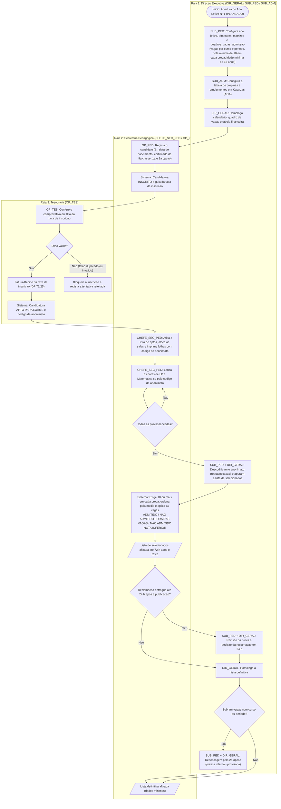

### 1.4 Passo a Passo Detalhado do Caminho Feliz (*Happy Path*)
1. **Parametrização Académica e Quadro de Vagas (`SUB_PED`):** cria o `Ano Letivo` (estado `Planeado`), as datas dos **I, II e III Trimestres**, associa as **Matrizes Curriculares** (fonte: decreto executivo de criação de cada curso — `COR-LEG-29`) e configura `quadros_vagas_admissao` por `Ano Letivo + Curso + Período`:
   - `total_vagas_disponiveis` e `vagas_preenchidas = 0`;
   - **`nota_minima_por_prova` = `10` valores** (padrão legal: "pelo menos 10 valores … em cada uma das provas de selecção" — DP n.º 167/23, art. 52.º, n.º 1; `COR-LEG-08`);
   - **idade mínima = 15 anos completados no ano da matrícula** (DP n.º 167/23, art. 23.º; DE n.º 361/26, art. 4.º — `COR-LEG-11`).
   > 🟡 **Provisória** — parâmetro configurável; validar com a resposta à `Q-LEG-09` (`DEC-009`). Fonte: [[Verificacao das Referencias Legais|LEG-VER]] §3.9. A **idade máxima** de ingresso regular não tem fonte legal encontrada: fica como parâmetro **opcional, desligado por omissão**.
2. **Parametrização Financeira (`SUB_ADM`):** tabela anual em `AOA` — propina mensal, taxa de inscrição no teste, taxa de matrícula/confirmação, exames extraordinários, defesa da PAP, cartão de estudante e documentos. Os emolumentos pagos ao Estado por RUPE ficam fora desta tabela (`Q-034`, `Q-C10-17`) 🟡.
3. **Homologação Institucional (`DIR_GERAL`):** valida as configurações e abre as inscrições.
4. **Inscrição do Candidato com 1ª e 2ª Opção (`OP_PED`):** recolhe BI/Cédula, data de nascimento, dados do Encarregado, certificado da 9ª Classe (conclusão do I Ciclo — DP n.º 167/23, art. 22.º), **1ª Opção** e **2ª Opção** de Curso/Período. A candidatura nasce `Inscrito`. A inscrição pelo portal eletrónico previsto no DE n.º 361/26, art. 5.º, fica em aberto (`Q-LEG-12`).
5. **Liquidação da Taxa de Inscrição (`OP_TES`):** o `OP_TES` valida o pagamento (TPA, Multicaixa Express ou talão) e é emitida a **Fatura-Recibo** da taxa (emolumento pago no ato — modelo a confirmar na `Q-LEG-16`) 🟡.
6. **Anonimato e Afixação dos Aptos (Sistema + `CHEFE_SEC_PED`):** a candidatura passa a **`Apto para Exame (Taxa Paga)`**, o sistema aloca a sala e gera o **Código de Anonimato** (escolha de implementação compatível com a correção "sob regime de anonimato" do DE n.º 361/26, art. 15.º). A lista de aptos é afixada (art. 13.º).
7. **Teste de Seleção:** um único teste com secções de **Língua Portuguesa** e **Matemática** (art. 10.º). A Secretaria imprime a lista de presença por sala e as folhas de cabeçalho destacáveis com o código.
8. **Lançamento Cego (`CHEFE_SEC_PED` / `SUB_PED`):** as notas de cada prova são digitadas **só pelo Código de Anonimato**; estado `Avaliado (Código Anonimato)`.
9. **Descodificação e Apuramento (`SUB_PED` + `DIR_GERAL` — `RN-01.2`):** com 100% dos códigos lançados, a descodificação exige reautenticação (`RN-16.14`). O sistema:
   - exclui quem tem **menos de 10 valores em alguma prova** (`NÃO ADMITIDO (Nota Inferior ao Mínimo)`), **mesmo que fiquem vagas por preencher**;
   - ordena os restantes por ordem decrescente da nota de ordenação $MFA = \text{round\_med}((\text{Nota\_LP} + \text{Nota\_Mat}) / 2)$ (média aritmética das provas — DP n.º 167/23, art. 52.º, n.º 2);
   - atribui `ADMITIDO` dentro das vagas da 1ª Opção e `NÃO ADMITIDO (Fora das Vagas / Excedente)` aos restantes.
   > 🟡 **Provisória** — parâmetro configurável; validar com a resposta à `Q-LEG-10` (`DEC-009`). Fonte: [[Verificacao das Referencias Legais|LEG-VER]] §3.9. Não se sabe se as secções do teste único contam como provas separadas; o arredondamento da `MFA` também fica por confirmar.
10. **Lista de Selecionados (`CHEFE_SEC_PED`):** afixada **até 72 horas após o teste** (DE n.º 361/26, art. 17.º), com dados mínimos (nome, curso, período, resultado), nunca com dados de saúde nem BI completo ([[11 - Protecao de Dados (APD)|APD-11]]).
11. **Reclamações (`SUB_PED` + `DIR_GERAL`):** aceites **até 24 horas após a publicação** e decididas **em 24 horas** (art. 18.º); uma reclamação procedente reordena a lista (E1.5).
12. **Lista Definitiva:** publicada depois da **homologação do Director** (art. 19.º), papel `DIR_GERAL` com o título configurado. Os `Admitidos` ficam habilitados para *"Converter em Matrícula da 10ª Classe"* (Fluxo 02).

### 1.5 Caminhos de Exceção, Erros e Travas de Segurança (*Edge Cases & Rollbacks*)
- **Exceção E1.1 — Candidato sem Taxa Paga no Fecho das Inscrições:** as candidaturas `Inscrito` passam a `Cancelado por Falta de Pagamento` e não recebem código de anonimato.
- **Exceção E1.2 — Dupla Inscrição (Mesmo BI):** `UNIQUE(ano_letivo_id, numero_bi)` impede a segunda inscrição.
- **Exceção E1.3 — Falta ao Teste:** o `CHEFE_SEC_PED` marca `Faltou ao Exame`; sem reembolso do emolumento.
- **Exceção E1.4 — Empate na Última Vaga (`COR-LEG-09`):** seleciona-se o **candidato com menor idade** (DE n.º 361/26, art. 16.º, n.º 2, c)).
  > 🟡 **Provisória** — parâmetro configurável; validar com a resposta à `Q-LEG-11` (`DEC-009`). Os antigos critérios "maior nota de Língua Portuguesa" e "média da 9ª Classe" ficam **desligados** e só voltam se a Direção Provincial os validar (DP n.º 167/23, art. 49.º, n.º 4).
- **Exceção E1.5 — Reclamação Procedente ou Alteração de Nota Após a Descodificação:** bloqueada para o `CHEFE_SEC_PED`. A retificação exige ação conjunta do `SUB_PED` + `DIR_GERAL`, com justificação gravada em `audit_logs`, e reordena a lista antes da homologação definitiva.
- **Exceção E1.6 — Vagas Remanescentes (`COR-LEG-08`, `COR-LEG-10`):** **não há redução do limiar mínimo**: com vagas sobrantes, ninguém abaixo de 10 valores numa prova é admitido, e o antigo estado `Admitido (Por Despacho de Ajuste de Limiar)` deixa de existir. As vagas podem ser preenchidas pela **repescagem da 2ª Opção**: candidatos `NÃO ADMITIDO (Fora das Vagas / Excedente)` (com 10 ou mais em cada prova) que indicaram esse Curso/Período como 2ª Opção, por ordem decrescente de `MFA`.
  > 🟡 **Provisória** — prática interna sem base nos diplomas lidos; validar com a escola e a resposta à `Q-LEG-12` (`DEC-009`). Fonte: [[Verificacao das Referencias Legais|LEG-VER]] `COR-LEG-10`. Uma exceção ao limiar só volta a existir se a Direção Provincial a confirmar por escrito (`COR-LEG-08`).
- **Exceção E1.7 — Idade Abaixo do Mínimo:** o candidato com menos de 15 anos completados no ano da matrícula é excluído do ensino regular (DP n.º 167/23, art. 23.º). A idade máxima só é verificada se o parâmetro opcional estiver ligado (`Q-LEG-09`) 🟡.
- **Exceção E1.8 — Reclamação Fora do Prazo:** recusada pelo sistema (prazo de 24 h após a publicação), com registo da tentativa.
- **Exceção E1.9 — Concurso Realizado Fora do SGE (`Q-017`):** os resultados homologados são importados (C17) com origem `IMPORTADO`; o Fluxo 02 converte os admitidos importados da mesma forma 🟡.

### 1.6 Pós-condições e Registos Gerados
- `Ano Letivo`, `Trimestres`, `Matrizes Curriculares` e tabela de emolumentos ativos e trancados.
- Lista de selecionados, decisões de reclamação e lista definitiva homologada (`DOF-02`), com as datas de publicação para controlo dos prazos.
- `audit_logs` da abertura do ano, da descodificação do anonimato e de cada retificação.

---

## Fluxo 02: Matrícula Inicial, Confirmação Automática, Processo Individual, Transcrição Externa e Bolsas

### 2.1 Atores Envolvidos (RBAC) e Contextos (DDD)
- **Atores RBAC:** `OP_PED`, `CHEFE_SEC_PED`, `SUB_PED`, `SUB_ADM`, `DIR_GERAL`, `OP_TES`, `DIR_TURMA` (só o estado das pendências), `ENCARREGADO`.
- **Contextos DDD:** *Secretaria Pedagógica* $\leftrightarrow$ *Tesouraria & Fiscalidade (AGT)* $\leftrightarrow$ *Direção Executiva* $\leftrightarrow$ *Auditoria (APD)*.

### 2.2 Pré-condições e Gatilho de Início
- **Pré-condições:**
  - 10ª Classe: candidato `Admitido` no Fluxo 01 (a passagem do I para o II Ciclo **não** é confirmação automática — DP n.º 167/23, art. 50.º, n.º 6–7).
  - 11ª, 12ª e 13ª Classes (internos): **proposta de confirmação** gerada pela Passagem de Ano (Fluxo 09, `RN-18.5`/`18.6`), a partir da deliberação homologada do ano anterior.
  - Transferidos de entrada: vaga na classe/curso e Guia de Transferência.
  - Catálogo de documentos do processo homologado para o ano (`RN-11.2`).
- **Gatilho de Início:** conversão de um admitido, passagem definitiva do ano (modo `AUTOMATICA`) ou atendimento ao balcão (modo `BALCAO`, matrícula inicial ou transferência).

### 2.3 Diagrama Visual em Raias (Swimlane Flowchart)

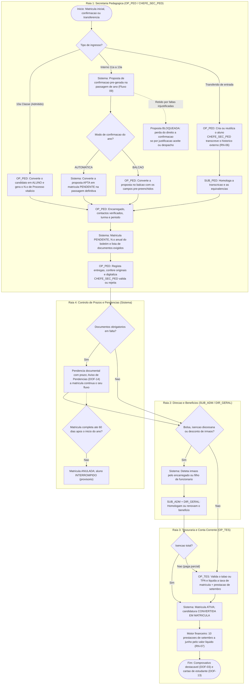

### 2.4 Passo a Passo Detalhado do Caminho Feliz (*Happy Path*)
1. **Identificação do Cenário de Matrícula:**
   - **Cenário A — Ingresso Inicial na 10ª Classe (`OP_PED`):** o operador seleciona o candidato `Admitido` e clica em *"Converter em Matrícula"*. O sistema cria o registo vitalício em `alunos` e gera o **`N.º de Processo Individual`** único (`RN-05`); os documentos da candidatura passam ao Processo Individual (`RN-11.1`).
   - **Cenário B — Confirmação de Aluno Interno (11ª, 12ª ou 13ª Classe — `COR-LEG-15`, `RN-18.6`):** a confirmação **parte da proposta pré-gerada** pela passagem de ano, com classe, curso, período, turma e cadeiras em atraso (até duas) já preenchidos; o operador não os digita (`RN-18.6.3`). O "problema de saúde" **nunca** é copiado do ano anterior: é declarado de novo, é facultativo e exige consentimento (APD-11, RF-C19-29).
     - **Modo `AUTOMATICA`** (DP n.º 167/23, art. 50.º, n.º 4: a confirmação "é automática e da responsabilidade da respectiva Escola"): na passagem definitiva, todas as propostas `APTA_A_CONFIRMAR` passam a matrícula `Pendente`, sem deslocação do encarregado.
     - **Modo `BALCAO`** (prática atual — boletim de confirmação real, DESC-L1 A12): a proposta é convertida pelo `OP_PED` (`US-PAS-06`).
     > 🟡 **Provisória** — parâmetro do Ano Letivo (`modo_confirmacao`); validar com a resposta à `Q-LEG-05` / `Q-C16-02` (`DEC-009`). Fonte: [[C16 - Passagem de Ano Letivo|C16]] `RN-18.6.4`; `COR-LEG-15`.
   - **Cenário C — Transferido de Entrada (`RN-06`):** o `OP_PED` cria o aluno (ou **reutiliza o registo** se for um antigo aluno — o BI é único, `RN-18.14.4`) e o `CHEFE_SEC_PED` transcreve o histórico externo com o PDF assinado; o `SUB_PED` homologa.
2. **Boletim, Encarregado e Turma (`OP_PED` — `RN-11.8`, `RN-11.9`, `RN-11.14`):**
   - a matrícula nasce **`Pendente (Aguardando Pagamento Inicial)`** e recebe o **número anual do Boletim de Matrícula ou de Confirmação** (`N.º nnn/AAAA-AAAA`), nunca reutilizado;
   - o operador vincula o Encarregado de Educação e confirma **até dois telefones**, indicando de quem é cada um, e regista o consentimento para avisos (`RN-14.3`, `RN-14.9`);
   - seleciona a turma dentro do Curso, Classe e Período, respeitando a lotação. Até ao congelamento, a lista da turma segue a **ordem alfabética do nome completo como no BI** (DESC-RESP R6; `RN-05`).
3. **Processo Individual (`OP_PED` + `CHEFE_SEC_PED` — `RN-11.2`, `RN-11.3`):** o sistema gera a lista de documentos exigidos para o tipo de ingresso e a classe; o `OP_PED` regista cada entrega, confere o original e digitaliza; o `CHEFE_SEC_PED` valida ou rejeita (`US-PIN-02`, `US-PIN-03`). Os documentos em falta ficam como **pendência com prazo**, mas **não bloqueiam a ativação** da matrícula (`RN-11.7`).
4. **Bolsas, Isenções e Descontos (`RN-07`):** desconto de irmãos sugerido automaticamente; bolsas (`50%`, `100%`, quota diocesana) e filho de funcionário homologados pelo `SUB_ADM` + `DIR_GERAL`. Nos internos, a bolsa precisa da **decisão de renovação** tomada na passagem de ano (`RN-18.11`).
5. **Liquidação Inicial (`OP_TES`):** taxa de matrícula/confirmação e a **prestação de setembro**, com o documento fiscal correspondente (Fluxo 07), salvo isenção de 100%.
6. **Ativação e Conta Corrente (Sistema):** a matrícula passa a **`Ativa`**; o Motor Financeiro gera as **10 prestações de setembro a junho** com `valor_liquido = valor_bruto - desconto` (DESC-RESP R9). A entrada após o congelamento recebe `num_ordem_turma = max + 1` (`RN-05`).
7. **Comprovativo e Cartão (`OP_PED` — `RN-11.10`):** é entregue o comprovativo destacável do `DOF-03` (sem dados de saúde) e, com fotografia validada e emolumento pago (ou isenção), o **Cartão de Estudante (`DOF-13`)** com QR Code (`US-PIN-08`).

### 2.5 Caminhos de Exceção, Erros e Travas de Segurança (*Edge Cases & Rollbacks*)
- **Exceção E2.1 — Dívida Vencida de Anos Anteriores (`RN-08`, `RN-18.10`):** a proposta fica `Bloqueada` com o motivo `DIVIDA_VENCIDA` e desbloqueia sozinha quando o semáforo volta a verde: por pagamento (mesmo com o ano anterior encerrado) ou por **acordo de pagamento com `liberta_semaforo`** (Fluxo 11). Origem: E-C16.2.
  > 🟡 **Provisória** — o bloqueio por dívida é parametrizável (ligado/desligado); validar com a resposta à `Q-LEG-05` (`DEC-009`), porque a confirmação automática da lei pode impedir a escola de a reter. Desligado, a dívida mantém-se no ano de origem e continua a bloquear documentos (`RN-08`).
- **Exceção E2.2 — 13ª Classe com Cadeira em Atraso:** bloqueada (`RN-02`); a proposta da 12ª fica `CONDICIONADA_13A` até à eliminação em Exame Extraordinário (Fluxo 05, `RN-18.9.3`).
- **Exceção E2.3 — Transferido sem Transcrição de Histórico:** pendência crítica até à homologação do `SUB_PED` (`RN-06`).
- **Exceção E2.4 — Lotação Esgotada:** a turma cheia não aceita novas alocações; o sistema sugere outra turma do mesmo curso e período.
- **Exceção E2.5 — Transferência Tardia com Notas Parciais (`RN-06.1`):** as médias trimestrais já vencidas (`M1` e/ou `M2`) são transcritas da Guia (`origem_nota = 'GUIA_TRANSFERENCIA_EXTERNA'`) e o aluno recebe `max + 1`.
- **Exceção E2.6 — Reativação ou Mudança Interna de Turma (`RN-05.1`):** mantém-se como na v1.2 (reposição do `N.º de Ordem` original; `TRANSFERIDO INTERNO` + `max + 1` na turma nova).
- **Exceção E2.7 — Perda do Direito à Confirmação por Faltas (`COR-LEG-14`):** o aluno retido por faltas injustificadas **perde o direito à confirmação de matrícula** no ano seguinte (DP n.º 167/23, art. 50.º, n.º 2): a proposta nasce `Bloqueada` (`PERDA_DIREITO_FALTAS`). Com justificação aceite, a escola confirma **em 5 dias úteis** (art. 50.º, n.º 3); sem ela, o reingresso só por despacho da `SUB_PED` (DESC-RESP R4).
  > 🟡 **Provisória** — validar o prazo de justificação no II Ciclo com a resposta à `Q-LEG-04` (`DEC-009`). Fonte: [[Verificacao das Referencias Legais|LEG-VER]] §3.5.
- **Exceção E2.8 — Matrícula Incompleta 60 Dias Após o Início do Ano (`COR-LEG-15`, DESC-RESP R5):** uma matrícula ainda `Pendente` passa a `Anulada / Desistente` pela transição `expirarPrazoConfirmacao` e o aluno fica `Interrompido` (`RN-18.14`); a confirmação tardia exige vaga e autorização do `CHEFE_SEC_PED`. Origem: E-C16.5.
  > 🟡 **Provisória** — prazo de 60 dias como parâmetro do Ano Letivo; validar com a resposta à `Q-C16-01` (`DEC-009`). Se a falta de **documentos** (e não só de pagamento) também anula a matrícula é uma divergência entre a lei (art. 50.º, n.º 8) e a proposta do `RN-11.7`, a resolver na mesma questão.
- **Exceção E2.9 — Bolsa Não Decidida a Tempo:** as prestações nascem pelo valor bruto; uma concessão posterior só afeta as vincendas (`RN-07.2`, `RN-18.11.3`). Origem: E-C16.8.
- **Exceção E2.10 — Documento Ilegível, Divergente ou Caducado:** `Rejeitado` com motivo ou `Caducado` (ex.: BI), voltando a pendência; o encarregado recebe o `DOF-14`. Origem: E-C03.1, E-C03.3.
- **Exceção E2.11 — Documento Impossível de Obter:** dispensa pela `SUB_PED` com despacho (`RN-11.3`). Origem: E-C03.2.
- **Exceção E2.12 — Novo BI Já Usado por Outro Aluno:** bloqueio e alerta de possível duplicado (`RN-11.8`).

### 2.6 Pós-condições e Registos Gerados
- Aluno com `N.º de Processo Individual` único e matrícula `Ativa`, com número anual do boletim, na turma e nas Mini-Pautas da matriz da classe.
- Lista estruturada de documentos do processo com estados e digitalizações (SHA-256); pendências com prazo.
- Conta Corrente com 10 prestações líquidas; cartão emitido e registado em `documentos_oficiais_emitidos`.
- Proposta de confirmação `Convertida` (internos) ou candidatura `Convertida em Matrícula` (10ª).

---

## Fluxo 03: Rotina Pedagógica Trimestral, Faltas por Tempo Letivo, Justificação, 2.ª Chamada e Substituição Docente (Offline-First)

### 3.1 Atores Envolvidos (RBAC) e Contextos (DDD)
- **Atores RBAC:** `COORD_DISC`, `PROF`, `DIR_TURMA`, `COORD_TURNO`, `CHEFE_SEC_PED`, `SUB_PED`, `ENCARREGADO`.
- **Contextos DDD:** *Coordenação & Docência* $\leftrightarrow$ *Secretaria Pedagógica* $\leftrightarrow$ *Comunicação* $\leftrightarrow$ *Auditoria (APD)*.

### 3.2 Pré-condições e Gatilho de Início
- **Pré-condições:** trimestre `Aberto / Em Curso`; turmas com matrículas ativas; alocações docentes vigentes; **horário publicado** com aulas previstas geradas (Fluxo 10); dispositivo do professor autorizado (Fluxo 16).
- **Gatilho de Início:** aula do dia, prova trimestral, pedido de justificação, dispensa médica ou substituição de um professor.

### 3.3 Diagrama Visual em Raias (Swimlane Flowchart)

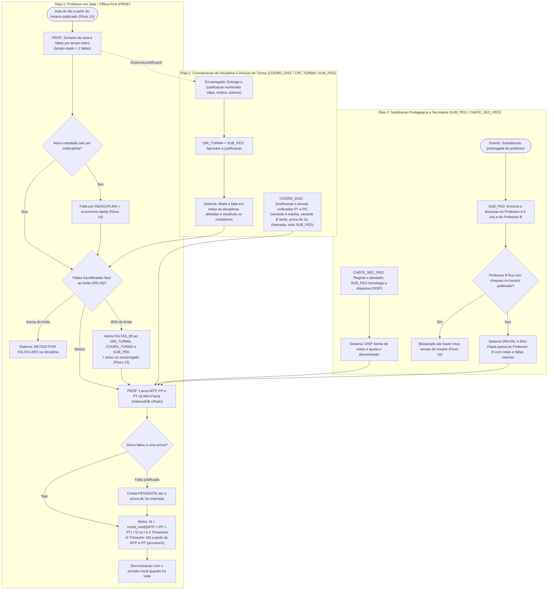

### 3.4 Passo a Passo Detalhado do Caminho Feliz (*Happy Path*)
1. **Dosificação e Provas Unificadas (`COORD_DISC`):** o Coordenador de Disciplina regista a dosificação e elabora a **Prova Trimestral (`PT`)** e a **Prova Global (`PG`)** unificadas, com **variante A (Manhã)**, **variante B (Tarde)** e uma **variante de 2.ª chamada**, com visto do `SUB_PED` (DESC-RESP §1).
2. **Chamada por Tempo Letivo (`PROF` — `RN-03`, `RN-12.13`):**
   - a chamada abre-se **a partir da aula do horário** (`PREVISTA`); turma, disciplina, data e tempos vêm preenchidos;
   - o sumário é registado **uma vez por aula** (a aula passa a `LECIONADA`); para cada ausente, **cada tempo em falta conta 1 falta**: um **tempo duplo dá 2 faltas** (DESC-RESP R1);
   - **atraso no 1.º tempo:** dentro da tolerância regista-se o atraso; depois dela, o aluno leva falta nesse tempo (`RN-15.2`);
   - cada falta tem **tipo**: `NAO_COMPARENCIA` ou `INDISCIPLINA` (`RN-15.1`). A falta por indisciplina exige uma ocorrência ligada (Fluxo 14) e não pode ser justificada.
   > 🟡 **Provisória** — tolerância de atraso (proposta 15 min; a escola refere 10–15 min) e efeito da falta por indisciplina no limite do `RN-03`: parâmetros; validar em **E3** (regulamento interno — `Q-C13-03`, `Q-C13-04`, `Q-032`) (`DEC-009`). Fonte: [[C13 - Disciplina e Comportamento|C13]].
3. **Limite de Faltas e Alerta Precoce (`RN-03`, `RN-17.8`):** $\text{Limite\_Faltas}_d = F_{\text{mult}} \times T_{\text{sem}}$. Aos **80%** do limite, o sistema cria o alerta `FALTAS_80` para o `DIR_TURMA`, o `COORD_TURNO` e o `SUB_PED` e gera o aviso ao encarregado (gatilhos `FALTAS_50` e `FALTAS_80` — Fluxo 13); acima do limite, a situação passa a **`Retido por Faltas (RF)`**.
   > 🟡 **Provisória** — fator e forma da regra (anual com multiplicador ou por trimestre e por escalões) são parâmetros; validar com a resposta à `Q-LEG-01` a `03` (`COR-LEG-13`) (`DEC-009`). Fonte: [[Verificacao das Referencias Legais|LEG-VER]] §3.5.
4. **Justificação de Faltas (`DIR_TURMA` + `SUB_PED` — DESC-L1 A8, DESC-RESP R3):** o encarregado ou o aluno entrega o **formulário numerado** (série anual `N.º __/IPCAG/ano` — `RN-11.14`) com intervalo de dias, motivo, documentos e disciplinas afetadas. Aprovado pelo **Director de Turma e pelo Coordenador para a Área Pedagógica**, o sistema **abate a falta automaticamente em todas as disciplinas afetadas** (o aluno deixa de ir a cada professor). Atestados seguem a regra da APD-11: o detalhe de saúde só no compartimento restrito.
5. **Dispensa Médica (`DISP` — `RN-01`):** o `CHEFE_SEC_PED` carrega o atestado e o `SUB_PED` homologa `Dispensado (DISP)`; a disciplina fica sem notas numéricas e sai do denominador.
6. **Lançamento na Mini-Pauta *Offline-First* (`PROF` — `RN-01`, `RN-10`):**
   - o professor lança **`MTP`**, **`PP`** e **`PT`** (`0` a `20`) mesmo sem rede; a aplicação guarda no `IndexedDB` cifrado e calcula no ecrã:
     $$M_t = \text{round\_med}\left(\frac{MTP_t + PP_t + PT_t}{3}\right) \quad (t = 1, 2)$$
   - **III Trimestre:** não há `PT`; `M3` forma-se a partir de `MTP` e `PP`, e a prova do III Trimestre é a **Prova Global** (lançada no Fluxo 04);
   - os rótulos impressos podem ser `MAC`/`NPP`/`NPT` conforme o modelo do documento (`Q-026`).
   > 🟡 **Provisória** — fórmulas e pesos parametrizáveis por Ano Letivo; validar em **E2** (recálculo de pautas preenchidas — `Q-025`; fórmula exata de `M3` em aberto) (`DEC-009`). Fonte: [[Sintese das Respostas da Fase B|DESC-RESP]] §1; `COR-LEG-26/27`.
7. **Prova de 2.ª Chamada (sub-regra nova de `RN-01`):** o aluno que falta a uma prova (`PP`, `PT` ou `PG`) por motivo **justificado e validado pelo `DIR_TURMA` + `SUB_PED`** fica com a célula **`PENDENTE (2.ª chamada)`**; a média não é calculada até à nota da prova de 2.ª chamada. Sem justificação, a falta à prova segue a regra normal da nota (a definir no regulamento) 🟡 E3.
8. **Sincronização:** com a rede local ou a internet, a fila sincroniza e regista `lancado_por_usuario_id`.
9. **Substituição Prolongada (`SUB_PED` — `RN-04`, `RN-12.14.4`):** ao encerrar a alocação do Professor A e criar a do Professor B, o sistema **valida logo os choques** do Professor B nos horários publicados; havendo choque, a substituição só é aceite com uma nova versão do horário que o resolva (Fluxo 10). O Professor B encontra as notas e as faltas intactas.

### 3.5 Caminhos de Exceção, Erros e Travas de Segurança (*Edge Cases & Rollbacks*)
- **Exceção E3.1 — Nota Fora da Escala (`< 0` ou `> 20`):** rejeitada na interface e por `CHECK`.
- **Exceção E3.2 — Professor Tenta Justificar Faltas:** bloqueado por RBAC; a justificação é do `DIR_TURMA` com o `SUB_PED`.
- **Exceção E3.3 — Conflito de Sincronização *Offline*:** a mutação sobre um trimestre fechado é rejeitada e guardada em `conflitos_sincronizacao` para decisão do `SUB_PED`.
- **Exceção E3.4 — Professor Falta a uma Aula (`RN-12.14`):** o `COORD_TURNO` designa um **substituto pontual** livre nesse tempo (regista só o sumário e as faltas dessa aula, sem acesso às notas) ou regista a aula como **`NAO_LECIONADA`**, sem faltas de alunos e elegível para reposição. Origem: E-C04.4.
- **Exceção E3.5 — Duas Pessoas Registam a Mesma Aula *Offline*:** o primeiro registo sincronizado fica; o segundo vai para `conflitos_sincronizacao` com o motivo `AULA_JA_SUMARIADA`. Origem: E-C04.8.
- **Exceção E3.6 — Registo de Aula sem Aula Prevista:** bloqueado (`HTTP 422`), com indicação de pedir reposição (`RN-12.13.5`). Origem: E-C04.9.
- **Exceção E3.7 — Dispositivo Revogado, Prazo *Offline* Esgotado ou Conta Inativa (`RN-16.9`, `RN-16.15`):** o dispositivo mostra os dados mas não aceita novos lançamentos; a fila já guardada **nunca se perde**. De uma conta suspensa ou desativada, a subida só em modo assistido, e as operações entram em `conflitos_sincronizacao` com o motivo `CONTA_INATIVA` (Fluxos 15 e 16).
- **Exceção E3.8 — Justificação Posterior ao Alerta:** se a justificação fizer o consumo descer abaixo de 80%, o alerta é **arquivado automaticamente** (`RN-17.8.4`); o aviso já enviado não é "desenviado", mas o seguinte não sai (`RN-14.5.3`).
- **Exceção E3.9 — Prova de 2.ª Chamada Não Realizada até ao Conselho:** a célula pendente bloqueia a submissão da Mini-Pauta (Fluxo 04, validação pré-conselho).

### 3.6 Pós-condições e Registos Gerados
- Livro de sumários digital (`aulas_registadas`) e faltas por tempo letivo e por tipo, base do `RN-03`.
- Mini-Pauta com `MTP`, `PP`, `PT`, `M1`/`M2` arredondadas, células de 2.ª chamada resolvidas e totais de faltas justificadas, injustificadas e por indisciplina.
- Justificações numeradas e alertas de faltas com o seu tratamento; autoria docente preservada após substituições.

---

## Fluxo 04: Conselho de Notas, Comportamento, Classificação Anual, Recurso, Deliberação e Reabertura Auditada

### 4.1 Atores Envolvidos (RBAC) e Contextos (DDD)
- **Atores RBAC:** `DIR_TURMA`, `PROF`, `COORD_CURSO`, `CHEFE_SEC_PED`, `SUB_PED`, `DIR_GERAL`.
- **Contextos DDD:** *Coordenação & Docência* $\rightarrow$ *Secretaria Pedagógica* $\rightarrow$ *Direção Executiva* $\rightarrow$ *Auditoria & Estatística GEPE*.

### 4.2 Pré-condições e Gatilho de Início
- **Pré-condições:** prazo de lançamento encerrado; Mini-Pautas completas (ou `DISP` / `RF` / `Transferido` / `Anulado`), sem provas de 2.ª chamada pendentes; no fim do ano, Prova Global lançada.
- **Gatilho de Início:** convocatória do Conselho de Notas trimestral ou final pela Subdireção Pedagógica.

### 4.3 Diagrama Visual em Raias (Swimlane Flowchart)

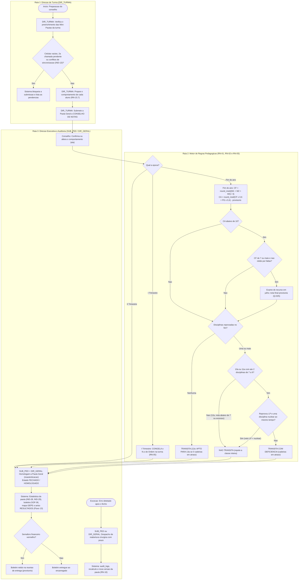

### 4.4 Passo a Passo Detalhado do Caminho Feliz (*Happy Path*)
1. **Validação Pré-Conselho (`DIR_TURMA`):** o validador confirma notas completas, **nenhuma prova de 2.ª chamada pendente** e **nenhum conflito de sincronização pendente na turma** (`IND-13`, `RN-17`); a turma passa a **`Em Conselho de Notas`** e os professores deixam de editar.
2. **Comportamento (`DIR_TURMA` → Conselho — `RN-15.7`):** o Director de Turma propõe a avaliação de comportamento de cada aluno, vendo as ocorrências e as faltas por indisciplina do trimestre; o conselho confirma ou altera e a decisão fica na ata. O comportamento é impresso no boletim (`DOF-06`) e **não entra** no cálculo de `CF`/`CA` nem na transição.
   > 🟡 **Provisória** — escala do comportamento (qualitativa ou numérica) e eventual efeito: parâmetros; validar em **E3** (regulamento interno — `Q-C13-02`) (`DEC-009`). Fonte: [[C13 - Disciplina e Comportamento|C13]].
3. **Fecho do I Trimestre (`RN-05`):** a homologação ativa `lista_chamada_congelada = TRUE`; o `N.º de Ordem` nunca mais muda (saídas ficam na sua linha com `TRANSFERIDO` / `ANULADO`; entradas recebem `N + 1`).
4. **Fim do Ano — Classificação Anual (`RN-01`, achados A1/A2):**
   1. $CF = \text{round\_med}((M_1 + M_2 + M_3) / 3)$ — Classificação de Frequência (o "MT3" impresso na mini-pauta é a `CF`);
   2. **Prova Global (`PG`)**, unificada pelo `COORD_DISC`;
   3. $CA = \text{round\_med}(CF \times 0{,}6 + PG \times 0{,}4)$ — Classificação Anual; aprova com $CA \ge 10$;
   4. **Exame de Recurso (julho):** para quem tem $CA < 10$ e $CF \ge 7$ e não está retido por faltas. A fórmula da nota depois do recurso **não é conhecida** (`Q-025`).
   > 🟡 **Provisória** — fórmulas, pesos (`0,6`/`0,4`), limiares (`10`, `7`) e regra do recurso parametrizáveis; validar em **E2** (recálculo de pautas — `Q-025`, `Q-LEG-21`) (`DEC-009`). Fonte: [[Sintese das Respostas da Fase B|DESC-RESP]] §1; `COR-LEG-26`. Substitui a fórmula `MFD` e o recurso 40%/60% da v1.2, que não tinham fonte.
5. **Deliberação (`RN-02`):**
   - **0 reprovações:** `Transita`; na 12ª, `Apto para 13ª Classe` se não houver cadeiras em atraso por eliminar;
   - **10ª e 11ª com até 2 disciplinas entre `7` e `9`:** verifica-se o veto — **reprovou ao mesmo tempo Língua Portuguesa e uma disciplina nuclear?** Se sim, `Não Transita`; se não, **`Transita com Deficiência`** e as disciplinas entram em `cadeiras_em_atraso`. O veto só se aplica na 10ª e 11ª, porque a Língua Portuguesa não existe na 12ª (A7);
   - **nota abaixo de `7`, mais de 2 negativas ou qualquer negativa na 12ª:** `Não Transita` — o aluno repete a classe inteira;
   - **12ª aprovada com cadeiras da 10ª/11ª por eliminar:** categoria em falta na lista de deliberações; proposta `CONCLUIU_12_COM_CADEIRAS_PENDENTES` 🟡 (`Q-C16-06`, `Q-031`).
   > 🟡 **Provisória** — número máximo de deficiências (2 no boletim real; 3 no termo de comparação), composição do veto e conjunto das disciplinas nucleares são parâmetros; validar em **E2** e com a resposta às `Q-LEG-01` a `03` e `Q-031` (`COR-LEG-13`) (`DEC-009`).
6. **Homologação (`SUB_PED` + `DIR_GERAL`):** exige reautenticação (`RN-16.14`); a pauta passa a **`Fechado / Homologado`**. O bloco de assinatura imprime os **títulos configurados** (hoje, o "visto" da Coordenadora Geral na Pauta Geral; o Coordenador para a Área Pedagógica **não** assina as pautas gerais finais — DESC-RESP §2) 🟡 E1 (`Q-028`).
7. **Estatística e Resultados (`RN-17.14`):** o sistema calcula o rodapé da Mini-Pauta (`IND-28`: Matriculados, `AV`, `AP`, `RP`, `NV`, por género) e os quadros da Pauta Geral (`IND-29`: positivas e negativas por disciplina; **Transitam, Transitam com Deficiência, Desistentes, Não Transitam**, por género), que alimentam o `DOF-05` e o **Mapa Estatístico (`DOF-12`)**. Sai o aviso `RESULTADOS_TRIMESTRE` aos encarregados, **sem notas** (Fluxo 13).
8. **Entrega dos Boletins (`DIR_TURMA`):** os boletins (`DOF-06`) são entregues na reunião; os de alunos com semáforo financeiro vermelho ficam retidos (prática real — DESC-RESP R12).
   > 🟡 **Provisória** — retenção do boletim por dívida como parâmetro (ligado/desligado); validar em **E1** com a Direção e à luz da APD-11 (a dívida nunca é mostrada ao `DIR_TURMA`: só "boletim retido — dirigir-se à Tesouraria") (`DEC-009`). Fonte: [[Sintese das Respostas da Fase B|DESC-RESP]] R12; `RN-13.6`.

### 4.5 Caminhos de Exceção, Erros e Travas de Segurança (*Edge Cases & Rollbacks*)
- **Exceção E4.1 — Reabertura Excecional de Pauta (`RN-10`):** só o `SUB_PED` ou o `DIR_GERAL`, na `Turma + Disciplina` afetada, com n.º de despacho, justificação, aluno/disciplina e janela (`1h` a `48h`), após reautenticação. O *trigger* grava `old_value`/`new_value` em `audit_logs`, recalcula `M`, `CF`, `CA` e a deliberação e volta a trancar (`versao_pauta + 1`). Os indicadores voltam a `PROVISÓRIO` (`RN-17.4`).
- **Exceção E4.2 — Avocação da Mini-Pauta (`RN-04.1`):** sem professor nem substituto ativo, o `SUB_PED` avoca e lança a partir das provas físicas (`AVOCACAO_LANCAMENTO_SUB_PED`).
- **Exceção E4.3 — Conflitos de Sincronização Pendentes (`IND-13`):** a homologação é recusada enquanto houver conflitos `PENDENTE` da turma, para que nenhum lançamento *offline* fique de fora.
- **Exceção E4.4 — Reabertura num Ano Já Encerrado (`RN-18.12`, `RN-18.13`):** exige a ação **conjunta** de `SUB_PED` **e** `DIR_GERAL`; se a deliberação mudar, o sistema recalcula a proposta de confirmação e, se o aluno já estiver matriculado numa classe errada em `N+1`, cria um alerta crítico (não o move sozinho — Fluxo 09).
- **Exceção E4.5 — Comportamento Não Proposto:** a submissão ao conselho fica bloqueada enquanto houver alunos sem proposta de comportamento (só quando o núcleo da C13 estiver ativo — `Q-038`) 🟡.

### 4.6 Pós-condições e Registos Gerados
- Pauta Geral imutável `Fechado / Homologado` com código de verificação, ata com o comportamento e estatística congelada.
- Lista de chamada congelada (após o I Trimestre); `cadeiras_em_atraso` criadas para os transitados com deficiência.
- Matrículas da 10ª à 12ª `Concluída` na homologação final (`RN-18.4`), prontas para a passagem de ano (Fluxo 09).

---

## Fluxo 05: Gestão de Cadeiras em Atraso (Deficiências) e Exame Extraordinário

### 5.1 Atores Envolvidos (RBAC) e Contextos (DDD)
- **Atores RBAC:** `SUB_PED`, `CHEFE_SEC_PED`, `OP_PED`, `OP_TES`, `PROF` (Júri de Exame), `DIR_GERAL`, `ALUNO` / `ENCARREGADO`.
- **Contextos DDD:** *Secretaria Pedagógica* $\leftrightarrow$ *Tesouraria & Fiscalidade (AGT)* $\leftrightarrow$ *Coordenação & Docência*.

### 5.2 Pré-condições e Gatilho de Início
- **Pré-condições:** aluno da 11ª ou 12ª Classe com disciplinas da 10ª ou 11ª em `Transitado com Deficiência` (até duas, como no boletim real de confirmação — `RN-18.9.5`).
- **Gatilho de Início:** abertura da época de **Exames Extraordinários** pelo Subdirector Pedagógico (maio, na prática da escola).

### 5.3 Diagrama Visual em Raias (Swimlane Flowchart)

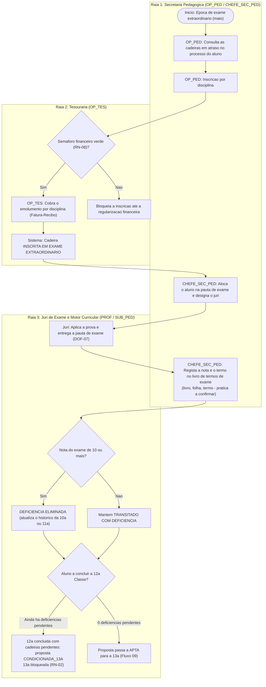

### 5.4 Passo a Passo Detalhado do Caminho Feliz (*Happy Path*)
1. **Identificação de Pendências (`OP_PED`):** o processo do aluno destaca as disciplinas `Transitado com Deficiência`.
2. **Inscrição e Validação Financeira (`OP_PED` $\rightarrow$ `OP_TES` — `RN-08`):** o `OP_PED` inscreve o aluno por disciplina; o sistema exige semáforo verde e o emolumento pago **por disciplina** (DESC-RESP §1), com **Fatura-Recibo** (Fluxo 07).
3. **Confirmação (`OP_TES`):** com o emolumento pago, a cadeira passa a **`Inscrito em Exame Extraordinário`**.
4. **Prova e Registo (`CHEFE_SEC_PED` + `SUB_PED` — `RN-10`):** o júri aplica a prova; o `CHEFE_SEC_PED` lança a nota e regista o termo no **livro de termos de exame** (a escola mantém livros separados de Termos de Exame, Certificados e Atas da PAP — DESC-RESP R17); o `SUB_PED` homologa a pauta (`DOF-07`).
   > 🟡 **Provisória** — a lei exige "um livro de registo e/ou uma base de dados", com número sequencial; **folha e termo** ficam como prática a confirmar (`COR-LEG-19`, `Q-LEG-14`) (`DEC-009`). A base legal do `DOF-07` está em aberto (`Q-023`).
5. **Extinção da Deficiência (`RN-02`):** com nota $\ge 10$, a pendência passa a **`Deficiência Eliminada`** e a nota entra na média anual da classe de origem (para a `MPC`/`MFC`). Uma proposta `CONDICIONADA_13A` com todas as cadeiras eliminadas passa sozinha a `APTA_A_CONFIRMAR` com destino à 13ª (`RN-18.9.3`).
   > 🟡 **Provisória** — o limiar de eliminação e o **prazo** para eliminar as deficiências (a escola permite até concluir a 12ª; o termo de comparação do Ensino Geral, até ao I Trimestre do ano seguinte) são parâmetros; validar com a resposta às `Q-LEG-01` a `03` (`COR-LEG-13`) e em **E2** (`DEC-009`).

### 5.5 Caminhos de Exceção, Erros e Travas de Segurança (*Edge Cases & Rollbacks*)
- **Exceção E5.1 — Reprovação no Exame Extraordinário:** a disciplina volta a `Transitado com Deficiência`; nova inscrição numa época seguinte.
- **Exceção E5.2 — 12ª Concluída com Cadeira em Atraso (`RN-02`, `RN-18.5`):** mesmo aprovando todas as disciplinas da 12ª, o aluno fica com a deliberação provisória `CONCLUIU_12_COM_CADEIRAS_PENDENTES` 🟡 (`Q-C16-06`) e a proposta `CONDICIONADA_13A`: sem certificado da 12ª e sem matrícula na 13ª até eliminar a deficiência.
- **Exceção E5.3 — Disciplina de Origem Já Fora da Matriz em Vigor (`RN-18.9.4`):** o exame continua a referir a matriz de origem; júri e equivalência dependem da `Q-C16-10` 🟡.
- **Exceção E5.4 — Época Marcada Depois do Início de `N+1`:** fica registada em `N+1` e não impede o encerramento de `N` (`RN-18.1.5`).

### 5.6 Pós-condições e Registos Gerados
- `cadeiras_em_atraso` atualizadas para `Deficiência Eliminada`, ligadas ao registo no livro de termos.
- Média anual da classe de origem recalculada; proposta de confirmação desbloqueada quando aplicável.

---

## Fluxo 06: 13ª Classe — Projecto Tecnológico, Estágio Curricular, Defesa da PAP, Certificado e Pedido do Diploma

### 6.1 Atores Envolvidos (RBAC) e Contextos (DDD)
- **Atores RBAC:** `COORD_CURSO` (pode acumular a coordenação GIVA — inserção na vida ativa), `PROF` (Orientador do Projecto Tecnológico, Tutor Interno, membros do júri), membros externos do júri, Supervisor na empresa, `CHEFE_SEC_PED`, `OP_TES`, `SUB_PED`, `DIR_GERAL`.
- **Contextos DDD:** *Coordenação & Docência* $\leftrightarrow$ *Secretaria Pedagógica* $\leftrightarrow$ *Tesouraria & Fiscalidade (AGT)* $\leftrightarrow$ *Direção Executiva*.
- **Base legal (`COR-LEG-16`, `COR-LEG-28`):** DP n.º 167/23, art. 27.º e 31.º–33.º: **Projecto Tecnológico** (disciplina avaliada na 12ª e na 13ª), **Estágio** (13ª, 20 tempos semanais) e **PAP** = apresentação e **defesa do relatório de estágio** perante um júri com professores e representantes dos trabalhadores e dos empregadores. O termo "Prova de Aptidão Técnica" fica reservado à Formação Profissional Básica.

### 6.2 Pré-condições e Gatilho de Início
- **Pré-condições:** 10ª, 11ª e 12ª Classes aprovadas (internamente ou por transcrição homologada — `RN-06`) e **0 cadeiras em atraso** (`RN-02`).
- **Gatilho de Início:** matrícula `Ativa` na **13ª Classe** (Fluxo 02).

### 6.3 Diagrama Visual em Raias (Swimlane Flowchart)

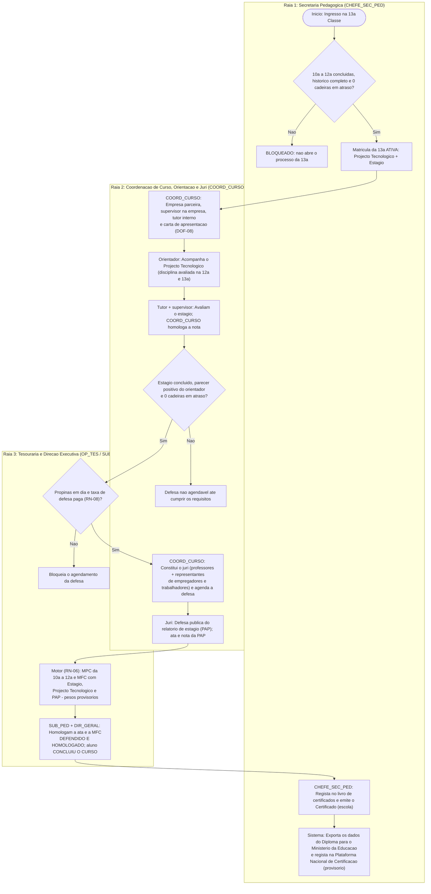

### 6.4 Passo a Passo Detalhado do Caminho Feliz (*Happy Path*)
1. **Elegibilidade (`RN-02`, `RN-06`):** todas as disciplinas da 10ª à 12ª com classificação final $\ge 10$ (ou `DISP`), incluindo transcrições externas, e nenhuma cadeira em atraso. O processo nasce **`Apto para 13ª Classe`**.
2. **Estágio e Orientação (`COORD_CURSO`):** o coordenador (ou quem acumula a coordenação GIVA — `COR-LEG-22`) liga o aluno a uma **empresa parceira**, regista o **Supervisor na empresa**, designa o **Tutor Interno** e emite a **Carta de Apresentação** (`DOF-08`). O **Orientador** acompanha o **Projecto Tecnológico**, que é uma **disciplina avaliada** (começa na 12ª com 2 h/semana e tem 8 h/semana na 13ª — DESC-L1 A6). Estado: **`Em Estágio`**.
3. **Avaliação do Estágio (`COORD_CURSO` + `SUB_PED`):** concluídas as horas de estágio (20 tempos semanais na 13ª), o Tutor e o Supervisor avaliam e é homologada a **nota do estágio** (`0` a `20`).
4. **Requisitos da Defesa (DESC-RESP R20):** **estágio concluído**, **parecer positivo do orientador**, **0 cadeiras em atraso**, **propinas em dia** e **taxa de defesa paga** (`RN-08`, Fluxo 07). Só então o `COORD_CURSO` constitui o **júri da PAP**, com **professores e membros externos** (representantes dos empregadores e dos trabalhadores do setor — DP n.º 167/23, art. 33.º, n.º 2; DESC-RESP R21), e agenda data, hora e sala. Estado: **`Apto para Defesa`**.
5. **Defesa Pública e `MFC` (`RN-06`):** a PAP é a **defesa do relatório de estágio** (projeto/relatório); regista-se a **nota da PAP** e a **Ata de Defesa** assinada pelos membros do júri (`DOF-08`). O motor calcula:
   1. as médias anuais $MA_{10}$, $MA_{11}$, $MA_{12}$ (sem `DISP` no denominador);
   2. $MPC = \text{round\_med}((MA_{10} + MA_{11} + MA_{12}) / 3)$;
   3. a **`MFC`**, combinando `MPC`, nota do **Estágio**, nota do **Projecto Tecnológico** e nota da **PAP**.
   > 🟡 **Provisória** — pesos da `MFC`, nota mínima da PAP (sem fonte legal) e forma de evitar a **dupla contagem do estágio** (a PAP já considera o desempenho no estágio — art. 33.º, n.º 3) são parâmetros; validar em **E2** e com a resposta às `Q-030`, `Q-LEG-06` e `Q-LEG-07` (`COR-LEG-17`) (`DEC-009`). Fonte: [[Verificacao das Referencias Legais|LEG-VER]] §3.8; [[Sintese das Respostas da Fase B|DESC-RESP]] §1.
6. **Homologação (`SUB_PED` + `DIR_GERAL`):** estado **`Defendido e Homologado`**; a matrícula da 13ª passa a `Concluída` e a situação académica do aluno a **`Concluiu o Curso`** (`RN-18.4.2`, `RN-18.14.2`).
7. **Certificado (escola) e Diploma (Ministério) — `COR-LEG-18`:**
   - o **Certificado** é emitido pela escola (Fluxo 08), registado no **livro de certificados**, com os signatários configurados;
   - o **Diploma** é emitido e assinado pelo **Ministro da Educação**, com o nível do Quadro Nacional de Qualificações (DP n.º 167/23, art. 55.º; DP n.º 227/25, art. 4.º, h)): o SGE **prepara e exporta os dados** do pedido; não o emite (`Q-021`).
   > 🟡 **Provisória** — signatários do Certificado: a lei indica o Director e o Subdirector Pedagógico (DP n.º 167/23, art. 54.º), mas na escola o Coordenador para a Área Pedagógica não assina certificados (DESC-RESP §2); validar em **E1** (`Q-028`). Registo na **Plataforma Nacional de Certificação** até 30 dias após o fim do ano e o seu QR: âmbito e forma por decidir (`Q-020`) (`DEC-009`).

### 6.5 Caminhos de Exceção, Erros e Travas de Segurança (*Edge Cases & Rollbacks*)
- **Exceção E6.1 — Histórico Externo Incompleto:** o cálculo da `MFC` lança `MissingHistoricalGradeException` e impede a homologação até a transcrição estar completa.
- **Exceção E6.2 — Reprovação na Defesa da PAP:** estado `Reprovado em PAP`; nova época de defesa com nova inscrição e taxa. Na passagem de ano, o aluno recebe proposta `NOVA_EPOCA_13A` (nova linha em `processos_13_classe` — `RN-18.5`).
- **Exceção E6.3 — Conflito de Papéis no Júri:** o mesmo professor não pode ter dois papéis no mesmo júri.
- **Exceção E6.4 — Júri Sem Membro Externo:** a constituição do júri é recusada sem pelo menos um membro externo 🟡 (número mínimo por confirmar — `Q-LEG-07`).
- **Exceção E6.5 — Membro do Júri, Tutor ou Orientador Sai da Escola (`RN-16.8`):** a desativação da conta cria uma pendência ao `COORD_CURSO` para o substituir no processo (Fluxo 15).
- **Exceção E6.6 — Estágio por Concluir no Encerramento do Ano:** a matrícula da 13ª é concluída no encerramento e o aluno recebe proposta `NOVA_EPOCA_13A` (`Q-C16-08`) 🟡.

### 6.6 Pós-condições e Registos Gerados
- Ata de Defesa da PAP arquivada; notas do Estágio, do Projecto Tecnológico e da PAP; `MFC` trancada no histórico vitalício.
- Certificado registado no livro e em `documentos_oficiais_emitidos`; dados do Diploma exportados para o Ministério.
- Situação académica `Concluiu o Curso`; processo individual passa ao arquivo histórico (`RN-18.14.5`).

---

## Fluxo 07: Tesouraria — Borderô por Saldo, Crédito do Aluno, Documentos Fiscais (DP n.º 71/25) e Fecho de Caixa por Turno

### 7.1 Atores Envolvidos (RBAC) e Contextos (DDD)
- **Atores RBAC:** `OP_TES`, `CHEFE_SEC_GER`, `SUB_ADM`, `DIR_GERAL`, `ENCARREGADO`.
- **Contextos DDD:** *Tesouraria & Fiscalidade (AGT)* $\leftrightarrow$ *Direção Executiva* $\leftrightarrow$ *Auditoria (APD)*.
- **Base legal (`COR-LEG-01`):** **DP n.º 71/25**, de 20 de março (Regime Jurídico das Facturas), DE n.º 683/25 e Código do IVA, art. 12.º, n.º 1, l). O DP n.º 292/18, citado na v1.2, está **revogado**.

### 7.2 Pré-condições e Gatilho de Início
- **Pré-condições:** sessão de utilizador `BALCAO` do `OP_TES` e sessão de caixa do período (`Manhã`/`Tarde`) aberta (`RN-16.13.3`); prestações (`A Vencer`, `Em Atraso`, `Em Acordo de Pagamento`) ou emolumento na Conta Corrente.
- **Gatilho de Início:** apresentação de um comprovativo (talão de depósito ou transferência, TPA ou Multicaixa Express) no guiché.

### 7.3 Diagrama Visual em Raias (Swimlane Flowchart)

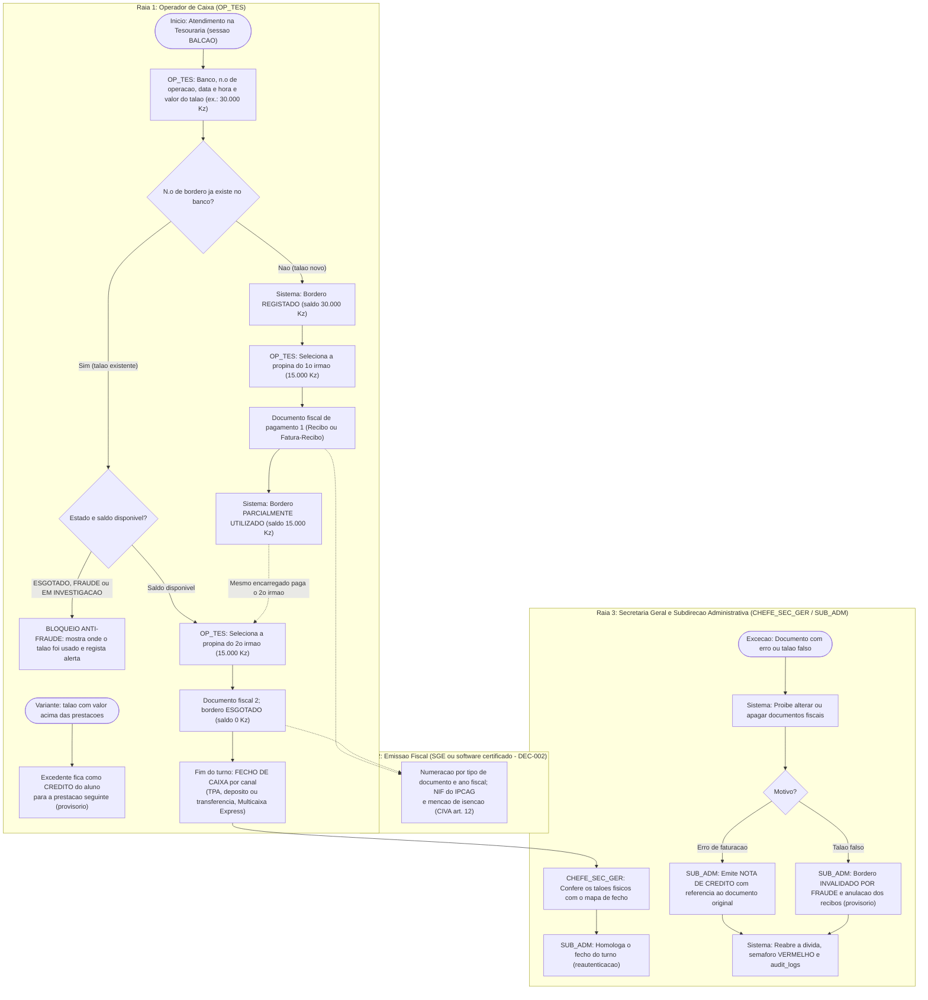

### 7.4 Passo a Passo Detalhado do Caminho Feliz (*Happy Path* — Caso Real de Irmãos / Pagamento Múltiplo)
1. **Abertura do Caixa (`OP_TES`):** no início do período, o operador abre a sessão de caixa a partir de uma sessão `BALCAO` (só uma sessão ativa por `OP_TES`; bloqueio de ecrã aos 15 min de inatividade — `RN-16.13`).
2. **Borderô por Saldo (`RN-09`):**
   - *Exemplo:* um encarregado tem **2 filhos**; a propina líquida de cada um é `15.000,00 Kz`; fez um depósito único de **`30.000,00 Kz`** (Borderô `BFA-998877`).
   - **Passo 2A (Irmão 1):** o `OP_TES` regista o talão; o sistema cria o borderô `Registado` (`saldo_disponivel = 30.000,00 Kz`), quita a propina do Irmão 1 e emite o **documento fiscal de pagamento** (ex.: `RC 2026/00105` — formato ilustrativo, `Q-004`). O borderô passa a **`Parcialmente Utilizado`** (`saldo_disponivel = 15.000,00 Kz`).
   - **Passo 2B (Irmão 2):** com o mesmo talão, o sistema lê o borderô com bloqueio transacional (`SELECT ... FOR UPDATE`), mostra o saldo de `15.000,00 Kz`, quita a propina do Irmão 2 e emite o segundo documento (`RC 2026/00106`). O borderô fica **`Esgotado / Trancado`**.
3. **Documentos Fiscais (`COR-LEG-02` a `05`):** cada operação gera o tipo legal adequado — **Fatura** (serviço prestado), **Recibo** (pagamento de algo faturado), **Fatura-Recibo** (emolumentos pagos no ato) e **Nota de Crédito** (correções). A numeração é **sequencial por tipo de documento e por ano fiscal** (não por Ano Letivo); a fatura leva o **NIF do IPCAG** e a **menção do motivo de isenção** de IVA com a norma. O SGE guarda o número e o código AGT devolvidos pelo emissor.
   > 🟡 **Provisória** — modelo de emissão das propinas (Fatura mensal por aluno + Recibo a cada pagamento, ou Fatura-Recibo), quem é o adquirente (aluno ou encarregado) e fatura de bolseiro a 100% dependem das `Q-LEG-16` a `18` e da `Q-003`; quem emite depende da `DEC-002` (aguarda a Direção) (`DEC-009`). Fonte: [[Verificacao das Referencias Legais|LEG-VER]] §4.2–4.4.
4. **Crédito do Aluno (sub-regra nova de `RN-09` — DESC-RESP R10):** se o talão excede o valor das prestações liquidadas, o **excedente fica como crédito do aluno** (saldo disponível do borderô ligado ao aluno e ao encarregado) e é proposto no pagamento da prestação seguinte; um talão com **valor a menos não quita** a prestação (sem pagamentos parciais de uma prestação).
   > 🟡 **Provisória** — aplicação automática ou proposta ao operador, e tratamento fiscal do adiantamento: parâmetro e questão `Q-LEG-16`; validar em **E1** (`DEC-009`). Fonte: [[Sintese das Respostas da Fase B|DESC-RESP]] R10; `RN-13.11.7`.
5. **Fecho de Caixa por Período e por Canal (`RN-09.2`, DESC-RESP R13):**
   - o `OP_TES` emite o **Mapa de Fecho de Caixa** (`DOF-11`) com totais separados por canal: **TPA**, **Depósito/Transferência** e **Multicaixa Express**;
   - o **`CHEFE_SEC_GER`** confere os talões físicos com o mapa;
   - o **`SUB_ADM`** homologa o fecho do turno, após reautenticação.
   > 🟡 **Provisória** — a coluna **RUPE** só existe se a escola receber pagamentos por RUPE que lhe pertençam; os emolumentos estatais pagos por RUPE não são receita do IPCAG (`Q-034`, `Q-C10-17`, `RN-13.11.9`) (`DEC-009`).

### 7.5 Caminhos de Exceção, Erros e Travas de Segurança (*Edge Cases & Rollbacks*)
- **Exceção E7.1 — Reutilização de Talão Esgotado:** bloqueio imediato; o ecrã mostra os documentos e os alunos onde o talão já foi usado e grava alerta em `audit_logs`.
- **Exceção E7.2 — Prestação Superior ao Saldo do Talão:** a transação é abortada (`InsufficientBorderoBalanceException`), salvo combinação com outro borderô ou meio de pagamento.
- **Exceção E7.3 — Erro num Documento Emitido (Imutabilidade — DP n.º 71/25):** o `OP_TES` não edita nem apaga documentos fiscais. O `SUB_ADM` emite uma **Nota de Crédito (`NC`)** com a menção "anulação" ou "rectificação" e a referência ao documento original (`COR-LEG-03`); a dívida volta à Conta Corrente e o saldo regressa ao borderô. A sigla `NC` deixa de colidir com a nota do estágio.
- **Exceção E7.4 — Talão Falso ou Adulterado:** o borderô passa a **`Invalidado por Fraude`** e os pagamentos que o usaram são anulados em cascata; o serviço continua faturado e a dívida reabre (semáforo vermelho).
  > 🟡 **Provisória** — instrumento fiscal adequado (anulação do recibo no software validado em vez de nota de crédito sobre a fatura): validar com o contabilista ou a AGT (`Q-LEG-16`) (`DEC-009`).
- **Exceção E7.5 — Pagamento Combinado de 2 ou Mais Borderôs (`RN-09.1`):** um pagamento pode somar o saldo de vários borderôs (`alocacoes_saldo_bordero`).
- **Exceção E7.6 — Correção de um Fecho Já Homologado ou de Ano Anterior (`RN-09.2`):** o mapa passado **nunca é reaberto**; a Nota de Crédito entra na sessão de caixa do dia da correção. As prestações de anos encerrados continuam liquidáveis (`RN-18.10`).
- **Exceção E7.7 — Prestações em Acordo de Pagamento (`RN-13.8`):** a parcela liquida-se com um pagamento normal das prestações que agrupa; com todas pagas, o acordo passa a `Cumprido` (Fluxo 11).
- **Exceção E7.8 — Borderô `NAO_ENCONTRADO` ou `DIVERGENTE` na Conciliação (`RN-13.16`):** o saldo desse borderô **não pode ser usado** (`HTTP 409 — BORDERÔ EM INVESTIGAÇÃO`) até a decisão do `SUB_ADM` (Fluxo 12).
- **Exceção E7.9 — Caixa Aberto sem Operador (saída, doença, ausência):** a sessão fica bloqueada a novos documentos e segue o **fecho administrativo** (`RN-13.18`, Fluxo 12).
- **Exceção E7.10 — Sem Comunicação com a AGT (`COR-LEG-06`):** se o SGE for o emissor, os documentos emitidos sem comunicação ficam em **modo de contingência**, marcados e submetidos depois; o emissor bloqueia após 60 dias sem comunicar 🟡 (`DEC-002`).

### 7.6 Pós-condições e Registos Gerados
- Documentos fiscais imutáveis em `AOA`, numerados por tipo e ano fiscal; Conta Corrente atualizada e semáforo verde.
- Borderô controlado ao cêntimo; crédito do aluno visível na Conta Corrente.
- Mapa de Fecho de Caixa por período e por canal, conferido pelo `CHEFE_SEC_GER` e homologado pelo `SUB_ADM`.

---

## Fluxo 08: Requerimento e Emissão Documental, Semáforo Financeiro, Transferência e Anulação, Certificado e Verificação QR

### 8.1 Atores Envolvidos (RBAC) e Contextos (DDD)
- **Atores RBAC:** `OP_PED`, `CHEFE_SEC_PED`, `SUB_PED`, `DIR_GERAL`, `OP_TES`, `ENCARREGADO` / `ALUNO`, `ENTIDADE_EXTERNA` (verificação pública).
- **Contextos DDD:** *Secretaria Pedagógica* $\leftrightarrow$ *Tesouraria & Fiscalidade (AGT)* $\leftrightarrow$ *Comunicação* $\leftrightarrow$ *Auditoria (APD)*.
- **Base legal (`COR-LEG-18` a `20`):** DP n.º 227/25 (títulos escolares): declarações em **até 5 dias úteis** (art. 9.º, n.º 6), 2ª via por erro da escola em 5 dias úteis (art. 9.º, n.º 8), número sequencial e código alfanumérico (art. 8.º, n.º 3), livro de registo e/ou base de dados (art. 13.º).

### 8.2 Pré-condições e Gatilho de Início
- **Pré-condições:** aluno com `N.º de Processo Individual`; séries anuais de numeração configuradas (`series_numeracao_documental` — `RN-11.14`).
- **Gatilho de Início:** **requerimento** do encarregado ou do aluno (declaração, boletim, guia de transferência, anulação, certificado) ou conclusão do curso (pedido do Diploma).

### 8.3 Diagrama Visual em Raias (Swimlane Flowchart)

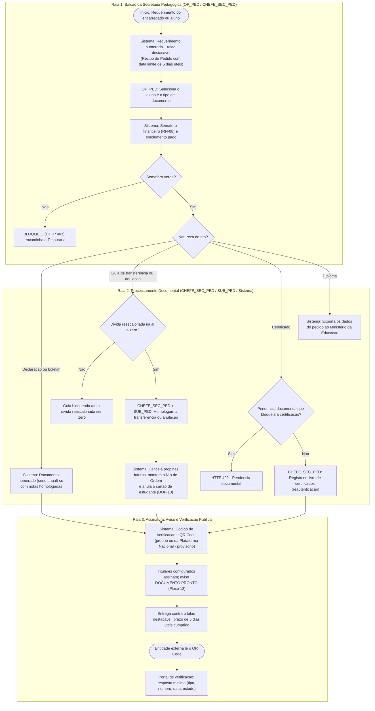

### 8.4 Passo a Passo Detalhado do Caminho Feliz (*Happy Path*)
1. **Requerimento Numerado (`OP_PED` — DESC-L1 A11, DESC-RESP R16):** o pedido é registado como **requerimento numerado** (`Requerente N.º __/IPCAG/ano`, dirigido à Coordenadora da Comissão de Gestão — título configurado) e o sistema imprime o **talão destacável** ("Recibo de Pedido") com o número e a **data limite de entrega**: **5 dias úteis** para declarações (DP n.º 227/25, art. 9.º, n.º 6). Um único balcão: o operador vê logo o semáforo, sem mandar o encarregado a outro guiché.
2. **Semáforo Financeiro (`RN-08`):** `fn_verificar_aptidao_financeira(aluno_id, tipo_servico)` confirma:
   - **Condição 1:** nenhuma prestação `Em Atraso (com Multa)` nem `Em Acordo de Pagamento` abrangida por acordo com `liberta_semaforo = Não` (`RN-13.8`), com a isenção dos bolseiros a 100%;
   - **Condição 2:** emolumento do documento pago e não consumido.
   > 🟡 **Provisória** — se a declaração tem taxa e se os emolumentos dos alunos se pagam à escola ou ao Estado por **RUPE** (DP n.º 227/25, art. 10.º, n.º 4) é a `Q-034` / `Q-LEG-14`: para os emolumentos estatais, a Condição 2 passa a ler o comprovativo RUPE registado; validar em **E1** (`DEC-009`). Fonte: [[Achados dos Documentos Reais - Lote 1|DESC-L1]] A11, A15.
3. **Execução Conforme a Natureza do Documento:**
   - **Caso A — Declaração ou Boletim:** só com dados de pautas `Fechado / Homologado`; a **Declaração de Estudante** recebe o número da sua série anual (`N.º __/IPCAG/ano` — DESC-L1 A13) e os campos reais (filiação, naturalidade, BI, classe, turma, sala, período, curso, efeito).
   - **Caso B — Guia de Transferência de Saída ou Anulação (`RN-05`):**
     1. a **Guia de Transferência** (`DOF-09`) exige **dívida reescalonada igual a zero**, mesmo com acordo que liberta o semáforo (`RN-13.8.3`);
     2. o `CHEFE_SEC_PED` e o `SUB_PED` homologam; a matrícula passa a `Transferida (Externa)` ou `Anulada / Desistente`;
     3. as prestações **futuras** passam a `Cancelada`; as **já vencidas e não pagas continuam dívida** do encarregado (`RN-13.10.1`);
     4. a linha do aluno mantém o seu `N.º de Ordem` com `TRANSFERIDO` / `ANULADO`;
     5. o **cartão de estudante** passa a `ANULADO` e a verificação do QR mostra "inválido"; o processo passa ao arquivo histórico e regista os originais devolvidos, se for prática da escola (`RN-11.10.5`, `RN-11.13`). Origem: E-C03.8.
   - **Caso C — Certificado (escola — `COR-LEG-18`):**
     1. verificação da **pendência documental**: requisitos `BLOQUEIA_CERTIFICACAO` em falta impedem a emissão (`RN-11.7.2`). Origem: E-C03.4;
     2. registo no **livro de certificados** com número sequencial (folha e termo como prática a confirmar — `COR-LEG-19`) 🟡;
     3. compila as médias da 10ª à 12ª (com transcrições e exames extraordinários) e, na 13ª, Estágio, Projecto Tecnológico, PAP e `MFC`.
   - **Caso D — Diploma (Ministério da Educação):** o SGE **não emite** o diploma; exporta os dados para o pedido ao Ministério (`Q-021`).
4. **Código de Verificação e QR (`RN-10`):** o sistema calcula o *hash* `HMAC-SHA256`, grava em `documentos_oficiais_emitidos` e estampa o QR e o código alfanumérico. Os blocos de assinatura imprimem o **título e o nome** de quem tinha o cargo na data, congelados no documento (`RN-16.20.6`).
   > 🟡 **Provisória** — nos títulos escolares, o QR pode ter de ser o da **Plataforma Nacional de Certificação** (DP n.º 227/25, art. 8.º, n.º 3); o QR próprio fica para os documentos sem QR nacional. Âmbito e integração por decidir (`Q-020`, C18) (`DEC-009`).
5. **Aviso e Entrega:** o encarregado recebe o aviso `DOCUMENTO_PRONTO` (Fluxo 13) e levanta o documento contra o talão destacável.
6. **Verificação Pública:** quem lê o QR vê só a resposta mínima da APD-11 (tipo, número, data de emissão, estado e, quando necessário, nome, curso e classe), nunca BI, contactos ou dados de saúde.

### 8.5 Caminhos de Exceção, Erros e Travas de Segurança (*Edge Cases & Rollbacks*)
- **Exceção E8.1 — Inadimplência ou Emolumento por Pagar (`HTTP 403`):** o botão *"Emitir"* fica bloqueado; só a quitação ou uma isenção formal (`DIR_GERAL`/`SUB_ADM`) o liberta. O operador vê apenas o semáforo e o código da pendência, nunca o valor em dívida (`RN-13.6`).
- **Exceção E8.2 — Certificado sem Registo no Livro:** `NOT NULL` + `UNIQUE` sobre o registo impedem gerar o PDF final sem registo ou com registo duplicado.
- **Exceção E8.3 — Notas de Trimestre Não Homologado:** nunca saem em documentos timbrados.
- **Exceção E8.4 — Pendência Documental Bloqueante (`HTTP 422`):** lista os documentos em falta, distinta do bloqueio financeiro (`RN-11.7.3`).
- **Exceção E8.5 — Prazo de 5 Dias Úteis em Risco:** pedidos pendentes há mais de 3 dias aparecem no painel da Direção (DESC-RESP R28; C15) 🟡 (limiar de alerta a confirmar).
- **Exceção E8.6 — 2ª Via por Erro da Escola:** emitida em até 5 dias úteis, sem novo emolumento; o documento errado fica anulado e a verificação mostra o estado (DP n.º 227/25, art. 9.º, n.º 8).
- **Exceção E8.7 — Guia Pedida com Acordo de Pagamento Ativo:** bloqueada até a dívida reescalonada ser zero. Origem: E-C10.5.
- **Exceção E8.8 — Documento de um Ano Encerrado:** continua a poder ser emitido; é uma das exceções ao modo só de leitura (`RN-18.12.2`).

### 8.6 Pós-condições e Registos Gerados
- Requerimento e documento numerados nas suas séries anuais; documento em `documentos_oficiais_emitidos` com código de verificação, signatários congelados e ligação ao emolumento consumido (um emolumento, um documento).
- Em transferência ou anulação: matrícula inativada, prestações futuras canceladas, dívida vencida mantida, numeração preservada e cartão anulado.
- Para concluintes: certificado registado no livro e dados do Diploma exportados.

---

## Fluxo 09: Encerramento do Ano Letivo e Passagem de Ano

> Capacidade [[C16 - Passagem de Ano Letivo|C16]] · Regras `RN-18.1` a `RN-18.16` · Documentos `DOF-25` (Mapa de Passagem e Encerramento) e `DOF-26` (Aviso de Confirmação de Matrícula) · US `US-PAS-01` a `08`

### 9.1 Atores Envolvidos (RBAC) e Contextos (DDD)
- **Atores RBAC:** `SUB_PED`, `DIR_GERAL`, `SUB_ADM`, `CHEFE_SEC_PED`, `OP_PED`, `OP_TES`, `COORD_CURSO`, `DIR_TURMA`, `ENCARREGADO`.
- **Contextos DDD:** *Governação & Direção Executiva* $\rightarrow$ *Secretaria Pedagógica* $\leftrightarrow$ *Tesouraria & Fiscalidade (AGT)* $\rightarrow$ *Auditoria & Estatística*.

### 9.2 Pré-condições e Gatilho de Início
- **Pré-condições:** ano `N` `Em Curso` com o III Trimestre por encerrar; ano `N+1` criado em `Planeado` com matrizes ativas e tabela de preços (`RN-18.1.3`).
- **Gatilho de Início:** encerramento oficial do III Trimestre pela `SUB_PED`; o ano `N` passa a `Em Encerramento` (`RN-18.2`).

### 9.3 Diagrama Visual em Raias (Swimlane Flowchart)

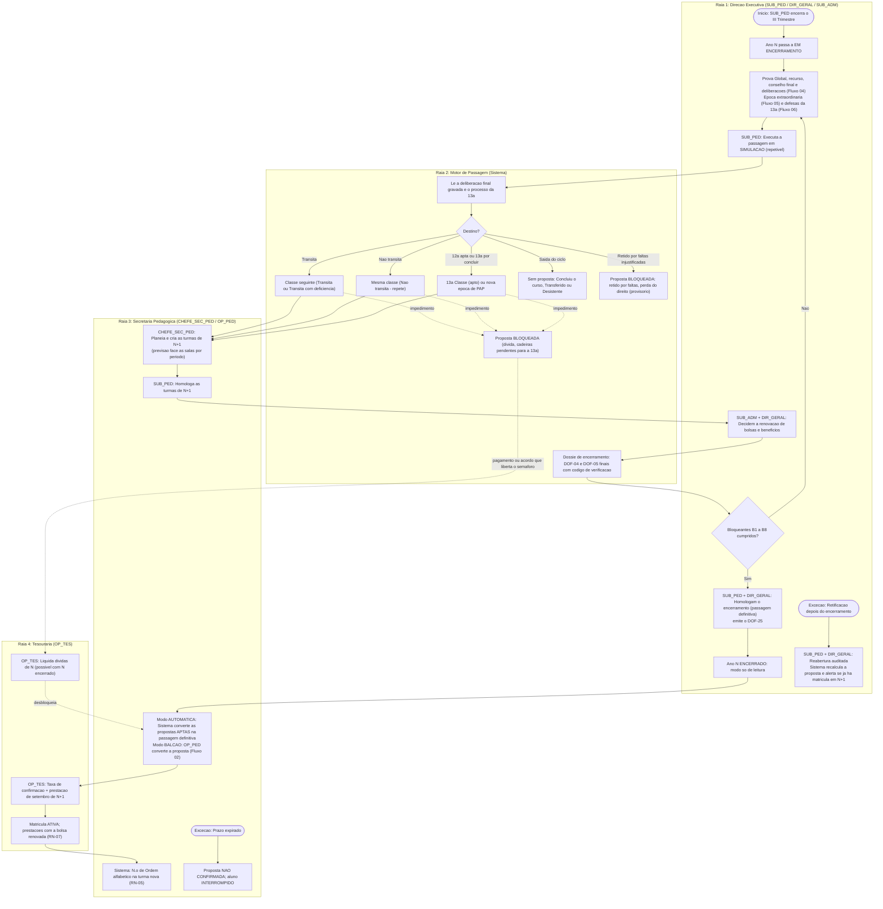

### 9.4 Passo a Passo Detalhado do Caminho Feliz (*Happy Path*)
1. **Entrada em Encerramento (`SUB_PED`):** o ano `N` passa a `Em Encerramento`; não se criam matrículas novas em `N` (continuam possíveis transferências de saída e anulações). O ano `N+1` pode estar `Planeado` ao mesmo tempo, com concurso, turmas e confirmações (`RN-18.1.3`); o I Trimestre de `N+1` só abre com `N` `Encerrado` (`RN-18.1.4`).
2. **Deliberações (Fluxos 04, 05 e 06):** Prova Global, recurso, conselhos finais e homologação das Pautas Gerais; as matrículas da 10ª à 12ª passam a `Concluída`. A 13ª conclui-se pelo estado do processo (`RN-18.4.2`).
3. **Simulação (`SUB_PED` — `RN-18.5`, `RN-18.16`):** o motor calcula o destino de cada aluno a partir da deliberação **gravada** (não volta a deliberar), mantendo o curso e o período atual. Cada execução fica numerada e substitui as propostas ainda não convertidas da anterior; uma proposta convertida nunca muda.

   | Resultado na Pauta Geral real | Destino em `N+1` | Proposta |
   | :--- | :--- | :--- |
   | Transita | Classe seguinte (12ª sem cadeiras: 13ª) | `TRANSICAO` |
   | Transita com deficiência | Classe seguinte com as cadeiras em atraso | `TRANSICAO_COM_DEFICIENCIA` |
   | 12ª aprovada com cadeiras da 10ª/11ª por eliminar 🟡 | 13ª, bloqueada até eliminar as cadeiras | `CONDICIONADA_13A` |
   | Não transita | Mesma classe | `REPETENCIA` |
   | Desistente / Transferido / 13ª concluída | Sem proposta | — |
   | 13ª reprovada em PAP ou estágio por concluir | 13ª, nova época | `NOVA_EPOCA_13A` |

4. **Turmas de `N+1` (`CHEFE_SEC_PED` → `SUB_PED` — `RN-18.7`):** previsão por `Curso + Classe + Período` = propostas + vagas de admissão + reserva para transferências; número de turmas sugerido pela lotação, limitado pelas salas por período. Cada turma nova recebe as Mini-Pautas da matriz ativa em `N+1`; a nomeação dos Directores de Turma e a distribuição de serviço seguem o Fluxo 10.
5. **Benefícios (`SUB_ADM` + `DIR_GERAL` — `RN-18.11`):** para cada benefício ativo, uma proposta de renovação: **renovar**, **alterar a percentagem** ou **não renovar**. O desconto de irmãos é recalculado; o de filho de funcionário só se o funcionário continuar ativo.
6. **Homologação do Encerramento (`SUB_PED` + `DIR_GERAL` — `RN-18.3`, `RN-18.15`):** com os bloqueantes B1–B8 cumpridos (pautas homologadas, matrículas em estado final, cadeiras em atraso consistentes, sem reaberturas nem conflitos pendentes, épocas fechadas, 13ª resolvida, dossiê completo) e a cópia anual de fecho verificada (RNF-BKP-08), homologam. É emitido o **`DOF-25`** (Mapa de Passagem e Encerramento, com as quatro categorias reais por curso, classe, período e género) e gravado `ANO_LETIVO_ENCERRADO`. As atribuições de cargo com escopo de turmas de `N` (ex.: `DIR_TURMA`) terminam (`RN-16.19.2`).
7. **Confirmações (`OP_PED`, `OP_TES`):** cada encarregado recebe o **`DOF-26`** (Aviso de Confirmação de Matrícula: destino, cadeiras em atraso, situação financeira sem valores de terceiros, bolsa, documentos em falta, prazo e modo — nunca dados de saúde). No modo `AUTOMATICA`, as propostas aptas já foram convertidas na homologação; no modo `BALCAO`, convertem-se no Fluxo 02. Paga a taxa e a prestação de setembro, a matrícula fica `Ativa` e o aluno entra na ordem alfabética da turma nova.
8. **Saídas do Ciclo (`CHEFE_SEC_PED` — `RN-18.14`):** concluintes, transferidos e desistentes ficam com a situação académica final; os processos passam ao arquivo histórico, continuam consultáveis e continuam a emitir documentos.

> 🟡 **Provisória** — modo de confirmação (`BALCAO`/`AUTOMATICA`), bloqueio por dívida, prazo de 60 dias, perda do direito por faltas e categoria da 12ª com cadeiras pendentes são parâmetros; validar com as respostas às `Q-LEG-04`, `Q-LEG-05`, `Q-C16-01`, `Q-C16-06` e `Q-031` e em **E1** (homologação) (`DEC-009`). Fonte: [[C16 - Passagem de Ano Letivo|C16]]; `COR-LEG-14/15`.

### 9.5 Caminhos de Exceção, Erros e Travas de Segurança (*Edge Cases & Rollbacks*)
- **Exceção E9.1 — Bloqueantes por Cumprir:** o painel lista cada pendência com ligação ao módulo que a resolve; a homologação é rejeitada (`HTTP 422`). Origem: E-C16.1.
- **Exceção E9.2 — Dívida Vencida:** proposta `Bloqueada` (`DIVIDA_VENCIDA`); a Tesouraria liquida a prestação de `N` mesmo com o ano encerrado e a proposta desbloqueia sozinha (`RN-18.10`). Origem: E-C16.2.
- **Exceção E9.3 — 12ª com Cadeiras em Atraso:** `CONDICIONADA_13A` até à eliminação em Exame Extraordinário (`RN-18.9.3`). Origem: E-C16.3.
- **Exceção E9.4 — Salas Insuficientes no Período:** o plano de turmas mostra o défice; a `SUB_PED` decide (turmas maiores, outro período, laboratório como sala). A 13ª em estágio pode não precisar de sala própria (`Q-C16-05`) 🟡. Origem: E-C16.4.
- **Exceção E9.5 — Prazo de Confirmação Expirado:** proposta `Não Confirmada`, aluno `Interrompido`; confirmação tardia com autorização do `CHEFE_SEC_PED` (`RN-18.6.5`). Origem: E-C16.5.
- **Exceção E9.6 — Retificação Depois do Encerramento (`RN-18.13`, `US-PAS-08`):** a proposta é recalculada; se o aluno já estiver matriculado numa classe que deixou de estar certa, cria-se um **alerta crítico** ao `CHEFE_SEC_PED` e à `SUB_PED` (o sistema não move a matrícula) e grava-se `RETIFICACAO_POS_ENCERRAMENTO`. Origem: E-C16.6.
- **Exceção E9.7 — Alteração de Dados de um Ano Encerrado:** rejeitada (`HTTP 409`), salvo as exceções da lista fechada: emissão de documentos, Tesouraria (liquidações, Notas de Crédito, fraude) e reabertura auditada conjunta (`RN-18.12`). Origem: E-C16.7.
- **Exceção E9.8 — Bolsa Não Decidida a Tempo:** prestações pelo valor bruto; concessão posterior só nas vincendas. Origem: E-C16.8.
- **Exceção E9.9 — Irmão Saiu da Escola:** desconto de irmãos recalculado e encarregado avisado (`RN-18.11.4`). Origem: E-C16.9.
- **Exceção E9.10 — Retido por Faltas Injustificadas:** proposta `Bloqueada` (`PERDA_DIREITO_FALTAS`), desbloqueável só por justificação aceite (confirmação em 5 dias úteis) ou por despacho de reingresso da `SUB_PED` (`COR-LEG-14`, Fluxo 02 E2.7) 🟡.

### 9.6 Pós-condições e Registos Gerados
- Ano `N` `Encerrado`, só de leitura, com dossiê de encerramento, `DOF-25` e evento em `audit_logs`.
- Uma proposta por aluno que continua no ciclo; turmas de `N+1` criadas com Mini-Pautas; benefícios decididos.
- Situação académica vitalícia de todos os alunos atualizada; processos dos que saíram identificados para o arquivo histórico.

---

## Fluxo 10: Distribuição de Serviço Docente, Horário Semanal e Livro de Sumários

> Capacidade [[C04 - Horarios e Distribuicao de Servico Docente|C04]] · Regras `RN-12.1` a `RN-12.18` · Documentos `DOF-15` (Mapa de Distribuição de Serviço Docente) e `DOF-16` (Horário Semanal) · US `US-HOR-01` a `11` · Decisão `DEC-004` (horário registado à mão ou importado; sem geração automática)

### 10.1 Atores Envolvidos (RBAC) e Contextos (DDD)
- **Atores RBAC:** `SUB_PED` (formação de turmas e horários — DP n.º 93/21, art. 17.º, a), `COR-LEG-22`), `DIR_GERAL` (visto), `COORD_CURSO`, `COORD_TURNO`, `CHEFE_SEC_GER`, `SUB_ADM`, `DIR_TURMA`, `PROF`.
- **Contextos DDD:** *Governação & Direção Executiva* $\leftrightarrow$ *Coordenação & Docência* $\leftrightarrow$ *Secretaria Geral & RH*.

### 10.2 Pré-condições e Gatilho de Início
- **Pré-condições:** Ano Letivo homologado; matrizes ativas; turmas criadas com sala própria e Mini-Pautas (Fluxo 09); cadastro de professores ativo nos RH.
- **Gatilho de Início:** preparação do arranque do ano (agosto, na prática da escola: os Coordenadores de Curso propõem a distribuição e o Coordenador para a Área Pedagógica consolida o horário — `Q-011`).

### 10.3 Diagrama Visual em Raias (Swimlane Flowchart)

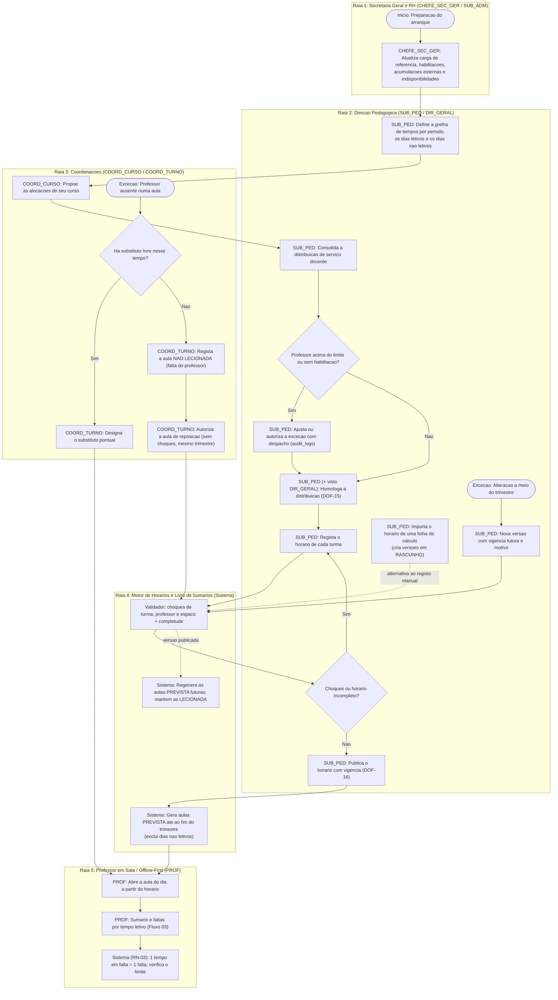

### 10.4 Passo a Passo Detalhado do Caminho Feliz (*Happy Path*)
1. **RH (`CHEFE_SEC_GER`):** confirma professores ativos, carga de referência, habilitações, acumulações externas autorizadas e **indisponibilidades** — essencial porque mais de metade dos professores leciona noutra escola (DESC-RESP R23; `US-HOR-02`).
2. **Parametrização (`SUB_PED` — `RN-12.1`, `RN-12.2`, `RN-12.12`):** grelha de tempos de cada período, dias letivos e dias não letivos; o sistema verifica a **capacidade semanal** de cada turma face à matriz.
   > 🟡 **Provisória** — duração do tempo letivo, número de tempos por período (a escola refere 6, de 45/50 min) e dias letivos são parâmetros. Com os dados atuais, as **32 horas curriculares semanais** dos planos reais não cabem em 5 dias × 6 tempos: a grelha real tem de ser recolhida; validar com as respostas às `Q-012` e `Q-C04-18` (`DEC-009`). Fonte: [[C04 - Horarios e Distribuicao de Servico Docente|C04]] `RN-12.1.4`.
3. **Proposta (`COORD_CURSO`):** cada coordenador propõe os titulares das disciplinas do seu curso; as disciplinas transversais são distribuídas pela `SUB_PED`.
4. **Consolidação e Homologação (`SUB_PED` + visto `DIR_GERAL` — `RN-12.3`, `RN-12.4`):** o sistema mostra a carga de cada professor, as reduções por cargo e os avisos; a `SUB_PED` resolve ou autoriza exceções com despacho e homologa. Uma disciplina pode ficar "Sem Docente Atribuído", em alerta permanente.
   > 🟡 **Provisória** — limites de carga letiva, reduções por cargo e regra das acumulações: enquanto a escola não os fornecer, o sistema **só mostra** a carga e não bloqueia; validar com as respostas às `Q-C04-04` e `Q-C04-05` (`DEC-009`).
5. **Horário (`SUB_PED` ou delegado — `RN-12.8`, `RN-12.9`, `RN-12.18`):** regista as aulas de cada turma na grelha, ou **importa** o horário de uma folha de cálculo no modelo do SGE (versões em `RASCUNHO`, relatório de linhas aceites e rejeitadas). O professor de cada aula é sempre **derivado** da alocação vigente. O validador indica os choques de turma, professor e espaço a cada gravação e no relatório de importação.
6. **Publicação (`SUB_PED` — `RN-12.11`):** sem choques e com o horário completo, publica com data de vigência; o sistema gera as **aulas previstas** até ao fim do trimestre. O `DOF-16` imprime o rótulo "Período".
7. **Rotina Diária (`PROF` — `RN-12.13`, `RN-12.17`):** o ecrã inicial mostra as aulas do dia (também *offline*); o professor abre a aula, regista o sumário e as faltas por tempo letivo (Fluxo 03).
8. **Faltas dos Professores (`COORD_TURNO` — `RN-12.14`, DESC-RESP R24):** a ausência do professor é registada por tempo letivo; as aulas `NAO_LECIONADA` por falta do professor ficam visíveis à `CHEFE_SEC_GER` para o mapa mensal de efetividade (os salários estão fora do SGE).

### 10.5 Caminhos de Exceção, Erros e Travas de Segurança (*Edge Cases & Rollbacks*)
- **Exceção E10.1 — Carga Acima do Limite:** homologação bloqueada até ajuste ou despacho de exceção (`EXCECAO_CARGA_LETIVA`). Origem: E-C04.1.
- **Exceção E10.2 — Choque ao Gravar uma Aula:** aceite no rascunho mas marcada a vermelho; a submissão é bloqueada (`RN-12.9`). Origem: E-C04.2.
- **Exceção E10.3 — Disciplina sem Professor no Arranque:** publica-se com "Sem Docente Atribuído"; as aulas registam-se `NAO_LECIONADA` (`SEM_PROFESSOR_ATRIBUIDO`) e a taxa de cumprimento mostra o problema. Origem: E-C04.3.
- **Exceção E10.4 — Professor Falta a uma Aula:** substituição pontual (`US-HOR-07`) ou aula não lecionada seguida de reposição no mesmo trimestre (`US-HOR-08`, `RN-12.15`). Origem: E-C04.4.
- **Exceção E10.5 — Substituição Prolongada com Choque:** a nova alocação do `RN-04` é bloqueada até haver nova versão do horário sem choque (`RN-12.14.4`). Origem: E-C04.5.
- **Exceção E10.6 — Alteração a Meio do Trimestre:** nova versão só com vigência futura e motivo; as aulas `LECIONADA` nunca mudam; avisos ao `DIR_TURMA`, professores e `COORD_TURNO` (e aviso `HORARIO_ALTERADO` pelo portal na E5 — Fluxo 13). Origem: E-C04.6.
- **Exceção E10.7 — Feriado Declarado Depois da Publicação:** as aulas previstas desse dia passam a `CANCELADA` (`RN-12.12`). Origem: E-C04.7.
- **Exceção E10.8 — Mesma Aula Registada em Dois Dispositivos:** conflito `AULA_JA_SUMARIADA` (Fluxo 03, E3.5). Origem: E-C04.8.
- **Exceção E10.9 — Aula sem Aula Prevista:** `HTTP 422`, com indicação de pedir reposição. Origem: E-C04.9.
- **Exceção E10.10 — Linha de Importação Inválida:** a linha é rejeitada com número e motivo; nada é publicado sem passar o validador (`RN-12.18`).

### 10.6 Pós-condições e Registos Gerados
- Distribuição de serviço homologada (`DOF-15`) e alocações vigentes em `alocacoes_docentes`.
- Horário publicado por turma (`DOF-16`), com versões e vigências, e aulas previstas geradas para o trimestre.
- Livro de sumários digital com faltas por tempo letivo e indicadores de cumprimento (`RN-12.16`) para os painéis da Direção (C15).

---

## Fluxo 11: Cobrança de Dívidas, Avisos Escalonados e Acordos de Pagamento

> Capacidade [[C10 - Cobranca, Relatorios Financeiros e Conciliacao|C10]] · Regras `RN-13.1` a `RN-13.10` e `RN-13.20` · Documentos `DOF-17` (Aviso de Regularização de Propinas), `DOF-18` (Acordo de Pagamento) e `DOF-19` (Extrato de Conta Corrente) · US `US-COB-01` a `06`

### 11.1 Atores Envolvidos (RBAC) e Contextos (DDD)
- **Atores RBAC:** `OP_TES`, `CHEFE_SEC_GER`, `SUB_ADM`, `DIR_GERAL`, `ENCARREGADO` (devedor). Os cargos pedagógicos **nunca** veem valores em dívida (`RN-13.6`).
- **Contextos DDD:** *Tesouraria & Fiscalidade (AGT)* $\leftrightarrow$ *Comunicação* $\leftrightarrow$ *Direção Executiva* $\leftrightarrow$ *Auditoria (APD)*.

### 11.2 Pré-condições e Gatilho de Início
- **Pré-condições:** Conta Corrente com prestações geradas (Fluxo 02); parâmetros de cobrança do Ano Letivo (multa, escalões, níveis de aviso, tolerâncias) em `parametros_cobranca`.
- **Gatilho de Início:** o *job* diário encontra uma prestação no dia seguinte à data limite sem pagamento.

### 11.3 Diagrama Visual em Raias (Swimlane Flowchart)

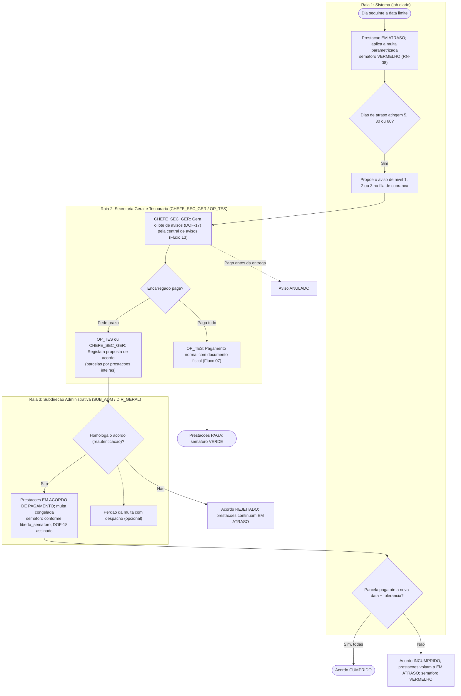

### 11.4 Passo a Passo Detalhado do Caminho Feliz (*Happy Path*)
1. **Entrada em Atraso (Sistema — `RN-13.1`, `RN-13.2`, `RN-13.3`):** no dia seguinte à data limite, a prestação passa a `Em Atraso (com Multa)`, a multa é calculada pela regra parametrizada e o semáforo fica vermelho. A antiguidade conta-se por prestação, em escalões (`1–30`, `31–60`, `61–90`, `> 90` dias).
   > 🟡 **Provisória** — a regra real da multa (tipo, valor, base, tolerância, teto) é **desconhecida**; nenhum valor por omissão é assumido. Validar com a resposta à `Q-C10-01` e em **E1** (`DEC-009`). Fonte: [[C10 - Cobranca, Relatorios Financeiros e Conciliacao|C10]] `RN-13.3`.
2. **Avisos Escalonados (`CHEFE_SEC_GER` — `RN-13.5`):** nível 1 (**Lembrete**, 5 dias), nível 2 (**Aviso**, 30 dias, com referência ao bloqueio de documentos e convite a acordo) e nível 3 (**Convocatória** à Subdireção Administrativa, 60 dias, assinada pelo `SUB_ADM`). O aviso impresso é o **`DOF-17`**; a entrega e o canal seguem a central de avisos (Fluxo 13), sem valores no SMS (`RN-14.4`). Nunca há listas públicas de devedores.
   > 🟡 **Provisória** — dias de cada nível e canais (envelope pelo aluno, SMS) são parâmetros; validar com as respostas às `Q-C10-05` e `Q-037` (`DEC-009`).
3. **Pagamento:** o encarregado paga na Tesouraria (Fluxo 07); as prestações passam a `Paga` e o semáforo volta a verde. Um aviso por entregar é anulado.
4. **Acordo de Pagamento (`OP_TES`/`CHEFE_SEC_GER` → `SUB_ADM` — `RN-13.7`, `RN-13.8`):** o acordo é feito com o **encarregado**, pode juntar prestações vencidas de vários educandos e agrupa **prestações inteiras** em parcelas com novas datas. Na homologação (com reautenticação), as prestações passam a **`Em Acordo de Pagamento`**, a multa fica congelada (pode haver **perdão** com despacho — `RN-13.4`) e o acordo indica se **liberta o semáforo**. O **`DOF-18`** é assinado pelo encarregado e pelo homologador, e a versão digitalizada é anexada antes de o acordo ficar ativo. Acima dos limites parametrizados, homologa o `DIR_GERAL` (`Q-C10-02`) 🟡.
5. **Cumprimento:** cada parcela liquida-se com um pagamento normal; com todas pagas, o acordo passa a **`Cumprido`**.
6. **Extrato (`OP_TES`):** o encarregado pode pedir o **`DOF-19`** (Extrato de Conta Corrente), informativo e **não fiscal** (`Q-C10-13`).

### 11.5 Caminhos de Exceção, Erros e Travas de Segurança (*Edge Cases & Rollbacks*)
- **Exceção E11.1 — Pagamento Anulado Depois de Pago (erro ou fraude):** a prestação volta a `Em Atraso` se a data limite já passou e reentra no ciclo com a antiguidade original. Origem: E-C10.1.
- **Exceção E11.2 — Pagamento Antes da Entrega do Aviso:** o aviso é anulado automaticamente. Origem: E-C10.2.
- **Exceção E11.3 — Acordo Rejeitado:** motivo obrigatório; nada muda na Conta Corrente. Origem: E-C10.3.
- **Exceção E11.4 — Acordo Incumprido (`RN-13.9`):** uma parcela por pagar além da tolerância torna o acordo `Incumprido` (*job* diário): as prestações voltam a `Em Atraso`, o semáforo fica vermelho e não há novo acordo no mesmo ano sem despacho do `DIR_GERAL`. A multa recomeça na data do incumprimento 🟡 (`Q-C10-02`, `Q-C10-15`). Origem: E-C10.4.
- **Exceção E11.5 — Guia de Transferência com Acordo Ativo:** bloqueada até a dívida reescalonada ser zero (Fluxo 08). Origem: E-C10.5.
- **Exceção E11.6 — Encarregado Já com Acordo Ativo:** nova proposta recusada (`HTTP 409 — ACORDO ATIVO EXISTENTE`). Origem: E-C10.6.
- **Exceção E11.7 — Dívida de Ex-Aluno ou de Ano Encerrado (`RN-13.10`):** continua dívida do encarregado, separada por Ano Letivo de origem; pode ser reescalonada e liquidada com o ano encerrado (`RN-18.10`). Não existe "dívida incobrável" nesta versão (`Q-C10-11`).
- **Exceção E11.8 — Perdão de Multa já Paga:** proibido como atalho; exigiria corrigir o documento fiscal (Nota de Crédito — Fluxo 07).

### 11.6 Pós-condições e Registos Gerados
- Avisos registados em `avisos_cobranca` (nível, canal, valor à data, entrega), ligados aos `avisos` da central de comunicação.
- Acordos com parcelas, estado e documento assinado; perdões em `ajustes_conta_corrente` (*append-only*) e `PERDAO_MULTA` em `audit_logs`.
- Nenhum documento fiscal alterado ou apagado (`RN-13.20`).

---

## Fluxo 12: Conciliação Bancária Mensal e Fecho Administrativo de Caixa

> Capacidade [[C10 - Cobranca, Relatorios Financeiros e Conciliacao|C10]] · Regras `RN-13.14` a `RN-13.19` · Documentos `DOF-20` (Mapa de Conciliação Bancária) e `DOF-11` (Mapa de Fecho de Caixa, com menção de fecho administrativo) · US `US-COB-11` a `14` · Decisão `DEC-005` (borderô manual + conciliação por extrato; integração automática fora das E1–E5)

### 12.1 Atores Envolvidos (RBAC) e Contextos (DDD)
- **Atores RBAC:** `CHEFE_SEC_GER` (confirma as correspondências), `SUB_ADM` (aprova diferenças, investiga, homologa), `DIR_GERAL` (homologa quando foi o `SUB_ADM` a confirmar), `OP_TES` (regista borderôs; **não concilia** os seus — `RN-13.14.5`).
- **Contextos DDD:** *Tesouraria & Fiscalidade (AGT)* $\leftrightarrow$ *Direção Executiva* $\leftrightarrow$ *Auditoria*.

### 12.2 Pré-condições e Gatilho de Início
- **Pré-condições:** borderôs do mês registados (Fluxo 07); conta bancária do IPCAG por banco; período de conciliação `Aberto`. O primeiro período conciliado é o mês de arranque do SGE; borderôs migrados não são conciliados retroativamente (`RN-13.14.6`).
- **Gatilho de Início:** extrato do mês disponível; ou uma sessão de caixa aberta sem o seu operador.

### 12.3 Diagrama Visual em Raias (Swimlane Flowchart)

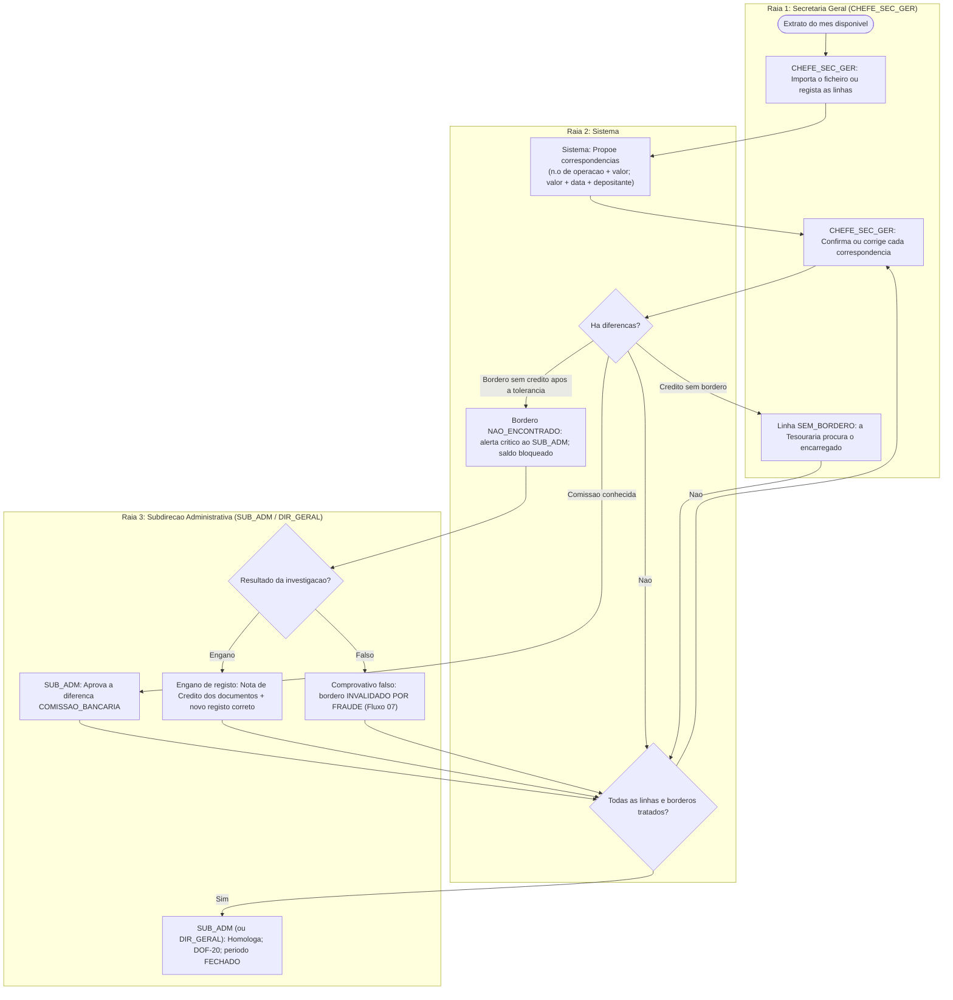

**Variante — Fecho administrativo de caixa (`RN-13.18`):**

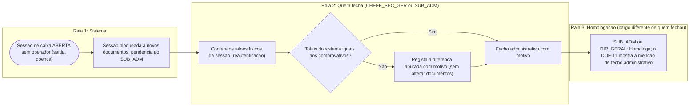

### 12.4 Passo a Passo Detalhado do Caminho Feliz (*Happy Path*)
1. **Importação (`CHEFE_SEC_GER` — `RN-13.14`):** o extrato é importado do ficheiro do banco ou registado à mão a partir do papel; o ficheiro original fica guardado com *hash*.
2. **Correspondência (Sistema → `CHEFE_SEC_GER` — `RN-13.15`):** o sistema sugere por (a) banco + n.º de operação + valor, (b) valor + data até `N` dias depois do talão + nome do depositante; só uma pessoa confirma. São admitidas as cardinalidades `1↔1`, `1↔N` (créditos agregados de TPA ou Multicaixa Express) e `N↔1`.
3. **Diferenças:** comissões conhecidas registam-se como `COMISSAO_BANCARIA`, aprovadas pelo `SUB_ADM`; créditos sem borderô ficam `SEM_BORDERO` para a Tesouraria procurar o encarregado; débitos e comissões que não são pagamentos ficam `FORA_DO_AMBITO`. Nenhum documento fiscal é alterado.
4. **Borderô Não Encontrado (`RN-13.16`):** depois do extrato que cobre a sua data e da tolerância, o borderô passa a `NAO_ENCONTRADO`, com alerta crítico ao `SUB_ADM`; o seu saldo deixa de poder ser usado. O `SUB_ADM` investiga e decide: engano de registo (Nota de Crédito e novo registo, tudo auditado) ou comprovativo falso (`declararFraudeBancaria`).
5. **Fecho do Período (`RN-13.19`):** com todas as linhas tratadas e todos os borderôs conciliados ou com alerta aberto, homologa um cargo **diferente** de quem confirmou; é gerado o **`DOF-20`** (saldos, créditos conciliados e sem borderô, borderôs não encontrados, diferenças, saldo de borderôs por alocar). Um período homologado **nunca é reaberto**.
6. **Fecho Administrativo de Caixa (`RN-13.18`):** quando o `OP_TES` não pode fechar a sua sessão (saída — Fluxo 15 —, doença ou ausência), a sessão fica bloqueada; o `CHEFE_SEC_GER` ou o `SUB_ADM` confere os talões e fecha com motivo, após reautenticação; homologa um cargo diferente; o `DOF-11` mostra *"Fecho administrativo — executado por [nome/cargo] em DD/MM/AAAA — motivo"*.
   > 🟡 **Provisória** — tolerâncias (3 dias úteis para a sugestão, 5 dias úteis para `NAO_ENCONTRADO`), formatos de extrato por banco e tratamento dos créditos agregados de TPA são parâmetros; validar com as respostas às `Q-007`, `Q-C10-08` e `Q-C10-09` (`DEC-009`).

### 12.5 Caminhos de Exceção, Erros e Travas de Segurança (*Edge Cases & Rollbacks*)
- **Exceção E12.1 — Extrato em Formato Desconhecido:** registo manual das linhas, com o ficheiro anexado. Origem: E-C10.7.
- **Exceção E12.2 — Extrato Importado Duas Vezes:** recusado pelo *hash* do ficheiro ou pela combinação `(conta, data, referência, valor)`. Origem: E-C10.8.
- **Exceção E12.3 — Linha Descoberta Depois do Fecho:** entra no período aberto seguinte, com referência à data original. Origem: E-C10.9.
- **Exceção E12.4 — Uso do Saldo de um Borderô em Investigação:** recusado (`HTTP 409 — BORDERÔ EM INVESTIGAÇÃO`). Origem: E-C10.10.
- **Exceção E12.5 — Diferença no Fecho Administrativo:** registada como diferença apurada com motivo, sem alterar documentos. Origem: E-C10.11.
- **Exceção E12.6 — Correspondência Confirmada por Engano:** só pode ser desfeita antes da homologação, por quem a confirmou ou pelo `SUB_ADM`, com motivo; nunca se apaga — regista-se a anulação.
- **Exceção E12.7 — Pagamento por RUPE:** não é receita do IPCAG e não entra na conciliação, salvo indicação da Direção (`Q-C10-17`) 🟡.

### 12.6 Pós-condições e Registos Gerados
- Período de conciliação `Fechado / Homologado` com `DOF-20`; correspondências *append-only*.
- Borderôs com estado de conciliação (`POR_CONCILIAR`, `CONCILIADO`, `DIVERGENTE`, `NAO_ENCONTRADO`), separado dos estados de saldo.
- Sessões de caixa sem operador fechadas administrativamente e homologadas por um segundo cargo.

---

## Fluxo 13: Avisos e Convocatórias aos Encarregados

> Capacidade [[C12 - Comunicacao com Encarregados e Alunos|C12]] · Regras `RN-14.1` a `RN-14.10` · Documentos `DOF-21` (Convocatória numerada) e `DOF-22` (Aviso impresso com recibo de entrega) · US `US-COM-01` a `08` · Decisão `DEC-003` (portal só na E5)

### 13.1 Atores Envolvidos (RBAC) e Contextos (DDD)
- **Atores RBAC:** `DIR_TURMA`, `COORD_TURNO`, `SUB_PED`, `DIR_GERAL`, `SUB_ADM` (modelos e orçamento de SMS), `CHEFE_SEC_GER` (avisos de cobrança), `OP_PED` (contactos e entregas ao balcão), `ENCARREGADO`, `ALUNO` (portal, E5).
- **Contextos DDD:** *Comunicação* $\leftrightarrow$ *Coordenação & Docência* $\leftrightarrow$ *Secretaria Pedagógica* $\leftrightarrow$ *Tesouraria*.

### 13.2 Pré-condições e Gatilho de Início
- **Pré-condições:** modelos de mensagem aprovados pela Direção; contactos do encarregado confirmados na matrícula (Fluxo 02); consentimento registado; gatilhos ativos e limiares configurados.
- **Gatilho de Início:** um gatilho automático (`FALTAS_50`, `FALTAS_80`, `PROPINA_VENCIDA`, `RESULTADOS_TRIMESTRE`, `HORARIO_ALTERADO`, `DOCUMENTO_PRONTO`) ou uma convocatória emitida manualmente.

### 13.3 Diagrama Visual em Raias (Swimlane Flowchart)

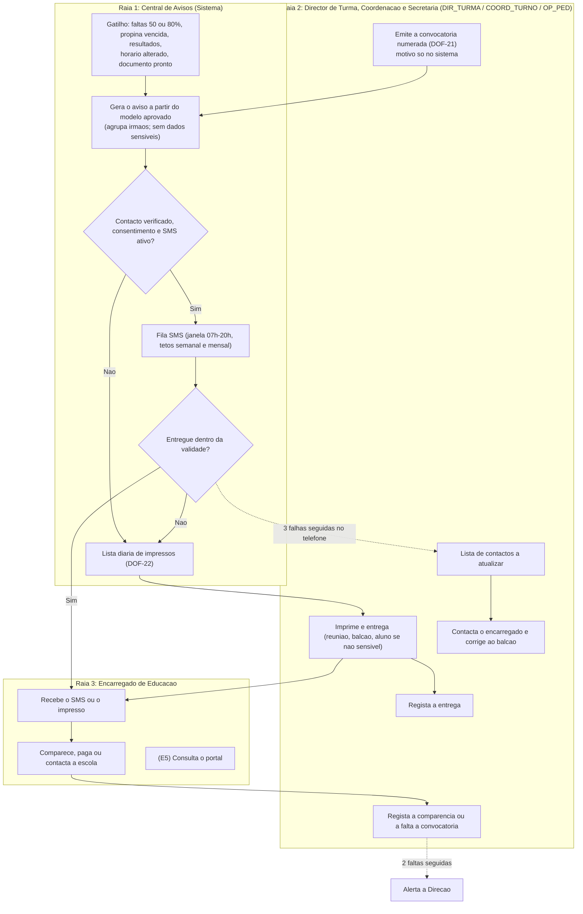

### 13.4 Passo a Passo Detalhado do Caminho Feliz (*Happy Path*)
1. **Gatilho (`RN-14.5`):** o sistema gera o aviso a partir do modelo aprovado. Os avisos do mesmo tipo e do mesmo dia para irmãos são **agrupados** numa só mensagem (`RN-14.2`). Um gatilho não se repete para o mesmo aluno, disciplina e limiar no mesmo ano.
2. **Conteúdo Mínimo (`RN-14.4`, APD-11 §7.4):** só primeiro nome do aluno, mês, data/hora/local, limiar atingido; **nunca** notas, disciplina, valores em dívida, bolsas, motivo disciplinar ou saúde. SMS até 160 caracteres, com identificação da escola e contacto da Secretaria.
3. **Canal (`RN-14.1`):** com contacto verificado, consentimento e SMS ativo, o aviso entra na fila SMS (janela 07h00–20h00, máximo de 4 SMS automáticos por semana por encarregado, teto mensal); caso contrário, ou se o SMS falhar dentro da validade, passa à **lista diária de impressos** (`DOF-22`). O impresso está sempre disponível.
4. **Convocatórias (`RN-14.7`):** emitidas pelo `DIR_TURMA`, `COORD_TURNO`, `SUB_PED` ou Direção, com numeração anual (`N.º ___/IPCAG/ano` — `RN-11.14`), data, hora, local e quem convoca; o **motivo** (pedagógico, disciplinar, financeiro) fica só no sistema. As convocatórias disciplinares ligam-se à ocorrência (Fluxo 14); as de cobrança de nível 3 vêm do Fluxo 11.
5. **Entrega e Prova (`RN-14.8`):** cada aviso fica com canal, telefone, data/hora e confirmação de entrega (ou a quem foi entregue em mão). Este registo é a **prova de que a escola avisou** (importante na retenção por faltas).
6. **Comparência:** a comparência ou falta à convocatória é registada; duas faltas seguidas geram alerta à Direção.
7. **Portal (E5 — `RN-14.10`):** ativação presencial com código de uso único; o encarregado vê os seus educandos (notas homologadas, faltas e limite, pagamentos sem pormenor de bolsas, horário, avisos). Descargas sujeitas ao semáforo do `RN-08`.
   > 🟡 **Provisória** — adoção do SMS antes da E5, fornecedor e orçamento mensal; limiares (50%, 80%); aluno maior de 18 como destinatário: parâmetros; validar com as respostas às `Q-C12-01`, `Q-037`, `Q-013` e `Q-C12-04` e em **E1** (`DEC-009`). Fonte: [[C12 - Comunicacao com Encarregados e Alunos|C12]].

### 13.5 Caminhos de Exceção, Erros e Travas de Segurança (*Edge Cases & Rollbacks*)
- **Exceção E13.1 — Sem Internet:** os avisos ficam em fila no servidor local; os que expiram passam a impresso se ainda fizerem sentido.
- **Exceção E13.2 — Telefone do Aluno Menor:** não se envia SMS; impresso para reunião ou balcão (`RN-14.2.3`).
- **Exceção E13.3 — Teto de SMS Atingido:** só seguem convocatórias e `FALTAS_80`; o resto passa a impresso; aos 80% do teto, alerta ao `SUB_ADM` (`RN-14.6`).
- **Exceção E13.4 — Telefone Inválido:** 3 falhas de entrega seguidas marcam o telefone `INVALIDO` e põem-no na lista de contactos a atualizar do `DIR_TURMA` (a escola estima 20–30% de telefones errados — DESC-RESP R26).
- **Exceção E13.5 — Motivo Desaparece Antes do Envio:** o aviso é `Cancelado` (ex.: propina paga).
- **Exceção E13.6 — Encarregado Recusa Avisos Não Essenciais (`RN-14.9`):** resultados e documento pronto deixam de ser enviados; convocatórias e `FALTAS_80` seguem sempre, por impresso se recusar o SMS.
- **Exceção E13.7 — Encarregado Contesta que Não Foi Avisado:** o registo de envio e entrega (`audit_logs`) é a prova.

### 13.6 Pós-condições e Registos Gerados
- Cada aviso com estado final (`Entregue`, `Entregue em Mão`, `Expirado`, `Cancelado`) e prova de entrega.
- Convocatórias numeradas com comparência registada; contactos e consentimentos atualizados com rasto em `audit_logs`.
- Relatório de envios e custos para a Direção.

---

## Fluxo 14: Disciplina — Ocorrências, Medidas, Processo Disciplinar e Comportamento

> Capacidade [[C13 - Disciplina e Comportamento|C13]] · Regras `RN-15.1` a `RN-15.8` · Documentos `DOF-23` (Participação de Ocorrência) e `DOF-24` (Notificação de Decisão Disciplinar); o `DOF-06` passa a imprimir faltas por tipo e comportamento · US `US-DIS-01` a `06`

> 🟡 **Provisória** — tipos de ocorrência, medidas, quem as aplica, prazos do processo disciplinar, recurso e escala de comportamento vêm do **regulamento interno**, ainda não recebido: são tabelas de parâmetros; validar em **E3** (`Q-C13-02` a `Q-C13-06`) (`DEC-009`). A entrega do núcleo (tipos de falta e comportamento) na E2/E3 depende da `Q-038`. Fonte: [[C13 - Disciplina e Comportamento|C13]].

### 14.1 Atores Envolvidos (RBAC) e Contextos (DDD)
- **Atores RBAC:** `PROF`, `COORD_TURNO`, `DIR_TURMA`, `SUB_PED`, `DIR_GERAL` (instaura e decide o processo disciplinar), instrutor nomeado, `ENCARREGADO`, `ALUNO`.
- **Contextos DDD:** *Coordenação & Docência* $\leftrightarrow$ *Direção Executiva* $\leftrightarrow$ *Comunicação* $\leftrightarrow$ *Auditoria (APD)*.

### 14.2 Pré-condições e Gatilho de Início
- **Pré-condições:** catálogo de ocorrências e medidas aprovado pela Direção (`RN-15.4`); tolerância de atrasos e escala de comportamento configuradas.
- **Gatilho de Início:** o professor manda um aluno sair da sala, uma ocorrência no recinto, atrasos reiterados ou a preparação do conselho de notas.

### 14.3 Diagrama Visual em Raias (Swimlane Flowchart)

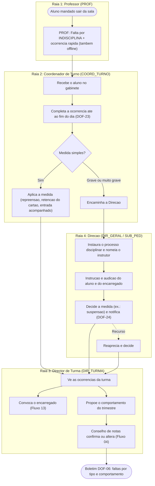

### 14.4 Passo a Passo Detalhado do Caminho Feliz (*Happy Path*)
1. **Falta por Indisciplina (`PROF` — `RN-15.1`):** ao mandar o aluno sair, o professor marca a falta do tipo `INDISCIPLINA` na grelha de faltas (também *offline*) e uma ocorrência rápida. Esta falta **não é justificável** e o seu efeito no limite do `RN-03` é parâmetro 🟡 (`Q-C13-03`).
2. **Ocorrência (`COORD_TURNO` — `RN-15.3`):** completa a ocorrência até ao fim do dia: aluno, data e hora, tempo letivo ou local, tipo, gravidade (`LEVE`, `GRAVE`, `MUITO_GRAVE`), descrição **factual** (sem juízos sobre saúde ou família), relator e testemunhas. Uma ocorrência com vários alunos cria um registo por aluno ligado ao mesmo facto.
3. **Medida Simples (`RN-15.5`):** advertência oral (`PROF`, `COORD_TURNO`, `DIR_TURMA`), repreensão registada (`DIR_TURMA`, `COORD_TURNO`, comunicada ao encarregado), convocatória do encarregado (Fluxo 13, sem motivo no SMS), retenção do cartão ou entrada acompanhado (`COORD_TURNO`).
4. **Processo Disciplinar (`RN-15.6`):** para ocorrências `MUITO_GRAVE` ou que possam levar a suspensão: instauração com instrutor → **audição do aluno e do encarregado** (direito de defesa) → relatório → decisão da Direção → notificação (`DOF-24`) → eventual recurso. A suspensão é decidida pela Direção e **não gera faltas injustificadas automáticas** (`Q-C13-05`) 🟡.
5. **Atrasos (`RN-15.2`):** dentro da tolerância do 1.º tempo, regista-se o atraso; depois dela, falta de não comparência nesse tempo; atrasos reiterados (parâmetro mensal) geram ocorrência automática (`Q-C13-04`) 🟡.
6. **Comportamento Trimestral (`RN-15.7`):** o `DIR_TURMA` propõe, vendo ocorrências e faltas por indisciplina do trimestre; o conselho de notas confirma ou altera (Fluxo 04); fica fechado com a homologação da Pauta Geral e é impresso no boletim. Não entra no cálculo das notas nem na transição.

### 14.5 Caminhos de Exceção, Erros e Travas de Segurança (*Edge Cases & Rollbacks*)
- **Exceção E14.1 — Professor sem Rede:** a falta e a ocorrência rápida ficam *offline* e sincronizam como as outras faltas.
- **Exceção E14.2 — Ocorrência no Aluno Errado:** retificação com motivo; a ocorrência fechada nunca se apaga e fica o registo em `audit_logs` (`RN-15.3.5`).
- **Exceção E14.3 — Encarregado Não Comparece à Audição:** o processo segue com a prova da convocatória (Fluxo 13).
- **Exceção E14.4 — Falta por Indisciplina sem Ocorrência no Fim do Dia:** alerta ao `COORD_TURNO` para a completar.
- **Exceção E14.5 — Tentativa de Justificar uma Falta por Indisciplina:** recusada pelo circuito de justificação (Fluxo 03).
- **Exceção E14.6 — Acesso Indevido (`RN-15.8`):** só veem as ocorrências o relator, o `DIR_TURMA` da turma, o `COORD_TURNO` do turno, a `SUB_PED` e a Direção; o `PROF` vê as que registou. As ocorrências **nunca** aparecem em declarações, certificados, guias de transferência nem no portal (só a nota de comportamento).

### 14.6 Pós-condições e Registos Gerados
- Ocorrências e processos com estado (`Registada` → `Em Análise` → `Medida Aplicada` / `Em Processo` / `Arquivada` → `Fechada`), medidas com decisor e fundamento.
- Faltas por tipo e comportamento do trimestre prontos para o `DOF-06`.
- Conservação dos dados disciplinares até ao fim do ciclo do aluno (processos com suspensão, mais 5 anos) 🟡 (`Q-APD-32`).

---

## Fluxo 15: Ciclo de Vida da Conta — Entrada, Cargos, Suspensão e Saída do Funcionário

> Capacidade [[C14 - Gestao de Contas e Acesso|C14]] · Regras `RN-16.1` a `RN-16.10`, `RN-16.17` a `RN-16.20` · US `US-CTA-01` a `06`, `12`, `13`, `15`

### 15.1 Atores Envolvidos (RBAC) e Contextos (DDD)
- **Atores RBAC:** `CHEFE_SEC_GER` (cadastro de pessoal e pedido de conta), `SUB_PED` / `SUB_ADM` / `DIR_GERAL` (aprovam atribuições conforme o cargo pedido), `ADMIN_TEC` (ativação técnica, MFA, dispositivos — sem ver notas nem finanças), titular da conta.
- **Contextos DDD:** *Secretaria Geral & RH* $\leftrightarrow$ *Governação & Direção Executiva* $\leftrightarrow$ *Segurança e Contas* $\leftrightarrow$ *Auditoria*.

### 15.2 Pré-condições e Gatilho de Início
- **Pré-condições:** funcionário com cadastro **ativo** em `funcionarios_docentes` (Nome, N.º do BI e Telefone); títulos de cargo configurados e ligados a papéis (`RN-16.20`).
- **Gatilho de Início:** entrada de um funcionário, mudança de cargo, nomeação (ex.: Director de Turma), suspensão ou registo da saída.

### 15.3 Diagrama Visual em Raias (Swimlane Flowchart)

**15.3.1 Entrada e ativação da conta**

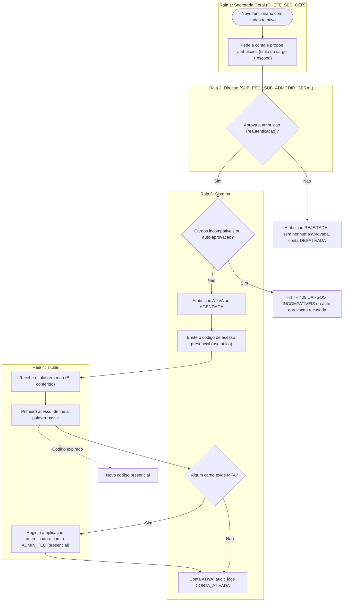

**15.3.2 Saída do funcionário (desativação com pendências)**

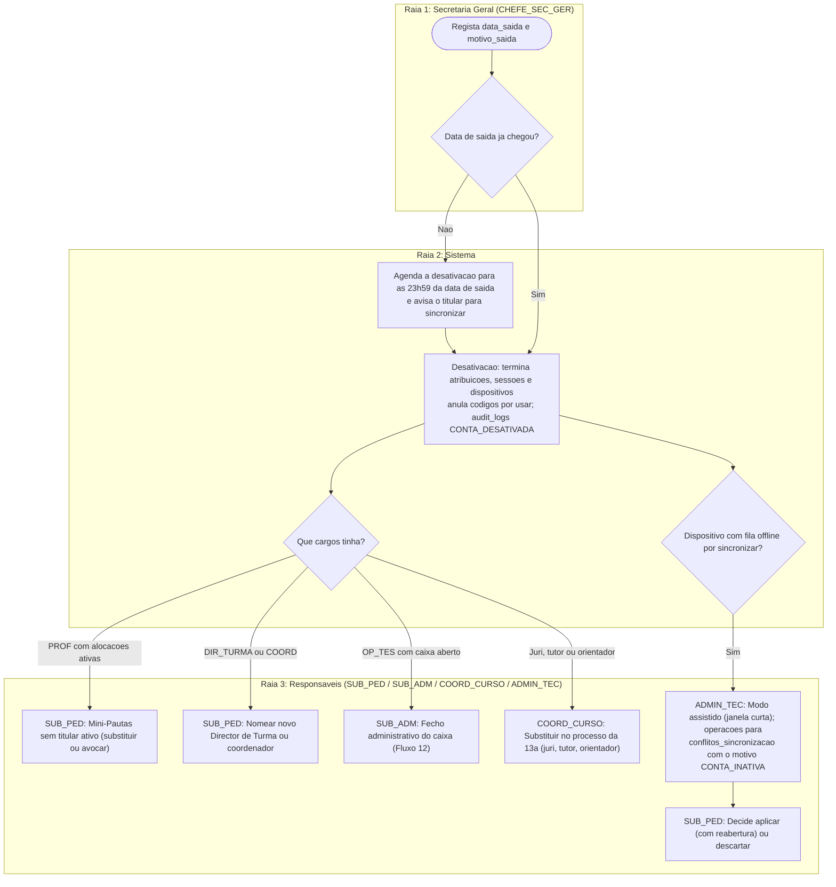

### 15.4 Passo a Passo Detalhado do Caminho Feliz (*Happy Path*)
1. **Pedido (`CHEFE_SEC_GER` — `RN-16.1`, `RN-16.2`):** só para cadastro ativo; uma conta **nominal**, nunca partilhada nem reutilizada; o pedido inclui pelo menos uma **Atribuição de Cargo** (título configurado → papel no sistema) com escopo.
2. **Aprovação (Direção — `RN-16.2`, `RN-16.5`):** cargos pedagógicos aprova `SUB_PED` ou `DIR_GERAL`; `CHEFE_SEC_GER` e `OP_TES` aprova `SUB_ADM` ou `DIR_GERAL`; `SUB_PED`, `SUB_ADM` e `ADMIN_TEC` aprova o `DIR_GERAL`. **Quatro olhos:** quem pede não aprova, e ninguém se aprova a si próprio. O sistema recusa **combinações incompatíveis** (ex.: `OP_TES` + `PROF`; `SUB_ADM` + `OP_TES`), como decisão de controlo interno do SGE (`COR-LEG-21`).
   > 🟡 **Provisória** — matriz de aprovação, incompatibilidades e quem substitui o `DIR_GERAL` dependem da estrutura real de direção (Comissão de Gestão; sem título conhecido para `SUB_ADM`); validar em **E1** (`Q-028`, `Q-C14-01`, `Q-C14-05`, `Q-C14-14`) (`DEC-009`). Fonte: [[C14 - Gestao de Contas e Acesso|C14]].
3. **Escopo e Acumulação (`RN-16.3`):** uma conta pode ter várias atribuições (ex.: `PROF` + `DIR_TURMA`); as permissões são a união, cada uma limitada ao seu escopo. Quando o escopo vem de uma nomeação noutro módulo (Director de Turma, coordenadores), **a nomeação cria ou termina a atribuição**. Uma atribuição nunca se edita: termina-se e cria-se outra.
4. **Ativação (`RN-16.16`, `RN-16.12`):** o titular recebe em mão o **código de acesso presencial** (BI conferido), define a palavra-passe no primeiro acesso e, se algum cargo o exigir (`DIR_GERAL`, `SUB_PED`, `SUB_ADM`, `OP_TES`, `CHEFE_SEC_GER`, `ADMIN_TEC`), regista o **segundo fator** presencialmente com o `ADMIN_TEC`.
5. **Revisão Periódica (`RN-16.19`):** no início de cada ano letivo e de cada trimestre, o `DIR_GERAL` e o `SUB_ADM` confirmam ou terminam cada atribuição na Lista de Revisão de Acessos; contas sem acesso há mais de 90 dias aparecem destacadas 🟡.
6. **Suspensão (`RN-16.10`):** por licença, processo disciplinar ou suspeita de comprometimento, pelo `DIR_GERAL`/`SUB_ADM` (ou `SUB_PED` para contas só pedagógicas); o `ADMIN_TEC` pode fazer uma suspensão de emergência de até 24 h 🟡. Termina sessões e revoga dispositivos, sem apagar a fila *offline*.
7. **Saída (`RN-16.7`, `RN-16.8`):** o registo da saída agenda a desativação (ou executa-a se a data já passou); a desativação é **definitiva**, preserva a autoria em todos os registos (`(conta desativada em DD/MM/AAAA)`) e cria pendências para os responsáveis, sem decidir por eles.

### 15.5 Caminhos de Exceção, Erros e Travas de Segurança (*Edge Cases & Rollbacks*)
- **Exceção E15.1 — Cargos Incompatíveis ou Auto-Aprovação:** `HTTP 409`; o pedido fica pendente para correção. Origem: E-C14.1.
- **Exceção E15.2 — Atribuição Rejeitada:** motivo obrigatório; sem atribuições aprovadas, a conta fica `DESATIVADA` (o nome de utilizador não é reutilizado). Origem: E-C14.2.
- **Exceção E15.3 — Código Presencial Expirado ou Usado:** novo código na Secretaria Geral; o antigo fica `EXPIRADO`/`ANULADO`. Origem: E-C14.3.
- **Exceção E15.4 — Palavra-passe Recusada:** curta, comum ou com dados pessoais; a mensagem explica a regra. Origem: E-C14.4.
- **Exceção E15.5 — Cadastro Incompleto:** sem BI ou telefone, o pedido não é criado. Origem: E-C14.5.
- **Exceção E15.6 — Saída Registada por Engano:** antes da data agendada, o agendamento pode ser anulado (auditado); depois da desativação, se a pessoa regressar, cria-se **uma conta nova** ligada ao mesmo cadastro. Origem: E-C14.6.
- **Exceção E15.7 — Fila *Offline* por Sincronizar:** modo assistido pelo `ADMIN_TEC`; as operações vão para `conflitos_sincronizacao` (`CONTA_INATIVA`) e nunca são aplicadas automaticamente (`RN-16.9`). Origem: E-C14.7.
- **Exceção E15.8 — Caixa Aberto na Saída:** a sessão fica bloqueada até ao fecho administrativo (Fluxo 12). Origem: E-C14.8.
- **Exceção E15.9 — Fim do Ano Letivo:** as atribuições com escopo de turmas do ano encerrado terminam no evento `concluirAnoLetivo` (Fluxo 09).
- **Exceção E15.10 — Mudança de Título de Cargo (`RN-16.20`):** renomear um título não muda permissões nem documentos já emitidos; mudar o papel de um título com atribuições ativas é proibido (cria-se um título novo).

### 15.6 Pós-condições e Registos Gerados
- Conta nominal com atribuições, escopos e vigências em `atribuicoes_cargo`; títulos e papéis separados.
- Todas as operações de conta em `audit_logs` (categoria `SEGURANCA_CONTAS`); nenhum `DELETE` físico de contas, cadastros ou atribuições.
- Pendências de saída entregues aos responsáveis (Mini-Pautas, Direção de Turma, caixa, 13ª Classe).

---

## Fluxo 16: Autenticação, Trabalho Offline com PIN, Reautenticação e Recuperação de Acesso

> Capacidade [[C14 - Gestao de Contas e Acesso|C14]] · Regras `RN-16.11` a `RN-16.16` · US `US-CTA-07` a `11`

### 16.1 Atores Envolvidos (RBAC) e Contextos (DDD)
- **Atores RBAC:** todos os utilizadores internos; `CHEFE_SEC_GER` e `ADMIN_TEC` (reposição presencial); `DIR_GERAL` / `SUB_ADM` (segunda aprovação nas contas privilegiadas).
- **Contextos DDD:** *Segurança e Contas* $\leftrightarrow$ *Coordenação & Docência* (*offline*) $\leftrightarrow$ *Auditoria*.

### 16.2 Pré-condições e Gatilho de Início
- **Pré-condições:** conta `ATIVA` (Fluxo 15); para trabalho *offline*, dispositivo autorizado com PIN local definido.
- **Gatilho de Início:** abertura do SGE, uma ação crítica ou um esquecimento de palavra-passe.

### 16.3 Diagrama Visual em Raias (Swimlane Flowchart)

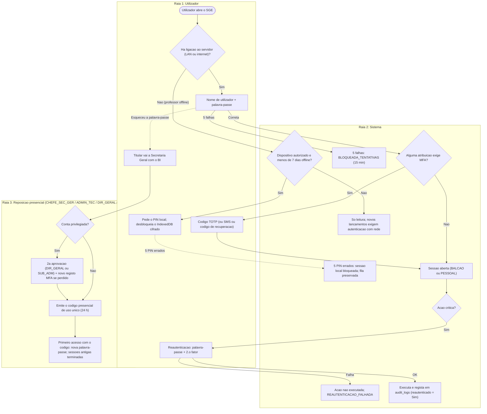

### 16.4 Passo a Passo Detalhado do Caminho Feliz (*Happy Path*)
1. **Autenticação (`RN-16.11`, `RN-16.12`):** palavra-passe com mínimo proposto de 10 caracteres (frases-passe aceites; sem troca periódica forçada); para os cargos com MFA, **código TOTP** validado pelo servidor local (funciona sem internet), SMS só se houver integração, ou código de recuperação impresso.
2. **Sessões (`RN-16.13`):** `BALCAO` (Tesouraria e Secretarias: bloqueio de ecrã aos 15 min, máximo proposto de 8 h, **uma só sessão para o `OP_TES`**), `PESSOAL` (professores, desbloqueio com PIN) e `ADMINISTRACAO` (`ADMIN_TEC`, 10 min de inatividade). As permissões são avaliadas no servidor em cada pedido.
3. **Trabalho *Offline* (`RN-16.15`):** só a Mini-Pauta e as faltas funcionam *offline*. O PIN local (6 dígitos, nunca enviado ao servidor) desbloqueia a chave do `IndexedDB` cifrado; o dispositivo aceita lançamentos até **7 dias** sem contacto com o servidor e guarda só as turmas do escopo atual.
4. **Reautenticação (`RN-16.14`):** antes de cada ação crítica — reabrir ou homologar pautas, descodificar o anonimato, decidir conflitos, emitir Certificado, emitir Nota de Crédito, declarar fraude, homologar fecho de caixa, conceder bolsas, perdoar multa, homologar acordos, aprovar atribuições, exportar listas nominais — pede-se **palavra-passe + segundo fator** (o PIN nunca serve). Vale para um único pedido.
5. **Recuperação Presencial (`RN-16.16`):** sem email: o titular apresenta o BI ao `CHEFE_SEC_GER` ou ao `ADMIN_TEC`, que emite um **código de uso único** (24 h); nas contas privilegiadas, exige-se a segunda aprovação. Ninguém repõe o próprio acesso. O titular é notificado no acesso seguinte.
   > 🟡 **Provisória** — comprimento da palavra-passe, número de tentativas, tempos de sessão, prazo *offline* de 7 dias, expiração dos dados de leitura (14 dias) e validade dos códigos são propostas; os valores fixam-se no [[08 - Requisitos Nao Funcionais|RNF-08]] e validam-se em **E1** (`Q-C14-03`, `Q-C14-11`) (`DEC-009`).

### 16.5 Caminhos de Exceção, Erros e Travas de Segurança (*Edge Cases & Rollbacks*)
- **Exceção E16.1 — Tentativas Excedidas:** bloqueio de 15 min; o segundo bloqueio do dia exige desbloqueio manual (`ADMIN_TEC` ou `CHEFE_SEC_GER`). A mensagem nunca revela se o utilizador existe. Origem: E-C14.9.
- **Exceção E16.2 — Prazo *Offline* Esgotado:** o dispositivo mostra os dados mas não aceita novos lançamentos; a fila existente sincroniza normalmente. Origem: E-C14.10.
- **Exceção E16.3 — PIN Errado 5 Vezes:** bloqueio local; desbloqueio só com autenticação completa e rede; a fila **não é apagada**. Origem: E-C14.11.
- **Exceção E16.4 — Reautenticação Falhada:** a ação crítica não acontece; 3 falhas seguidas terminam a sessão. Origem: E-C14.12.
- **Exceção E16.5 — Telemóvel com o Autenticador Perdido:** código de recuperação; sem ele, caminho de conta privilegiada (segunda aprovação + novo registo presencial). Origem: E-C14.13.
- **Exceção E16.6 — Dispositivo Perdido ou Roubado:** o titular, o `ADMIN_TEC` ou o `SUB_PED` revoga-o; o servidor recusa as suas sincronizações (exceto em modo assistido).
- **Exceção E16.7 — PIN Esquecido:** não é reposição de conta: o titular autentica-se com palavra-passe (com rede) e define novo PIN nesse dispositivo.

### 16.6 Pós-condições e Registos Gerados
- Eventos de autenticação em `eventos_autenticacao` (*append-only*, conservação proposta de 12 meses, IP truncado aos 90 dias 🟡 `PC-27`).
- Ações críticas em `audit_logs` com `reautenticado = Sim` e o método usado.
- Dispositivos autorizados com estado e fila *offline* preservada até à sincronização.

---

## Alterações da v2.0

> [!note] Origem e regra
> Integração decidida na `DEC-009` e coordenada pelo [[00.2 - Mapa de Integracao v2.0|Mapa de Integração (INT-V2)]] §4. O conteúdo substituído fica registado aqui com a sua origem. Os números das sub-regras novas de `RN-01` (prova de 2.ª chamada) e de `RN-09` (crédito do aluno) são atribuídos no [[01 - Dominio e Regras|DOC-01]]; este documento cita só a regra-mãe.

### Alterações aos Fluxos 01 a 08

| # | Fluxo | O que mudou | O que existia na v1.2 | Origem |
| :---: | :---: | :--- | :--- | :--- |
| A01 | Geral | Secção de convenções (🟡, papéis vs títulos, nomenclatura `MTP`…`CA`, fiscal, "Período"); índice em tabela com regras e situação; calendário real do ano | Lista simples de 8 fluxos | INT-V2 §3; DESC-RESP §3 |
| A02 | 01 | DE n.º 361/26 descrito como regulamento do teste de seleção | "Normas de Avaliação e Calendário" | `COR-LEG-07` |
| A03 | 01 | Mínimo de **10 valores em cada prova**; sem redução do limiar; estado `Admitido por Despacho de Ajuste de Limiar` retirado | `nota_minima_por_prova = 0`; mínimo só na `MFA`; redução para 9 ou 8 por despacho | `COR-LEG-08` |
| A04 | 01 | Desempate pela **menor idade**; outros critérios desligados | LP/nuclear → média da 9ª → idade | `COR-LEG-09` |
| A05 | 01 | Repescagem pela 2ª opção marcada 🟡 como prática interna | Regra apresentada como legal | `COR-LEG-10` |
| A06 | 01 | Idade mínima 15 anos; idade máxima opcional sem fonte | Faixa etária "segundo o DP n.º 167/23" | `COR-LEG-11` |
| A07 | 01 | Lista de selecionados em 72 h, reclamação em 24 h, decisão em 24 h, lista definitiva homologada pelo Director (E1.5, E1.8) | Sem prazos nem reclamações | `COR-LEG-12` |
| A08 | 01 | Taxa de inscrição com Fatura-Recibo; importação do concurso se correr fora do SGE (E1.9) | "Recibo Oficial" | `COR-LEG-02`; `Q-017` |
| A09 | 02 | Confirmação a partir de **proposta pré-gerada**, modos `AUTOMATICA`/`BALCAO` 🟡 | Confirmação como ato anual ao balcão | `COR-LEG-15`; C16 `RN-18.6`; DESC-RESP R5 |
| A10 | 02 | Anulação da matrícula incompleta **60 dias** após o início do ano (E2.8) 🟡 | — | `COR-LEG-15`; `RN-18.6.5` |
| A11 | 02 | **Perda do direito à confirmação** por retenção por faltas; confirmação em 5 dias úteis após justificação (E2.7) 🟡 | — | `COR-LEG-14`; DESC-RESP R4 |
| A12 | 02 | Bloqueio por dívida parametrizável e desbloqueio por acordo (E2.1) 🟡 | Bloqueio fixo | C16 `RN-18.10`; C10 `RN-13.8`; `Q-LEG-05` |
| A13 | 02 | Lista de documentos do processo, entrega, conferência, validação, pendências (E2.10–E2.12); número anual do boletim; contactos verificados; cartão `DOF-13`; ordem do nome no BI; 10 prestações de setembro a junho | `documentos_entregues_checklist`; "Cartão" sem regra; prestações de outubro a junho | C03 `RN-11.2`–`11.14`; C12 `RN-14.3`; DESC-RESP R6, R9 |
| A14 | 03 | Componentes `MTP`/`PP`/`PT`; III Trimestre sem `PT` 🟡 | `MAC`/`NPP`/`NPT` e `MT` nos 3 trimestres | A1/A2; `COR-LEG-26/27`; INT-V2 §3.3 |
| A15 | 03 | **Prova de 2.ª chamada** (célula pendente); provas unificadas com variantes A/B | — | DESC-RESP §1 |
| A16 | 03 | Chamada a partir da aula do horário; **tempo duplo = 2 faltas**; atrasos com tolerância | Faltas diárias digitadas | C04 `RN-12.13`; C13 `RN-15.2`; DESC-RESP R1 |
| A17 | 03 | **Justificação** numerada aprovada por DT + Coordenador Pedagógico, que **abate a falta em todas as disciplinas** | Só o DT, disciplina a disciplina | A8; DESC-RESP R3; `Q-032` |
| A18 | 03 | **Faltas por indisciplina** ligadas a ocorrência e não justificáveis 🟡 | Só justificadas/injustificadas | C13 `RN-15.1`; A8 |
| A19 | 03 | Alerta de 80% e avisos ao encarregado; substituição validada contra choques; exceções E3.4–E3.9 (aula não lecionada, conflito de aula, conta inativa) | — | C15 `RN-17.8`; C12 `RN-14.5`; C04 E-C04.4/.8/.9; C14 `RN-16.9` |
| A20 | 04 | **`CF`/`PG`/`CA`**, aprovação `CA ≥ 10`, recurso com `CA < 10` e `CF ≥ 7` 🟡 | `MFD` e recurso 40%/60% | A1; DESC-RESP §1; `COR-LEG-26` |
| A21 | 04 | Deliberação: até 2 deficiências (7–9) na 10ª/11ª; veto LP + nuclear só na 10ª/11ª; 12ª sem deficiências; lacuna da 12ª com cadeiras pendentes 🟡 | "1 a 2 (ou 3)"; veto em todas as classes | A7; `COR-LEG-13`; `Q-031`; `Q-C16-06` |
| A22 | 04 | **Comportamento** proposto pelo DT e confirmado no conselho 🟡 | — | C13 `RN-15.7` |
| A23 | 04 | Verificação de conflitos pendentes (`IND-13`) antes de homologar; estatística `IND-28`/`IND-29` com as 4 categorias reais; aviso de resultados; **boletim retido por dívida** 🟡; reabertura num ano encerrado (E4.4) | — | C15 `RN-17.14`; A10; DESC-RESP R12; C16 `RN-18.12/13` |
| A24 | 05 | Época em maio; Fatura-Recibo por disciplina; livro de termos (folha/termo 🟡); proposta `CONDICIONADA_13A`; prazo de eliminação 🟡 | Recibo; Livro/Folha/Termo "exigido pelo MED" | DESC-RESP §1, R17; `COR-LEG-13/19`; C16 `RN-18.9` |
| A25 | 06 | **Projecto Tecnológico** (disciplina 12ª/13ª), **Estágio**, **PAP = defesa do relatório de estágio**, júri com **membros externos**, requisitos da defesa, `MFC` com pesos 🟡 | PAP como projeto; júri de 3 docentes; sem Projecto Tecnológico | `COR-LEG-16/17/28`; A6; DESC-RESP R20–R21 |
| A26 | 06 | **Certificado** pela escola; **Diploma** pelo Ministério (o SGE exporta); Plataforma Nacional de Certificação 🟡 | Diploma emitido e assinado na escola | `COR-LEG-18/19`; DESC-RESP R18; `Q-020`, `Q-021` |
| A27 | 07 | **DP n.º 71/25**; **Fatura, Fatura-Recibo, Recibo, Nota de Crédito**; numeração por tipo e ano fiscal; NIF e isenção; emissor por `DEC-002` 🟡 | DP n.º 292/18; Recibo e Nota de Estorno | `COR-LEG-01` a `06`; DESC-RESP R14 |
| A28 | 07 | **Crédito do aluno** com o excedente do talão 🟡; fecho por canal conferido pela Secretaria Geral; exceções do acordo, borderô em investigação, fecho administrativo, contingência AGT | Excedente só como saldo do borderô | DESC-RESP R10, R13; C10 `RN-13.8/16/18` |
| A29 | 08 | **Requerimento numerado com talão destacável**; prazo de **5 dias úteis**; 2ª via em 5 dias úteis; RUPE 🟡 | Pedido ao balcão sem número nem prazo | A11; DESC-RESP R16; `COR-LEG-20`; `Q-034` |
| A30 | 08 | **Certificado vs Diploma**; pendência documental antes do registo; cartão anulado na saída; dívida vencida mantida; guia exige dívida reescalonada zero; QR nacional 🟡; signatários configurados | "Certificado/Diploma" emitidos juntos | `COR-LEG-18/19`; C03 E-C03.4/.8; C10 `RN-13.8.3/13.10`; C14 `RN-16.20` |

### Fluxos novos

| Fluxo | Tema | Fonte | Documentos |
| :---: | :--- | :--- | :--- |
| 09 | Encerramento do Ano Letivo e Passagem de Ano | [[C16 - Passagem de Ano Letivo\|C16]] §5 | `DOF-25`, `DOF-26` |
| 10 | Distribuição de Serviço Docente, Horário e Livro de Sumários | [[C04 - Horarios e Distribuicao de Servico Docente\|C04]] §5 | `DOF-15`, `DOF-16` |
| 11 | Cobrança de Dívidas, Avisos Escalonados e Acordos | [[C10 - Cobranca, Relatorios Financeiros e Conciliacao\|C10]] §5.1 | `DOF-17`, `DOF-18`, `DOF-19` |
| 12 | Conciliação Bancária e Fecho Administrativo de Caixa | C10 §5.2–5.3 | `DOF-20`, `DOF-11` |
| 13 | Avisos e Convocatórias | [[C12 - Comunicacao com Encarregados e Alunos\|C12]] §5 | `DOF-21`, `DOF-22` |
| 14 | Disciplina e Comportamento | [[C13 - Disciplina e Comportamento\|C13]] §5 | `DOF-23`, `DOF-24` |
| 15 | Ciclo de Vida da Conta | [[C14 - Gestao de Contas e Acesso\|C14]] §5.1–5.2 | — |
| 16 | Autenticação, *Offline*, Reautenticação e Recuperação | C14 §5.3 | — |

Os fluxos C03 (processo individual) e C15 (indicadores) não ganharam fluxo próprio: foram integrados nos Fluxos 02, 03, 04 e 08. Os documentos `DOF-13` (Cartão de Estudante) e `DOF-14` (Aviso de Pendências Documentais) aparecem no Fluxo 02.

### Regras provisórias (🟡) usadas neste documento

| Tema | Fluxos | Bloqueio | Ponto de controlo |
| :--- | :---: | :--- | :---: |
| Fórmulas `M1`–`M3`, `CF`, `CA`, recurso, pesos | 03, 04 | `Q-025`, `Q-LEG-21` | E2 |
| Máximo de deficiências, veto LP + nuclear, prazo de eliminação, limite de faltas | 03, 04, 05 | `Q-LEG-01` a `03`, `Q-031` | E2 |
| 12ª aprovada com cadeiras pendentes | 04, 05, 09 | `Q-C16-06`, `Q-031` | E2 |
| `MFC`, nota mínima da PAP, dupla contagem do estágio, júri externo | 06 | `Q-030`, `Q-LEG-06`, `Q-LEG-07` | E2 |
| Comportamento, faltas por indisciplina, atrasos, 2.ª chamada sem justificação, catálogo disciplinar | 03, 04, 14 | `Q-C13-02` a `06`, `Q-032`, `Q-038` | E3 |
| Títulos dos cargos, signatários, aprovações de contas, `SUB_ADM` | Todos | `Q-028`, `Q-C14-14` | E1 |
| Admissão: secções como provas, desempate, repescagem, idade máxima | 01 | `Q-LEG-09` a `12` | — |
| Confirmação automática, bloqueio por dívida, 60 dias, perda por faltas | 02, 09 | `Q-LEG-04`, `Q-LEG-05`, `Q-C16-01` | E1 |
| Modelo fiscal, emissor, crédito do aluno, contingência AGT, RUPE | 01, 05, 07, 08, 12 | `DEC-002`, `Q-LEG-14`, `Q-LEG-16` a `19`, `Q-034` | E1 |
| Livro/Folha/Termo, QR da Plataforma Nacional, Diploma | 05, 06, 08 | `Q-020`, `Q-021`, `Q-LEG-14` | — |
| Boletim retido por dívida | 04 | Direção; APD-11 | E1 |
| Grelha horária (32 h semanais), limites de carga | 10 | `Q-012`, `Q-C04-18`, `Q-C04-04/05` | — |
| Multa, níveis de aviso, tolerâncias de acordo e conciliação | 11, 12 | `Q-C10-01/02/05/08/09/15` | E1 |
| SMS, orçamento, limiares de aviso | 13 | `Q-C12-01`, `Q-037`, `Q-013` | E1 |
| Valores de segurança (palavra-passe, sessões, prazo *offline*) | 16 | `Q-C14-03`, `Q-C14-11`; RNF-08 | E1 |

### Histórico

| Versão | Data | Alteração |
| :---: | :---: | :--- |
| 1.2 | 2026-10-31 | 8 fluxos com swimlanes, exceções e auditoria |
| 2.0-rc1 | 2026-11-02 | Integração da v2.0: Fluxos 01–08 corrigidos (A01–A30) e Fluxos 09–16 novos; referências finais `RN-11`…`RN-18` e `DOF-13`…`DOF-26`; regras provisórias marcadas 🟡 |

---

> [!tip] Próximo Passo na Arquitetura
> Avance para [[03 - User Stories]] para os épicos e as User Stories BDD derivados destes 16 fluxos (incluindo `EP-PIN`, `EP-HOR`, `EP-COB`, `EP-COM`, `EP-DIS`, `EP-CTA`, `EP-PNL` e `EP-PAS`), consulte o [Quadro DOC-02 no FigJam](https://www.figma.com/board/klMnPKkxorDv9NEfvvpSRq) (ainda v1.2) ou regresse a [[01 - Dominio e Regras]].
