# Documento 04: Arquitetura da Informação dos Módulos Funcionais (Sem UI) e Especificação Estrutural dos Documentos Oficiais

> [!abstract] Navegação & Rastreabilidade no Vault
> - **Painel Principal:** [[Inicio|Início do Vault]] | **Índice do Projeto:** [[00 - MOC SGE IPCAG 12008 BGO|MOC — SGE IPCAG N.º 12008 / BGO]]
> - **Sequência Arquitetural:** [[01 - Dominio e Regras]] $\rightarrow$ [[02 - Fluxos de Trabalho]] $\rightarrow$ [[03 - User Stories]] $\rightarrow$ **04 - Telas e Documentos** $\rightarrow$ [[05 - Modelagem de Dados]]
> - **Integração v2.0:** [[00.2 - Mapa de Integracao v2.0|Mapa de Integração (INT-V2)]] · [[12 - Registo de Decisoes e Questoes em Aberto|REG-12]] (`DEC-009`) · [[11 - Protecao de Dados (APD)|APD-11]] §8.2 · [[Verificacao das Referencias Legais|LEG-VER]] §5 · [[Achados dos Documentos Reais - Lote 1|DESC-L1]] · [[Sintese das Respostas da Fase B|DESC-RESP]]
> - **Capacidades integradas:** [[C03 - Processo Individual do Aluno|C03]] · [[C04 - Horarios e Distribuicao de Servico Docente|C04]] · [[C10 - Cobranca, Relatorios Financeiros e Conciliacao|C10]] · [[C12 - Comunicacao com Encarregados e Alunos|C12]] · [[C13 - Disciplina e Comportamento|C13]] · [[C14 - Gestao de Contas e Acesso|C14]] · [[C15 - Paineis de Gestao da Direcao|C15]] · [[C16 - Passagem de Ano Letivo|C16]]
> - **Quadros Visuais no Figma (ainda na v1.2):** 🎨 [Quadro Dedicado DOC-04 no FigJam](https://www.figma.com/board/ceE1mzcDmB2bT9RUAZxOcN) \| 🌐 [Quadro Geral Unificado](https://www.figma.com/board/OneLIwLlc2kuM1koaIeXG0) \| 📋 [[Quadros de Arquitetura no Figma\|Ver Todos os Links]]
> - **Áreas e Recursos:** [[Arquitetura de Software e DDD]] \| [[Governacao Escolar Ensino Tecnico MED]] \| [[Quadro Legal MED AGT e APD Angola]]

**Projeto:** Sistema de Gestão Escolar (SGE) — Ensino Secundário Técnico-Profissional (II Ciclo)  
**Instituição Alvo:** Instituto Politécnico Católico de Administração e Gestão (IPCAG) N.º 12008 / BGO (n.º secundário em uso: 8009 — `Q-027`) – *"Nossa Senhora do Rosário"*  
**Referências Base:** [[01 - Dominio e Regras|01 - Domínio e Regras]], [[02 - Fluxos de Trabalho|02 - Fluxos de Trabalho]] e [[03 - User Stories|03 - User Stories]]

> [!important]
> Este documento especifica a **Arquitetura da Informação (Entradas, Validações de Domínio, Estado Local/Offline, Ações RBAC e Saídas)** de cada módulo e o **Contrato Estrutural dos 26 Documentos Oficiais (`DOF-01` a `DOF-26`)** emitidos pelo SGE ou preparados por ele para outra entidade (Ministério da Educação, Gabinete Provincial da Educação do Bengo, AGT), sem acoplamento prematuro a estilos visuais de interface (UI). Na v2.0 os documentos seguem os **modelos reais da escola** (DESC-L1 A1–A16) em vez de modelos deduzidos da lei.

> [!note] Convenções da v2.0 (Mapa de Integração §3)
> - **Regras provisórias (`DEC-009`).** O que ainda depende de validação pela escola leva a marca 🟡 **Provisória**, indica o ponto de controlo (**E1** homologação; **E2** recálculo de pautas; **E3** regulamento interno) e a questão que a bloqueia. O sistema trata esses valores como **parâmetros configuráveis**, nunca como constantes.
> - **Parâmetros, não texto fixo:** número da instituição (por tipo de documento), linhas do cabeçalho e do rodapé, **títulos dos cargos** impressos, fórmulas, pesos, limiares, escalas e catálogos. O DOC-05 tem de ter onde os guardar: parâmetros da instituição, títulos dos cargos (`cargos_institucionais` — C14), séries de numeração (`series_numeracao_documental` — C03) e modelos de documento.
> - **Notas:** nomenclatura canónica `MTP`, `PP`, `PT`, `PG`, `M1`–`M3`, `CF`, `CA`; `MAC`/`NPP`/`NPT` passam a **rótulos alternativos de impressão** (DESC-L1 A2; `COR-LEG-26/27`).
> - **Língua impressa:** "Período" é o rótulo impresso de "Turno"; "Cadeira" é sinónimo aceite de "Disciplina"; o sistema usa um só termo (DESC-L1 A9; `Q-033`).
> - **Regras citadas:** `RN-01`…`RN-10` (DOC-01) e as famílias novas `RN-11` (C03), `RN-12` (C04), `RN-13` (C10), `RN-14` (C12), `RN-15` (C13), `RN-16` (C14), `RN-17` (C15), `RN-18` (C16), mantendo o número da sub-regra da nota de origem (ex.: a sub-regra 14 da C03 passa a `RN-11.14`).

> [!note] Convenção de identificadores
> - **`DOC-`** identifica uma **nota da especificação** do SGE (esta nota é o `DOC-04`).
> - **`DOF-`** identifica um **documento oficial impresso ou exportado** (`DOF-01` a `DOF-26`, especificados na Parte 2). As subpartes acrescentam uma letra: `DOF-08A`/`B`; `DOF-09A`/`B`/`C`/`D`; `DOF-10A`/`B`; `DOF-11A`/`B`/`C`/`D`/`E`.
> - Para não partir as referências existentes, as letras antigas mantêm o significado e o nome muda onde a lei o exige: `DOF-11A` continua a ser o **Recibo**, `DOF-11B` passa de "Nota de Estorno" a **Nota de Crédito** (`COR-LEG-03`) e `DOF-11C` continua a ser o **Mapa de Fecho de Caixa**; as letras novas são `DOF-11D` **Fatura** e `DOF-11E` **Fatura-Recibo** (`COR-LEG-02`). `DOF-09D` é o **Requerimento de Declaração** com o Recibo de Pedido (DESC-L1 A11); `DOF-10A` é o **Certificado** e `DOF-10B` a **Ficha de Dados para o Diploma** (`COR-LEG-18`).
> - Em todo o vault, um documento oficial é sempre referido por `DOF-xx`; `DOC-xx` refere-se só a notas da especificação.

---

## PARTE 1: Arquitetura da Informação por Workspace e Módulo Funcional

> [!tip] 🎨 Árvore de Módulos e Documentos no FigJam
> Os quadros do FigJam continuam na v1.2 (4 workspaces, 12 documentos) e serão atualizados depois do congelamento da v2.0 (Mapa de Integração §5): [Abrir Quadro DOC-04](https://www.figma.com/board/ceE1mzcDmB2bT9RUAZxOcN).

O sistema divide-se em **5 Workspaces Operacionais Internos**, **1 Portal Público de Verificação** (sem conta) e **1 Área Externa Autenticada** (Portal do Encarregado e do Aluno, na entrega **E5** — `DEC-003`). A separação dos workspaces e a segregação de funções são **decisões de controlo interno** do SGE; não são impostas pelo DP n.º 93/21, que se aplica às instituições públicas e não trata de sistemas informáticos (`COR-LEG-21`, `Q-LEG-13`). Há ainda um componente **transversal** (`MOD-ALR`), presente em todos os workspaces.

```mermaid
flowchart TD
    Root["SGE — IPCAG N.o 12008 / BGO (Arquitetura da Informacao v2.0)"]

    Root --> WS1["WS 01: Governacao, Direcao Executiva e Auditoria"]
    Root --> WS2["WS 02: Secretaria Pedagogica"]
    Root --> WS3["WS 03: Coordenacao Intermedia e Docencia (Offline-First)"]
    Root --> WS4["WS 04: Tesouraria, Fiscalidade e Secretaria Geral / RH"]
    Root --> WS5["WS 05: Seguranca e Administracao de Acessos"]
    Root --> TRV["Transversal: MOD-ALR Caixa de Alertas de Gestao"]
    Root --> WSP["Portal Publico: Verificacao QR (MOD-PUB-QR)"]
    Root --> EXT["Area Externa E5: Portal do Encarregado e do Aluno (MOD-COM-04)"]

    WS1 --> G1["MOD-GOV-01 Ano Letivo e Calendario"]
    WS1 --> G2["MOD-GOV-02 Cursos, Areas de Formacao, Matrizes e Modelo de Avaliacao"]
    WS1 --> G3["MOD-GOV-03 Turmas, Periodos e Salas"]
    WS1 --> G4["MOD-GOV-04 Reabertura Auditada de Pautas"]
    WS1 --> G5["MOD-GOV-05 Mapas GEPE e Consola audit_logs"]
    WS1 --> G6["MOD-GOV-06 Contas, Cargos, Titulos e Escopos (C14)"]
    WS1 --> G7["MOD-GOV-07 Painel da Direcao Executiva (C15)"]
    WS1 --> G8["MOD-GOV-08 Catalogo de Indicadores e Limiares (C15)"]
    WS1 --> G9["MOD-GOV-09 Protecao de Dados (APD-11)"]
    WS1 --> H1["MOD-HOR-01 Grelha de Tempos e Dias Nao Letivos (C04)"]
    WS1 --> H2["MOD-HOR-02 Distribuicao de Servico Docente (C04, partilhado com WS 04)"]
    WS1 --> H3["MOD-HOR-03 Editor do Horario e Validador de Choques (C04)"]
    WS1 --> H6["MOD-HOR-06 Consulta de Horarios e Cumprimento (C04, tambem WS 03)"]
    WS1 --> P1["MOD-PAS-01 Painel de Encerramento do Ano (C16)"]
    WS1 --> P3["MOD-PAS-03 Turmas do Ano Seguinte (C16)"]
    WS1 --> C1["MOD-COM-01 Central de Avisos (C12)"]
    WS1 --> D4["MOD-DIS-04 Processos Disciplinares (C13)"]
    WS1 --> D5["MOD-DIS-05 Parametros do Regulamento Disciplinar (C13)"]

    WS2 --> A1["MOD-PED-ADM Teste de Selecao a 10a Classe"]
    WS2 --> A2["MOD-PED-MAT Boletins de Matricula e Confirmacao"]
    WS2 --> A3["MOD-PED-HIST Historico Externo"]
    WS2 --> A4["MOD-PED-DEF Cadeiras em Atraso e Exame Extraordinario"]
    WS2 --> A5["MOD-PED-DOC Requerimentos e Emissao Documental"]
    WS2 --> I1["MOD-PIN-01..05 Processo Individual e Cartao (C03)"]
    WS2 --> P2["MOD-PAS-02 Motor de Passagem e Propostas (C16)"]
    WS2 --> P5["MOD-PAS-05 Saidas do Ciclo e Arquivo (C16)"]
    WS2 --> C3["MOD-COM-03 Contactos e Consentimentos (C12)"]

    WS3 --> B1["MOD-DOC-DOS Dosificacao e Provas Unificadas PT/PG"]
    WS3 --> B2["MOD-DOC-FAL Faltas, Justificacao e DISP"]
    WS3 --> B3["MOD-DOC-PAU Mini-Pauta Offline-First"]
    WS3 --> B4["MOD-DOC-CON Conselho de Notas, PG/CA e Deliberacao"]
    WS3 --> B5["MOD-DOC-13C 13a Classe: Projecto Tecnologico, Estagio e PAP"]
    WS3 --> B6["MOD-DOC-PNL Painel de Coordenacao e Turma (C15)"]
    WS3 --> H4["MOD-HOR-04 Livro de Sumarios e Chamada por Tempo (C04)"]
    WS3 --> H5["MOD-HOR-05 Consola do Turno (C04)"]
    WS3 --> C2["MOD-COM-02 Avisos da Turma (C12)"]
    WS3 --> D1["MOD-DIS-01..03 Registo em Sala, Gabinete do Turno, Dossier da Turma (C13)"]

    WS4 --> T1["MOD-TES-TAB Tabelas AOA e Bolsas"]
    WS4 --> T2["MOD-TES-CXA Caixa e Borderos por Saldo"]
    WS4 --> T3["MOD-TES-EST Notas de Credito e Fecho de Caixa"]
    WS4 --> T4["MOD-TES-COB Dividas, Avisos e Acordos (C10)"]
    WS4 --> T5["MOD-TES-REL Relatorios Financeiros (C10)"]
    WS4 --> T6["MOD-TES-CON Conciliacao Bancaria (C10)"]
    WS4 --> P4["MOD-PAS-04 Renovacao de Bolsas (C16)"]
    WS4 --> R1["MOD-GER-RH Pessoal, Ponto e Efetividade"]

    WS5 --> S1["MOD-SEG-01 Consola de Administracao Tecnica (C14)"]
    WS5 --> S2["MOD-SEG-02 Autenticacao, MFA e Primeiro Acesso (C14)"]
    WS5 --> S3["MOD-SEG-03 Dispositivos e PIN Local (C14)"]
    WS5 --> S4["MOD-SEG-04 A Minha Conta (C14)"]
    WS5 --> S5["MOD-MIG-01 Consola de Migracao (C17)"]
```



### Índice de módulos (v2.0)

| Workspace | Módulos existentes (v1.2, corrigidos) | Módulos novos (v2.0) |
| :--- | :--- | :--- |
| **01 — Governação** | `MOD-GOV-01` a `MOD-GOV-05` | `MOD-GOV-06` (C14), `MOD-GOV-07`, `MOD-GOV-08` (C15), `MOD-GOV-09` (APD-11), `MOD-HOR-01`, `MOD-HOR-02`, `MOD-HOR-03`, `MOD-HOR-06` (C04), `MOD-PAS-01`, `MOD-PAS-03` (C16), `MOD-COM-01` (C12), `MOD-DIS-04`, `MOD-DIS-05` (C13) |
| **02 — Secretaria Pedagógica** | `MOD-PED-ADM`, `MOD-PED-MAT`, `MOD-PED-HIST`, `MOD-PED-DEF`, `MOD-PED-DOC` | `MOD-PIN-01` a `MOD-PIN-05` (C03), `MOD-PAS-02`, `MOD-PAS-05` (C16), `MOD-COM-03` (C12) |
| **03 — Docência** | `MOD-DOC-DOS`, `MOD-DOC-FAL`, `MOD-DOC-PAU`, `MOD-DOC-CON`, `MOD-DOC-13C` | `MOD-DOC-PNL` (C15), `MOD-HOR-04`, `MOD-HOR-05` (C04; `MOD-HOR-06` também aqui), `MOD-COM-02` (C12), `MOD-DIS-01` a `MOD-DIS-03` (C13) |
| **04 — Tesouraria e RH** | `MOD-TES-TAB`, `MOD-TES-CXA`, `MOD-TES-EST`, `MOD-GER-RH` | `MOD-TES-COB`, `MOD-TES-REL`, `MOD-TES-CON` (C10), `MOD-PAS-04` (C16); `MOD-HOR-02` partilhado (dados de RH) |
| **05 — Segurança** *(novo)* | — | `MOD-SEG-01` a `MOD-SEG-04` (C14), `MOD-MIG-01` (C17 — `DEC-010`) |
| **Transversal** | — | `MOD-ALR` (C15) |
| **Portal público** | `MOD-PUB-QR` | — |
| **Área externa (E5)** *(nova)* | — | `MOD-COM-04` Portal do Encarregado e do Aluno (C12, contas da C14 §11) |

> [!warning] Conflito de identificador resolvido nesta integração
> A [[C14 - Gestao de Contas e Acesso|C14]] e a [[11 - Protecao de Dados (APD)|APD-11]] (`ALT-04-01`) propunham ambas o código `MOD-GOV-06`, e a [[C15 - Paineis de Gestao da Direcao|C15]] já tinha reservado `MOD-GOV-07` e `MOD-GOV-08`. Fica `MOD-GOV-06` para as **Contas, Cargos e Escopos** (C14) e o módulo de **Proteção de Dados** da APD-11 passa a **`MOD-GOV-09`**. As referências da APD-11 a `MOD-GOV-06` (`ALT-04-01`, `Q-APD-04`) leem-se como `MOD-GOV-09`.

---

## 1. Workspace 01 — Governação, Direção Executiva e Auditoria

### `MOD-GOV-01`: Configuração de Ano Letivo e Calendário Trimestral (`US-GOV-01`)
- **Perfis RBAC Autorizados:**
  - **Escrita (`C, U`):** `SUB_PED`
  - **Homologação / Trancamento (`H`):** `DIR_GERAL`, `SUB_PED`
  - **Leitura (`R`):** Todos os perfis internos autenticados.
- **Dados de Entrada (Inputs):**
  | Campo | Tipo de Dado | Obrigatório | Formato / Máscara / Restrição Angolana |
  | :--- | :---: | :---: | :--- |
  | `codigo_ano_letivo` | `VARCHAR(9)` | Sim | Formato `YYYY/YYYY` (ex.: `2026/2027`, onde `ano_fim = ano_inicio + 1`). |
  | `data_inicio_letivo` / `data_fim_letivo` | `DATE` | Sim | `DD/MM/YYYY` (`data_fim > data_inicio`). As datas vêm do **decreto executivo anual do calendário escolar** (2025/2026: DE n.º 686/25 — `COR-LEG-07`; `Q-005`). |
  | `trimestres[1..3].designacao` | `ENUM` | Sim | Fixo: `'I_TRIMESTRE'`, `'II_TRIMESTRE'`, `'III_TRIMESTRE'`. |
  | `trimestres[1..3].data_abertura_notas` / `data_fecho_notas` | `TIMESTAMP` | Sim | Janela de lançamento na Mini-Pauta antes de `Em Conselho de Notas`. |
  | `epoca_prova_global_inicio` / `fim` | `DATE` | Sim | Prova Global no III Trimestre (maio–junho na prática — DESC-RESP §3). |
  | `epoca_recurso_inicio` / `fim` | `DATE` | Sim | Exames de Recurso (julho na prática). |
  | `epoca_extraordinaria_inicio` / `fim` | `DATE` | Sim | Exames Extraordinários de cadeiras em atraso (maio na prática). |
  | `quadros_vagas[].curso_id` / `turno` | `UUID` / `ENUM` | Sim | Par `Curso + Período (MANHA / TARDE)` para o teste de seleção à 10ª classe. |
  | `quadros_vagas[].total_vagas_disponiveis` | `SMALLINT` | Sim | Lotação de ingresso no Curso/Período (ex.: `90` vagas). |
  | `quadros_vagas[].nota_minima_por_prova` | `NUMERIC(4,2)` | Sim | **`10` valores em cada prova de seleção** (DP n.º 167/23, art. 52.º, n.º 1 — `COR-LEG-08`). Com vagas sobrantes não se admite abaixo de 10. |
  | `quadros_vagas[].idade_minima_ingresso` | `SMALLINT` | Sim | **15 anos completados no ano da matrícula** (DP n.º 167/23, art. 23.º; DE n.º 361/26, art. 4.º — `COR-LEG-11`). |
  | `quadros_vagas[].idade_maxima_ingresso_regular` | `SMALLINT` | Não | 🟡 **Provisória** — parâmetro configurável, sem fonte legal encontrada; validar em **E1** (`DEC-009`). Bloqueado por `Q-LEG-09`. Fonte: LEG-VER `COR-LEG-11`. |
  | `prazos_selecao.horas_publicacao_lista` / `horas_reclamacao` / `horas_decisao_reclamacao` | `SMALLINT` | Sim | `72` / `24` / `24` horas (DE n.º 361/26, art. 17.º–19.º — `COR-LEG-12`). |
- **Regras de Validação Sistémica:**
  1. Impede sobreposição cronológica entre o I, II e III Trimestres.
  2. Bloqueia a abertura do `II Trimestre` (ou `III Trimestre`) enquanto o anterior não estiver `Fechado / Homologado`; bloqueia a abertura do I Trimestre enquanto o ano anterior não estiver `Encerrado` (`RN-18.1`; `MOD-PAS-01`).
  3. Ao homologar o fecho do `I Trimestre`, dispara o **Congelamento da Lista de Chamada (`RN-05`)** em todas as turmas ativas.
  4. A **redução do limiar de admissão por despacho** (estado `DespachoLimiar` da v1.2) foi retirada (`COR-LEG-08`). Só volta como parâmetro se a Direção Provincial confirmar por escrito uma exceção (`Q-LEG-10`).
- **Ações Disparo e Dados de Saída (Outputs):**
  - **Comandos:** `CriarAnoLetivo`, `HomologarCalendario`, `AbrirTrimestre`, `EncerrarLancamentosTrimestre`.
  - **Outputs:** Estado do Ano Letivo e de cada Trimestre; evento `ANO_LETIVO_HOMOLOGADO` em `audit_logs`.

---

### `MOD-GOV-02`: Cursos, Áreas de Formação, Matrizes Curriculares e Modelo de Avaliação (`US-GOV-02`)
- **Perfis RBAC Autorizados:**
  - **Escrita (`C, U`):** `SUB_PED`, `COORD_CURSO` *(proposta no seu curso)*
  - **Homologação (`H`):** `SUB_PED`, `DIR_GERAL`
  - **Leitura (`R`):** `CHEFE_SEC_PED`, `OP_PED`, `COORD_DISC`, `DIR_TURMA`, `PROF`.
- **Dados de Entrada (Inputs):**
  | Campo | Tipo de Dado | Obrigatório | Formato / Máscara / Restrição Angolana |
  | :--- | :---: | :---: | :--- |
  | `area_formacao` | `UUID` | Sim | Entidade **Área de Formação** (ex.: *Administração e Serviços*) — DESC-L1 A5. |
  | `especialidade` | `VARCHAR(30)` | Sim | Atributo impresso na Pauta Geral (ex.: `ADM_GESTÃO`). |
  | `curso_codigo` / `nome_oficial` | `VARCHAR` | Sim | Cursos reais: *Contabilidade e Gestão*, *Gestão de Recursos Humanos*, *Gestão Empresarial*, *Estatística e Planeamento* (`Q-029`). |
  | `diploma_criacao_curso` | `VARCHAR(80)` | Sim | Decreto executivo de criação do curso que aprova o plano curricular (DP n.º 167/23, art. 14.º — `COR-LEG-29`; n.º por obter: `Q-LEG-22`). |
  | `classe` | `SMALLINT` | Sim | `10`, `11`, `12` ou `13`. |
  | `disciplinas[].nome_disciplina` | `VARCHAR(120)` | Sim | Nome oficial do plano curricular recebido. |
  | `disciplinas[].componente` | `ENUM` | Sim | `'SOCIO_AMBIENTAL_CULTURAL'` (nome legal — `COR-LEG-23`), `'CIENTIFICA'`, `'TECNICA_TECNOLOGICA_PRATICA'`. |
  | `disciplinas[].is_nuclear` | `BOOLEAN` | Sim | 🟡 **Provisória** — quais são as "nucleares"/"específicas da área" de cada plano é parâmetro; validar em **E2** (`DEC-009`). Bloqueado por `Q-LEG-22`, `Q-LEG-06`. Fonte: LEG-VER §3.12. |
  | `disciplinas[].is_lingua_portuguesa` | `BOOLEAN` | Sim | Só existe na 10ª e 11ª (DESC-L1 A7). |
  | `disciplinas[].permite_dispensa_medica` | `BOOLEAN` | Sim | Ex.: *Educação Física* (`RN-01`). |
  | `disciplinas[].horas_curriculares_semanais` | `SMALLINT` | Sim | Valor do plano (32 h na 10ª–12ª; 28 h na 13ª). 🟡 **Provisória** — a equivalência "hora curricular = tempo letivo" e o encaixe nos períodos estão por validar em **E1** (`DEC-009`). Bloqueado por `Q-C04-18`, `Q-012`. Fonte: C04 `RN-12.1.4`. |
  | `disciplinas[].tem_prova_global` | `BOOLEAN` | Sim | 🟡 **Provisória** — a que disciplinas e classes se aplica a `PG`; validar em **E2** (`DEC-009`). Bloqueado por `Q-025`, `Q-LEG-21`. Fonte: DESC-L1 A1. |
  | `regra_faltas` | `JSONB` | Sim | 🟡 **Provisória** — multiplicador (`3 × tempos semanais`) ou escalões, trimestral ou anual; validar em **E3** (`DEC-009`). Bloqueado por `Q-LEG-04`. Fonte: `COR-LEG-13`. Um tempo duplo em falta conta **2 faltas** (DESC-RESP R1). |
  | `max_cadeiras_atraso_transicao` | `SMALLINT` | Sim | 🟡 **Provisória** — **2** na 10ª e 11ª (prática descrita), `0` na 12ª; validar em **E2** (`DEC-009`). Bloqueado por `Q-LEG-06`, `Q-031`. Fonte: DESC-RESP §1. |
  | `modelo_avaliacao` | `JSONB` (versão) | Sim | Componentes por trimestre, fórmulas, pesos, arredondamento, nota de aprovação, acesso e fórmula do recurso, **rótulos de impressão** (`MTP`/`PP`/`PT` do modelo do Gabinete Provincial ou `MAC`/`NPP`/`NPT` do modelo da escola). Ver abaixo. |
  | `pesos_mfc_13_classe` | `JSONB` | Sim *(13ª)* | 🟡 **Provisória** — pesos da Média do Plano Curricular, Projecto Tecnológico, Estágio e PAP; validar em **E2** (`DEC-009`). Bloqueado por `Q-030`, `Q-LEG-07`, `Q-LEG-23`. Fonte: `COR-LEG-16/17`. |
- **Modelo de avaliação por defeito (parâmetro versionado):**
  > 🟡 **Provisória** — parâmetro configurável; validar em **E2** (recálculo de pautas reais) (`DEC-009`). Bloqueado por `Q-025`, `Q-026`, `Q-LEG-21`. Fonte: [[00.2 - Mapa de Integracao v2.0|INT-V2]] §3.3; DESC-L1 A1/A2; DESC-RESP §1.
  - I e II Trimestres: `M1`, `M2` `= round_med((MTP + PP + PT) / 3)`;
  - III Trimestre: sem `PT`; `M3` a partir de `MTP` e `PP` (fórmula exata por confirmar);
  - `CF = round_med((M1 + M2 + M3) / 3)`; `CA = round_med(CF × 0,6 + PG × 0,4)`;
  - aprovação `CA ≥ 10`; recurso se `CA < 10` e `CF ≥ 7` (fórmula da nota depois do recurso por confirmar);
  - transição com deficiência: até **2** disciplinas com 7–9 na 10ª e 11ª, salvo veto "Língua Portuguesa + nuclear"; na 12ª, aprovação a todas e 0 cadeiras em atraso.
- **Regras de Validação Sistémica:**
  1. Calcula o limite de faltas a partir de `regra_faltas` e das horas da disciplina.
  2. Na `13ª Classe`, a matriz tem a disciplina **Projecto Tecnológico** (8 h; também na 12ª, 2 h) e o **Estágio Curricular Supervisionado** (20 tempos). A **PAP** não é disciplina do plano: é a prova final de defesa do relatório de estágio (DP n.º 167/23, art. 4.º, w); art. 33.º — `COR-LEG-28`).
  3. Impede edição destrutiva de matrizes ou modelos de avaliação com notas lançadas no ano corrente (exige nova versão).
- **Ações Disparo e Dados de Saída (Outputs):**
  - **Comandos:** `GuardarMatrizCurricular`, `HomologarMatriz`, `ClonarMatrizNovaVersao`, `HomologarModeloAvaliacao`.
  - **Outputs:** Grelha curricular por componente; legenda das fórmulas impressa na Mini-Pauta (`DOF-04`).

---

### `MOD-GOV-03`: Gestão de Turmas, Períodos, Salas e Nomeação do Director de Turma (`US-GOV-03`)
- **Perfis RBAC Autorizados:**
  - **Escrita (`C, U`):** `CHEFE_SEC_PED`, `SUB_PED`, `COORD_TURNO` *(gestão de salas)*
  - **Homologação (`H`):** `SUB_PED` (competência legal: formação de turmas e horários — DP n.º 93/21, art. 17.º, a); `COR-LEG-22`), `DIR_GERAL`
- **Dados de Entrada (Inputs):**
  | Campo | Tipo de Dado | Obrigatório | Formato / Máscara / Restrição Angolana |
  | :--- | :---: | :---: | :--- |
  | `ano_letivo_id` / `curso_id` / `classe` | `UUID` / `INT` | Sim | Hierarquia `Ano Letivo -> Curso -> Classe`. |
  | `turno` (impresso "Período") | `ENUM` | Sim | `'MANHA'` ou `'TARDE'`. 🟡 **Provisória** — janelas horárias (07h30–12h35 / 13h00–18h05) e duração do tempo letivo não comportam as 32 h semanais dos planos; validar em **E1** (`DEC-009`). Bloqueado por `Q-C04-18`, `Q-012`. Fonte: C04. |
  | `codigo_turma` | `VARCHAR(20)` | Sim | Padrão configurável (ex.: `10ª A`, como na Pauta Geral real). |
  | `sala_fisica_id` | `SMALLINT` | Condicional | Sala `01` a `12` ou laboratório. Obrigatória na 10ª–12ª; na 13ª (estágio) pode não haver sala fixa (`Q-C16-05`). |
  | `capacidade_maxima_alunos` | `SMALLINT` | Sim | Lotação física (turmas reais de 37–45 alunos — DESC-L1 A16). |
  | `director_turma_docente_id` | `UUID` | Sim | Cria a **atribuição de cargo** `DIR_TURMA` com escopo da turma (`RN-16.3`). Título impresso configurável: *Director de Turma* ou *Coordenador de Turma* (nome legal — `COR-LEG-22`). |
- **Regras de Validação Sistémica:**
  1. `UNIQUE(ano_letivo_id, turno, sala_fisica_id)` — duas turmas do mesmo período não ocupam a mesma sala.
  2. Cria os registos de `turma_disciplinas` (Mini-Pautas vazias) a partir da Matriz Curricular ativa.
  3. A alocação de professores sai deste módulo e passa para a **Distribuição de Serviço Docente** (`MOD-HOR-02`).
- **Ações Disparo e Dados de Saída (Outputs):**
  - **Comandos:** `CriarTurma`, `NomearDirectorTurma` (cria/termina a atribuição `DIR_TURMA`).
  - **Outputs:** Mapa de ocupação das salas por período e lista de Mini-Pautas criadas.

---

### `MOD-GOV-04`: Consola de Reabertura Excecional de Pautas por Ordem da Direção (`US-GOV-04`)
- **Perfis RBAC Autorizados:**
  - **Execução Exclusiva (`H`):** `SUB_PED` e `DIR_GERAL` *(bloqueado aos restantes perfis)*.
- **Dados de Entrada (Inputs):**
  | Campo | Tipo de Dado | Obrigatório | Formato / Máscara / Restrição Angolana |
  | :--- | :---: | :---: | :--- |
  | `turma_disciplina_id` / `trimestre` | `UUID` / `ENUM` | Sim | Mini-Pauta ou Pauta Geral fechada. |
  | `matricula_id` *(opcional)* | `UUID` | Não | Desbloqueia só a linha do aluno. |
  | `numero_despacho_direcao` | `VARCHAR(40)` | Sim | Ex.: `DESP-DG-IPCAG-008/2026`. |
  | `motivo_justificativa` | `TEXT` | Sim | Mínimo de `30` caracteres. |
  | `prazo_expiracao_horas` | `SMALLINT` | Sim | `1` a `48` horas (fecho automático por *job*). |
- **Regras de Validação Sistémica:**
  1. Exige **reautenticação com palavra-passe + segundo fator** (`RN-16.14`; `MOD-SEG-02`) e opera só sobre a `Turma + Disciplina` indicada.
  2. **Avocação Excecional (`RN-04.1`):** se o professor titular já saiu da escola, o `SUB_PED` lança/retifica com registo `AVOCACAO_LANCAMENTO_SUB_PED`.
  3. Toda alteração durante `Reaberto Temporariamente` grava `valor_antigo_jsonb` e `valor_novo_jsonb` em `audit_logs` (`RN-10`).
  4. Num ano já `Encerrado`, a retificação segue a análise de impacto da `RN-18.13` (`US-PAS-08`).
- **Ações Disparo e Dados de Saída (Outputs):**
  - **Comandos:** `ReabrirPautaComDespacho`, `TrancarPautaRetificada`.
  - **Outputs:** Nova versão da pauta (`versao_pauta + 1`; a anterior passa a `SUBSTITUIDO` no portal QR — RF-C19-11) e comprovativo de auditoria.

---

### `MOD-GOV-05`: Exportação de Mapas Estatísticos GEPE e Consola `audit_logs` (`US-DOC-05`)
- **Perfis RBAC Autorizados:**
  - **Mapas GEPE:** `DIR_GERAL`, `SUB_PED`, `SUB_ADM`, `CHEFE_SEC_PED`.
  - **Consola `audit_logs`:** `DIR_GERAL`, `SUB_PED` *(escopo pedagógico)*, `SUB_ADM` *(escopo financeiro)*, `ADMIN_TEC` *(só a categoria `SEGURANCA_CONTAS`)*.
- **Dados de Entrada (Inputs / Filtros):**
  - **Filtro GEPE:** `ano_letivo_id`, `momento` (início do ano, I, II, III Trimestre, fim do ano — DESC-RESP §2), `curso_id`, `classe`, `turno`.
  - **Filtro Auditoria:** intervalo de datas, `usuario_id`, `papel`, `tipo_evento` (`REABERTURA_PAUTA`, `ALTERACAO_NOTA_POS_FECHO`, `NOTA_CREDITO_EMITIDA`, `TENTATIVA_FRAUDE_BORDERO`, `CONCESSAO_BOLSA` e os eventos novos da APD-11: `EXPORTACAO_DADOS_PESSOAIS`, `ACESSO_ANEXO_SENSIVEL`, `PEDIDO_TITULAR_DECIDIDO`, `EXECUCAO_CONSERVACAO_APROVADA`, `INCIDENTE_SEGURANCA_REGISTADO` — `ALT-04-09`; nomes do catálogo do DOC-05 §4.9), filtro `contem_dados_sensiveis`.
- **Regras de Validação Sistémica:**
  1. Os dados do GEPE agregam-se das matrículas e pautas homologadas, por **Género (`M` / `F`)** e **Idade**; a secção de aproveitamento usa o mesmo cálculo do `IND-29` (`RN-17.14`).
  2. A consola `audit_logs` é *read-only*; a eliminação só ocorre por lote de conservação aprovado (`MOD-GOV-09`; RNF-AUD-03, RNF-AUD-07).
  3. Cada exportação com dados pessoais fica em `audit_logs` e o ficheiro leva a identificação de quem o gerou (RF-C19-19).
- **Ações Disparo e Dados de Saída (Outputs):**
  - **Outputs:** **`DOF-12`** (Mapa Estatístico) em PDF/A4 e Excel/CSV; diffs JSON (`old_value` vs. `new_value`).

---

### `MOD-GOV-06`: Gestão de Contas, Cargos, Títulos e Escopos (`US-CTA-01`, `-03`, `-05`, `-06`, `-13`, `-15`) — C14
- **Perfis RBAC Autorizados:** `CHEFE_SEC_GER` *(pedir contas, registar saídas, propor títulos)*; `SUB_PED` / `SUB_ADM` / `DIR_GERAL` *(aprovar atribuições conforme `RN-16.2`, suspender, desativar, rever acessos)*; `DIR_GERAL` *(homologar títulos e o seu papel)*.
- **Sub-ecrã "Títulos dos Cargos" (`RN-16.20`):** lista de títulos com o **papel no sistema** ligado (um dos 12 papéis ou `ADMIN_TEC`), o texto impresso (masculino/feminino, se a escola o usar), vigência e n.º de atribuições ativas. Mapeamento inicial:
  > 🟡 **Provisória** — parâmetro configurável; validar em **E1** (`DEC-009`). Bloqueado por `Q-028`, `Q-C14-14`. Fonte: DESC-L1 A4; C14 `RN-16.20.4`.

  | Título impresso nos documentos reais | Papel no sistema |
  | :--- | :--- |
  | Coordenadora Geral da Comissão de Gestão | `DIR_GERAL` |
  | Coordenador para a Área Pedagógica | `SUB_PED` |
  | Chefe da Secretaria Pedagógica | `CHEFE_SEC_PED` |
  | Director de Turma / Coordenador de Turma | `DIR_TURMA` |
  | *(sem equivalente visto)* | `SUB_ADM` |
- **Dados de Entrada (Inputs):**
  | Campo | Tipo | Obrigatório | Regra |
  | :--- | :---: | :---: | :--- |
  | `funcionario_docente_id` | `UUID` | Sim | Cadastro ativo com nome, BI e telefone. |
  | `nome_utilizador` | `VARCHAR(40)` | Sim | Único para sempre (`RN-16.1`). |
  | `atribuicoes[].cargo_institucional_id` | `UUID` | Sim | Título homologado; o papel vem do título. |
  | `atribuicoes[].tipo_escopo` / `escopo_id` | `ENUM` / `UUID` | Sim | Coerente com o cargo (`RN-16.3`). |
  | `atribuicoes[].data_inicio` / `data_fim` | `DATE` | Sim / Não | `data_fim >= data_inicio`. |
  | `atribuicoes[].referencia_despacho` | `VARCHAR(40)` | Sim | Ex.: `DESP-DG-IPCAG-012/2026`. |
  | `motivo` | `TEXT` | Sim | Suspensão, desativação ou rejeição. |
- **Regras:** incompatibilidades (`RN-16.5`); quatro olhos; reautenticação (`RN-16.14`); mudar um título não muda permissões (`RN-16.20.5`).
- **Comandos:** `PedirConta`, `ProporAtribuicao`, `AprovarAtribuicao`, `TerminarAtribuicao`, `SuspenderConta`, `ReativarConta`, `DesativarConta`, `RegistarSaidaFuncionario`, `GerarListaRevisaoAcessos`, `RegistarTituloCargo`, `HomologarTituloCargo`.
- **Saídas:** ficha da conta; pendências da desativação; Lista de Revisão de Acessos (interna, não é `DOF`). Os títulos alimentam **os blocos de assinatura de todos os `DOF`** (Parte 2, §P2.3).

---

### `MOD-GOV-07`: Painel da Direção Executiva (`US-PNL-01` a `03`, `09` a `11`) — C15
- **Perfis:** `DIR_GERAL`, `SUB_PED`, `SUB_ADM` (cada um vê a sua composição; separação estrita pedagógico/financeiro — `RN-17.3`).
- **Filtros:** Ano Letivo, trimestre ou mês, curso, classe, período, turma.
- **Regras:** `RN-17.1` a `RN-17.7`, `RN-17.10`, `RN-17.11`; detalhe até ao aluno dentro da RLS; etiqueta `PROVISÓRIO`/`OFICIAL`. Inclui o painel semanal pedido pela Direção (DESC-RESP R28): receita vs. dívida, assiduidade docente e aulas não dadas, alunos em risco, pedidos pendentes há mais de 3 dias, estado das Mini-Pautas.
- **Comandos:** `AbrirPainel`, `DetalharIndicador`, `CompararPeriodos`, `ExportarIndicador`.
- **Saídas:** painel; exportações PDF/CSV com *hash* e registo em `audit_logs` (RF-C19-19).

### `MOD-GOV-08`: Catálogo de Indicadores e Limiares — C15
- **Perfis:** `SUB_PED` (pedagógicos), `SUB_ADM` (financeiros), `DIR_GERAL` (homologa); leitura por todos os internos.
- **Entradas:** limiar de alerta de faltas (`80%`), dias sem sincronizar (`3`), escalões de antiguidade (de `parametros_cobranca`), hora do cálculo diário.
- **Regras:** cada alteração cria versão nova (`RN-17.1`) e é auditada.

---

### `MOD-GOV-09`: Proteção de Dados (`ALT-04-01`) — APD-11
- **Perfis:** `DIR_GERAL` e o **ponto de contacto de proteção de dados**, que não é um dos 12 papéis.
  > 🟡 **Provisória** — quem é o ponto de contacto e com que papel no sistema; validar em **E1** (`DEC-009`). Bloqueado por `Q-APD-04`, `Q-APD-01`. Fonte: APD-11 §8.2.
- **Funções:**
  1. **Pedidos dos titulares** (acesso, retificação, eliminação, oposição): registo, legitimidade do requerente, prazo de **60 dias úteis** com alerta aos 40 (RF-C19-08).
  2. **Relatório de acesso** do titular em PDF (RF-C19-09).
  3. **Consentimentos** por finalidade (`CON-01` a `CON-08`) e **avisos** entregues (`AV-01` a `AV-12`) — consulta e revogação (RF-C19-01/02).
  4. **Políticas e lotes de conservação**: proposta mensal, aprovação pela Direção, relatório de execução (RF-C19-13).
  5. **Incidentes de segurança** e minuta de comunicação à APD (RF-C19-23).
  6. **Registo de comunicações a destinatários externos** (MED/GEPE, AGT, empresas de estágio, outras escolas, Diocese — RF-C19-22).
  7. **Bloqueio** de registos (RF-C19-12).
- **Saídas:** relatório de acesso; relatório de conservação; minuta de comunicação de incidente (documentos internos, sem `DOF`).

---

### `MOD-HOR-01`: Grelha de Tempos Letivos e Calendário de Dias Não Letivos (`US-HOR-01`) — C04
- **Perfis:** escrita `SUB_PED`; homologação `SUB_PED`/`DIR_GERAL`; leitura por todos os internos.
- **Entradas:** `ano_letivo_id` / `turno`; `elementos[].ordem` / `tipo` (`TEMPO_LETIVO`, `INTERVALO`) / `hora_inicio` / `hora_fim` (dentro da janela do período, sem sobreposição — `RN-12.1`); `dias_letivos_semana` (🟡 `Q-C04-02`); `dias_nao_letivos[].data` / `motivo` / `abrangencia` (escola, período ou turma).
- **Comandos:** `DefinirGrelhaTurno`, `HomologarGrelha`, `RegistarDiaNaoLetivo`.
- **Saídas:** capacidade semanal por turma (`RN-12.2`); alerta quando a carga do plano não cabe na grelha (`Q-C04-18`).

### `MOD-HOR-02`: Distribuição de Serviço Docente e Carga Letiva (`US-HOR-02`, `US-HOR-03`) — C04 (Workspaces 01 e 04)
- **Perfis:** proposta `COORD_CURSO` (seu curso); consolidação e homologação `SUB_PED`; visto `DIR_GERAL`; dados de RH `CHEFE_SEC_GER` (no Workspace 04).
- **Entradas:** `turma_disciplina_id`, `docente_id` (ou `SEM_DOCENTE`), `despacho_excecao`, `justificacao`; RH: `carga_letiva_referencia_tempos`, `habilitacoes[]`, `acumulacoes[]`, `indisponibilidades[]` (mais de metade dos professores leciona noutra escola — DESC-RESP R23).
- **Validações:** `RN-12.3` a `RN-12.7`.
- **Comandos:** `ProporAlocacao` (substitui o `AlocarProfessorDisciplina` do `MOD-GOV-03`), `SubmeterPlanoDistribuicao`, `HomologarDistribuicao`, `AutorizarExcecaoCarga`.
- **Saídas:** grelha professor × turma com carga, reduções e avisos; **`DOF-15`**.

### `MOD-HOR-03`: Editor do Horário Semanal com Validador de Choques (`US-HOR-04`, `05`, `09`, `11`) — C04
- **Perfis:** edição `SUB_PED` (ou delegado — `Q-C04-03`); propostas de espaço `COORD_TURNO`; publicação `SUB_PED`.
- **Entradas:** `horario_turma_id` (versão em `Rascunho`); `dia_semana` / `tempo_inicial` / `n_tempos`; `turma_disciplina_id`; `sala_fisica_id` (sala própria por omissão; laboratórios em escala — DESC-RESP R22); `data_inicio_vigencia` / `motivo_alteracao` (a partir da versão 2 — `RN-12.11`); `ficheiro_importacao` (folha de cálculo no modelo do SGE — `RN-12.18`, `DEC-004`).
- **Validações:** choques em tempo real (`RN-12.9`), completude (`RN-12.8`), avisos pedagógicos (`RN-12.10`).
- **Comandos:** `ColocarAula`, `MoverAula`, `RetirarAula`, `SubmeterHorario`, `PublicarHorario`, `CriarNovaVersao`, `DescarregarModeloImportacao`, `ImportarHorarioFolhaCalculo`.
- **Saídas:** vistas por turma, professor e espaço; lista de choques; **`DOF-16`**.

### `MOD-HOR-06`: Consulta de Horários e Mapa de Cumprimento (`US-HOR-10`) — C04 (Workspaces 01 e 03)
- **Perfis:** todos os internos, com âmbito (`R*`) conforme a matriz RBAC.
- **Saídas:** horário por turma, professor e espaço; taxa de cumprimento de aulas (`RN-12.16`) por disciplina, professor, turma e curso; impressão do `DOF-16`.

---

### `MOD-PAS-01`: Painel de Encerramento do Ano Letivo (`US-PAS-01`, `US-PAS-05`) — C16
- **Perfis:** `SUB_PED` (submete), `DIR_GERAL` (homologa); leitura `SUB_ADM` (itens financeiros), `CHEFE_SEC_PED`.
- **Entradas:** `ano_letivo_id`; ações `EntrarEmEncerramento`, `SubmeterEncerramento`, `HomologarEncerramento`; observações.
- **Validações:** `RN-18.1` a `RN-18.3` (lista de verificação B1–B8 / A1–A5); depois da homologação, o ano fica **só de leitura** (`RN-18.12`).
- **Saídas:** lista de verificação com contagens e ligações; **`DOF-25`**.

### `MOD-PAS-03`: Planeamento de Turmas do Ano Seguinte (`US-PAS-03`) — C16
- **Perfis:** `CHEFE_SEC_PED` (cria), `SUB_PED` (homologa), `COORD_TURNO` (espaços).
- **Saídas:** previsão por `Curso + Classe + Período`, n.º de turmas sugerido, saldo de salas por período (12 salas × 2 períodos × 45 lugares < ~1.120 alunos — `Q-C16-05`), ligação turma de origem → destino.

---

### `MOD-COM-01`: Central de Avisos (`US-COM-01`, `US-COM-05`) — C12
- **Perfis:** `DIR_GERAL`, `SUB_PED`, `SUB_ADM` (aprovação de modelos e limiares do seu âmbito); leitura de custos `SUB_ADM`.
- **Entradas:** modelos de mensagem (só campos permitidos pela APD-11 §7.4 — `RN-14.4`), gatilhos ativos e limiares (faltas 50%/80%, propina vencida, notas publicadas, convocatória, documento pronto — DESC-RESP R26), janelas de envio, tetos mensais de custo.
  > 🟡 **Provisória** — canal SMS antes da E5 e orçamento mensal; validar em **E1** (`DEC-009`). Bloqueado por `Q-037`, `DEC-003`. Fonte: C12.
- **Regras:** `RN-14.1` a `RN-14.9`; sem texto livre; recusa dos avisos não essenciais respeitada (`RN-14.9`).
- **Saídas:** relatório de envios, entregas e custos; fila de avisos por imprimir (`DOF-22`).

---

### `MOD-DIS-04`: Processos Disciplinares (`US-DIS-03`, `US-DIS-06`) — C13
- **Perfis:** Direção (`DIR_GERAL`; `SUB_PED` na instrução), instrutor nomeado; leitura restrita (`RN-15.8`).
- **Entradas:** ocorrência(s) de origem, instrutor, audição do aluno e do encarregado, relatório, decisão, medida, notificação, recurso.
  > 🟡 **Provisória** — passos, prazos e recurso vêm do regulamento interno; validar em **E3** (`DEC-009`). Bloqueado por `Q-C13-06`. Fonte: C13 `RN-15.6`.
- **Saídas:** **`DOF-24`** (Notificação de Decisão Disciplinar); convocatórias pela Central de Avisos (`DOF-21`).

### `MOD-DIS-05`: Parâmetros do Regulamento Disciplinar — C13
- **Perfis:** `SUB_PED` propõe; `DIR_GERAL` homologa.
- **Entradas:** tipos de ocorrência, gravidades, medidas e quem as aplica (`RN-15.4`, `RN-15.5`), **escala do comportamento** (qualitativa ou numérica — `Q-C13-02`), tolerância de atraso no 1.º tempo (15 min por defeito — `RN-15.2`).
  > 🟡 **Provisória** — catálogo e escala por validar com o regulamento interno em **E3** (`DEC-009`). Bloqueado por `Q-C13-02`, `Q-032`. Fonte: C13.

---

## 2. Workspace 02 — Secretaria Pedagógica

### `MOD-PED-ADM`: Teste de Seleção para Admissão à 10ª Classe e Gestão de Anonimato (`US-ADM-01` a `US-ADM-04`)
- **Base:** DE n.º 361/26, de 22/07/2026 — **regulamento do teste de seleção para admissão** (antecessores DE n.º 136/24 e n.º 684/25 — `COR-LEG-07`); DP n.º 167/23, art. 52.º.
- **Perfis RBAC Autorizados:**
  - **Inscrição (`C, U`):** `OP_PED`, `CHEFE_SEC_PED`.
  - **Alocação e Lançamento Cego (`U`):** `CHEFE_SEC_PED`, `SUB_PED`.
  - **Descodificação, Reclamações e Homologação (`H`):** `SUB_PED` + `DIR_GERAL` (homologação da lista definitiva pelo Director — `COR-LEG-12`).
- **Dados de Entrada (Inputs):**
  | Etapa | Campo | Tipo | Obrigatório | Formato / Regra de Validação |
  | :--- | :--- | :---: | :---: | :--- |
  | **1. Ficha do Candidato** | `nome_completo` | `VARCHAR(150)` | Sim | Nome civil conforme o Bilhete de Identidade. |
  | | `numero_bi_cedula` | `VARCHAR(20)` | Sim | Máscara BI angolano — `UNIQUE` no ano letivo. |
  | | `data_nascimento` / `genero` | `DATE` / `CHAR(1)` | Sim | Idade mínima de 15 anos completados no ano (`COR-LEG-11`); a data de nascimento é também o critério de desempate. |
  | | `escola_origem` / `media_9a_classe` | `VARCHAR` / `NUMERIC(4,2)` | Sim | 🟡 **Provisória** — uso da média da 9ª como critério de seleção ou desempate só se a Direção Provincial o validar; validar em **E1** (`DEC-009`). Bloqueado por `Q-LEG-11`. Fonte: `COR-LEG-09`. |
  | | `curso_1a_opcao_id` / `turno_1a` | `UUID` / `ENUM` | Sim | Curso e período pretendidos. |
  | | `curso_2a_opcao_id` / `turno_2a` | `UUID` / `ENUM` | Não | 🟡 **Provisória** — repescagem na 2ª opção é **prática interna** sem base nos diplomas lidos; validar em **E1** (`DEC-009`). Bloqueado por `Q-LEG-12`. Fonte: `COR-LEG-10`. |
  | | `representante_legal` (nome, BI, título) | `VARCHAR` / `ENUM` | Sim *(menor)* | Pai, mãe, tutor ou outro (`ALT-04-02`; RF-C19-03). |
  | | `aviso_av01_entregue` | `BOOLEAN` | Sim | Aviso de privacidade AV-01 (finalidade, publicação da pauta, conservação dos não admitidos). |
  | **2. Lançamento Cego** | `codigo_anonimato` | `VARCHAR(20)` | Sim | Grelha cega (oculta nome e BI). |
  | | `nota_lingua_portuguesa` / `nota_matematica` | `NUMERIC(4,2)` | Sim | `0,00` a `20,00` (ou `faltou_exame = TRUE`). 🟡 **Provisória** — se o teste é único com secções e como se calcula a nota final do teste; validar em **E1** (`DEC-009`). Bloqueado por `Q-LEG-10`. Fonte: `COR-LEG-08`. |
  | **3. Reclamações** | `reclamacao.texto` / `data_hora` / `decisao` | `TEXT` / `TIMESTAMP` / `ENUM` | Condicional | Até **24 h** após a publicação; decisão em **24 h** (`COR-LEG-12`). |
- **Regras de Validação Sistémica:**
  1. O `codigo_anonimato` e a sala só são gerados com o emolumento de inscrição pago (`RN-08`).
  2. Na vista de lançamento (`US-ADM-03`), a API não serializa `nome_completo` nem `numero_bi_cedula`.
  3. **Apuramento (`RN-01.2`):** é **admitido** o candidato com **≥ 10 valores em cada prova** e posicionado dentro das vagas; o desempate na última vaga faz-se pela **menor idade** (DE n.º 361/26, art. 16.º, n.º 2, c) — `COR-LEG-09`). Resultados impressos (rótulo → código da lista 7 do DOC-05): `ADMITIDO` → `ADMITIDO_1A_OPCAO`; `ADMITIDO (2ª Opção)` 🟡 → `ADMITIDO_2A_OPCAO_REPESCAGEM`; `NÃO ADMITIDO (Fora das Vagas)` → `NAO_ADMITIDO_FORA_DAS_VAGAS`; `NÃO ADMITIDO (Nota Inferior a 10 numa Prova)` → `NAO_ADMITIDO_NOTA_INFERIOR`; `FALTOU` → `FALTOU_AO_EXAME`. Não há admissão abaixo de 10 por despacho (`COR-LEG-08`).
  4. **Prazos:** lista de selecionados até **72 h** após o teste; reclamações; lista definitiva só depois da homologação do Director (`COR-LEG-12`).
  5. Os candidatos não admitidos são anonimizados no fim do prazo PC-02, mantendo os campos estatísticos (RF-C19-14).
- **Ações Disparo e Dados de Saída (Outputs):**
  - **Comandos:** `InscreverCandidato`, `LancarNotaAnonimato`, `DescodificarEApurar`, `PublicarListaSelecionados`, `RegistarReclamacao`, `DecidirReclamacao`, `HomologarListaDefinitiva`, `ExecutarRepescagem2aOpcao` 🟡.
  - **Outputs:** **`DOF-01`** (Ficha de Inscrição + Talão de Anonimato) e **`DOF-02`** (Pauta de Resultados, em versão pública minimizada e versão integral de arquivo).

---

### `MOD-PED-MAT`: Boletins de Matrícula e de Confirmação de Matrícula, Chamada Congelada (`US-MAT-01`, `US-MAT-02`, `US-MAT-04`, `US-PIN-09`)
- **Perfis RBAC Autorizados:** `OP_PED`, `CHEFE_SEC_PED`, `SUB_PED` *(homologação/exceções)*.
- **Dados de Entrada (Inputs)** — campos reais dos boletins (DESC-L1 A12; `RN-11.8`):
  | Campo | Tipo | Obrigatório | Formato / Regra |
  | :--- | :---: | :---: | :--- |
  | `numero_boletim` | `VARCHAR(20)` | Auto | Série anual própria de cada tipo de boletim, formato real `N.º nnn/AAAA-AAAA` (`RN-11.14`), atribuída na criação da matrícula (`Pendente`), nunca reutilizada. |
  | `num_processo` | `VARCHAR(20)` | Auto / Sim | Gerado na 1ª matrícula, vitalício e imutável (`RN-05`). |
  | `tipo_ingresso` | `ENUM` | Sim | `'MATRICULA_INICIAL_10A'`, `'CONFIRMACAO_INTERNA'`, `'TRANSFERENCIA_ENTRADA'`. |
  | Identificação civil: nome, filiação (pai e mãe), data de nascimento, naturalidade, sexo, n.º do BI e **data de emissão**, nacionalidade | `VARCHAR` / `DATE` | Sim | A data de emissão do BI só com finalidade registada (ALT-05-21). A **nacionalidade** não consta do boletim real mas é impressa no `DOF-10A` (`Q-C03-20`). |
  | Residência e município | `VARCHAR` | Sim | Com finalidade registada (ALT-05-21). |
  | Telefones do encarregado (dois) | `VARCHAR` | Sim | `+244 9XX XXX XXX`. 🟡 **Provisória** — o boletim real não identifica o encarregado por nome nem BI, mas o desconto de irmãos e a Tesouraria dependem do BI; validar em **E1** (`DEC-009`). Bloqueado por `Q-C03-17`. Fonte: C03 `RN-11.9`. |
  | Representante legal (título, nome, BI) | `ENUM` / `VARCHAR` | Sim *(menor)* | Pode não ser o encarregado (`ALT-04-04`; RF-C19-03; `Q-APD-13`). |
  | Escola, classe, ano e resultado anteriores | `VARCHAR` / `ENUM` | Sim *(só matrícula inicial)* | Na 10ª podem vir de `candidaturas_10a`. |
  | Turma e sala do ano anterior; cadeiras em atraso (até duas) | Derivados | — *(confirmação)* | **Não se digitam**: vêm da matrícula anterior e de `cadeiras_em_atraso` (`RN-18.6.3`, `RN-18.9.5`). |
  | Classe, curso e **período** pretendidos | `UUID` / `ENUM` | Sim | `turma_destino_id` com `vagas_ocupadas < capacidade_maxima_alunos`. |
  | "Possui algum problema de saúde? Qual?" | `TEXT` | **Não** (facultativo) | Só com consentimento **CON-07**, finalidade escrita junto ao campo; guardado no compartimento de saúde, válido um ano letivo (RF-C19-29; `ALT-04-17`). |
  | Ocupação ou local de trabalho do pai | `VARCHAR` | Não | 🟡 **Provisória** — o campo só existe se a Direção confirmar uma finalidade; com CON-08; nunca impresso; validar em **E1** (`DEC-009`). Bloqueado por `Q-APD-29`. Fonte: RF-C19-32. |
  | Consentimentos facultativos | `BOOLEAN` × 5 | Não | Caixas separadas, **desmarcadas por defeito**: CON-03 (imagem), CON-05 (comunicações facultativas — `RN-14.9`), CON-06 (publicação nominal), CON-07, CON-08 (`ALT-04-04`). |
  | Atestado médico de matrícula | `BOOLEAN` | Condicional | Só "entregue sim/não", sem carregamento de ficheiro (RF-C19-07; `Q-APD-05`). |
- **Documentos entregues:** o campo `documentos_entregues_checklist` (`JSONB`) da v1.2 foi **retirado**: a lista de documentos é gerada pela matrícula e tratada no **`MOD-PIN-02`** (`RN-11.2`).
- **Regras de Validação Sistémica:**
  1. **Confirmação de matrícula (`COR-LEG-15`; DESC-RESP R5):** a confirmação parte da **proposta pré-gerada** pela passagem de ano (`MOD-PAS-02`), no modo `BALCAO` ou `AUTOMATICA`, e é **anulada automaticamente 60 dias após o início do ano** se o processo continuar incompleto (DP n.º 167/23, art. 50.º, n.º 4 e 8).
     > 🟡 **Provisória** — modo de confirmação e bloqueio da confirmação por dívida (`RN-08`) são parâmetros; validar em **E1** (`DEC-009`). Bloqueado por `Q-LEG-05` (= `Q-C16-02`). Fonte: LEG-VER `COR-LEG-15`; C16 `RN-18.6`.
  2. **Perda da confirmação por faltas:** o aluno retido por faltas injustificadas perde a confirmação no ano seguinte, salvo justificação; reingresso por despacho; confirmação em 5 dias úteis após a justificação (`COR-LEG-14`; DESC-RESP R4). 🟡 Bloqueado por `Q-LEG-04` (E1).
  3. **13ª Classe:** só com `0` cadeiras em atraso (`RN-02`) e guarda de conclusão da 12ª (`RN-18.4.2`).
  4. **N.º de Ordem na Turma (`RN-05`, `RN-05.1`):**
     - antes do congelamento: `num_ordem_turma` de `1` a `N` pela ordem alfabética do **nome completo como no BI** (DESC-RESP R6);
     - depois do congelamento (pós-I Trimestre): o novo aluno recebe `MAX + 1`; os números `1..N` não mudam;
     - reativação de matrícula anulada restaura o número congelado; transferência interna preserva a linha de origem (`TRANSFERIDO INTERNO`) e aloca `MAX + 1` no destino, migrando as notas do I Trimestre.
- **Ações Disparo e Dados de Saída (Outputs):**
  - **Comandos:** `ConverterCandidatoEmAluno`, `ConverterPropostaEmConfirmacao` (`MOD-PAS-02`), `ConfirmarMatriculaAnual`, `AnularMatriculaIncompleta60Dias`, `CongelarListaChamadaTurma`, `ReativarMatriculaAnulada`.
  - **Outputs:** **`DOF-03`** (Boletim de Matrícula ou de Confirmação + Comprovativo destacável); emissão do **`DOF-13`** (Cartão de Estudante) pelo `MOD-PIN-05`.

---

### `MOD-PED-HIST`: Transcrição de Histórico Externo para Transferidos de Entrada (`US-MAT-03`)
- **Perfis RBAC Autorizados:** registo `CHEFE_SEC_PED`, `OP_PED`; **homologação obrigatória** `SUB_PED`.
- **Dados de Entrada (Inputs):**
  | Campo | Tipo de Dado | Obrigatório | Formato / Restrição |
  | :--- | :---: | :---: | :--- |
  | `aluno_id` (`num_processo`) | `UUID` | Sim | Aluno com `TRANSFERENCIA_ENTRADA` na 10ª (tardia), 11ª, 12ª ou 13ª. |
  | `escola_origem_nome` / `provincia` | `VARCHAR` | Sim | Escola de origem. |
  | `num_guia_transferencia` | `VARCHAR(50)` | Sim | Guia de Transferência / Certificado Parcial. |
  | `anexo_pdf_guia_certificado` | `FILE (PDF)` | Sim | Digitalização do documento físico, guardada como documento do processo (`MOD-PIN-02`). |
  | `notas_transcritas[classe][disc]` | `SMALLINT` | Sim | Classificação anual (`CA`, `10` a `20`, ou `'DISP'`) de cada disciplina das classes anteriores, **ou médias trimestrais parciais (`M1`/`M2`)** para entradas no II ou III Trimestre (`RN-06.1`). |
- **Regras de Validação Sistémica:**
  1. Todas as disciplinas equivalentes das classes anteriores têm de estar preenchidas (`RN-06`).
  2. Uma disciplina trazida com 7 a 9 valores cria o registo em `cadeiras_em_atraso`.
- **Outputs:** integração em `vw_curriculo_consolidado_aluno` para o cálculo futuro da `MFC`.

---

### `MOD-PED-DEF`: Cadeiras em Atraso e Exames Extraordinários (`US-DEF-01`, `US-DEF-02`)
- **Perfis RBAC Autorizados:** inscrição `OP_PED`, `CHEFE_SEC_PED`; nota e registo no livro `CHEFE_SEC_PED` + `SUB_PED`.
- **Dados de Entrada (Inputs):**
  | Campo | Tipo de Dado | Obrigatório | Formato / Restrição |
  | :--- | :---: | :---: | :--- |
  | `cadeira_atraso_id` | `UUID` | Sim | Disciplina `Transitado com Deficiência` (10ª ou 11ª). |
  | `recibo_item_taxa_exame_id` | `UUID` | Sim | Taxa paga **por disciplina** (DESC-RESP §1). |
  | `nota_exame_extraordinario` | `SMALLINT` | Sim *(pós-prova)* | `0` a `20` (`>= 10` elimina a deficiência). |
  | `livro_termos_exame` / `numero_registo` / `folha` / `termo` | `VARCHAR(20)` | Sim *(pós-prova)* | Livro de **Termos de Exame**, separado dos livros de certificados e de atas (DESC-RESP R17). 🟡 **Provisória** — a lei exige "livro de registo e/ou base de dados" com n.º sequencial; **folha e termo** são prática a confirmar; validar em **E1** (`DEC-009`). Bloqueado por `Q-LEG-14`, `Q-APD-08`. Fonte: `COR-LEG-19`. |
- **Regras de Validação Sistémica:**
  1. `fn_verificar_aptidao_financeira` impede a inscrição com propinas vencidas ou taxa por pagar (salvo acordo que liberta o semáforo — `RN-13.8`).
  2. Nota `>= 10` → `Deficiência Eliminada` e atualização da classificação da classe; `< 10` mantém a deficiência e continua a bloquear a conclusão da 12ª e a entrada na 13ª (`RN-02`).
- **Outputs:** **`DOF-07`** (Pauta e Termo de Exame Extraordinário). A base legal do `DOF-07` está por identificar (`Q-023`).

---

### `MOD-PED-DOC`: Requerimentos, Balcão de Emissão Documental, Transferências e Registo em Livro (`US-DOC-01`, `US-DOC-02`)
- **Perfis RBAC Autorizados:** `OP_PED` *(requerimentos, declarações, boletins)*, `CHEFE_SEC_PED` *(certificados, guias, registo em livro)*, `SUB_PED` e `DIR_GERAL` *(assinatura e homologação, conforme o título configurado de cada documento)*.
- **Dados de Entrada (Inputs):**
  | Campo | Tipo | Obrigatório | Formato / Restrição |
  | :--- | :---: | :---: | :--- |
  | `requerimento.numero` | `VARCHAR(30)` | Auto | Série anual `Requerente N.º nnn/IPCAG/AAAA` (DESC-L1 A11, A13). |
  | `requerimento.requerente` / `legitimidade` | `VARCHAR` / `ENUM` | Sim | Aluno maior; representante legal de aluno menor; terceiro com autorização escrita do titular (RF-C19-31). |
  | `aluno_id` (`num_processo`) | `UUID` | Sim | Titular do documento. |
  | `tipo_documento` | `ENUM` | Sim | `'BOLETIM'` (`DOF-06`), `'DECLARACAO_ESTUDANTE'` (`DOF-09A`), `'DECLARACAO_COM_NOTAS'` (`DOF-09B`), `'GUIA_TRANSFERENCIA_SAIDA'` (`DOF-09C`), `'CERTIFICADO'` (`DOF-10A`), `'PEDIDO_DIPLOMA_MINISTERIO'` (`DOF-10B`). O tipo `DIPLOMA_TECNICO_MEDIO` da v1.2 foi retirado: o Diploma é emitido pelo Ministério (`COR-LEG-18`). |
  | `efeito_declaracao` | `ENUM` | Condicional | Lista fechada de efeitos aprovada pela Direção; cada efeito define os campos impressos (RF-C19-30). 🟡 **Provisória** — lista de efeitos e campos (estado civil e residência só quando exigidos); validar em **E1** (`DEC-009`). Bloqueado por `Q-APD-30`. Fonte: `ALT-04-18`. |
  | `recibo_item_emolumento_id` / `referencia_rupe` | `UUID` / `VARCHAR` | Condicional | 🟡 **Provisória** — se a declaração tem taxa e se os emolumentos se pagam à escola ou ao Estado por **RUPE** (DP n.º 227/25, art. 10.º, n.º 4); validar em **E1** (`DEC-009`). Bloqueado por `Q-034`, `Q-LEG-14`. Fonte: DESC-L1 A11, A15. |
  | `livro_registo` / `numero_registo` / `folha` / `termo` | `VARCHAR(20)` | Condicional | Obrigatório para o `DOF-10A` (livro de **Certificados**). Folha e termo 🟡 (`COR-LEG-19`, `Q-LEG-14`). |
- **Regras de Validação Sistémica:**
  1. **Requerimento numerado e prazo:** cada pedido gera o **`DOF-09D`** com o talão destacável ("Recibo de Pedido") e a **data limite: 5 dias úteis** para declarações (DP n.º 227/25, art. 9.º, n.º 6 — `COR-LEG-20`). Pedidos pendentes há mais de 3 dias aparecem no painel da Direção (`MOD-GOV-07`) 🟡 (limiar a confirmar em E1).
  2. **Semáforo Financeiro (`RN-08`):** indicador `VERDE`/`VERMELHO`; vermelho bloqueia o PDF com `HTTP 403`. O operador vê só o semáforo e o código da pendência, nunca o valor em dívida (`RN-13.6`).
  3. **Pendência documental:** requisitos `BLOQUEIA_CERTIFICACAO` em falta impedem o `DOF-10A` (`HTTP 422`, distinto do bloqueio financeiro — `RN-11.7`).
  4. **Consumo único de emolumento:** cada `recibo_item_emolumento_id` liga-se a um só documento (`UNIQUE`).
  5. **Transferência de saída / anulação (`RN-05`):** a Guia exige dívida reescalonada igual a zero (`RN-13.8.3`); prestações futuras canceladas, dívida vencida mantida (`RN-13.10.1`); linha congelada na pauta; cartão anulado (`RN-11.10.5`).
  6. **2ª via por erro da escola:** em até 5 dias úteis, sem novo emolumento; o documento errado fica `ANULADO` (DP n.º 227/25, art. 9.º, n.º 8).
  7. **Certificado vs. Diploma (`COR-LEG-18`):** a escola emite e assina o **Certificado** (`DOF-10A`); o **Diploma** é emitido pelo Ministro da Educação com o nível do QNQ — o SGE só **exporta os dados** (`DOF-10B`). Como se pede hoje o Diploma é a `Q-021`.
  8. **Plataforma Nacional de Certificação:** 🟡 **Provisória** — registo dos títulos e QR da plataforma nacional (DP n.º 227/25, art. 8.º, n.º 3; art. 13.º, n.º 2: até 30 dias após o fim do ano letivo); âmbito e integração por decidir; validar em **E1** (`DEC-009`). Bloqueado por `Q-020`, `Q-LEG-14`. Fonte: `COR-LEG-19`.
- **Ações Disparo e Dados de Saída (Outputs):**
  - **Comandos:** `RegistarRequerimento`, `EmitirDocumento`, `RegistarNoLivro`, `EmitirSegundaVia`, `ExportarDadosDiploma`.
  - **Outputs:** **`DOF-09D`**, **`DOF-06`**, **`DOF-09A/B/C`**, **`DOF-10A`**, **`DOF-10B`**, com código de verificação e signatários congelados (`RN-10.3`, `RN-16.20.6`); aviso `DOCUMENTO_PRONTO` pela Central de Avisos.

---

### `MOD-PIN-01`: Ficha do Processo Individual — Vista Única do Aluno (`US-PIN-04`) — C03
- **Perfis:** `OP_PED`, `CHEFE_SEC_PED`, `SUB_PED`, `DIR_GERAL` (completo); `DIR_TURMA`, `COORD_CURSO`, `COORD_TURNO` (só estado das pendências, sem ficheiros — `RN-11.12`).
- **Entradas:** pesquisa por `num_processo`, nome ou n.º do documento de identificação.
- **Saídas:** secções do processo (`RN-11.1.2`); faixa de pendências; localização da pasta física; relatório de pendências por turma. Cada consulta fica em `audit_logs`.

### `MOD-PIN-02`: Checklist, Entrega e Digitalização de Documentos (`US-PIN-02`, `US-PIN-03`) — C03
> Substitui o campo `documentos_entregues_checklist` (`JSONB`) do `MOD-PED-MAT`.
- **Perfis:** `OP_PED` (entrega e digitalização), `CHEFE_SEC_PED` (validação, rejeição, proposta de dispensa), `SUB_PED` (dispensa).
- **Entradas:** `documento_processo_id`; `original_conferido`; `localizacao_original` (`ARQUIVO_ESCOLA` / `DEVOLVIDO_AO_ENCARREGADO`); `ficheiro` (PDF, JPEG ou PNG — `RN-11.5`); `data_validade`; `motivo_rejeicao` / `despacho_dispensa`.
- **Regras:** alertas de documentos em falta com tolerância de 60 dias (`RN-11.6`; DESC-RESP R7); efeitos da pendência (`RN-11.7`) 🟡 (`Q-C03-01` — lista de documentos ainda não recebida).
- **Comandos:** `RegistarEntregaDocumento`, `AnexarDigitalizacao`, `ValidarDocumento`, `RejeitarDocumento`, `ProporDispensa`, `HomologarDispensa`.
- **Saídas:** estado de cada documento; **`DOF-14`**.

### `MOD-PIN-03`: Catálogo de Documentos do Processo (`US-PIN-01`) — C03
- **Perfis:** `CHEFE_SEC_PED` (escrita), `SUB_PED` (homologação).
- **Entradas:** `tipo_documento` (nome, categoria de dados), `requisitos[]` (`tipo_ingresso`, `classe`, `obrigatorio`, `exige_original`, `exige_digitalizacao`, `validade`, `prazo_entrega_dias`, `efeito_falta`).

### `MOD-PIN-04`: Atualização de Dados Pessoais e do Encarregado (`US-PIN-06`, `US-PIN-07`) — C03
- **Perfis:** `OP_PED` (contactos; pedidos de alteração), `CHEFE_SEC_PED` (aprova identificação civil; muda encarregado).
- **Entradas:** campo, valor novo, comprovativo; para o encarregado: BI do novo encarregado, data de início, motivo, comprovativo.
- **Regras:** `RN-11.8`, `RN-11.9`; ao aprovar uma alteração civil, lista os documentos emitidos com o dado antigo, para reemissão (RF-C19-10).
- **Saídas:** pré-visualização do efeito no desconto de irmãos; lista de educandos afetados.

### `MOD-PIN-05`: Emissão do Cartão de Estudante (`US-PIN-08`) — C03
- **Perfis:** `OP_PED` (pedido, emissão, entrega), `CHEFE_SEC_PED` (anulação, 2ª via).
- **Entradas:** `matricula_id`, `fotografia` (finalidade "identificação" — RF-C19-28), `item_recibo_id` (ou isenção), `motivo_anulacao`.
- **Regras:** `RN-11.10`, `RN-11.11`; emissão em lote por turma no início do ano.
- **Saídas:** **`DOF-13`**; lista de cartões por emitir.

---

### `MOD-PAS-02`: Motor de Passagem e Propostas de Confirmação (`US-PAS-02`, `US-PAS-06`) — C16
- **Perfis:** `SUB_PED` (executa); `CHEFE_SEC_PED` (ajusta turno ou turma sugerida, reabre proposta expirada); `OP_PED` (converte); `OP_TES` (só o estado de bloqueio financeiro).
- **Entradas:** `ano_origem_id` (`EM_ENCERRAMENTO`) / `ano_destino_id` (`PLANEADO`); `modo` (`SIMULACAO` / `DEFINITIVA`); `proposta.turno_sugerido` / `turma_sugerida_id` (🟡 `Q-C16-04`); `prazo_confirmacao` (proposta: 60 dias após o início do ano — 🟡 `Q-C16-01`); `modo_confirmacao` (`BALCAO` / `AUTOMATICA`) e `bloqueio_por_divida` (🟡 `Q-LEG-05`).
- **Regras:** `RN-18.5` a `RN-18.11`; a proposta não é matrícula; uma dívida com acordo `liberta_semaforo` não bloqueia (`RN-13.8`).
- **Comandos:** `ExecutarPassagem`, `AjustarProposta`, `ConverterPropostaEmConfirmacao`, `ReabrirPropostaExpirada`.
- **Saídas:** totais por destino; propostas bloqueadas por motivo; **`DOF-26`** por aluno.

### `MOD-PAS-05`: Saídas do Ciclo, Situação Académica e Arquivo (`US-PAS-07`) — C16
- **Perfis:** `CHEFE_SEC_PED`; `OP_PED` (localização física); `SUB_PED` (despacho de reingresso).
- **Saídas:** listas de concluintes, transferidos, desistentes e interrompidos; processos a arquivar (`RN-18.14`, `RN-18.15`).

### `MOD-COM-03`: Contactos e Consentimentos (`US-COM-04`, `US-COM-06`, `US-COM-07`) — C12
- **Perfis:** `OP_PED`, `CHEFE_SEC_PED`.
- **Entradas:** verificação de telefones (20–30% estão errados — DESC-RESP R26; `RN-14.3`), consentimento e recusa de avisos facultativos (CON-05 — `RN-14.9`), **ativação presencial do portal** (BI do encarregado conferido, código de uso único — `RN-14.10.1`, E5).
- **Saídas:** lista de contactos por verificar por turma; registo das recusas.

---

## 3. Workspace 03 — Coordenação Intermédia e Docência (*Offline-First*)

### `MOD-DOC-DOS`: Dosificação Trimestral e Provas Unificadas `PT` e `PG` (`US-PED-01`)
- **Perfis RBAC Autorizados:** `COORD_DISC` *(elabora)*, `SUB_PED` *(visto/homologação)*, `PROF` *(leitura)*.
- **Dados de Entrada:** `ano_letivo_id`, `classe`, `disciplina_codigo`, `trimestre`, `semanas_letivas[].tema_conteudos`, `matriz_prova_pdf`, `tipo_prova` (`PT` no I e II Trimestres; `PG` no III), **variantes** (`A` — Manhã, `B` — Tarde, `2ª_CHAMADA`), `data_aplicacao`.
- **Regras de Validação:** prova unificada por disciplina e classe em toda a escola, elaborada pelo Coordenador de Disciplina com visto do Coordenador Pedagógico (DESC-RESP §1). O DP n.º 93/21 dá ao `SUB_PED` a orientação das avaliações (art. 17.º, e)), sem regular a prova unificada.
- **Outputs:** plano de dosificação no ecrã de cada professor; calendário das provas e da 2.ª chamada.

---

### `MOD-DOC-FAL`: Faltas por Tempo Letivo, Justificação e Dispensa Médica `DISP` (`US-PED-02`, `US-PED-03`)
- **Perfis RBAC Autorizados:**
  - **Registo de falta (`C`):** `PROF` (a partir da aula do horário — `MOD-HOR-04`), `COORD_TURNO`.
  - **Justificação (`U, H`):** `DIR_TURMA` da turma **e** visto do `SUB_PED` (Coordenador para a Área Pedagógica), como no formulário real (DESC-L1 A8).
    > 🟡 **Provisória** — circuito de dupla assinatura (DT + Coordenação Pedagógica); validar em **E3** (`DEC-009`). Bloqueado por `Q-032`. Fonte: DESC-L1 A8; DESC-RESP R3.
  - **Homologação de `DISP` (`H`):** `SUB_PED` (sob instrução do `CHEFE_SEC_PED`).
- **Dados de Entrada (Inputs):**
  | Operação | Campo | Tipo | Obrigatório | Regra de Validação |
  | :--- | :--- | :---: | :---: | :--- |
  | **Chamada** | `aula_registada_id` | `UUID` | Sim | Escolhida em "Aulas de hoje" (`MOD-HOR-04`); `data_aula` e `tempos_aula` deixam de ser digitados (`RN-12.13`). |
  | | `faltas[].matricula_id` / `tempos[]` / `tipo_falta` | `UUID` / `SMALLINT[]` / `ENUM` | Sim | Cada tempo em falta = 1 falta (tempo duplo = 2 faltas — DESC-RESP R1); `NAO_COMPARENCIA` ou `INDISCIPLINA` (`RN-15.1`). A falta por indisciplina exige ocorrência ligada (`MOD-DIS-01`). |
  | **Justificação** | `numero_justificacao` | `VARCHAR(30)` | Auto | Formulário numerado `N.º nnn/IPCAG N.º <n.º> BGO/AAAA` (DESC-L1 A8, A13). |
  | | `periodo_dias` / `mes` / `categoria_motivo` / `anexo` | `DATE[]` / `ENUM` / `FILE` | Sim | **Lista fechada de motivos**, sem texto clínico livre; o anexo médico vai para o **compartimento de saúde** com aviso AV-03 e consentimento CON-01 (`ALT-04-05`; RF-C19-05/06). |
  | **Dispensa (`DISP`)** | `matricula_id` + `disciplina_id` + `atestado` | `UUID` / `FILE` | Sim | Só se `permite_dispensa_medica`; atestado no compartimento de saúde (CON-01). |
- **Regras de Validação Sistémica:**
  1. **Justificação aprovada abate a falta em todas as disciplinas afetadas** (DESC-RESP R3), sem o aluno ter de a mostrar a cada professor. As faltas por indisciplina não se justificam (`RN-15.1.3`; 🟡 `Q-C13-03`).
  2. Ao gravar uma falta injustificada, recalcula o limite (`RN-03`): ao ultrapassá-lo, propõe **`Retido por Faltas (RF)`** — proposta sujeita a confirmação humana (RF-C19-21).
  3. **Alertas** aos **50% e 80%** do limite para o `DIR_TURMA` (`RN-17.8`; `MOD-ALR`) e aviso ao encarregado pela Central de Avisos (`RN-14.5`).
  4. `PROF`, `DIR_TURMA` e `COORD_*` veem só `DISP`, a abrangência e o estado; o atestado só `CHEFE_SEC_PED` e `SUB_PED` (`ALT-04-05`).
  5. Ao homologar `DISP`, as células da disciplina ficam `'DISP'` e o denominador de disciplinas válidas desce `-1` (`RN-01`).
- **Outputs:** mapa de assiduidade; faltas por tipo para o boletim (`DOF-06`) e a Pauta Geral (`DOF-05`); formulário de justificação numerado (impresso interno do Fluxo 03, sem código `DOF` nesta versão).

---

### `MOD-DOC-PAU`: Mini-Pauta *Offline-First* (`IndexedDB`) e Substituição Docente (`US-PED-04`, `US-PED-05`)
- **Perfis RBAC Autorizados:**
  - **Lançamento (`C, U`):** `PROF` *(só nas `turma_disciplinas` com alocação ativa)*, num **dispositivo autorizado com PIN local** (`MOD-SEG-03`; `RN-16.15`).
  - **Substituição Docente (`U, H`):** `SUB_PED` (validada contra os horários publicados — `RN-12.14.4`).
- **Dados de Entrada (Inputs)** — nomenclatura canónica; o rótulo impresso segue o modelo (`MTP`/`PP`/`PT` ou `MAC`/`NPP`/`NPT`):
  | Campo na Grelha | Tipo | Obrigatório | Regra |
  | :--- | :---: | :---: | :--- |
  | `num_ordem_turma` / `nome_completo` / `genero` *(read-only)* | — | — | Ordem `1..N` congelada após o I Trimestre (`RN-05`). |
  | `mtp` (Média de Trabalho Prático) | `NUMERIC(4,2)` | Condicional | `0` a `20`; bloqueado se `DISP`, `TRANSFERIDO` ou `ANULADO`. |
  | `pp` (Prova do Professor) | `NUMERIC(4,2)` | Condicional | `0` a `20`; variantes A/B. |
  | `pt` (Prova Trimestral) | `NUMERIC(4,2)` | Condicional | Só no I e II Trimestres. |
  | `pg` (Prova Global) | `NUMERIC(4,2)` | Condicional | Só no III Trimestre, nas disciplinas com `tem_prova_global` (🟡 `Q-025`). |
  | `estado_celula` | `ENUM` | Auto | `LANCADA`, `PENDENTE_2A_CHAMADA` (falta justificada à prova — DT + Coordenação Pedagógica; a célula fica pendente até à 2.ª chamada), `DISP`. 🟡 **Provisória** — regra da prova de 2.ª chamada (sub-regra nova da `RN-01`); validar em **E2** (`DEC-009`). Bloqueado por `Q-025`. Fonte: DESC-RESP §1. |
  | `m1`, `m2`, `m3`, `cf`, `ca` *(auto)* | `SMALLINT` | Auto | Calculados pelo `modelo_avaliacao` em vigor (`MOD-GOV-02`), com `round_med` (🟡 E2, `Q-025`). |
- **Regras de Validação Sistémica e Arquitetura *Offline-First*:**
  1. **Motor local (`RN-10.4`):** a grelha carrega os alunos para uma *store* **cifrada** no `IndexedDB`; cada nota é validada localmente (`0 <= nota <= 20`), as médias calculam-se com o mesmo motor do servidor e cada mutação vai para a fila assinada (`idempotency_key`, `matricula_id`, `turma_disciplina_id`, `trimestre`, componentes, `timestamp_local`).
  2. **Sincronização resiliente:** na LAN do IPCAG ou na internet, o *Service Worker* despacha o lote (`BATCH UPSERT`). Também funciona nos 1–2 PCs da Sala de Professores (DESC-RESP R31).
  3. **Desacoplamento docente (`RN-04`):** na substituição, a grelha abre para o novo professor com os valores intactos.
  4. **Proteção dos dados no dispositivo (`ALT-04-06`):** aviso **AV-08** na instalação; o dispositivo apaga as operações confirmadas pelo servidor e a lista de alunos quando a alocação termina; os dados expiram após N dias sem sincronizar (PC-18; RF-C19-26; RNF-OFF-11, RNF-PRV-08, RNF-SEG-07); o servidor pode ordenar a limpeza (dispositivo perdido, conta desativada — `RN-16.9`).
- **Ações Disparo e Dados de Saída (Outputs):**
  - **Comandos:** `GuardarRascunhoMiniPautaOffline`, `SincronizarMiniPauta`, `SubmeterMiniPautaAoDirectorTurma`, `SubstituirDocenteAlocado`, `ImprimirMiniPauta`.
  - **Outputs:** **`DOF-04`** com o rodapé estatístico calculado pelo `IND-28` (`RN-17.14`).

---

### `MOD-DOC-CON`: Conselho de Notas, Prova Global, Classificação Anual, Recurso e Deliberação (`US-PED-06`)
- **Perfis RBAC Autorizados:**
  - **Revisão e Submissão da Turma (`U`):** `DIR_TURMA` (inclui a proposta de **comportamento** — `RN-15.7`).
  - **Homologação (`H`):** `SUB_PED` + visto `DIR_GERAL` (títulos configurados; na prática real a Coordenadora Geral dá o "visto" na Pauta Geral — DESC-L1 A4).
- **Dados de Entrada (Inputs):**
  - Notas de **Exame de Recurso** dos alunos elegíveis (`CA < 10` e `CF ≥ 7`, em julho — DESC-RESP §1).
  - **Comportamento** do trimestre por aluno (escala parametrizada em `MOD-DIS-05`), proposto pelo `DIR_TURMA` e confirmado ou alterado pelo conselho; fica na ata (`RN-15.7`).
  - Parecer/observações da ata do conselho.
- **Regras de Validação Sistémica (`RN-01`, `RN-02`):**
  1. Impede o fecho com células por preencher em alunos ativos (as `PENDENTE_2A_CHAMADA` bloqueiam até à 2.ª chamada) ou com conflitos de sincronização pendentes (`IND-13`).
  2. Calcula `CF`, `CA` e, com recurso, a nota final — 🟡 **Provisória**: fórmula da nota depois do recurso por confirmar; validar em **E2** (`DEC-009`). Bloqueado por `Q-025`, `Q-LEG-03`. Fonte: `COR-LEG-26`. A ponderação 40%/60% da v1.2 foi retirada (sem fonte; o modelo real tem 0,6/0,4 sobre `CF` e `PG`).
  3. **Proposta de deliberação anual** (sujeita a homologação humana — RF-C19-21):
     - `0` disciplinas reprovadas → **Transita** (ou **Apto para a 13ª Classe** na 12ª sem cadeiras em atraso);
     - na 10ª ou 11ª, até **2** disciplinas com 7–9, sem reprovar ao mesmo tempo Língua Portuguesa e uma nuclear → **Transita com Deficiência** (cria `cadeiras_em_atraso`); com esse veto → **Não Transita**;
     - restantes casos → **Não Transita** (repete a classe inteira — DESC-RESP §1); retenção por faltas → **Não Transita (Faltas)**.
     > 🟡 **Provisória** — número máximo de deficiências, composição do veto, regra da 12ª com cadeiras pendentes; validar em **E2** (`DEC-009`). Bloqueado por `Q-LEG-06`, `Q-031`, `Q-C16-06`. Fonte: `COR-LEG-13`; DESC-RESP §1.
  4. O comportamento **não entra** no cálculo de `CF`/`CA` nem na transição, salvo regra do regulamento (`RN-15.7.5`; 🟡 `Q-C13-02`, E3).
- **Ações Disparo e Dados de Saída (Outputs):**
  - **Outputs:** **`DOF-05`** (Pauta de Aproveitamento Geral) com os quadros estatísticos do `IND-29`; liberação do **`DOF-06`** (Boletim); aviso `RESULTADOS` pela Central de Avisos.

---

### `MOD-DOC-13C`: 13ª Classe — Projecto Tecnológico, Estágio Curricular Supervisionado, PAP e `MFC` (`US-13C-01`, `US-13C-02`)
- **Base:** DP n.º 167/23, art. 4.º, u)–w); art. 27.º; art. 32.º–33.º (`COR-LEG-16`, `COR-LEG-28`).
- **Perfis RBAC Autorizados:**
  - **Gestão (`C, U`):** `COORD_CURSO` (ou o Coordenador GIVA, se existir — `COR-LEG-22`), `CHEFE_SEC_PED`.
  - **Avaliação (`U`):** `PROF` (orientador do Projecto Tecnológico, tutor interno), membros do júri.
  - **Homologação (`H`):** `SUB_PED` + `DIR_GERAL`.
- **Dados de Entrada (Inputs):**
  | Sub-Processo | Campo | Tipo | Obrigatório | Regra |
  | :--- | :--- | :---: | :---: | :--- |
  | **1. Projecto Tecnológico** (12ª e 13ª) | `nota_projecto_tecnologico` | `SMALLINT` | Sim | Disciplina do plano com classificação final (art. 32.º). 🟡 Como se avalia na 12ª e na 13ª (`Q-030`, `Q-LEG-23`; E2). |
  | **2. Estágio Supervisionado** (13ª, 20 tempos) | `empresa_parceira_id` / `nif` | `UUID` / `VARCHAR` | Sim | Lista de empresas parceiras (DESC-RESP R21). |
  | | `supervisor_empresa_nome` / `cargo` | `VARCHAR` | Sim | Informado nos termos do art. 25.º, n.º 3 da Lei n.º 22/11 (aviso AV-10). |
  | | `tutor_interno_docente_id` | `UUID` | Sim | Professor do IPCAG. |
  | | `periodo_estagio_inicio` / `fim` / `parecer_orientador` | `DATE` / `ENUM` | Sim | Parecer positivo exigido para a defesa (DESC-RESP R20). |
  | | `nota_estagio` (`NE`) | `SMALLINT` | Sim *(final)* | `0` a `20`. |
  | **3. PAP** — defesa do **relatório de estágio** | `titulo_relatorio` | `VARCHAR(250)` | Sim | A PAP não é a defesa do Projecto Tecnológico (`COR-LEG-28`). |
  | | `juri[]` (presidente, vogais, **representantes de trabalhadores e de empregadores**) | `UUID` / `VARCHAR` | Sim *(defesa)* | Membros distintos; inclui membros externos (art. 33.º; DESC-RESP R21). 🟡 Composição exata (`Q-LEG-07`, `Q-LEG-23`; E1). |
  | | `data_hora_defesa` / `sala` | `TIMESTAMP` | Sim | Só com estágio concluído, parecer positivo, `0` cadeiras em atraso, propinas e taxa de defesa pagas (DESC-RESP R20; `RN-08`). |
  | | `nota_pap` | `SMALLINT` | Sim *(ata)* | `0` a `20`; nota mínima 🟡 (`Q-LEG-07`). |
- **Regras de Validação Sistémica:**
  1. **Trava de entrada na 13ª:** `0` disciplinas pendentes da 10ª à 12ª e transcrição externa completa (`RN-02`, `RN-06`).
  2. **`MFC`:** apura a Média do Plano Curricular (10ª–12ª, ajustando `DISP`) e combina-a com Projecto Tecnológico, Estágio e PAP pelos `pesos_mfc_13_classe` — 🟡 **Provisória** (sem fonte; possível dupla contagem do estágio); validar em **E2** (`DEC-009`). Bloqueado por `Q-030`, `Q-LEG-07`. Fonte: `COR-LEG-16/17`.
  3. O diploma exige aprovação em todas as disciplinas, incluindo o Projecto Tecnológico, **e** na PAP (art. 33.º, n.º 1).
- **Ações Disparo e Dados de Saída (Outputs):**
  - **Outputs:** **`DOF-08A`** (Carta de Apresentação de Estágio) e **`DOF-08B`** (Ata de Defesa da PAP, no **Livro de Atas da PAP**); habilitação para o **`DOF-10A`** (Certificado) e para o **`DOF-10B`** (dados do Diploma).

---

### `MOD-DOC-PNL`: Painel de Coordenação e Direção de Turma (`US-PNL-04` a `08`) — C15
- **Perfis:** `COORD_CURSO`, `COORD_DISC`, `COORD_TURNO`, `DIR_TURMA` (escopo próprio; um painel por atribuição — `RN-17.2.4`).
- **Regras:** como o `MOD-GOV-07`, sem dados financeiros; funciona com os dados já sincronizados.

### `MOD-HOR-04`: Livro de Sumários e Chamada por Tempo Letivo (*Offline-First*) (`US-HOR-06`) — C04
> Estende o `MOD-DOC-FAL`: a chamada parte de uma aula do horário publicado.
- **Perfis:** `PROF` (professor efetivo da aula); correção fora de prazo `COORD_TURNO`/`SUB_PED`.
- **Entradas:** `aula_registada_id`, `sumario` (`VARCHAR(300)`, obrigatório — guardado na aula, mesmo sem faltas), `faltas[].matricula_id` + `tempos[]` + `tipo_falta`.
- **Regras:** `RN-12.13` (faltas só em aulas lecionadas); horário e lista congelada guardados no `IndexedDB`.
- **Comandos:** `AbrirAula`, `RegistarSumarioEFaltas`, `SincronizarAulas`.

### `MOD-HOR-05`: Consola do Turno — Substituições, Aulas Não Lecionadas e Reposições (`US-HOR-07`, `US-HOR-08`) — C04
- **Perfis:** `COORD_TURNO` (do seu período); supervisão `SUB_PED`; pedido de reposição `PROF`.
- **Entradas:** `aula_registada_id`, `docente_substituto_id`, `motivo_nao_lecionada`, `reposicao.data` / `tempo` / `espaco`; faltas dos professores por tempo letivo (DESC-RESP R24 — alimenta o `MOD-GER-RH`).
- **Regras:** `RN-12.14`, `RN-12.15`.
- **Saídas:** quadro das aulas do período em tempo real; professores livres por tempo.

### `MOD-COM-02`: Avisos da Turma (`US-COM-02`, `US-COM-03`) — C12
- **Perfis:** `DIR_TURMA`, `COORD_TURNO` (convocatórias); `SUB_PED`.
- **Funções:** lista diária de avisos a imprimir (encarregados sem SMS ou que recusaram), contactos a atualizar, emissão de convocatórias e registo de comparência (duas faltas seguidas geram alerta à Direção — `RN-14.7.3`).
- **Saídas:** **`DOF-21`** (Convocatória) e **`DOF-22`** (Aviso impresso com recibo de entrega).

### `MOD-DIS-01`: Registo Rápido em Sala (`US-DIS-01`) — C13 (*offline*)
- **Perfis:** `PROF`.
- **Entradas:** na grelha de faltas: falta `INDISCIPLINA` + ocorrência curta (tipo, gravidade, descrição factual sem juízos sobre saúde ou família — `RN-15.3.3`).

### `MOD-DIS-02`: Gabinete do Turno (`US-DIS-02`, `US-DIS-05`) — C13
- **Perfis:** `COORD_TURNO`.
- **Funções:** completar ocorrências, registar atrasos (tolerância no 1.º tempo — `RN-15.2`), aplicar medidas simples (`RN-15.5`).
- **Saídas:** **`DOF-23`** (Participação de Ocorrência).

### `MOD-DIS-03`: Dossier Disciplinar da Turma (`US-DIS-04`) — C13
- **Perfis:** `DIR_TURMA` (da sua turma).
- **Funções:** ver ocorrências e faltas por indisciplina do trimestre; propor o comportamento (`RN-15.7`) que segue para o `MOD-DOC-CON`.

---

## 4. Workspace 04 — Tesouraria, Fiscalidade e Secretaria Geral / RH

> [!info] Base fiscal (`COR-LEG-01`)
> A base fiscal é o **DP n.º 71/25, de 20 de Março** (Regime Jurídico das Facturas), o **DE n.º 683/25** e o **Código do IVA, art. 12.º, n.º 1, l)** (isenção do ensino). O DP n.º 292/18, citado na v1.2, foi **revogado** (art. 40.º do DP n.º 71/25). Os documentos fiscais podem vir a ser emitidos por um **software de faturação validado pela AGT**, através de um adaptador (`DEC-002`, pendente): este DOC descreve os documentos, **não** quem os emite.

### `MOD-TES-TAB`: Tabelas Financeiras em Kwanzas (`AOA`) e Motor de Bolsas/Descontos (`US-TES-01`, `US-TES-02`)
- **Perfis RBAC Autorizados:** `SUB_ADM` *(configuração)*, `DIR_GERAL` *(homologação de tabelas e bolsas)*, `OP_TES` *(leitura)*.
- **Dados de Entrada (Inputs):**
  - **Tabela Anual (`AOA`):** `valor_propina_mensal_kz`, `numero_prestacoes` (`10`: setembro a junho; setembro pago na matrícula — DESC-RESP R9), `dia_vencimento_mensal` (10 ou 15), preçário de cada `tipo_emolumento` (incluindo cartão de estudante, 2ª via e taxa por disciplina do exame extraordinário). A **multa por mora** passa a vir de `parametros_cobranca` (`MOD-TES-COB`; `RN-13.3`).
    > 🟡 **Provisória** — valor e forma de cálculo da multa; validar em **E1** (`DEC-009`). Bloqueado por `Q-C10-01`. Fonte: C10.
  - **Concessão de Benefício (`RN-07`):** `matricula_id`, `tipo_beneficio` (`'BOLSA_100'`, `'BOLSA_50'`, `'ISENCAO_DIOCESE_CAXITO'`, `'DESCONTO_IRMAOS'`, `'FILHO_FUNCIONARIO'`), `percentagem_desconto`, `despacho_autorizacao`, `comprovativo` — com aviso **AV-04** e consentimento **CON-04**; o comprovativo fica em armazenamento restrito a `SUB_ADM` e `DIR_GERAL`, com prazo de eliminação PC-11 (`ALT-04-07`).
- **Regras de Validação Sistémica:**
  1. Deteta irmãos pelo `encarregado_educacao_id` entre matrículas ativas do mesmo ano.
  2. Ao homologar uma bolsa, recalcula as prestações vincendas (ou `Isenta` se `100%`). Como se documenta fiscalmente a bolsa de 100% é a `Q-LEG-18` 🟡 (E1).
  3. A renovação para o ano seguinte é decidida no `MOD-PAS-04` (`RN-18.11`).
- **Outputs:** tabela de emolumentos ativa; listagem de bolseiros para a Direção e para a Diocese (envio registado — RF-C19-22; 🟡 `Q-APD-09`).

---

### `MOD-TES-CXA`: Terminal de Caixa e Validador Anti-Fraude de Borderô por Saldo (`US-TES-03`)
- **Perfis RBAC Autorizados:** `OP_TES` *(no seu turno de atendimento)*, `CHEFE_SEC_GER` e `SUB_ADM` *(supervisão)*.
- **Dados de Entrada (Inputs):**
  | Bloco | Campo | Tipo | Obrigatório | Regra (`RN-09`) |
  | :--- | :--- | :---: | :---: | :--- |
  | **1. Borderô** | `meio_pagamento` | `ENUM` | Sim | `'TRANSFERENCIA_DEPOSITO_BANCARIO'`, `'TPA_MULTICAIXA'`, `'MULTICAIXA_EXPRESS'`, `'RUPE'` (emolumentos do Estado: guarda a referência e o comprovativo RUPE, **sem documento fiscal do IPCAG** — `DEC-011`). |
  | | `banco_id` | `UUID` | Sim | Banco angolano. |
  | | `numero_operacao_bordero` | `VARCHAR(60)` | Sim | `UNIQUE(banco_id, numero_operacao_bordero)`. |
  | | `data_hora_operacao_banco` / `valor_total_talao_kz` | `TIMESTAMP` / `NUMERIC(14,2)` | Sim | Como impressos no talão. |
  | **2. Alocação** | `aluno_id` / `itens_conta_corrente_ids[]` | `UUID` | Sim | Prestações ou emolumentos do aluno ou de irmãos do mesmo encarregado. |
  | | `valor_alocado_neste_documento_kz` | `NUMERIC(14,2)` | Sim | `<= bordero.saldo_disponivel_kz`. |
- **Regras de Validação Sistémica (`RN-09`, `RN-09.1`):**
  1. **Pesquisa do borderô:** se não existir, cria-o `Registado`; se `Parcialmente Utilizado`, mostra o consumido e o saldo; se `Esgotado` ou `Invalidado por Fraude`, bloqueia com `HTTP 409 — TENTATIVA DE REUTILIZAÇÃO DE TALÃO ESGOTADO` e regista em `audit_logs`.
  2. **Excedente do talão = crédito do aluno** para o mês seguinte; um talão com valor a menos **não quita** a prestação (DESC-RESP R10; sub-regra nova da `RN-09`). Suporta `N borderôs -> 1 documento`.
  3. **Fraude sem marca sobre a pessoa:** o estado `INVALIDADO_POR_FRAUDE` qualifica o **documento bancário**, nunca o encarregado; o detalhe só é visível a `SUB_ADM` e `DIR_GERAL` (`ALT-04-08`; RF-C19-25; 🟡 `Q-APD-17`).
  4. Atualiza o **Semáforo Financeiro (`RN-08`)** em tempo real.
  5. **Documento fiscal:** a liquidação gera o **Recibo** (`DOF-11A`) de uma Fatura já emitida, ou a **Fatura-Recibo** (`DOF-11E`) quando o serviço é faturado e pago no ato.
     > 🟡 **Provisória** — modelo "fatura mensal + recibo" ou "fatura-recibo" no pagamento; validar em **E1** (`DEC-009`). Bloqueado por `Q-LEG-16`, `DEC-002`. Fonte: LEG-VER §4.2.
  6. Se o emissor for o software certificado, o SGE guarda o **número e o código AGT** devolvidos pelo adaptador; em contingência (*offline*), os documentos ficam marcados e são submetidos depois, com bloqueio após 60 dias sem comunicar (DP n.º 71/25, art. 17.º–18.º — `COR-LEG-06`).
- **Ações Disparo e Dados de Saída (Outputs):**
  - **Comandos:** `ValidarBorderoBancario`, `EmitirDocumentoFiscal` (via adaptador — `DEC-002`).
  - **Outputs:** **`DOF-11A`** / **`DOF-11E`** com QR.

---

### `MOD-TES-EST`: Notas de Crédito, Anulação de Recibo e Fecho de Caixa por Turno (`US-TES-04`, `US-TES-05`, `US-COB-14`)
- **Perfis RBAC Autorizados:**
  - **Nota de Crédito / anulação / declaração de fraude (`A, H`):** exclusivo `SUB_ADM` e `DIR_GERAL`.
  - **Fecho de Caixa (`C, P`):** `OP_TES` *(no fim do seu turno)* + `CHEFE_SEC_GER` *(conferência)* + `SUB_ADM` *(homologação)* (DESC-RESP R13).
  - **Fecho Administrativo (`C, H`):** `CHEFE_SEC_GER` ou `SUB_ADM`, homologado por cargo diferente (`RN-13.18`).
- **Dados de Entrada (Inputs):**
  - **Nota de Crédito (`US-TES-04`):** `documento_original_id`, `mencao` (`'ANULACAO'` ou `'RECTIFICACAO'`), `motivo` (texto obrigatório), `valor` (DP n.º 71/25, art. 8.º, n.º 4–5 — `COR-LEG-03`).
  - **Talão falso:** borderô passa a `INVALIDADO_POR_FRAUDE` (lista 17) e a Nota de Crédito leva o motivo `Comprovativo Bancário Falso/Fraude` (`notas_estorno`, DOC-05) → **anulação do recibo** (o serviço continua faturado; a dívida reabre) — 🟡 **Provisória** — instrumento a confirmar com o contabilista/AGT; validar em **E1** (`DEC-009`). Bloqueado por `Q-LEG-16`. Fonte: `COR-LEG-03`.
  - **Fecho de Caixa:** `sessao_caixa_id`, `data_movimento`, `turno_caixa`, `operador_tesouraria_id`, `observacoes_conferencia`; no fecho administrativo: `motivo`, `comprovativos_conferidos`, `diferencas_apuradas[]`.
- **Regras de Validação Sistémica (`RN-09`, `RN-09.2`, `RN-13.18`, `RN-13.20`):**
  1. Nenhum documento fiscal emitido sofre `DELETE` ou `UPDATE`. A **Nota de Crédito** é um documento sequencial próprio, com referência ao documento original; reabre a dívida na Conta Corrente.
  2. O fecho soma separadamente os canais (TPA, Depósito/Transferência, Multicaixa Express e RUPE — `DEC-011`), abate as notas de crédito do turno e tranca a sessão. Uma nota de crédito sobre um caixa já homologado entra na sessão aberta na data em que é emitida.
  3. O **fecho administrativo** (operador ausente) imprime a menção própria no `DOF-11C`.
- **Outputs:** **`DOF-11B`** (Nota de Crédito) e **`DOF-11C`** (Mapa de Fecho de Caixa por Turno).

---

### `MOD-TES-COB`: Gestão de Dívidas, Avisos e Acordos de Pagamento (`US-COB-01` a `06`) — C10
- **Perfis:** `OP_TES` *(consulta por aluno, aviso individual, proposta de acordo, extrato)*; `CHEFE_SEC_GER` *(lotes de avisos, propostas)*; `SUB_ADM` / `DIR_GERAL` *(homologação, perdão, modelos, parâmetros)*.
- **Dados de Entrada:**
  | Operação | Campo | Tipo | Obrigatório | Regra |
  | :--- | :--- | :---: | :---: | :--- |
  | Antiguidade | `data_referencia`, filtros (curso, classe, período, ano de origem, situação) | `DATE` / `ENUM` | Sim / Não | `RN-13.2`. |
  | Avisos | `nivel` (`1`, `2`, `3`), `canal` | `ENUM` | Sim | Níveis aos 5, 30 e 60 dias de atraso (parâmetros — `RN-13.5`); canal pela Central de Avisos (`MOD-COM-01`). |
  | Acordo | `encarregado_id`, `parcelas[].prestacao_ids[]`, `parcelas[].data_limite`, `liberta_semaforo`, `perdao_multa`, `documento_assinado_pdf` | `UUID` / `DATE` / `BOOLEAN` / `FILE` | Sim | Só prestações `Em Atraso`; prestações inteiras; um acordo ativo por encarregado (`RN-13.7`). |
  | Perdão | `prestacao_id`, `valor_perdao_kz`, `numero_despacho`, `justificacao` | `UUID` / `NUMERIC` / `VARCHAR` / `TEXT` | Sim | `0 < valor <= multa`; justificação ≥ 30 caracteres. |
- **Regras:** a dívida nunca é mostrada a professores, Directores de Turma ou coordenadores; não há listas públicas de devedores (`RN-13.6`). Os **boletins de alunos com dívida ficam retidos** na reunião de entrega (DESC-RESP R12) — 🟡 **Provisória**: retenção como parâmetro, com desbloqueio pontual pelo `SUB_ADM` (RF-C19-21); validar em **E1** (`DEC-009`). Bloqueado por `Q-LEG-05`, `Q-APD-16`. Fonte: DESC-RESP R12.
- **Comandos:** `ConsultarAntiguidade`, `GerarLoteAvisos`, `RegistarEntregaAviso`, `RegistarPropostaAcordo`, `HomologarAcordo`, `RejeitarAcordo`, `AnularAcordo`, `PerdoarMulta`, `EmitirExtratoContaCorrente`.
- **Saídas:** **`DOF-17`**, **`DOF-18`**, **`DOF-19`**; mapa de antiguidade (interno).

### `MOD-TES-REL`: Relatórios Financeiros de Gestão (`US-COB-07` a `10`) — C10
- **Perfis:** `DIR_GERAL`, `SUB_ADM` *(todos)*; `CHEFE_SEC_GER` *(agregados)*; `OP_TES` *(só o próprio caixa)*.
- **Relatórios internos (sem código `DOF`):** `REL-FIN-01` Receita; `REL-FIN-02` Dívida e Antiguidade; `REL-FIN-03` Custo de Bolsas, Descontos e Multas Perdoadas; `REL-FIN-04` Emolumentos; `REL-FIN-05` Acordos de Pagamento. Balancetes e lista nominal de bolseiros para a Diocese (DESC-RESP §2) saem daqui. Regras `RN-13.11` a `RN-13.13` e `RN-13.17`; exportação PDF/CSV com *hash* e registo (RF-C19-19).

### `MOD-TES-CON`: Conciliação Bancária (`US-COB-11` a `13`) — C10
- **Perfis:** `CHEFE_SEC_GER` *(importar, confirmar)*; `SUB_ADM` *(diferenças, borderôs não encontrados, homologação)*; `DIR_GERAL` *(homologar quando o `SUB_ADM` confirmou)*.
- **Entradas:** `banco_id`, `periodo`; `ficheiro_extrato` (formatos por banco — 🟡 `Q-C10-08`) ou registo manual; linhas (datas, descrição, referência, valor, tipo); saldos inicial e final, que têm de fechar com as linhas.
- **Comandos:** `ImportarExtrato`, `RegistarLinhaManual`, `ConfirmarCorrespondencia`, `AnularCorrespondencia`, `RegistarDiferencaJustificada`, `DecidirBorderoNaoEncontrado` (origem possível de `declararFraudeBancaria`), `HomologarConciliacao`.
- **Saídas:** **`DOF-20`**.

### `MOD-PAS-04`: Renovação de Bolsas e Benefícios (`US-PAS-04`) — C16
- **Perfis:** `SUB_ADM` (propõe), `DIR_GERAL` (homologa); leitura `OP_TES`, `OP_PED`.
- **Entradas:** `proposta_renovacao_id`, `decisao` (`RENOVAR` / `ALTERAR` / `NAO_RENOVAR`), `nova_percentagem`, `despacho`.
- **Saídas:** benefícios por decidir; impacto previsto na receita do ano seguinte (informativo, para a C15).

---

### `MOD-GER-RH`: Cadastro de Pessoal, Carga Letiva, Ponto e Efetividade (`US-DOC-04`)
- **Perfis RBAC Autorizados:** `CHEFE_SEC_GER`, `COORD_TURNO` *(faltas dos professores por tempo letivo)*, `SUB_ADM` *(homologação; assiduidade do pessoal é competência legal — DP n.º 93/21, art. 18.º, b))*.
- **Dados de Entrada:** dados civis e académicos, **n.º de agente** (agentes públicos — DESC-L1 A15), vínculo (Estado / Diocese de Caxito), **carga letiva de referência, habilitações, acumulações e indisponibilidades** (usados pelo `MOD-HOR-02`); registo de presença, atrasos e faltas por tempo letivo, vindo da Consola do Turno (`MOD-HOR-05`).
- **Regras:**
  1. Aviso **AV-07** ao funcionário; o ponto **não guarda motivos clínicos** (`ALT-04-14`).
  2. Os salários ficam fora do SGE (`DEC-008`); o mapa mensal de efetividade é exportado para os descontos (DESC-RESP R24).
  3. **Avaliação de desempenho e declarações de serviço** (10 indicadores, homologação do Gabinete Provincial; n.º de agente e RUPE): só se a C11 for alargada — com aviso AV-12, visibilidade restrita ao avaliado, avaliador e homologador, e registo do envio ao Gabinete Provincial (`ALT-04-21`; RF-C19-33).
     > 🟡 **Provisória** — entrada no âmbito; validar em **E1** (`DEC-009`). Bloqueado por `Q-036`, `Q-APD-31`. Fonte: DESC-L1 A15.
- **Outputs:** Mapa Mensal de Efetividade e Assiduidade do Pessoal (relatório interno).

---

## 5. Workspace 05 — Segurança e Administração de Acessos (C14)

### `MOD-SEG-01`: Consola de Administração Técnica (`US-CTA-08`, `US-CTA-12`)
- **Perfis:** `ADMIN_TEC` (exclusivo); o `CHEFE_SEC_GER` usa só "Emitir código presencial" e "Desbloquear" para contas não privilegiadas.
- **Funções:** códigos presenciais de ativação e reposição (com "BI conferido: Sim"); desbloquear; terminar sessões; registar/remover MFA; autorizar/revogar dispositivos; sincronização assistida; parâmetros de segurança; leitura da auditoria `SEGURANCA_CONTAS`. O `ADMIN_TEC` **não vê notas nem finanças** e não altera títulos de cargos (`RN-16.17`, `RN-16.20.8`).
- **Saídas:** Talão Interno de Código de Acesso (não é `DOF`); resumo semanal das operações do `ADMIN_TEC` para o `DIR_GERAL`.

### `MOD-SEG-02`: Autenticação, MFA, Primeiro Acesso, Bloqueio de Ecrã e Reautenticação (`US-CTA-02`, `-07`, `-10`, `-11`)
- **Perfis:** todos os utilizadores internos.
- **Ecrãs:** entrada (nome de utilizador + palavra-passe); segundo fator (obrigatório para Direção, Tesouraria, Administração Técnica e cargos com acesso a dados de saúde — `RN-16.12`; RNF-SEG-02, RNF-SEG-03); ativação com código presencial; **primeiro acesso com aceitação do termo de sigilo e do aviso AV-07** — sem aceitação não há acesso, e a aceitação repete-se a cada nova versão (`ALT-04-16`; RF-C19-24); ecrã bloqueado por inatividade; diálogo de reautenticação que mostra a ação a executar.
- **Regras:** mensagens de erro genéricas; validação TOTP no servidor local; nenhuma dependência de serviço externo para entrar.

### `MOD-SEG-03`: Dispositivos e PIN Local (`US-CTA-09`)
- **Perfis:** `PROF`, `DIR_TURMA` (próprios dispositivos); `SUB_PED` (revogar dispositivos de docentes).
- **Funções:** registar dispositivo; definir/alterar PIN; ver prazo *offline* restante e operações por sincronizar; revogar.

### `MOD-SEG-04`: A Minha Conta
- **Perfis:** todos.
- **Funções:** sessões ativas; histórico de acessos próprio; cargos e escopos atuais; dispositivos; códigos de recuperação; alterar palavra-passe.

---

### `MOD-MIG-01`: Consola de Migração de Dados (RF-C17-01 a RF-C17-16) — C17
> Decidido na [[12 - Registo de Decisoes e Questoes em Aberto#DEC-010 — Integrar os ajustes da migração no modelo de dados|DEC-010]] (2026-11-05). Fonte: [[10 - Migracao de Dados e Implantacao|MIG-10]]. Entrega **E1**; depois da E4 fica só o modo a pedido.
- **Perfis:**
  - **Carregar e validar:** conta técnica de migração (`RN-16.21`).
  - **Digitar:** equipa de digitação, com `OP_PED`/`OP_TES`.
  - **Conferir:** `CHEFE_SEC_PED` (dados pedagógicos) e `CHEFE_SEC_GER` (dados financeiros).
  - **Aprovar o lote:** `SUB_PED` (pedagógicos) e `SUB_ADM` (financeiros e ajustes de saldo), com reautenticação.
  - **Termo de Aceitação:** `DIR_GERAL`.
- **Funções:**
  1. Carregar ficheiros modelo (`MIG-Fnn`) para a **área de preparação**, separada da produção; anexar a imagem da fonte (RF-C17-01, -02, -06).
  2. Validar com as regras do SGE e as regras de qualidade da MIG-10 §5; relatório de ocorrências por linha (`ocorrencias_migracao`) com decisão (RF-C17-03).
  3. **Digitação assistida** igual ao papel, com **dupla digitação cega** e resolução das divergências por um terceiro (RF-C17-04, -05).
  4. Recarga idempotente e carga delta; deteção e fusão controlada de duplicados (RF-C17-07, -08).
  5. Recálculo de médias, deliberações e `MFC`, com sinalização das divergências face aos valores oficiais (RF-C17-09).
  6. Relatórios de reconciliação: contagens, totais de controlo, dívida, créditos e bolsas (RF-C17-10).
  7. Aprovação do lote: os registos passam a produção com `origem_registo = MIGRADO` (RF-C17-11; DOC-05 §4.10).
  8. Ajuste de saldo migrado com despacho do `SUB_ADM` (RF-C17-13).
  9. Conferência do histórico antes da primeira certificação (RF-C17-14).
  10. Lote individual a pedido de um antigo aluno (RF-C17-15).
  11. Fecho da consola e desativação da conta técnica (RF-C17-16).
- **Saídas:**
  - relatório de ocorrências;
  - relatórios de reconciliação;
  - **Termo de Aceitação** por lote ou por conjunto (documento interno, sem `DOF`);
  - documentos de ensaio com a marca de água "ENSAIO — SEM VALIDADE" (RF-C17-12).

## 6. Componente Transversal — `MOD-ALR`: Caixa de Alertas de Gestão (`US-PNL-08`, `US-PNL-10`) — C15
- **Perfis:** todos os internos (só os alertas do seu cargo e escopo).
- **Funções:** ver, abrir, registar tratamento com nota, filtrar por tipo e gravidade; ligação direta ao ecrã onde se resolve (Mini-Pauta, conflito de sincronização, caixa, conta, pedido pendente).
- **Alertas de origem:** faltas a 50%/80% do limite (`RN-17.8`), risco de retenção por notas (`RN-17.9`), dispositivos sem sincronizar, documentos em falta no processo (`RN-11.6`), duas faltas seguidas a convocatórias (`RN-14.7.3`), requerimentos perto do prazo de 5 dias úteis.

---

## 7. Portal Público Externo — Verificação de Autenticidade Documental (`MOD-PUB-QR` — `US-DOC-03`)

- **Acesso:** público, sem conta; *rate limiting*, códigos com entropia suficiente e **páginas não indexáveis** (RNF-SEG-09).
- **Dados de Entrada:** leitura do **QR Code** (URL `/verificar/{codigo_verificacao}`) ou digitação do código alfanumérico impresso no rodapé.
- **Regras (`ALT-04-10`; RF-C19-16 a 18; APD-11 §7.3):**
  1. Mostra **aviso de privacidade AV-06** e regista cada consulta (código, data e hora, resultado, IP truncado).
  2. Devolve **só** os campos admitidos para o tipo de documento:
     | Tipo de documento | Campos devolvidos (além de tipo, número, data de emissão, estado e data do último estado) |
     | :--- | :--- |
     | Boletim, declarações, guia de transferência, cartão de estudante (`DOF-06`, `DOF-09A/B/C`, `DOF-13`) | Nome do titular, curso, classe e ano letivo (o cartão nunca mostra a fotografia — `RN-11.10.7`) |
     | Termo de exame, ata de PAP, certificado (`DOF-07`, `DOF-08B`, `DOF-10A`) | Nome do titular, curso, classificação final ou `MFC`, registo no livro |
     | Pautas (`DOF-04`, `DOF-05`) | Turma, disciplina (mini-pauta), ano letivo, trimestre, data de homologação — **sem nomes nem notas** |
     | Documentos fiscais (`DOF-11A/B/D/E`) | Valor total e estado — **sem nomes, BI/NIF nem dados bancários** |
     | Outros documentos com QR (`DOF-17`, `DOF-18`, `DOF-21`, `DOF-24`) | Só tipo, número, data e estado |
  3. **Nunca** devolve BI/cédula, NIF, filiação, data de nascimento, naturalidade, morada, contactos, n.º de processo, dados de saúde, bolsas, notas por disciplina, faltas ou comportamento (`ALT-04-20`).
  4. **Estados** (lista 104 do DOC-05): `ATIVO`, `SUBSTITUIDO` (com o número do novo), `ANULADO` (inclui os documentos fiscais anulados por Nota de Crédito), `EXPIRADO_PARA_VERIFICACAO`; depois do prazo PC-19, os documentos sem registo em livro respondem só "documento emitido em [data]; para confirmação contacte a Secretaria" (RF-C19-18).
  5. 🟡 **Provisória** — nos títulos escolares, a verificação pode passar a ser a da **Plataforma Nacional de Certificação**; o QR próprio fica para os restantes documentos; validar em **E1** (`DEC-009`). Bloqueado por `Q-020`, `Q-LEG-14`. Fonte: `COR-LEG-19`.
- **Saídas:** bandeira verde **`DOCUMENTO OFICIAL AUTÊNTICO — {designação da instituição}`** ou alerta vermelho **`DOCUMENTO INVÁLIDO, ANULADO OU NÃO RECONHECIDO`**.

---

## 8. Área Externa Autenticada — Portal do Encarregado e do Aluno (`MOD-COM-04` — `US-COM-07`, `US-COM-08`; entrega E5)

- **Acesso:** contas externas `ENCARREGADO` e `ALUNO` (C14 §11), **ativadas presencialmente** com código de uso único depois de conferido o BI (`RN-14.10.1`); sem autorregisto; sem acesso aos workspaces internos.
- **O encarregado vê** todos os seus educandos ativos: notas parcelares e médias **homologadas**, faltas por disciplina e o limite, justificações aceites, situação de pagamentos (prestações pagas e em atraso, sem pormenor de bolsas), horário da turma, convocatórias e avisos recebidos (`RN-14.10.3`).
- **O aluno vê** só os seus dados escolares, sem a parte financeira (🟡 `Q-C12-04`, E1).
- **Descargas:** boletim (`DOF-06`) e documentos fiscais (`DOF-11A`/`E`) em PDF com QR — 🟡 **Provisória**: sujeitas ao semáforo da `RN-08` como no balcão; validar em **E1** (`DEC-009`). Bloqueado por `Q-C12-03`. Fonte: C12 `RN-14.10.4`.
- **Nunca mostra:** dados de saúde, ocorrências disciplinares em pormenor (só a nota de comportamento), dados de outros alunos. Com o aluno maior, o acesso do encarregado depende da `Q-APD-22`.

---
---

## PARTE 2: Especificação Estrutural dos 26 Documentos Oficiais

Os documentos são gerados em PDF (A4 Retrato ou Paisagem, A5 ou formato de cartão, conforme a ficha de cada um) a partir de **modelos de documento parametrizados** (layout, rótulos e textos guardados no DOC-05). Cada `DOF` tem uma **ficha** com cinco elementos obrigatórios: **emitente**, **assinantes** (por papel no sistema, impressos com o título configurado), **numeração**, **verificação QR** e **regras de proteção de dados**.

### P2.1 Cabeçalho Institucional (modelo real — DESC-L1 A14)

O padrão da v1.2 (com "Ministério da Educação" e "Diocese de Caxito") foi substituído pelo cabeçalho dos documentos reais. Cada linha é um **parâmetro** da instituição ou do modelo de documento.

```text
====================================================================================================
   [INSÍGNIA DA REPÚBLICA]                                                [LOGÓTIPO DA ESCOLA]
                                       REPÚBLICA DE ANGOLA
                                GOVERNO DA PROVÍNCIA DO BENGO
                               GABINETE PROVINCIAL DA EDUCAÇÃO
   INSTITUTO POLITÉCNICO CATÓLICO DE ADMINISTRAÇÃO E GESTÃO N.º {numero_instituicao_do_documento} / BGO
                          {designacao_complementar — opcional}
                          {unidade_emitente — opcional, ex.: "Subdirecção Pedagógica"}
====================================================================================================
```

| Parâmetro | Valor por defeito (documentos reais) | Estado |
| :--- | :--- | :--- |
| `linhas_tutela` | "República de Angola / Governo da Província do Bengo / Gabinete Provincial da Educação" | 🟡 **Provisória** — modelo oficial a usar; validar em **E1** (`DEC-009`). Bloqueado por `Q-035`, `Q-018`. Fonte: DESC-L1 A14. |
| `numero_instituicao_do_documento` | Por tipo de documento: **12008** nos boletins de matrícula/confirmação (`DOF-03`) e na Pauta Geral (`DOF-05`); **8009** nos boletins (`DOF-06`), mini-pauta (`DOF-04`), declarações e requerimentos (`DOF-09A/B/D`) e justificações de faltas; **12008** nos restantes até decisão | 🟡 **Provisória** — o sistema guarda o número oficial e o secundário e escolhe por tipo; validar em **E1** (`DEC-009`). Bloqueado por `Q-027`. Fonte: DESC-L1 A3; DESC-RESP §2. |
| `designacao_complementar` | *"Nossa Senhora do Rosário"* | Opcional por modelo (não visto nos modelos recebidos — `Q-035`) |
| `unidade_emitente` | Ex.: "Subdirecção Pedagógica" (Mini-Pauta real) | Opcional por modelo |
| Imagens | Insígnia da República + logótipo da escola | Ficheiros parametrizados |

### P2.2 Rodapé Institucional e de Segurança (modelo real + `RN-10`)

```text
----------------------------------------------------------------------------------------------------
{endereco_rodape: "Sector 9, Tecto Vermelho, Panguila — Dande — Bengo"}   {marca_rodape: "Governo de Angola · gpebengo.gov.ao"}
Código do modelo: {codigo_modelo, ex.: IPCAG.SG-ACE | DEE-PEEP-001-ACE}
[QR CODE]  Código de verificação: {codigo_verificacao}   ·   Estado: verificável em {url_verificacao}
           Registo em livro (quando aplicável): {livro} n.º [___] | Registo n.º [___] | Folha [___] | Termo [___]
           Emitido pelo SGE em DD/MM/AAAA às HH:MM por {título do cargo do operador} | Versão: [vN]
           Dados pessoais tratados por {responsavel_tratamento} nos termos da Lei n.º 22/11 — direitos: {contacto_dados}
----------------------------------------------------------------------------------------------------
```

1. **Endereço, marca e código do modelo** vêm dos documentos reais (DESC-L1 A14). 🟡 **Provisória** — significado dos códigos (`IPCAG.SG-ACE`, `DEE-PEEP-001-ACE`) e uso da marca do Governo; validar em **E1** (`DEC-009`). Bloqueado por `Q-035`, `Q-LEG-21`. Fonte: DESC-L1 A14.
2. **Código de verificação e QR (`RN-10.3`):** código alfanumérico não adivinhável (RNF-SEG-09), calculado com `HMAC-SHA256` sobre os dados críticos e gravado em `documentos_oficiais_emitidos`; o QR aponta para o `MOD-PUB-QR`. Nos títulos escolares, 🟡 QR da Plataforma Nacional de Certificação (`Q-020`, `Q-LEG-14`).
3. **Registo em livro (`RN-10.2`):** só nos documentos que o exigem (`DOF-07`, `DOF-08B`, `DOF-10A`); a lei pede "livro de registo e/ou base de dados" com número sequencial; **folha e termo** 🟡 (`COR-LEG-19`, `Q-LEG-14`).
4. **Linha de proteção de dados (`ALT-04-11`; AV-06):** 🟡 o responsável pelo tratamento e o contacto estão por definir (`Q-APD-01`, `Q-APD-04`; E1).
5. Documentos fiscais: o rodapé acrescenta as menções obrigatórias do DP n.º 71/25 (ver `DOF-11`).

### P2.3 Blocos de Assinatura (títulos configuráveis — `RN-16.20`)

1. Cada `DOF` declara os seus assinantes por **papel no sistema** (`DIR_GERAL`, `SUB_PED`, …). O PDF imprime o **título configurado** (`cargos_institucionais`) e o **nome** de quem tinha a atribuição ativa na data da assinatura, congelados no documento emitido (`RN-16.20.6`).
2. Títulos observados nos documentos reais (mapeamento inicial do `MOD-GOV-06`): `DIR_GERAL` → *Coordenadora Geral da Comissão de Gestão*; `SUB_PED` → *Coordenador para a Área Pedagógica*; `CHEFE_SEC_PED` → *Chefe da Secretaria Pedagógica*; `DIR_TURMA` → *Director de Turma* / *Coordenador de Turma*; `SUB_ADM` → sem equivalente visto. 🟡 **Provisória** — validar em **E1** (`DEC-009`). Bloqueado por `Q-028`, `Q-C14-14`. Fonte: DESC-L1 A4.
3. Limite observado: o Coordenador para a Área Pedagógica substitui a Coordenadora Geral no expediente pedagógico corrente, mas **não** assina certificados, pautas gerais finais nem despachos financeiros em substituição (DESC-RESP §2). O sistema impede que um substituto assine esses documentos.
4. Elementos físicos (carimbo a óleo, selo branco) são indicados no modelo como espaço reservado.

### P2.4 Numeração Documental (DESC-L1 A13)

1. **Fonte única:** `series_numeracao_documental` (Grupo 6 do DOC-05) — uma série por **tipo de documento** e por **período** (ano civil, ano letivo ou ano fiscal), com prefixo, formato e último número; usada também pelas convocatórias (C12) e pelas declarações (Mapa de Integração §2.4).
2. **Formato real:** `N.º nnn/IPCAG N.º {n.º} BGO/AAAA` na maioria dos documentos; `N.º nnn/AAAA-AAAA` nos boletins de matrícula e de confirmação (`RN-11.14`).
3. **Documentos fiscais:** numeração **sequencial e cronológica por tipo de documento e por ano fiscal** (DP n.º 71/25, art. 10.º, n.º 1, b) — `COR-LEG-04`), ou a do software certificado se a `DEC-002` assim o decidir. 🟡 Formato oficial por confirmar (`Q-004`; E1).
4. Um número nunca é reutilizado; um documento anulado mantém o seu número.
5. No arranque, o último número usado de cada série no ano corrente é carregado como ponto de partida (nota [[10 - Migracao de Dados e Implantacao|10]]).
6. 🟡 **Provisória** — séries, períodos de reinício e formatos de cada tipo; validar em **E1** (`DEC-009`). Bloqueado por `Q-C03-18`. Fonte: DESC-L1 A13; C03 `RN-11.14`.

### P2.5 Matriz dos Documentos Oficiais

| DOF | Documento | Módulo | Emitente | Assinantes (papel → título configurável) | Numeração | QR |
| :--- | :--- | :--- | :--- | :--- | :--- | :---: |
| `DOF-01` | Ficha de Inscrição no Teste de Seleção + Talão de Anonimato | `MOD-PED-ADM` | Secretaria Pedagógica | `OP_PED`; candidato / representante legal | Série anual de inscrições | Sim (talão) |
| `DOF-02` | Pauta de Resultados do Teste de Seleção (pública / integral) | `MOD-PED-ADM` | Secretaria Pedagógica | `SUB_PED`; homologação `DIR_GERAL` | Sem série; versão por lista (selecionados / definitiva) | Sim |
| `DOF-03` | Boletim de Matrícula / de Confirmação + Comprovativo destacável | `MOD-PED-MAT` | Secretaria Pedagógica | Aluno, representante legal, `OP_PED` | `N.º nnn/AAAA-AAAA` por tipo | Não (comprovativo com n.º) |
| `DOF-04` | Mini-Pauta do Professor | `MOD-DOC-PAU` | Subdirecção Pedagógica | `PROF`; `CHEFE_SEC_PED` | Sem série; turma × disciplina × trimestre + versão | Sim |
| `DOF-05` | Pauta de Aproveitamento Geral | `MOD-DOC-CON` | Subdirecção Pedagógica | `DIR_TURMA`; `SUB_PED`; visto `DIR_GERAL` | Sem série; turma × época + versão | Sim |
| `DOF-06` | Boletim de Notas (trimestral / anual) | `MOD-DOC-CON`, `MOD-PED-DOC` | Subdirecção Pedagógica | `DIR_TURMA`; `SUB_PED` | Sem série; aluno × trimestre + versão | Sim |
| `DOF-07` | Pauta e Termo de Exame Extraordinário | `MOD-PED-DEF` | Secretaria Pedagógica | Júri; `CHEFE_SEC_PED`; `SUB_PED` | Livro de Termos de Exame | Sim |
| `DOF-08A` | Carta de Apresentação de Estágio | `MOD-DOC-13C` | Coordenação de Curso | `COORD_CURSO`; `DIR_GERAL` | Série anual | Não |
| `DOF-08B` | Ata de Defesa da PAP | `MOD-DOC-13C` | Coordenação de Curso | Júri; orientador; `COORD_CURSO`; `SUB_PED`; `DIR_GERAL`; aluno | Livro de Atas da PAP | Sim |
| `DOF-09A` | Declaração de Estudante | `MOD-PED-DOC` | Secretaria Pedagógica | `DIR_GERAL` | `N.º nnn/IPCAG/AAAA` | Sim |
| `DOF-09B` | Declaração com Notas | `MOD-PED-DOC` | Secretaria Pedagógica | `DIR_GERAL` | Mesma série do `DOF-09A` 🟡 | Sim |
| `DOF-09C` | Guia de Transferência de Saída | `MOD-PED-DOC` | Secretaria Pedagógica | `CHEFE_SEC_PED`; `DIR_GERAL` | Série anual | Sim |
| `DOF-09D` | Requerimento de Declaração + Recibo de Pedido | `MOD-PED-DOC` | Secretaria Pedagógica | Requerente; `OP_PED` (receção) | `Requerente N.º nnn/IPCAG/AAAA` | Não |
| `DOF-10A` | Certificado de Habilitações / de Conclusão do Curso | `MOD-PED-DOC` | Escola | `DIR_GERAL`; `SUB_PED` | Livro de Certificados | Sim 🟡 |
| `DOF-10B` | Ficha de Dados para o Diploma (exportação ao Ministério) | `MOD-PED-DOC` | Escola → Ministério da Educação | `CHEFE_SEC_PED`; `DIR_GERAL` | Série anual de pedidos | Não |
| `DOF-11A` | Recibo | `MOD-TES-CXA` | Tesouraria / software certificado | `OP_TES` | Fiscal por tipo e ano fiscal | Sim |
| `DOF-11B` | Nota de Crédito | `MOD-TES-EST` | Tesouraria / software certificado | `OP_TES`; `SUB_ADM` | Fiscal por tipo e ano fiscal | Sim |
| `DOF-11C` | Mapa de Fecho de Caixa por Turno | `MOD-TES-EST` | Tesouraria (interno) | `OP_TES`; `CHEFE_SEC_GER`; `SUB_ADM` | Sessão de caixa | Não |
| `DOF-11D` | Fatura | `MOD-TES-CXA` | Tesouraria / software certificado | — (documento fiscal) | Fiscal por tipo e ano fiscal | Sim |
| `DOF-11E` | Fatura-Recibo | `MOD-TES-CXA` | Tesouraria / software certificado | `OP_TES` | Fiscal por tipo e ano fiscal | Sim |
| `DOF-12` | Mapa Estatístico (GEPE / Gabinete Provincial) | `MOD-GOV-05` | Direção | `CHEFE_SEC_PED`; `SUB_PED`; `DIR_GERAL` | Ano letivo × momento + versão | Não |
| `DOF-13` | Cartão de Estudante | `MOD-PIN-05` | Secretaria Pedagógica | `DIR_GERAL` (assinatura digitalizada) 🟡 | Série anual por ano letivo | Sim |
| `DOF-14` | Aviso de Pendências Documentais | `MOD-PIN-02` | Secretaria Pedagógica | `OP_PED` ou `CHEFE_SEC_PED` | Série anual | Não |
| `DOF-15` | Mapa de Distribuição de Serviço Docente | `MOD-HOR-02` | Subdirecção Pedagógica | `SUB_PED`; visto `DIR_GERAL` | Ano letivo + versão | Não |
| `DOF-16` | Horário Semanal (turma / professor / espaço) | `MOD-HOR-03` | Subdirecção Pedagógica | `SUB_PED` | Versão e vigência | Não |
| `DOF-17` | Aviso de Regularização de Propinas (níveis 1–3) | `MOD-TES-COB` | Secretaria Geral / Tesouraria | `CHEFE_SEC_GER`; nível 3 também `SUB_ADM` | Série anual | Sim |
| `DOF-18` | Acordo de Pagamento | `MOD-TES-COB` | Subdirecção Administrativa | Encarregado; `SUB_ADM` (ou `DIR_GERAL`) | Série anual | Sim |
| `DOF-19` | Extrato de Conta Corrente | `MOD-TES-COB` | Tesouraria | `OP_TES` | Sem série; data de referência | Não |
| `DOF-20` | Mapa de Conciliação Bancária | `MOD-TES-CON` | Secretaria Geral (interno) | `CHEFE_SEC_GER`; `SUB_ADM` (ou `DIR_GERAL`) | Conta × mês | Não |
| `DOF-21` | Convocatória do Encarregado | `MOD-COM-02` | Quem convoca | `DIR_TURMA`, `COORD_TURNO`, `SUB_PED` ou `DIR_GERAL` | `N.º nnn/IPCAG/AAAA` | Sim |
| `DOF-22` | Aviso Impresso com Recibo de Entrega | `MOD-COM-02` | Central de Avisos | Emissor do aviso; encarregado (recibo) | Identificador do aviso | Não |
| `DOF-23` | Participação de Ocorrência | `MOD-DIS-02` | Coordenação de Turno | Relator; `COORD_TURNO` ou `DIR_TURMA` | Série anual | Não |
| `DOF-24` | Notificação de Decisão Disciplinar | `MOD-DIS-04` | Direção | `DIR_GERAL`; encarregado (recebido) | Série anual | Sim |
| `DOF-25` | Mapa de Passagem e Encerramento do Ano Letivo | `MOD-PAS-01` | Subdirecção Pedagógica | `CHEFE_SEC_PED`; `SUB_PED`; homologação `DIR_GERAL` | Ano letivo + versão | Sim |
| `DOF-26` | Aviso de Confirmação de Matrícula | `MOD-PAS-02` | Secretaria Pedagógica | `CHEFE_SEC_PED` | Série anual | Não |

> Em todos os casos o título impresso é o configurado (§P2.3) e o cabeçalho e o rodapé seguem §P2.1–P2.2. "Sem série" quer dizer que o documento é identificado pela sua chave natural, pela versão e pelo código de verificação, como nos modelos reais, que não trazem número.

---

## `DOF-01`: Ficha de Inscrição no Teste de Seleção (10ª Classe) + Talão com Código de Anonimato (DE n.º 361/26)

| Emitente | Assinantes | Numeração | Verificação QR | Proteção de dados |
| :--- | :--- | :--- | :--- | :--- |
| Secretaria Pedagógica (`MOD-PED-ADM`) | `OP_PED` (título configurado); candidato e, se menor, representante legal | N.º de inscrição numa série anual do concurso | Só no talão do candidato | Aviso **AV-01**; identificação do representante legal (`ALT-04-02`); sem dados de saúde |

- **Formato:** A4 Retrato, em 3 secções destacáveis.
- **Secção Superior (arquivo da Secretaria — identificada):** n.º de inscrição, ano letivo, nome completo, género, data de nascimento e idade, n.º do BI/cédula, escola de proveniência e média da 9ª Classe (🟡 `Q-LEG-11`), curso e período (1ª e 2ª opção 🟡 `Q-LEG-12`), sala de exame, n.º do documento fiscal da taxa de inscrição, **código de anonimato**, representante legal.
- **Secção Intermédia (destacável da prova):** código de anonimato repetido na aba da folha de prova, destacada antes da entrega ao júri.
- **Secção Inferior (talão do candidato):** sala, data e hora do teste, documentos a apresentar, QR e texto resumido do AV-01 (finalidade, publicação da pauta e o que dela consta).
- 🟡 **Provisória** — modelo construído sem exemplar real (pauta e edital ainda não recebidos); validar em **E1** (`DEC-009`). Bloqueado por `Q-022`. Fonte: DESC-L1 §6.

---

## `DOF-02`: Pauta de Resultados do Teste de Seleção (Lista de Selecionados e Lista Definitiva)

| Emitente | Assinantes | Numeração | Verificação QR | Proteção de dados |
| :--- | :--- | :--- | :--- | :--- |
| Secretaria Pedagógica (`MOD-PED-ADM`) | `SUB_PED`; **homologação** `DIR_GERAL` (lista definitiva — `COR-LEG-12`) | Sem série: curso × período × lista (`SELECIONADOS` / `DEFINITIVA`) + versão | Sim (o portal devolve só curso, período, ano e data de homologação) | **Duas versões** (`ALT-04-03`; RF-C19-15): **pública minimizada** (n.º de inscrição, nome, resultado) e **integral de arquivo**; aviso AV-05 no rodapé |

- **Formato:** A4 Retrato ou Paisagem; agrupada por `Ano Letivo -> Curso -> Período`.
- **Prazos impressos:** data e hora de publicação; limite para reclamação (**24 h**); data da decisão (**24 h**) — `COR-LEG-12`.
- **Colunas da versão integral:**
  1. `N.º de Classificação`
  2. `N.º de Inscrição`
  3. `Código de Anonimato` *(após descodificação)*
  4. `Nome Completo`
  5. `Género` | `Data de Nascimento` *(critério de desempate: menor idade — `COR-LEG-09`)*
  6. `Nota de Língua Portuguesa` | `Nota de Matemática` *(≥ 10 em cada prova — `COR-LEG-08`)*
  7. `Nota Final do Teste` 🟡 (cálculo por confirmar — `Q-LEG-10`; E1)
  8. `Resultado`: **`ADMITIDO`**, **`ADMITIDO (2ª Opção)`** 🟡 (`Q-LEG-12`), **`NÃO ADMITIDO (Fora das Vagas)`**, **`NÃO ADMITIDO (Nota Inferior a 10 numa Prova)`**, **`FALTOU`**
- **Cabeçalho de parâmetros:** total de vagas, vagas preenchidas e nota mínima por prova (`10`). O "Despacho de Ajuste" da v1.2 foi retirado (`COR-LEG-08`).

---

## `DOF-03`: Boletim de Matrícula / Boletim de Confirmação de Matrícula + Comprovativo Destacável (modelos reais — DESC-L1 A12)

| Emitente | Assinantes | Numeração | Verificação QR | Proteção de dados |
| :--- | :--- | :--- | :--- | :--- |
| Secretaria Pedagógica (`MOD-PED-MAT`) | Aluno (o modelo real diz "candidato"); **representante legal** (aluno menor — `ALT-04-04`); funcionário `OP_PED` (título configurado) | **Série anual por tipo de boletim**: `N.º nnn/AAAA-AAAA` (ex.: `N.º 0137/2026-2027`, ilustrativo — `RN-11.14`); o comprovativo leva o mesmo número | Não tem QR (o número do boletim identifica o comprovativo) | Cláusula **AV-02** (APD-11 §4.4); caixas **CON-03, 05, 06, 07, 08** separadas e desmarcadas; campo de saúde facultativo; **comprovativo sem dados de saúde** (`ALT-04-17`) |

- **Formato:** A4 Retrato com comprovativo destacável. Número da instituição impresso: **12008** (🟡 `Q-027`).
- **Boletim de Matrícula — campos (pela ordem do modelo real):** nome completo; filiação (pai e mãe); data de nascimento; naturalidade; sexo; n.º do bilhete e data de emissão; dois telefones do encarregado; ocupação ou local de trabalho do pai (só se mantido — 🟡 `Q-APD-29`); residência e município; escola, classe, ano e resultado final anteriores; **"possui algum problema de saúde? qual?"** (facultativo, com a finalidade escrita junto ao campo e a caixa CON-07); classe, curso e **período** pretendidos.
- **Boletim de Confirmação — campos:** os de identificação (pré-preenchidos pela proposta da passagem de ano — `MOD-PAS-02`), **turma e sala do ano anterior** e **até duas cadeiras em atraso** (derivadas, não digitadas), problema de saúde (renovado em cada confirmação — CON-07), classe, curso e período.
- **Bloco de proteção de dados:** cláusula informativa AV-02 e as caixas de consentimento. Atestado médico só como "entregue: sim / não" (RF-C19-07).
- **Comprovativo destacável (via do aluno):** número do boletim, nome, curso, classe, período, data e a menção de que deve ser **conservado "para efeito de reclamação"**; nunca dados de saúde nem de terceiros.
- **Retirado do `DOF-03` na v2.0:** o "Quadro Financeiro e de Benefícios" e o calendário de prestações da v1.2 não constam dos modelos reais; essa informação passa ao **Extrato de Conta Corrente** (`DOF-19`) e ao **Aviso de Confirmação** (`DOF-26`).
- 🟡 **Provisória** — confirmação ao balcão vs. automática (o boletim real é de balcão; a lei diz automática): os dois modos são suportados; validar em **E1** (`DEC-009`). Bloqueado por `Q-LEG-05`. Fonte: `COR-LEG-15`; DESC-L1 A12.

---

## `DOF-04`: Mini-Pauta do Professor (modelo real — DESC-L1 A1, A10)

| Emitente | Assinantes | Numeração | Verificação QR | Proteção de dados |
| :--- | :--- | :--- | :--- | :--- |
| Subdirecção Pedagógica (`unidade_emitente` do cabeçalho real); impressa no `MOD-DOC-PAU` | `PROF` (o professor da disciplina); `CHEFE_SEC_PED` (assina o modelo real). 🟡 Se assinam também o `DIR_TURMA` e o `SUB_PED` é configurável (`Q-028`; E1) | Sem série: turma × disciplina × trimestre + versão | Sim (o portal **não** devolve nomes nem notas) | Afixação sem dados sensíveis (DESC-RESP R27); aviso AV-05 no rodapé |

- **Formato:** A4 Paisagem; **45 linhas** no modelo real (DESC-L1 A16). Número da instituição impresso: **8009** (🟡 `Q-027`).
- **Cabeçalho:** ano letivo, curso, classe, turma, **turno** (único documento real que usa "Turno" em vez de "Período"), disciplina, professor (atual — `RN-04`).
- **Colunas (modelo real; rótulos configuráveis `MTP`/`PP`/`PT` ou `MAC`/`NPP`/`NPT`):**
  | Aluno | I Trimestre | II Trimestre | III Trimestre |
  | :--- | :---: | :---: | :---: |
  | `N.º` (ordem congelada)<br>`Nome do Aluno`<br>`Género` | `MTP` \| `PP` \| `PT` \| **`M1`** | `MTP` \| `PP` \| `PT` \| **`M2`** | `MTP` \| `PP` \| **`M3/CF`** \| `PG` \| **`CA`** |
  > 🟡 **Provisória** — o sistema guarda `M3` e `CF` separados; por defeito a coluna única `M3/CF` do modelo real mostra a `CF` (o "MT3" da fórmula impressa é a `CF` — DESC-RESP §1); fórmula de `M3` e disciplinas com `PG` por confirmar; validar em **E2** (`DEC-009`). Bloqueado por `Q-025`, `Q-026`, `Q-LEG-21`. Fonte: DESC-L1 A1/A2; `COR-LEG-26`.
- **Legenda das fórmulas** impressa no rodapé, gerada a partir do `modelo_avaliacao` em vigor (ex.: "`CA = MT3 × 0,6 + PG × 0,4`").
- **Regras especiais de impressão:** notas `< 10` em vermelho; `DISP` nas células dispensadas; `2.ª CH.` nas células pendentes de 2.ª chamada (não imprimível como versão final enquanto houver pendentes); `RF` para retidos por faltas; alunos saídos depois do congelamento mantêm a linha com a faixa **`TRANSFERIDO (data)`** ou **`MATRÍCULA ANULADA (data)`**.
- **Rodapé estatístico por trimestre (`IND-28` — `RN-17.14`), por género `M` / `F` / `MF`:** `MT` (Matriculados — sigla impressa; no sistema "Matriculados"), `AV` (avaliados), `AP` (aprovados), `RP` (reprovados), `NV` (não avaliados), com as identidades `AV = AP + RP` e `MT = AV + NV` verificadas antes de imprimir.
  > 🟡 **Provisória** — definições de "matriculado" e "não avaliado" (transferidos a meio, `DISP`); validar em **E2** (`DEC-009`). Bloqueado por `Q-C15-12`. Fonte: C15 `RN-17.14.5`; DESC-L1 A10.

---

## `DOF-05`: Pauta de Aproveitamento Geral da Turma (modelo real — DESC-L1 A4, A10)

| Emitente | Assinantes | Numeração | Verificação QR | Proteção de dados |
| :--- | :--- | :--- | :--- | :--- |
| Subdirecção Pedagógica; emitida no `MOD-DOC-CON` na homologação | `DIR_TURMA`; `SUB_PED` (*Coordenador para a Área Pedagógica* assina o modelo real); **visto** `DIR_GERAL` (*Coordenadora Geral*), com carimbo a óleo. 🟡 Lista completa de assinantes (`Q-028`; E1) | Sem série: turma × época (trimestral / final / pós-recurso) + versão | Sim (sem nomes nem notas) | Versão afixada sem dados sensíveis (DESC-RESP R27; AV-05); sem comportamento disciplinar detalhado |

- **Formato:** A3 ou A4 Paisagem multi-bloco; **37 linhas** no modelo real. Número da instituição impresso: **12008** (🟡 `Q-027`).
- **Cabeçalho (real):** ano lectivo, **área de formação**, **especialidade** (ex.: `ADM_GESTÃO`), curso, classe e turma (ex.: `10ª A`), **período** (ex.: Tarde).
- **Colunas:**
  1. **Identificação:** `N.º` (ordem congelada), `Nome do Aluno`, `Género`.
  2. **Bloco por disciplina** (agrupado por componente, com marca nas nucleares): **`FALT`** | **`CF`** | **`PG`** | **`CA`** (pauta final); na pauta trimestral, a média do trimestre e as faltas. Faltas por tipo (não comparência / indisciplina) somadas em separado (`RN-15.1.5`).
  3. **Colunas finais:** `Observação` e `Resultado` (modelo real); total de faltas; n.º de disciplinas com negativa; cadeiras em atraso contraídas.
- **Resultado (situação final):** as quatro categorias do modelo real — **Transita**, **Transita com Deficiência**, **Não Transita**, **Desistente** — mais **Transferido** numa linha própria, para que a soma feche com o n.º de linhas. Internamente o sistema mantém a distinção retido por notas / por veto LP + nuclear / por faltas, exigida pelo `DOF-12`; **Apto para a 13ª Classe** imprime-se como "Transita" na 12ª.
  > 🟡 **Provisória** — categorias, regra da 12ª com cadeiras em atraso e significado das linhas destacadas a cor no modelo real; validar em **E2** (`DEC-009`). Bloqueado por `Q-031`, `Q-C16-06`, `Q-C15-12`. Fonte: DESC-L1 A10; C16.
- **Pauta pós-recurso:** nova versão com a nota do exame de recurso e o resultado final — 🟡 fórmula por confirmar (`Q-025`; E2).
- **Quadros estatísticos (`IND-29` — `RN-17.14`), por género `M` / `F` / `MF`:**
  - por disciplina: **n.º e % de positivas** e **de negativas** (`Retido por Faltas` conta como negativa — 🟡 `Q-C15-12`);
  - por turma: **transitam**, **transitam com deficiência**, **não transitam**, **desistentes**, **transferidos**; a soma é igual ao n.º de linhas da pauta.

---

## `DOF-06`: Boletim de Notas (Trimestral e Anual) (modelos reais — DESC-L1 A1, A2, A8)

| Emitente | Assinantes | Numeração | Verificação QR | Proteção de dados |
| :--- | :--- | :--- | :--- | :--- |
| Subdirecção Pedagógica; liberado no `MOD-DOC-CON` e reimpresso no `MOD-PED-DOC` | `DIR_TURMA` (impresso *Director de Turma* ou *Coordenador de Turma*); `SUB_PED` (*Coordenador para a Área Pedagógica*) — títulos configurados | Sem série: aluno × trimestre (ou anual) + versão | Sim (só nome, curso, classe e ano — nunca notas, faltas ou comportamento — `ALT-04-20`) | Entregue **só ao aluno e ao encarregado/representante**; comportamento e faltas por indisciplina nunca no portal QR |

- **Formato:** A5 ou A4 (2 boletins por página). Número da instituição impresso: **8009** (🟡 `Q-027`).
- **Dois modelos reais, um só documento no sistema:** o modelo do **Gabinete Provincial** (código `DEE-PEEP-001-ACE`, colunas `MTP`/`PP`/`PT`/`MT`) e o modelo da **escola** (colunas `MAC`/`NPP`/`NPT`/`MT2`). O modelo de documento parametrizado escolhe o layout e os rótulos (DESC-L1 A2; 🟡 `Q-026`, E2).
- **Conteúdo:**
  - Dados do aluno: `N.º de Processo`, `N.º de Ordem`, nome, curso, classe, turma, **período**.
  - **Boletim trimestral:** por disciplina, as componentes do trimestre (`MTP`, `PP`, `PT`) e a média (`M1`/`M2`); no III Trimestre `MTP`, `PP`, `M3/CF`, `PG`, `CA` (🟡 `Q-025`, E2).
  - **Faltas por indisciplina** e **faltas por não comparência**, por disciplina ou no total do trimestre (`RN-15.1.5`).
  - **Comportamento** do trimestre, confirmado no conselho de notas, na escala parametrizada (`RN-15.7`; 🟡 `Q-C13-02`, E3).
  - **Boletim anual:** classificação anual por disciplina, cadeiras em atraso de classes anteriores e **deliberação final**.
  - Parecer do Director de Turma.
- **Retenção por dívida:** na reunião de entrega, os boletins de alunos com semáforo vermelho ficam retidos (DESC-RESP R12) — 🟡 parâmetro com desbloqueio pontual do `SUB_ADM` (`Q-LEG-05`, `Q-APD-16`; E1).

---

## `DOF-07`: Pauta e Termo de Exame Extraordinário (Eliminação de Cadeiras em Atraso)

| Emitente | Assinantes | Numeração | Verificação QR | Proteção de dados |
| :--- | :--- | :--- | :--- | :--- |
| Secretaria Pedagógica (`MOD-PED-DEF`) | Júri (presidente e vogais); `CHEFE_SEC_PED`; `SUB_PED` (títulos configurados) | **Livro de Termos de Exame** (livro próprio — DESC-RESP R17): n.º de registo sequencial; folha e termo 🟡 | Sim (nome, curso, classificação, registo no livro) | Pauta coletiva afixada sem BI nem n.º de processo; o termo individual vai para o processo |

- **Formato:** A4 Retrato; época de maio (DESC-RESP §3).
- **Pauta coletiva por disciplina/classe:** alunos inscritos (taxa paga por disciplina), classe atual, classe da disciplina em atraso, nota da prova (`0–20`), nota por extenso e resultado (**`APROVADO — DEFICIÊNCIA ELIMINADA`** se `>= 10`; **`REPROVADO — MANTÉM DEFICIÊNCIA`** se `< 10`).
- **Termo individual:** no topo, *"Registado no Livro de Termos de Exame n.º [___], registo n.º [___]"* (+ folha e termo, se for a prática).
- 🟡 **Provisória** — base legal do documento e prática de folha/termo; validar em **E1** (`DEC-009`). Bloqueado por `Q-023`, `Q-LEG-14`. Fonte: L11; `COR-LEG-19`.

---

## `DOF-08`: Documentos da 13ª Classe (DP n.º 167/23, art. 32.º–33.º)

### `DOF-08A` — Carta de Apresentação de Estágio Curricular Supervisionado

| Emitente | Assinantes | Numeração | Verificação QR | Proteção de dados |
| :--- | :--- | :--- | :--- | :--- |
| Coordenação de Curso (`MOD-DOC-13C`) | `COORD_CURSO` (ou Coordenador GIVA, se o cargo existir — `COR-LEG-22`); `DIR_GERAL` (títulos configurados) | Série anual por tipo (§P2.4) | Não | Só os dados necessários à finalidade (RF-C19-27); **BI do aluno a rever** (`ALT-04-12`; 🟡 `Q-APD-18`, E1); aviso AV-10 ao supervisor |

- Dirigida à empresa parceira: nome do aluno, curso, `N.º de Processo`, período do estágio (20 tempos semanais na 13ª), **tutor interno** e **supervisor na empresa**, grelha de avaliação do supervisor em anexo.

### `DOF-08B` — Ata de Defesa da Prova de Aptidão Profissional (PAP)

| Emitente | Assinantes | Numeração | Verificação QR | Proteção de dados |
| :--- | :--- | :--- | :--- | :--- |
| Coordenação de Curso (`MOD-DOC-13C`) | Membros do júri (presidente, vogais e **representantes de trabalhadores e de empregadores**); orientador; `COORD_CURSO`; `SUB_PED`; `DIR_GERAL`; o aluno | **Livro de Atas da PAP** (livro próprio — DESC-RESP R17): n.º sequencial; folha e termo 🟡 | Sim (nome, curso, `MFC`, registo no livro) | Sem BI no portal; sem dados de terceiros além dos membros do júri |

- **Objeto (corrigido — `COR-LEG-16/28`):** a PAP é a **apresentação e defesa, perante um júri, do relatório reflexivo sobre o estágio curricular supervisionado** (DP n.º 167/23, art. 4.º, w)); não é a defesa do Projecto Tecnológico.
- **Texto narrativo:** *"Aos [dia] dias do mês de [mês] do ano de [ano], nas instalações do {designação da instituição}, reuniu o Júri da Prova de Aptidão Profissional…"* — a designação vem dos parâmetros (§P2.1).
- **Identificação:** aluno (nome, `N.º de Processo`, curso), **título do relatório de estágio**, orientador, empresa do estágio.
- **Quadro de avaliação do júri:** critérios parametrizados e **nota final da PAP** (`0–20`, em algarismos e por extenso); nota mínima 🟡 (`Q-LEG-07`, E1).
- **Quadro da Média Final do Curso (`MFC`):** Média do Plano Curricular (10ª–12ª); **Projecto Tecnológico** (classificação final); **Estágio**; **PAP**; **`MFC`** em algarismos e por extenso; resultado **`APROVADO`**.
  > 🟡 **Provisória** — pesos da `MFC` e possível dupla contagem do estágio; validar em **E2** (`DEC-009`). Bloqueado por `Q-030`, `Q-LEG-07`, `Q-LEG-23`. Fonte: `COR-LEG-16/17`; DESC-RESP §1.

---

## `DOF-09`: Requerimento, Declarações e Guia de Transferência

### `DOF-09A` — Declaração de Estudante (modelo real — DESC-L1 A11)

| Emitente | Assinantes | Numeração | Verificação QR | Proteção de dados |
| :--- | :--- | :--- | :--- | :--- |
| Secretaria Pedagógica (`MOD-PED-DOC`), a pedido por `DOF-09D` | `DIR_GERAL` (*Coordenadora Geral da Comissão de Gestão* no modelo real), "autenticada com o carimbo a óleo" | **`Declaração N.º nnn/IPCAG/AAAA`** — série anual própria (A13) | Sim (nome, curso, classe, ano) | **Campos conforme o efeito** (RF-C19-30; `ALT-04-18`): por defeito sem estado civil nem residência |

- **Formato:** A4 Retrato. Número da instituição impresso: **8009** (🟡 `Q-027`).
- **Conteúdo do modelo real:** declara que o aluno (nome; filiação; **estado civil** 🟡; idade; naturalidade; BI e data de emissão; **residência** 🟡) frequenta a classe, turma, sala, **período** e curso no ano letivo, e que a declaração se destina a **[efeito]**; data de emissão.
  > 🟡 **Provisória** — tabela "efeito → campos" aprovada pela Direção; validar em **E1** (`DEC-009`). Bloqueado por `Q-APD-30`. Fonte: DESC-L1 A11; APD-11 RF-C19-30.
- **Prazo:** entrega até **5 dias úteis** após o requerimento (DP n.º 227/25, art. 9.º, n.º 6 — `COR-LEG-20`).

### `DOF-09B` — Declaração com Notas

| Emitente | Assinantes | Numeração | Verificação QR | Proteção de dados |
| :--- | :--- | :--- | :--- | :--- |
| Secretaria Pedagógica (`MOD-PED-DOC`) | `DIR_GERAL` (título configurado) | Série das declarações (🟡 série comum ou própria — `Q-C03-18`; E1) | Sim (sem notas no portal) | Notas só das classes pedidas; mesmos campos de identificação do `DOF-09A` para o efeito escolhido |

- Tabela das disciplinas das classes concluídas com a classificação anual em algarismos e por extenso, a origem (frequência, recurso, exame extraordinário, transcrição externa) e `DISP`. Só notas de pautas homologadas.

### `DOF-09C` — Guia de Transferência de Saída

| Emitente | Assinantes | Numeração | Verificação QR | Proteção de dados |
| :--- | :--- | :--- | :--- | :--- |
| Secretaria Pedagógica (`MOD-PED-DOC`) | `CHEFE_SEC_PED`; `DIR_GERAL` (títulos configurados) | Série anual por tipo | Sim (nome, curso, classe, ano) | Só os dados necessários à escola de destino (RF-C19-27); a comunicação fica no registo de destinatários (RF-C19-22) |

- Extrato de notas e faltas dos trimestres concluídos no ano corrente, cadeiras em atraso, confirmação de que **não há dívida reescalonada** (`RN-13.8.3`).
- 🟡 **Provisória** — modelo real da guia ainda não recebido; validar em **E1** (`DEC-009`). Bloqueado por `Q-C03-14`. Fonte: DESC-L1 §6.

### `DOF-09D` — Requerimento de Declaração + Recibo de Pedido Destacável (modelo real — DESC-L1 A11)

| Emitente | Assinantes | Numeração | Verificação QR | Proteção de dados |
| :--- | :--- | :--- | :--- | :--- |
| Secretaria Pedagógica (`MOD-PED-DOC`) — balcão único | Requerente; `OP_PED` na receção (título configurado). Dirigido ao `DIR_GERAL` (*Coordenadora Geral da Comissão de Gestão* no modelo real) | **`Requerente N.º nnn/IPCAG/AAAA`** — série anual (A13) | Não (o número do requerimento serve para levantar o documento) | Aviso **AV-11**; registo da **legitimidade** do requerente (RF-C19-31); o recibo de pedido leva **só o n.º, o nome do aluno e a data** (`ALT-04-19`) |

- **Requerimento:** n.º; requerente e qualidade (aluno maior, representante legal, terceiro autorizado); aluno, classe, turma, período e curso; documento pedido; efeito; data; assinatura.
- **Recibo de Pedido (talão destacável, entregue ao requerente):** n.º do requerimento, nome do aluno, data do pedido e **data limite de entrega** (5 dias úteis).
- Número da instituição impresso: **8009** (🟡 `Q-027`). Emolumento 🟡 (`Q-034`; E1).

---

## `DOF-10`: Certificado (Escola) e Dados para o Diploma (Ministério da Educação) — `COR-LEG-18`

### `DOF-10A` — Certificado de Habilitações / de Conclusão do Curso

| Emitente | Assinantes | Numeração | Verificação QR | Proteção de dados |
| :--- | :--- | :--- | :--- | :--- |
| **Escola** (`MOD-PED-DOC`) | `DIR_GERAL` e `SUB_PED` (DP n.º 167/23, art. 54.º–55.º), títulos configurados; selo branco ou carimbo. O substituto não assina (§P2.3) | **Livro de Certificados** (livro próprio — DESC-RESP R17): n.º sequencial `NOT NULL` + `UNIQUE`; folha e termo 🟡 (`COR-LEG-19`) | Sim — 🟡 próprio ou da **Plataforma Nacional de Certificação** (`Q-020`, `Q-LEG-14`; E1) | Portal devolve nome, curso, classificação final e registo; nunca BI nem filiação |

- **Bloqueios:** semáforo financeiro (`RN-08`), pendência documental (`RN-11.7`), registo no livro.
- **Identificação civil:** nome, filiação, naturalidade, **nacionalidade** (🟡 atributo a criar — `Q-C03-20`; E1), data de nascimento, BI e `N.º de Processo`.
- **Grelha curricular:** disciplinas por componente (**Sócio-Ambiental-Cultural**, Científica, Técnica, Tecnológica e Prática — `COR-LEG-23`) com a classificação anual de cada classe em algarismos e por extenso; transcrições externas sem lacunas (`RN-06`).
- **Conclusão do curso (13ª):** Média do Plano Curricular, **Projecto Tecnológico**, **Estágio**, **PAP** e **`MFC`** (🟡 pesos — `Q-030`; E2).
- **Registo na Plataforma Nacional de Certificação** até **30 dias** após o fim do ano letivo (DP n.º 227/25, art. 13.º, n.º 2), com alerta do prazo. **Não há API publicada** (investigação #26): na E4 o SGE **exporta o histórico avaliativo** para registo manual e guarda o **número, o código e o QR devolvidos pela plataforma** e o **identificador único do aluno** (art. 8.º). Nos títulos, o QR é o da plataforma (art. 8.º, n.º 3); o QR próprio do SGE só se usa enquanto a plataforma não estiver aberta ao ensino técnico — [ticket #40](https://github.com/Angeloaqp/sge-ipcag-12008/issues/40).

### `DOF-10B` — Ficha de Dados para o Diploma (exportação ao Ministério da Educação)

| Emitente | Assinantes | Numeração | Verificação QR | Proteção de dados |
| :--- | :--- | :--- | :--- | :--- |
| Escola, **para** o Ministério da Educação — o **Diploma é emitido e assinado pelo Ministro**, com o nível do QNQ; o SGE **não o emite** | `CHEFE_SEC_PED` (confere); `DIR_GERAL` (remete) | Série anual de pedidos | Não (não é título escolar) | Envio registado como comunicação a destinatário externo (RF-C19-22) |

- Dados do diplomado e do curso, `MFC`, registo do certificado (`DOF-10A`), em PDF e no formato que o Ministério pedir.
- 🟡 **Provisória** — formato e canal do pedido do Diploma; validar em **E1** (`DEC-009`). Bloqueado por `Q-021`, `Q-LEG-14`. Fonte: `COR-LEG-18`.

---

## `DOF-11`: Documentos Fiscais e de Caixa (DP n.º 71/25, DE n.º 683/25, CIVA — `COR-LEG-01` a `06`)

> [!important] Regras comuns aos documentos fiscais (`DOF-11A`, `B`, `D`, `E`)
> 1. **Tipos legais** (DP n.º 71/25, art. 3.º): Fatura, Fatura-Recibo, Recibo, Nota de Crédito. A "Nota de Estorno" da v1.2 não é tipo legal e a sigla `NE` colidia com a Nota do Estágio (`COR-LEG-03`). A Nota de Débito (multas) 🟡 só se o contabilista a pedir (`Q-LEG-17`; E1).
> 2. **Menções obrigatórias** (art. 10.º): **NIF do IPCAG** (🟡 `Q-LEG-19`; E1), numeração sequencial e cronológica **por tipo e por ano fiscal**, e o **motivo de não liquidação do IVA com a norma** — *"Isento nos termos do art. 12.º, n.º 1, alínea l) do Código do IVA"* (`COR-LEG-05`). 🟡 Que operações são isentas (emolumentos, cartão, multas) é a `Q-LEG-17` (E1).
> 3. **Emissor:** o SGE ou um software validado pela AGT, através do adaptador (`DEC-002` pendente). Se for o software certificado, o SGE guarda e imprime o número e o código AGT devolvidos. Os comprovativos internos do SGE **não podem parecer fatura**.
> 4. **Adquirente:** aluno ou Encarregado de Educação, com BI/NIF — 🟡 rever a necessidade do BI no documento (`ALT-04-13`; `Q-003`; E1).
> 5. **Imutabilidade (`RN-09`, `RN-13.20`):** nenhum documento fiscal é alterado ou apagado; corrige-se por Nota de Crédito ou anulação no software validado.
> 6. **Verificação QR:** o portal devolve só valor total e estado; nunca nomes, BI/NIF ou dados bancários.

### `DOF-11A` — Recibo

| Emitente | Assinantes | Numeração | Verificação QR | Proteção de dados |
| :--- | :--- | :--- | :--- | :--- |
| Tesouraria (`MOD-TES-CXA`) ou software certificado | `OP_TES` (título configurado), turno de atendimento | `RC {série}/{ano fiscal}/nnnnnn` por tipo e ano fiscal (🟡 formato — `Q-004`) | Sim | Regras comuns |

- Documento(s) liquidado(s) (fatura de origem), dados do aluno e do adquirente, itens (propina do mês, emolumento), valor bruto, desconto de bolsa/irmão, multa, **valor pago**.
- **Rastreabilidade bancária (`RN-09`):** canal, banco, n.º da operação/borderô, data e hora, valor do talão, valor alocado neste recibo, saldo remanescente do talão e **crédito do aluno gerado pelo excedente** (DESC-RESP R10).

### `DOF-11B` — Nota de Crédito (antiga "Nota de Estorno")

| Emitente | Assinantes | Numeração | Verificação QR | Proteção de dados |
| :--- | :--- | :--- | :--- | :--- |
| Tesouraria (`MOD-TES-EST`) ou software certificado | Operador; **homologação** `SUB_ADM` (ou `DIR_GERAL`) | `NC {série}/{ano fiscal}/nnnnnn` por tipo e ano fiscal | Sim | O motivo nunca qualifica a pessoa como suspeita (RF-C19-25) |

- Menção **"anulação"** ou **"rectificação"**, documento original (tipo e número), motivo, valor, efeito na Conta Corrente. O talão falso trata-se por **anulação do recibo**, não por nota de crédito sobre a fatura — 🟡 (`Q-LEG-16`; E1).

### `DOF-11C` — Mapa de Fecho de Caixa por Turno (documento interno, não fiscal)

| Emitente | Assinantes | Numeração | Verificação QR | Proteção de dados |
| :--- | :--- | :--- | :--- | :--- |
| Tesouraria (`MOD-TES-EST`) | `OP_TES`; conferência `CHEFE_SEC_GER`; homologação `SUB_ADM` (títulos configurados) | Identificador da sessão de caixa (data × turno × operador) | Não | Interno; só n.º de processo, sem nomes |

- Identificação do turno (data, turno, operador, abertura e fecho); listagem cronológica dos documentos fiscais e notas de crédito do turno (n.º, n.º de processo, rubrica, banco/borderô, canal, valor).
- **Quadro de conferência por canal:**
  | Canal | Qtd. | Total Bruto (`AOA`) | Notas de Crédito (`AOA`) | Total Líquido (`AOA`) |
  | :--- | :---: | :---: | :---: | :---: |
  | TPA (Multicaixa presencial) | `[__]` | `[_,00 Kz]` | `[_,00 Kz]` | **`[_,00 Kz]`** |
  | Transferência / Depósito (borderô) | `[__]` | `[_,00 Kz]` | `[_,00 Kz]` | **`[_,00 Kz]`** |
  | Multicaixa Express | `[__]` | `[_,00 Kz]` | `[_,00 Kz]` | **`[_,00 Kz]`** |
  | RUPE — emolumentos do Estado (`DEC-011`) | `[__]` | `[_,00 Kz]` | `[_,00 Kz]` | **`[_,00 Kz]`** |
  | **Total do turno** | **`[__]`** | **`[_,00 Kz]`** | **`[_,00 Kz]`** | **`[_,00 Kz]`** |
- **Fecho administrativo:** menção *"Fecho administrativo — executado por [título/nome] em DD/MM/AAAA, por ausência do operador"* com as diferenças apuradas (`RN-13.18`).

### `DOF-11D` — Fatura

| Emitente | Assinantes | Numeração | Verificação QR | Proteção de dados |
| :--- | :--- | :--- | :--- | :--- |
| Tesouraria ou software certificado | Não exige assinatura manuscrita (documento fiscal) | `FT {série}/{ano fiscal}/nnnnnn` | Sim | Regras comuns |

- Emitida em cada prestação de serviços (art. 4.º), até ao 5.º dia útil seguinte (art. 8.º); para propinas, uma fatura mensal por aluno (≈ 1.120/mês). Bolsa de 100% 🟡 (`Q-LEG-18`; E1).
  > 🟡 **Provisória** — modelo de faturação das propinas; validar em **E1** (`DEC-009`). Bloqueado por `Q-LEG-16`, `DEC-002`. Fonte: LEG-VER §4.2.

### `DOF-11E` — Fatura-Recibo

| Emitente | Assinantes | Numeração | Verificação QR | Proteção de dados |
| :--- | :--- | :--- | :--- | :--- |
| Tesouraria (`MOD-TES-CXA`) ou software certificado | `OP_TES` | `FR {série}/{ano fiscal}/nnnnnn` | Sim | Regras comuns |

- Para serviços faturados e pagos no ato (emolumentos, inscrições); dispensa recibo separado (art. 6.º). Mesmo bloco de rastreabilidade bancária do `DOF-11A`.

---

## `DOF-12`: Mapa Estatístico (GEPE / Gabinete Provincial da Educação)

| Emitente | Assinantes | Numeração | Verificação QR | Proteção de dados |
| :--- | :--- | :--- | :--- | :--- |
| Direção (`MOD-GOV-05`) | `CHEFE_SEC_PED`; `SUB_PED`; `DIR_GERAL` (a Coordenadora Geral assina os mapas — DESC-RESP §2), títulos configurados | Ano letivo × momento (início do ano, fim de cada trimestre, fim do ano) + versão | Não | Agregados; regra para não divulgar células com muito poucos alunos, se o formato o permitir (`ALT-04-15`; 🟡 `Q-APD-12`); envio registado (RF-C19-22) |

- **Formato:** A4 Paisagem, em papel assinado e em Excel (DESC-RESP §2).
- **Base (`COR-LEG-25`):** **não foi encontrado normativo publicado**; o modelo vem do último mapa enviado e das instruções da Direção Provincial.
  > 🟡 **Provisória** — modelo, datas, canal e designação do órgão destinatário; validar em **E1** (`DEC-009`). Bloqueado por `Q-LEG-15`, `Q-018`. Fonte: LEG-VER `COR-LEG-25`; DESC-L1 §6 (último mapa em falta).
- **Secção 1 — Efetivos:** por curso, classe, período e género (`M | F | MF`): n.º de turmas, matrícula inicial, transferidos de entrada e de saída, desistentes/anulados, efetivo no fim do período.
- **Secção 2 — Idades:** faixas etárias do modelo do GEPE, por classe e género.
- **Secção 3 — Aproveitamento e transição:** o **mesmo cálculo** do `IND-28` (trimestres) e do `IND-29` (final) — avaliados, aprovados, transitam com deficiência, retidos por notas, retidos por faltas, desistentes, transferidos, concluintes da 13ª, com `%` (`RN-17.14`).

---

## `DOF-13`: Cartão de Estudante (C03)

| Emitente | Assinantes | Numeração | Verificação QR | Proteção de dados |
| :--- | :--- | :--- | :--- | :--- |
| Secretaria Pedagógica (`MOD-PIN-05`) | Assinatura digitalizada do `DIR_GERAL` (título configurado) — 🟡 cargo por confirmar (`Q-C03-08`, `Q-028`; E1) | **Série anual por ano letivo** (`RN-11.10.3`, `RN-10.6`) + n.º da via | Sim — o portal mostra o estado do cartão (lista 56: `EMITIDO`/`ENTREGUE`, `ANULADO`, `CADUCADO`); nunca fotografia, n.º de processo, BI ou contactos (`RN-11.10.7`) | Fotografia com finalidade "identificação" (RF-C19-28) |

- **Formato:** 🟡 ID-1 (85,60 × 53,98 mm) ou A4 com vários cartões para recorte e plastificação (`Q-C03-08`; E1).
- **Frente:** nome e número da instituição (parâmetros), fotografia, nome completo, `N.º de Processo`, curso, classe, turma, **período**, ano letivo, validade (por defeito o ano letivo).
- **Verso:** n.º e via do cartão, QR, indicação de devolução em caso de perda.
- **Regras:** fotografia validada e emolumento pago ou isenção; anulado automaticamente na transferência ou anulação da matrícula; 2ª via anula a anterior; caduca no encerramento do ano (`RN-11.10`).

---

## `DOF-14`: Aviso de Pendências Documentais (C03)

| Emitente | Assinantes | Numeração | Verificação QR | Proteção de dados |
| :--- | :--- | :--- | :--- | :--- |
| Secretaria Pedagógica (`MOD-PIN-02`) | `OP_PED` ou `CHEFE_SEC_PED` (título configurado) | Série anual por tipo (§P2.4) | Não | Sem dados de terceiros nem de saúde |

- **Formato:** A5 ou A4. Aluno, `N.º de Processo`, turma, documentos em falta, rejeitados ou caducados, motivo, **prazo de entrega** (tolerância de 60 dias — `RN-11.6`; DESC-RESP R7) e efeito da falta (`RN-11.7` 🟡 `Q-C03-01`, E1).

---

## `DOF-15`: Mapa de Distribuição de Serviço Docente (C04)

| Emitente | Assinantes | Numeração | Verificação QR | Proteção de dados |
| :--- | :--- | :--- | :--- | :--- |
| Subdirecção Pedagógica (`MOD-HOR-02`) | `SUB_PED`; **visto** `DIR_GERAL` (títulos configurados) | Ano letivo + versão do plano | Não | Documento interno; sem dados pessoais além de nome, n.º de agente e vínculo |

- **Formato:** A4 Paisagem. Por professor: n.º de agente, nome, vínculo, disciplinas × turmas × tempos, carga total, cargos acumulados, reduções, acumulação externa autorizada, exceções com despacho.
- 🟡 **Provisória** — se a Direção Provincial exige um modelo próprio (o documento fica interno até lá) e quem assina; validar em **E1** (`DEC-009`). Bloqueado por `Q-C04-16`, `Q-C04-03`. Fonte: C04.

---

## `DOF-16`: Horário Semanal — Vista Turma, Professor ou Espaço (C04)

| Emitente | Assinantes | Numeração | Verificação QR | Proteção de dados |
| :--- | :--- | :--- | :--- | :--- |
| Subdirecção Pedagógica (`MOD-HOR-03`, `MOD-HOR-06`) | `SUB_PED` (título configurado) | Versão e data de início de vigência (`RN-12.11`) | Não | Afixável; só nomes de professores e espaços |

- **Formato:** A4 Paisagem. Grelha dias × tempos do período com disciplina, professor e espaço; rótulo **"Período"** para o turno; versão e vigência.
- 🟡 **Provisória** — modelo oficial de horário; validar em **E1** (`DEC-009`). Bloqueado por `Q-C04-16`. Fonte: C04.

---

## `DOF-17`: Aviso de Regularização de Propinas — Níveis 1, 2 e 3 (C10)

| Emitente | Assinantes | Numeração | Verificação QR | Proteção de dados |
| :--- | :--- | :--- | :--- | :--- |
| Secretaria Geral / Tesouraria (`MOD-TES-COB`), via Central de Avisos | `CHEFE_SEC_GER`; no **nível 3** também `SUB_ADM` (títulos configurados) | Série anual por tipo (§P2.4) | Sim (só tipo, número, data e estado) | Entregue ao encarregado (em mão, envelope fechado 🟡 `Q-C10-05`); nunca a professores; sem bolsas nem dados de outros educandos; por SMS só o conteúdo mínimo da APD-11 §7.4 |

- **Nível 1 — Lembrete** (≥ 5 dias de atraso): prestações em atraso, valores, multa, como pagar.
- **Nível 2 — Aviso** (≥ 30 dias): + referência ao bloqueio de documentos (`RN-08`) e convite a acordo.
- **Nível 3 — Convocatória** (≥ 60 dias): convocatória do encarregado à Subdirecção Administrativa, com data.
- 🟡 **Provisória** — dias de cada nível e multa; validar em **E1** (`DEC-009`). Bloqueado por `Q-C10-01`. Fonte: C10 `RN-13.5`.

---

## `DOF-18`: Acordo de Pagamento (C10)

| Emitente | Assinantes | Numeração | Verificação QR | Proteção de dados |
| :--- | :--- | :--- | :--- | :--- |
| Subdirecção Administrativa (`MOD-TES-COB`) | **Encarregado de Educação**; homologador `SUB_ADM` (ou `DIR_GERAL` acima dos limites — `RN-13.7`) | Série anual por tipo | Sim (só tipo, número, data e estado `ATIVO` / `CUMPRIDO` / `INCUMPRIDO`) | Só os educandos do encarregado |

- Prestações abrangidas (só `Em Atraso`, inteiras), parcelas com datas limite crescentes, multa congelada ou perdoada (despacho), indicação `liberta_semaforo`, **cláusula de incumprimento** (`RN-13.9`). A versão assinada digitalizada é anexada antes de o acordo ficar ativo.
- 🟡 **Provisória** — limites de parcelas e montante; validar em **E1** (`DEC-009`). Bloqueado por `Q-C10-02`. Fonte: C10.

---

## `DOF-19`: Extrato de Conta Corrente (C10)

| Emitente | Assinantes | Numeração | Verificação QR | Proteção de dados |
| :--- | :--- | :--- | :--- | :--- |
| Tesouraria (`MOD-TES-COB`) | `OP_TES` (título configurado) | Sem série: aluno/encarregado × data de referência | Não | Informativo, **não é documento fiscal**; entregue só ao encarregado |

- Prestações (pagas, em atraso, vincendas), plano das 10 prestações, bolsa ou desconto aplicado, multas, créditos do aluno, acordos ativos. Substitui o quadro financeiro que o `DOF-03` tinha na v1.2.
- 🟡 Emolumento do extrato (`Q-C10-13`; E1).

---

## `DOF-20`: Mapa de Conciliação Bancária (C10)

| Emitente | Assinantes | Numeração | Verificação QR | Proteção de dados |
| :--- | :--- | :--- | :--- | :--- |
| Secretaria Geral (`MOD-TES-CON`) — documento **interno** | `CHEFE_SEC_GER`; `SUB_ADM` (ou `DIR_GERAL`) | Conta bancária × mês (período de conciliação) | Não | Sem nomes de encarregados; borderôs por número |

- Saldos inicial e final, linhas do extrato, correspondências, diferenças justificadas, borderôs não encontrados e decisão, resultado do fecho mensal (`RN-13.14` a `RN-13.16`, `RN-13.19`).

---

## `DOF-21`: Convocatória do Encarregado de Educação (C12)

| Emitente | Assinantes | Numeração | Verificação QR | Proteção de dados |
| :--- | :--- | :--- | :--- | :--- |
| Quem convoca (`MOD-COM-02`): Director de Turma, Coordenador de Turno, Coordenação Pedagógica ou Direção | O convocante — `DIR_TURMA`, `COORD_TURNO`, `SUB_PED` ou `DIR_GERAL` (título configurado) | **`N.º nnn/IPCAG/AAAA`** — série anual (`RN-14.7.1`; fonte única §P2.4) | Sim (só tipo, número, data e estado) | **O motivo** (pedagógico, disciplinar, financeiro) **fica só no sistema**; não se imprime nem se envia por SMS (`RN-14.7.2`; APD-11 §7.4) |

- Nome do encarregado, primeiro nome do aluno, data, hora, local, quem convoca; destacável de tomada de conhecimento. A comparência ou falta é registada; duas faltas seguidas geram alerta (`RN-14.7.3`). As convocatórias disciplinares ligam-se à ocorrência (C13).

---

## `DOF-22`: Aviso Impresso com Recibo de Entrega (C12)

| Emitente | Assinantes | Numeração | Verificação QR | Proteção de dados |
| :--- | :--- | :--- | :--- | :--- |
| Central de Avisos (`MOD-COM-01`, impresso no `MOD-COM-02`) | Emissor do aviso (título configurado); o encarregado assina o recibo de entrega | Identificador do aviso na fila (`RN-14.8`) | Não | Só o conteúdo dos modelos aprovados (`RN-14.4`): primeiro nome do aluno, mês de referência, data/hora/local, limiar atingido; nunca notas, valores, bolsas, motivo disciplinar ou saúde |

- Carta ou bilhete com **recibo de entrega destacável**, usado quando o encarregado não tem SMS, recusou os avisos não essenciais ou o envio falhou. As convocatórias e os avisos de faltas a 80% seguem sempre, pelo impresso se não houver SMS (`RN-14.9.2`). O recibo devolvido é a prova de que a escola avisou.

---

## `DOF-23`: Participação de Ocorrência (C13)

| Emitente | Assinantes | Numeração | Verificação QR | Proteção de dados |
| :--- | :--- | :--- | :--- | :--- |
| Coordenação de Turno (`MOD-DIS-02`) | Relator; `COORD_TURNO` ou `DIR_TURMA` (títulos configurados) | Série anual por tipo | Não | **Documento interno** (`RN-15.8`): visível ao relator, ao `DIR_TURMA`, ao `COORD_TURNO`, ao `SUB_PED` e à Direção; nunca em declarações, certificados, guias ou portal; uma participação por aluno, sem dados de outros alunos (`RN-15.3.4`) |

- Aluno, data e hora, tempo letivo ou local, tipo, gravidade (🟡 lista 46 — valores do regulamento interno, `Q-C13-04`, E3; proposta: `LEVE`, `GRAVE`, `MUITO_GRAVE`), **descrição factual** (sem juízos sobre saúde ou família), testemunhas, medida aplicada.
- 🟡 **Provisória** — catálogo de tipos e medidas e prazo de conservação; validar em **E3** (`DEC-009`). Bloqueado por `Q-032`, `Q-APD-32`. Fonte: C13.

---

## `DOF-24`: Notificação de Decisão Disciplinar (C13)

| Emitente | Assinantes | Numeração | Verificação QR | Proteção de dados |
| :--- | :--- | :--- | :--- | :--- |
| Direção (`MOD-DIS-04`) | `DIR_GERAL` (título configurado); o encarregado (e o aluno maior) assinam a receção | Série anual por tipo | Sim (só tipo, número, data e estado) | Entregue por escrito ao aluno e ao encarregado; sem pormenores por SMS; prazo de conservação 🟡 (`Q-APD-32`) |

- Processo de origem, factos provados, medida, fundamento no regulamento interno, datas de execução (ex.: dias de suspensão) e **prazo e órgão de recurso**.
- 🟡 **Provisória** — medidas, fundamentos e recurso; validar em **E3** (`DEC-009`). Bloqueado por `Q-C13-06`. Fonte: C13 `RN-15.6`.

---

## `DOF-25`: Mapa de Passagem e Encerramento do Ano Letivo (C16)

| Emitente | Assinantes | Numeração | Verificação QR | Proteção de dados |
| :--- | :--- | :--- | :--- | :--- |
| Subdirecção Pedagógica (`MOD-PAS-01`) | `CHEFE_SEC_PED`; `SUB_PED`; **homologação** `DIR_GERAL` (títulos configurados) | Ano letivo + versão | Sim (só tipo, ano, data e estado) | Agregados por curso, classe e período |

- **Formato:** A4 Paisagem. Por curso, classe e **período**, com `M` / `F`: matriculados, **transitam**, **transitam com deficiência**, **desistentes**, **não transitam** (as quatro categorias da Pauta Geral real), transferidos e concluintes; propostas geradas e bloqueadas; resultado da lista de verificação do encerramento.
- 🟡 **Provisória** — documento interno de homologação até se saber se a Direção Provincial exige ata ou mapa próprio; validar em **E1** (`DEC-009`). Bloqueado por `Q-C16-15`. Fonte: C16.

---

## `DOF-26`: Aviso de Confirmação de Matrícula (C16)

| Emitente | Assinantes | Numeração | Verificação QR | Proteção de dados |
| :--- | :--- | :--- | :--- | :--- |
| Secretaria Pedagógica (`MOD-PAS-02`) | `CHEFE_SEC_PED` (título configurado) | Série anual por tipo | Não | Individual, para o encarregado; situação financeira só do próprio aluno, sem valores de outros; **nunca dados de saúde** (RF-C19-29) |

- **Formato:** A5 ou A4. Aluno, `N.º de Processo`, destino (classe, curso, **período**), cadeiras em atraso (até duas), situação financeira e estado da bolsa, documentos em falta (C03), **prazo e modo de confirmação** (`BALCAO` / `AUTOMATICA`) e efeito da não confirmação (anulação aos 60 dias).
- 🟡 **Provisória** — modo de confirmação, bloqueio por dívida e prazo; validar em **E1** (`DEC-009`). Bloqueado por `Q-LEG-05`, `Q-C16-01`. Fonte: C16; `COR-LEG-15`.

---
---

## Alterações da v2.0

### Plataforma Nacional de Certificação — [ticket #40](https://github.com/Angeloaqp/sge-ipcag-12008/issues/40) (2026-11-08)

- `DOF-10A`: exportação do histórico na E4, campos externos (número, código, QR) e QR da plataforma nos títulos.


### Decisão [[12 - Registo de Decisoes e Questoes em Aberto#DEC-011 — Pagamentos por RUPE no fecho de caixa|DEC-011]] — RUPE (2026-11-05)

- Borderô (`meio_pagamento = RUPE`), fecho e `DOF-11C`: a RUPE é um canal do caixa, deixa de ser 🟡 e não gera documento fiscal do IPCAG.


### Decisão [[12 - Registo de Decisoes e Questoes em Aberto#DEC-010 — Integrar os ajustes da migração no modelo de dados|DEC-010]] — migração (2026-11-05)

- Novo módulo `MOD-MIG-01` Consola de Migração de Dados (Workspace 05), que liga os 16 RF da C17.


### Correções da verificação [[00.4 - Relatorio de Verificacao v2.0-rc1|VER-01]] (2026-11-05)

- `RF-P-APD-nn` → `RF-C19-nn` e `RNF-P-APD-nn` → RNF finais (issue #1).
- Eventos do `MOD-GOV-05` com os nomes do catálogo do DOC-05 §4.9 (issue #2).
- Rótulos de admissão mapeados à lista 7; `TRANSFERENCIA_DEPOSITO_BANCARIO`; talão falso via `INVALIDADO_POR_FRAUDE`; estados de verificação da lista 104; cartão com a lista 56 (issue #3).
- Gravidade disciplinar marcada 🟡 (lista 46) (issue #4).


> [!info] Origem e regra
> Integração decidida em `DEC-009` e coordenada pelo [[00.2 - Mapa de Integracao v2.0|Mapa de Integração]] (§4, linha DOC-04). O conteúdo substituído não se apaga sem rasto: esta lista diz o que mudou e de onde veio. A versão `1.2` anterior está no histórico do vault.

### A. Arquitetura da informação (Parte 1)

| # | Alteração | Origem |
| :---: | :--- | :--- |
| V2-01 | Passa de 4 para **5 workspaces internos** (novo **Workspace 05 — Segurança**), mais o componente transversal `MOD-ALR` e a **Área Externa E5** (`MOD-COM-04`, Portal do Encarregado e do Aluno) | C14 §7; C15 §8; C12 §7; `DEC-003` |
| V2-02 | **38 módulos novos**: `MOD-GOV-06`…`09`, `MOD-HOR-01`…`06`, `MOD-PAS-01`…`05`, `MOD-PIN-01`…`05`, `MOD-COM-01`…`04`, `MOD-DIS-01`…`05`, `MOD-SEG-01`…`04`, `MOD-TES-COB`, `MOD-TES-REL`, `MOD-TES-CON`, `MOD-DOC-PNL`, `MOD-ALR` | C03, C04, C10, C12, C13, C14, C15, C16; APD-11 `ALT-04-01` |
| V2-03 | Conflito `MOD-GOV-06` resolvido: Contas (C14) fica com o `MOD-GOV-06`; Proteção de Dados (APD-11) passa a `MOD-GOV-09` | Esta integração |
| V2-04 | Segregação de funções apresentada como **decisão de controlo interno**, não como imposição do DP n.º 93/21 | `COR-LEG-21` |
| V2-05 | `MOD-GOV-01`: mínimo de **10 em cada prova**; retirada a redução do limiar por despacho; idade mínima 15 anos; idade máxima 🟡; prazos de listas e reclamações; época da Prova Global; guarda do ano anterior encerrado | `COR-LEG-07`, `08`, `11`, `12`; C16 |
| V2-06 | `MOD-GOV-02`: Área de Formação e Especialidade; cursos reais; componente **Sócio-Ambiental-Cultural**; decreto de criação do curso; **modelo de avaliação parametrizado** (`MTP`/`PP`/`PT`/`PG`/`M1`–`M3`/`CF`/`CA`) 🟡; regra de faltas, deficiências e `MFC` 🟡; Projecto Tecnológico + Estágio na 13ª, PAP como prova final | INT-V2 §3.3, §3.6, §3.7; A1, A2, A5, A6; `COR-LEG-13`, `23`, `26`–`29` |
| V2-07 | `MOD-GOV-03`: "Período"; sala condicional na 13ª; alocação docente passa ao `MOD-HOR-02`; `NomearDirectorTurma` cria a atribuição `DIR_TURMA`; formação de turmas como competência legal do `SUB_PED` | C04, C14, C16; `COR-LEG-22` |
| V2-08 | `MOD-GOV-04`: reautenticação com palavra-passe + segundo fator | C14 `RN-16.14` |
| V2-09 | `MOD-GOV-05`: eventos de auditoria da APD; registo das exportações; momentos de reporte reais | `ALT-04-09`; RF-P-APD-19; DESC-RESP §2 |
| V2-10 | `MOD-PED-ADM`: desempate pela **menor idade**; repescagem como prática interna 🟡; reclamações; aviso AV-01 e representante legal | `COR-LEG-09`, `10`, `12`; `ALT-04-02` |
| V2-11 | `MOD-PED-MAT`: **campos reais** dos boletins; numeração anual; consentimentos e saúde facultativa; checklist JSONB retirado (→ `MOD-PIN-02`); confirmação pré-gerada e anulação aos 60 dias; perda da confirmação por faltas; ordem pelo nome no BI | A12; C03; C16; `COR-LEG-14`, `15`; DESC-RESP R4–R6; `ALT-04-04`, `17` |
| V2-12 | `MOD-PED-DEF` / `MOD-PED-DOC`: livros separados; folha/termo 🟡; **requerimento numerado** com prazo de 5 dias úteis; Certificado vs. Diploma; RUPE 🟡; efeitos da declaração; legitimidade; pendência documental; Plataforma Nacional 🟡 | A11, A13; DESC-RESP R16–R19; `COR-LEG-18`, `19`, `20`; `ALT-04-18`, `19`; C03 |
| V2-13 | `MOD-DOC-DOS`: provas unificadas `PT`/`PG` com variantes A/B e 2.ª chamada | DESC-RESP §1 |
| V2-14 | `MOD-DOC-FAL`: chamada a partir da aula do horário; tempo duplo = 2 faltas; **tipos de falta**; justificação numerada, DT + Coordenação Pedagógica, que **abate em todas as disciplinas**; categorias fechadas e compartimento de saúde; alertas 50%/80% | C04, C13, C15; A8; DESC-RESP R1–R3; `ALT-04-05` |
| V2-15 | `MOD-DOC-PAU`: nomenclatura canónica com rótulos configuráveis; `PG`; célula pendente de 2.ª chamada; PIN local; limpeza e expiração dos dados *offline* | INT-V2 §3.3; DESC-RESP; C14; `ALT-04-06` |
| V2-16 | `MOD-DOC-CON`: `CF`/`PG`/`CA`; recurso 40/60 retirado (🟡 fórmula nova); deliberação como proposta com homologação humana; comportamento | `COR-LEG-26`; C13; RF-P-APD-21 |
| V2-17 | `MOD-DOC-13C`: Projecto Tecnológico, Estágio e **PAP = defesa do relatório de estágio**; júri com membros externos; pré-requisitos da defesa; `MFC` 🟡 | `COR-LEG-16`, `17`, `28`; DESC-RESP R20–R21 |
| V2-18 | Workspace 04: base fiscal **DP n.º 71/25**; fatura/fatura-recibo/recibo; **Nota de Crédito**; anulação do recibo no talão falso 🟡; crédito do aluno com o excedente do talão; canal RUPE 🟡; fecho administrativo; multa em `parametros_cobranca`; bolsas com AV-04/CON-04; fraude sem marca sobre a pessoa | `COR-LEG-01`–`06`; DESC-RESP R9–R15; C10; `ALT-04-07`, `08` |
| V2-19 | `MOD-GER-RH`: n.º de agente; carga, habilitações, acumulações e indisponibilidades; faltas docentes por tempo letivo; AV-07; avaliação de desempenho condicional 🟡 | C04; A15; `ALT-04-14`, `21` |
| V2-20 | `MOD-PUB-QR`: saídas minimizadas por tipo; estados novos; aviso AV-06; não indexável; registo de consultas; cartão de estudante; QR da Plataforma Nacional 🟡 | `ALT-04-10`; C03; `COR-LEG-19` |
| V2-21 | Ecrã de **primeiro acesso** com termo de sigilo e AV-07 (no `MOD-SEG-02`) | `ALT-04-16` |

### B. Documentos oficiais (Parte 2)

| # | Alteração | Origem |
| :---: | :--- | :--- |
| V2-22 | **Cabeçalho real** (República de Angola / Governo da Província do Bengo / Gabinete Provincial da Educação / Instituto…, insígnia + logótipo); retirados "Ministério da Educação" e "Diocese de Caxito"; **número da instituição por tipo de documento** (12008 / 8009) 🟡 | A3, A14; INT-V2 §3.5; `Q-027`, `Q-035` |
| V2-23 | **Rodapé real** (endereço do Panguila, marca do Governo, código do modelo) + bloco de segurança + **linha de proteção de dados** | A14; `RN-10`; `ALT-04-11` |
| V2-24 | **Blocos de assinatura por papel com título configurável**, congelados no documento; limites do substituto | A4; C14 `RN-16.20`; INT-V2 §3.4; DESC-RESP §2 |
| V2-25 | **Numeração documental** por série anual e tipo (`series_numeracao_documental` como fonte única); fiscal por tipo e ano fiscal | A13; INT-V2 §2.4; `COR-LEG-04` |
| V2-26 | Ficha obrigatória por documento (emitente, assinantes, numeração, QR, proteção de dados) e matriz dos 26 documentos | Mapa de Integração §4 |
| V2-27 | `DOF-01`/`DOF-02`: regulamento do teste de seleção; ≥ 10 por prova; menor idade; listas, reclamações e homologação; **versão pública minimizada** | `COR-LEG-07`–`12`; `ALT-04-02`, `03` |
| V2-28 | `DOF-03`: **boletins reais** de matrícula e de confirmação, numerados, com comprovativo destacável sem saúde, consentimentos e representante legal; quadro financeiro retirado (→ `DOF-19`/`DOF-26`) | A12; C03; `ALT-04-04`, `17` |
| V2-29 | `DOF-04`: **colunas reais** da Mini Pauta do Professor (`MTP`/`PP`/`PT`/`M1`–`M2`, `M3/CF`, `PG`, `CA`), legenda das fórmulas, **estatística `MT`/`AV`/`AP`/`RP`/`NV`** por género; assinatura do Chefe da Secretaria Pedagógica | A1, A2, A10, A16; C15 `IND-28` |
| V2-30 | `DOF-05`: **Pauta de Aproveitamento Geral real** (área, especialidade, período; `FALT`/`CF`/`PG`/`CA` por disciplina; Observação/Resultado; 4 categorias + transferidos) e quadros estatísticos por género; recurso 40/60 retirado | A1, A4, A10; C15 `IND-29`; `COR-LEG-26` |
| V2-31 | `DOF-06`: dois modelos reais; **faltas por indisciplina e por não comparência**, **comportamento**; entrega restrita; retenção por dívida 🟡 | A1, A2, A8; C13; DESC-RESP R12; `ALT-04-20` |
| V2-32 | `DOF-07`: livro de termos de exame próprio; folha/termo 🟡; base legal 🟡 | DESC-RESP R17; `COR-LEG-19`; `Q-023` |
| V2-33 | `DOF-08`: carta com minimização do BI; ata com **PAP = defesa do relatório de estágio**, júri com externos, Projecto Tecnológico no quadro da `MFC` 🟡; livro de atas próprio | `COR-LEG-16`, `17`, `28`; `ALT-04-12` |
| V2-34 | `DOF-09`: **declaração numerada** do modelo real com campos por efeito; guia minimizada; **novo `DOF-09D`** Requerimento + Recibo de Pedido; prazo de 5 dias úteis | A11, A13; `COR-LEG-20`; `ALT-04-18`, `19`; RF-P-APD-27 |
| V2-35 | `DOF-10`: separados **`DOF-10A` Certificado** (escola) e **`DOF-10B` Ficha de Dados para o Diploma** (o Diploma é do Ministério); livro de certificados; Plataforma Nacional 🟡; nacionalidade 🟡 | `COR-LEG-18`, `19`; DESC-RESP R17–R18; C03 |
| V2-36 | `DOF-11`: **Fatura (`11D`), Fatura-Recibo (`11E`), Recibo (`11A`), Nota de Crédito (`11B`, ex-Nota de Estorno)**, Fecho de Caixa (`11C`); NIF, menção de isenção, numeração fiscal; emissor via adaptador (`DEC-002`); canal RUPE 🟡; fecho administrativo | `COR-LEG-01`–`06`; C10; `ALT-04-13` |
| V2-37 | `DOF-12`: sem normativo publicado (modelo do último mapa) 🟡; secção 3 com o mesmo cálculo do `IND-28`/`IND-29`; células pequenas; momentos de reporte reais | `COR-LEG-25`; C15; `ALT-04-15` |
| V2-38 | **Documentos novos `DOF-13` a `DOF-26`** (numeração final do Mapa §2.3): `DOF-13` Cartão, `DOF-14` Aviso de Pendências (C03); `DOF-15` Mapa DSD, `DOF-16` Horário (C04); `DOF-17` Aviso de Regularização, `DOF-18` Acordo, `DOF-19` Extrato, `DOF-20` Conciliação (C10); `DOF-21` Convocatória, `DOF-22` Aviso impresso (C12); `DOF-23` Participação, `DOF-24` Notificação disciplinar (C13); `DOF-25` Mapa de Passagem, `DOF-26` Aviso de Confirmação (C16) | INT-V2 §2.3 |

### C. Aplicação das `ALT-04-nn` (APD-11 §8.2)

| ALT | Onde ficou |
| :---: | :--- |
| `ALT-04-01` | `MOD-GOV-09` (numerado assim por conflito com o `MOD-GOV-06` da C14) |
| `ALT-04-02` | `MOD-PED-ADM`; `DOF-01` |
| `ALT-04-03` | `DOF-02` (versões pública e integral) |
| `ALT-04-04` | `MOD-PED-MAT`; `DOF-03` |
| `ALT-04-05` | `MOD-DOC-FAL` |
| `ALT-04-06` | `MOD-DOC-PAU` |
| `ALT-04-07` | `MOD-TES-TAB` |
| `ALT-04-08` | `MOD-TES-CXA` |
| `ALT-04-09` | `MOD-GOV-05` |
| `ALT-04-10` | `MOD-PUB-QR` (§7) |
| `ALT-04-11` | Rodapé (§P2.2) |
| `ALT-04-12` | `DOF-08A` |
| `ALT-04-13` | `DOF-11` (regras comuns, adquirente) |
| `ALT-04-14` | `MOD-GER-RH` |
| `ALT-04-15` | `DOF-12` |
| `ALT-04-16` | `MOD-SEG-02` (primeiro acesso) |
| `ALT-04-17` | `MOD-PED-MAT`; `DOF-03` |
| `ALT-04-18` | `MOD-PED-DOC`; `DOF-09A` |
| `ALT-04-19` | `DOF-09D` |
| `ALT-04-20` | `DOF-06`; `MOD-PUB-QR` |
| `ALT-04-21` | `MOD-GER-RH` |

### D. Pontos provisórios (🟡) por ponto de controlo

| Ponto de controlo | O que fica provisório neste DOC | Questões que bloqueiam |
| :--- | :--- | :--- |
| **E1 — homologação** | Cabeçalho, rodapé e número da instituição por documento; títulos dos cargos e assinantes; séries de numeração; idade máxima; média da 9ª e repescagem na admissão; nota final do teste; confirmação balcão/automática e bloqueio por dívida; encarregado no boletim; ocupação do pai; efeitos da declaração; emolumentos e RUPE; folha/termo e Plataforma Nacional; Diploma e nacionalidade; modelo fiscal (fatura + recibo ou fatura-recibo), NIF, isenção, bolsa a 100%, anulação do recibo; multa e avisos de cobrança; retenção de boletins por dívida; Central de Avisos (SMS antes da E5); descargas no portal; ponto de contacto APD; DSD, horário e mapa de passagem como documentos oficiais; modelo do GEPE; janelas do período; avaliação de desempenho | `Q-003`, `Q-004`, `Q-018`, `Q-020`, `Q-021`, `Q-022`, `Q-023`, `Q-027`, `Q-028`, `Q-034`, `Q-035`, `Q-036`, `Q-037`, `Q-C03-01`, `Q-C03-08`, `Q-C03-14`, `Q-C03-17`, `Q-C03-18`, `Q-C03-20`, `Q-C04-03`, `Q-C04-16`, `Q-C04-18`, `Q-C10-01`, `Q-C10-02`, `Q-C10-05`, `Q-C10-13`, `Q-C12-03`, `Q-C14-14`, `Q-C16-01`, `Q-C16-05`, `Q-C16-15`, `Q-LEG-04`, `Q-LEG-05`, `Q-LEG-09`–`12`, `Q-LEG-14`–`19`, `Q-APD-01`, `Q-APD-04`, `Q-APD-12`, `Q-APD-16`–`18`, `Q-APD-29`, `Q-APD-30`, `DEC-002` |
| **E2 — recálculo de pautas** | Modelo de avaliação (`M3`, `CF`, `CA`, `PG`, recurso, arredondamento); rótulos `MTP`/`MAC`; coluna `M3/CF`; prova de 2.ª chamada; disciplinas nucleares; deficiências e regra da 12ª; categorias da Pauta Geral e linhas a cor; estatísticas `MT`/`NV`; Projecto Tecnológico, PAP e pesos da `MFC` | `Q-025`, `Q-026`, `Q-030`, `Q-031`, `Q-C15-12`, `Q-C16-06`, `Q-LEG-03`, `Q-LEG-06`, `Q-LEG-07`, `Q-LEG-21`–`23` |
| **E3 — regulamento interno** | Regra de faltas; circuito de justificação; faltas por indisciplina e comportamento; catálogo disciplinar, processo e recurso | `Q-032`, `Q-C13-02`, `Q-C13-03`, `Q-C13-06`, `Q-LEG-04`, `Q-APD-32` |

---

> [!tip] Próximo Passo na Arquitetura
> Avance para [[05 - Modelagem de Dados]] para consultar o modelo de dados (parâmetros da instituição, `cargos_institucionais`, `series_numeracao_documental`, modelos de documento, tabelas novas das capacidades e da APD-11), consulte o [Quadro DOC-04 no FigJam](https://www.figma.com/board/ceE1mzcDmB2bT9RUAZxOcN) (ainda v1.2) ou regresse a [[03 - User Stories]].
