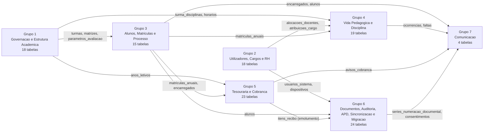
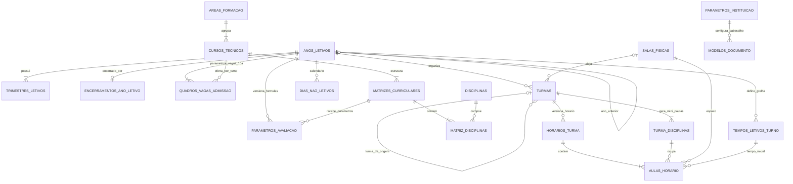
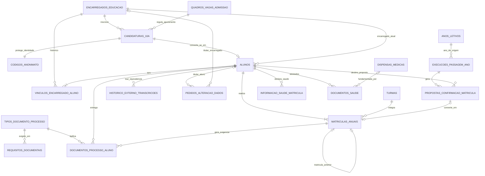
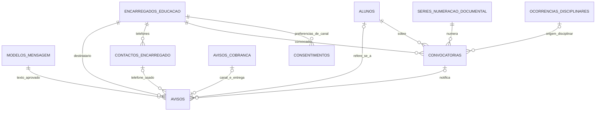
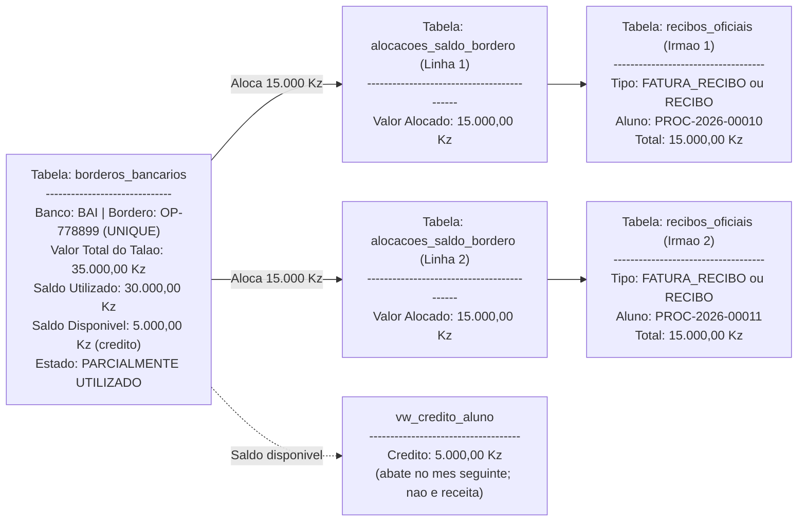
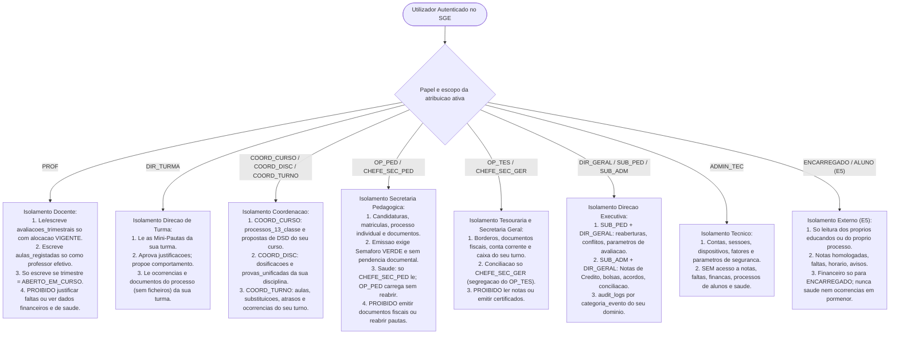

# Documento 05: Modelagem Conceptual e Organização Lógica da Base de Dados (ERD, Dicionário de Entidades, Integridade e Isolamento de Acesso)

> [!abstract] Navegação & Rastreabilidade no Vault
> - **Painel Principal:** [[Inicio|Início do Vault]] | **Índice do Projeto:** [[00 - MOC SGE IPCAG 12008 BGO|MOC — SGE IPCAG N.º 12008 / BGO]]
> - **Sequência Arquitetural:** [[01 - Dominio e Regras]] $\rightarrow$ [[02 - Fluxos de Trabalho]] $\rightarrow$ [[03 - User Stories]] $\rightarrow$ [[04 - Telas e Documentos]] $\rightarrow$ **05 - Modelagem de Dados**
> - **Integração v2.0:** [[00.2 - Mapa de Integracao v2.0|Mapa de Integração (INT-V2)]] · [[12 - Registo de Decisoes e Questoes em Aberto|REG-12]] (`DEC-009`) · [[11 - Protecao de Dados (APD)|APD-11]] §8 · [[Verificacao das Referencias Legais|LEG-VER]] §5 · [[Achados dos Documentos Reais - Lote 1|DESC-L1]] · [[Sintese das Respostas da Fase B|DESC-RESP]]
> - **Capacidades integradas:** [[C03 - Processo Individual do Aluno|C03]] · [[C04 - Horarios e Distribuicao de Servico Docente|C04]] · [[C10 - Cobranca, Relatorios Financeiros e Conciliacao|C10]] · [[C12 - Comunicacao com Encarregados e Alunos|C12]] · [[C13 - Disciplina e Comportamento|C13]] · [[C14 - Gestao de Contas e Acesso|C14]] · [[C15 - Paineis de Gestao da Direcao|C15]] · [[C16 - Passagem de Ano Letivo|C16]]
> - **Quadros Visuais no Figma:** 🎨 [Quadro Dedicado DOC-05 no FigJam](https://www.figma.com/board/lGrzPwEBaxgExyewDXnEAt) *(ainda na v1.2)* \| 🌐 [Quadro Geral Unificado](https://www.figma.com/board/OneLIwLlc2kuM1koaIeXG0) \| 📋 [[Quadros de Arquitetura no Figma\|Ver Todos os Links]]
> - **Mapa Visual e Base:** [[Arquitetura SGE IPCAG 12008 BGO.canvas|Mapa Visual da Arquitetura (.canvas)]] \| [[Painel Documentacao SGE.base|Painel de Documentação (.base)]]
> - **Áreas e Recursos:** [[Arquitetura de Software e DDD]] \| [[Governacao Escolar Ensino Tecnico MED]] \| [[Quadro Legal MED AGT e APD Angola]]

**Projeto:** Sistema de Gestão Escolar (SGE) — Ensino Secundário Técnico-Profissional (II Ciclo)  
**Instituição Alvo:** Instituto Politécnico Católico de Administração e Gestão (IPCAG) N.º 12008 / BGO – *"Nossa Senhora do Rosário"* (o número impresso em cada documento é parâmetro — §1.4, `Q-027`)  
**Referências Base:** [[01 - Dominio e Regras|01 - Domínio e Regras]], [[02 - Fluxos de Trabalho|02 - Fluxos de Trabalho]], [[03 - User Stories|03 - User Stories]] e [[04 - Telas e Documentos|04 - Telas e Documentos]]

> [!note]
> Este documento define a **arquitetura lógica e organizacional da base de dados** (sem código físico SQL), estabelecendo o mapa completo de entidades, atributos, ligações, controlo de saldos, sincronização *Offline-First*, **parâmetros provisórios** e isolamento de segurança por papel.

> [!important] Versão `2.0-rc1` — regras provisórias (`DEC-009`)
> Esta versão integra as 8 capacidades novas, as correções legais (`COR-LEG-01` a `29`), as alterações de proteção de dados (`ALT-05-01` a `26`) e os achados dos documentos reais. Os valores que dependem de validação da escola estão marcados:
> > 🟡 **Provisória** — parâmetro configurável; validar em [ponto de controlo] (`DEC-009`). Fonte: [nota].
>
> Pontos de controlo: homologação → **E1**; recálculo de pautas → **E2**; regulamento interno → **E3**. Cada valor 🟡 vive numa **tabela de parâmetros** (§1.4), nunca numa constante do código. Uma divergência no ponto de controlo muda **parâmetros**, não a estrutura.
> **Total de tabelas: 121** (44 da v1.2 + 77 novas), em **7 grupos** (§6).

---

## 1. Visão Geral da Organização dos Dados e Sincronização *Offline-First*

### 1.1 Divisão Lógica em 7 Domínios de Dados
Para manter a base de dados do **IPCAG** organizada e auditável, todas as tabelas estão agrupadas em **7 Domínios Lógicos**. A segregação de funções entre domínios é uma **decisão de controlo interno** da escola, inspirada nos cargos do DP n.º 93/21 (Regime Jurídico para o Exercício de Cargos de Direcção e Chefia das Instituições Públicas de Educação Pré-Escolar, Ensino Primário e Secundário — `COR-LEG-21`):

1. **Grupo 01 — Governação, Calendário e Estrutura Académica (`Academic Structure`) — 18 tabelas:** Ano Letivo (estados, passagem e encerramento), 3 Trimestres, **parâmetros da instituição**, **parâmetros de avaliação**, Áreas de Formação e Cursos Técnicos, Salas/Laboratórios, Disciplinas, Matrizes Curriculares, Turmas, grelha de tempos letivos, dias não letivos e horários semanais.
2. **Grupo 02 — Utilizadores, Papéis e Títulos dos Cargos, Alocação Docente e RH (`Identity & Staff`) — 18 tabelas:** contas de acesso, **atribuições de cargo com escopo** (12 papéis RBAC + perfil técnico `ADMIN_TEC`), **títulos dos cargos configuráveis**, sessões, dispositivos, segundos fatores, códigos presenciais, eventos de autenticação, parâmetros de segurança, cadastro de professores/funcionários, distribuição de serviço docente, habilitações, acumulações, indisponibilidades, dosificação e livro de ponto.
3. **Grupo 03 — Admissão, Alunos, Matrículas, Processo Individual e Passagem de Ano (`Enrollment & Records`) — 15 tabelas:** Encarregados de Educação (e vínculos históricos), Candidatos (com **Código de Anonimato** separado), o Aluno (**N.º de Processo Individual**), Matrículas Anuais, Histórico Externo, **documentos do processo individual**, pedidos de alteração de dados, motor de passagem e propostas de confirmação, e o **compartimento de saúde** (esquema separado — APD-11).
4. **Grupo 04 — Vida Pedagógica, Avaliação, Faltas, Disciplina e 13ª Classe (`Pedagogical & Assessment`) — 19 tabelas:** Dispensas (`DISP`), **livro de sumários por aula**, faltas e **justificações numeradas**, **provas unificadas com variantes**, Avaliações Trimestrais (`MTP`, `PP`, `PT`, `M1`–`M3`), Resultados Anuais (`CF`, `PG`, `CA`, recurso), Reaberturas de Pauta, Cadeiras em Atraso, Exames Extraordinários, ocorrências, medidas e processos disciplinares, comportamento trimestral, atrasos e a **13ª Classe** (Projecto Tecnológico, Estágio e PAP).
5. **Grupo 05 — Tesouraria, Documentos Fiscais (DP n.º 71/25), Cobrança e Conciliação (`Finance & Treasury`) — 23 tabelas:** Bancos e contas bancárias da escola, preçário em Kwanzas (`AOA`), bolsas e renovação, Conta Corrente de Propinas, **Borderôs com saldo (crédito do aluno)**, **Fatura / Fatura-Recibo / Recibo** (emitidos pelo software certificado — `DEC-002`), **Nota de Crédito / Recibo de Estorno**, **fila de emissão fiscal**, Fecho de Caixa, parâmetros de cobrança, acordos de pagamento, avisos de cobrança, ajustes, extratos e conciliação bancária.
6. **Grupo 06 — Emissão Documental, Numeração, Indicadores, Auditoria, Proteção de Dados e Sincronização (`Audit & Verification`) e Migração — 24 tabelas:** Documentos Oficiais Emitidos (registo do título, QR), **modelos de documento**, **séries de numeração documental (fonte única)**, requerimentos de declaração, ficheiros digitalizados, cartões de estudante, catálogo e instantâneos de indicadores, alertas de gestão, `audit_logs` (imutável durante o prazo de conservação — `ALT-05-11`), consentimentos, avisos de privacidade, pedidos de titulares, políticas de conservação, comunicações a destinatários, incidentes, consultas ao portal de verificação e o controlo da sincronização *Offline-First*.
7. **Grupo 07 — Comunicação com Encarregados e Alunos (`Communication`) — 4 tabelas (novo — C12):** modelos de mensagem aprovados, avisos (impresso, SMS, portal E5), convocatórias numeradas e contactos verificados. Os consentimentos de comunicação usam a tabela única `consentimentos` do Grupo 06 (§3.7).

---

### 1.2 Lógica de Sincronização *Offline-First* (Navegador Local $\leftrightarrow$ Servidor Central)
Para garantir que o lançamento de Mini-Pautas, sumários e faltas e o atendimento no Panguila (Bengo) não parem quando a internet oscila:

1. **Armazenamento Local Encriptado (`IndexedDB`), só em dispositivos autorizados:**
   - Só um dispositivo registado em `dispositivos_autorizados` (estado `AUTORIZADO`) e desbloqueado com o **PIN local** pode guardar dados (`RN-16.15`; o PIN **não** é guardado no servidor).
   - Quando um professor (`PROF`) abre a sua turma com ligação ativa, o sistema descarrega a lista congelada de alunos da Mini-Pauta, as aulas previstas do horário publicado (`aulas_registadas` em `PREVISTA`) e a versão atual de cada linha (`versao_registo`).
   - Sem internet, cada nota (`MTP`, `PP`, `PT`, `PG`), sumário ou falta é guardada numa **Fila de Sincronização Pendente**, com uma **Chave de Idempotência**, a data/hora local e o identificador do dispositivo.
2. **Prevenção de Duplicações:** quando a ligação (LAN da escola ou internet) regressa, os dados sobem em lote. Um reenvio com a mesma chave é reconhecido em `operacoes_sincronizacao` e ignorado.
3. **Resolução Segura de Conflitos:** o servidor central é a autoridade sobre o estado do trimestre (`Aberto` vs. `Fechado`) e sobre o estado da conta (`RN-16.9`). Se a Mini-Pauta foi fechada, a aula já foi sumariada, a alocação terminou ou a conta deixou de estar ativa entretanto, o envio vai para `conflitos_sincronizacao` e a decisão é da Direção (`SUB_PED`/`DIR_GERAL`). 🟡 Qual dos servidores (local ou réplica na nuvem) é a autoridade final é a `Q-015` (`DEC-006`).
4. **Limpeza e expiração local (`ALT-05-20`):** os dados locais expiram no fim do prazo *offline* do dispositivo (`dispositivos_autorizados.prazo_offline_ate`; 🟡 prazo em `parametros_seguranca`, PC-18 da APD-11) e são apagados na revogação do dispositivo, na mudança de cargo e na desativação da conta (RF-C19-26). O conteúdo das operações já aplicadas é eliminado do servidor segundo o PC-16 (`operacoes_sincronizacao.conteudo_eliminado_em` — `ALT-05-12`).
5. **Tesouraria e documentos fiscais (`DEC-002` (b), decidida a 2026-11-09, homologação pendente):** o SGE **não emite documentos fiscais**; quem os emite é o software certificado pela AGT, através do adaptador. Sem ligação ao software certificado, o balcão **não bloqueia**: o SGE emite o **recibo escolar provisório** (documento de quitação académica, que não pode parecer uma fatura — DP n.º 71/25, art. 4.º, n.º 9) e guarda o pedido em `fila_emissao_fiscal`; quando o canal volta, o adaptador envia os pedidos e grava a resposta em `recibos_oficiais` (`RN-09.5`). A contingência fiscal propriamente dita (emissão "em contingência, pendente de autorização", comunicação posterior à AGT e bloqueio após **60 dias** sem comunicar — DP n.º 71/25, art. 17.º–18.º, `COR-LEG-06`, investigação #33) é do software certificado, não do SGE.

---

### 1.3 Conjuntos de Valores Fechados (Listas de Estados e Categorias Controladas)
Para evitar erros de digitação, a base de dados só aceita valores pertencentes às seguintes listas fechadas. As listas 1 a 17 vêm da v1.2 (corrigidas onde indicado); as listas 18 em diante são novas na v2.0. Os **catálogos que a escola altera** (tipos de documento do processo, tipos de ocorrência, medidas, títulos de cargos, rubricas de emolumento) **não** são listas fechadas: são tabelas (§1.4).

#### 1.3.1 Listas da v1.2 (corrigidas)

| Nome da Lista Controlada | Valores Oficiais Permitidos na Base de Dados |
| :--- | :--- |
| **1. Papéis no Sistema (RBAC)** *(ex-"Cargos Oficiais RBAC" — C14)* | `DIR_GERAL`, `SUB_PED`, `SUB_ADM`, `CHEFE_SEC_PED`, `OP_PED`, `CHEFE_SEC_GER`, `OP_TES`, `COORD_CURSO`, `COORD_DISC`, `COORD_TURNO`, `DIR_TURMA`, `PROF`. São códigos internos, **nunca impressos**; o título impresso vem de `cargos_institucionais` (`RN-16.20`, A4). |
| **2. Turnos Escolares** *(rótulo impresso "Período" — A9)* | `MANHA`, `TARDE` |
| **3. Classes do II Ciclo Técnico** | `10ª Classe`, `11ª Classe`, `12ª Classe`, `13ª Classe` |
| **4. Componentes Curriculares** | `SOCIO_AMBIENTAL_CULTURAL` *(ex-`SOCIO_CULTURAL` — `COR-LEG-23`)*, `CIENTIFICA`, `TECNICA_TECNOLOGICA_PRATICA` |
| **5. Trimestres Letivos** | `I_TRIMESTRE`, `II_TRIMESTRE`, `III_TRIMESTRE` |
| **6. Estados do Período / Pauta** | `PLANEADO`, `ABERTO_EM_CURSO`, `EM_CONSELHO_DE_NOTAS`, `FECHADO_HOMOLOGADO`, `REABERTO_TEMPORARIAMENTE` |
| **7. Estados da Candidatura (10ª Classe)** | `INSCRITO`, `EXCLUIDO_POR_IDADE`, `APTO_PARA_EXAME`, `AVALIADO_ANONIMATO`, `ADMITIDO_1A_OPCAO`, `ADMITIDO_2A_OPCAO_REPESCAGEM` 🟡 *(prática interna — `COR-LEG-10`, `Q-LEG-12`; E1)*, `NAO_ADMITIDO_FORA_DAS_VAGAS`, `NAO_ADMITIDO_NOTA_INFERIOR`, `FALTOU_AO_EXAME`, `CANCELADO_POR_FALTA_PAGAMENTO`, `CONVERTIDO_EM_MATRICULA`. **Retirado:** `ADMITIDO_DESPACHO_LIMIAR` (`COR-LEG-08`). |
| **8. Tipos de Ingresso na Matrícula** | `MATRICULA_INICIAL_10A`, `CONFIRMACAO_INTERNA`, `TRANSFERENCIA_ENTRADA`, `TRANSFERENCIA_INTERNA` *(acrescentado: já existia no atributo de `matriculas_anuais`)*, `REINGRESSO_POR_DESPACHO` *(`RN-03.6`, `RN-18.14.3`)* |
| **9. Estados da Matrícula Anual** | `PENDENTE_PAGAMENTO_INICIAL`, `ATIVA`, `TRANSFERIDA_INTERNA`, `TRANSFERIDA_EXTERNA`, `ANULADA_DESISTENTE`, `CONCLUIDA_NO_ANO`. O motivo da anulação distingue a **anulação automática da matrícula incompleta** aos 60 dias (lista 39 — `COR-LEG-15`). |
| **10. Situação do Aluno na Disciplina** | `EM_CURSO`, `DISPENSADO_DISP`, `RETIDO_POR_FALTAS_RF`, `APROVADO_CLASSIFICACAO_ANUAL` *(ex-`APROVADO_FREQUENCIA`: aprovação pela `CA ≥ 10`)*, `EM_EXAME_DE_RECURSO`, `APROVADO_POS_EXAME`, `REPROVADO_NA_DISCIPLINA` |
| **11. Deliberação Final do Conselho de Notas** | `TRANSITA_APROVADO`, `TRANSITA_COM_DEFICIENCIA`, `NAO_TRANSITA_RETIDO_NOTAS`, `NAO_TRANSITA_VETO_LP_NUCLEAR`, `NAO_TRANSITA_RETIDO_FALTAS`, `APTO_PARA_13_CLASSE`, `CONCLUIU_12_COM_CADEIRAS_PENDENTES` *(novo — `RN-02.2`, `DEC-024`)*, `TRANSFERIDO`, `ANULADO_DESISTENTE`. Agrupamento impresso na lista 45. |
| **12. Estados da Cadeira em Atraso** | `TRANSITADO_COM_DEFICIENCIA`, `INSCRITO_EXAME_EXTRAORDINARIO`, `DEFICIENCIA_ELIMINADA` |
| **13. Estados do Processo da 13ª Classe** | `BLOQUEADO_CADEIRAS_EM_ATRASO`, `APTO_PARA_13_CLASSE`, `EM_ESTAGIO_E_PROJECTO_TECNOLOGICO` *(ex-`EM_ESTAGIO_E_ELABORACAO_PAP` — `COR-LEG-28`)*, `APTO_PARA_DEFESA_PAP`, `DEFENDIDO_E_HOMOLOGADO`, `REPROVADO_EM_PAP`, `CERTIFICADO_EMITIDO` *(ex-`DIPLOMA_CERTIFICADO_EMITIDO`: o Diploma é do Ministério — `COR-LEG-18`)* |
| **14. Tipos de Bolsa / Desconto (`RN-07`)** 🟡 *(tipos e percentagens por validar — E1)* | `SEM_BENEFICIO`, `BOLSA_100`, `BOLSA_50`, `BOLSA_PARCIAL_OUTRA`, `ISENCAO_DIOCESE_CAXITO`, `DESCONTO_IRMAOS`, `FILHO_FUNCIONARIO` |
| **15. Estados da Propina Mensal** | `A_VENCER`, `PAGA`, `EM_ATRASO_COM_MULTA`, `EM_ACORDO_PAGAMENTO` *(novo — C10)*, `ISENTA_BOLSEIRO_100`, `CANCELADA_POR_INATIVACAO`, `ESTORNADA` *(nome mantido; agora "por Nota de Crédito")* |
| **16. Canais de Pagamento (Fecho de Caixa)**| `TPA_MULTICAIXA`, `TRANSFERENCIA_DEPOSITO_BANCARIO`, `MULTICAIXA_EXPRESS`, `RUPE` *(emolumentos do Estado — lista 63 `RUPE_ESTADO`: comprovativo RUPE, sem documento fiscal do IPCAG, fora da receita e da conciliação bancária — `DEC-011`)*. |
| **17. Estados do Borderô / Talão Bancário** | `REGISTADO_SALDO_100`, `PARCIALMENTE_UTILIZADO`, `ESGOTADO_TRANCADO`, `INVALIDADO_POR_FRAUDE` (sem marca sobre o encarregado — `ALT-05-16`) |

#### 1.3.2 Listas novas da v2.0

| N.º | Lista | Valores | Origem |
| :---: | :--- | :--- | :--- |
| 18 | Estados do Ano Letivo | `PLANEADO`, `EM_CURSO`, `EM_ENCERRAMENTO`, `ENCERRADO`, `ARQUIVADO` | C16 |
| 19 | Modo de Confirmação de Matrícula 🟡 | `BALCAO`, `AUTOMATICA` (`COR-LEG-15`, `Q-LEG-05`; E1) | C16 |
| 20 | Tipos de Proposta de Confirmação | `TRANSICAO`, `TRANSICAO_COM_DEFICIENCIA`, `REPETENCIA`, `CONDICIONADA_13A`, `NOVA_EPOCA_13A` | C16 |
| 21 | Estados da Proposta de Confirmação | `APTA_A_CONFIRMAR`, `BLOQUEADA`, `CONVERTIDA_EM_MATRICULA`, `NAO_CONFIRMADA`, `SUBSTITUIDA`, `CANCELADA` | C16 |
| 22 | Motivos de Bloqueio da Proposta | `DIVIDA_VENCIDA`, `CADEIRAS_PENDENTES_13A`, `TRANSCRICAO_EXTERNA_PENDENTE`, `AGUARDA_DESPACHO`, `PERDA_DIREITO_CONFIRMACAO_FALTAS` (`COR-LEG-14`) | C16, LEG-VER |
| 23 | Situação Académica do Aluno | `ATIVO`, `AGUARDA_CONFIRMACAO`, `INTERROMPIDO`, `TRANSFERIDO_SAIDA`, `DESISTENTE_ANULADO`, `CONCLUIU_CURSO` | C16 |
| 24 | Decisão de Renovação de Benefício | `RENOVAR`, `ALTERAR`, `NAO_RENOVAR` | C16 |
| 25 | Modo da Execução de Passagem | `SIMULACAO`, `DEFINITIVA` | C16 |
| 26 | Tipo de Elemento da Grelha | `TEMPO_LETIVO`, `INTERVALO` | C04 |
| 27 | Estados do Plano de Distribuição | `EM_ELABORACAO`, `SUBMETIDO`, `HOMOLOGADO`, `ENCERRADO` | C04 |
| 28 | Estados da Alocação Docente | `PROPOSTA`, `VIGENTE`, `ENCERRADA` | C04 |
| 29 | Estados da Versão do Horário | `RASCUNHO`, `SUBMETIDO`, `PUBLICADO`, `SUBSTITUIDO`, `DESCARTADO` | C04 |
| 30 | Origem da Versão do Horário | `MANUAL`, `IMPORTADO` (`DEC-004`) | C04 |
| 31 | Tipos de Aula | `NORMAL`, `SUBSTITUICAO_PONTUAL`, `REPOSICAO` | C04 |
| 32 | Estados da Aula | `PREVISTA`, `LECIONADA`, `NAO_LECIONADA`, `CANCELADA`, `REPOSTA` | C04 |
| 33 | Motivos de Aula Não Lecionada | `FALTA_PROFESSOR`, `SEM_PROFESSOR_ATRIBUIDO`, `ATIVIDADE_ESCOLAR`, `FORCA_MAIOR`, `OUTRO` | C04 |
| 34 | Motivos de Dia Não Letivo | `FERIADO`, `PAUSA_LETIVA`, `ATIVIDADE_ESCOLAR`, `OUTRO` | C04 |
| 35 | Estados da Acumulação Externa | `DECLARADA`, `AUTORIZADA`, `RECUSADA`, `CESSADA` | C04 |
| 36 | Abrangência do Dia Não Letivo | `ESCOLA`, `TURNO`, `TURMA` | C04 |
| 37 | Tipos de Falta 🟡 | `NAO_COMPARENCIA`, `INDISCIPLINA` (A8; `Q-032`, `Q-C13-03`; E3) | C13, A8, `ALT-05-26` |
| 38 | Categoria do Motivo de Falta | 🟡 categorias do regulamento interno (`ALT-05-10`; valores a fixar com o regulamento — E3). Os anexos clínicos vão para `documentos_saude`. | APD-11 |
| 39 | Motivo de Anulação da Matrícula | `REQUERIMENTO_ENCARREGADO`, `ABANDONO_FORMALIZADO`, `MATRICULA_INCOMPLETA_60_DIAS` 🟡 (prazo parametrizado em `anos_letivos`; DP n.º 167/23, art. 50.º, n.º 8 — `COR-LEG-15`), `EXCESSO_FALTAS` | LEG-VER, DESC-RESP R5 |
| 40 | Estado da Célula de Avaliação 🟡 | `LANCADA`, `PENDENTE_2A_CHAMADA` (`RN-01.3`; E2), `DISP` | DOC-01, DOC-04 |
| 41 | Variante de Prova Unificada 🟡 | `A_MANHA`, `B_TARDE`, `SEGUNDA_CHAMADA` (`RN-01.4`; E2) | DESC-RESP §1 |
| 42 | Tipo de Prova Unificada | `PT`, `PG` | DESC-RESP §1 |
| 43 | Origem da Nota | `LANCAMENTO_INTERNO`, `GUIA_TRANSFERENCIA_EXTERNA`, `MIGRACAO` | DOC-01 `RN-06.1`; MIG-10 |
| 44 | Estados da Justificação de Faltas | `PEDIDA`, `APROVADA_DIR_TURMA`, `APROVADA_COM_VISTO`, `REJEITADA` (o visto do `SUB_PED` é parâmetro `exige_visto_sub_ped` — `RN-03.4`) | A8, DESC-RESP R3 |
| 45 | Resultado na Pauta Geral (agrupamento impresso — A10) | `TRANSITA`, `TRANSITA_COM_DEFICIENCIA`, `DESISTENTE`, `NAO_TRANSITA` (inclui `CONCLUIU_12_COM_CADEIRAS_PENDENTES` — `DEC-024` §1; 🟡 categoria dos transferidos — `Q-C16-18`) | C16, `RN-02.3` |
| 46 | Gravidade da Ocorrência 🟡 | valores do regulamento interno (`Q-C13-04`; **E5** — `RF-C13-02`, `DEC-013`) *(VER-02 #45)* | C13 |
| 47 | Estados da Ocorrência | segundo a máquina `OCORRENCIA` do DOC-01 §3.15 | C13 |
| 48 | Estados do Processo Disciplinar | segundo a máquina `PROC_DISC` (C13 §4.2) | C13 |
| 49 | Estado do Comportamento Trimestral | `ABERTO`, `FECHADO` | C13 |
| 50 | Categoria de Dados do Documento | `IDENTIFICACAO`, `ACADEMICO`, `SAUDE`, `FOTOGRAFIA`, `OUTRO` | C03 |
| 51 | Estados do Documento do Processo | `EM_FALTA`, `ENTREGUE`, `VALIDADO`, `REJEITADO`, `CADUCADO`, `DISPENSADO` | C03 |
| 52 | Motivos de Rejeição do Documento | `ILEGIVEL`, `INCOMPLETO`, `DADOS_DIVERGENTES`, `CADUCADO`, `OUTRO` | C03 |
| 53 | Efeito da Falta de Documento | `ALERTA`, `BLOQUEIA_CERTIFICACAO` | C03 |
| 54 | Localização do Original | `ARQUIVO_ESCOLA`, `DEVOLVIDO_AO_ENCARREGADO` | C03 |
| 55 | Estados do Pedido de Alteração de Dados | `PENDENTE`, `APROVADO`, `REJEITADO` | C03 |
| 56 | Estados do Cartão de Estudante | `SOLICITADO`, `EMITIDO`, `ENTREGUE`, `ANULADO`, `CADUCADO` | C03 |
| 57 | Motivos de Anulação do Cartão | `TRANSFERENCIA`, `ANULACAO_MATRICULA`, `PERDA`, `ROUBO`, `DANO`, `ERRO` | C03 |
| 58 | Tipo de Documento de Identificação | `BI`, `CEDULA_PESSOAL`, `OUTRO` | C03 |
| 59 | Tipos de Série Documental | `BOLETIM_MATRICULA`, `BOLETIM_CONFIRMACAO`, `CARTAO_ESTUDANTE`, `REQUERIMENTO_DECLARACAO`, `DECLARACAO`, `JUSTIFICACAO_FALTAS`, `CONVOCATORIA`, `ACORDO_PAGAMENTO` (extensível por homologação; **não** inclui documentos fiscais — `RN-10.6`) | C03, C10, C12, A13 |
| 60 | Arquivo da Pasta Física | `CORRENTE`, `HISTORICO` | C03 |
| 61 | Tipos de Documento Fiscal | `FATURA` (`FT`), `FATURA_RECIBO` (`FR`), `RECIBO` (`RC`) — em `recibos_oficiais`. A **Nota de Crédito** (`NC`) e o **Recibo de Estorno** (`RE`, DE n.º 683/25) registam-se em `notas_estorno` (campo **Tipo de Documento de Correção**: `NOTA_CREDITO`, `RECIBO_ESTORNO`). Emitidos pelo software certificado (`DEC-002` (b); `Q-LEG-16`); Nota de Débito por confirmar | `COR-LEG-02`, `DEC-002` |
| 62 | Emissor do Documento Fiscal | `SOFTWARE_CERTIFICADO_EXTERNO` — único valor admitido pela `DEC-002` (b) (decidida a 2026-11-09, homologação pendente); o valor `SGE` sai da lista e só voltaria com nova decisão | `COR-LEG-01`, `DEC-002` |
| 63 | Forma de Pagamento do Emolumento 🟡 | `TESOURARIA_IPCAG`, `RUPE_ESTADO` (`Q-034`, `Q-C10-17`; E1) | DESC-RESP R15 |
| 64 | Menção da Nota de Crédito | `ANULACAO`, `RECTIFICACAO` (DP n.º 71/25, art. 8.º, n.º 4–5) | `COR-LEG-03` |
| 65 | Estados do Acordo de Pagamento | `PROPOSTO`, `ATIVO`, `REJEITADO`, `CUMPRIDO`, `INCUMPRIDO`, `ANULADO` | C10 |
| 66 | Estados da Parcela | `A_VENCER`, `PAGA`, `VENCIDA` | C10 |
| 67 | Níveis do Aviso de Cobrança | `NIVEL_1_LEMBRETE`, `NIVEL_2_AVISO`, `NIVEL_3_CONVOCATORIA` | C10 |
| 68 | Estados do Aviso de Cobrança | `GERADO`, `ENTREGUE`, `NAO_ENTREGUE`, `ANULADO` | C10 |
| 69 | Tipos de Regra de Multa 🟡 | `VALOR_FIXO`, `PERCENTAGEM_UNICA`, `PERCENTAGEM_POR_MES_DE_ATRASO` (`Q-C10-01`; E1) | C10 |
| 70 | Tipos de Ajuste da Conta Corrente | `PERDAO_MULTA_TOTAL`, `PERDAO_MULTA_PARCIAL`, 🆕 `AJUSTE_SALDO_MIGRADO` *(só prestações `MIGRADO`, despacho do `SUB_ADM` — MIG-10 §7.4, RF-C17-13)* *(VER-02 #45)* | C10, MIG-10 |
| 71 | Estados de Conciliação do Borderô | `POR_CONCILIAR`, `CONCILIADO`, `DIVERGENTE`, `NAO_ENCONTRADO` | C10 |
| 72 | Estados da Linha de Extrato | `POR_CONCILIAR`, `CONCILIADA`, `SEM_BORDERO`, `FORA_DO_AMBITO` | C10 |
| 73 | Estados do Período de Conciliação | `ABERTO`, `EM_CONCILIACAO`, `FECHADO_HOMOLOGADO` | C10 |
| 74 | Tipo de Diferença da Conciliação | `NENHUMA`, `COMISSAO_BANCARIA`, `OUTRA_JUSTIFICADA` | C10 |
| 75 | Origem da Correspondência | `SUGESTAO_AUTOMATICA`, `MANUAL`, `FORNECEDOR_PAGAMENTOS` (este último fora das E1–E5 — `DEC-005`) | C10 |
| 76 | Estados do Fecho de Caixa | `ABERTO`, `FECHADO_PELO_OPERADOR`, `FECHADO_ADMINISTRATIVAMENTE` *(novo)*, `CONFERIDO_SECRETARIA_GERAL`, `HOMOLOGADO_ADMINISTRACAO` | C10, DESC-RESP R13 |
| 77 | Perfis Técnicos e Externos | `ADMIN_TEC` (interno, fora dos 12 papéis); `ENCARREGADO`, `ALUNO` (externos, **E5** — `DEC-003`) | C14 |
| 78 | Tipo de Conta | `INTERNA`, `ENCARREGADO` (E5), `ALUNO` (E5) | C14 |
| 79 | Estados da Conta | `PENDENTE_ATIVACAO`, `ATIVA`, `BLOQUEADA_TENTATIVAS`, `SUSPENSA`, `DESATIVADA` | C14 |
| 80 | Estados do Título do Cargo | `PROPOSTO`, `HOMOLOGADO`, `INATIVO` | C14 |
| 81 | Estados da Atribuição de Cargo | `PENDENTE_APROVACAO`, `AGENDADA`, `ATIVA`, `REJEITADA`, `TERMINADA` | C14 |
| 82 | Tipos de Escopo | `INSTITUICAO`, `CURSO`, `DISCIPLINA`, `TURNO`, `TURMA`, `ALOCACOES_DOCENTES` (E5: `EDUCANDOS`, `PROPRIO_PROCESSO`) | C14 |
| 83 | Tipos de Sessão | `BALCAO`, `PESSOAL`, `ADMINISTRACAO` | C14 |
| 84 | Tipos de Segundo Fator | `TOTP`, `SMS`, `CODIGOS_RECUPERACAO` | C14 |
| 85 | Estados do Dispositivo | `AUTORIZADO`, `REVOGADO` | C14 |
| 86 | Finalidade do Código Presencial | `ATIVACAO`, `REPOSICAO` | C14 |
| 87 | Motivo de Saída do Funcionário | `FIM_CONTRATO`, `TRANSFERENCIA`, `APOSENTACAO`, `RESCISAO`, `FALECIMENTO`, `OUTRO` | C14 |
| 88 | Categoria do Evento de Auditoria | `PEDAGOGICO`, `FINANCEIRO`, `DOCUMENTAL`, `SEGURANCA_CONTAS`, `PROTECAO_DADOS` | C14, APD-11 |
| 89 | Domínio do Indicador | `PEDAGOGICO`, `ASSIDUIDADE`, `FUNCIONAMENTO`, `ESTRUTURA`, `FINANCEIRO`, `CONTAS` | C15 |
| 90 | Classe de Atualização do Indicador | `TEMPO_REAL`, `DIARIO`, `FECHO` | C15 |
| 91 | Estado do Instantâneo | `PROVISORIO`, `OFICIAL` | C15 |
| 92 | Tipos de Alerta de Gestão | `ALERTA_FALTAS_80`, `RETENCAO_POR_FALTAS`, `RISCO_NOTAS_ELEVADO`, `CONFLITO_SINC_PENDENTE`, `MINI_PAUTA_SEM_TITULAR`, `DISPOSITIVO_SEM_SINCRONIZAR`, `TURMA_SEM_DIRECTOR`, `CAIXA_POR_HOMOLOGAR`, `CAIXA_SEM_OPERADOR`, `BORDERO_NAO_ENCONTRADO`, `ACORDO_INCUMPRIDO`, `SUSPENSAO_EMERGENCIA_POR_CONFIRMAR` | C15 |
| 93 | Estados do Alerta | `NOVO`, `VISTO`, `TRATADO`, `ARQUIVADO_AUTOMATICAMENTE` | C15 |
| 94 | Canais de Aviso | `IMPRESSO`, `SMS`, `PORTAL` (E5) | C12 |
| 95 | Gatilhos de Aviso | `FALTAS_50`, `FALTAS_80`, `PROPINA_VENCIDA`, `RESULTADOS_TRIMESTRE`, `CONVOCATORIA`, `HORARIO_ALTERADO`, `DOCUMENTO_PRONTO` (ativos e limiares são parâmetros 🟡) | C12 |
| 96 | Estados do Aviso | segundo a máquina `AVISO` do DOC-01 §3.14 | C12 |
| 97 | Titular do Contacto | `PAI`, `MAE`, `ENCARREGADO`, `ALUNO`, `OUTRO` | C12 |
| 98 | Estado do Contacto | `POR_VERIFICAR`, `VERIFICADO`, `INVALIDO` | C12 |
| 99 | Motivo da Convocatória | `PEDAGOGICO`, `DISCIPLINAR`, `FINANCEIRO`, `OUTRO` (só no sistema; nunca impresso nem por SMS) | C12 |
| 100 | Comparência à Convocatória | `COMPARECEU`, `FALTOU`, `REMARCADA` | C12 |
| 101 | Finalidades de Consentimento | `CON-01` … `CON-08` da APD-11 §4 (versionadas em `avisos_privacidade`) e, para a comunicação, `SMS_ESSENCIAIS` (recusa registada; segue impresso), `SMS_NAO_ESSENCIAIS` (= `CON-05`), `PORTAL` (E5) | APD-11, C12 |
| 102 | Tipos de Direito do Titular | acesso, retificação, eliminação, oposição, informação (APD-11 §6) | `ALT-05-18` |
| 103 | Estados de Conservação | `ATIVO`, `BLOQUEADO`, `ANONIMIZADO` | `ALT-05-02` |
| 104 | Estados de Verificação do Documento | `ATIVO`, `SUBSTITUIDO`, `ANULADO`, `EXPIRADO_PARA_VERIFICACAO` | `ALT-05-13` |
| 105 | Tipos de Livro de Registo Físico | `TERMOS_EXAME`, `CERTIFICADOS`, `ATAS_PAP` 🟡 *(lista real a confirmar no inventário dos livros — MIG-10 §7.5)* | MIG-10 `AJ-04`; `DEC-010` |
| 106 | Número da Instituição a Imprimir 🟡 | `OFICIAL`, `SECUNDARIO` (12008 / 8009 — `Q-027`; E1) | A3, INT-V2 §3.5 |
| 107 | Estado da Entrega do Boletim 🟡 | `POR_ENTREGAR`, `ENTREGUE`, `RETIDO_POR_DIVIDA` (`RN-08.2`; E1) | DESC-RESP R12 |
| 108 | Estado dos Parâmetros | `PROPOSTO`, `HOMOLOGADO`, `SUBSTITUIDO` | v2.0 (§1.4) |
| 109 | 🆕 Estados do Incidente de Segurança | `REGISTADO`, `NOTIFICADO_APD`, `ENCERRADO` | APD-11 `ALT-05-08`; VER-02 #45 |
| 110 | 🆕 Motivo da Cessação do Consentimento | `REVOGACAO`, `MAIORIDADE` *(o aluno faz 18 anos e reconfirma — `AV-09`)* | APD-11 §4.3; VER-02 #45 |
| 111 | 🆕 Nível de Risco do Incidente 🟡 | escala a fixar com a Direção e a APD (Circular APD n.º 2/2024 — APD-11 §1.3 F); sem valores por omissão | APD-11 `RF-P-APD-23`; VER-02 #45 |
| 112 | 🆕 Estados do Lote de Conservação | `PROPOSTO`, `APROVADO`, `EXECUTADO`, `REJEITADO` | APD-11 `ALT-05-06`; VER-02 #45 |
| 113 | Tipo de Livro de Registo *(era a 2.ª lista 105 — renumerada em VER-02 #47; mesmos valores da lista 105, usada no registo do título em `documentos_oficiais_emitidos`)* | `TERMOS_EXAME`, `CERTIFICADOS`, `ATAS_PAP` (DESC-RESP R17; Folha/Termo 🟡 — `COR-LEG-19`) | DOC-01 `RN-10.2` |

---

### 1.4 Onde se Guardam os Parâmetros Provisórios (`DEC-009`, INT-V2 §3.2)

Todos os valores que a escola ainda tem de validar são **dados**, com versão, homologação e auditoria. Nenhum valor desta tabela pode existir como constante no código. Quando um parâmetro não tem valor por omissão, o sistema **recusa** a operação que dele depende até a Direção o configurar.

| Parâmetro (o quê) | Tabela onde vive | Valor por omissão | Estado | Bloqueado por / ponto de controlo |
| :--- | :--- | :--- | :---: | :--- |
| Fórmulas de `M1`/`M2` (componentes `MTP`, `PP`, `PT` e pesos) | `parametros_avaliacao` | `round_med((MTP + PP + PT) / 3)` | 🟡 | `Q-025`, `Q-LEG-21` — **E2** |
| Fórmula de `M3` (`MTP`, `PP`) | `parametros_avaliacao` | **nenhum** (obrigatório antes de abrir o III Trimestre) | 🟡 | `Q-025` — **E2** |
| `CF` e `CA` (pesos `0,6` / `0,4`), nota de aprovação (`10`), arredondamento (`round_med`) | `parametros_avaliacao` | como no DOC-01 `RN-01` | 🟡 | `Q-025`, `COR-LEG-26` — **E2** |
| Acesso ao recurso (`CA < 10` e `CF ≥ 7`) e fórmula da nota depois do recurso | `parametros_avaliacao` | acesso como na prática; fórmula: **nenhum** | 🟡 | `Q-025` — **E2** |
| Disciplinas com Prova Global (`tem_prova_global`), nucleares (`is_nuclear`) | `matriz_disciplinas` | por plano curricular | 🟡 | `Q-025`, `Q-LEG-22` — **E2** |
| Transição: máximo de deficiências (`2`; `0` na 12ª), nota mínima de deficiência (`7`), composição do veto (LP + *n* nucleares), prazo para eliminar | `parametros_avaliacao` | `2` / `7` / LP + 1 | 🟡 | `Q-031`, `Q-LEG-06`, `COR-LEG-13` — **E2** |
| Regime de faltas (multiplicador ou escalões; anual ou trimestral), contagem dos tipos de falta no limite, prazo de justificação, visto do `SUB_PED` | `parametros_avaliacao` | multiplicador da v1.2; ambos os tipos contam; visto ligado | 🟡 | `Q-LEG-04`, `Q-C13-03`, `Q-032` — **E2/E3** |
| Limiares de alerta de faltas (`50%`, `80%`) | `parametros_avaliacao` (e `indicadores_catalogo` para o painel) | `80%` (`50%` opcional) | 🟡 | `RN-03.5` — **E2** |
| Prova de 2.ª chamada: valor sem justificação, prazo | `parametros_avaliacao`, `trimestres_letivos` | **nenhum** | 🟡 | `Q-025` — **E2** |
| Tolerância de atraso no 1.º tempo; escala do comportamento | `parametros_avaliacao` | `15 min`; escala: **nenhuma** | 🟡 | `Q-C13-02`, `Q-C13-05` — **E3** |
| `MFC`: fórmula da `MPC`, pesos `MPC`/`NE`/`NPTEC`/`NPAP`, nota mínima da PAP | `parametros_avaliacao` | pesos: **nenhum**; PAP: `10` | 🟡 | `Q-030`, `Q-LEG-06/07/23`, `COR-LEG-16/17` — **E2** |
| Admissão: mínimo por prova (`10`), idade mínima (`15`), idade máxima (desligada), repescagem na 2ª opção, desempate (menor idade) | `quadros_vagas_admissao` | `10` / `15` / desligada / desligada / `MENOR_IDADE` | 🟡 (repescagem, idade máx.) | `Q-LEG-09/10/11/12` — **E1** |
| Modo de confirmação, bloqueio por dívida, prazo de anulação da matrícula incompleta (`60 dias`), reserva para transferências | `anos_letivos` | `BALCAO` / ligado / `60` / `0` | 🟡 | `Q-LEG-05`, `COR-LEG-15` — **E1** |
| Número da instituição (12008 / 8009), NIF, cabeçalho, rodapé, responsável pelo tratamento e contacto APD, limites de SMS | `parametros_instituicao` | 12008 oficial; 8009 secundário | 🟡 | `Q-027`, `Q-035`, `Q-APD-01/02` (estrutura decidida na `DEC-020`), teto de SMS (central de avisos decidida na `DEC-015` (E3)) — **E1** |
| Número a imprimir, código do rodapé, rótulos das componentes (`MTP`/`MAC`…), signatários, conteúdo por efeito | `modelos_documento` | conforme documentos reais (A14) | 🟡 | `Q-026`, `Q-027`, `Q-028`, `Q-035` — **E1** |
| Títulos dos cargos e papel de cada título | `cargos_institucionais` | títulos vistos nos documentos reais (A4); mapeamento confirmado na `DEC-021`, a homologar | 🟡 (textos finais; vacatura do `SUB_ADM`) | `DSC-08-DIR-GERAL` — **E1** |
| Formato das séries de numeração anual | `series_numeracao_documental` | `N.º {n}/IPCAG N.º {num_instituicao} BGO/{ano}` | 🟡 | `Q-004`, A13 — **E1** |
| Multa por mora, níveis de aviso, escalões de antiguidade, tolerâncias, limites de homologação | `parametros_cobranca` | multa: **nenhum** (fictícia até `Q-C10-01`) | 🟡 | `Q-C10-01` — **E1** |
| Preçário, rubricas e forma de pagamento (RUPE) | `tabelas_precos_emolumentos` | — | 🟡 | `Q-034` — **E1** |
| Software certificado em uso, configuração do adaptador fiscal e regime de IVA | `parametros_instituicao` | emissor `SOFTWARE_CERTIFICADO_EXTERNO` (`DEC-002` (b)) | 🟡 | `Q-002`, `DEC-026` — **E1** |
| Política de palavra-passe, sessões, prazo *offline*, validade de códigos | `parametros_seguranca` | valores do DOC-08 | 🟡 | `Q-C14-*` — **E1** |
| Grelha de tempos letivos (duração, n.º de tempos) | `tempos_letivos_turno` | sem carga prévia | 🟡 | `Q-012`, `Q-C04-18` — **E1** |
| Limites e reduções de carga letiva | `regras_carga_letiva` | sem carga prévia | 🟡 | `Q-C04-04` — **E1** |
| Catálogo de documentos do processo e efeito da falta | `tipos_documento_processo`, `requisitos_documentais` | sem carga prévia | 🟡 | `Q-C03-01` — **E1** |
| Tipos de ocorrência, gravidade, medidas | `tipos_ocorrencia`, `medidas_disciplinares_catalogo` | sem carga prévia | 🟡 | `Q-C13-02` a `06` — **E3** |
| Limiares e fórmulas dos indicadores | `indicadores_catalogo` | catálogo `IND-01`…`IND-29` | 🟡 | `Q-C15-*` — **E1/E2** |
| Prazos de conservação (`PC-nn`) | `politicas_conservacao` | APD-11 §5 | 🟡 | todos "a validar" — **E1** |
| Gatilhos ativos e textos das mensagens | `modelos_mensagem` | impresso sempre; SMS sob teto (central de avisos decidida na `DEC-015` (E3)) | 🟡 | teto e orçamento de SMS (`RN-14.6`) — **E1** |

---

## 2. Diagrama Entidade-Relacionamento (ERD em Mermaid, por Grupo)

> [!tip] 🎨 Diagrama ERD e Políticas RLS no Figma
> O quadro do FigJam ainda mostra as 44 tabelas da v1.2: [Abrir Quadro DOC-05 no FigJam](https://www.figma.com/board/lGrzPwEBaxgExyewDXnEAt) ou [Ver Secção 05 no Ficheiro Geral](https://www.figma.com/board/OneLIwLlc2kuM1koaIeXG0). Será atualizado depois do congelamento da v2.0 (INT-V2 §5).

Com **121 tabelas**, um único diagrama deixa de ser legível. O §2.1 mostra como os 7 grupos dependem uns dos outros; os §2.2 a §2.8 mostram as ligações dentro de cada grupo. Uma tabela de outro grupo aparece no diagrama quando é o ponto de ligação (por exemplo, `MATRICULAS_ANUAIS` nos Grupos 4 e 5). Cada tabela aparece pelo menos uma vez com todas as suas ligações principais.

### 2.1 Mapa dos 7 Grupos

### 2.2 Grupo 1 — Governação, Calendário e Estrutura Académica

### 2.3 Grupo 2 — Utilizadores, Papéis, Títulos dos Cargos, Alocação Docente e RH

```mermaid
erDiagram
    USUARIOS_SISTEMA |o--o| FUNCIONARIOS_DOCENTES : conta_de
    CARGOS_INSTITUCIONAIS ||--o{ ATRIBUICOES_CARGO : titulo_e_papel
    USUARIOS_SISTEMA ||--o{ ATRIBUICOES_CARGO : exerce_com_escopo
    USUARIOS_SISTEMA ||--o{ SESSOES_UTILIZADOR : abre
    USUARIOS_SISTEMA ||--o{ DISPOSITIVOS_AUTORIZADOS : regista
    DISPOSITIVOS_AUTORIZADOS |o--o{ SESSOES_UTILIZADOR : usado_em
    USUARIOS_SISTEMA ||--o{ FATORES_AUTENTICACAO : protege
    USUARIOS_SISTEMA ||--o{ CODIGOS_ACESSO_PRESENCIAL : recebe
    USUARIOS_SISTEMA |o--o{ EVENTOS_AUTENTICACAO : gera
    USUARIOS_SISTEMA ||--o{ PARAMETROS_SEGURANCA : altera_versao
    ANOS_LETIVOS ||--o| PLANOS_DISTRIBUICAO_SERVICO : planeia
    ANOS_LETIVOS ||--o{ REGRAS_CARGA_LETIVA : limita
    PLANOS_DISTRIBUICAO_SERVICO ||--o{ ALOCACOES_DOCENTES : compoe
    FUNCIONARIOS_DOCENTES ||--o{ ALOCACOES_DOCENTES : leciona_em_periodo
    TURMA_DISCIPLINAS ||--o{ ALOCACOES_DOCENTES : recebe_professor
    FUNCIONARIOS_DOCENTES ||--o{ HABILITACOES_DOCENTES : habilitado
    DISCIPLINAS ||--o{ HABILITACOES_DOCENTES : exige
    FUNCIONARIOS_DOCENTES ||--o{ ACUMULACOES_DOCENTES : declara
    FUNCIONARIOS_DOCENTES ||--o{ INDISPONIBILIDADES_DOCENTES : indisponivel
    ACUMULACOES_DOCENTES |o--o{ INDISPONIBILIDADES_DOCENTES : origina
    FUNCIONARIOS_DOCENTES ||--o{ DOSIFICACOES_TRIMESTRAIS : elabora
    FUNCIONARIOS_DOCENTES ||--o{ ASSIDUIDADE_FUNCIONARIOS : livro_de_ponto
```

### 2.4 Grupo 3 — Admissão, Alunos, Matrículas, Processo Individual e Passagem de Ano

### 2.5 Grupo 4 — Vida Pedagógica, Avaliação, Faltas, Disciplina e 13ª Classe

```mermaid
erDiagram
    MATRICULAS_ANUAIS ||--o{ DISPENSAS_MEDICAS : beneficia_de
    TURMA_DISCIPLINAS ||--o{ AULAS_REGISTADAS : livro_de_sumarios
    AULAS_HORARIO |o--o{ AULAS_REGISTADAS : prevista_por
    AULAS_REGISTADAS ||--o{ SUMARIOS_E_FALTAS_ALUNOS : regista_faltas
    MATRICULAS_ANUAIS ||--o{ SUMARIOS_E_FALTAS_ALUNOS : falta_de
    MATRICULAS_ANUAIS ||--o{ JUSTIFICACOES_FALTAS : pede
    JUSTIFICACOES_FALTAS |o--o{ SUMARIOS_E_FALTAS_ALUNOS : abate
    OCORRENCIAS_DISCIPLINARES |o--o{ SUMARIOS_E_FALTAS_ALUNOS : origina_falta_indisciplina
    DISCIPLINAS ||--o{ PROVAS_UNIFICADAS : variantes
    MATRICULAS_ANUAIS ||--|{ AVALIACOES_TRIMESTRAIS : possui_notas
    TURMA_DISCIPLINAS ||--o{ AVALIACOES_TRIMESTRAIS : consolida_mini_pauta
    PROVAS_UNIFICADAS |o--o{ AVALIACOES_TRIMESTRAIS : variante_aplicada
    MATRICULAS_ANUAIS ||--|{ RESULTADOS_ANUAIS_DISCIPLINA : apura_cf_pg_ca
    TURMA_DISCIPLINAS ||--o{ RESULTADOS_ANUAIS_DISCIPLINA : fecha_ano
    PARAMETROS_AVALIACAO ||--o{ RESULTADOS_ANUAIS_DISCIPLINA : versao_de_calculo
    TURMA_DISCIPLINAS ||--o{ REABERTURAS_PAUTA_DIRECAO : reabre_por_despacho
    ALUNOS ||--o{ CADEIRAS_EM_ATRASO : acumula_deficiencia
    CADEIRAS_EM_ATRASO ||--o{ EXAMES_EXTRAORDINARIOS : elimina_em
    ALUNOS ||--o{ PROCESSOS_13_CLASSE : historico_13a
    MATRICULAS_ANUAIS ||--o| PROCESSOS_13_CLASSE : conclui_curso_em
    EMPRESAS_PARCEIRAS ||--o{ PROCESSOS_13_CLASSE : acolhe_estagiario
    TIPOS_OCORRENCIA ||--o{ OCORRENCIAS_DISCIPLINARES : classifica
    MATRICULAS_ANUAIS ||--o{ OCORRENCIAS_DISCIPLINARES : envolve
    OCORRENCIAS_DISCIPLINARES ||--o{ MEDIDAS_APLICADAS : decide
    MEDIDAS_DISCIPLINARES_CATALOGO ||--o{ MEDIDAS_APLICADAS : tipifica
    PROCESSOS_DISCIPLINARES |o--o{ OCORRENCIAS_DISCIPLINARES : instrui
    MATRICULAS_ANUAIS ||--o{ COMPORTAMENTO_TRIMESTRAL : avaliado_em
    MATRICULAS_ANUAIS ||--o{ ATRASOS_ALUNOS : chega_tarde
    AULAS_REGISTADAS |o--o{ ATRASOS_ALUNOS : no_tempo
```

### 2.6 Grupo 5 — Tesouraria, Documentos Fiscais, Cobrança e Conciliação

```mermaid
erDiagram
    MATRICULAS_ANUAIS ||--o{ BENEFICIOS_BOLSAS_MATRICULA : aplica_desconto_vigencia
    BENEFICIOS_BOLSAS_MATRICULA ||--o| PROPOSTAS_RENOVACAO_BENEFICIO : decide_renovacao
    MATRICULAS_ANUAIS ||--|{ CONTA_CORRENTE_PROPINAS : gera_mensalidades
    ANOS_LETIVOS ||--o{ TABELAS_PRECOS_EMOLUMENTOS : precario
    ANOS_LETIVOS ||--o{ PARAMETROS_COBRANCA : regras_multa_e_avisos
    BANCOS_ANGOLA ||--o{ BORDEROS_BANCARIOS : emite_comprovativo
    BORDEROS_BANCARIOS ||--o{ ALOCACOES_SALDO_BORDERO : abate_saldo_em
    RECIBOS_OFICIAIS ||--o{ ALOCACOES_SALDO_BORDERO : consome_saldo_de
    RECIBOS_OFICIAIS ||--|{ ITENS_RECIBO : discrimina
    RECIBOS_OFICIAIS |o--o{ RECIBOS_OFICIAIS : recibo_liquida_fatura
    CONTA_CORRENTE_PROPINAS ||--o{ ITENS_RECIBO : liquidada_por
    TABELAS_PRECOS_EMOLUMENTOS ||--o{ ITENS_RECIBO : rubrica
    RECIBOS_OFICIAIS ||--o{ NOTAS_ESTORNO : corrigido_por_nota_de_credito
    RECIBOS_OFICIAIS ||--o{ FILA_EMISSAO_FISCAL : pedido_fiscal
    NOTAS_ESTORNO |o--o{ FILA_EMISSAO_FISCAL : pedido_de_anulacao
    SESSOES_FECHO_CAIXA ||--o{ RECIBOS_OFICIAIS : contabiliza_no_turno
    SESSOES_FECHO_CAIXA ||--o{ NOTAS_ESTORNO : abate_no_turno_atual
    ENCARREGADOS_EDUCACAO ||--o{ ACORDOS_PAGAMENTO : assina
    ACORDOS_PAGAMENTO ||--|{ PARCELAS_ACORDO : divide_em
    PARCELAS_ACORDO ||--|{ PARCELAS_ACORDO_PRESTACOES : agrupa
    CONTA_CORRENTE_PROPINAS ||--o{ PARCELAS_ACORDO_PRESTACOES : reescalonada_em
    ENCARREGADOS_EDUCACAO ||--o{ AVISOS_COBRANCA : recebe
    AVISOS_COBRANCA |o--o| AVISOS : entregue_via
    CONTA_CORRENTE_PROPINAS ||--o{ AJUSTES_CONTA_CORRENTE : perdao_de_multa
    BANCOS_ANGOLA ||--o{ CONTAS_BANCARIAS_ESCOLA : conta_da_escola
    CONTAS_BANCARIAS_ESCOLA ||--o{ EXTRATOS_BANCARIOS : extrato_da_conta
    BANCOS_ANGOLA ||--o{ EXTRATOS_BANCARIOS : extrato_do_banco
    EXTRATOS_BANCARIOS ||--|{ LINHAS_EXTRATO_BANCARIO : contem
    LINHAS_EXTRATO_BANCARIO ||--o{ CORRESPONDENCIAS_CONCILIACAO : concilia
    BORDEROS_BANCARIOS ||--o{ CORRESPONDENCIAS_CONCILIACAO : confirmado_por
    BANCOS_ANGOLA ||--o{ PERIODOS_CONCILIACAO : fecho_mensal
```

### 2.7 Grupo 6 — Emissão Documental, Numeração, Indicadores, Auditoria, Proteção de Dados e Sincronização

```mermaid
erDiagram
    ALUNOS ||--o{ DOCUMENTOS_OFICIAIS_EMITIDOS : recebe
    ITENS_RECIBO |o--o| DOCUMENTOS_OFICIAIS_EMITIDOS : libera_emissao_condicional
    MODELOS_DOCUMENTO ||--o{ DOCUMENTOS_OFICIAIS_EMITIDOS : formata
    SERIES_NUMERACAO_DOCUMENTAL ||--o{ DOCUMENTOS_OFICIAIS_EMITIDOS : numera
    SERIES_NUMERACAO_DOCUMENTAL ||--o{ REQUERIMENTOS_DECLARACAO : numera
    REQUERIMENTOS_DECLARACAO |o--o| DOCUMENTOS_OFICIAIS_EMITIDOS : resulta_em
    ALUNOS ||--o{ CARTOES_ESTUDANTE : titular
    CARTOES_ESTUDANTE |o--o| DOCUMENTOS_OFICIAIS_EMITIDOS : registado_como
    ALUNOS |o--o{ FICHEIROS_DIGITALIZADOS : digitaliza
    FICHEIROS_DIGITALIZADOS |o--o{ FICHEIROS_DIGITALIZADOS : substitui_versao
    DOCUMENTOS_OFICIAIS_EMITIDOS ||--o{ CONSULTAS_PORTAL_VERIFICACAO : verificado_em
    INDICADORES_CATALOGO ||--o{ INSTANTANEOS_INDICADORES : calcula
    INDICADORES_CATALOGO |o--o{ ALERTAS_GESTAO : dispara
    USUARIOS_SISTEMA ||--o{ AUDIT_LOGS : rastreado_em
    ATRIBUICOES_CARGO |o--o{ AUDIT_LOGS : ao_abrigo_de
    USUARIOS_SISTEMA ||--o{ OPERACOES_SINCRONIZACAO : envia_offline
    DISPOSITIVOS_AUTORIZADOS ||--o{ OPERACOES_SINCRONIZACAO : origem
    OPERACOES_SINCRONIZACAO ||--o| CONFLITOS_SINCRONIZACAO : rejeitada_gera
    TURMA_DISCIPLINAS ||--o{ CONFLITOS_SINCRONIZACAO : mini_pauta_afetada
    REABERTURAS_PAUTA_DIRECAO |o--o{ CONFLITOS_SINCRONIZACAO : resolve_por_despacho
    AVISOS_PRIVACIDADE ||--o{ AVISOS_ENTREGUES : entregue_a
    AVISOS_PRIVACIDADE ||--o{ CONSENTIMENTOS : versao_do_texto
    ALUNOS ||--o{ CONSENTIMENTOS : titular
    ENCARREGADOS_EDUCACAO |o--o{ CONSENTIMENTOS : prestado_por
    ALUNOS |o--o{ PEDIDOS_TITULARES : exerce_direito
    POLITICAS_CONSERVACAO ||--o{ EXECUCOES_CONSERVACAO : executa_lote
    USUARIOS_SISTEMA ||--o{ COMUNICACOES_DESTINATARIOS : regista
    USUARIOS_SISTEMA ||--o{ INCIDENTES_SEGURANCA : regista
    USUARIOS_SISTEMA ||--o{ LOTES_MIGRACAO : carrega_e_aprova
    LOTES_MIGRACAO ||--o{ OCORRENCIAS_MIGRACAO : gera
    LIVROS_REGISTO_FISICO ||--o{ DOCUMENTOS_OFICIAIS_EMITIDOS : regista_termo
```

### 2.8 Grupo 7 — Comunicação com Encarregados e Alunos

---

## 3. Dicionário e Organização Lógica das Tabelas (Por Grupo de Domínio)

Abaixo detalha-se o papel de cada tabela, as suas informações principais e como se relaciona com o restante sistema, sem código SQL.

> [!info] Como ler o dicionário da v2.0
> - 🆕 **Tabela nova** na v2.0 (a origem está na coluna "Papel"). Os nomes vêm das notas de capacidades e da APD-11 e **mantêm-se** (INT-V2 §2.4).
> - *(v2.0)* marca um **atributo novo ou alterado** numa tabela da v1.2. O que foi retirado ou substituído está no §7.
> - 🟡 marca um valor **provisório e parametrizável** (`DEC-009`), com a questão que o bloqueia e o ponto de controlo (E1, E2 ou E3).
> - Todas as tabelas têm `ID Único`, `criado_em`/`criado_por` e, quando editáveis, `versao_registo` (*optimistic locking*); não se repete em cada linha.

---

### 3.1 Grupo 1 — Governação, Calendário e Estrutura Académica (18 tabelas)

| Nome da Tabela | Papel no Sistema | Atributos / Informações Guardadas | Ligações e Regras de Chave |
| :--- | :--- | :--- | :--- |
| **`anos_letivos`** | Representa o ano escolar oficial (ex.: `2026/2027`). Tudo no sistema (turmas, propinas, concursos) pertence a um Ano Letivo. | • **ID Único** *(Identificador)* • **Código do Ano** *(Texto único, ex.: `2026/2027`)* • **Data de Início e Data de Fim** *(Datas)* • **Estado do Ano** *(lista 18 — `PLANEADO`…`ARQUIVADO`)* *(v2.0)* • **Ano Letivo Anterior** *(Ligação)* *(v2.0)* • **Dias Letivos da Semana** *(Lista — `RN-12.1.5`)* *(v2.0)* • 🟡 **Modo de Confirmação de Matrícula** (`BALCAO`/`AUTOMATICA`) e **Bloqueio por Dívida na Confirmação** *(Sim/Não; **Não** por omissão — sem base legal, `RN-08.3`, ticket #41)* — `COR-LEG-15`, `Q-LEG-05`; E1 *(v2.0)* • 🟡 **Prazo de Confirmação** e **Dias para Anular a Matrícula Incompleta** *(default `60` após o início do ano — DP n.º 167/23, art. 50.º, n.º 8)* *(v2.0)* • 🟡 **Reserva de Lugares para Transferências** *(Inteiro)* *(v2.0)* • **Homologado por / Data** *(Ligação ao `DIR_GERAL`)* | **Liga-se a:** `trimestres_letivos`, `turmas`, `tabelas_precos_emolumentos`, `parametros_avaliacao`, `parametros_cobranca`, `encerramentos_ano_letivo`. **Regras:** só um ano `EM_CURSO` para matrículas regulares; podem coexistir um ano `EM_ENCERRAMENTO` e um `PLANEADO` (`RN-18.1`). O I Trimestre não abre se o ano anterior não estiver `ENCERRADO` (§4.7). |
| **`trimestres_letivos`** | Guarda o calendário macro dos 3 trimestres dentro de cada Ano Letivo (Nível 1 da Máquina de Estados 3.1). | • **ID Único** *(Identificador)* • **Ano Letivo** *(Ligação)* • **Designação** (`I_TRIMESTRE`, `II_TRIMESTRE`, `III_TRIMESTRE`) • **Data de Abertura e Fecho de Notas** *(Data/Hora)* • 🟡 **Prazo para Provas de 2.ª Chamada** *(Data — `RN-01.3`; E2)* *(v2.0)* • **Época da Prova Global** e **Época de Recurso** *(Datas, só no III Trimestre — julho)* *(v2.0)* • **Estado Macro do Calendário** *(Planeado, Janela Letiva Aberta, Época de Conselhos, Encerrado Oficialmente)* | **Chave Única:** `(Ano Letivo + Designação do Trimestre)`. **Regra:** o II Trimestre não abre se o I não estiver `Encerrado Oficialmente`; o encerramento do III passa o Ano Letivo a `EM_ENCERRAMENTO`. |
| 🆕 **`parametros_instituicao`** | Dados institucionais impressos e configuráveis (INT-V2 §3.2 e §3.5; A3, A14; `RN-10.6`). Uma linha vigente; cada alteração cria uma versão. | • **Versão** e **Vigência** *(Datas)* • **Nome Oficial** e **Nome Abreviado** *(ex.: `IPCAG`)* • 🟡 **Número Oficial** *(`12008`)* e **Número Secundário** *(`8009`)* — `Q-027`; E1 • 🟡 **NIF do IPCAG** e **Menção de Isenção de IVA** *(CIVA, art. 12.º, n.º 1, l) — `COR-LEG-05`, `Q-003`, `Q-LEG-17`; E1)* • 🟡 **Regime de IVA** (`regime_iva`: `GERAL`, `SIMPLIFICADO`, `EXCLUSAO` — `DEC-026`; a isenção do ensino é a menção acima, não um regime) *(valor por confirmar — `Q-LEG-19`, questionário `DSC-06-SUB-ADM`; E1)* • **Emissor dos Documentos Fiscais** (`SOFTWARE_CERTIFICADO_EXTERNO` — `DEC-002` (b)); 🟡 **software certificado em uso e configuração do adaptador** *(por recolher — `Q-002`; E1)* • 🟡 **Linhas do Cabeçalho** *(ex.: "República de Angola / Governo da Província do Bengo / Gabinete Provincial da Educação")*, **Insígnia** e **Logótipo** *(ficheiros)* — A14, `Q-035` • **Rodapé:** endereço *(Sector 9, Tecto Vermelho, Panguila)*, marca e sítio institucional • 🟡 **Tipo de Entidade / Enquadramento** *(ex.: `ESCOLA_PUBLICA_GESTAO_CONFIADA`, `PRIVADA_PARCERIA`)* e **Ato Constitutivo** *(alvará / acordo: tipo, n.º, data)* — `DEC-020`; valores por recolher (`Q-APD-02`, `Q-LEG-13`; questionário `DSC-08-DIR-GERAL`; E1) • 🟡 **Responsável pelo Tratamento** e **Contacto para a APD** *(estrutura `DEC-020`/`DEC-019`; valores `Q-APD-01`, `Q-APD-04`)* • 🟡 **Comunicação:** janela de envio de SMS *(07h00–20h00)*, máximo de SMS automáticos por encarregado/semana *(4)*, orçamento mensal e alerta aos 80% — `RN-14.6` (central de avisos decidida na `DEC-015` (E3); teto 🟡) • **Designação Complementar** *(texto opcional, ex.: "Nossa Senhora do Rosário"; cada `modelos_documento` decide se a imprime — DOC-04 cabeçalho, A14)* *(v2.0)* • **Homologado por** (`DIR_GERAL`) + Data | **Regras:** só uma versão vigente; versões anteriores nunca se apagam (os documentos já emitidos guardam o texto congelado — `RN-10.7`). O número impresso em cada tipo de documento escolhe-se em `modelos_documento`. |
| 🆕 **`parametros_avaliacao`** | **Parâmetros de avaliação, transição e faltas por Ano Letivo e Matriz** (INT-V2 §3.2–3.3; `DEC-009`; `COR-LEG-13/26`). Substitui as fórmulas "fixas" da v1.2. | • **Ano Letivo** *(Ligação)* + **Matriz Curricular** *(Ligação; vazio = todas as matrizes do ano)* + **Versão** • **Estado** *(lista 108)*; **Homologado por** (`SUB_PED` + `DIR_GERAL`) + Data • **Rótulos de Impressão** das componentes (`MTP`/`PP`/`PT` ou `MAC`/`NPP`/`NPT` — `Q-026`) • 🟡 **Fórmula de `M1`/`M2`** *(default `round_med((MTP+PP+PT)/3)`)* e **Fórmula de `M3`** *(sem default — `Q-025`)*; **Regra de Arredondamento** (`round_med`) • 🟡 **`CF`** *(default média de `M1`–`M3`)*; **Pesos da `CA`** *(`0,6` `CF` / `0,4` `PG`)*; **Nota de Aprovação** *(`10`)*; **Efeito da `DISP` na `PG`/`CA`** • 🟡 **Acesso ao Recurso** *(`CA < 10` e `CF ≥ 7`)* e **Fórmula da Nota depois do Recurso** *(sem default — `Q-025`)* • 🟡 **Valor por Ausência Injustificada a Prova** *(sem default — `RN-01.3`)* • 🟡 **Máximo de Deficiências na Transição** *(`2`; `0` na 12ª — `Q-031`, `Q-LEG-06`)*, **Nota Mínima de Deficiência** *(`7`)*, **Composição do Veto** *(LP + *n* disciplinas nucleares)*, **Prazo para Eliminar Deficiências** • 🟡 **Regime de Faltas** *(multiplicador × tempos ou escalões; anual ou trimestral)*, **Unidade** *(tempo duplo = 2 faltas — DESC-RESP R1)*, **Tipos de Falta que Contam no Limite** (`Q-C13-03`), **Prazo de Justificação** (`Q-LEG-04`), **`exige_visto_sub_ped`** *(Sim por omissão — `Q-032`)* • 🟡 **Limiares de Alerta de Faltas** *(`80%`; `50%` opcional — `RN-03.5`)* • 🟡 **Tolerância de Atraso no 1.º Tempo** *(`15 min` — `RN-15.2`)* e **Escala do Comportamento** *(sem default — `Q-C13-02`; E3)* • 🟡 **13ª Classe:** fórmula da `MPC`, pesos `P_MPC`, `P_NE`, `P_NPTEC`, `P_NPAP` *(sem default — `Q-030`, `COR-LEG-17`)* e nota mínima da PAP *(`10`)* | **Chave Única:** `(Ano Letivo + Matriz Curricular + Versão)`; no máximo 1 versão `HOMOLOGADO` vigente por `(Ano + Matriz)`. **Regras:** (1) imutável depois de existirem notas lançadas com essa versão: qualquer correção cria versão nova e recálculo auditado (`PARAMETROS_AVALIACAO_HOMOLOGADOS`); (2) o III Trimestre não abre sem a fórmula de `M3`, e o fecho anual não corre sem a fórmula do recurso (§4.1); (3) cada `resultados_anuais_disciplina` guarda a versão usada. **Ponto de controlo: E2** (recálculo de pelo menos 3 pautas preenchidas). |
| **`salas_fisicas`** | Catálogo das 12 salas de aula e dos laboratórios técnicos do IPCAG no Panguila. | • **ID Único** *(Identificador)* • **Código / Nome da Sala** *(Ex.: `Sala 01`, `Lab. Informática 01`)* • 🟡 **Tipo de Espaço** *(Sala Comum, Laboratório, `ESPACO_DESPORTIVO`… — `Q-C04-08`)* *(v2.0)* • **Lotação Máxima de Alunos** *(Número Inteiro, ex.: `45`)* | **Liga-se a:** `turmas`, `aulas_horario` (choques de espaço — `RN-12.9`) e `candidaturas_10a` (sala do teste de seleção). |
| 🆕 **`areas_formacao`** | Agrupamento oficial de cursos técnicos (A5; `Q-029`). Todos os cursos recebidos pertencem a **"Administração e Serviços"**. | • **Código** e **Designação Oficial** *(ex.: `Administração e Serviços`)* • **Ativa?** *(Sim/Não)* | **Chave Única:** `(Código)`. **Liga-se a:** `cursos_tecnicos` (`1 Área -> N Cursos`). |
| **`cursos_tecnicos`** | Catálogo dos cursos do II Ciclo Técnico-Profissional. Os quatro cursos reais (A5, `Q-029`): **Contabilidade e Gestão**, **Gestão de Recursos Humanos**, **Gestão Empresarial** e **Estatística e Planeamento** (outros cursos só como exemplo). | • **ID Único** *(Identificador)* • **Área de Formação** *(Ligação a `areas_formacao`)* *(v2.0)* • 🟡 **Especialidade** *(Texto impresso na Pauta Geral, ex.: `ADM_GESTÃO` — lista real por confirmar, `Q-029`)* *(v2.0)* • **Sigla Oficial** *(Texto único, ex.: `TCG`, `TGE`)* • **Nome Oficial do Curso** *(Texto)* • **Título Profissional** *(Ex.: `Técnico Médio de...`)* e **Nível do QNQ** *(para os dados do Diploma — `COR-LEG-18`)* *(v2.0)* • 🟡 **Diploma de Criação do Curso** *(decreto executivo — DP n.º 167/23, art. 14.º; `COR-LEG-29`, `Q-LEG-22`)* *(v2.0)* • **Coordenador de Curso Atual** *(derivado de `atribuicoes_cargo` com escopo `CURSO`)* *(v2.0)* | **Liga-se a:** `areas_formacao`, `quadros_vagas_admissao`, `matrizes_curriculares`, `turmas`, `candidaturas_10a`. |
| **`quadros_vagas_admissao`** | Parametriza o quadro anual de vagas e as regras de seleção da 10ª Classe (`RN-01.2`) por `Ano Letivo + Curso Técnico + Turno`. | • **ID Único** *(Identificador)* • **Ano Letivo**, **Curso Técnico**, **Turno** (`MANHA` ou `TARDE`) • **`total_vagas_disponiveis`** e **`vagas_preenchidas`** *(Inteiros)* • **`nota_minima_por_prova`** *(Numérico `0–20`, **default legal = `10` em cada prova** — DP n.º 167/23, art. 52.º, n.º 1; `COR-LEG-08`)* *(v2.0)* • **`MFA` só para ordenação** *(`nota_minima_admissao` deixa de ser limiar autónomo)* *(v2.0)* • **`idade_minima_ingresso`** *(default `15` anos completados no ano da matrícula — art. 23.º; `COR-LEG-11`)* • 🟡 **`idade_maxima_ingresso_regular`** *(17 anos por omissão — Lei n.º 17/16, art. 20.º; acima disso, Ensino de Adultos — `Q-LEG-09`, ticket #41)* *(v2.0)* • **Critério de Desempate** *(default `MENOR_IDADE` — DE n.º 361/26, art. 16.º, n.º 2, c); `COR-LEG-09`)* *(v2.0)* • 🟡 **Permite Repescagem na 2ª Opção?** *(desligado por omissão — prática interna, `COR-LEG-10`, `Q-LEG-12`; E1)* *(v2.0)* • **Prazos:** lista de selecionados (`72 h`), reclamação (`24 h`) e decisão (`24 h`) — `COR-LEG-12` *(v2.0)* | **Chave Única:** `UNIQUE(Ano Letivo + Curso Técnico + Turno)`. **Regra (`RN-01.2`):** nenhum candidato com alguma prova `< 10` é admitido, mesmo com vagas por preencher. **Retirado:** "Despacho de Ajuste de Limiar" (`COR-LEG-08`); só volta com confirmação escrita do Gabinete Provincial (`Q-LEG-10`). |
| **`disciplinas`** | Dicionário central de todas as disciplinas ("Cadeira" é sinónimo aceite nos impressos — A9). | • **ID Único** *(Identificador)* • **Código e Nome Oficial da Disciplina** *(Ex.: `Língua Portuguesa`, `Matemática`, `Contabilidade Geral`, `Projecto Tecnológico`)* • **Coordenador de Disciplina Atual** *(derivado de `atribuicoes_cargo` com escopo `DISCIPLINA`)* *(v2.0)* | **Liga-se a:** `matriz_disciplinas`, `dosificacoes_trimestrais`, `provas_unificadas`, `habilitacoes_docentes`. |
| **`matrizes_curriculares`**| Define o plano de estudos oficial para cada par `Curso Técnico + Classe (10ª a 13ª)`. | • **ID Único** *(Identificador)* • **Curso Técnico** *(Ligação)* + **Classe** (`10`, `11`, `12` ou `13`) • **Versão da Matriz** *(Número Inteiro)* • **Fonte do Plano** *(decreto de criação do curso e plano curricular recebido — `COR-LEG-29`)* *(v2.0)* • **Horas Curriculares Semanais Totais** *(32 na 10ª–12ª; 28 na 13ª — A5)* *(v2.0)* • *(v2.0)* Os campos da v1.2 **Fator Multiplicador de Faltas**, **`max_deficiencias_transicao`**, **Nota Mínima para Deficiência** e **Pesos da `MFC`** passam para `parametros_avaliacao` (variam por Ano Letivo e estão por validar) | **Chave Única:** `(Curso Técnico + Classe + Versão)`. **Regra:** imutável depois de existirem notas lançadas no ano letivo (nova versão). |
| **`matriz_disciplinas`** | Lista as disciplinas que compõem cada Matriz Curricular e as suas propriedades. | • **ID Único** *(Identificador)* • **Matriz Curricular** + **Disciplina** *(Ligações)* • **Componente Curricular** (`SOCIO_AMBIENTAL_CULTURAL`, `CIENTIFICA`, `TECNICA_TECNOLOGICA_PRATICA` — `COR-LEG-23`) *(v2.0)* • 🟡 **É Disciplina Nuclear?** *(`is_nuclear` — `Q-LEG-22`; E2)* • **É Língua Portuguesa?** *(só existe na 10ª e 11ª — A7)* • **Permite Dispensa Médica (`DISP`)?** *(Sim/Não — Educação Física)* • 🟡 **Tem Prova Global?** *(`tem_prova_global` — A1, `Q-025`; E2)* *(v2.0)* • **Tempos Letivos Semanais** *(Inteiro)* e 🟡 **Horas Curriculares Semanais** do plano oficial, lado a lado até à `Q-C04-18` *(v2.0)* • **Tipo de Espaço Requerido** e **Máximo de Tempos por Dia** *(opcionais — `RN-12.8.2`, `RN-12.10.1`)* *(v2.0)* • **Limite de Faltas Injustificadas** *(calculado pela regra de `parametros_avaliacao`)* *(v2.0)* | **Chave Única:** `(Matriz Curricular + Disciplina)`. **Regra:** determina o teto de faltas (`RN-03`) e o veto na transição (`RN-02`); o Projecto Tecnológico é disciplina da 12ª e da 13ª e o Estágio tem 20 tempos na 13ª; a PAP **não** é disciplina (`COR-LEG-28`). |
| **`turmas`** | Agrupamento anual de alunos num Curso, Classe, Turno ("Período") e Sala física, com controlo de congelamento da chamada e estado do Conselho de Notas (Nível 2). | • **ID Único** *(Identificador)* • **Ano Letivo**, **Curso Técnico**, **Matriz Curricular**, **Classe**, **Turno** (`Manhã`/`Tarde`) • **Código da Turma** *(Ex.: `GE10A-M`)* • 🟡 **Sala Física** *(Ligação; opcional só na 13ª Classe — `Q-C16-05`)* e **Lotação Máxima** *(v2.0)* • **Turma de Origem** *(Ligação — coorte do ano anterior, `RN-18.7`)* *(v2.0)* • **Director de Turma** *(derivado de `atribuicoes_cargo` com escopo `TURMA`; o título impresso pode ser "Coordenador de Turma" — `COR-LEG-22`)* *(v2.0)* • **Estado do Conselho da Turma no I, II e III Trimestres** • **Lista de Chamada Congelada?** *(Sim/Não — `RN-05`)* e **Data/Hora do Congelamento** | **Chave Única Anti-Colisão:** `(Ano Letivo + Turno + Sala Física)` quando a sala está preenchida. **Regra:** um só `DIR_TURMA` ativo por turma (`atribuicoes_cargo`). |
| **`turma_disciplinas`** | **Cabeçalho da Mini-Pauta** de cada disciplina numa turma (Nível 3 — trancamento e reabertura cirúrgicos). | • **ID Único** *(Identificador)* • **Turma** + **Disciplina da Matriz** *(Ligações)* • **Estado da Mini-Pauta no I, II e III Trimestres** *(Aberta para Docente, Submetida ao DT, Fechada/Homologada, Reaberta Temporariamente)* • **Versão da Mini-Pauta** *(Inteiro incrementado a cada reabertura)* | **Chave Única:** `(Turma + Disciplina da Matriz)`. **Regra:** não guarda o professor como dono (`RN-04`). Reabrir uma linha **não** abre as restantes turmas. |
| 🆕 **`tempos_letivos_turno`** | Grelha de tempos letivos e intervalos de cada turno (C04 — `RN-12.1`). | • **Ano Letivo**, **Turno**, **Ordem** • **Tipo** (`TEMPO_LETIVO`/`INTERVALO`) • 🟡 **Hora de Início** e **Hora de Fim** *(6 tempos de 45/50 min por turno — `Q-012`, `Q-C04-18`; E1)* • **Vigência** | **Chave Única:** `(Ano Letivo + Turno + Ordem + Vigência)`; cada tempo contido na janela do turno. |
| 🆕 **`dias_nao_letivos`** | Feriados, pausas e atividades sem aulas (C04 — `RN-12.12`). | • **Ano Letivo**, **Data** • **Motivo** *(lista 34)* • **Abrangência** (`ESCOLA`/`TURNO`/`TURMA`) + Turno ou Turma • **Registado por** | **Chave Única:** `(Ano Letivo + Data + Abrangência + Alvo)`. Não gera aulas previstas. |
| 🆕 **`horarios_turma`** | Versões do horário semanal de cada turma (C04 — `RN-12.11`; `DEC-004`). | • **Turma**, **N.º da Versão**, **Estado** *(lista 29)* • **Início e Fim de Vigência**, **Motivo da Alteração** • **Origem** (`MANUAL`/`IMPORTADO`) + **Ficheiro de Origem** *(ligação a `ficheiros_digitalizados`)* • **Publicado por** (`SUB_PED`) + Data | **Chave Única:** `(Turma + N.º da Versão)`; no máximo 1 `PUBLICADO` vigente por turma e data. A publicação gera as aulas `PREVISTA` em `aulas_registadas`. |
| 🆕 **`aulas_horario`** | Lugares semanais de cada versão do horário (C04). | • **Versão do Horário**, **Dia da Semana** • **Tempo Inicial** *(ligação a `tempos_letivos_turno`)* + **N.º de Tempos** • **Disciplina da Turma** (`turma_disciplina`) • **Espaço** (`salas_fisicas`) | **Sem professor** (derivado de `alocacoes_docentes` — `RN-12.9.6`). Choques de turma, professor e espaço validados por `(Dia + Turno + Tempo)` (§4.6). |
| 🆕 **`encerramentos_ano_letivo`** | Registo do encerramento de cada ano (C16 — `RN-18.2`, `RN-18.3`). | • **Ano Letivo** • **Fotografia da Lista de Verificação** (B1–B8, A1–A5) • **Data de Entrada em Encerramento** • **Submetido por** (`SUB_PED`) + Data; **Homologado por** (`DIR_GERAL`) + Data • **Execução de Passagem Definitiva** *(Ligação)* • **Mapa de Passagem e Encerramento** *(ligação a `documentos_oficiais_emitidos`, `DOF-25`)* | **Chave Única:** `(Ano Letivo)`; só homologável com B1–B8 cumpridos; ativa o modo só de leitura (§4.7). |

---

### 3.2 Grupo 2 — Utilizadores, Papéis e Títulos dos Cargos, Alocação de Professores e RH (18 tabelas)

| Nome da Tabela | Papel no Sistema | Atributos / Informações Guardadas | Ligações e Regras de Chave |
| :--- | :--- | :--- | :--- |
| **`usuarios_sistema`** | Contas de acesso nominais, únicas e nunca reutilizadas (`RN-16.1`). O papel deixa de estar na conta: vem das atribuições. | • **ID Único** *(Identificador)* • **`nome_utilizador`** *(obrigatório, único)* e **`email_institucional`** *(opcional)* *(v2.0)* • **`hash_palavra_passe`** *(ex-"Credencial Encriptada")* *(v2.0)* • **`tipo_conta`** (`INTERNA`; `TECNICA_MIGRACAO` — conta técnica das cargas, fora dos 12 papéis, `RN-16.21`, `AJ-14`; `ENCARREGADO` e `ALUNO` só na **E5** — `DEC-003`) + ligação ao encarregado ou ao aluno *(v2.0)* • **`estado_conta`** *(lista 79 — substitui "Conta Ativa? Sim/Não")* *(v2.0)* • **`palavra_passe_alterada_em`**, **`exige_troca_palavra_passe`**, **`tentativas_falhadas_consecutivas`**, **`bloqueada_ate`**, **`ultimo_acesso_em`**, **`ativada_em`**, **`desativada_em`**, **`motivo_desativacao`** *(v2.0)* • **`termo_sigilo_versao`** e **`termo_sigilo_aceite_em`** *(`ALT-05-17`)* *(v2.0)* • *(v2.0)* **Retirado:** "Cargo Oficial RBAC" (passa para `atribuicoes_cargo`) | **Liga-se a:** `funcionarios_docentes` (1:1), `atribuicoes_cargo`, `sessoes_utilizador`, `dispositivos_autorizados`, `audit_logs`. **Regras:** nunca apagada; uma conta desativada continua a aparecer como autora (`RN-16.7`). |
| **`funcionarios_docentes`**| Cadastro civil, académico e administrativo de todos os professores e trabalhadores do IPCAG. | • **ID Único** *(Identificador)* • **Utilizador do Sistema** *(Ligação 1:1)* • **N.º de Agente / Mecanográfico**, **Nome Completo**, **N.º do BI**, **Telefone** • **Categoria** (`Docente`, `Administrativo`, `Direção`; 🟡 `Prestador de Serviços` se o `ADMIN_TEC` for externo — `Q-C14-02`) *(v2.0)* • **Vínculo** (`Quadro Estatal MED` vs. `Comparticipado Diocese de Caxito`) • 🟡 **Categoria Docente** *(lista por definir — `Q-C04-04`)*, **Carga Letiva de Referência** e **Carga Letiva Máxima Individual** *(tempos/semana — `RN-12.4`)* *(v2.0)* • **`data_saida`** e **`motivo_saida`** *(lista 87)* *(v2.0)* | **Liga-se a:** `alocacoes_docentes`, `habilitacoes_docentes`, `acumulacoes_docentes`, `indisponibilidades_docentes`, `assiduidade_funcionarios` e `processos_13_classe` (Tutor/Orientador/Júri). **Regra:** a saída desativa a conta e gera pendências (`RN-16.8`). |
| 🆕 **`cargos_institucionais`** | **Títulos dos cargos** usados pela escola e o papel do sistema a que cada um dá acesso (C14 — `RN-16.20`, A4; INT-V2 §3.4). | • 🟡 **Texto do Título** *(e variante feminina/masculina — ex.: "Coordenadora Geral da Comissão de Gestão" → `DIR_GERAL`; "Coordenador para a Área Pedagógica" → `SUB_PED`; "Coordenador de Turma" → `DIR_TURMA`; `SUB_ADM` sem equivalente visto — mapeamento confirmado na `DEC-021`, a homologar; textos finais e vacatura do `SUB_ADM` 🟡 em `DSC-08-DIR-GERAL`; E1)* • **Papel no Sistema** *(lista 1 ou `ADMIN_TEC`)* • **Tipo de Escopo Exigido** *(lista 82)* • **Imprime-se em Blocos de Assinatura?**, **Ordem de Apresentação** • **Estado** *(lista 80)*; **Proposto por**; **Homologado por** (`DIR_GERAL`) + Data; **Vigência** | **Regras:** um título tem exatamente 1 papel; o papel de um título com atribuições ativas não pode mudar; alterações de texto auditadas; os documentos emitidos guardam o texto congelado. |
| 🆕 **`atribuicoes_cargo`** | Vigência de cada cargo de uma conta, com escopo (C14 — `RN-16.3`). Permite acumular cargos (ex.: `PROF` + `DIR_TURMA`). | • **Conta** + **Título do Cargo** *(o papel vem do título)* • **Tipo de Escopo** + **ID do Escopo** *(curso, disciplina, turma ou turno)* • **Data de Início** e **Data de Fim** • **Estado** *(lista 81)*; **Origem** (`PEDIDO`, `NOMEACAO`); **Referência do Despacho** • **Pedido por**; **Aprovado por** + Data; **Motivo de Rejeição/Término** • **Autorização do `DIR_GERAL`** para `ADMIN_TEC` + docente | **Regras:** sem sobreposição de vigência para `(Conta + Cargo + Escopo)`; um só `DIR_TURMA` ativo por turma; proibido `DELETE`; as atribuições do ano anterior terminam em `concluirAnoLetivo` (C16). Fonte da RLS (§5). |
| 🆕 **`sessoes_utilizador`** | Sessões abertas e terminadas (C14 — `RN-16.13`). | • **Conta**, **Tipo** (`BALCAO`, `PESSOAL`, `ADMINISTRACAO`), **Dispositivo**, **IP** • **Hash do *token***; **Criada em**, **Última atividade**, **Expira em** • **MFA verificado?**; **Terminada em** + **Motivo de fim** | **Regra:** `OP_TES` com no máximo 1 sessão `BALCAO` ativa; a sessão de caixa abre a partir de uma sessão `BALCAO` (`RN-09.2`). |
| 🆕 **`dispositivos_autorizados`** | Dispositivos que podem guardar dados cifrados e sincronizar (C14 — `RN-16.15`). | • **Conta**, **Identificador do Dispositivo**, **Descrição**, **Plataforma** • **Estado** (`AUTORIZADO`, `REVOGADO`); **Revogado por** + Motivo • **Última sincronização**, **Última autenticação completa** • **Prazo *offline* até** e **Janela de sincronização assistida até** | **Chave Única:** `(Conta + Identificador)` enquanto `AUTORIZADO`. O PIN **não** é guardado no servidor. |
| 🆕 **`fatores_autenticacao`** | Segundos fatores de cada conta (C14 — `RN-16.12`: obrigatório para Direção, Tesouraria e `ADMIN_TEC`). | • **Conta**, **Tipo** (`TOTP`, `SMS`, `CODIGOS_RECUPERACAO`) • **Segredo cifrado** / telefone / hashes dos códigos • **Estado** (`ATIVO`, `REMOVIDO`); **Registado em + por** *(presencial)*; **Último uso** | **Regra:** só `ADMIN_TEC` regista/remove; o segredo nunca é exportado. |
| 🆕 **`codigos_acesso_presencial`** | Códigos de uso único para ativação e reposição sem email (C14 — `RN-16.16`). | • **Conta**, **Finalidade** (`ATIVACAO`, `REPOSICAO`), **Hash do código** • **Emitido por**; **Aprovado por** *(2.º cargo em contas privilegiadas)*; **BI conferido?** • **Emitido em**, **Expira em**, **Usado em**; **Estado** (`EMITIDO`, `USADO`, `EXPIRADO`, `ANULADO`) | **Regras:** emissor ≠ titular; o código em claro só aparece no talão impresso. Também ativa as contas do portal (E5 — `RN-14.10.1`). |
| 🆕 **`eventos_autenticacao`** | Registo de grande volume de acessos e falhas (C14 — `RN-16.18.2`). | • **ID sequencial**, **Data/hora UTC**, **Conta** *(opcional)* • **Tipo** (`ACESSO_SUCESSO`, `PALAVRA_PASSE_FALHADA`, `MFA_FALHADO`, `CONTA_BLOQUEADA`, `REAUTENTICACAO_SUCESSO`, `REAUTENTICACAO_FALHADA`, `PIN_BLOQUEADO_LOCAL`, `DISPOSITIVO_REVOGADO_RECUSADO`) • **IP**, **Dispositivo**, **Sessão** | ***Append-Only*.** 🟡 Conservação **12 meses**, IP truncado aos **90 dias** (APD-11 PC-27; E1). |
| 🆕 **`parametros_seguranca`** | Valores da política de segurança (C14). | • **Chave** *(comprimento mínimo, tentativas, tempos de sessão, prazo *offline*, validade de códigos…)* • 🟡 **Valor**, **Limite mínimo/máximo aprovado** *(valores no DOC-08)* • **Versão**; **Alterado por** + Data | **Regra:** o `ADMIN_TEC` só altera dentro dos limites aprovados pela Direção; cada alteração grava `PARAMETRO_SEGURANCA_ALTERADO`. |
| **`alocacoes_docentes`** | Regista qual professor leciona qual `turma_disciplina` e em que período (**Substituição Docente — `RN-04`**); é também a **linha da Distribuição de Serviço Docente** (C04). | • **ID Único** *(Identificador)* • **Mini-Pauta (`turma_disciplina`)** + **Professor** *(Ligações)* • **Plano de Distribuição** *(Ligação)* *(v2.0)* • **Estado da Alocação** (`PROPOSTA`/`VIGENTE`/`ENCERRADA`) *(v2.0)* • **Data de Início** e **Data de Fim da Regência** • **Titular Ativo?** *(`TRUE` só em `VIGENTE`)* *(v2.0)* • **Motivo de Substituição / Despacho**; **Despacho e Justificação de Exceção** *(carga ou habilitação)* *(v2.0)* | **Regra Crítica (`RN-04`):** só `1` alocação `VIGENTE` com `Titular Ativo = Sim` por `turma_disciplina`; a substituição é validada contra os horários publicados (`RN-12.14.4`). |
| 🆕 **`planos_distribuicao_servico`** | Cabeçalho anual da Distribuição de Serviço Docente (C04 — `RN-12.3`; `DOF-15`). | • **Ano Letivo**, **Estado** *(lista 27)* • **Submetido por/em**; **Homologado por** (`SUB_PED`)/em; **Visto** (`DIR_GERAL`)/em | **Chave Única:** `(Ano Letivo)`. |
| 🆕 **`regras_carga_letiva`** | Parâmetros de limite e de redução de carga letiva (C04 — `RN-12.4`). | • **Ano Letivo**; **Critério** (`CATEGORIA`/`VINCULO`/`CARGO_ACUMULADO`) + Valor • **Efeito** (`LIMITE_MAXIMO`/`LIMITE_DIARIO`/`REDUCAO`); 🟡 **Tempos**; **Base legal ou despacho** | **Valores pré-carregados para o Quadro Estatal** (DP n.º 160/18): `LIMITE_MAXIMO` 24 tempos (II Ciclo do ESTP), `LIMITE_DIARIO` 5 h; `REDUCAO` `COORD_TURNO` 10, `COORD_CURSO`/`COORD_DISC` 6, `DIR_TURMA` 2. Com vários cargos aplica-se **só a maior** redução (`RN-12.6`). 🟡 Contratados da Diocese sem valores (`Q-C04-04`; E1). |
| 🆕 **`habilitacoes_docentes`** | Disciplinas para que cada professor está habilitado (C04 — `RN-12.5`). | • **Professor**, **Disciplina**, **Comprovativo** *(ficheiro)*, **Registado por** | **Chave Única:** `(Professor + Disciplina)`. |
| 🆕 **`acumulacoes_docentes`** | Acumulações externas declaradas e autorizadas (C04 — `RN-12.6`; mais de metade dos professores leciona noutra escola — DESC-RESP R23). | • **Professor**, **Ano Letivo**, **Entidade externa**, **Carga semanal externa** • **Estado** *(lista 35)*; **Despacho**; **Autorizado por/em** | **Regra:** só `AUTORIZADA` gera indisponibilidades bloqueantes. |
| 🆕 **`indisponibilidades_docentes`** | Períodos em que o professor não pode ter aulas (C04 — `RN-12.7`). | • **Professor**, **Dia da Semana**, **Turno**, **Tempo Inicial** e **Final** • **Motivo**; **Acumulação de Origem** *(opcional)*; **Vigência** | Restrição bloqueante na validação do horário. |
| **`dosificacoes_trimestrais`**| Plano temático do trimestre elaborado pelo Coordenador de Disciplina. | • **ID Único** *(Identificador)* • **Ano Letivo**, **Classe**, **Disciplina**, **Trimestre** • **Coordenador de Disciplina Autor** *(Ligação)* • **Conteúdos Programáticos** *(Texto / ficheiro)*; *(v2.0)* a matriz e os enunciados da `PT` e da `PG` passam para `provas_unificadas` • **Homologado pelo `SUB_PED`?** *(Sim/Não)* | **Chave Única:** `(Ano Letivo + Classe + Disciplina + Trimestre)`. |
| **`assiduidade_funcionarios`**| Livro de ponto de professores e funcionários; as faltas dos professores registam-se **por tempo letivo** pelo Coordenador de Turno (DESC-RESP R24). | • **ID Único** *(Identificador)* • **Funcionário / Docente** *(Ligação)* • **Data**, **Turno**, **Hora de Entrada e Saída** • **Estado de Presença** (`Presente`, `Atraso`, `Falta Justificada`, `Falta Injustificada`) • **Aulas Não Lecionadas por Falta do Professor** *(ligação a `aulas_registadas`, opcional — `RN-12.14.6`)* *(v2.0)* | **Chave Única:** `(Funcionário + Data + Turno)`. **Regra:** alimenta o mapa mensal de efetividade exportado (salários fora do SGE — `DEC-008`, `Q-010`). |

> [!note] Não criadas nesta versão (`ALT-05-24`)
> As tabelas `avaliacoes_desempenho` e `pedidos_declaracao_servico` (A15) ficam **fora da linha de base (`DEC-016`)**: a avaliação de desempenho e o expediente geral não entram nas entregas E1–E5 (`DEC-008`, itens 9 e 10; `Q-036` e `Q-039` respondidas). Não fazem parte das 121 tabelas; podem ser reavaliadas depois da E5.

---

### 3.3 Grupo 3 — Admissão (10ª Classe), Alunos, Matrículas, Processo Individual e Passagem de Ano (15 tabelas)

| Nome da Tabela | Papel no Sistema | Atributos / Informações Guardadas | Ligações e Regras de Chave |
| :--- | :--- | :--- | :--- |
| **`encarregados_educacao`**| Cadastro único dos encarregados de educação. É o elo que identifica irmãos na escola (`RN-07`, `RN-09`). Pode **não** ser o representante legal (`ALT-05-01`). | • **ID Único** *(Identificador)* • **Nome Completo do Encarregado** *(Texto)* • **N.º do Bilhete de Identidade** *(Texto, **único quando preenchido**; nos registos `MIGRADO` pode faltar e fica uma **pendência de identificação** — `AJ-06`, `DEC-010`)* e **NIF** *(Texto, opcional)* — campos separados *(`ALT-05-01`)* *(v2.0)* • **Data de Validade do BI** *(opcional — `Q-C03-05`)* *(v2.0)* • **`e_representante_legal`** *(Sim/Não)*, **`titulo_representacao`** *(pai, mãe, tutor, outro)* e **Documento de Representação** *(ficheiro)* *(`ALT-05-01`)* *(v2.0)* • **Grau de Parentesco**, **Morada** • *(v2.0)* Os telefones passam para `contactos_encarregado` (C12; boletim real com 2 telefones — A12) • **É Funcionário do IPCAG?** *(Sim/Não — desconto de filho de trabalhador)* | **Liga-se a:** `alunos`, `vinculos_encarregado_aluno`, `candidaturas_10a`, `borderos_bancarios`, `contactos_encarregado`, `consentimentos`, `acordos_pagamento`. 🟡 O boletim real não identifica o encarregado (só 2 telefones), mas o `RN-07` e o `RN-09` dependem do BI (`Q-C03-17`; E1). |
| **`candidaturas_10a`** | Registo dos candidatos ao teste de seleção da 10ª Classe (DE n.º 361/26 — regulamento do teste de seleção; DP n.º 167/23 — `COR-LEG-07`). | • **ID Único** *(Identificador)* • **Ano Letivo**, **N.º de Inscrição Sequencial** • **Nome Completo**, **N.º do BI/Cédula**, **Género (`M`/`F`)**, **Data de Nascimento** *(validada contra `idade_minima_ingresso`; idade máxima só se ligada)* • **Escola de Origem (9ª Classe)** e **Média Final da 9ª Classe** • **1ª Opção** *(Ligação obrigatória a `quadros_vagas_admissao`)* e 🟡 **2ª Opção** *(opcional; só usada se a repescagem estiver ligada — `Q-LEG-12`)* • **Sala de Exame Atribuída**; **Item de Recibo da Taxa de Inscrição** • **Estado / Resultado** *(lista 7, sem `ADMITIDO_DESPACHO_LIMIAR`)* *(v2.0)* • **Data de Publicação da Lista**, **Reclamação** *(texto, data, decisão)* *(v2.0)* • **`anonimizado_em`** e **Aviso AV-01 Entregue** *(ligação a `avisos_entregues` — `ALT-05-14`)* *(v2.0)* • **Representante Legal do Candidato Menor** *(nome, n.º do BI e qualidade: `PAI`, `MAE`, `TUTOR`, `OUTRO`; obrigatório se menor — DOC-04 MOD-PED-ADM, `ALT-04-02`, RF-C19-03; passa a encarregado na matrícula)* *(v2.0)* | **Chave Única:** `(Ano Letivo + N.º do BI/Cédula)` — impede dupla inscrição. **Regra (`RN-01.2`):** admitido só com **cada prova ≥ 10** e dentro das vagas, ordenado pela `MFA`; empate → menor idade. Os candidatos não admitidos são anonimizados no prazo da APD-11. |
| **`codigos_anonimato`** | Tabela isolada que guarda o **Código de Anonimato**, as notas por prova e a **`MFA`** (DE n.º 361/26, art. 15.º). | • **ID Único** *(Identificador)* • **Candidatura** *(Ligação 1:1 oculta até à descodificação)* • **Código de Anonimato** *(Texto Único, ex.: `IPCAG-26-491B`)* • **`Nota_LP`** e **`Nota_Mat`** *(`0–20`; secções do teste único — art. 10.º)* • **`MFA`** *(`= round_med((Nota_LP + Nota_Mat) / 2)`, usada só para ordenar quem tem ≥ 10 em cada prova)* *(v2.0)* • **Anonimato Descodificado pela Direção?** *(Sim/Não + Data/Hora)* | **Isolamento:** enquanto não descodificado, o ecrã de correção lê apenas esta tabela. 🟡 Se as secções contam como provas separadas: `Q-LEG-10`. |
| **`alunos`** | Entidade vitalícia do estudante no IPCAG, da 10ª até ao Certificado da 13ª Classe. | • **ID Único** *(Identificador)* • **`N.º de Processo Individual`** *(Texto Único e Vitalício, ex.: `PROC-2026-00412` — `RN-05`)* • **Nome Completo** *(como no BI — ordena a lista da turma, DESC-RESP R6)*, **Filiação (Pai e Mãe)**, **Naturalidade / Província**, **Nacionalidade** *(exigida pelo `DOF-10` — `Q-C03-20`)* *(v2.0)* • **Data de Nascimento**, **Género (`M`/`F`)** • **Tipo de Documento de Identificação** *(lista 58)*, **N.º** *(**único quando preenchido**; nos registos `MIGRADO` pode faltar e fica uma **pendência de identificação** — `AJ-05`, `DEC-010`)*, **Data de Emissão** e **Data de Validade** *(opcional)*, **Histórico de Identificação** *(números anteriores)* *(v2.0)* • **Residência** e **Município** *(A12; só com finalidade registada — `ALT-05-21`)* *(v2.0)* • 🟡 **`ocupacao_ou_local_trabalho_pai`** *(só se a `Q-APD-29` confirmar a finalidade, com CON-08; senão não se cria — `ALT-05-23`)* *(v2.0)* • 🟡 **Estado Civil** *(só se a tabela de efeitos da declaração o exigir — `Q-APD-30`)* *(v2.0)* • **Fotografia Atual** *(ligação a `ficheiros_digitalizados`, com finalidade — `ALT-05-02`)* *(v2.0)* • 🟡 **Telefone do Aluno** e **Contacto de Emergência** *(opcionais — `Q-C03-15`)* *(v2.0)* • **`destinatario_proprio`** *(aluno maior que recebe os avisos — `RN-14.2`, `Q-C12-04`)* *(v2.0)* • **Situação Académica** *(lista 23)* + **Data da Situação** *(`RN-18.14`)* *(v2.0)* • **Localização da Pasta Física** + **Arquivo** (`CORRENTE`/`HISTORICO`) *(v2.0)* • **`estado_conservacao`** (`ATIVO`, `BLOQUEADO`, `ANONIMIZADO` — `ALT-05-02`) *(v2.0)* • **Encarregado de Educação Atual** *(Ligação; histórico em `vinculos_encarregado_aluno`)* | **Regra Vitalícia (`RN-05`):** o `N.º de Processo Individual` nunca muda nem é reutilizado, incluindo passagem de ano, reingresso e regresso por transferência. A maioridade deriva da data de nascimento (sem campo próprio — `ALT-05-02`). A informação de saúde **não** está aqui: fica no compartimento de saúde (§3.3.1). |
| **`matriculas_anuais`** | Vínculo formal do Aluno a uma Turma/Classe num Ano Letivo, com o **N.º de Ordem na Turma** (`RN-05`, `RN-05.1`). | • **ID Único** *(Identificador)* • **Aluno**, **Ano Letivo**, **Turma** *(Ligações)* • **Tipo de Ingresso** *(lista 8)* • **N.º do Boletim** de Matrícula ou de Confirmação + **Série** *(ligação a `series_numeracao_documental` — `RN-11.14`, A12/A13)* *(v2.0)* • **Na matrícula inicial:** **Escola, Classe, Ano Letivo e Resultado Final Anteriores** *(A12; `ALT-05-21`)* *(v2.0)* • **Na confirmação:** **Turma e Sala do Ano Anterior** e **até 2 Cadeiras em Atraso declaradas** *(A12)* *(v2.0)* • **`N.º de Ordem na Turma`** *(Inteiro `1..N` — `RN-05`)* • **Estado da Matrícula** *(lista 9)* + **Motivo de Anulação** *(lista 39)* *(v2.0)* • **Data de Inativação / Reativação** • **Proposta de Confirmação de Origem** e **Matrícula Anterior** *(Ligações — C16)* *(v2.0)* • **Deliberação Final do Conselho de Notas** *(lista 11)* | **Chaves e Regras (`RN-05.1`):** (1) `(Turma + N.º de Ordem)` único; (2) mudança interna pós-I Trimestre congela a linha de origem (`Transferida Interna`) e cria a nova com `max + 1`; (3) reativação na mesma turma restaura o n.º original; (4) 🟡 matrícula `PENDENTE_PAGAMENTO_INICIAL` sem documentos completos anulada automaticamente ao fim do prazo do ano (`MATRICULA_INCOMPLETA_60_DIAS` — `COR-LEG-15`; E1); (5) o `N.º de Ordem` não transita entre anos (`RN-05.2`). |
| **`historico_externo_transcricoes`**| Classificações finais trazidas por alunos transferidos de outras escolas (`RN-06.1`). | • **ID Único** *(Identificador)* • **Aluno** + **Classe Equivalente** (`10ª`, `11ª` ou `12ª`) • **Escola de Origem**, **Província**, **N.º da Guia/Certificado** • **Documento Digitalizado** *(ligação a `ficheiros_digitalizados` — `RN-11.5.5`)* *(v2.0)* • **Disciplina da Matriz** *(Ligação)* • **Classificação Final Transcrita** *(a `CA` ou a classificação equivalente do documento de origem, `10–20`, ou `DISP`)* *(v2.0)* • **Homologado pelo `SUB_PED`?** *(Sim/Não + Utilizador + Data)* | **Chave Única:** `(Aluno + Classe Equivalente + Disciplina)`. **Regra:** alimenta `vw_curriculo_consolidado_aluno` para a `MPC` da 13ª Classe. |
| 🆕 **`vinculos_encarregado_aluno`** | Histórico de quem foi o encarregado de cada aluno (C03 — `RN-11.9`). | • **Aluno**, **Encarregado** • **Data de Início**, **Data de Fim**, **Motivo** • **Comprovativo** *(ficheiro)*; **Registado por** (`CHEFE_SEC_PED`) | No máximo 1 vínculo sem data de fim por aluno, coerente com `alunos.encarregado_educacao_id`; a mudança recalcula o `DESCONTO_IRMAOS` só nas prestações vincendas (`RN-11.9.3`). |
| 🆕 **`tipos_documento_processo`** | Catálogo dos documentos que o aluno pode ter de entregar (C03 — `RN-11.2`). | • **Código**, **Nome** • **Categoria de Dados** *(lista 50)* • **Tem Validade?**, **Ativo?** | **Chave Única:** `(Código)`. 🟡 Lista real ainda não recebida (`Q-C03-01`; E1). |
| 🆕 **`requisitos_documentais`** | Que documentos se exigem a cada tipo de ingresso e classe (C03 — `RN-11.2`). | • **Ano Letivo** *(início de vigência)*, **Tipo de Documento**, **Tipo de Ingresso**, **Classe** *(vazio = todas)* • **Obrigatório?**, **Exige Original?**, **Exige Digitalização?** • 🟡 **Prazo de Entrega** *(dias; tolerância real de 60 dias — DESC-RESP R7)* • **Efeito da Falta** *(lista 53)*; **Homologado por** (`SUB_PED`) | **Chave Única:** `(Ano Letivo + Tipo de Documento + Tipo de Ingresso + Classe)`. |
| 🆕 **`documentos_processo_aluno`** | Estado de cada documento exigido a cada aluno (C03 — `RN-11.3`; substitui o checklist `JSONB` do `MOD-PED-MAT`). | • **Aluno**, **Tipo de Documento**, **Matrícula que gerou a exigência** • **Estado** *(lista 51)*; **Data Limite de Entrega** • **Original Conferido por/em**; **Localização do Original** *(lista 54)* + 🆕 **Data e Destinatário da Devolução** e **Entregue por** *(quando `DEVOLVIDO_AO_ENCARREGADO` — `RN-11.13`; 🟡 `Q-C03-14`)* *(VER-02 #45)*; **Data de Validade** • **Validado/Rejeitado por/em**; **Motivo de Rejeição** *(lista 52)* • **Despacho de Dispensa** + **Homologado por** • **Ficheiro Atual** *(ligação a `ficheiros_digitalizados`)* | **Chave Única:** `(Aluno + Tipo de Documento + Matrícula)`. **Regra (`RN-08.1`):** um documento `BLOQUEIA_CERTIFICACAO` em falta impede o Certificado (`HTTP 422`). |
| 🆕 **`pedidos_alteracao_dados`** | Pedidos de retificação de dados de identificação civil do aluno ou do encarregado (C03 — `RN-11.8`; direito de retificação da APD-11). | • **Titular** *(Aluno ou Encarregado)*, **Campo**, **Valor Atual**, **Valor Proposto** • **Comprovativo** *(ficheiro)* • **Estado** *(lista 55)*; **Pedido por** (`OP_PED`)/em; **Decidido por** (`CHEFE_SEC_PED`)/em; **Motivo da Decisão** | **Regra:** a aprovação aplica a alteração e grava `ALTERACAO_DADOS_IDENTIFICACAO` em `audit_logs`. |
| 🆕 **`execucoes_passagem_ano`** | Cada execução (simulação ou definitiva) do motor de passagem (C16 — `RN-18.5`, `RN-18.16`). | • **Ano de Origem**, **Ano de Destino**, **N.º da Execução** • **Modo** *(lista 25)*; **Executado por/em** • **Totais por Destino** | **Chave Única:** `(Ano de Origem + N.º da Execução)`; no máximo 1 `DEFINITIVA` por ano de origem. ***Append-Only*.** |
| 🆕 **`propostas_confirmacao_matricula`** | Destino proposto de cada aluno no ano seguinte (C16 — `RN-18.6`). Prática real: confirmação **pré-gerada** para os aprovados (DESC-RESP R5). | • **Execução**, **Aluno**, **Matrícula de Origem**, **Ano de Destino** • **Curso**, **Classe de Destino**, **Turno Sugerido**, **Turma Sugerida** *(opcional)* • **Tipo** *(lista 20)*; **Estado** *(lista 21)*; **Motivos de Bloqueio** *(lista 22)* • **Prazo de Confirmação**; **Matrícula Criada** *(Ligação)*; **Ajustado por** (`CHEFE_SEC_PED`) | **Chave Única:** `(Aluno + Ano de Destino)` entre propostas não `SUBSTITUIDA`. **Regras:** a proposta **não é matrícula** e nunca cria lotação; reprovação por faltas injustificadas → `PERDA_DIREITO_CONFIRMACAO_FALTAS` (`COR-LEG-14`). |

#### 3.3.1 Compartimento de Saúde (esquema separado, cifra própria — APD-11, `RNF-PRV-03`)

> [!warning] Isolamento obrigatório
> As duas tabelas abaixo ficam num **esquema separado**, com chave de cifra própria e acesso só para `CHEFE_SEC_PED` e `SUB_PED` (`RNF-PRV-03`, linha D4a do DOC-01). Os outros perfis veem apenas o **estado** (ex.: `DISP` homologada) e, com consentimento CON-07, um **alerta de emergência** resumido. O conteúdo de saúde **nunca** vai para `audit_logs` (guarda-se só uma referência ou *hash* — `ALT-05-11`).

| Nome da Tabela | Papel no Sistema | Atributos / Informações Guardadas | Ligações e Regras de Chave |
| :--- | :--- | :--- | :--- |
| 🆕 **`documentos_saude`** | Atestados e motivos clínicos das dispensas e das justificações de faltas (APD-11 `ALT-05-09`, `ALT-05-10`). | • **Aluno**; **Origem** *(dispensa ou justificação de faltas)* + ID • **Motivo Clínico / Junta Médica** *(Texto cifrado)* • **Ficheiro do Atestado** *(cifrado)* • **Consentimento CON-01** *(Ligação a `consentimentos`)* • **Carregado por** (`OP_PED`, sem reabrir) / **Lido por** *(registo de acesso)* • 🟡 **Eliminar após** *(prazo PC-nn da APD-11; E1)* | **Liga-se a:** `dispensas_medicas`, `justificacoes_faltas`. **Regra:** cada leitura grava `ACESSO_ANEXO_SENSIVEL` em `audit_logs` (sem conteúdo). |
| 🆕 **`informacao_saude_matricula`** | O "problema de saúde" declarado na matrícula ou na confirmação (A12; APD-11 `ALT-05-22`). | • **Aluno**, **Ano Letivo** • **Texto Declarado** *(cifrado, facultativo)* • **Alerta de Emergência Resumido** *(opcional; visível ao `DIR_TURMA` e ao `COORD_TURNO` só com CON-07)* • **Consentimento CON-07** *(Ligação)* • 🟡 **Validade** *(só o ano letivo — PC-30; E1)* | **Chave Única:** `(Aluno + Ano Letivo)`. **Regra:** substituída pela nova declaração na confirmação seguinte e eliminada na saída do aluno (PC-30). |

---

### 3.4 Grupo 4 — Vida Pedagógica, Avaliação, Faltas, Disciplina e 13ª Classe (19 tabelas)

| Nome da Tabela | Papel no Sistema | Atributos / Informações Guardadas | Ligações e Regras de Chave |
| :--- | :--- | :--- | :--- |
| **`dispensas_medicas`** | Regista a isenção oficial (`DISP`) de um aluno numa disciplina elegível (ex.: Educação Física — `RN-01`). | • **ID Único** *(Identificador)* • **Matrícula do Aluno** + **Disciplina da Turma** *(Ligações)* • **Abrangência** (`Anual` ou `Trimestral`) • **Documento de Saúde** *(ligação a `documentos_saude`)* e **Consentimento CON-01** *(v2.0)* • *(v2.0)* **Retirados para o compartimento de saúde:** "Motivo Clínico / Junta Médica" e "Ficheiro PDF do Atestado" (`ALT-05-09`) • **Homologado pelo `SUB_PED`** *(Ligação + Data)* | **Chave Única:** `(Matrícula + Disciplina da Turma)`. **Regra (`RN-01`):** bloqueia notas numéricas com `'DISP'` e reduz o divisor da média anual. |
| 🆕 **`aulas_registadas`** | **Livro de sumários:** cada aula concreta numa data (C04 — `RN-12.13`). Guarda o sumário **uma vez por aula** (a v1.2 guardava-o em cada falta). | • **Aula do Horário** *(opcional nas reposições)*, **Disciplina da Turma**, **Data** • **Tempos Letivos** *(ordens)*, **Espaço** • **Tipo** *(lista 31)*; **Estado** *(lista 32)* • **Professor Titular no Momento**; **Professor Efetivo**; **Designado por** • **Motivo de Não Lecionada** *(lista 33)*; **Aula Reposta** *(Ligação)* • **Sumário**; **Fora de Prazo?** • **`idempotency_key`** e **Versão da Linha** | **Chave Única:** `(Disciplina da Turma + Data + Tempo Inicial)`. **Regra (`RN-03.1`):** só aulas `LECIONADA` aceitam faltas. |
| **`sumarios_e_faltas_alunos`**| Regista **cada falta** de cada aluno, por tempo letivo, separando quem marcou de quem justificou (`RN-03`). *(v2.0: o sumário passou para `aulas_registadas`; o nome da tabela mantém-se para não partir referências.)* | • **ID Único** *(Identificador)* • **Matrícula do Aluno** + **Disciplina da Turma** + **Trimestre** • **Aula Registada** *(Ligação obrigatória)* *(v2.0)* • **Tempos Letivos em Falta** *(lista de ordens; tempo duplo = 2 faltas — DESC-RESP R1)* + **N.º de Tempos de Falta** *(v2.0)* • 🟡 **`tipo_falta`** (`NAO_COMPARENCIA`/`INDISCIPLINA` — lista 37; A8; `Q-032`; E3) *(v2.0)* • **`ocorrencia_id`** *(Ligação a `ocorrencias_disciplinares`; obrigatória se `INDISCIPLINA`)* *(v2.0)* • **Registado pelo Professor** *(Ligação)* • **Falta Justificada?** *(Sim/Não — nasce `Não`)* • **Justificação** *(ligação a `justificacoes_faltas`)* + **Categoria do Motivo** *(lista 38 — `ALT-05-10`)* *(v2.0)* | **Regras:** o professor cria a falta; só uma justificação aprovada (`DIR_TURMA` + visto do `SUB_PED` se `exige_visto_sub_ped`) a passa a `Sim`; a falta por indisciplina **não é justificável** (`RN-15.1`). Acesso restrito à turma e à direção pedagógica (`ALT-05-26`). |
| 🆕 **`justificacoes_faltas`** | **Formulário numerado de justificação de faltas** (`N.º __/IPCAG N.º <n.º> BGO/<ano>`), pedido pelo aluno ou encarregado; a aprovação **abate a falta em todas as disciplinas afetadas** (DOC-01 `RN-03.4`; A8; DESC-RESP R3). | • **Matrícula do Aluno** • **N.º da Justificação** + **Série** *(ligação a `series_numeracao_documental`)* • **Intervalo de Dias** *(Data inicial e final)*, **Categoria do Motivo** *(lista 38)*, **Descrição** • **Anexos** *(`ficheiros_digitalizados`; anexos clínicos em `documentos_saude`)* • **Requerente** *(aluno ou encarregado)*; **Registado por** *(DT ou Secretaria Pedagógica)* • **Estado** *(lista 44)* • **Aprovado pelo `DIR_TURMA`** + Data; 🟡 **Visto do `SUB_PED`** + Data (`exige_visto_sub_ped` — `Q-032`) | **Chave Única:** `(Série + N.º)`. **Regra:** a aprovação final marca como justificadas, numa só operação, todas as faltas de `NAO_COMPARENCIA` da matrícula no intervalo e grava `JUSTIFICACAO_FALTAS_APROVADA`. 🟡 Prazo de justificação: `Q-LEG-04` (E2). |
| 🆕 **`provas_unificadas`** | Provas `PT` e `PG` elaboradas pelo `COORD_DISC`, com **variante A (Manhã)**, **B (Tarde)** e **de 2.ª chamada**, com visto do Coordenador para a Área Pedagógica (DOC-01 `RN-01.4`; DESC-RESP §1). | • **Ano Letivo**, **Classe**, **Disciplina**, **Trimestre** *(ou época da `PG`)* • **Tipo** *(lista 42)*; 🟡 **Variante** *(lista 41; E2)* • **Enunciado e Matriz** *(ficheiro)* • **Elaborada por** (`COORD_DISC`); **Visto do `SUB_PED`** + Data • **Data de Aplicação** | **Chave Única:** `(Ano Letivo + Classe + Disciplina + Trimestre + Tipo + Variante)`. **Regra:** só uma prova com visto pode ser aplicada; cada nota de `PT`/`PG` regista a variante aplicada. |
| **`avaliacoes_trimestrais`**| Coração da **Mini-Pauta**: notas de cada aluno por disciplina e trimestre (**Desacoplado do Professor — `RN-04`**). Nomenclatura canónica `MTP`/`PP`/`PT`; `MAC`/`NPP`/`NPT` são rótulos de impressão (INT-V2 §3.3; `COR-LEG-27`). | • **ID Único** *(Identificador)* • **Matrícula do Aluno** + **Disciplina da Turma** + **Trimestre** • **`MTP`** *(Média de Trabalho Prático, ex-`MAC`)*, **`PP`** *(Prova do Professor, ex-`NPP`)*, **`PT`** *(Prova Trimestral, ex-`NPT`; **só no I e II Trimestres**)* — `0,00–20,00` *(v2.0)* • 🟡 **Estado de cada Célula** (`LANCADA`, `PENDENTE_2A_CHAMADA`, `DISP` — lista 40; `RN-01.3`; E2) *(v2.0)* • **Variante da `PT`** *(ligação a `provas_unificadas`)* *(v2.0)* • 🟡 **`M`** *(`M1`, `M2` ou `M3` conforme o trimestre; inteiro `0–20` por `round_med` com a fórmula de `parametros_avaliacao` — `Q-025`; E2)* *(v2.0, ex-`MT`)* • **Total de Faltas Justificadas e Injustificadas no Trimestre** *(por tipo de falta)* *(v2.0)* • **Origem da Nota** *(lista 43)* *(v2.0)* • **`idempotency_key`** e **Versão da Linha** • **Metadados de Auditoria:** `Lançado por`, `Última Edição por`, `Professor Titular no Momento` | **Chave Única Estrutural (`RN-04`):** `(Matrícula + Disciplina da Turma + Trimestre)`. **Regras:** não depende do professor; uma célula `PENDENTE_2A_CHAMADA` impede a submissão da Mini-Pauta; no III Trimestre `PT` fica vazia por construção. |
| **`resultados_anuais_disciplina`**| Consolida o fecho anual da disciplina: **`CF`**, **Prova Global**, **`CA`**, Exame de Recurso e situação final (A1; `COR-LEG-26`). | • **ID Único** *(Identificador)* • **Matrícula do Aluno** + **Disciplina da Turma** • **`M1`**, **`M2`**, **`M3`** *(Inteiros `0–20`)* *(v2.0, ex-`MT1`–`MT3`)* • 🟡 **`CF`** *(Classificação de Frequência `= round_med((M1+M2+M3)/3)` — impressa como "M3/CF" ou "MT3")* *(v2.0, ex-`MFD`)* • 🟡 **`PG`** *(Prova Global `0–20`, só se `tem_prova_global`)* + **Variante** + **Estado da Célula** *(v2.0)* • 🟡 **`CA`** *(Classificação Anual `= round_med(CF × 0,6 + PG × 0,4)`)* *(v2.0)* • **Total Anual de Faltas Injustificadas** e **Flag `Retido por Faltas (RF)`** • 🟡 **Nota do Exame de Recurso** *(acesso `CA < 10` e `CF ≥ 7`)* e **Classificação depois do Recurso** *(fórmula de `parametros_avaliacao`, sem default — `Q-025`)* *(v2.0)* • **Classificação Final da Disciplina** *(`CA` ou nota depois do recurso)* *(v2.0, ex-`CFD`)* • **Parâmetros de Avaliação Usados** *(Ligação à versão)* *(v2.0)* • **Situação Final na Disciplina** *(lista 10)* | **Chave Única:** `(Matrícula + Disciplina da Turma)`. **Regras:** base do motor de deliberação da Pauta Geral (`DOF-05`); **retirada** a fórmula `40% MFD + 60% Exame` da v1.2 (`COR-LEG-26`). **Ponto de controlo: E2.** |
| **`reaberturas_pauta_direcao`**| Ordens excecionais da Direção (`SUB_PED`/`DIR_GERAL`) para reabrir temporariamente uma pauta fechada (`RN-10`). | • **ID Único** *(Identificador)* • **Disciplina da Turma / Pauta Alvo** + **Trimestre** + **Aluno** *(opcional)* • **N.º do Despacho da Direção** *(obrigatório)* • **Motivo Justificativo** *(Texto $\ge 30$ caracteres)* • **Autorizado por** *(Ligação; **ambos** os cargos se o Ano Letivo estiver `ENCERRADO` — `RN-18.12`)* *(v2.0)* • **Análise de Impacto** *(retificação depois do encerramento — `RN-18.13`)* *(v2.0)* • **Abertura**, **Limite de Expiração** (`1h–48h`) e **Novo Fecho** *(Data/Hora)* | **Regra (`RN-10`):** sem um registo ativo e dentro do prazo, qualquer alteração de notas de um trimestre fechado é bloqueada. |
| **`cadeiras_em_atraso`** | Disciplinas da 10ª e 11ª classes em que o aluno transitou com deficiência (`RN-02`). | • **ID Único** *(Identificador)* • **Aluno** *(Ligação vitalícia)* • **Disciplina da Matriz Originária (10ª ou 11ª)** • **Ano Letivo em que Contraiu a Deficiência** e 🟡 **Nota de Origem** *(entre a nota mínima de deficiência e `9` — `parametros_avaliacao`)* *(v2.0)* • **Estado Atual** *(lista 12)* • **Nota de Aprovação Final (`>= 10`)** e **Data da Eliminação** | **Chave Única:** `(Aluno + Disciplina da Matriz Originária)`. **Trava (`RN-02`):** com qualquer linha não `DEFICIENCIA_ELIMINADA`, o aluno não passa a `APTO_PARA_13_CLASSE` (`CONCLUIU_12_COM_CADEIRAS_PENDENTES` — `RN-02.2`). |
| **`exames_extraordinarios`**| Inscrição e avaliação em Exame Extraordinário (maio; taxa por disciplina) para eliminar uma Cadeira em Atraso. | • **ID Único** *(Identificador)* • **Cadeira em Atraso** + **Ano Letivo da Época** • **Item de Recibo da Taxa** *(Ligação única)* • **Nota Obtida (`0–20`)** • **Registo no Livro de Termos de Exame:** **Tipo de Livro** (`TERMOS_EXAME`), **N.º de Registo**, 🟡 **`Livro n.º`**, **`Folha n.º`**, **`Termo n.º`** *(prática a confirmar — `COR-LEG-19`, `Q-LEG-14`; E1)* *(v2.0)* • **Homologado por (`SUB_PED`)** | **Chave Única de Arquivo:** `(Tipo de Livro + N.º de Registo)`; e `(Livro + Folha + Termo)` enquanto o parâmetro estiver ativo. **Regra:** `Nota >= 10` muda a cadeira para `DEFICIENCIA_ELIMINADA`. |
| **`empresas_parceiras`** | Catálogo de empresas e instituições onde os alunos da 13ª Classe fazem o Estágio (cartas de apresentação — DESC-RESP R21). | • **ID Único**, **Nome**, **NIF**, **Sector de Atividade**, **Morada e Contacto** | **Liga-se a:** `processos_13_classe`. |
| **`processos_13_classe`** | Gere o regime da **13ª Classe**: **Projecto Tecnológico**, **Estágio Curricular Supervisionado** (20 tempos) e **PAP = defesa do relatório de estágio** (DP n.º 167/23, art. 27.º, 32.º–33.º; `COR-LEG-16/28`). | • **ID Único** *(Identificador)* • **Aluno** + **Matrícula da 13ª Classe** *(1:1)* + **N.º da Época** *(1, 2… — `NOVA_EPOCA_13A`)* *(v2.0)* • **Estado do Processo** *(lista 13)* • **Estágio:** Empresa Parceira, Supervisor Externo, Tutor Interno, Datas, **Nota do Estágio (`NE`)**, **Parecer do Orientador** *(positivo/negativo — `RN-06.3`)* *(v2.0)* • **Projecto Tecnológico:** Tema, Professor Orientador, **Nota (`NPTEC`)** *(v2.0)* • 🟡 **Júri da PAP:** Presidente e vogais, **incluindo membros externos** (representantes dos trabalhadores e dos empregadores — art. 33.º, n.º 2; composição exata `Q-030`, `Q-LEG-07`; E1), Data/Hora e Sala, Item de Recibo da Taxa de Defesa *(v2.0)* • **Registo no Livro de Atas da PAP** *(Tipo de Livro `ATAS_PAP` + N.º)* *(v2.0)* • 🟡 **Avaliação e Médias:** **`NPAP`**, `MA10`, `MA11`, `MA12`, **`MPC`** e **`MFC`** *(pesos de `parametros_avaliacao`, sem default — `Q-030`, `COR-LEG-17`; E2)* *(v2.0)* • **Título do Relatório de Estágio** *(texto até 250 caracteres; impresso na Ata da PAP — DOF-08B, `COR-LEG-28`)* *(v2.0)* | **Regras:** (1) `UNIQUE(matricula_id)` — histórico em nova época; (2) os membros do júri são pessoas diferentes; (3) defesa só com estágio concluído, parecer positivo, 0 cadeiras em atraso, propinas e taxa pagas (`RN-06.3`). O Diploma é do Ministério: o processo termina em `CERTIFICADO_EMITIDO` e exporta os dados do Diploma (`COR-LEG-18`). |
| 🆕 **`tipos_ocorrencia`** | Catálogo de tipos de ocorrência do regulamento interno (C13 — `RN-15.4`). | • **Designação**, 🟡 **Gravidade por Defeito** *(lista 46)*, **Ativo?** | 🟡 Sem carga prévia até ao regulamento interno (`Q-C13-02`…`06`; **E5** — `RF-C13-02`, `DEC-013`; só a escala do comportamento sai na E3) *(VER-02 #45)*. |
| 🆕 **`medidas_disciplinares_catalogo`** | Catálogo de medidas disciplinares (C13 — `RN-15.5`). | • **Designação** *(ex.: advertência, repreensão, suspensão — DESC-RESP R2)* • **Papéis que Podem Aplicar**; **Exige Processo?**; **Comunica ao Encarregado?** | 🟡 Valores do regulamento interno (**E5** — `RF-C13-02`, `DEC-013`) *(VER-02 #45)*. |
| 🆕 **`ocorrencias_disciplinares`** | Cada ocorrência disciplinar (C13 — `RN-15.3`). | • **Matrícula**, **Data/Hora**, **Tempo Letivo ou Local** • **Tipo**, **Gravidade**, **Descrição** • **Relator**, **Testemunhas** • **Estado** *(lista 47)*; **Falta Ligada** *(opcional)* | **Regra:** nunca aparece em declarações, certificados, guias nem no portal (`RN-15.8`); 🟡 conservação `Q-APD-32`. |
| 🆕 **`medidas_aplicadas`** | Medidas aplicadas a cada ocorrência (C13). | • **Ocorrência**, **Medida**, **Decisor**, **Data**, **Fundamento** • **Dias** *(suspensão)*; **Cumprida em** | **Regra:** o decisor tem de ter um dos papéis autorizados no catálogo. |
| 🆕 **`processos_disciplinares`** | Processos disciplinares formais (C13 — `RN-15.6`). | • **Ocorrência(s)**, **Instrutor** • **Estado** *(lista 48)*; **Datas de cada passo**; **Decisão**; **Recurso** | **Regra:** instruído pelo `SUB_PED`, decidido pela Direção. |
| 🆕 **`comportamento_trimestral`** | Avaliação do comportamento por trimestre, impressa no boletim (C13 — `RN-15.7`; A8). | • **Matrícula**, **Trimestre** • **Proposta do `DIR_TURMA`**; 🟡 **Valor Final** *(escala de `parametros_avaliacao` — `Q-C13-02`; E3)* • **Confirmado no Conselho em**; **Estado** *(lista 49)* | **Chave Única:** `(Matrícula + Trimestre)`. **Regra:** só de leitura depois da homologação da Pauta Geral do trimestre; não entra no cálculo das notas. |
| 🆕 **`atrasos_alunos`** | Entradas tardias (C13 — `RN-15.2`). | • **Matrícula**, **Data**, **Tempo Letivo** *(ligação a `aulas_registadas`)* • **Minutos de Atraso**; **Dentro da Tolerância?** | **Regra:** fora da tolerância no 1.º tempo gera falta de `NAO_COMPARENCIA` nesse tempo (`RN-03.3`). |

---

### 3.5 Grupo 5 — Tesouraria, Documentos Fiscais (DP n.º 71/25), Cobrança e Conciliação (23 tabelas)

> [!info] Base fiscal (`COR-LEG-01` a `06`)
> **DP n.º 71/25, de 20 de Março** (Regime Jurídico das Facturas, que revogou o DP n.º 292/18), **DE n.º 683/25** e **Código do IVA, art. 12.º, n.º 1, l)**. Os documentos fiscais são emitidos pelo **software de faturação certificado pela AGT**, através do adaptador (`DEC-002` (b), decidida a 2026-11-09, homologação pendente): o SGE gere o balcão (conta corrente, borderôs, semáforo, fecho de caixa), emite o **documento de quitação académica / recibo escolar interno** (que não pode parecer uma fatura — DP n.º 71/25, art. 4.º, n.º 9) e guarda em `recibos_oficiais` e `notas_estorno` os dados devolvidos pelo software certificado; os pedidos ainda por emitir vivem em `fila_emissao_fiscal`. A numeração fiscal é por tipo e por ano civil, com as séries da AGT. 🟡 A fatura eletrónica é obrigatória desde 01/01/2027 **se** o IPCAG estiver no Regime Geral ou Simplificado de IVA (regime a confirmar — `DEC-026`). Os nomes físicos `recibos_oficiais` e `notas_estorno` **mantêm-se** para não partir referências do DOC-03/DOC-04; o conteúdo passa a ser, respetivamente, **Fatura / Fatura-Recibo / Recibo** e **Nota de Crédito / Recibo de Estorno**.

#### Como Funciona a Estrutura de Tabelas do Borderô por Saldo (Irmãos, Pagamento Múltiplo e Crédito do Aluno — `RN-09.1`, `RN-09.3`)
Para impedir que o mesmo talão bancário seja usado em fraudes, mas permitir que um encarregado pague os seus **2 ou 3 filhos (ou vários meses)** com um único depósito (ou some 2 talões para 1 documento), a base de dados separa o **Comprovativo Bancário (`borderos_bancarios`)** do **Documento Fiscal de Quitação (`recibos_oficiais`)** através da tabela de rateio `N:M` **`alocacoes_saldo_bordero`**. O excedente que fica em `Saldo Disponível` é o **crédito do aluno** (`RN-09.3`, 🟡 E1). Valores ilustrativos.

| Nome da Tabela | Papel no Sistema | Atributos / Informações Guardadas | Ligações e Regras de Chave |
| :--- | :--- | :--- | :--- |
| **`bancos_angola`** | Catálogo de bancos comerciais a operar em Angola (`BAI`, `BFA`, `BIC`, `SOL`, `ATLANTICO`, `KEVE`, `BPC`, etc.). | • **ID Único**, **Sigla do Banco**, **Nome Oficial** | **Liga-se a:** `contas_bancarias_escola`, `borderos_bancarios`. |
| 🆕 **`contas_bancarias_escola`** | Contas bancárias institucionais do IPCAG para depósito de propinas e emolumentos (C10 — `RN-13.14.1`; [[12 - Registo de Decisoes e Questoes em Aberto#DEC-023 — Modelo de Tesouraria Contas Bancárias da Escola e Prestações Inteiras sem Pagamento Parcial Q-C10-07 Q-C10-16|DEC-023]]). Suporta uma ou várias contas por banco comercial. | • **ID Único** *(Identificador)* • **Banco** *(Ligação a `bancos_angola`)* • **Número da Conta**, **IBAN da Conta do IPCAG** • **Moeda** (`AOA`), **Finalidade/Descrição** *(ex.: "Geral Propinas", "Emolumentos")* • **Ativa?** *(Sim/Não)* | **Chave Única:** `(Banco + Número da Conta)`. **Liga-se a:** `extratos_bancarios`, `periodos_conciliacao`. |
| **`tabelas_precos_emolumentos`**| Valores anuais das propinas e das taxas de todos os serviços escolares em Kwanzas (`AOA`). | • **ID Único** *(Identificador)* • **Ano Letivo** *(Ligação)* • **Código e Nome da Rubrica** (`PROPINA_MENSAL`, `TAXA_ADMISSAO`, `TAXA_MATRICULA`, `TAXA_CONFIRMACAO`, `TAXA_DECLARACAO`, `TAXA_EXAME_EXTRA` *(por disciplina)*, `TAXA_DEFESA_PAP`, `TAXA_CERTIFICADO`, 🟡 `TAXA_CARTAO_ESTUDANTE` e `TAXA_CARTAO_ESTUDANTE_2A_VIA` *(a confirmar)*) *(v2.0)* • **Valor Unitário em Kwanzas (`AOA`)** • **N.º de Prestações** *(`10`: setembro a junho; setembro pago na matrícula — DESC-RESP R9)* e 🟡 **Dia de Vencimento** *(10 ou 15)* *(v2.0)* • 🟡 **Forma de Pagamento** (`TESOURARIA_IPCAG`/`RUPE_ESTADO` — lista 63; `Q-034`; E1) *(v2.0)* • *(v2.0)* A **Regra de Multa** sai desta tabela e passa a `parametros_cobranca`; `TAXA_DIPLOMA` sai (o Diploma é do Ministério — `COR-LEG-18`) | **Chave Única:** `(Ano Letivo + Código da Rubrica)`. |
| 🆕 **`parametros_cobranca`** | Parâmetros anuais de cobrança e multa (C10 — `RN-13.3`). | • **Ano Letivo**; **Versão** • 🟡 **`tipo_regra_multa`** *(lista 69)*, **`valor_ou_percentagem_multa`**, **`base_calculo_multa`**, **`dias_tolerancia_multa`**, **`teto_multa`** *(sem valor real até `Q-C10-01`; E1)* • 🟡 **Dias dos Avisos 1/2/3**; **Escalões de Antiguidade** *(`1–30`, `31–60`, `61–90`, `> 90` dias)* • 🟡 **`dias_tolerancia_acordo`**; **Limites para homologação pelo `DIR_GERAL`** *(n.º de parcelas, montante)*; **Tolerâncias da Conciliação** • **Homologado por** (`DIR_GERAL`) | **Chave Única:** `(Ano Letivo + Versão)`; uma versão vigente por ano. Imutável depois de homologado; alterações criam versão nova auditada. |
| **`beneficios_bolsas_matricula`**| Histórico de bolsas, isenções diocesanas e descontos com vigência mensal (`1:N` — `RN-07`). | • **ID Único** *(Identificador)* • **Matrícula do Aluno** *(Ligação 1:N)* • 🟡 **Tipo de Benefício** *(lista 14)* e **Percentagem de Abatimento** *(`0%`–`100%`; regras escritas por receber — E1)* • **Mês de Início e de Fim de Vigência (`1..10`)** + **Ativo?** • **N.º do Despacho**; **Comprovativo** *(ligação a `ficheiros_digitalizados`, armazenamento restrito `SUB_ADM`/`DIR_GERAL`, `eliminar_comprovativo_apos` — `ALT-05-15`; CON-04)* *(v2.0)* • **Renovado do Benefício** *(Ligação — `RN-18.11`)* *(v2.0)* • **Homologado por (`SUB_ADM` + `DIR_GERAL`)** | **Regra (`RN-07`):** concessão ou revogação a meio do ano só afeta as prestações `A Vencer`; os benefícios não se prolongam automaticamente entre anos (`RN-07.3`). |
| 🆕 **`propostas_renovacao_beneficio`** | Decisão sobre cada benefício ativo no fim do ano (C16 — `RN-18.11`). | • **Benefício de Origem**; **Proposta de Confirmação** • **Deliberação do Aluno** *(fotografia)* • **Decisão** *(lista 24)*; **Nova Percentagem**; **Despacho** • **Proposto por** (`SUB_ADM`); **Homologado por** (`DIR_GERAL`) | **Chave Única:** `(Benefício de Origem)`. A conversão cria o benefício de `N+1`. |
| **`conta_corrente_propinas`**| Livro-razão das 10 prestações mensais (setembro a junho) de cada matrícula. | • **ID Único** *(Identificador)* • **Matrícula do Aluno** *(Ligação)* • **Mês/Ano de Referência** *(Prestação `n/10`)* • **Valor Bruto (`AOA`)**, **Valor do Desconto (`AOA`)**, **Valor da Multa de Mora (`AOA`)** • **`valor_multa_perdoada` (`AOA`)** *(v2.0)* • **Valor Líquido Final a Pagar** *(`= líquido + multa − multa perdoada`)* *(v2.0)* • **Data Limite de Vencimento** • **Estado da Prestação** *(lista 15, com `EM_ACORDO_PAGAMENTO`)* *(v2.0)* | **Chave Única:** `(Matrícula + Mês/Ano de Referência)`. **Regra (`RN-08`):** `Em Atraso com Multa` (incluindo dívida de anos anteriores) ou `Em Acordo` sem `liberta_semaforo` → **Semáforo Vermelho**. As dívidas ficam no ano de origem (`RN-18.10`). |
| **`borderos_bancarios`** | Registo único de cada comprovativo bancário, talão, TPA ou referência Express com controlo de saldo (`RN-09.1`). | • **ID Único** *(Identificador)* • **Banco** *(Ligação)* • **`N.º da Operação / Borderô`** • **Canal de Pagamento** *(lista 16)* • **Data e Hora Impressa no Talão** • **`Valor Total do Talão (AOA)`**, **`Saldo Utilizado (AOA)`**, **`Saldo Disponível (AOA)`** • **Estado de Saldo** *(lista 17)* • **`estado_conciliacao`** *(lista 71)* e **`data_conciliacao`** *(dimensão separada — C10)* *(v2.0)* • **Encarregado / Depositante** *(Ligação opcional)* e 🟡 **Aluno Beneficiário do Crédito** *(opcional — `RN-09.3`; E1)* *(v2.0)* | **Chave Única Anti-Fraude:** `UNIQUE(Banco + N.º da Operação)`. **Travas:** `Saldo Utilizado ≤ Valor Total`; saldo de um borderô `NAO_ENCONTRADO`/`DIVERGENTE` não pode ser alocado (`RN-13.16.3`); `INVALIDADO_POR_FRAUDE` não cria marca sobre o encarregado e tem acesso restrito (`ALT-05-16`). |
| **`recibos_oficiais`** | **Documento fiscal imutável** da Tesouraria em `AOA`: **Fatura**, **Fatura-Recibo** ou **Recibo** (DP n.º 71/25, art. 3.º–6.º — `COR-LEG-02`). *(v2.0: deixa de ser só "Recibo Oficial" e deixa de citar o DP n.º 292/18.)* | • **ID Único** *(Identificador)* • **Tipo de Documento Fiscal** (`FATURA`, `FATURA_RECIBO`, `RECIBO` — lista 61; `FR` no pagamento imediato ao balcão, `FT` + `RC` na liquidação desfasada — `DEC-002` §3, `Q-LEG-16`) *(v2.0)* • **Ano Fiscal**, **Série** e **N.º Sequencial** *(por tipo e por ano civil, séries da AGT, atribuídos pelo software certificado — `COR-LEG-04`)* *(v2.0)* • **`emissor_tipo`** (`SOFTWARE_CERTIFICADO_EXTERNO` — lista 62; `DEC-002` (b)) *(v2.0)* • **`fatura_externa_tipo`** (`FT`, `FR`, `RC`), **`fatura_externa_numero`** e **`fatura_externa_hash`** *(hash/código devolvido pelo software certificado; vazios enquanto o pedido está na fila — `DEC-002` §2)* *(v2.0)* • **`estado_emissao_fiscal`** (`PENDENTE_EMISSAO`, `EMITIDO`, `REJEITADO_AGT`) + **Emitido pelo software certificado em** *(Data/Hora)* + **Pedido na Fila** *(ligação a `fila_emissao_fiscal`)* *(v2.0)* • **N.º do Recibo Escolar Provisório** *(documento de quitação académica emitido no balcão; não é documento fiscal — DP n.º 71/25, art. 4.º, n.º 9)* *(v2.0)* • **Aluno** + **Encarregado**; 🟡 **Adquirente** *(nome e NIF — `Q-003`)* *(v2.0)* • **NIF do IPCAG** e **Menção do Motivo de Isenção** *(congelados de `parametros_instituicao` — `COR-LEG-05`)* *(v2.0)* • **Documento Liquidado** *(um `RECIBO` liquida uma `FATURA`)* *(v2.0)* • **Sessão de Caixa** + **Operador (`OP_TES`)** • **Data/Hora de Emissão**; **Valor Total (`AOA`)** • **Estado Fiscal** (`Emitido Ativo` vs. `Corrigido por Nota de Crédito`) *(v2.0)* • *(v2.0)* Os campos **Modo de Contingência?** e **Comunicado à AGT em** saem: a contingência fiscal é do software certificado (`DEC-002` §5, `COR-LEG-06`) • **Código de Verificação (`HMAC-SHA256`)** | **Chave Única Fiscal:** `(Tipo + Ano Fiscal + Série + N.º Sequencial)`. **Regra (`RN-09`):** proibido `DELETE` e `UPDATE` dos campos fiscais; só a `FATURA_RECIBO` e o `RECIBO` consomem saldo de borderô; os documentos fiscais **não** usam `series_numeracao_documental` (`RN-10.6`). **Regra (`RN-09.5`):** os campos `fatura_externa_*` só são preenchidos uma vez, pelo adaptador, na passagem de `PENDENTE_EMISSAO` a `EMITIDO`; `REJEITADO_AGT` abre tarefa para o `SUB_ADM` e não apaga o registo. |
| **`alocacoes_saldo_bordero`**| Tabela de ligação `N:M` que desconta uma fatia (ou 100%) do saldo de um ou mais Borderôs para pagar um ou mais documentos de quitação. | • **ID Único** *(Identificador)* • **Borderô Bancário** *(Ligação)* • **Documento de Quitação** *(`recibos_oficiais` do tipo `FATURA_RECIBO` ou `RECIBO`)* *(v2.0)* • **`Valor Alocado (AOA)`** *(> 0)* • **Saldo Remanescente do Borderô Após Esta Alocação (`AOA`)** | **Chave Única:** `(Borderô + Documento)`. **Efeito:** suporta `1 Borderô -> N Documentos` e `N Borderôs -> 1 Documento`; com `Saldo Disponível == 0,00 Kz` tranca o Borderô (`ESGOTADO_TRANCADO`). Um talão inferior à prestação **não quita** o mês (`RN-09.3`). |
| **`itens_recibo`** | Detalha o que foi faturado ou pago em cada documento fiscal (meses de propina ou emolumento). | • **ID Único** *(Identificador)* • **Documento Fiscal** *(Ligação)* • **Natureza do Item** (`Propina Mensal` vs. `Emolumento Escolar`) • **Prestação da Conta Corrente** / **Rubrica de Emolumento** *(Ligações)* • **Valor Bruto, Desconto, Multa e Valor Líquido (`AOA`)** • **`taxa_iva`** *(`0%` nas propinas e serviços de ensino isentos; `14%` em eventuais vendas avulsas não isentas — `DEC-002` §4)* *(v2.0)* • **`motivo_isencao_codigo`** *(menção obrigatória da isenção — CIVA, art. 12.º, n.º 1, l); código da AGT; `Q-LEG-17`)* *(v2.0)* • **Emolumento Já Consumido pela Secretaria Pedagógica?** *(Sim/Não)* | **Regra (`RN-08`):** a emissão do documento escolar marca o item como `Consumido = Sim`, impedindo que a mesma taxa pague dois documentos. |
| **`notas_estorno`** | **Nota de Crédito (`NC`)** — único meio legal de anular ou retificar um documento fiscal (DP n.º 71/25, art. 3.º, l) e art. 8.º, n.º 4–5 — `COR-LEG-03`). *(v2.0: a "Nota de Estorno" da v1.2 deixa de existir; o nome físico da tabela mantém-se.)* | • **ID Único** *(Identificador)* • **Tipo de Documento de Correção** (`NOTA_CREDITO` (`NC`), `RECIBO_ESTORNO` (`RE`, DE n.º 683/25) — lista 61; `DEC-002` §2) *(v2.0)* • **Ano Fiscal**, **Série** e **N.º Sequencial** *(atribuídos pelo software certificado; ex.: `NC 2027/000012` — ilustrativo)* *(v2.0)* • **Documento Original** *(Ligação a `recibos_oficiais`)* • **Menção** (`ANULACAO`/`RECTIFICACAO` — lista 64) *(v2.0)* • **Sessão de Caixa do Dia da Nota de Crédito** *(Ligação — `RN-09.2`)* • **Motivo** (`Erro Operacional` vs. `Comprovativo Bancário Falso/Fraude`; 🟡 no talão falso pode aplicar-se a anulação do documento — a confirmar, `Q-LEG-16`) • **Justificativa Formal** *(obrigatória)*; **Valor (`AOA`)** • **`emissor_tipo`** (`SOFTWARE_CERTIFICADO_EXTERNO`), **Número e Hash Externos** e **Estado de Emissão Fiscal** *(como em `recibos_oficiais`; pedido em `fila_emissao_fiscal` com `ANULAR_NC` ou `ANULAR_RE` — `DEC-002`)* *(v2.0)* • **Aprovado pelo `SUB_ADM`** *(Ligação + Data/Hora)* | **Chave Única Fiscal:** `(Tipo + Ano Fiscal + Série + N.º Sequencial)`. **Efeito (`RN-09.2`):** marca o documento original como `Corrigido por Nota de Crédito`, conta na **sessão de caixa aberta na data da Nota de Crédito** (sem reabrir caixas homologados), devolve a dívida à Conta Corrente (`ESTORNADA`) e ajusta/invalida o Borderô. |
| 🆕 **`fila_emissao_fiscal`** | Fila assíncrona dos pedidos ao software certificado, através do adaptador (`DEC-002` (b) §5; `RN-09.5`). Permite que o balcão não bloqueie quando o canal falha. | • **ID Único** *(Identificador)* • **Documento** *(ligação a `recibos_oficiais`; nos pedidos de anulação, também a `notas_estorno`)* • **Tipo de Pedido** (`EMITIR`, `ANULAR_NC`, `ANULAR_RE`) • **Estado** (`EM_FILA`, `ENVIADO`, `CONFIRMADO`, `ERRO`) • **Chave de Idempotência** *(um reenvio não gera segundo documento fiscal)* • **N.º de Tentativas** e **Último Erro** *(texto devolvido pelo adaptador ou pela AGT)* • **Criado em**, **Enviado em**, **Confirmado em** e **Próxima Tentativa em** *(Datas/Horas)* • **Sessão de Caixa** + **Operador (`OP_TES`)** de origem | **Chave Única:** `(Chave de Idempotência)`. **Regras:** `CONFIRMADO` grava `fatura_externa_numero` e `fatura_externa_hash` no documento e passa-o a `EMITIDO`; erro repetido ou rejeição da AGT passa o documento a `REJEITADO_AGT` e alerta o `SUB_ADM`; os pedidos por confirmar aparecem no fecho de caixa (`RN-09.2`); nunca é apagada. |
| **`sessoes_fecho_caixa`**| Abertura e Fecho de Caixa Diário por Turno (`Manhã`/`Tarde`), **conferido pela Secretaria Geral e homologado pelo `SUB_ADM`** (DESC-RESP R13). | • **ID Único** *(Identificador)* • **Data do Movimento** + **Turno** • **Operador de Caixa (`OP_TES`)** + **Sessão de Utilizador `BALCAO`** *(v2.0)* • **Hora de Abertura e de Fecho** • **`Subtotal TPA`**, **`Subtotal Transferência/Depósito`**, **`Subtotal Multicaixa Express`**, **`Subtotal RUPE`** *(AOA; RUPE = emolumentos do Estado — `DEC-011`)* • **`Total Receita IPCAG`** *(Total Líquido Geral menos o Subtotal RUPE — `RN-13.11.2`)* • **Total de Notas de Crédito no Turno** e **Total Líquido Geral** *(AOA)* *(v2.0)* • **Estado do Caixa** *(lista 76)* *(v2.0)* • **`fechado_por`**, **`motivo_fecho_administrativo`**, **`diferencas_apuradas`** *(fecho administrativo — `RN-09.4`)* *(v2.0)* • **Conferido por (`CHEFE_SEC_GER`)** + Data *(v2.0)* e **Homologado por (`SUB_ADM`)** + Data | **Chave Única:** `(Data + Turno + Operador)`. **Regra:** depois de homologado nunca é reaberto; no fecho administrativo, quem executa ≠ quem homologa (`RN-13.18`). |
| 🆕 **`acordos_pagamento`** | Acordo de pagamento com o encarregado (C10 — `RN-13.7`; plano de pagamento autorizado — DESC-RESP R11; `DOF-18`). | • **N.º** numa série anual própria *(ligação a `series_numeracao_documental`, tipo `ACORDO_PAGAMENTO`; padrão `N.º ___/IPCAG N.º <n.º> BGO/<ano>` — A13, `Q-027`)* • **Encarregado**; **Estado** *(lista 65)* • **Valor Total Reescalonado**; **`liberta_semaforo`** *(Sim/Não)* • **Registado por**; **Homologado por** + Data • **Documento Assinado** *(ficheiro + *hash*)*; **Motivo de rejeição/anulação**; **Data do incumprimento** | **Regra:** no máximo 1 acordo `ATIVO` por encarregado; permitido para dívidas de anos encerrados (`RN-18.10`). |
| 🆕 **`parcelas_acordo`** | Parcelas com nova data limite (C10). | • **Acordo**, **N.º da Parcela**, **Data Limite**, **Valor**, **Estado** *(lista 66)* | **Chave Única:** `(Acordo + N.º)`. |
| 🆕 **`parcelas_acordo_prestacoes`** | Que prestações **inteiras** compõem cada parcela (C10 — `RN-13.7.4`). | • **Parcela**, **Prestação** (`conta_corrente_propinas`) • **Valor Líquido e Multa Congelados** na homologação | **Regra:** uma prestação só pode estar numa parcela de um acordo `ATIVO`. |
| 🆕 **`avisos_cobranca`** | Avisos de cobrança escalonados (C10 — `RN-13.5`; `DOF-17`). O envio e a prova de entrega são feitos pela tabela `avisos` do Grupo 7 (INT-V2 §2.4). | • **Encarregado**; **Nível** *(lista 67)*; **Prestações Abrangidas** *(lista)* • **Valor em Dívida na Data** *(só no sistema; nunca por SMS — `RN-14.4`)* • **Data de Geração**; **Aviso** *(ligação a `avisos` — canal e entrega)* • **Estado** *(lista 68)*; **Entregue a / por / em**; **Código de Verificação** | **Regra:** sem duplicado de nível para a mesma prestação. |
| 🆕 **`ajustes_conta_corrente`** | Perdões de multa (C10 — `RN-13.4`) e ajustes de saldo migrado (`AJUSTE_SALDO_MIGRADO` — MIG-10 §7.4, RF-C17-13) *(VER-02 #45)*. | • **Prestação**; **Tipo** *(lista 70)*; **Valor** • **N.º do Despacho**; **Justificação** *(≥ 30 caracteres)*; **Autorizado por** + Data; **Acordo de Origem** *(opcional)* | ***Append-Only*.** Perdões: `0 < valor ≤ multa`. `AJUSTE_SALDO_MIGRADO`: só sobre prestações com `origem_registo = MIGRADO`, autorizado pelo `SUB_ADM` com despacho; grava `AJUSTE_SALDO_MIGRADO` em `audit_logs` com o valor anterior e o corrigido (§4.9) *(VER-02 #45)*. |
| 🆕 **`extratos_bancarios`** | Extrato importado ou registado (C10 — `RN-13.14`). | • **Conta Bancária** *(ligação a `contas_bancarias_escola`)*; **Período**; **Datas inicial e final**; **Saldos inicial e final** • **Ficheiro Original** + *hash*; **Formato**; **Importado por** + Data | **Chave Única:** `(hash do ficheiro)`. |
| 🆕 **`linhas_extrato_bancario`** | Movimentos do extrato (C10). | • **Extrato**; **Data do Movimento**; **Data Valor**; **Descrição**; **Referência**; **Valor**; **Tipo** *(crédito/débito)* • **Estado** *(lista 72)*; **Nota** | **Chave Única:** `(Banco + Data + Referência + Valor + N.º de ordem no extrato)`. |
| 🆕 **`correspondencias_conciliacao`** | Ligação `N:M` entre linhas de extrato e borderôs (C10 — `RN-13.15`). | • **Linha do Extrato**; **Borderô**; **Valor Conciliado**; **Diferença** + **Tipo** *(lista 74)* • **Origem** *(lista 75)*; **Confirmada por** + Data; **Diferença aprovada por** • **Anulada?** + por + motivo | Nunca apagada; a anulação regista quem e porquê. |
| 🆕 **`periodos_conciliacao`** | Fecho mensal da conciliação por conta (C10 — `RN-13.19`; `DOF-20`). | • **Conta Bancária** *(ligação a `contas_bancarias_escola`)*; **Mês/Ano**; **Estado** *(lista 73)* • **Totais** *(créditos conciliados, sem borderô, borderôs não encontrados, diferenças, saldo por alocar — inclui o crédito dos alunos)* • **Homologado por** + Data | **Chave Única:** `(Conta Bancária + Mês/Ano)`; nunca reaberto. |

---

### 3.6 Grupo 6 — Emissão Documental, Numeração, Indicadores, Auditoria (APD), Proteção de Dados e Sincronização *Offline-First* e Migração de Dados (24 tabelas)

| Nome da Tabela | Papel no Sistema | Atributos / Informações Guardadas | Ligações e Regras de Chave |
| :--- | :--- | :--- | :--- |
| **`documentos_oficiais_emitidos`**| Regista cada Boletim, Declaração, Guia de Transferência, Certificado, Ficha de Dados para o Diploma, Pauta, Cartão ou outro documento escolar impresso, com o registo do título e a verificação por QR Code (`RN-10`). | • **ID Único** *(Identificador)* • **Aluno** *(opcional em pautas coletivas)* + **Matrícula** • **Tipo de Documento Oficial** (`DOF-01` a `DOF-26`, com subparte — ex.: `DOF-09D`, `DOF-10A`) e **Modelo de Documento** *(ligação a `modelos_documento`)* *(v2.0)* • **N.º do Documento** + **Série** *(ligação a `series_numeracao_documental` — `RN-10.6`)* *(v2.0)* • **N.º da Instituição Impresso** *(congelado)* *(v2.0)* • **Item de Recibo do Emolumento** *(Ligação 1:1 condicional — `RN-08`)* ou 🟡 **Referência RUPE** *(emolumento estatal — `Q-034`)* *(v2.0)* • **Registo do Título:** **Tipo de Livro** *(lista 113)*, **N.º de Registo**, **Código Alfanumérico** (DP n.º 227/25, art. 8.º, n.º 3, e 13.º, n.º 1) e 🟡 **`Livro n.º` / `Folha n.º` / `Termo n.º`** *(prática a confirmar — `COR-LEG-19`, `Q-LEG-14`)* *(v2.0)* • 🟡 **QR da Plataforma Nacional de Certificação** + **Registado na Plataforma em** *(até 30 dias após o fim do ano — `Q-020`)* *(v2.0)* • **`Código de Verificação Pública (HMAC-SHA256)`** *(documentos sem QR nacional)* • **Número, Código e QR da Plataforma Nacional de Certificação** *(texto; preenchidos depois do registo manual — títulos escolares; DP n.º 227/25, art. 8.º)* e **Identificador Único do Aluno na plataforma** *(ticket #40)* • **`estado_verificacao`** *(lista 104)*, **`substituido_por`**, **`nivel_exposicao_portal`** *(`ALT-05-13`)* *(v2.0)* • **Resumo Congelado dos Dados Impressos** *(incluindo títulos e nomes dos signatários — `RN-10.7`; conteúdo conforme o efeito da declaração — RF-C19-30)* *(v2.0)* • 🟡 **Estado da Entrega** *(boletins: lista 107 — `RETIDO_POR_DIVIDA`, `RN-08.2`)* *(v2.0)* • **Emitido por** e **Homologado por** • **Documento Válido / Ativo?** | **Chave Única de Registo (`RN-10.2`):** `UNIQUE(Tipo de Livro + N.º de Registo)`; `UNIQUE(Série + N.º do Documento)`. **Regra Condicional de Taxa:** item de recibo obrigatório para documentos individuais pagos à escola; `NULL` em documentos coletivos (`DOF-02`, `DOF-04`, `DOF-05`, `DOF-12`), 1ª via isenta, Bolseiro 100% ou emolumento por RUPE. 🟡 Onde fica o registo de emissão do `DOF-11` (documentos fiscais): `Q-024`. |
| 🆕 **`modelos_documento`** | Configuração de cada tipo de documento impresso (INT-V2 §3.4–3.5; A2, A3, A4, A14; pedido do DOC-04). | • **Tipo de Documento** (`DOF-nn` + subparte) + **Versão** + **Vigência** • 🟡 **Número da Instituição a Imprimir** (`OFICIAL`/`SECUNDARIO` — lista 106; `Q-027`) • 🟡 **Código do Modelo no Rodapé** *(ex.: `IPCAG.SG-ACE`, `DEE-PEEP-001-ACE` — `Q-035`)* • 🟡 **Rótulos das Componentes** (`MTP`/`PP`/`PT` ou `MAC`/`NPP`/`NPT` — `Q-026`) e **Legenda das Fórmulas** *(gerada de `parametros_avaliacao`)* • 🟡 **Signatários** *(ligações a `cargos_institucionais`; ex.: o Coordenador para a Área Pedagógica não assina certificados — `Q-028`)* • **Série de Numeração** *(Ligação, quando numerado)* • **Campos por Efeito** *(declarações — RF-C19-30)*; **Nível de Exposição no Portal QR** • **Homologado por** (`DIR_GERAL`) | **Chave Única:** `(Tipo de Documento + Versão)`; uma versão vigente por tipo. Os documentos emitidos guardam a versão usada. |
| 🆕 **`series_numeracao_documental`** | **Fonte única** de numeração dos documentos escolares por tipo e por Ano Letivo (C03 — `RN-11.14`; A13; INT-V2 §2.4; `RN-10.6`). | • **Tipo de Série** *(lista 59)*; **Ano Letivo** • 🟡 **Formato** *(ex.: `N.º {n}/IPCAG N.º {num_instituicao} BGO/{ano}` ou `N.º {n}/{ano_letivo}` — `Q-004`)* • **Último Número Usado**; **Número Inicial** *(migração)* • **Tipo de Ano** (`CIVIL`/`LETIVO`) e **Origem do Número Inicial** (`SGE`/`MIGRADO` — último número usado antes do SGE; `AJ-18`, `DEC-010`) *(v2.0)* | **Chave Única:** `(Tipo de Série + Ano Letivo)`. **Regras:** atribuição atómica do número seguinte; nunca reutiliza números; um documento anulado mantém o seu. Usada por boletins, cartões, declarações, requerimentos, justificações, convocatórias e acordos. **Não** numera documentos fiscais. |
| 🆕 **`requerimentos_declaracao`** | **Requerimento numerado** de declaração com **talão destacável** (Recibo de Pedido de Declaração — `DOF-09D`; A11; DESC-RESP R16; APD-11 `ALT-05-25`). | • **N.º Anual** + **Série** *(ligação a `series_numeracao_documental`)* • **Requerente**; 🟡 **Legitimidade** *(aluno, encarregado, representante — RF-C19-31)* • **Aluno**; **Efeito a que se Destina**; **Data** • **Recibo de Pedido Entregue** *(Sim/Não)* • **Prazo-Limite** *(≤ 5 dias úteis — DP n.º 227/25, art. 9.º; `COR-LEG-20`)* • **Documento Emitido** *(Ligação a `documentos_oficiais_emitidos`)* | **Chave Única:** `(Série + N.º)`. 🟡 Conservação: registo numerado 10 anos; resumo completo 5 anos (PC-31). |
| 🆕 **`ficheiros_digitalizados`** | Ficheiros carregados no SGE, com resumo e versões (C03 — `RN-11.5`). | • **Aluno** *(opcional)*; **Entidade e Registo de Origem** • **Nome**, **Tipo (MIME)**, **Tamanho**, **Resumo SHA-256**, **Localização de Armazenamento** • **Categoria de Dados** *(lista 50; **nunca** `SAUDE`: essa vai para `documentos_saude`)* • **Versão**; **Substitui o Ficheiro** *(Ligação)*; **Carregado por/em** | **Regras:** sem `UPDATE` do conteúdo nem `DELETE` pelos utilizadores; eliminação só pela política de conservação; categoria `IDENTIFICACAO` só legível pelos perfis da linha D4 do DOC-01. |
| 🆕 **`cartoes_estudante`** | Cartões de estudante emitidos (C03 — `RN-11.10`; com fotografia, n.º de processo, curso, classe, turno e QR — DESC-RESP R29; `DOF-13`). | • **Aluno**, **Matrícula**, **Ano Letivo** • **N.º do Cartão** *(série `CARTAO_ESTUDANTE`)*; **Via** (1ª, 2ª…) • **Estado** *(lista 56)*; **Motivo de Anulação** *(lista 57)* • **Fotografia Usada** *(ficheiro)*; **Item de Recibo** *(opcional — isenção)* • **Documento Emitido** *(Ligação)*; **Emissão**, **Validade**, **Entrega** | **Chave Única:** `(Ano Letivo + N.º do Cartão)`; no máximo 1 cartão `EMITIDO`/`ENTREGUE` por aluno e ano. |
| 🆕 **`indicadores_catalogo`** | Definição única e versionada de cada indicador `IND-01`…`IND-29` (C15 — `RN-17.1`). | • **ID** (`IND-nn`) + **Versão**; **Nome**; **Domínio** *(lista 89)* • **Definição**; **Fórmula** *(texto)*; **Fontes**; **Classe de Atualização** *(lista 90)* • **Papéis e Escopos Autorizados** • 🟡 **Parâmetros / Limiares** *(ex.: alerta de faltas 80%, dias sem sincronizar 3)* • **Vigente desde**; **Aprovado por** | **Chave Única:** `(ID + Versão)`; uma só versão vigente por indicador. Os indicadores de notas dependem das fórmulas de `parametros_avaliacao` (🟡 E2). |
| 🆕 **`instantaneos_indicadores`** | Valores calculados para tendências (C15 — `RN-17.10`). | • **Indicador + Versão**; **Data de Referência**; **Tipo** (`DIARIO`, `FECHO_TRIMESTRE`, `FECHO_MES`) • **Tipo e ID do Escopo** (`ESCOLA`, `CURSO`, `CLASSE`, `TURNO`, `TURMA`, `DISCIPLINA`, `TURMA_DISCIPLINA`) • **Numerador**, **Denominador**, **Valor**; **Estado** *(lista 91)*; **Calculado em** | ***Append-Only*.** Não guarda dados nominais; a leitura segue a RLS do escopo. |
| 🆕 **`alertas_gestao`** | Caixa única de alertas e pendências (C15 — `RN-17.12`; máquina `ALERTA` do DOC-01 §3.18). | • **Tipo** *(lista 92)*; **Gravidade**; **Regra de Origem** • **Entidade Afetada** *(tabela + ID)* • **Destinatário** *(papel + tipo e ID do escopo)* • **Estado** *(lista 93)*; **Criado em**; **Visto por/em**; **Tratado por/em + Nota**; **Arquivado em + Motivo** | **Regras:** sem duplicado aberto para `(Tipo + Entidade + Destinatário)`; só referências, nunca cópias de valores. |
| **`audit_logs`** | Trilha de auditoria **imutável durante o prazo de conservação** (Lei n.º 22/11, art. 31.º, n.º 1, g): verificação *a posteriori* "em prazo adequado" — `ALT-05-11`) (`RN-10`). *(v2.0: deixa de se chamar "perpétua".)* | • **ID Único Sequencial**; **Data e Hora (`UTC`)** • **Utilizador Autor**, **Papel no Momento**, **`atribuicao_cargo_id`**, **`sessao_id`**, **`reautenticado`** *(Sim/Não)* e **método** *(v2.0)* • **Endereço IP** *(truncado após 90 dias)* / **Dispositivo** *(v2.0)* • **Módulo / Tabela Afetada** e **ID do Registo** • **Tipo de Ação Crítica** *(catálogo do §4.9)* • **`categoria_evento`** *(lista 88)* e **`categoria_conservacao`** *(PC-15 a/b/c)* *(v2.0)* • **`contem_dados_sensiveis`** *(Sim/Não)* *(v2.0)* • **N.º do Despacho e Motivo Justificativo** • **`Valor Antigo`** e **`Valor Novo`** *(fotografias; **campos de saúde só como referência ou *hash***)* *(v2.0)* | **Regra de Imutabilidade (`RN-10`):** *Append-Only* — nenhuma edição nem apagamento pelos utilizadores; só a eliminação por lote no fim do prazo de conservação (`execucoes_conservacao`), ela própria auditada. A RLS de leitura usa `categoria_evento` (§5). |
| **`operacoes_sincronizacao`** | Registo no servidor de cada operação recebida da **Fila de Sincronização** (notas, sumários e faltas), garantindo que um reenvio nunca duplica (`RN-10.4`). | • **ID Único** *(Identificador)* • **`Chave de Idempotência`** *(UUID v4 do dispositivo)* • **Utilizador Autor** e **Dispositivo** *(ligação a `dispositivos_autorizados`)* *(v2.0)* • **Tabela de Destino** (`avaliacoes_trimestrais`, `resultados_anuais_disciplina`, `aulas_registadas` ou `sumarios_e_faltas_alunos`) e **ID do Registo** *(v2.0)* • **Conteúdo da Operação** *(fotografia; eliminada segundo PC-16)* + **`conteudo_eliminado_em`** *(`ALT-05-12`)* *(v2.0)* • **`versao_registo` Esperada** • **Hora Local do Dispositivo** e **Hora de Receção no Servidor (`UTC`)** • **Resultado** (`APLICADA`, `DUPLICADA_IGNORADA`, `REJEITADA_EM_CONFLITO`) | **Chave Única:** `UNIQUE(Chave de Idempotência)`. **Regra:** decide sempre pela hora do servidor, pelo estado atual da Mini-Pauta e pelo estado da conta. ***Append-Only*** (exceto a eliminação do conteúdo). |
| **`conflitos_sincronizacao`** | Envios *offline* que não puderam ser aplicados, à espera de decisão humana. | • **ID Único** *(Identificador)* • **Operação de Origem** *(Ligação 1:1)* • **Mini-Pauta Afetada** e **Matrícula** *(Ligações)* • **Motivo do Conflito** (`MINI_PAUTA_FECHADA`, `VERSAO_DIVERGENTE`, `ALOCACAO_DOCENTE_ENCERRADA`, `AULA_JA_SUMARIADA`, `AULA_NAO_PREVISTA`, `CONTA_INATIVA`) *(v2.0)* • **Valor no Servidor** e **Valor Enviado** *(lado a lado)* • **Estado** (`PENDENTE`, `RESOLVIDO_POR_REABERTURA`, `DESCARTADO`) • **Decidido por (`SUB_PED`/`DIR_GERAL`)**, **Data** e **Despacho de Reabertura** *(opcional)* | **Resolução Exclusiva pela Direção.** A criação avisa o professor e o `SUB_PED` (`alertas_gestao`, `CONFLITO_SINC_PENDENTE`); cada decisão gera `audit_logs`. |
| 🆕 **`avisos_privacidade`** | Versões dos textos de aviso de privacidade `AV-nn` (APD-11 `ALT-05-03`). | • **Código** (`AV-01`…`AV-12`); **Versão**; **Texto**; **Vigência**; **Aprovado por** | **Chave Única:** `(Código + Versão)`. |
| 🆕 **`avisos_entregues`** | Registo da entrega de cada aviso de privacidade a cada titular (APD-11 `ALT-05-03`). | • **Aviso + Versão**; **Titular** *(aluno, encarregado, candidato ou funcionário)*; **Data**; **Meio**; **Registado por** | 🟡 Conservação 5 anos (PC-21). |
| 🆕 **`consentimentos`** | **Tabela única** de consentimentos e recusas: os da APD-11 (`CON-01`…`CON-08` — `ALT-05-04`) **e** os de comunicação da C12 (§3.7). | • **Titular** *(aluno)*; **Quem Consentiu** *(aluno maior ou representante legal)* • **Finalidade** *(lista 101)* + **Versão do Texto** *(ligação a `avisos_privacidade`)* • **Valor** *(consente / recusa)*; **Data**; **Prova** *(ficheiro assinado)* • **Revogado em** + 🆕 **Motivo da Cessação** *(lista 110)* *(VER-02 #45)*; **Registado por** | **Regras:** um registo vigente por `(Titular + Finalidade)`; revogação nunca apaga o histórico; `CONSENTIMENTO_ALTERADO` em `audit_logs`. 🟡 Conservação 5 anos após revogação (PC-21). |
| 🆕 **`pedidos_titulares`** | Pedidos de exercício de direitos dos titulares (APD-11 `ALT-05-05`). | • **Tipo de Direito** *(lista 102)*; **Titular**; **Requerente**; **Legitimidade** • **Data**; **Prazo-Limite** *(60 dias úteis)*; **Estado**; **Resposta**; **Decidido por** | Liga-se a `pedidos_alteracao_dados` quando o direito é de retificação. |
| 🆕 **`politicas_conservacao`** | Prazos de conservação por categoria `PC-nn` (APD-11 `ALT-05-06`). | • **Categoria** (`PC-01`…`PC-32`); **Tabela**; 🟡 **Prazo**; **Evento Inicial**; **Ação** *(eliminar, anonimizar, reduzir)*; **Versão**; **Aprovado por** | 🟡 Todos os prazos "a validar com a Direção/APD" (E1). |
| 🆕 **`execucoes_conservacao`** | Lotes de eliminação ou anonimização propostos e executados (APD-11 `ALT-05-06`). | • **Política**; **Data**; **N.º de Registos**; 🆕 **Estado** *(lista 112)* *(VER-02 #45)*; **Aprovado por**; **Executado por**; **Resultado** | ***Append-Only*** depois de `EXECUTADO`. Cada lote gera `audit_logs`. |
| 🆕 **`comunicacoes_destinatarios`** | Registo das comunicações de dados a terceiros (ex.: Gabinete Provincial, Ministério, Diocese — APD-11 `ALT-05-07`). | • **Destinatário**; **Titulares Abrangidos**; **Categorias de Dados**; **Data**; **Base Legal**; **Registado por** | Inclui as exportações para o Diploma e os mapas do `DOF-12`. |
| 🆕 **`incidentes_seguranca`** | Incidentes de segurança e violações de dados (APD-11 `ALT-05-08`). | • 🆕 **Código** *(`INC-AAAA-NNNN`, único)*; **Data** *(do conhecimento)*; **Descrição**; **Categorias e N.º de Titulares**; **Medidas** • 🆕 🟡 **Nível de Risco** *(lista 111)*; 🆕 **Estado** *(lista 109)* *(VER-02 #45)* • **Data de Comunicação à APD**; **Referência da APD** | 🟡 Conservação 5 anos (PC-22). |
| 🆕 **`consultas_portal_verificacao`** | Consultas ao portal público de verificação por QR (APD-11 `ALT-05-13`). | • **Código Consultado**; **Data/Hora**; **Resultado**; **IP Truncado** | 🟡 Conservação 12 meses (PC-25). |
| 🆕 **`lotes_migracao`** | Unidade de carga, aprovação e auditoria da migração de dados antigos (MIG-10 `AJ-02`; `DEC-010`). | • **Ficheiro Modelo** *(`MIG-Fnn`)*, **Fonte** *(papel, folha de cálculo, sistema antigo)*, **Data de Corte** • **Hash do Ficheiro**, **Imagem da Fonte** *(ligação a `ficheiros_digitalizados` — RF-C17-06)* • **Contagens e Totais de Controlo** *(linhas lidas, aceites, rejeitadas; somas de notas e montantes)* • **Estado do Lote** *(`CARREGADO`, `VALIDADO`, `CONFERIDO`, `APROVADO`, `REJEITADO`, `REVERTIDO`)* • **Carregado por** *(conta `TECNICA_MIGRACAO`)*, **Conferido por**, **Aprovado por** + **Despacho** | **Liga-se a:** `ocorrencias_migracao` e a todos os registos com `origem_registo = MIGRADO` (§4.10). **Regras:** nada entra em produção sem lote `APROVADO` (RF-C17-02); aprovação pelo `SUB_PED` (dados pedagógicos) ou pelo `SUB_ADM` (financeiros), com reautenticação; recarga idempotente por chave natural (RF-C17-07). |
| 🆕 **`ocorrencias_migracao`** | Relatório de qualidade de cada lote, linha a linha (MIG-10 `AJ-03`; `DEC-010`). | • **Lote**, **N.º da Linha**, **Regra Violada** *(regras de domínio ou de qualidade — MIG-10 §5)* • **Severidade** (`BLOQUEANTE`, `AVISO`) • **Mensagem**; **Decisão** (`CORRIGIR_NA_FONTE`, `ACEITAR_COM_NOTA`, `REJEITAR_LINHA`) + **Decidido por/em** | **Liga-se a:** `lotes_migracao`. **Regra:** um lote com ocorrências `BLOQUEANTE` por decidir não pode ser aprovado. |
| 🆕 **`livros_registo_fisico`** | Livros físicos de registo (termos de exame, certificados, atas da PAP) e o último termo usado antes do SGE (MIG-10 `AJ-04`; `DEC-010`). | • **Tipo de Livro** *(lista 105 — `TERMOS_EXAME`, `CERTIFICADOS`, `ATAS_PAP`…)* + **N.º do Livro** • **Estado** (`ABERTO`/`ENCERRADO`), **Total de Folhas**, **Termos por Folha** • **Último Termo Usado antes do SGE**, **Verificado por** + **Data**, **Fotografia** da última folha *(ligação a `ficheiros_digitalizados`)* | **Chave Única:** `(Tipo de Livro + N.º do Livro)`. **Liga-se a:** `documentos_oficiais_emitidos` e `exames_extraordinarios` (Livro/Folha/Termo). **Regra:** o SGE continua a numeração a partir do último termo verificado (`RN-10.2`; MIG-10 §7.5). |

---

### 3.7 Grupo 7 — Comunicação com Encarregados e Alunos (4 tabelas — novo, C12)

> [!info] Âmbito e entrega
> A central de avisos (impresso + SMS) foi decidida na `DEC-015` (E3); o portal fica na **E5** (`DEC-003`). O **impresso está sempre disponível**; o SMS só com contrato e sob teto mensal (🟡 teto e orçamento por fixar — `RN-14.6`; custos assumidos pela escola — `DEC-017`). Os **consentimentos e recusas de comunicação** (`SMS_ESSENCIAIS`, `SMS_NAO_ESSENCIAIS` = `CON-05`, `PORTAL`) ficam na tabela única `consentimentos` (Grupo 6): a tabela `consentimentos_comunicacao` proposta na C12 **não é criada em separado**, para não guardar o mesmo consentimento em dois sítios (§7). O nome fica disponível como vista (`vw_consentimentos_comunicacao`).

| Nome da Tabela | Papel no Sistema | Atributos / Informações Guardadas | Ligações e Regras de Chave |
| :--- | :--- | :--- | :--- |
| 🆕 **`modelos_mensagem`** | Textos aprovados pela Direção para cada gatilho e canal (C12 — `RN-14.4`). | • **Código do Gatilho** *(lista 95)*; **Canal** *(lista 94)* • **Texto com Campos Substituíveis** *(só os da APD-11 §7.4: primeiro nome, mês, data/hora/local, limiar; ≤ 160 caracteres no SMS)* • **Aprovado por** *(`SUB_PED` pedagógicos, `SUB_ADM` financeiros, `DIR_GERAL`)* + Data; **Ativo?** | **Regra:** proibido texto livre por SMS e proibido incluir notas, disciplina, valores em dívida, multas, bolsas, motivo disciplinar ou saúde. |
| 🆕 **`avisos`** | Cada aviso gerado (C12 — `RN-14.8`; máquina `AVISO` do DOC-01 §3.14; `DOF-22`). Canal e entrega também dos `avisos_cobranca` (C10). | • **Modelo**; **Aluno(s)** *(irmãos agrupados)*; **Encarregado** • **Canal**; **Telefone Usado** *(ligação a `contactos_encarregado`)* • **Estado** *(lista 96)*; **Validade** • **Datas de Geração / Envio / Entrega**; **Custo** • **Ligação de Origem** *(falta, prestação, aviso de cobrança, convocatória, documento)* | **Regras:** um gatilho não se repete para o mesmo aluno, disciplina e limiar no mesmo ano; 🟡 janela de envio e máximo semanal em `parametros_instituicao`; SMS falhado passa a impresso. O registo é a prova de que a escola avisou. |
| 🆕 **`convocatorias`** | Convocatórias numeradas `N.º ___/IPCAG/ano` (C12 — `RN-14.7`; `DOF-21`). | • **N.º Anual** + **Série** *(ligação a `series_numeracao_documental`, tipo `CONVOCATORIA`)* • **Aluno**; **Encarregado**; **Emissor** *(`DIR_TURMA`, `COORD_TURNO`, `SUB_PED`, Direção)* • **Motivo** *(lista 99 + texto interno; nunca impresso)* • **Data/Hora/Local**; **Comparência** *(lista 100)* • **Ocorrência Disciplinar** *(ligação opcional — C13)* | **Chave Única:** `(Série + N.º)`. **Regra:** duas faltas seguidas do encarregado geram alerta à Direção. |
| 🆕 **`contactos_encarregado`** | Telefones com verificação (C12 — `RN-14.3`; 20–30% dos telefones estão errados — DESC-RESP R26). Substitui os campos de telefone de `encarregados_educacao`. | • **Encarregado**; **Telefone** *(+244)*; **Titular** *(lista 97)* • **Estado** *(lista 98)*; **Data de Verificação**; **Falhas Seguidas** | **Regras:** até 2 telefones confirmados na matrícula e na confirmação; 3 falhas seguidas → `INVALIDO`; reconfirmação se não verificado há mais de 12 meses; alterações em `audit_logs`. |

---

## 4. Regras de Integridade e Travas Automáticas da Base de Dados (Explicação Funcional)

A base de dados do **IPCAG** não funciona apenas como um depósito passivo de informação: tem **9 Barreiras Automáticas de Integridade** (5 da v1.2, corrigidas, e 4 novas) e um catálogo fechado de eventos de auditoria (§4.9).

### 4.1 Barreira 1: Cálculo das Médias a partir dos Parâmetros (`round_med`) e Neutralidade de Dispensa (`DISP`)
> 🟡 **Provisória** — parâmetro configurável; validar em **E2** (`DEC-009`). Fonte: DESC-L1 A1; DESC-RESP §1; `COR-LEG-26`. Bloqueada por `Q-025`.

1. **Cálculo automático (`RN-01`):** sempre que `MTP`, `PP` e `PT` são guardadas em `avaliacoes_trimestrais`, a base de dados calcula `M1`/`M2` com a fórmula da versão homologada de `parametros_avaliacao` e arredonda com `round_med` (parte decimal `≥ 0,5` sobe: `9,50` → `10`; `9,49` → `9`). No III Trimestre calcula `M3` a partir de `MTP` e `PP`; no fecho anual, `CF`, `CA` e, se aplicável, a classificação depois do recurso.
2. **Sem fórmula, sem cálculo:** se a versão de `parametros_avaliacao` não tiver a fórmula de `M3`, o III Trimestre **não abre**; sem a fórmula do recurso, a época de recurso **não fecha**. Não há valor por omissão escondido no código.
3. **Versão congelada:** cada resultado guarda a versão dos parâmetros usada; uma nova versão só se aplica com recálculo auditado (`PARAMETROS_AVALIACAO_HOMOLOGADOS`).
4. **Célula pendente de 2.ª chamada (`RN-01.3`):** uma célula `PENDENTE_2A_CHAMADA` não é nota nem zero e impede a submissão da Mini-Pauta.
5. **Proteção de Alunos Dispensados (`DISP`):** com dispensa homologada, a base de dados impede notas numéricas nessa disciplina e retira-a do divisor da média anual.

### 4.2 Barreira 2: Congelamento do `N.º de Ordem na Turma` (`RN-05`)
1. **Ordem inicial:** até ao congelamento, a lista é ordenada pelo **nome completo como no BI** (DESC-RESP R6).
2. **Trava Pós-I Trimestre:** com `Lista de Chamada Congelada = Sim`, o `N.º de Ordem` dos alunos já matriculados não pode mudar.
3. **Preservação de Linha:** proibido `DELETE` da matrícula de um aluno transferido ou anulado após o I Trimestre; só o estado muda.
4. **Fim da Lista (`N + 1`):** uma nova matrícula numa turma congelada recebe o maior número existente `+ 1`.
5. **Não transita:** cada turma nova começa sem congelamento (`RN-05.2`).

### 4.3 Barreira 3: Veto `Língua Portuguesa + Disciplina Nuclear` e Bloqueio da 13ª Classe (`RN-02`)
> 🟡 **Provisória** — parâmetro configurável; validar em **E2** (`DEC-009`). Fonte: DESC-RESP §1; `COR-LEG-13`. Bloqueada por `Q-025`, `Q-031`.

1. **Veto só na 10ª e 11ª:** no fecho anual, a base de dados cruza as classificações finais `< 10` com `matriz_disciplinas`. Reprovação simultânea em `É Língua Portuguesa = Sim` **e** numa disciplina `is_nuclear` força `NAO_TRANSITA_VETO_LP_NUCLEAR`. A composição do veto e o máximo de deficiências vêm de `parametros_avaliacao`.
2. **12ª Classe:** sem transição com deficiência; aprovado a todas com cadeiras pendentes → `CONCLUIU_12_COM_CADEIRAS_PENDENTES` (`RN-02.2`, `DEC-024`), com proposta `CONDICIONADA_13A`.
3. **Trava de Acesso à 13ª Classe:** `processos_13_classe` não passa a `APTO_PARA_13_CLASSE` com qualquer cadeira em atraso não eliminada ou nota da 10ª–12ª em falta (interna ou transcrita).

### 4.4 Barreira 4: Controlo Atómico do Saldo de Borderô Bancário (`RN-09`)
1. **Bloqueio de Concorrência:** a leitura de `borderos_bancarios` tranca a linha (`SELECT ... FOR UPDATE`) até o documento de quitação ser emitido.
2. **Invariante de Saldo:** a soma das alocações ativas de um talão nunca ultrapassa o `Valor Total do Talão`; em `0,00 Kz`, o estado passa a `ESGOTADO_TRANCADO`.
3. **Crédito do aluno (`RN-09.3`, 🟡 E1):** o `Saldo Disponível` de um talão é o crédito do aluno/encarregado, mostrado na conta corrente (`vw_credito_aluno`); não é receita.
4. **Conciliação:** saldo de um borderô `NAO_ENCONTRADO` ou `DIVERGENTE` não pode ser alocado (`RN-13.16.3`).

### 4.5 Barreira 5: Imutabilidade Fiscal (DP n.º 71/25) e de Auditoria (APD) (`RN-09`, `RN-10`)
1. **Documentos fiscais:** `recibos_oficiais`, `itens_recibo` e `notas_estorno` rejeitam `DELETE` e alteração dos campos fiscais (valor, adquirente, data, número, tipo); a correção é sempre por **Nota de Crédito** (`COR-LEG-03`). Numeração sequencial **por tipo e por ano fiscal** sem buracos (`COR-LEG-04`).
2. **Auditoria:** `audit_logs`, `eventos_autenticacao`, `operacoes_sincronizacao` (exceto a eliminação do conteúdo), `execucoes_passagem_ano`, `ajustes_conta_corrente`, `instantaneos_indicadores` e `execucoes_conservacao` são *append-only*. A única eliminação é a do fim do prazo de conservação, por lote aprovado e ele próprio auditado (`ALT-05-11`).

### 4.6 Barreira 6 (nova — C04): Horário, Aulas e Faltas
1. **Choques bloqueantes:** a publicação de uma versão de `horarios_turma` falha se houver dois lugares da mesma turma, do mesmo professor (via `alocacoes_docentes` `VIGENTE`) ou do mesmo espaço no mesmo `(Dia + Turno + Tempo)`, ou se colidir com uma `indisponibilidades_docentes` bloqueante (`RN-12.9`).
2. **Faltas só em aulas lecionadas:** uma linha de `sumarios_e_faltas_alunos` exige uma `aulas_registadas` em `LECIONADA` da mesma turma e disciplina (`RN-03.1`).
3. **Falta por indisciplina:** com `tipo_falta = INDISCIPLINA`, `ocorrencia_id` é obrigatório até ao fim do dia letivo; depois disso, a falta sem ocorrência bloqueia o fecho do trimestre da turma (C13 §8.4). Nunca é justificável.
4. **Justificação em bloco:** a aprovação final de uma `justificacoes_faltas` marca como justificadas todas as faltas `NAO_COMPARENCIA` do intervalo, numa só transação.

### 4.7 Barreira 7 (nova — C16): Ano Letivo Encerrado
1. **Trava de ano encerrado:** um *trigger* rejeita `INSERT`/`UPDATE`/`DELETE` nas tabelas pedagógicas e de matrícula de um Ano Letivo `ENCERRADO` ou `ARQUIVADO`, exceto pelas operações da lista fechada do `RN-18.12.2` (a retificação usa um registo ativo em `reaberturas_pauta_direcao`, autorizado por `SUB_PED` **e** `DIR_GERAL`).
2. **Trava de abertura:** `abrirPeriodoLetivo` do I Trimestre falha se o ano anterior não estiver `ENCERRADO`.
3. **Comportamento fechado:** `comportamento_trimestral` fica só de leitura depois da homologação da Pauta Geral do trimestre.

### 4.8 Barreira 8 (nova — C14, C03, APD-11): Contas, Numeração e Dados Sensíveis
1. **Atribuições:** sem sobreposição de vigência para `(Conta + Cargo + Escopo)`; um só `DIR_TURMA` ativo por turma; papéis incompatíveis rejeitados (`RN-16.5`); proibido `DELETE` de contas e atribuições.
2. **Numeração única:** `series_numeracao_documental` atribui o número seguinte de forma atómica e nunca reutiliza; uma tentativa de alterar um número já atribuído grava `TENTATIVA_ALTERACAO_NUMERO_BOLETIM`.
3. **Compartimento de saúde:** `documentos_saude` e `informacao_saude_matricula` só são legíveis por `CHEFE_SEC_PED` e `SUB_PED`; `ficheiros_digitalizados` não aceita a categoria `SAUDE`; `audit_logs` guarda só a referência ou o *hash* destes campos.
4. **Consentimento como condição:** sem consentimento CON-01 vigente, não se carrega atestado em `documentos_saude`; sem CON-07, o alerta de emergência não é mostrado.

### 4.9 Catálogo de Eventos de `audit_logs` (Tipo de Ação Crítica)

| Categoria | Eventos já previstos (v1.2 e DOC-01, agora codificados) | Eventos novos da v2.0 | Origem |
| :--- | :--- | :--- | :--- |
| `PEDAGOGICO` | `REABERTURA_PAUTA`, `ALTERACAO_NOTA_POS_FECHO`, `AVOCACAO_LANCAMENTO_SUB_PED` | `PARAMETROS_AVALIACAO_HOMOLOGADOS`, `PROVA_UNIFICADA_VISADA`, `JUSTIFICACAO_FALTAS_APROVADA`, `REPESCAGEM_2A_OPCAO` 🟡, `ANO_LETIVO_HOMOLOGADO`, `SUBSTITUICAO_DOCENTE` *(substituição duradoura em `alocacoes_docentes`; a de uma só aula é `SUBSTITUICAO_PONTUAL`)* | v2.0 (`RN-01`, `RN-01.2`, `RN-01.4`, `RN-03.4`, `RN-04`; `US-GOV-01`, `US-PED-05`) |
| `PEDAGOGICO` (C04) | — | `GRELHA_TEMPOS_HOMOLOGADA`, `DISTRIBUICAO_HOMOLOGADA`, `EXCECAO_CARGA_LETIVA`, `ACUMULACAO_AUTORIZADA`, `HORARIO_IMPORTADO`, `HORARIO_PUBLICADO`, `HORARIO_ALTERADO`, `EXCECAO_CHOQUE_INDISPONIBILIDADE`, `SUBSTITUICAO_PONTUAL`, `AULA_NAO_LECIONADA`, `REPOSICAO_AUTORIZADA`, `SUMARIO_FORA_DE_PRAZO` | C04 §8.5 |
| `PEDAGOGICO` (C13) | — | `OCORRENCIA_REGISTADA`, `OCORRENCIA_RETIFICADA`, `MEDIDA_APLICADA`, `PROCESSO_DECIDIDO`, `COMPORTAMENTO_ALTERADO` | C13 §8.5 |
| `PEDAGOGICO` (C16) | — | `ANO_LETIVO_EM_ENCERRAMENTO`, `PASSAGEM_SIMULADA`, `PASSAGEM_DEFINITIVA`, `ANO_LETIVO_ENCERRADO`, `PROPOSTA_REABERTA`, `REINGRESSO_AUTORIZADO`, `RETIFICACAO_POS_ENCERRAMENTO`, `MATRICULA_ANULADA_AUTOMATICAMENTE` 🟡 | C16 §8.5; `COR-LEG-15` |
| `DOCUMENTAL` (C03) | `EMISSAO_SEGUNDA_VIA_CERTIFICADO` | `CATALOGO_DOCUMENTOS_HOMOLOGADO`, `DOCUMENTO_PROCESSO_VALIDADO`, `DOCUMENTO_PROCESSO_REJEITADO`, `DOCUMENTO_PROCESSO_DISPENSADO`, `ACESSO_ANEXO_SENSIVEL`, `ALTERACAO_DADOS_IDENTIFICACAO`, `ALTERACAO_CONTACTOS`, `MUDANCA_ENCARREGADO`, `POSSIVEL_REGISTO_DUPLICADO`, `CARTAO_EMITIDO`, `CARTAO_ANULADO`, `TENTATIVA_ALTERACAO_NUMERO_BOLETIM` | C03 §8.4 |
| `DOCUMENTAL` (v2.0) | — | `PARAMETROS_INSTITUICAO_ALTERADOS`, `MODELO_DOCUMENTO_HOMOLOGADO`, `TITULO_CARGO_HOMOLOGADO`, `CATALOGO_INDICADORES_HOMOLOGADO` | INT-V2 §3.2; C14; C15 §11 |
| `FINANCEIRO` | `CONCESSAO_BOLSA`, `TENTATIVA_FRAUDE_BORDERO` (sem marca sobre o encarregado — `ALT-05-16`) | `NOTA_CREDITO_EMITIDA` *(ex-`EMISSAO_ESTORNO`)*, `BENEFICIO_RENOVADO`, `BENEFICIO_NAO_RENOVADO` | `COR-LEG-03`; C16 |
| `FINANCEIRO` (C10) | — | `ACORDO_HOMOLOGADO`, `ACORDO_REJEITADO`, `ACORDO_ANULADO`, `ACORDO_INCUMPRIDO`, `PERDAO_MULTA`, `CONCILIACAO_HOMOLOGADA`, `CORRESPONDENCIA_ANULADA`, `BORDERO_NAO_ENCONTRADO`, `FECHO_ADMINISTRATIVO_CAIXA` | C10 §8.2 |
| `SEGURANCA_CONTAS` (C14) | — | `CONTA_PEDIDA`, `ATRIBUICAO_APROVADA`, `ATRIBUICAO_REJEITADA`, `ATRIBUICAO_TERMINADA`, `CONTA_ATIVADA`, `CONTA_SUSPENSA`, `CONTA_REATIVADA`, `CONTA_DESATIVADA`, `ACESSO_REPOSTO`, `MFA_REGISTADO`, `MFA_REMOVIDO`, `DISPOSITIVO_AUTORIZADO`, `DISPOSITIVO_REVOGADO`, `SINCRONIZACAO_ASSISTIDA_ABERTA`, `SESSAO_TERMINADA_POR_TERCEIRO`, `CONTA_DESBLOQUEADA`, `PARAMETRO_SEGURANCA_ALTERADO` | C14 `RN-16.18` |
| `PROTECAO_DADOS` (C12, APD-11, C10/C15) | — | `MODELO_APROVADO`, `CONTACTO_ALTERADO`, `CONSENTIMENTO_ALTERADO`, `CONVOCATORIA_EMITIDA`, `PORTAL_ATIVADO`, `EXPORTACAO_DADOS_PESSOAIS`, `PEDIDO_TITULAR_DECIDIDO`, `EXECUCAO_CONSERVACAO_APROVADA`, `INCIDENTE_SEGURANCA_REGISTADO` | C12 §8.4; C10; C15; APD-11 |
| `MIGRACAO` (MIG-10) | — | `CARGA_MIGRACAO`, `APROVACAO_LOTE_MIGRACAO`, `CORRECAO_DADO_MIGRADO`, `AJUSTE_SALDO_MIGRADO`, `FUSAO_REGISTOS_DUPLICADOS`, `CONFERENCIA_HISTORICO_CERTIFICACAO` | MIG-10 `AJ-13`; `DEC-010` |

Os eventos de grande volume (acessos, falhas de palavra-passe, MFA, PIN) **não** vão para `audit_logs`: ficam em `eventos_autenticacao` (`RN-16.18.2`).

---

### 4.10 Barreira 9 (nova — MIG-10): Registos Migrados

Decidido na [[12 - Registo de Decisoes e Questoes em Aberto#DEC-010 — Integrar os ajustes da migração no modelo de dados|DEC-010]] (2026-11-05): integram-se **todos** os ajustes `AJ-01` a `AJ-18` da [[10 - Migracao de Dados e Implantacao|MIG-10]] §3.3. As exceções abaixo **só valem** para registos com `origem_registo = MIGRADO` e lote `APROVADO`. Os registos criados no SGE seguem as regras normais.

| # | Regra | Tabelas | Ajuste |
| :---: | :--- | :--- | :--- |
| 1 | **Proveniência:** `origem_registo` (`SGE` por omissão ou `MIGRADO`), `lote_migracao_id` e `referencia_fonte`; **nunca mudam** depois da aprovação do lote | `alunos`, `encarregados_educacao`, `funcionarios_docentes`, `anos_letivos`, `turmas`, `matriculas_anuais`, `resultados_anuais_disciplina`, `avaliacoes_trimestrais`, `historico_externo_transcricoes`, `cadeiras_em_atraso`, `exames_extraordinarios`, `processos_13_classe`, `candidaturas_10a`, `alocacoes_docentes`, `dispensas_medicas`, `beneficios_bolsas_matricula`, `conta_corrente_propinas`, `borderos_bancarios`, `documentos_oficiais_emitidos` | `AJ-01` |
| 2 | **Identificação:** BI/cédula do aluno e BI/NIF do encarregado **opcionais com pendência de identificação** (unicidade só quando preenchidos); a pendência entra nos documentos em falta do processo (`RN-11.7`) | `alunos`, `encarregados_educacao` | `AJ-05`, `AJ-06` |
| 3 | **Aluno migrado:** `num_processo` aceita formatos antigos; **aliases** do n.º de processo depois de uma fusão de duplicados; indicador `historico_conferido_para_certificacao` — sem ele, o aluno não recebe o primeiro certificado (RF-C17-14) | `alunos` | `AJ-05` |
| 4 | **Turmas históricas:** sala e Director de Turma opcionais; a chave anti-colisão (ano + turno + sala) só se aplica com sala preenchida | `turmas` | `AJ-07` |
| 5 | **Resultados antigos:** `M1`–`M3` opcionais quando a fonte só tem a classificação final (`CF`, `PG`, `CA`); campo `origem_aprovacao` (frequência, Prova Global, recurso, extraordinário, transcrição — 🟡 lista a fechar depois da A1) | `resultados_anuais_disciplina` | `AJ-08` |
| 6 | **Propinas antigas:** prestação `PAGA` sem `itens_recibo`, com `referencia_documento_externo`; valor em dívida se houver pagamentos parciais (🟡 `MIG-Q12`) | `conta_corrente_propinas` | `AJ-09` |
| 7 | **Borderôs antigos:** `saldo_utilizado_inicial_migrado` (o saldo utilizado deixa de ser só a soma das alocações); ajuste com despacho do `SUB_ADM` (RF-C17-13) | `borderos_bancarios` | `AJ-10` |
| 8 | **Documentos emitidos antes do SGE:** item de recibo, código de verificação e homologador opcionais; signatário original guardado como texto; taxa de inscrição opcional nos admitidos do concurso em papel | `documentos_oficiais_emitidos`, `exames_extraordinarios`, `candidaturas_10a` | `AJ-11`, `AJ-12` |
| 9 | **Auditoria:** categoria `MIGRACAO` no catálogo §4.9 | `audit_logs` | `AJ-13` |
| 10 | **Conta técnica de migração:** `tipo_conta = TECNICA_MIGRACAO`, fora dos 12 papéis e diferente do `ADMIN_TEC`; desativada no fim (`RN-16.21`) | `usuarios_sistema` | `AJ-14` |
| 11 | **Numeração:** a série continua a partir do último número usado antes do SGE (origem `MIGRADO`) | `series_numeracao_documental`, `livros_registo_fisico` | `AJ-04`, `AJ-18` |
| 12 | **Já integrados antes:** `origem_nota = MIGRADO` (lista 43), documentos do processo em `documentos_processo_aluno`, campos reais da ficha em `alunos` | — | `AJ-15`, `AJ-16`, `AJ-17` |

## 5. Organização da Segurança e Isolamento de Acesso aos Dados (Row-Level Security)

Além das permissões nos ecrãs, a própria base de dados aplica **Políticas de Isolamento de Linhas** (*Row-Level Security*). Na v2.0, a política lê o **papel e o escopo da atribuição ativa** em `atribuicoes_cargo` (não um campo da conta), de modo que uma conta com `PROF` + `DIR_TURMA` vê exatamente a união dos seus escopos. Os perfis externos `ENCARREGADO` e `ALUNO` só existem na **E5** (`DEC-003`). A segregação de funções é uma decisão de controlo interno (`COR-LEG-21`).

### Matriz Resumo de Isolamento de Dados na Base de Dados

Legenda: **L** lê · **E** escreve · **H** homologa · `—` sem acesso · *(E5)* só a partir da entrega E5. "Seu/sua" = escopo da atribuição ativa.

> [!important] Fonte das permissões (`DEC-012`, 2026-11-05)
> Esta matriz **implementa** a matriz RBAC do [[01 - Dominio e Regras|DOC-01]] §2.2–§2.3. Quando as duas diferem, **prevalece o DOC-01** e corrige-se esta matriz. Nas colunas agrupadas (`COORD_CURSO` / `DISC`, `OP_PED` / `CHEFE_SEC_PED`, `OP_TES` / `CHEFE_SEC_GER`), cada papel recebe **só** as permissões da sua própria coluna no DOC-01. O `ADMIN_TEC` vê apenas dados técnicos (metadados, parâmetros e alertas técnicos), nunca notas, faltas, dinheiro ou dados de alunos (`RN-16.17`).

| Grupo de Tabelas | `PROF` | `DIR_TURMA` | `COORD_CURSO` / `DISC` | `COORD_TURNO` | `OP_PED` / `CHEFE_SEC_PED` | `OP_TES` / `CHEFE_SEC_GER` | `SUB_PED` | `SUB_ADM` | `DIR_GERAL` | `ADMIN_TEC` | `ENCARREGADO` *(E5)* | `ALUNO` *(E5)* |
| :--- | :---: | :---: | :---: | :---: | :---: | :---: | :---: | :---: | :---: | :---: | :---: | :---: |
| **1. Matrizes, Turmas e Salas** | Lê apenas as suas turmas | Lê a sua turma | `COORD_CURSO` lê e atualiza o seu curso; `COORD_DISC` lê a sua disciplina | Lê e atualiza as turmas e salas do seu turno | `CHEFE_SEC_PED` cria e edita turmas; `OP_PED` lê e imprime | Lê dados básicos de turma | Cria, edita e homologa | Lê todas | Homologa todas | — | Lê a turma do educando | Lê a sua turma |
| **2. Candidaturas e `codigos_anonimato`** | — | — | Lê pauta publicada | — | Inscreve; lança nota cega pelo código | Vê apenas a taxa a pagar | Descodifica e homologa | Lê resumo | Descodifica e homologa | — | — | — |
| **3. Matrículas e `historico_externo`** | Lê a lista de chamada da sua turma | Lê a lista da sua turma | `COORD_CURSO` lê alunos do seu curso; `COORD_DISC` — | Lê alunos do seu turno | Cria e edita matrículas e transcrições | Lê estado da matrícula | Homologa transcrições | Lê para bolsas | Homologa exceções | — | Lê a do educando | Lê a sua |
| **4. `avaliacoes_trimestrais` e `resultados_anuais_disciplina`** | Lê e edita **só** nas alocações `VIGENTE` com trimestre aberto | Lê todas as disciplinas da sua turma | Lê pautas do seu curso/disciplina | Lê a Pauta Geral das turmas do seu turno | Lê e imprime pautas | **Sem acesso às notas** | Homologa e reabre com despacho | **Sem acesso às notas** | Homologa e reabre com despacho | — | Lê notas **homologadas** do educando | Lê as suas notas homologadas |
| **5. `sumarios_e_faltas_alunos`, `justificacoes_faltas`, `atrasos_alunos`** *(sem conteúdo clínico — `ALT-05-19`)* | Marca falta nas suas aulas *(proibido justificar)* | **Aprova justificações** da sua turma | Lê faltas do curso | Lê faltas e regista atrasos do seu turno | Regista pedidos de justificação | — | Visto nas justificações; homologa `DISP` | — | Supervisiona | — | Lê faltas e justificações aceites do educando | Lê as suas faltas |
| **6. `cadeiras_em_atraso`, `exames_extraordinarios`, `processos_13_classe`** | Lança nota se for Tutor/Orientador/Júri | Lê da sua turma | Gere Estágio, Projecto Tecnológico e júri da PAP do seu curso | — | Inscreve exame; regista o título no livro | Vê apenas taxas de exame/PAP | Homologa exames, atas PAP e `MFC` | — | Homologa atas PAP e Certificados | — | Lê do educando | Lê as suas |
| **7. Tesouraria: `borderos`, documentos fiscais, `conta_corrente`, `fecho_caixa`** | — | — | — | — | **Vê apenas o Semáforo (`Verde`/`Vermelho`)** | Regista borderô, emite documento fiscal e fecha caixa; `CHEFE_SEC_GER` confere o caixa | — | Audita, homologa caixa e **emite Notas de Crédito** | Supervisiona; aprova bolsas e Notas de Crédito | — | Lê prestações pagas e em atraso do educando (sem pormenor de bolsas) | — |
| **7a. Preços e bolsas:** `tabelas_precos_emolumentos`, `beneficios_bolsas_matricula`, `propostas_renovacao_beneficio` *(`DEC-012`)* | Lê os preços | Lê os preços | Lê os preços | Lê os preços | Lê os preços; bolsas: **só o Semáforo** | Lê preços e bolsas | Lê os preços; bolsas: só o Semáforo | Cria, edita e homologa | Homologa; aprova bolsas | — | — | — |
| **8. `audit_logs`** | — | — | — | — | — | — | Lê categoria `PEDAGOGICO` | Lê `FINANCEIRO` e `SEGURANCA_CONTAS` | Lê todas | Lê `SEGURANCA_CONTAS` | — | — |
| **9. `operacoes_sincronizacao` e `conflitos_sincronizacao`** | Envia; lê **só** as suas operações e conflitos | Lê conflitos da sua turma | — | — | — | — | Lê todos; **resolve ou descarta** | — | Lê todos; **resolve ou descarta** | Lê metadados (sem conteúdo) | — | — |
| **10. Horários e livro de sumários (C04):** `tempos_letivos_turno`, `horarios_turma`, `aulas_horario`, `aulas_registadas`, DSD, habilitações, acumulações, indisponibilidades | Lê os horários das suas turmas; escreve as aulas de que é professor efetivo; lê a própria carga | Lê a sua turma | `COORD_CURSO` propõe a DSD do seu curso; ambos leem | Escreve substituições, aulas não lecionadas e reposições do seu turno | Lê horários | `CHEFE_SEC_GER` regista carga, habilitações e acumulações | Cria, publica e homologa | Lê; homologa acumulações | Visto na DSD; homologa | — | Lê o horário do educando | Lê o seu horário |
| **11. Processo individual (C03):** `documentos_processo_aluno`, `ficheiros_digitalizados`, `vinculos_*`, `pedidos_alteracao_dados`, `cartoes_estudante` | — | Lê estado das pendências da sua turma (**sem ficheiros**) | `COORD_CURSO` lê estado | Lê estado do seu turno | Cria e edita; `CHEFE_SEC_PED` valida e decide alterações; cópias de BI só D4 | `OP_TES` lê o emolumento do cartão | Homologa catálogo e dispensas | Lê contactos (benefícios) | Lê | — | — | — |
| **12. Compartimento de saúde:** `documentos_saude`, `informacao_saude_matricula` | Só estado (`DISP`) | Só estado + alerta de emergência (CON-07) | Só estado | Só estado + alerta de emergência (CON-07) | `CHEFE_SEC_PED` lê; `OP_PED` carrega sem reabrir | — | Lê | — | Só estado | — | — | — |
| **13. Disciplina (C13):** `ocorrencias_*`, `medidas_*`, `processos_disciplinares`, `comportamento_trimestral`, catálogos | Regista ocorrência em sala; lê **só as que registou** | Lê as da sua turma; aplica medidas simples; propõe comportamento | — | Lê e trata as do seu turno | — | — | Instrui processos; preside à confirmação do comportamento; parâmetros | — | Decide processos; parâmetros | — | Lê só a nota de comportamento | Lê só a sua nota de comportamento |
| **14. Cobrança e conciliação (C10):** `acordos_*`, `parcelas_*`, `avisos_cobranca`, `ajustes_*`, `extratos_*`, `linhas_*`, `correspondencias_*`, `periodos_conciliacao`, `parametros_cobranca` | — | — | — | — | — | `OP_TES`: propõe acordos e avisos individuais; **sem acesso à conciliação**. `CHEFE_SEC_GER`: lotes de avisos, cria e confirma a conciliação | — | Homologa acordos, ajustes, diferenças e conciliação; edita parâmetros | Homologa acima dos limites e os parâmetros | — | Lê os acordos e avisos do próprio | — |
| **15. Contas e acesso (C14):** `atribuicoes_cargo`, `sessoes_*`, `dispositivos_*`, `fatores_*`, `codigos_*`, `eventos_autenticacao`, `parametros_seguranca`, `cargos_institucionais` | Lê as suas atribuições e sessões; regista e revoga os próprios dispositivos | Idem | Idem | Idem | Idem; lê títulos | `CHEFE_SEC_GER` pede atribuições, emite códigos de contas não privilegiadas e propõe títulos | Aprova atribuições pedagógicas; revoga dispositivos de docentes | Aprova administrativas; 2.º aprovador de códigos; lê os parâmetros de segurança | Aprova todas; homologa títulos e limites de segurança | **Gere contas, sessões, dispositivos e fatores; altera parâmetros dentro dos limites** | Lê a própria conta | Lê a própria conta |
| **16. Indicadores e alertas (C15):** `indicadores_catalogo`, `instantaneos_indicadores`, `alertas_gestao` | Lê estatísticas da sua Mini-Pauta | Lê indicadores e alertas da sua turma e trata-os | Lê os do seu curso/disciplina | Lê e trata os do seu turno (faltas) | Lê estatísticas das pautas; `CHEFE_SEC_PED` lê e trata os alertas do seu âmbito | `CHEFE_SEC_GER` lê os indicadores financeiros e trata os alertas do seu âmbito | Edita indicadores pedagógicos; lê alertas pedagógicos | Edita financeiros; lê alertas financeiros | Homologa o catálogo; lê tudo | Só alertas técnicos | — | — |
| **17. Passagem de ano (C16):** `encerramentos_*`, `execucoes_passagem_ano`, `propostas_*` | — | Lê as propostas da turma que dirigiu | `COORD_CURSO` lê as do curso | Lê e ajusta as turmas do ano seguinte do seu turno | `CHEFE_SEC_PED` ajusta e converte propostas | `OP_TES` vê só o estado e o motivo `DIVIDA_VENCIDA`; `CHEFE_SEC_GER` lê | Executa e homologa | Decide renovação de benefícios | Homologa o encerramento e a passagem definitiva | — | — | — |
| **18. Comunicação (C12):** `modelos_mensagem`, `avisos`, `convocatorias`, `contactos_encarregado` | — | Emite convocatórias; lê avisos e contactos da sua turma (correção sinalizada) | — | Emite convocatórias; lê avisos | Verifica contactos e consentimentos; ativa o portal (E5) | `OP_TES` lê avisos financeiros | Aprova modelos pedagógicos; relatório de envios | Aprova modelos financeiros; relatório de custos | Aprova modelos; lê tudo | — | Lê os avisos e convocatórias recebidos | Lê os avisos de horário |
| **19. Proteção de dados (APD-11):** `consentimentos`, `avisos_privacidade`, `avisos_entregues`, `pedidos_titulares`, `politicas_conservacao`, `execucoes_conservacao`, `comunicacoes_destinatarios`, `incidentes_seguranca`, `consultas_portal_verificacao` | — | — | — | — | Regista consentimentos, avisos entregues e pedidos | `CHEFE_SEC_GER` opera os pedidos dos titulares (triagem, registo, resposta) e regista consentimentos, sob a tutela do `DIR_GERAL` (`DEC-019`, `MOD-GOV-09`)¹; `OP_TES` — | Decide pedidos pedagógicos | Decide pedidos financeiros | Aprova políticas, conservação e incidentes | Lê `consultas_portal_verificacao` e incidentes técnicos | Lê os consentimentos do educando | Lê os seus |
| **20. Parâmetros e documentos:** `parametros_instituicao`, `parametros_avaliacao`, `modelos_documento`, `series_numeracao_documental`, `documentos_oficiais_emitidos`, `requerimentos_declaracao` | Lê os parâmetros do seu ano | Lê | Lê | Lê | Emite documentos e regista requerimentos (Semáforo VERDE) | Lê as rubricas com RUPE | Propõe parâmetros de avaliação; homologa | Lê | Homologa parâmetros, modelos e séries | Lê (sem dados de alunos) | Descarrega o boletim do educando *(Semáforo — `RN-08.2`)* | Descarrega o seu boletim *(se não retido)* |
| **21. Outras tabelas com linha própria no RBAC:** `funcionarios_docentes`, `assiduidade_funcionarios` (RBAC 24), `dispensas_medicas` (RBAC 8), `dosificacoes_trimestrais`, `provas_unificadas` (RBAC 9), `empresas_parceiras` (RBAC 16), `reaberturas_pauta_direcao` (RBAC 14) *(`DEC-012`)* | Segue a linha do RBAC indicada, filtrada pelo escopo do cargo | idem | idem | idem | idem | idem | idem | idem | idem | — | — | — |

¹ *Linha 19 (`DEC-019`, VER-02 #46):* o DOC-01 §2.2–§2.3 não tem linha própria para a C19 (proteção de dados); a célula do `CHEFE_SEC_GER` segue a `DEC-019` e o perfil do `MOD-GOV-09` no DOC-04 (ponto de contacto operado pela Secretaria Geral sob a tutela do `DIR_GERAL`, sem 13.º papel RBAC). Se o DOC-01 vier a ter a linha da C19, prevalece o DOC-01 (`DEC-012`).

---

## 6. Contagem de Tabelas (v1.2 → v2.0)

| Grupo | v1.2 | Novas na v2.0 | v2.0 | Tabelas novas (origem) |
| :--- | :---: | :---: | :---: | :--- |
| **1 — Governação e Estrutura Académica** | 10 | 8 | **18** | `areas_formacao` (A5), `parametros_instituicao` (INT-V2 §3.5), `parametros_avaliacao` (INT-V2 §3.2–3.3), `tempos_letivos_turno`, `dias_nao_letivos`, `horarios_turma`, `aulas_horario` (C04), `encerramentos_ano_letivo` (C16) |
| **2 — Utilizadores, Cargos e RH** | 5 | 13 | **18** | `cargos_institucionais`, `atribuicoes_cargo`, `sessoes_utilizador`, `dispositivos_autorizados`, `fatores_autenticacao`, `codigos_acesso_presencial`, `eventos_autenticacao`, `parametros_seguranca` (C14); `planos_distribuicao_servico`, `regras_carga_letiva`, `habilitacoes_docentes`, `acumulacoes_docentes`, `indisponibilidades_docentes` (C04) |
| **3 — Alunos, Matrículas e Processo** | 6 | 9 | **15** | `tipos_documento_processo`, `requisitos_documentais`, `documentos_processo_aluno`, `vinculos_encarregado_aluno`, `pedidos_alteracao_dados` (C03); `execucoes_passagem_ano`, `propostas_confirmacao_matricula` (C16); `documentos_saude`, `informacao_saude_matricula` (APD-11) |
| **4 — Vida Pedagógica e Disciplina** | 9 | 10 | **19** | `aulas_registadas` (C04); `tipos_ocorrencia`, `medidas_disciplinares_catalogo`, `ocorrencias_disciplinares`, `medidas_aplicadas`, `processos_disciplinares`, `comportamento_trimestral`, `atrasos_alunos` (C13); `justificacoes_faltas` (`RN-03.4`, A8), `provas_unificadas` (`RN-01.4`) |
| **5 — Tesouraria e Cobrança** | 10 | 13 | **23** | `parametros_cobranca`, `acordos_pagamento`, `parcelas_acordo`, `parcelas_acordo_prestacoes`, `avisos_cobranca`, `ajustes_conta_corrente`, `extratos_bancarios`, `linhas_extrato_bancario`, `correspondencias_conciliacao`, `periodos_conciliacao` (C10); `propostas_renovacao_beneficio` (C16); `contas_bancarias_escola` (`DEC-023`); `fila_emissao_fiscal` (`DEC-002`) |
| **6 — Documentos, Auditoria, APD, Sincronização e Migração** | 4 | 20 | **24** | `ficheiros_digitalizados`, `cartoes_estudante`, `series_numeracao_documental` (C03); `indicadores_catalogo`, `instantaneos_indicadores`, `alertas_gestao` (C15); `modelos_documento` (INT-V2 §3.4–3.5); `avisos_privacidade`, `avisos_entregues`, `consentimentos`, `pedidos_titulares`, `politicas_conservacao`, `execucoes_conservacao`, `comunicacoes_destinatarios`, `incidentes_seguranca`, `consultas_portal_verificacao`, `requerimentos_declaracao` (APD-11); `lotes_migracao`, `ocorrencias_migracao`, `livros_registo_fisico` (MIG-10 `AJ-02` a `AJ-04`; `DEC-010`) |
| **7 — Comunicação** *(novo)* | 0 | 4 | **4** | `modelos_mensagem`, `avisos`, `convocatorias`, `contactos_encarregado` (C12) |
| **Total** | **44** | **77** | **121** | |

**Origem das 77 tabelas novas:** 1 da `DEC-002` (`fila_emissao_fiscal`, 2026-11-09); 1 da `DEC-023` (`contas_bancarias_escola`, 2026-11-09); 3 da MIG-10 (`AJ-02` a `AJ-04`, `DEC-010`, 2026-11-05); 54 das notas de capacidades (C03 8, C04 10, C10 10, C12 4 de 5, C13 7, C14 8, C15 3, C16 4), 12 da APD-11 §8 e 6 de armazenamento pedido pelo Mapa de Integração e pelo DOC-01/DOC-04 (`areas_formacao`, `parametros_instituicao`, `parametros_avaliacao`, `modelos_documento`, `justificacoes_faltas`, `provas_unificadas`).

**Propostas que não contam:** `consentimentos_comunicacao` (C12) — fundida em `consentimentos`; `avaliacoes_desempenho` e `pedidos_declaracao_servico` (`ALT-05-24`) — fora da linha de base (`DEC-016`); `faltas_alunos` (renomeação sugerida pela C04) — não adotada, o nome `sumarios_e_faltas_alunos` mantém-se.

---

## 7. Alterações da v2.0

### Linha de base v2.0 (2026-11-09)

- Documento congelado na **v2.0**, com a homologação da Direção pendente ([[ATA-HOM-01 - Homologacao das Decisoes da Especificacao v2.0|ATA-HOM-01]]). A partir daqui, as alterações entram por pedido de alteração registado no [[12 - Registo de Decisoes e Questoes em Aberto|REG-12]]. Etiqueta git `v2.0`.

### Correções da verificação VER-02 — #46/#47 (2026-11-09)

- **`DEC-015`:** §1.4 (parâmetros) e nota da C12 (Grupo 7, §3.7) — central de avisos decidida na `DEC-015` (E3); fica 🟡 só o teto e orçamento de SMS; `parametros_instituicao` sem `Q-037`.
- **`DEC-016`:** `avaliacoes_desempenho` e `pedidos_declaracao_servico` fora da linha de base (`DEC-016`), deixam de estar "condicionadas à `Q-036`"; referência às "116 tabelas" corrigida para 121 (a contagem não muda).
- **`DEC-019`:** §5, linha 19 (Proteção de dados) — o `CHEFE_SEC_GER` opera os pedidos dos titulares sob a tutela do `DIR_GERAL` (`MOD-GOV-09`); nota ¹: o DOC-01 não tem linha da C19, a célula segue a `DEC-019`.
- **`DEC-020`:** `parametros_instituicao` com os atributos 🟡 **Tipo de Entidade / Enquadramento** (ex.: `ESCOLA_PUBLICA_GESTAO_CONFIADA`, `PRIVADA_PARCERIA`) e **Ato Constitutivo** (alvará / acordo, n.º, data), valores em `DSC-08-DIR-GERAL`.
- **`DEC-021`:** §1.4 e `cargos_institucionais` — mapeamento confirmado na `DEC-021`; 🟡 textos finais e vacatura do `SUB_ADM`.
- **`DEC-024`:** lista 11 e lista 45 — `CONCLUIU_12_COM_CADEIRAS_PENDENTES` sem 🟡 `Q-C16-06`, contado em `NAO_TRANSITA` (`DEC-024` §1); §4.3 item 2 alinhado.
- **`DEC-026`:** `parametros_instituicao` com 🟡 **Regime de IVA** (`regime_iva`: `GERAL`, `SIMPLIFICADO`, `EXCLUSAO`), igual ao REG-12 e ao IDX-12; a isenção do ensino fica na menção de isenção.
- **Listas (#47):** a 2.ª lista 105 (Tipo de Livro de Registo, `RN-10.2`) passa a **lista 113**; o registo do título em `documentos_oficiais_emitidos` passa a citar a lista 113.

### Correções da verificação VER-02 — #45 (2026-11-09)

Só atributos e valores de listas; a contagem de tabelas mantém-se em **121**.

- Lista 70 e `ajustes_conta_corrente`: novo tipo `AJUSTE_SALDO_MIGRADO` (prestações `MIGRADO`, despacho do `SUB_ADM` — MIG-10 §7.4, RF-C17-13; evento do §4.9). A regra `0 < valor ≤ multa` fica só para os perdões.
- `documentos_processo_aluno`: **Data e Destinatário da Devolução** e **Entregue por**, junto da **Localização do Original** (`RN-11.13`; 🟡 `Q-C03-14`).
- `consentimentos`: **Motivo da Cessação** (lista 110: `REVOGACAO`, `MAIORIDADE`).
- `incidentes_seguranca`: **Código** `INC-AAAA-NNNN`, 🟡 **Nível de Risco** (lista 111, sem valores por omissão) e **Estado** (lista 109: `REGISTADO`, `NOTIFICADO_APD`, `ENCERRADO`).
- `execucoes_conservacao`: **Estado** do lote (lista 112: `PROPOSTO`, `APROVADO`, `EXECUTADO`, `REJEITADO`); *append-only* depois de `EXECUTADO`.
- Lista 46, `tipos_ocorrencia` e `medidas_disciplinares_catalogo`: entrega **E5**, alinhada com o `RF-C13-02` (escala do comportamento na E3, resto do regulamento na E5 — `DEC-013`).

### Aplicação da DEC-002 — VER-02 #43 (2026-11-09)

- `DEC-002` (b) aplicada (decidida a 2026-11-09, homologação pendente): os documentos fiscais vêm do software certificado pela AGT, através do adaptador; o SGE gere o balcão e emite o recibo escolar provisório.
- §1.2 ponto 5: o balcão não bloqueia sem ligação; recibo escolar provisório + `fila_emissao_fiscal`; a contingência fiscal (60 dias) é do software certificado.
- Listas 61 e 62: `FATURA`/`FATURA_RECIBO`/`RECIBO` em `recibos_oficiais`, `NC` e `RE` em `notas_estorno`; emissor só `SOFTWARE_CERTIFICADO_EXTERNO`.
- `recibos_oficiais`: `emissor_tipo`, `fatura_externa_tipo`, `fatura_externa_numero`, `fatura_externa_hash`, `estado_emissao_fiscal` (`PENDENTE_EMISSAO`, `EMITIDO`, `REJEITADO_AGT`) e n.º do recibo escolar provisório; saem os campos de contingência do SGE.
- `itens_recibo`: `taxa_iva` e `motivo_isencao_codigo` (CIVA, art. 12.º, n.º 1, l)). `notas_estorno`: tipo de documento de correção (`NC`/`RE`).
- Tabela nova `fila_emissao_fiscal` no Grupo 5 (§3.5 e ERD §2.6): Grupo 5 **22 → 23**; total **120 → 121** (77 novas).
- §1.4: o parâmetro 🟡 passa a ser o software certificado em uso (`Q-002`) e o regime de IVA (`DEC-026`).

### Contagem depois da `DEC-023` (2026-11-09)

- `contas_bancarias_escola` passa a contar no Grupo 5 (22 tabelas) e no total (**120**), e entra no ERD do grupo.

### Plataforma Nacional de Certificação — [ticket #40](https://github.com/Angeloaqp/sge-ipcag-12008/issues/40) (2026-11-08)

- `documentos_oficiais_emitidos`: número, código e QR da plataforma e identificador único do aluno.

### Conclusões legais da admissão e da confirmação — [ticket #41](https://github.com/Angeloaqp/sge-ipcag-12008/issues/41) (2026-11-08)

- `quadros_vagas_admissao`: `idade_maxima_ingresso_regular` = 17 por omissão.
- `anos_letivos`: bloqueio por dívida na confirmação = Não por omissão.

### Correção da carga letiva — [ticket #39](https://github.com/Angeloaqp/sge-ipcag-12008/issues/39) (2026-11-08)

- `regras_carga_letiva`: efeito `LIMITE_DIARIO` e valores pré-carregados do DP n.º 160/18 para o Quadro Estatal.

### Decisão [[12 - Registo de Decisoes e Questoes em Aberto#DEC-012 — Alinhar permissões RBAC e RLS|DEC-012]] — permissões (2026-11-05)

- §5: a matriz RLS implementa o RBAC do DOC-01, que prevalece. As linhas 1, 3, 4, 8, 15, 16 e 17 foram corrigidas, e há duas linhas novas: a 7a (preços e bolsas) e a 21 (tabelas com linha própria no RBAC).

### Decisão [[12 - Registo de Decisoes e Questoes em Aberto#DEC-011 — Pagamentos por RUPE no fecho de caixa|DEC-011]] — RUPE (2026-11-05)

- Lista 16 com o canal `RUPE`; `sessoes_fecho_caixa` com `Subtotal RUPE` e `Total Receita IPCAG`.

### Decisão [[12 - Registo de Decisoes e Questoes em Aberto#DEC-010 — Integrar os ajustes da migração no modelo de dados|DEC-010]] — migração (2026-11-05)

- 3 tabelas novas no Grupo 6 (`lotes_migracao`, `ocorrencias_migracao`, `livros_registo_fisico`): **116 → 119**.
- §4.10 nova (Barreira 9 — registos migrados) com os ajustes `AJ-01` a `AJ-18` da MIG-10.
- BI/NIF únicos só quando preenchidos; `tipo_conta = TECNICA_MIGRACAO`; séries com tipo de ano e origem `MIGRADO`; eventos da categoria `MIGRACAO` no §4.9.

### Correções da verificação [[00.4 - Relatorio de Verificacao v2.0-rc1|VER-01]] (2026-11-05)

- `RF-P-APD-nn` → `RF-C19-nn` e `RNF-P-APD-nn` → RNF finais (issue #1).
- §4.9: eventos novos `ANO_LETIVO_HOMOLOGADO` e `SUBSTITUICAO_DOCENTE` (issue #2).
- Atributos novos: representante legal em `candidaturas_10a`, título do relatório de estágio em `processos_13_classe`, designação complementar em `parametros_instituicao` (issue #8).

> [!info] Versão `2.0-rc1` (2026-11-02)
> Integrada segundo o [[00.2 - Mapa de Integracao v2.0|Mapa de Integração]] (§4, linha DOC-05). A v1.2 completa continua nos quadros do FigJam até ao congelamento. A versão `2.0` só sai depois da verificação de consistência entre os DOC-01 a DOC-05.

| # | Onde | O que mudou | Origem |
| :---: | :--- | :--- | :--- |
| 1 | Frontmatter | `version: "1.2"` → `"2.0-rc1"`; `status: concluido` → `ativo`; `updated: 2026-11-02` | INT-V2 §4 |
| 2 | §1.1 | 6 → **7 domínios**; novo **Grupo 7 — Comunicação**; contagem por grupo; DP n.º 93/21 com o título e o âmbito corretos (instituições públicas) e a segregação como decisão de controlo interno | INT-V2 §2.4; `COR-LEG-21` |
| 3 | §1.2 | Dispositivos autorizados e PIN; autoridade sobre o estado da conta; limpeza e expiração local; contingência fiscal só se o SGE for emissor; `Q-015` | C14; `ALT-05-20`; `COR-LEG-06` |
| 4 | §1.3 | Listas 1, 4, 7, 8, 9, 10, 11, 13, 15, 16, 17 corrigidas (ver §1.3.1); **91 listas novas** (18 a 108) | C03, C04, C10, C12, C13, C14, C15, C16; APD-11; LEG-VER |
| 5 | §1.4 (novo) | Onde se guardam os **parâmetros provisórios**, com valor por omissão, questão e ponto de controlo | `DEC-009`; INT-V2 §3.2 |
| 6 | §2 | O ERD global único da v1.2 (44 tabelas) foi **substituído** por um mapa dos grupos e **7 diagramas por grupo** (116 tabelas). Ligação alterada: entre `RECIBOS_OFICIAIS` e `NOTAS_ESTORNO` passa de "1 para 0 ou 1" a "1 para 0 ou N" (um documento pode ter mais de uma Nota de Crédito de retificação parcial) | INT-V2 §4 |
| 7 | `anos_letivos`, `trimestres_letivos` | Estado do ano (lista 18), ano anterior, dias letivos, modo de confirmação, bloqueio por dívida, anulação aos 60 dias, reserva; prazo de 2.ª chamada, épocas de PG e recurso | C16; C04; `COR-LEG-15`; `RN-01.3` |
| 8 | `cursos_tecnicos`, `matrizes_curriculares`, `matriz_disciplinas` | Área de Formação e Especialidade; os 4 cursos reais; diploma de criação; nível QNQ; parâmetros de faltas, deficiências e `MFC` **movidos** para `parametros_avaliacao`; componente `SOCIO_AMBIENTAL_CULTURAL`; `tem_prova_global`; horas curriculares; requisitos de espaço | A5; `COR-LEG-23/29`; C04 |
| 9 | `quadros_vagas_admissao`, `candidaturas_10a`, `codigos_anonimato` | `nota_minima_por_prova` = **10** (era 0); **retirado** o "Despacho de Ajuste de Limiar" e o estado `ADMITIDO_DESPACHO_LIMIAR`; idade máxima desligada; desempate pela menor idade; repescagem 🟡; prazos 72 h/24 h/24 h; estado `EXCLUIDO_POR_IDADE`; anonimização | `COR-LEG-07` a `12`; `ALT-05-14` |
| 10 | `usuarios_sistema`, `funcionarios_docentes`, `alocacoes_docentes` | **Retirado** o "Cargo Oficial RBAC" da conta (passa para `atribuicoes_cargo`); "Conta Ativa?" → `estado_conta`; `tipo_conta` com `ENCARREGADO`/`ALUNO` (E5); termo de sigilo; carga letiva; saída do funcionário; estado da alocação e plano DSD | C14; C04; `ALT-05-17` |
| 11 | `encarregados_educacao`, `alunos`, `matriculas_anuais`, `historico_externo_transcricoes` | BI e NIF separados; representante legal; telefones **movidos** para `contactos_encarregado`; nacionalidade, documento de identificação, residência, fotografia, situação académica, estado de conservação, destinatário próprio; n.º do boletim e série; dados anteriores; motivo de anulação; classificação transcrita = `CA` | `ALT-05-01/02/21/23`; C03; C12; C16 |
| 12 | `dispensas_medicas` | "Motivo Clínico / Junta Médica" e "Ficheiro PDF do Atestado" **movidos** para `documentos_saude` (compartimento de saúde) | `ALT-05-09` |
| 13 | `sumarios_e_faltas_alunos` | O **sumário saiu** para `aulas_registadas`; ligação obrigatória à aula; tempos em falta; `tipo_falta`; `ocorrencia_id`; justificação em `justificacoes_faltas`; categoria do motivo | C04 §8.3; C13; `ALT-05-10/26`; A8 |
| 14 | `avaliacoes_trimestrais` | `MAC`/`NPP`/`NPT` → **`MTP`/`PP`/`PT`** (os antigos passam a rótulos de impressão); `MT` → `M1`/`M2`/`M3`; `PT` só no I e II Trimestres; estado da célula (`PENDENTE_2A_CHAMADA`); variante; origem da nota | A1/A2; `COR-LEG-26/27`; INT-V2 §3.3 |
| 15 | `resultados_anuais_disciplina` | `MT1`–`MT3` → `M1`–`M3`; `MFD` → **`CF`**; novos **`PG`** e **`CA`**; **retirado** o recurso `40% MFD + 60% Exame` (fórmula por confirmar); `CFD` → classificação final; versão dos parâmetros | A1; `COR-LEG-26`; `Q-025` |
| 16 | `exames_extraordinarios`, `processos_13_classe`, `documentos_oficiais_emitidos` | Livro/Folha/Termo passam a 🟡 prática a confirmar; registo do título por tipo de livro, número e código alfanumérico; QR da Plataforma Nacional; Projecto Tecnológico, estágio com parecer, PAP = defesa do relatório, júri com membros externos, época; `DIPLOMA_CERTIFICADO_EMITIDO` → `CERTIFICADO_EMITIDO`; `DOF-01` a `DOF-26`; estado de verificação; estado de entrega (`RETIDO_POR_DIVIDA`) | `COR-LEG-16/18/19/28`; `ALT-05-13`; DESC-RESP R12, R17 |
| 17 | `recibos_oficiais`, `notas_estorno`, `itens_recibo`, `alocacoes_saldo_bordero` | Base legal **DP n.º 292/18 → DP n.º 71/25**; tipos **Fatura / Fatura-Recibo / Recibo**; "Nota de Estorno" → **Nota de Crédito** (`NC`, menção anulação/rectificação); numeração por tipo e ano fiscal; NIF e menção de isenção; emissor (`DEC-002`); contingência | `COR-LEG-01` a `06` |
| 18 | `tabelas_precos_emolumentos`, `conta_corrente_propinas`, `borderos_bancarios`, `sessoes_fecho_caixa`, `beneficios_bolsas_matricula` | Multa **movida** para `parametros_cobranca`; `TAXA_DIPLOMA` **retirada**, novas rubricas; RUPE 🟡; `EM_ACORDO_PAGAMENTO`; multa perdoada; estado de conciliação; **crédito do aluno**; fecho administrativo e conferência pela Secretaria Geral; renovação e comprovativo restrito | C10; C16; DESC-RESP R9–R15; `ALT-05-15/16` |
| 19 | `audit_logs` | "Perpétua e inviolável" → **imutável durante o prazo de conservação**; categoria do evento e de conservação; atribuição, sessão e reautenticação; dados sensíveis só por referência; IP truncado | `ALT-05-11`; C14 |
| 20 | `operacoes_sincronizacao`, `conflitos_sincronizacao` | Destino `aulas_registadas`; ligação ao dispositivo; eliminação do conteúdo (PC-16); motivos `AULA_JA_SUMARIADA`, `AULA_NAO_PREVISTA`, `CONTA_INATIVA` | C04; C14; `ALT-05-12` |
| 21 | §3 (tabelas novas) | **72 tabelas novas** (§6) | C03, C04, C10, C12, C13, C14, C15, C16; APD-11; INT-V2 |
| 22 | §4 | Barreira 1 reescrita (cálculo a partir de `parametros_avaliacao`); Barreiras 2–5 corrigidas; **Barreiras 6 a 8 novas**; **catálogo de eventos** de `audit_logs` (§4.9) | C04, C13, C14, C16; APD-11 |
| 23 | §5 | RLS lida das atribuições ativas; colunas novas **`COORD_TURNO`**, **`ADMIN_TEC`**, **`ENCARREGADO`** e **`ALUNO`** (E5); linha 5 sem conteúdo clínico; **11 linhas novas** (10 a 20) | C14; C12; `ALT-05-19` |
| 24 | §6 (novo) | Contagem por grupo: **44 → 116** | INT-V2 §4 |

### 7.1 Decisões de integração tomadas neste documento (a confirmar na verificação de consistência)

1. **Tabelas da C15:** o INT-V2 §2.4 diz "C15 — sem tabelas; só vistas e indicadores", mas a nota C15 §9 propõe `indicadores_catalogo`, `instantaneos_indicadores` e `alertas_gestao`, e o DOC-01 já usa os alertas (`RN-03.5`, máquina `ALERTA` §3.18) e os limiares como parâmetros (INT-V2 §3.2). **Foram incluídas no Grupo 6**; as vistas `vw_*` dos indicadores continuam a ser só vistas.
2. **`consentimentos_comunicacao` (C12) fundida em `consentimentos` (APD-11)**, para não haver dois registos do mesmo consentimento (`SMS_NAO_ESSENCIAIS` é o `CON-05`).
3. **Nomes físicos mantidos** apesar da mudança de conceito: `recibos_oficiais` (Fatura/Fatura-Recibo/Recibo), `notas_estorno` (Nota de Crédito), `sumarios_e_faltas_alunos` (só faltas) — para não partir as referências do DOC-03 e do DOC-04.
4. **Tabelas de armazenamento novas sem nota de origem própria**, criadas porque o DOC-01/DOC-04 ou o INT-V2 exigem um sítio para os dados: `parametros_instituicao`, `parametros_avaliacao`, `modelos_documento`, `areas_formacao`, `justificacoes_faltas`, `provas_unificadas`.
5. **Compartimento de saúde no Grupo 3** (esquema separado), por ser informação do aluno; o INT-V2 não fixa o grupo.
6. **Estado `EM_ESTAGIO_E_PROJECTO_TECNOLOGICO`** segue o DOC-01 §3.5; o DOC-03 manteve o rótulo `Em Estágio / Elaboração de PAP`.
7. **Divergência a corrigir fora do DOC-05:** o DOC-03 (`US-TES-01`) refere `tabelas_precos_ano_letivo` e `catalogo_emolumentos`, que não existem; a tabela é `tabelas_precos_emolumentos`.

---

> [!tip] Ciclo de Especificação Completo (DOC-01 a DOC-05)
> Regresse ao índice central do projeto em [[00 - MOC SGE IPCAG 12008 BGO]], consulte o [Quadro DOC-05 no FigJam](https://www.figma.com/board/lGrzPwEBaxgExyewDXnEAt) / [[Quadros de Arquitetura no Figma|Catálogo de Links]] ou visualize o mapa interativo em [[Arquitetura SGE IPCAG 12008 BGO.canvas]].
