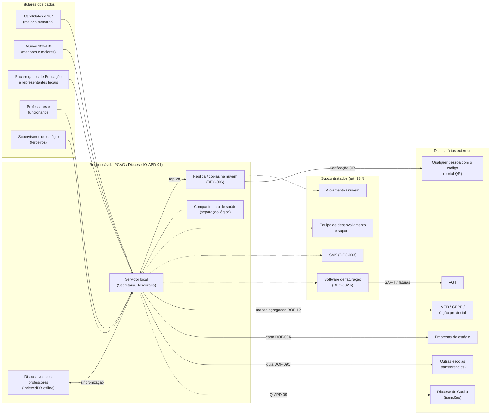
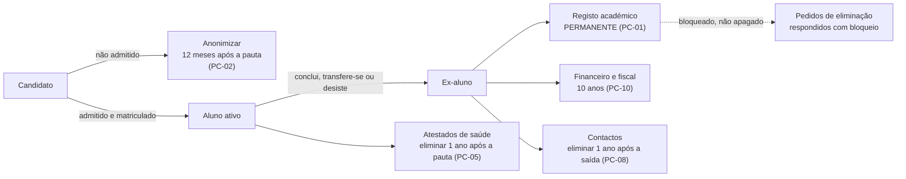
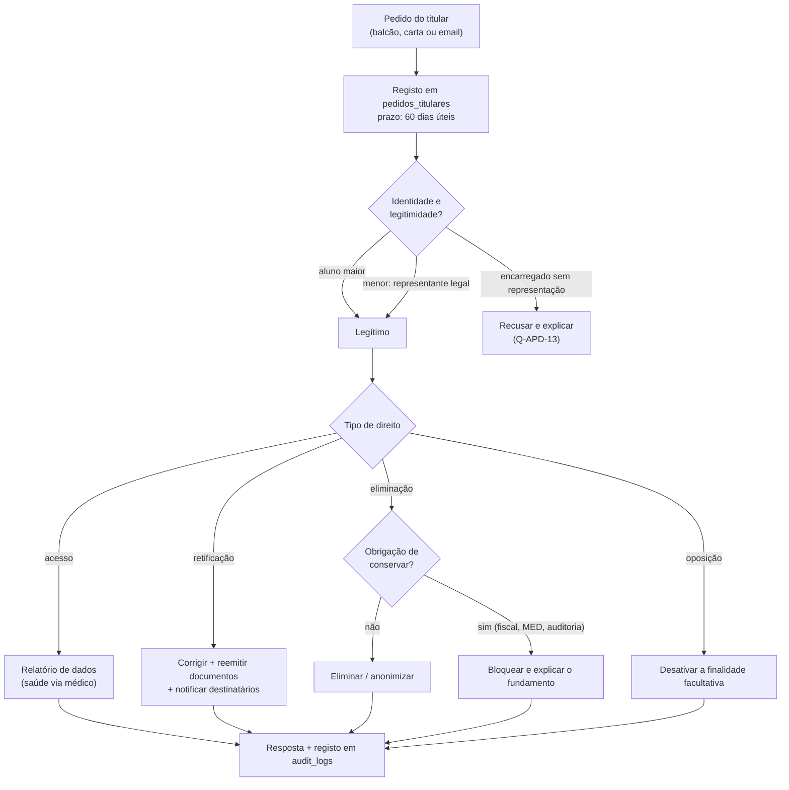
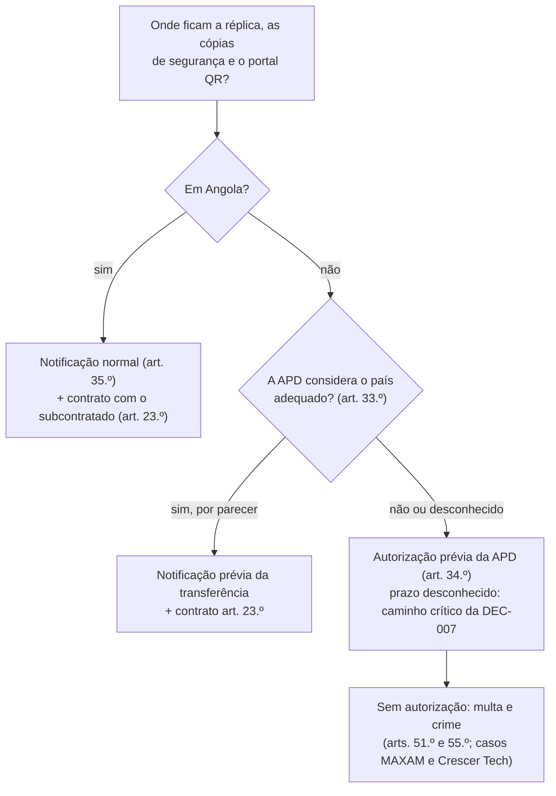

# Proteção de Dados Pessoais (APD) — SGE IPCAG N.º 12008 / BGO

> [!abstract] Navegação
> - **Painel Principal:** [[Inicio|Início do Vault]] | **Índice do Projeto:** [[00 - MOC SGE IPCAG 12008 BGO|MOC]] | **Plano:** [[00.1 - Plano de Engenharia de Requisitos]] (lacuna **L8**, capacidade **C19**)
> - **Decisões e questões:** [[12 - Registo de Decisoes e Questoes em Aberto]] (`DEC-003`, `DEC-006`, `Q-016`)
> - **Especificação (v1.2):** [[01 - Dominio e Regras]] → [[02 - Fluxos de Trabalho]] → [[03 - User Stories]] → [[04 - Telas e Documentos]] → [[05 - Modelagem de Dados]]
> - **Documentos reais da escola:** [[Achados dos Documentos Reais - Lote 1]] (DESC-L1 — A8, A11, A12, A15)
> - **Enquadramento:** [[Quadro Legal MED AGT e APD Angola]] | **Notas irmãs previstas:** [[08 - Requisitos Nao Funcionais]] · [[09 - Integracoes, Infraestrutura e Operacao]] · [[10 - Migracao de Dados e Implantacao]]

> [!important] Objetivo e estado deste documento
> Fecha a lacuna **L8** e a capacidade **C19** do [[00.1 - Plano de Engenharia de Requisitos|PLN-00]]: que dados pessoais o SGE trata, com que base legal, quem os vê, a quem são comunicados, quanto tempo se guardam, que direitos têm os titulares e o que a lei exige junto da **Agência de Protecção de Dados (APD)**.
> - É um **rascunho de engenharia de requisitos, não um parecer jurídico**. Tudo o que está marcado 🔶 **Inferido** ou `Q-APD-nn` tem de ser validado por jurista, pela Direção do IPCAG e, quando indicado, pela APD.
> - Os documentos oficiais impressos usam a numeração `DOF-01`…`DOF-12` da Parte 2 de [[04 - Telas e Documentos]]; `DOC-01`…`DOC-05` são as notas da especificação.
> - Os códigos de cargo (`DIR_GERAL`, `SUB_PED`, `SUB_ADM`…) são **papéis do sistema**. Os títulos reais na escola (Comissão de Gestão, Coordenador para a Área Pedagógica…) estão por confirmar (DESC-L1 A4).
> - Os requisitos aqui definidos são **provisórios** (`RF-P-APD-nn`, `RNF-P-APD-nn`) e passam para os catálogos `07`/`08` na Fase C. As questões usam `Q-APD-nn` para não colidir com a numeração `Q-nnn` do [[12 - Registo de Decisoes e Questoes em Aberto|REG-12]].

---

## 0. Síntese

> [!summary] Obrigações principais para o IPCAG (por confirmar com jurista e APD)
> 1. **Notificar a APD antes de tratar dados pessoais** — regra geral da Lei n.º 22/11 (art. 12.º n.º 1 b) e art. 35.º n.º 1). Abrange o SGE **e** os ficheiros em papel que já existem (art. 2.º). A notificação tem o conteúdo do art. 36.º, que este documento já prepara (§3 e §5).
> 2. **Pedir autorização prévia à APD** para os **dados de saúde** (campo "problema de saúde" do boletim real de matrícula, atestados das dispensas `DISP` e das justificações de faltas — art. 14.º), para qualquer **transferência de dados para país sem nível de proteção adequado** (art. 34.º) e, se se aplicar, para o registo de **propinas em atraso** como dado de crédito (art. 16.º — `Q-APD-16`).
> 3. **Informar os titulares no momento da recolha** (art. 25.º), em linguagem clara para menores, e recolher **consentimento escrito do aluno maior ou do representante legal** para os dados de saúde (art. 14.º).
> 4. **Segurança:** medidas técnicas e organizativas adequadas ao risco e um **documento de segurança** escrito (art. 30.º); medidas especiais e **separação lógica dos dados de saúde** (art. 31.º); **sigilo** de todos os utilizadores (art. 32.º); comunicação de incidentes à APD logo que conhecidos (Circular APD n.º 2/2024 — fonte secundária).
> 5. **Conservação limitada** (art. 11.º): eliminar ou anonimizar quando a finalidade termina. Os registos que certificam habilitações são de conservação permanente; os documentos fiscais seguem o Código Geral Tributário.
> 6. **Direitos dos titulares:** informação, acesso, retificação, atualização e eliminação **em 60 dias úteis**, oposição e não sujeição a decisões exclusivamente automáticas (arts. 25.º a 29.º). Quando a lei obriga a conservar (fiscal, MED), o dado é **bloqueado**, não apagado (art. 28.º, último número).
> 7. **Contrato escrito com cada subcontratado** (fornecedor de nuvem, equipa de desenvolvimento e suporte, SMS, software de faturação) e notificação à APD (art. 23.º).
> 8. **Sanções relevantes:** multas de USD 65.000 a 150.000, **triplicadas para pessoas coletivas** (art. 51.º); omitir um pedido de autorização é crime, com pena agravada para dados sensíveis (art. 55.º). A APD aplica estas multas na prática (§1.3 K).

> [!warning] Impacto na DEC-006 (Alojamento)
> Alojar fora de Angola a réplica na nuvem, as cópias de segurança ou o portal QR é uma **transferência internacional de dados**: exige **notificação** à APD se o país de destino tiver nível adequado reconhecido pela APD (art. 33.º) e **autorização prévia** caso contrário (art. 34.º). A APD já multou uma empresa por guardar dados numa *cloud* no exterior sem notificar nem pedir autorização (2026) e outra por transferência ilegal para o Reino Unido (2024). **Recomendação:** manter a opção (a) da DEC-006, mas exigir que a componente na nuvem fique **em Angola** ou, se ficar fora, que a autorização da APD seja obtida **antes do arranque** e entre no caminho crítico da DEC-007. Detalhe no §10.

> [!note] O que mudou com os documentos reais da escola (DESC-L1, versão 0.2)
> - **Matrícula (A12):** o boletim pede a **todos** os alunos um "**problema de saúde**", ou seja, um dado sensível recolhido em massa, que exige consentimento escrito e/ou autorização da APD (TRT-11, CON-07, RF-P-APD-29). Pede também a **ocupação ou local de trabalho do pai**, sem finalidade conhecida (TRT-32), e **dois telefones** do encarregado (PC-08).
> - **Declaração de estudante (A11):** imprime filiação, **estado civil**, BI, **residência** e outros dados para qualquer efeito. Propõe-se conteúdo por efeito (RF-P-APD-30) e verificação de quem a requer (TRT-33, RF-P-APD-31).
> - **Pessoal (A15):** a **avaliação de desempenho** é homologada pelo Gabinete Provincial e as declarações de serviço incluem o salário. São tratamentos de RH com destinatário externo (TRT-34, TRT-35).
> - **Boletins (A8):** registam **faltas por indisciplina** e **comportamento**, dados disciplinares a proteger (`Q-APD-32`).
> - O lote recebido inclui uma avaliação de desempenho **preenchida**, enviada por WhatsApp e guardada no vault: recomenda-se retirá-la (§3.9, §11).

---

## 1. Investigação Jurídica

### 1.1 Fontes consultadas (02/11/2026)

| Ref. | Fonte | Tipo | URL |
| :---: | :--- | :--- | :--- |
| **F1** | **Lei n.º 22/11, de 17 de Junho — Lei da Protecção de Dados Pessoais** (reprodução do DR, I Série, n.º 114) | Oficial (reprodução integral em lex.ao) | https://lex.ao/docs/assembleia-nacional/2011/lei-n-o-22-11-de-17-de-junho/ |
| F2 | Decreto Presidencial n.º 214/16, de 10 de Outubro — Estatuto Orgânico da APD (DR I Série n.º 171) | Oficial (lex.ao) | https://lex.ao/docs/presidente-da-republica/2016/decreto-presidencial-n-o-214-16-de-10-de-outubro/ |
| F3 | Lei n.º 25/12, de 22 de Agosto — Protecção e Desenvolvimento Integral da Criança | Oficial (lex.ao) | https://lex.ao/docs/assembleia-nacional/2012/lei-n-o-25-12-de-22-de-agosto/ |
| F4 | Constituição da República de Angola, art. 24.º (Maioridade) | Texto constitucional reproduzido em AngoLEX | https://angolex.com/paginas/leis/constituicao-da-republica-de-angola.html |
| F5 | Decreto Presidencial n.º 71/25, de 20 de Março — Regime Jurídico das Facturas | Oficial (lex.ao) | https://lex.ao/docs/presidente-da-republica/2025/decreto-presidencial-n-o-71-25-de-20-de-marco/ |
| F6 | Lei n.º 21/14, de 22 de Outubro — Código Geral Tributário | Oficial (lex.ao; versão publicada — alterações posteriores não verificadas) | https://lex.ao/docs/assembleia-nacional/2014/lei-n-o-21-14-de-22-de-outubro/ |
| F7 | PLMJ Colab / RVA Advogados, *Dados Pessoais e Ciber-segurança em Angola* (agosto 2024) | Secundária (escritório de advogados) | https://plmj.com/xms/files/03_Novidades_legislativas/2024/N_Colab_RVA-PLMJ_Dados_Pessoais_e_Ciber-seguranca_em_Angola.pdf |
| F8 | PLMJ, *APD Guidelines For Reporting Cybersecurity Accidents And Incidents* (dezembro 2024) — sobre a Circular APD n.º 2, de 25/10/2024 | Secundária | https://www.legal500.com/intelligence/portugal/privacy/apd-guidelines-for-reporting-cybersecurity-accidents-and-incidents |
| F9 | Ver Angola / Lusa, *Agência de Protecção de Dados multou duas empresas em mais de 600 mil dólares* (24/06/2026) | Secundária (imprensa) | https://www.verangola.net/va/pt/062026/Sociedade/49239/Agência-de-Protecção-de-Dados-multou-duas-empresas-em-mais-de-600-mil-dólares.htm |
| F10 | Expansão, *Taxas para tratamento e protecção de dados vão de 4 mil a 350 mil Kz* (23/03/2021) — sobre o DP n.º 60/21 | Secundária (imprensa) | https://expansao.co.ao/legislacao/interior/taxas-para-tratamento-e-proteccao-de-dados-vao-de-4-mil-a-350-mil-kz-101459.html |
| F11 | AngoLEX, *Proposta de Lei de Protecção de Dados Pessoais — versão 2025* | **Proposta, não vigente** | https://angolex.com/paginas/projecto-lei/proposta-de-lei-de-proteccao-de-dados-pessoais-versao-2025a.html |
| F12 | Afriwise, *New Cybersecurity Law* (15/10/2026) — sobre a Lei n.º 9/26 | Secundária, **não confirmada em fonte oficial** | https://www.afriwise.com/blog/new-cybersecurity-law |
| F13 | APD — formulários de tratamento de dados pessoais | Oficial — **sítio em manutenção na data da consulta** | https://apd.ao/ao/catalogo/formularios-apd/tratamento-de-dados-pessoais/ |

> [!caution] Limitações das fontes
> - A reprodução em linha da Lei n.º 22/11 (F1) **perde texto nas mudanças de página**. Ficaram ilegíveis: a epígrafe do art. 8.º; a alínea e) do art. 12.º n.º 2 (sabe-se que existe porque o art. 27.º remete para ela, e o fim legível fala dos "direitos, liberdades e garantias do titular"); o art. 18.º; a epígrafe e os primeiros números do art. 28.º (retificação, atualização e eliminação); a alínea i) do art. 34.º n.º 1 (um contrato cujas condições a APD define); as alíneas h) e i) do art. 36.º; o art. 48.º; o art. 59.º. **Confirmar no Diário da República impresso** (`Q-APD-25`).
> - O rodapé da reprodução diz "DR n.º 114 de **22** de Junho de 2011", enquanto o título diz "Lei n.º 22/11, de **17** de Junho". Usamos a designação oficial "de 17 de Junho".
> - O sítio da APD (F13) estava em manutenção: **não foi possível confirmar formulários, canais nem orientações setoriais** (educação).
> - F7–F12 são fontes secundárias. Usam-se só para a **prática** da APD e para a **evolução legislativa**, nunca como texto de lei.

### 1.2 Legenda

- ✅ **Confirmado na fonte** — lido no texto citado (artigo indicado).
- 🔶 **Inferido** — interpretação nossa para o SGE; **a confirmar** com jurista/APD.

### 1.3 Resultados por tema

#### A. Âmbito e responsável pelo tratamento

✅ **Confirmado na fonte**
- A lei aplica-se a tratamentos por meios total ou parcialmente automatizados **e a ficheiros manuais** (F1, art. 2.º), por qualquer entidade do sector público, privado ou cooperativo (art. 3.º n.º 1). O processo individual em papel também está abrangido.
- "Dados pessoais" incluem **imagem e som** e a identificação por **número de identificação** (art. 5.º b). Fotografias, BI e `N.º de Processo Individual` são dados pessoais.
- Responsável pelo tratamento é quem determina finalidades e meios (art. 5.º i); subcontratado é quem trata por conta do responsável ao abrigo de contrato (art. 5.º m).
- O sector privado e cooperativo segue a lei com exceção da Secção VIII (art. 42.º). No sector público, criar um ficheiro exige disposição legal com conteúdo mínimo (art. 40.º).

🔶 **Inferido**
- O responsável pelo tratamento é a entidade com personalidade jurídica que gere o IPCAG (o próprio Instituto ou a Diocese de Caxito) — `Q-APD-01`.
- Sendo uma escola católica comparticipada, o IPCAG deverá cair no sector privado/cooperativo (Secção IX). A comparticipação do Estado e a tutela do MED podem gerar dúvida — `Q-APD-02`. Os documentos reais reforçam a dúvida: cabeçalho do Gabinete Provincial da Educação sem referência à Diocese, direção por uma Comissão de Gestão e pessoal com n.º de agente (DESC-L1 A4, A14, A15).
- O fornecedor de nuvem ou de alojamento, a equipa que desenvolve e mantém o SGE, um eventual fornecedor de SMS (`DEC-003`) e um software de faturação externo (`DEC-002` (b)) são **subcontratados** (art. 23.º).

#### B. Notificação e autorização prévia

✅ **Confirmado na fonte**
- Salvo disposição legal em contrário, o tratamento exige **consentimento inequívoco e expresso** e **notificação à APD** (F1, art. 12.º n.º 1). O n.º 2 dispensa o **consentimento** quando o tratamento é necessário para executar um contrato, cumprir obrigação legal, proteger interesses vitais ou executar missão de interesse público. Esse n.º 2 não dispensa a notificação.
- Todo o tratamento está sujeito a **notificação prévia ou autorização** (art. 35.º n.º 1). A APD pronuncia-se sobre uma notificação em **30 dias**; findo o prazo, o tratamento considera-se notificado (n.º 2). A APD pode simplificar ou isentar categorias de tratamento (n.º 3–4). Se o tratamento decorrer de diploma legal, basta notificar (n.º 6).
- A notificação ou o pedido de autorização indica: responsável, finalidades, categorias de titulares e de dados, destinatários, subcontratado, interconexões, **tempo de conservação** e descrição das medidas de segurança (art. 36.º). Os tratamentos ficam num **registo público** da APD (art. 38.º).
- Os tratamentos que já existiam em 2011 tinham **2 anos** para ser notificados (art. 63.º).
- Exigem **autorização**: dados sensíveis sem base legal (art. 13.º), saúde (art. 14.º), crédito e solvabilidade (art. 16.º), interconexão sem base legal (art. 24.º) e transferência para país sem nível adequado (art. 34.º).
- O Estatuto da APD inclui nas receitas da Agência as **taxas pelo registo de ficheiros e pelas autorizações** (F2). Segundo F10, o **DP n.º 60/21, de 10 de Março** fixa essas taxas entre **4.315 e 350.450 Kz**; a tabela por tipo de ato não foi lida.
- A APD sancionou empresas por **não notificar** tratamentos de trabalhadores (MAXAM, 2024 — F7) e por **não notificar nem pedir autorização** para tratar dados de clientes (Fast Digital Center, 2026 — F9).

🔶 **Inferido**
- O SGE exige pelo menos **uma notificação** à APD antes da E1 e **um pedido de autorização** para o compartimento de saúde (TRT-15/16). Os ficheiros atuais do IPCAG (papel, folhas de cálculo) já deviam estar notificados — `Q-APD-03`.
- Não se sabe se a APD aceita uma notificação única para o SGE ou uma por finalidade ou ficheiro — `Q-APD-14`.
- O prazo de decisão de uma **autorização** não foi encontrado. Entra no caminho crítico da `DEC-007`.

#### C. Dados sensíveis, sobretudo de saúde (`DISP`, atestados)

✅ **Confirmado na fonte**
- São **dados sensíveis**: convicções filosóficas ou políticas, filiação partidária ou sindical, **fé religiosa**, **vida privada**, origem racial ou étnica, **saúde** e vida sexual, incluindo dados genéticos (F1, art. 5.º c).
- Dados sensíveis só com **disposição legal** ou **autorização da APD**. A autorização exige uma de várias condições, entre elas o consentimento **escrito** do titular ou do seu representante legal, ou a necessidade, por interesse público, para atribuições legais ou estatutárias do responsável (art. 13.º n.º 1). Se o tratamento decorrer da lei, notifica-se a APD (n.º 2). Exigem-se garantias de não discriminação e medidas especiais de segurança (n.º 3).
- **Saúde:** só com consentimento inequívoco, expresso e **escrito** do titular **ou do seu representante legal** "e/ou" **autorização da APD** (art. 14.º n.º 1). Sem consentimento, só para medicina preventiva, diagnóstico, assistência médica consentida, gestão de serviços de saúde, emergência médica ou interesse público (n.º 2).
- Os sistemas têm de garantir a **separação lógica** entre os dados de saúde e os restantes (art. 31.º n.º 2). O titular acede aos seus dados de saúde **por intermédio de médico** escolhido por ele ou pelo representante legítimo (art. 26.º, último número).
- O incumprimento dos arts. 14.º–17.º e 30.º–32.º é punido com multa de **USD 75.000 a 150.000** (art. 51.º n.º 1 a), triplicada para pessoas coletivas (n.º 2).

🔶 **Inferido**
- O **motivo clínico** e o **PDF do atestado** de `dispensas_medicas`, os **anexos médicos** das justificações de faltas, o **atestado médico** da lista de documentos da matrícula ([[04 - Telas e Documentos]] `MOD-PED-MAT`) e o campo "**problema de saúde**" do boletim real de matrícula (DESC-L1 A12) são **dados de saúde**. O último é o mais abrangente, porque é pedido a todos os alunos em cada matrícula.
- A escola não presta cuidados de saúde, logo as exceções do art. 14.º n.º 2 não se aplicam. A base é o **consentimento escrito** (do aluno maior ou do representante legal) e, por cautela, a **autorização da APD**, porque o "e/ou" do art. 14.º é ambíguo — `Q-APD-15`.
- A sigla `DISP` na pauta revela indiretamente uma condição de saúde, sem o motivo. Considera-se aceitável porque decorre da regra de avaliação (RN-01) — a validar.
- **Fé religiosa:** o SGE não deve registar religião, batismo ou outros sacramentos. A disciplina de Moral Cristã / Formação de Atitudes Integradas é currículo, não um dado do aluno.
- **Vida privada:** a lista da lei é ampla. Os comprovativos socioeconómicos das bolsas podem ficar abrangidos — `Q-APD-23`.

#### D. Dados de menores e consentimento do encarregado

✅ **Confirmado na fonte**
- A Lei n.º 22/11 **não fixa uma idade de consentimento**. Refere o **representante legal** no consentimento escrito para dados sensíveis e de saúde (arts. 13.º n.º 1 b) i) e 14.º n.º 1 a)) e quando o titular está incapaz de consentir (art. 12.º n.º 2 c)). A informação ao titular deve ser **clara, precisa e objetiva, em particular quando dirigida a menores** (art. 25.º n.º 4).
- **A maioridade adquire-se aos 18 anos** (F4, CRA art. 24.º).
- A Lei n.º 25/12 aplica-se **a toda a pessoa com menos de 18 anos** (F3, art. 2.º) e manda atender ao **superior interesse da criança** (art. 6.º). As **escolas** que disponibilizem informação à criança pela internet devem ter medidas tecnológicas de proteção, incluindo contra a **inadequada exposição, uso ou disseminação de informações relativas à criança** (art. 30.º n.º 2–3 d)).
- A proposta de lei de 2025 (F11, **não vigente**) prevê consentimento próprio a partir dos **16 anos**, abaixo disso pelos representantes legais (art. 16.º da proposta, segundo a versão do AngoLEX).

🔶 **Inferido**
- Da 10ª à 13ª Classe convivem **menores e maiores**: a faixa etária do GEPE usada no `DOF-12` vai de "< 15" a "> 20 anos". O SGE tem de saber, por aluno, se é menor; a data de nascimento já existe em `alunos`.
- Para menores, consente o **representante legal** (pai, mãe ou tutor). O "Encarregado de Educação" do DOC-01 §1.2 **pode não ser o representante legal** (ex.: tio ou irmão mais velho). O SGE tem de distinguir os dois (ALT-05-01) — `Q-APD-13`.
- Aos 18 anos o aluno passa a exercer os seus direitos e a dar os seus consentimentos. O encarregado continua parte no contrato financeiro, mas o seu acesso às notas de um aluno maior deixa de ter base automática — `Q-APD-22`.
- O art. 30.º da Lei n.º 25/12 reforça a **minimização** no portal QR e no futuro portal de encarregados (`DEC-003`).

#### E. Direitos dos titulares

✅ **Confirmado na fonte**
- Os dados devem ser conservados de forma a permitir os direitos de **acesso, informação, retificação, cancelamento e oposição** (F1, art. 6.º n.º 2).
- **Informação** (art. 25.º): identidade e endereço do responsável; finalidades; destinatários; carácter obrigatório ou facultativo da resposta e consequências de não responder; direitos e como exercê-los; outras informações necessárias. A informação é dada no momento da recolha ou, se os dados não vierem do titular, no prazo de 30 dias.
- **Acesso** (art. 26.º): livremente, sem restrições, demoras ou custos excessivos, incluindo os dados concretos e a sua origem.
- **Oposição** (art. 27.º): por razões ponderosas e legítimas, pelo menos nos tratamentos baseados no art. 12.º n.º 2 d) e e).
- **Retificação, atualização e eliminação** (art. 28.º, epígrafe ilegível na fonte): o responsável assegura-as **em 60 dias úteis**, notifica os destinatários a quem comunicou os dados e deve **bloquear e/ou conservar** os dados quando a lei ou uma autoridade o exigem, quando é necessário a interesse legítimo (exercício de direito ou cumprimento de obrigações legais), em investigação criminal ou enquanto a situação de crédito não estiver regularizada.
- **Decisões automatizadas** (art. 29.º): direito a não ficar sujeito a decisão com efeitos jurídicos tomada **exclusivamente** por tratamento automatizado que avalie aspetos da pessoa. É admitida, por exemplo, na execução de contrato com medidas que garantam os interesses legítimos do titular, como o direito de se exprimir.
- **Queixa** à APD e recurso aos tribunais (art. 47.º).

🔶 **Inferido**
- O "bloquear e/ou conservar" do art. 28.º é a base para manter recibos (AGT), pautas homologadas, registos de Livro/Folha/Termo e `audit_logs` apesar de um pedido de eliminação. O SGE tem de oferecer o **bloqueio** como alternativa à eliminação (§6).

#### F. Segurança e incidentes

✅ **Confirmado na fonte**
- Medidas técnicas e organizativas **adequadas ao risco e à natureza dos dados**, e um **documento** com as medidas, normas, procedimentos, níveis de segurança, recursos protegidos e funções e obrigações de quem acede (F1, art. 30.º).
- Para dados dos arts. 13.º–17.º e 20.º: controlo de acesso às instalações e aos suportes; impedir leitura, cópia, alteração ou remoção não autorizadas; garantir que só pessoas autorizadas acedem; **verificar a posteriori quais os dados introduzidos, quando e por quem**, "em prazo adequado à natureza do tratamento"; proteger a transmissão e o transporte (art. 31.º n.º 1). A APD pode exigir transmissão **cifrada** (n.º 3).
- **Sigilo profissional** de todos os que conhecem os dados, mesmo após o fim das funções (art. 32.º). **Acesso indevido** é crime, com prisão de 6 meses a 2 anos (art. 56.º); apagar ou modificar dados sem autorização é crime (art. 57.º).
- A Lei n.º 22/11 **não tem artigo sobre notificação de violações de dados** (leitura integral do texto disponível).
- A APD multou o BCH, a UNITEL e a COSAL (USD 75.000 cada) e a ENDE (USD 225.000) por **medidas de segurança inadequadas**, em dois casos após ataques de *ransomware* (F7, 2024).
- A **Circular APD n.º 2, de 25/10/2024**, pede que os incidentes de segurança com dados pessoais sejam comunicados à APD **logo que conhecidos**, com natureza, categorias e número aproximado de titulares, consequências prováveis e medidas tomadas (F8 — fonte secundária).

🔶 **Inferido**
- Segundo F12 (não confirmado em fonte oficial), a **Lei n.º 9/26, de 28 de Setembro** (cibersegurança) revoga a Lei n.º 7/17 e impõe obrigações a prestadores de **computação em nuvem** e **centros de dados**, entre elas informar os clientes sobre incidentes e manter planos de continuidade. O IPCAG provavelmente não é entidade abrangida, mas o fornecedor de nuvem pode ser — `Q-APD-24`.

#### G. Comunicação de dados, subcontratação e interconexão

✅ **Confirmado na fonte**
- Um destinatário que trata os dados para fins próprios é também **responsável** (F1, art. 21.º).
- A comunicação a outro responsável ou a terceiro exige consentimento e notificação, **salvo** se decorrer da lei, de contrato, de obrigação legal ou das condições dos arts. 12.º–20.º (art. 22.º).
- **Subcontratado:** contrato ou documento escrito que o obrigue a cumprir a lei e as instruções do responsável, mais notificação à APD. Por defeito, o subcontratado não comunica os dados a outros, cumpre as medidas de segurança e destrói ou devolve os dados no fim do contrato (art. 23.º).
- **Interconexão** de dados só com autorização da APD, salvo disposição legal (art. 24.º).

🔶 **Inferido**
- **MED / GEPE / órgão provincial da Educação:** obrigação legal (normas GEPE — L3). O `DOF-12` é agregado; a Fase B confirmará se também se enviam listas nominais (`Q-APD-12`).
- **AGT:** obrigação fiscal (DP n.º 71/25, CGT). O envio depende da `DEC-002` e da `Q-001` do REG-12.
- **Empresas de estágio:** execução do contrato e regime da 13ª Classe (DP n.º 167/23, por confirmar em L3).
- **Outras escolas** (transferências): pedido do titular e regras do MED.
- **Diocese de Caxito** (isenções diocesanas): base por definir (`Q-APD-09`).
- **Público** (portal QR): ver TRT-25.
- Uma futura ligação automática a sistemas do MED ou do banco (`DEC-005` (b)) é **interconexão** e precisa de autorização da APD, salvo base legal.

#### H. Transferência internacional (relevante para a DEC-006)

✅ **Confirmado na fonte**
- Para país com **nível de proteção adequado**: **notificação** à APD. A adequação é decidida pela APD, **por parecer, caso a caso**, atendendo à natureza dos dados, finalidade, duração, país de destino e regras lá em vigor (F1, art. 33.º).
- Para país **sem nível adequado**: **autorização** da APD, só com uma condição legal. Entre elas: consentimento escrito do titular, tratado internacional, contrato com o titular, interesse público importante, interesses vitais, fonte pública e um contrato cujas condições a APD define (alínea i, ilegível) (art. 34.º).
- A APD "aprecia e pronuncia-se sobre a transferência internacional de dados pessoais" (F2, Estatuto, art. 5.º g)).
- **MAXAM** multada em **USD 150.000** por transferência ilegal de dados para o Reino Unido e por não notificar tratamentos de trabalhadores (F7, 2024).
- **Crescer Tech** condenada por não notificar a APD nem obter autorização para a transferência internacional de dados de clientes, através do **envio e armazenamento numa *cloud* localizada no exterior do país**; multa de cerca de USD 505.000 (F9, junho de 2026).

🔶 **Inferido**
- Alojar fora de Angola a base de dados, a réplica, as cópias de segurança, o portal QR ou qualquer serviço SaaS com dados de alunos (correio, SMS, armazenamento de ficheiros) é **transferência internacional**.
- O **acesso remoto** de suporte técnico a partir do estrangeiro provavelmente também conta — `Q-APD-19`.
- Não foi encontrada uma lista pública de países considerados adequados pela APD.
- O consentimento escrito (art. 34.º a) **não serve** como base prática: seria preciso obtê-lo de cerca de 1.120 alunos ou representantes, e é revogável.

#### I. Prazos de conservação

✅ **Confirmado na fonte**
- Conservação identificável **só pelo período necessário** à finalidade; depois, **eliminar ou anonimizar** (F1, art. 11.º n.º 1). A APD pode autorizar prazo superior para fins históricos e estatísticos (n.º 2). O tratamento posterior para fins históricos ou estatísticos é admitido com **anonimização** (art. 9.º n.º 2 b)).
- **Fiscal:** quem exerce atividade no país deve conservar os documentos e registos das operações dos **últimos 5 anos**. A caducidade da liquidação é de 5 anos, alargada a **10 anos** em caso de infração (F6, CGT art. 62.º); a prescrição é de **10 anos** (art. 63.º).
- O DP n.º 71/25 manda arquivar faturas e documentos fiscalmente relevantes (incluindo **recibos**) **nos prazos do CGT** (F5, art. 26.º). O arquivo eletrónico tem de garantir integridade, deteção de alterações, recuperação após incidente e cópias legíveis (art. 27.º).

🔶 **Inferido**
- Não encontrámos **norma do MED** sobre a conservação de processos individuais, livros de termos, mini-pautas, pautas ou provas — `Q-APD-08`.
- Os registos que **certificam habilitações** servem para emitir certificados e segundas vias a qualquer momento da vida do titular, por isso a finalidade justifica a **conservação permanente**.
- O "trilho de auditoria perpétuo" do DOC-05 §3.6 vai além do que o art. 31.º pede ("em prazo adequado") e choca com o art. 11.º — `Q-APD-20` e §5.

#### J. Riscos específicos: crédito, atividades ilícitas e decisões automáticas

✅ **Confirmado na fonte**
- **Crédito e solvabilidade** (F1, art. 16.º): tratamento só com consentimento e autorização da APD. Os dados sobre o cumprimento ou incumprimento de obrigações perante o responsável exigem **notificar o titular em 60 dias** de que consta do ficheiro de devedores **e** autorização da APD (n.º 2).
- Dados sobre **suspeitas de atividades ilícitas** são sensíveis e **só podem ser tratados por autoridade pública** (art. 15.º).
- **Decisões automatizadas:** art. 29.º (tema E).

🔶 **Inferido — riscos no desenho atual**
- A `conta_corrente_propinas` (estado `EM_ATRASO_COM_MULTA`) e o **semáforo financeiro** (RN-08) podem ser lidos como "ficheiro de devedores" do art. 16.º — `Q-APD-16`.
- O estado `INVALIDADO_POR_FRAUDE` do borderô e o evento `TENTATIVA_FRAUDE_BORDERO` em `audit_logs` podem, se ligados a um encarregado, constituir dados sobre suspeita de atividade ilícita (art. 15.º) — `Q-APD-17`. Proposta: qualificar **o documento bancário**, nunca a pessoa (RF-P-APD-25).
- O motor de deliberação anual (transição, `RF`, veto LP + nuclear — RN-02/RN-03) e o **bloqueio automático** de documentos pelo semáforo (RN-08) produzem efeitos jurídicos. O art. 29.º cita expressamente o "crédito" da pessoa. Proposta: manter **homologação humana** e um **desbloqueio pontual com motivo** (RF-P-APD-21).

#### K. Sanções e prática da APD

| Infração (Lei n.º 22/11) | Sanção | Artigo |
| :--- | :--- | :--- |
| Incumprir os arts. 14.º–17.º, 20.º e 30.º–32.º (saúde, crédito, segurança, sigilo); notificar com negligência ou com informação falsa | Multa de **USD 75.000 a 150.000** (equivalente em kwanzas) | 51.º n.º 1 a) |
| Violar os princípios dos arts. 6.º–11.º; não obter consentimento quando exigido; incumprir os arts. 18.º, 19.º e 21.º–24.º | Multa de **USD 65.000 a 130.000** | 51.º n.º 1 b) |
| Pessoas coletivas | Limites **triplicados** | 51.º n.º 2 |
| Omitir o pedido de autorização; informação falsa; interconexão ilegal | Prisão de 3 a 18 meses ou multa; **dobro** para dados dos arts. 13.º–16.º | 55.º |
| Acesso indevido | Prisão de 6 meses a 2 anos ou multa (depende de queixa) | 56.º |
| Apagar ou modificar dados sem autorização | Prisão de 18 meses a 3 anos ou multa | 57.º |

Na prática, a APD está ativa: Estatuto aprovado em 2016 (F2), sanções publicadas em 2024 (F7) e 2026 (F9), e orientações sobre incidentes (F8).

#### L. Evolução legislativa a acompanhar

- ✅ O **DP n.º 292/18** (Regime Jurídico das Faturas e Documentos Equivalentes), citado na RN-09, no `DEC-002` e no [[Quadro Legal MED AGT e APD Angola]], foi **revogado pelo DP n.º 71/25, de 20 de Março** (F5, art. 40.º), que entra em vigor 6 meses após a publicação (art. 42.º). A sessão de verificação legal (L3) deve tratar disto.
- 🔶 **Proposta de nova lei de proteção de dados (2025)** (F11), segundo a versão no AngoLEX: consentimento próprio aos 16 anos; encarregado de proteção de dados obrigatório em certos casos; notificação de violações à APD em 72 horas; avaliação de impacto; manutenção do controlo prévio pela APD. **Não é lei.** Usa-se só para preparar o desenho para o que vier.
- 🔶 **Lei n.º 9/26** (cibersegurança), revogando a Lei n.º 7/17 — apenas fonte secundária (F12) — `Q-APD-24`.

---

## 2. Papéis e Fluxos de Dados

Se `HOS` (ou `NUV`) ficar fora de Angola, a seta para a nuvem é uma **transferência internacional** (§1.3 H).

---

## 3. Inventário de Tratamentos

### 3.0 Bases legais usadas (Lei n.º 22/11)

| Código | Base | Artigo | Nota |
| :---: | :--- | :--- | :--- |
| **CTR** | Execução de contrato em que o titular é parte, ou diligências prévias a seu pedido | 12.º n.º 2 a) | Contrato de prestação de serviço educativo (com o encarregado/representante ou com o aluno maior) ou contrato de trabalho |
| **OL** | Cumprimento de obrigação legal do responsável | 12.º n.º 2 b) | Exige identificar a norma; normas do MED ainda por confirmar em L3 |
| **IP** | Missão de interesse público | 12.º n.º 2 d) | 🔶 Aplicabilidade a uma escola comparticipada por confirmar (`Q-APD-02`) |
| **IL** | Alínea e) do art. 12.º n.º 2 (ilegível na fonte; ponderada com os direitos do titular) | 12.º n.º 2 e) | 🔶 Só usar depois de confirmado o texto (`Q-APD-25`) |
| **CONS** | Consentimento inequívoco e expresso | 12.º n.º 1 a), 5.º a) | Para finalidades facultativas |
| **SAU** | Consentimento **escrito** do titular ou do representante legal e/ou autorização da APD | 14.º | Dados de saúde |
| **SEG** | Dever de segurança do responsável | 30.º, 31.º | Logs, auditoria, cópias de segurança |

**Coluna "APD":** **N** = incluir na notificação (art. 35.º); **A** = autorização prévia necessária; **A?** = autorização se se confirmar a questão indicada.

### 3.1 Grupo 01 — Governação, Calendário e Estrutura Académica

| ID | Tratamento e finalidade | Tabelas / documentos | Dados e titulares | Base legal | Quem acede (RBAC) | Destinatários externos | APD |
| :---: | :--- | :--- | :--- | :--- | :--- | :--- | :---: |
| **TRT-01** | Organização do ano letivo: calendário, cursos, matrizes, salas, turmas e quem as dirige ou homologa | `anos_letivos`, `trimestres_letivos`, `salas_fisicas`, `cursos_tecnicos`, `quadros_vagas_admissao`, `disciplinas`, `matrizes_curriculares`, `matriz_disciplinas`, `turmas`, `turma_disciplinas` | Só dados residuais de **funcionários**: coordenador de curso e de disciplina, Director de Turma, autor de homologações e despachos | CTR (trabalho); OL (DP n.º 93/21 — cargos) | Leitura geral (DOC-01 §2.2, linhas 1–3); escrita `SUB_PED`, `CHEFE_SEC_PED` | MED (estrutura, sem dados pessoais) | N |

### 3.2 Grupo 02 — Utilizadores, Cargos, Alocação Docente e RH

| ID | Tratamento e finalidade | Tabelas / documentos | Dados e titulares | Base legal | Quem acede (RBAC) | Destinatários externos | APD |
| :---: | :--- | :--- | :--- | :--- | :--- | :--- | :---: |
| **TRT-02** | Contas e autenticação: controlo de acesso por cargo | `usuarios_sistema` | Nome de utilizador ou email institucional, *hash* da palavra-passe, cargo, estado — **funcionários** | CTR; SEG | Gestão de contas **não definida** (C14) — `Q-APD-04` | — | N |
| **TRT-03** | Cadastro de pessoal: gestão da relação de trabalho | `funcionarios_docentes`; `MOD-GER-RH` | N.º de agente, nome, **BI**, telefone, categoria, vínculo (Estado MED vs. Diocese) — **funcionários** | CTR; OL (legislação laboral — por identificar) | `SUB_ADM`, `CHEFE_SEC_GER` (escrita); `DIR_GERAL`; `SUB_PED` e `CHEFE_SEC_PED` (docentes); `COORD_*` (âmbito); `PROF` (o próprio) — linha 24 | 🔶 MED (professores do quadro) e Diocese (comparticipados) — `Q-APD-12` | N |
| **TRT-04** | Distribuição de serviço docente, dosificação e júris | `alocacoes_docentes`, `dosificacoes_trimestrais`; papéis de tutor, orientador e júri em `processos_13_classe` | Identificação do professor, períodos de regência, motivo de substituição — **funcionários** | CTR | DOC-01 linhas 3, 9 e 16 | — | N |
| **TRT-05** | Assiduidade do pessoal (ponto) | `assiduidade_funcionarios` | Data, turno, horas, estado (falta justificada/injustificada) — **funcionários**. A tabela **não guarda motivos clínicos** e assim deve continuar | CTR | `CHEFE_SEC_GER`; `COORD_TURNO` (o seu turno); `SUB_ADM`; `DIR_GERAL`; `PROF` (o próprio) | 🔶 MED/Diocese (efetividade) — `Q-APD-12` | N |

### 3.3 Grupo 03 — Admissão, Alunos, Matrículas e Histórico Externo

| ID | Tratamento e finalidade | Tabelas / documentos | Dados e titulares | Base legal | Quem acede (RBAC) | Destinatários externos | APD |
| :---: | :--- | :--- | :--- | :--- | :--- | :--- | :---: |
| **TRT-06** | Inscrição no Teste de Seleção à 10ª Classe | `candidaturas_10a`, `encarregados_educacao` (inscrevente); `DOF-01` | Nome, **BI/cédula**, género, data de nascimento, escola e média da 9ª, 1ª e 2ª opções, sala, recibo da taxa — **candidatos (maioria menores)** e **encarregados** | CTR (diligências pré-contratuais a pedido); OL (DE n.º 361/26 — L3) | `OP_PED`, `CHEFE_SEC_PED` (escrita); `SUB_PED`, `DIR_GERAL`; `SUB_ADM` e `CHEFE_SEC_GER` (leitura); `OP_TES` (só taxa); `COORD_*` (âmbito) — linha 4 | 🔶 Nenhum identificado — `Q-APD-12` | N |
| **TRT-07** | Correção anónima e apuramento | `codigos_anonimato`, `quadros_vagas_admissao` | Código de anonimato, notas de LP e Mat./Específica, `MFA` — **candidatos**. **Pseudonimização** já desenhada | Igual a TRT-06 | Lançamento cego: `CHEFE_SEC_PED`, `SUB_PED`; descodificação: `SUB_PED` + `DIR_GERAL` | — | N |
| **TRT-08** | **Publicação da pauta de admissão** | `DOF-02` | Nome, género, **idade**, **média da 9ª**, notas por prova, `MFA` e resultado de **todos** os candidatos, incluindo **não admitidos** | OL se o DE n.º 361/26 exigir a publicação; senão IP/IL (transparência do concurso) — `Q-APD-07` | Emissão: `SUB_PED`, `DIR_GERAL` | **Público** (afixação; eventual internet) | N |
| **TRT-09** | Conservação dos candidatos **não admitidos** (reclamações, recursos, estatística) | `candidaturas_10a`, `codigos_anonimato` (não convertidos) | Como TRT-06/07 — **candidatos não admitidos** e encarregados sem outro vínculo | OL / IL até ao fim do prazo de reclamação; depois **anonimizar** (art. 11.º) — PC-02 | `CHEFE_SEC_PED`, `SUB_PED`, `DIR_GERAL` | — | N |
| **TRT-10** | Matrícula, confirmação e **processo individual** do aluno | `alunos`, `matriculas_anuais`; `DOF-03`; lista de documentos de `MOD-PED-MAT` | N.º de processo, nome, **filiação**, naturalidade, data de nascimento, género, **BI/cédula**, turma, n.º de ordem, estado, deliberação, documentos entregues — **alunos** e **pais** (filiação). O **boletim real** (DESC-L1 A12) pede ainda data de emissão do BI, **residência e município**, escola, classe, ano e resultado anteriores e, na confirmação, turma e sala do ano anterior e até duas cadeiras em atraso; a numeração é anual e há um **comprovativo destacável** | CTR (contrato de serviço educativo); OL (registos escolares do MED — norma por identificar, `Q-APD-08`) | DOC-01 linhas 5–6: `CHEFE_SEC_PED`, `OP_PED` (escrita); `SUB_PED`, `DIR_GERAL`; `SUB_ADM`, `CHEFE_SEC_GER` (leitura); `OP_TES` (básico); `COORD_CURSO`, `COORD_TURNO`, `DIR_TURMA` (âmbito); `PROF` (lista de chamada) | MED/GEPE (agregado, TRT-28); outras escolas (TRT-24, `DOF-09C`) | N |
| **TRT-11** | **Informação de saúde recolhida na matrícula** | Campo "**problema de saúde**" do boletim real de matrícula e de confirmação (DESC-L1 A12; `DOF-03`); atestado médico da lista `documentos_entregues_checklist` de `MOD-PED-MAT` | **Dado de saúde** de **todos os alunos** que se matriculam, com o campo preenchido pelo encarregado ou pelo aluno | **SAU** (art. 14.º): consentimento **escrito** do aluno maior ou do representante legal, com finalidade declarada (CON-02, CON-07), e/ou autorização da APD. Finalidade por esclarecer (`Q-APD-05`, `Q-APD-28`). Proposta: campo **facultativo**, renovado em cada confirmação (RF-P-APD-29); atestado só "entregue sim/não" (RF-P-APD-07) | Como TRT-15 (compartimento de saúde). Um **alerta de emergência** resumido pode ser visível a `DIR_TURMA` e `COORD_TURNO`, só com consentimento (RF-P-APD-29) | — | **A** |
| **TRT-12** | **Fotografias** do aluno para identificação (processo, cartão de estudante) | Lista de documentos (`MOD-PED-MAT`); futuro cartão (C03) | Imagem (art. 5.º b) — **alunos** | CTR (identificação). Qualquer outro uso (sítio, redes sociais, eventos) só com **CONS** (CON-03) | Secretaria Pedagógica | — (divulgação só com CON-03) | N |
| **TRT-13** | Cadastro dos **Encarregados de Educação** (responsabilidade pelo aluno e pelos pagamentos; descontos de irmãos) | `encarregados_educacao` | Nome, **BI/NIF**, parentesco, telefones, morada, "é funcionário do IPCAG" — **encarregados** | CTR (parte no contrato e nos pagamentos) | Como TRT-10; Tesouraria (linhas 20–21) para borderôs e recibos | 🔶 AGT, se for o adquirente no recibo (`Q-003` do REG-12) | N |
| **TRT-14** | Transcrição de histórico externo (alunos transferidos) | `historico_externo_transcricoes` | Escola de origem, guia/certificado (**PDF**), médias por disciplina — **alunos** | OL (equivalências, RN-06 — L3); CTR | `CHEFE_SEC_PED`, `OP_PED` (escrita); `SUB_PED` (homologação); `DIR_GERAL`; `COORD_CURSO`, `DIR_TURMA` (âmbito) — linha 7 | Origem: outra escola, via o aluno | N |

### 3.4 Grupo 04 — Vida Pedagógica, Pautas, Faltas, Cadeiras em Atraso e 13ª Classe

| ID | Tratamento e finalidade | Tabelas / documentos | Dados e titulares | Base legal | Quem acede (RBAC) | Destinatários externos | APD |
| :---: | :--- | :--- | :--- | :--- | :--- | :--- | :---: |
| **TRT-15** | **Dispensas médicas (`DISP`)** | `dispensas_medicas`; `MOD-DOC-FAL` | **Motivo clínico / junta médica**, **PDF do atestado**, abrangência, homologação — **alunos**. **Dado sensível (saúde)** | **SAU** (art. 14.º) + medidas especiais e separação lógica (art. 31.º) — `Q-APD-15` | **Hoje** (DOC-01 linha 8): `R*` também a `COORD_CURSO`, `COORD_DISC`, `COORD_TURNO`, `DIR_TURMA` e `PROF` — **demasiado largo**. **Proposta** (alinhada com a RNF-PRV-03 do [[08 - Requisitos Nao Funcionais\|08]]): motivo e atestado só para `CHEFE_SEC_PED` e `SUB_PED`; `OP_PED` regista o pedido e carrega o atestado, sem o poder reabrir; os restantes, incluindo `DIR_GERAL`, veem apenas `DISP` e a abrangência (RF-P-APD-05) | — (a pauta mostra só `DISP`) | **A** |
| **TRT-16** | Sumários, faltas e **justificação de faltas** | `sumarios_e_faltas_alunos` | Data, tempos, sumário, quem registou, justificação (**motivo + anexo**) — **alunos**, **professores**. Sensível quando o motivo ou o anexo é clínico. O **formulário real** de justificação é numerado, preenchido pelo aluno ou pelo encarregado (intervalo de dias, motivo, documentos anexos, professores e disciplinas afetados) e assinado pelo Director de Turma **e** pelo Coordenador para a Área Pedagógica (DESC-L1 A8) | OL (RN-03 — limites do MED, L3); CTR. Anexos clínicos: **SAU** | DOC-01 linhas 11–12: `PROF` (regista), `DIR_TURMA` (justifica), `SUB_PED`, `CHEFE_SEC_PED`, `COORD_TURNO`, `COORD_CURSO` (âmbito) | Encarregados (boletim `DOF-06`) | N (A para anexos clínicos) |
| **TRT-17** | **Avaliação e pautas** | `avaliacoes_trimestrais`, `resultados_anuais_disciplina`, `reaberturas_pauta_direcao`, `turma_disciplinas`; `DOF-04`, `DOF-05`, `DOF-06` | `MAC`, `NPP`, `NPT`, `MT`, `MFD`, recurso, `CFD`, faltas, situação, deliberação, despachos de reabertura — **alunos**, **professores** (autoria). Os boletins reais registam também **faltas por indisciplina**, faltas por não comparência e **comportamento** (DESC-L1 A8): dados disciplinares, ligados à C13 (`Q-APD-32`). As fórmulas reais (`PG`, `CA` — DESC-L1 A1) não mudam a análise de proteção de dados | OL (Lei n.º 32/20, DP n.º 167/23 — L3); CTR | DOC-01 linhas 10, 13 e 14; Tesouraria **sem acesso** (bom) | Encarregados (`DOF-06`); 🔶 MED (pautas homologadas?) e **afixação pública** — `Q-APD-07`, `Q-APD-12` | N |
| **TRT-18** | **Deliberação automática** (transição, `RF`, veto LP + nuclear, aptidão para a 13ª) | Motor de RN-02/RN-03 sobre TRT-17 | Proposta de decisão com efeitos jurídicos — **alunos** | OL + **intervenção humana** (art. 29.º): homologação pelo Conselho de Notas, `SUB_PED` e `DIR_GERAL` | `DIR_TURMA`, `SUB_PED`, `DIR_GERAL` | — | N |
| **TRT-19** | Cadeiras em atraso e exames extraordinários | `cadeiras_em_atraso`, `exames_extraordinarios`; `DOF-07` | Disciplina, nota de origem, inscrição, nota do exame, Livro/Folha/Termo — **alunos** | OL (RN-02, RN-10); CTR | DOC-01 linha 15 | — | N |
| **TRT-20** | **13ª Classe:** estágio e PAP | `processos_13_classe`, `empresas_parceiras`; `DOF-08A`, `DOF-08B` | Empresa, **supervisor externo** (nome), tutor, orientador, júri, notas de estágio e PAP, `MFC` — **alunos**, **professores**, **supervisores (terceiros)** | OL (DP n.º 167/23 — L3); CTR | DOC-01 linha 16: `COORD_CURSO` (gestão), `PROF` (orientador/júri), Secretaria Pedagógica, `SUB_PED`, `DIR_GERAL`; `OP_TES` (só taxa) | **Empresa parceira**: carta `DOF-08A` com nome, **BI**, n.º de processo e curso (art. 22.º n.º 2) — `Q-APD-18` | N |

### 3.5 Grupo 05 — Tesouraria, Bolsas, Recibos e Fecho de Caixa

| ID | Tratamento e finalidade | Tabelas / documentos | Dados e titulares | Base legal | Quem acede (RBAC) | Destinatários externos | APD |
| :---: | :--- | :--- | :--- | :--- | :--- | :--- | :---: |
| **TRT-21** | **Bolsas, isenções e descontos** | `beneficios_bolsas_matricula` (`tabelas_precos_emolumentos` não tem dados pessoais) | Tipo de benefício, percentagem, vigência, despacho, **ficheiro comprovativo**; `DESCONTO_IRMAOS` e `FILHO_FUNCIONARIO` revelam relações familiares e laborais — **alunos**, **encarregados**, **funcionários**. Comprovativos socioeconómicos podem ser "**vida privada**" | CTR (pedido do encarregado); para comprovativos socioeconómicos, **CONS** escrito ou autorização — `Q-APD-23` | **Hoje** (DOC-01 linha 19): leitura também a `OP_PED`, `CHEFE_SEC_PED`, `SUB_PED`, `CHEFE_SEC_GER` e `OP_TES`. **Proposta:** comprovativo só para `SUB_ADM` e `DIR_GERAL`; os restantes veem tipo e percentagem | 🔶 **Diocese de Caxito** (isenções diocesanas) — `Q-APD-09` | N (A? `Q-APD-23`) |
| **TRT-22** | **Conta corrente, propinas, multas e semáforo financeiro** | `conta_corrente_propinas`, `itens_recibo` | Prestações, valores, multas, estado, atraso — **alunos**, **encarregados** | CTR; OL (fiscal). 🔶 Art. 16.º (crédito) — `Q-APD-16`. O semáforo é decisão automatizada (art. 29.º) | Tesouraria (linhas 20–21); Secretaria Pedagógica vê **apenas Verde/Vermelho** (minimização já desenhada) | — | N (A? `Q-APD-16`) |
| **TRT-23** | **Borderôs, recibos, notas de estorno e fecho de caixa** | `bancos_angola`, `borderos_bancarios`, `alocacoes_saldo_bordero`, `recibos_oficiais`, `notas_estorno`, `sessoes_fecho_caixa`; `DOF-11A`, `DOF-11B`, `DOF-11C` | Aluno (n.º de processo, nome), encarregado (**nome, BI/NIF**), operação bancária, valores, operador, código de verificação — **alunos**, **encarregados**, **operadores** | OL (DP n.º 71/25; CGT); CTR. Estado `INVALIDADO_POR_FRAUDE` — `Q-APD-17` | DOC-01 linhas 20–23: `OP_TES`, `CHEFE_SEC_GER`, `SUB_ADM`, `DIR_GERAL` | **AGT** (SAF-T / fatura eletrónica, se aplicável — `DEC-002`, `Q-001`); **software de faturação** (subcontratado, se `DEC-002` (b)); 🔶 **bancos** só se houver confirmação de operações — `Q-APD-12` | N |

### 3.6 Grupo 06 — Emissão Documental, Auditoria e Sincronização *Offline-First*

| ID | Tratamento e finalidade | Tabelas / documentos | Dados e titulares | Base legal | Quem acede (RBAC) | Destinatários externos | APD |
| :---: | :--- | :--- | :--- | :--- | :--- | :--- | :---: |
| **TRT-24** | **Emissão de documentos oficiais** e Livro/Folha/Termo | `documentos_oficiais_emitidos`; `DOF-06`, `DOF-07`, `DOF-08`, `DOF-09`, `DOF-10` | Resumo congelado dos dados impressos (nome, filiação, BI, naturalidade, notas, `MFC`), Livro/Folha/Termo, signatários — **alunos**, **funcionários** (signatários). A **declaração de estudante real** (DESC-L1 A11) imprime filiação, **estado civil**, idade, naturalidade, BI e data de emissão, **residência**, classe, turma, sala, período, curso e o efeito, para **qualquer** efeito pedido (`Q-APD-30`; RF-P-APD-30). O pedido é feito por requerimento numerado (TRT-33) | OL (certificação do MED — RN-10); pedido do titular | DOC-01 linha 17: `CHEFE_SEC_PED`, `OP_PED`, `SUB_PED`, `DIR_GERAL`; `COORD_CURSO`, `DIR_TURMA` (âmbito / boletim) | O titular, que entrega o documento a quem quiser; outras escolas (`DOF-09C`) | N |
| **TRT-25** | **Portal público de verificação por QR** | `MOD-PUB-QR` (`US-DOC-03`) sobre `documentos_oficiais_emitidos` e `recibos_oficiais` | Hoje mostra a **qualquer pessoa com o código**: tipo, número, **nome do titular**, **n.º de processo**, curso/classe, **classificação final/`MFC`**, Livro/Folha/Termo, data e hora, **nomes dos signatários**. Para recibos (`DOF-11A`) o DOC-04 não diferencia — **alunos, ex-alunos, encarregados, funcionários** | 🔶 **Finalidade compatível**: o titular entrega o documento a um terceiro para que o confirme. Base a confirmar (IL ou consentimento implícito na entrega) — `Q-APD-18`. Limitar ao que está impresso (RF-P-APD-16) | Sem autenticação; *rate limiting* | **Terceiros indeterminados** (MED, universidades, empregadores) | N |
| **TRT-26** | **Trilho de auditoria** | `audit_logs`; consola `MOD-GOV-05` | Utilizador, cargo, **IP e dispositivo**, ação, despacho, motivo, **valor antigo e novo completos** (podem conter dados de alunos, incluindo **saúde** e bolsas) — **funcionários** (autores), **alunos e encarregados** (conteúdo) | SEG (art. 31.º n.º 1 g) — verificação a posteriori "em prazo adequado"); OL fiscal para eventos financeiros | `DIR_GERAL` (completo), `SUB_PED` (pedagógico), `SUB_ADM` (financeiro) — linha 26 | — | N |
| **TRT-27** | **Sincronização *offline*** de notas e faltas | `operacoes_sincronizacao`, `conflitos_sincronizacao`; **IndexedDB** nos dispositivos dos professores | Conteúdo completo das operações (notas, faltas), lista congelada de alunos guardada localmente, identificador do dispositivo, hora local — **alunos**, **professores** | Igual a TRT-16/17 (mesma finalidade); SEG | `PROF` (as suas operações), `DIR_TURMA` (conflitos da turma), `SUB_PED`, `DIR_GERAL` (DOC-05 §5, linha 9) | — | N |
| **TRT-28** | **Mapas estatísticos** GEPE/MED | `DOF-12` (`MOD-GOV-05`) | Contagens por curso, classe, turno, género e faixa etária. **Agregados** — deixam de ser dados pessoais se não permitirem identificar ninguém (art. 5.º b) | OL (normas GEPE — L3); art. 9.º n.º 2 b) (estatística com anonimização) | `DIR_GERAL`, `SUB_PED`, `SUB_ADM`, `CHEFE_SEC_PED` (linha 25) | **GEPE/MED**, órgão provincial da Educação (`Q-018` do REG-12) | N 🔶 (se não houver listas nominais) |

### 3.7 Tratamentos transversais (sem tabela própria no DOC-05)

| ID | Tratamento e finalidade | Dados e titulares | Base legal | Quem acede | Destinatários / subcontratados | APD |
| :---: | :--- | :--- | :--- | :--- | :--- | :---: |
| **TRT-29** | **Cópias de segurança e réplica** (`DEC-006`, C18) | Todas as categorias, incluindo saúde | SEG (art. 30.º) | Operação técnica (C18 — a definir) | **Fornecedor de alojamento/nuvem** (art. 23.º); **transferência internacional** se fora de Angola (arts. 33.º–34.º) | N + **A** se país sem nível adequado |
| **TRT-30** | **Desenvolvimento, suporte e migração** (C17, C18) | Acesso técnico a dados reais; dados importados de papel e folhas de cálculo | SEG; CTR com o fornecedor | Equipa técnica, com contrato | **Subcontratado** (art. 23.º); acesso remoto do estrangeiro — `Q-APD-19` | N |
| **TRT-31** | **Comunicação com encarregados e alunos** (C12 — futuro; `DEC-003`) | Contactos, avisos, eventualmente notas, faltas e dívidas | CTR (avisos essenciais); CONS (facultativos — CON-05) | A definir na C12 | **Fornecedor de SMS** (subcontratado) | N |

### 3.8 Cobertura das 44 tabelas do DOC-05

| Grupo DOC-05 | Tabelas | Tratamentos |
| :--- | :--- | :--- |
| 01 — Estrutura académica (10) | `anos_letivos`, `trimestres_letivos`, `salas_fisicas`, `cursos_tecnicos`, `quadros_vagas_admissao`, `disciplinas`, `matrizes_curriculares`, `matriz_disciplinas`, `turmas`, `turma_disciplinas` | TRT-01 (+ TRT-07, TRT-17) |
| 02 — Utilizadores e RH (5) | `usuarios_sistema`, `funcionarios_docentes`, `alocacoes_docentes`, `dosificacoes_trimestrais`, `assiduidade_funcionarios` | TRT-02 a TRT-05 |
| 03 — Admissão e alunos (6) | `encarregados_educacao`, `candidaturas_10a`, `codigos_anonimato`, `alunos`, `matriculas_anuais`, `historico_externo_transcricoes` | TRT-06 a TRT-14 |
| 04 — Vida pedagógica (9) | `dispensas_medicas`, `sumarios_e_faltas_alunos`, `avaliacoes_trimestrais`, `resultados_anuais_disciplina`, `reaberturas_pauta_direcao`, `cadeiras_em_atraso`, `exames_extraordinarios`, `empresas_parceiras`, `processos_13_classe` | TRT-15 a TRT-20 |
| 05 — Tesouraria (10) | `bancos_angola`, `tabelas_precos_emolumentos`, `beneficios_bolsas_matricula`, `conta_corrente_propinas`, `borderos_bancarios`, `recibos_oficiais`, `alocacoes_saldo_bordero`, `itens_recibo`, `notas_estorno`, `sessoes_fecho_caixa` | TRT-21 a TRT-23 |
| 06 — Documentos, auditoria e sincronização (4) | `documentos_oficiais_emitidos`, `audit_logs`, `operacoes_sincronizacao`, `conflitos_sincronizacao` | TRT-24 a TRT-27 (+ TRT-28) |

`bancos_angola`, `tabelas_precos_emolumentos`, `salas_fisicas`, `disciplinas` e `matrizes_curriculares` não têm dados de pessoas singulares; ficam no inventário por estarem ligadas a tratamentos que os têm. `empresas_parceiras` guarda dados de pessoas coletivas (fora da lei, art. 1.º) e o nome e contacto de pessoas singulares (supervisor, contacto da empresa), que estão abrangidos.

### 3.9 Tratamentos revelados pelos documentos reais (Lote 1)

Os modelos recebidos da escola ([[Achados dos Documentos Reais - Lote 1|DESC-L1]], 02/11/2026) mostram tratamentos que o DOC-05 não prevê. Existem hoje **em papel** e estão sujeitos à lei por isso mesmo (art. 2.º), quer entrem ou não no SGE.

| ID | Tratamento e finalidade | Origem / documento | Dados e titulares | Base legal | Quem acede | Destinatários externos | APD |
| :---: | :--- | :--- | :--- | :--- | :--- | :--- | :---: |
| **TRT-32** | **Dados socioprofissionais da família** recolhidos na matrícula: **ocupação ou local de trabalho do pai** | Boletim de matrícula (DESC-L1 A12) | Ocupação ou local de trabalho — **pai** (titular que pode não ser o encarregado nem o representante que preenche a ficha) | 🔶 **Sem base identificada**: não é necessário à execução do contrato nem a obrigação legal conhecida. Manter só com finalidade declarada e **CONS**, ou deixar de recolher (`Q-APD-29`). Como os dados não vêm do pai, este tem de ser informado (art. 25.º n.º 3) | Secretaria Pedagógica | — | N (se mantido) |
| **TRT-33** | **Requerimentos de declaração**: pedido numerado, recibo de pedido destacável e emissão da declaração | Requerimento à Coordenadora da Comissão de Gestão + recibo de pedido (DESC-L1 A11, A13) | N.º anual, requerente, aluno, efeito pretendido, data — **alunos**, **requerentes** (encarregados ou terceiros) | Pedido do titular ou do representante legal (art. 12.º n.º 2 a)); a **legitimidade** do requerente tem de ser verificada (`Q-APD-30`) | `OP_PED`, `CHEFE_SEC_PED`; assinatura pela direção real (DESC-L1 A4) | — (a declaração vai para o requerente; ver TRT-24) | N |
| **TRT-34** | **Avaliação de desempenho anual do pessoal** | Ficha de avaliação com homologação do Gabinete Provincial (DESC-L1 A15) | 10 indicadores (0–20), classificação quantitativa e qualitativa, **apreciação do avaliador**, concordância do avaliado, homologação — **funcionários** (avaliado e avaliador) | 🔶 OL (regime de avaliação de desempenho aplicável aos agentes — **diploma por identificar**, `Q-APD-31`); CTR | Avaliado (os seus), avaliador, quem homologa; proposta: `SUB_ADM`, `DIR_GERAL` (ou equivalente real), `CHEFE_SEC_GER` | **Gabinete Provincial da Educação** (homologação) — comunicação com base legal (art. 22.º n.º 2) | N |
| **TRT-35** | **Declarações de serviço do pessoal** | Ficha de pedido do Gabinete Provincial (DESC-L1 A15) | N.º de agente, **salário**, n.º da RUPE — **funcionários** | Pedido do titular; OL (procedimento do Gabinete Provincial) | `CHEFE_SEC_GER`, `SUB_ADM` | **Gabinete Provincial da Educação** | N |

> [!warning] O próprio projeto tratou dados pessoais de um funcionário
> A DESC-L1 §5 regista que as fotografias recebidas incluem uma **avaliação de desempenho preenchida**, com nome, assinatura e comentários. As fotografias chegaram **por WhatsApp** (nomes dos ficheiros) e estão numa pasta do vault. Isto é um tratamento fora das finalidades da escola, com passagem por um serviço provavelmente alojado fora de Angola (🔶 inferido). Recomenda-se retirar ou rasurar essas imagens e receber os próximos lotes **só em modelos em branco ou anonimizados**, por um canal aprovado pela Direção (`Q-APD-33`; §11).

---

## 4. Consentimentos e Avisos de Privacidade

### 4.1 Princípio

O núcleo do SGE (inscrição, matrícula, avaliação, certificação, tesouraria) assenta em **contrato** e **obrigação legal**, não em consentimento. Pedir consentimento para o que é obrigatório seria enganador, porque a recusa não poderia ser respeitada. O consentimento usa-se só para o que é **facultativo** e para o que a lei exige **por escrito**: os dados de saúde (art. 14.º).

**Quem consente:** o **aluno**, se tiver 18 anos ou mais (CRA art. 24.º); o **representante legal** (pai, mãe ou tutor), se o aluno for menor. O Encarregado de Educação só consente se for também representante legal (`Q-APD-13`).

### 4.2 Consentimentos necessários

| ID | Consentimento | Base | Obrigatório para o serviço? | Forma | Efeito da recusa ou revogação |
| :---: | :--- | :--- | :--- | :--- | :--- |
| **CON-01** | Tratamento do **atestado e do motivo clínico** de um pedido de dispensa (`DISP`) e dos atestados que justificam faltas | Art. 14.º n.º 1 a) | É condição para analisar o pedido de dispensa ou a justificação | **Escrito**, assinado pelo aluno maior ou pelo representante legal | O pedido de `DISP` não pode ser analisado; a falta é justificada por outra via prevista no regulamento interno (`Q-APD-05`) |
| **CON-02** | **Atestado médico de matrícula**, se a Direção mantiver a exigência | Art. 14.º n.º 1 a) | A decidir (`Q-APD-05`) | Escrito | A definir; a alternativa recomendada é deixar de pedir o atestado ou só registar a entrega |
| **CON-03** | **Imagem do aluno para divulgação**: sítio, redes sociais, publicações, cerimónias e atividades | Art. 12.º n.º 1 a); Lei n.º 25/12, art. 30.º | **Não** | Expresso, separado por meio (ex.: sítio, redes sociais, impressos) | A imagem não é usada; retirada das publicações sob controlo do IPCAG |
| **CON-04** | **Comprovativos socioeconómicos** para bolsas, se forem "vida privada" | Art. 13.º (se sensível) / 12.º n.º 1 a) | Para obter a bolsa | Escrito | O pedido de bolsa é decidido sem esses comprovativos ou indeferido |
| **CON-05** | **Comunicações facultativas** (avisos não essenciais por SMS ou email, quando a C12 existir) | Art. 12.º n.º 1 a) | **Não** | Expresso | Só recebe comunicações essenciais |
| **CON-06** | **Publicação nominal** em quadros de honra, listas de mérito ou notícias | Art. 12.º n.º 1 a) | **Não** | Expresso | O nome não é publicado |
| **CON-07** | **"Problema de saúde" declarado na matrícula** (DESC-L1 A12), para agir em situações de emergência na escola; opcionalmente, um **alerta de emergência** resumido visível ao Director de Turma e ao Coordenador de Turno | Art. 14.º n.º 1 a) | **Não** — campo facultativo, sem efeito na matrícula | **Escrito**, assinado pelo aluno maior ou pelo representante legal, com a finalidade escrita junto ao campo; renovado em cada confirmação | O campo fica em branco; nenhum alerta é mostrado |
| **CON-08** | **Ocupação ou local de trabalho do pai**, se a Direção mantiver o campo com uma finalidade declarada (`Q-APD-29`) | Art. 12.º n.º 1 a) | **Não** | Expresso | O campo fica em branco |

> [!note] Transferência internacional por consentimento
> O art. 34.º n.º 1 a) admite a transferência para país sem nível adequado com consentimento escrito do titular. **Não se recomenda** como base para o alojamento (§1.3 H).

### 4.3 Avisos de privacidade (art. 25.º)

| ID | Momento | Documento / ecrã | Destinatário do aviso | Conteúdo específico | Consentimentos recolhidos |
| :---: | :--- | :--- | :--- | :--- | :--- |
| **AV-01** | Inscrição no Teste de Seleção | `DOF-01` (secção do candidato) e `MOD-PED-ADM` | Candidato e representante legal | Finalidade do concurso; **publicação da pauta** (TRT-08) e o que dela consta; conservação dos não admitidos (PC-02) | — |
| **AV-02** | Matrícula e confirmação anual | `DOF-03` (boletim real de matrícula e de confirmação — DESC-L1 A12) e `MOD-PED-MAT` | Aluno e representante legal | Todas as finalidades de TRT-10 a TRT-28 e TRT-32; destinatários (MED, AGT, empresas de estágio, outras escolas, portal QR); conservação permanente do registo académico; direitos. Junto ao campo "problema de saúde": finalidade e carácter facultativo. O **comprovativo destacável** não leva dados de saúde | CON-03, CON-05, CON-06, **CON-07**, CON-08 (caixas separadas, desmarcadas por defeito) |
| **AV-03** | Pedido de dispensa ou entrega de atestado | Formulário de `DISP` / justificação (`MOD-DOC-FAL`) | Aluno e representante legal | Quem vê o atestado; prazo de eliminação (PC-05); acesso por intermédio de médico (art. 26.º) | **CON-01** |
| **AV-04** | Pedido de bolsa | `MOD-TES-TAB` | Encarregado | Quem vê os comprovativos; comunicação à Diocese (se confirmada); prazo PC-11 | CON-04 |
| **AV-05** | Afixação de pautas | Rodapé de `DOF-02`, `DOF-04`, `DOF-05` | Público e titulares | Base legal da publicação; contacto para direitos | — |
| **AV-06** | Verificação de documentos | Página do portal QR e rodapé dos documentos (RN-10) | Titular e verificador | O que o portal mostra a quem tiver o código; prazos (PC-19) | — |
| **AV-07** | Criação de conta de utilizador | Primeiro acesso | Funcionário | Registo de ações, IP e dispositivo em `audit_logs`; ponto; **termo de sigilo** (art. 32.º) | Aceitação do termo de sigilo (RF-P-APD-24) |
| **AV-08** | Instalação da aplicação *offline* | Dispositivo do professor | Professor | Dados de alunos guardados no telemóvel; deveres de proteção do dispositivo; limpeza automática (RF-P-APD-26) | — |
| **AV-09** | O aluno faz 18 anos | Aviso ao próprio aluno (RF-P-APD-04) | Aluno | Passa a exercer os seus direitos; reconfirmação de CON-03/05/06 | Reconfirmação |
| **AV-10** | Recolha de dados de terceiros (supervisores de estágio, pais na filiação) | Carta à empresa / `MOD-DOC-13C` | Supervisor | Informação em 30 dias (art. 25.º n.º 3) | — |
| **AV-11** | Requerimento de declaração | Requerimento e recibo de pedido (DESC-L1 A11) | Requerente e aluno | Quem pode pedir; que dados a declaração imprime para o efeito escolhido; conservação do pedido (PC-31) | — |
| **AV-12** | Avaliação de desempenho e declarações de serviço | Ficha de avaliação; ficha de pedido do Gabinete Provincial (DESC-L1 A15) | Funcionário | Finalidade, quem vê a avaliação, envio ao Gabinete Provincial, conservação (PC-32), direito de acesso e de retificação | — |

### 4.4 Modelo de cláusula informativa (base para AV-02)

> [!example] Cláusula para a Ficha de Matrícula (`DOF-03`) — rascunho a validar por jurista
> **Proteção de dados pessoais (Lei n.º 22/11, de 17 de Junho).** O responsável pelo tratamento é **[entidade responsável — `Q-APD-01`]**, com sede no Bairro Modular do Panguila, Município do Dande, Bengo, contacto **[email/telefone do ponto de contacto — `Q-APD-04`]**.
> Os dados desta ficha servem para gerir a matrícula, a vida escolar, a avaliação, a certificação e os pagamentos do aluno. São **obrigatórios** os campos assinalados; sem eles a matrícula não pode ser efetuada.
> São comunicados ao **Ministério da Educação e aos seus serviços de estatística** (em mapas agregados), à **Administração Geral Tributária** (documentos fiscais), às **empresas de estágio** (na 13ª Classe), a **outras escolas** em caso de transferência e, através do código de verificação impresso, a quem o aluno apresentar um documento oficial.
> O registo académico (matrículas, notas, pautas, certificados) é conservado **permanentemente**; os documentos financeiros durante **[prazo — PC-10]**; os restantes dados nos prazos indicados em **[local do aviso completo]**.
> O aluno maior, ou o seu representante legal, pode pedir **acesso, retificação, atualização, eliminação ou oposição**, nos limites da lei, junto da Secretaria Pedagógica, com resposta em até 60 dias úteis, e apresentar queixa à **Agência de Protecção de Dados**.
> ☐ Autorizo a utilização da imagem do aluno em publicações do IPCAG (sítio / redes sociais / impressos).
> ☐ Autorizo o envio de comunicações facultativas por SMS ou email.

---

## 5. Prazos de Conservação Propostos

> [!warning] Todos os prazos desta secção são propostas — **a validar com a Direção do IPCAG e com a APD**
> A APD recebe os prazos na notificação (art. 36.º). Onde existe norma confirmada (CGT), o prazo cita-a; onde não existe, o prazo é proposta técnica e tem questão associada.

### 5.1 Conservação permanente

| ID | Categoria | Tabelas / documentos | Prazo proposto | Fundamento | Estado |
| :---: | :--- | :--- | :--- | :--- | :--- |
| **PC-01** | **Registo académico que certifica habilitações** | `alunos` (identificação civil), `matriculas_anuais`, `avaliacoes_trimestrais` e `resultados_anuais_disciplina` **homologados**, `reaberturas_pauta_direcao`, `historico_externo_transcricoes` (valores), `cadeiras_em_atraso`, `exames_extraordinarios`, `processos_13_classe` (notas, `MFC`, ata), `documentos_oficiais_emitidos` com Livro/Folha/Termo; `DOF-04`, `DOF-05`, `DOF-07`, `DOF-08B`, `DOF-10` | **Permanente** | Certificados e segundas vias podem ser pedidos durante toda a vida do titular (art. 11.º n.º 1 — finalidade duradoura); Livro/Folha/Termo (RN-10) | 🔶 a validar com a Direção/APD e o MED (`Q-APD-08`) |
| **PC-23** | Mapas estatísticos e dados anonimizados | `DOF-12`; extratos anonimizados de PC-02 e PC-10 | **Permanente** | Deixam de ser dados pessoais (art. 5.º b); art. 9.º n.º 2 b) | 🔶 a validar |

### 5.2 Médio prazo (obrigações fiscais e de prova)

| ID | Categoria | Tabelas / documentos | Prazo proposto | Início da contagem | Ação no fim | Fundamento | Estado |
| :---: | :--- | :--- | :--- | :--- | :--- | :--- | :--- |
| **PC-10** | **Documentos fiscais e financeiros** | `recibos_oficiais`, `itens_recibo`, `notas_estorno`, `sessoes_fecho_caixa`, `borderos_bancarios`, `alocacoes_saldo_bordero`, `conta_corrente_propinas`; `DOF-11A/B/C` | **10 anos** | Fim do ano civil do documento | Anonimizar (manter totais) | CGT art. 62.º (conservar 5 anos; caducidade alargada a 10 anos com infração) e art. 63.º (prescrição 10 anos); DP n.º 71/25 art. 26.º | 🔶 a validar com contabilista/AGT |
| **PC-11** | **Bolsas e benefícios** | `beneficios_bolsas_matricula` | Despacho, tipo, %, vigência: **10 anos** (afetam valores faturados). **Comprovativos socioeconómicos: 1 ano** após o fim da vigência | Fim da vigência | Eliminar comprovativo; anonimizar o resto aos 10 anos | PC-10; art. 11.º | 🔶 a validar |
| **PC-07** | Registo diário de **faltas e sumários** | `sumarios_e_faltas_alunos` | **5 anos** | Fim do ano letivo | Eliminar o detalhe diário (os totais ficam na pauta — PC-01) | Prova em reclamações e inspeção | 🔶 a validar (`Q-APD-08`) |
| **PC-12** | **Cadastro de pessoal** | `funcionarios_docentes` | Duração do vínculo + prazo da legislação laboral (**por identificar**) | Fim do vínculo | Eliminar; nome e cargo mantêm-se onde fazem parte do registo permanente (signatários, júris) | Legislação laboral (`Q-APD-26`) | 🔶 questão |
| **PC-13** | **Ponto** | `assiduidade_funcionarios` | **5 anos** | Fim do ano civil | Eliminar | Prova laboral (`Q-APD-26`) | 🔶 questão |
| **PC-15** | **`audit_logs`** | `audit_logs` | (a) ações sobre registos permanentes (reaberturas, notas pós-fecho, Livro/Folha/Termo, transcrições): **permanente**; (b) ações financeiras (estornos, bolsas, borderôs): **10 anos**; (c) restantes eventos (acessos, exportações, pedidos de titulares, execuções de conservação): **3 anos**; (d) **IP e dispositivo: truncar após 90 dias** | Data do evento | Eliminação por lote aprovado (partição por categoria e ano) | Art. 31.º n.º 1 g) ("prazo adequado"); art. 11.º | 🔶 exige alterar a RN-10 (`Q-APD-20`) |
| **PC-21** | Pedidos de titulares, consentimentos e avisos entregues | Novas tabelas (ALT-05-04, 05) | **5 anos** após o encerramento ou a revogação | Encerramento / revogação | Eliminar | Prova de cumprimento | 🔶 a validar |
| **PC-22** | Incidentes de segurança | Nova tabela (ALT-05-08) | **5 anos** | Encerramento | Eliminar | Prova perante a APD | 🔶 a validar |
| **PC-19** | **Verificação no portal QR** de documentos sem Livro/Folha/Termo (declarações, boletins, recibos) | `documentos_oficiais_emitidos`, `recibos_oficiais` | Resposta detalhada durante **5 anos** após a emissão; depois só "documento emitido em [data] — contacte a Secretaria" | Data de emissão | Reduzir a exposição (o registo em si segue PC-01/PC-10) | Art. 11.º; Lei n.º 25/12, art. 30.º | 🔶 a validar |

### 5.3 Curta duração

| ID | Categoria | Tabelas / documentos | Prazo proposto | Início da contagem | Ação no fim | Estado |
| :---: | :--- | :--- | :--- | :--- | :--- | :--- |
| **PC-02** | **Candidatos não admitidos** (e encarregados sem outro vínculo) | `candidaturas_10a`, `codigos_anonimato`, `encarregados_educacao` | **12 meses** | Homologação da pauta `DOF-02`, salvo reclamação ou recurso pendente | **Anonimizar** (manter ano, curso, turno, género, faixa etária e notas para estatística) | 🔶 a validar com a Direção/APD |
| **PC-03** | **Pauta de admissão homologada** (`DOF-02`, com não admitidos) | Documento | **5 anos** em arquivo restrito; afixação pública só durante o prazo de reclamação | Homologação | Manter só versão anonimizada | 🔶 questão (`Q-APD-07`) |
| **PC-04** | **Candidatos admitidos**: dados de candidatura que não passam para o processo individual (sala de exame, 2ª opção não usada, contactos de um inscrevente que não ficou encarregado) | `candidaturas_10a` (estado `CONVERTIDO_EM_MATRICULA`), `codigos_anonimato` | O que passa para `alunos`/`matriculas_anuais` segue **PC-01**; o resto, **12 meses** | Homologação da pauta `DOF-02` | Eliminar o que não passou para o processo; as notas de admissão e a `MFA` ficam no processo (PC-01) | 🔶 a validar com a Direção/APD |
| **PC-05** | **Atestados e motivos clínicos de `DISP`** | `dispensas_medicas` (compartimento de saúde) | **1 ano** | Homologação da pauta geral do ano a que respeitam | Eliminar ficheiro e motivo; `DISP` mantém-se na pauta (PC-01) | 🔶 a validar |
| **PC-06** | **Anexos clínicos** de justificação de faltas | `sumarios_e_faltas_alunos` (compartimento de saúde) | **1 ano** | Idem | Eliminar | 🔶 a validar |
| **PC-08** | **Contactos** de alunos e encarregados (os dois telefones do encarregado, residência e município, email — DESC-L1 A12) e, se mantida, **ocupação ou local de trabalho do pai** (TRT-32) | `encarregados_educacao`, `alunos` | Enquanto houver matrícula ativa ou dívida + **1 ano** | Saída sem dívida | Eliminar contactos; nome e BI do encarregado mantêm-se enquanto constarem de recibos (PC-10) | 🔶 a validar |
| **PC-09** | **Fotografias** de identificação | Processo digital / cartão | Matrícula ativa + **1 ano** (a cópia em papel segue o processo físico); fotografias de divulgação: até à revogação de CON-03 | Saída | Eliminar | 🔶 a validar (`Q-APD-06`) |
| **PC-14** | **Contas de utilizador** | `usuarios_sistema` | Desativar no fim do vínculo; eliminar a credencial de imediato; manter linha mínima (nome, cargo, datas) enquanto houver `audit_logs` que a referenciem | Fim do vínculo | — | 🔶 a validar |
| **PC-16** | **Conteúdo das operações *offline*** | `operacoes_sincronizacao` | Conteúdo eliminado **90 dias** após a homologação da mini-pauta do trimestre; chave de idempotência e resultado mantidos **1 ano** | Homologação | Eliminar conteúdo | 🔶 a validar |
| **PC-17** | **Conflitos de sincronização** | `conflitos_sincronizacao` | **1 ano** após a decisão (a decisão fica em `audit_logs` — PC-15 a) | Decisão | Eliminar | 🔶 a validar |
| **PC-18** | **Dados locais nos dispositivos** | IndexedDB | Operações apagadas logo que o servidor confirme; lista de alunos apagada no fim da alocação; tudo expira após **N dias** sem sincronizar (N alinhado com a meta *offline* de 7 dias do PLN-00 §5.3) | Confirmação / fim da alocação | Eliminar | 🔶 a validar |
| **PC-20** | **Cópias de segurança** | Todas | Rotação a definir na C18 (ex.: diárias por 30 dias, mensais por 12 meses). Dados eliminados desaparecem das cópias no fim da rotação; isto deve constar do aviso | Data da cópia | Destruir | 🔶 a definir na C18 |
| **PC-24** | **Supervisores e contactos de empresas** | `empresas_parceiras` | Enquanto durar a parceria (o nome no processo da 13ª é permanente — PC-01) | Fim da parceria | Eliminar contacto | 🔶 a validar |
| **PC-25** | **Registo de consultas ao portal QR** | Nova tabela (ALT-05-13) | **12 meses** | Data da consulta | Eliminar | 🔶 a validar |
| **PC-26** | **Logs técnicos** (servidor, erros, acessos HTTP) | Fora da base de dados | **12 meses**; IP completo **90 dias** | Data | Eliminar / truncar | 🔶 a validar |
| **PC-27** | **Eventos de autenticação** (acessos, falhas, bloqueios, reautenticação — proposta C14) | `eventos_autenticacao` (nova, C14) | **12 meses**; IP completo **90 dias**. As operações administrativas sobre contas (`SEGURANCA_CONTAS`) ficam em `audit_logs` com PC-15 c) | Data do evento | Eliminar / truncar | 🔶 a validar — responde à `Q-C14-13` |
| **PC-28** | **Ficheiros intermédios de migração** (folhas de cálculo, digitalizações, extratos de conferência) | Fora da base de dados ([[10 - Migracao de Dados e Implantacao\|10]] §7.7) | **90 dias** após o fecho da onda de migração e a aprovação das reconciliações | Fecho da onda | Destruição segura, com registo; os originais em papel ficam no arquivo da escola | 🔶 a validar — responde à `MIG-Q36` |
| **PC-29** | **Cópia anual de fecho do ano letivo** | Catálogo de cópias de segurança ([[08 - Requisitos Nao Funcionais\|08]] RNF-BKP-08) | **10 anos** (alinhado com PC-10). O registo académico permanente (PC-01) vive na base de produção e não depende desta cópia | Fecho do ano letivo | Destruir a cópia | 🔶 a validar — responde à RNF-BKP-08 |
| **PC-30** | **"Problema de saúde" declarado na matrícula** | Compartimento de saúde (ALT-05-22) | Válido **só para o ano letivo** da matrícula ou confirmação; eliminado na confirmação seguinte (substituído pela nova declaração) ou na saída do aluno | Início do ano letivo seguinte / saída | Eliminar | 🔶 a validar com a Direção/APD |
| **PC-31** | **Requerimentos de declaração e resumo congelado de declarações e boletins** (sem Livro/Folha/Termo) | `requerimentos_declaracao` (ALT-05-25), `documentos_oficiais_emitidos` | Registo numerado (n.º, data, titular, efeito): **10 anos**. Resumo congelado completo (incluindo estado civil e residência): **5 anos**, alinhado com PC-19 | Data de emissão | Reduzir ao registo numerado; depois eliminar | 🔶 a validar |
| **PC-32** | **Avaliações de desempenho e declarações de serviço do pessoal** | Fichas (papel); tabelas propostas na ALT-05-24, se entrarem no SGE | Duração do vínculo + prazo do regime aplicável aos agentes (**por identificar**) | Fim do vínculo | Eliminar | 🔶 questão (`Q-APD-26`, `Q-APD-31`) |

---

## 6. Direitos dos Titulares e Suporte no Sistema

| Direito | Lei n.º 22/11 | Como o SGE o suporta | Limites (AGT, RN-05, RN-09, RN-10, MED) | Prazo |
| :--- | :--- | :--- | :--- | :--- |
| **Informação** | Art. 25.º | Avisos versionados AV-01 a AV-10, com registo de entrega (RF-P-APD-01); texto adaptado a menores | — | No momento da recolha; 30 dias se os dados vierem de terceiro |
| **Acesso** | Art. 26.º | **Relatório de dados do titular** em PDF, com dados por categoria, finalidades, destinatários e origem (RF-P-APD-09); registo de comunicações a destinatários (RF-P-APD-22) | Dados de **saúde** por intermédio de médico (art. 26.º, último número — `Q-APD-21`) | Sem "demoras excessivas"; 🔶 adotar os 60 dias úteis do art. 28.º como teto |
| **Retificação e atualização** | Art. 28.º | Edição auditada; lista dos **documentos emitidos afetados** para reemissão e dos **destinatários a notificar** (RF-P-APD-10, 11, 22) | **Recibos não se alteram** (RN-09; DP n.º 71/25): a correção segue o regime fiscal (`Q-001` do REG-12). **Documentos com Livro/Folha/Termo não se reescrevem**: emite-se novo documento ou averbamento (`Q-APD-08`) e o antigo passa a `SUBSTITUIDO` no portal QR. O valor antigo fica em `audit_logs` (art. 28.º — conservação por obrigação legal / interesse legítimo). O `N.º de Processo` e o `N.º de Ordem` congelado não mudam (RN-05); o nome mostrado acompanha a correção | **60 dias úteis** |
| **Eliminação** | Art. 28.º; art. 11.º | Possível para: candidatos não admitidos (antes de PC-02, se não houver reclamação), contactos, fotografias de divulgação, consentimentos revogados, atestados fora de prazo, dados recolhidos em excesso. Execução pelo motor de conservação ou por pedido (RF-P-APD-13) | **Impossível** (responde-se com **bloqueio** — RF-P-APD-12) para: registo académico (PC-01), documentos fiscais (PC-10) e `audit_logs` no prazo PC-15. O *append-only* da RN-10 mantém-se **durante o prazo**; no fim, eliminação por lote aprovado | **60 dias úteis** |
| **Oposição** | Art. 27.º | Registo no pedido; efeito por finalidade: publicação nominal (CON-06), divulgação de imagem (CON-03), detalhe no portal QR (RF-P-APD-16), comunicações facultativas | Não se aplica ao que decorre de obrigação legal ou de contrato (avaliação, pautas homologadas, faturação) | 60 dias úteis (proposta) |
| **Não sujeição a decisões automáticas** | Art. 29.º | Deliberação anual, `RF` e semáforo são **propostas** do sistema até homologação humana; o semáforo admite **desbloqueio pontual** pelo `SUB_ADM` com motivo; o titular pode expor a sua posição (RF-P-APD-21) | — | Antes da produção de efeitos |
| **Bloqueio** | Art. 28.º (último número) | Estado `BLOQUEADO`: fora das listas operacionais, só consultável por `DIR_GERAL` e pelo cargo responsável (RF-P-APD-12) | — | — |
| **Queixa** | Art. 47.º | Indicada nos avisos | — | — |

---

## 7. Requisitos Provisórios

> [!info] Convenções
> `RF-P-APD-nn` e `RNF-P-APD-nn` são provisórios: passam a `RF-C19-nn` no catálogo `07` e a requisitos do `08 - Requisitos Nao Funcionais` na Fase C. A coluna "Entrega" é uma **sugestão** para a Fase E (PLN-00 §6). A prioridade MoSCoW fica para a Fase E.

### 7.1 Requisitos funcionais

| ID | Requisito | Origem | Capacidades | Entrega |
| :---: | :--- | :--- | :---: | :---: |
| **RF-P-APD-01** | O sistema guarda os **avisos de privacidade** em versões (texto, data de início) e regista, por titular, que aviso foi entregue, quando e a quem (aluno ou representante). | Art. 25.º; AV-01…AV-10 | C19, C02, C03 | E1 |
| **RF-P-APD-02** | O sistema regista **consentimentos por finalidade** (CON-01…CON-06): titular, quem consentiu (aluno maior ou representante legal), versão do texto, data, prova (ficha assinada digitalizada) e **revogação** com data. A revogação produz efeito imediato (ex.: a fotografia deixa de poder ser exportada para divulgação). | Arts. 5.º a), 12.º, 14.º | C19, C03 | E1 |
| **RF-P-APD-03** | O registo do encarregado indica se é **representante legal** do aluno e com que título (pai, mãe, tutor, outro). Os consentimentos CON-01, CON-02 e CON-04 de um aluno menor só são aceites de um representante legal. | Arts. 13.º, 14.º | C03, C19 | E1 |
| **RF-P-APD-04** | Uma tarefa diária identifica os alunos que **fazem 18 anos** e gera uma lista para a Secretaria Pedagógica, que entrega o AV-09 e recolhe a reconfirmação dos consentimentos facultativos pelo próprio aluno. | CRA art. 24.º; art. 25.º n.º 4 | C03, C19 | E1 |
| **RF-P-APD-05** | **Compartimento de saúde:** atestados e motivos clínicos (`DISP`, justificações, matrícula) ficam num armazenamento separado. O detalhe só é visível a `CHEFE_SEC_PED` e `SUB_PED`; `OP_PED` pode registar o pedido e carregar o ficheiro, mas não o reabre; `PROF`, `DIR_TURMA`, `COORD_CURSO`, `COORD_DISC`, `COORD_TURNO` e `DIR_GERAL` veem apenas `DISP`, a abrangência e o estado (igual à RNF-PRV-03). | Arts. 14.º, 31.º n.º 2 | C05, C06, C19 | E2 |
| **RF-P-APD-06** | A **justificação de faltas** usa uma **lista fechada de categorias de motivo**, sem texto clínico livre; um anexo médico vai para o compartimento de saúde. | Arts. 14.º, 31.º | C05 | E2 |
| **RF-P-APD-07** | Na lista de documentos da matrícula, o **atestado médico** é só um indicador "entregue / não entregue", sem carregamento de ficheiro, salvo decisão em contrário (`Q-APD-05`). | Arts. 11.º, 14.º | C03 | E1 |
| **RF-P-APD-08** | **Pedidos dos titulares:** registo do pedido (tipo de direito, titular, requerente e legitimidade), contagem do prazo de **60 dias úteis**, estados, resposta e prova de envio. Alerta ao responsável aos 40 dias úteis. Cada passo fica em `audit_logs`. | Arts. 26.º–28.º | C19 | E2 |
| **RF-P-APD-09** | **Relatório de acesso** do titular em PDF: dados por categoria, finalidades, destinatários (a partir de RF-P-APD-22) e origem. Os dados de saúde são entregues pela via decidida em `Q-APD-21`. | Art. 26.º | C19 | E2 |
| **RF-P-APD-10** | Ao **retificar** dados de identificação, o sistema lista os documentos emitidos que contêm o dado antigo (para reemissão) e os destinatários a quem foi comunicado (para notificação). | Art. 28.º | C19, C09 | E2 |
| **RF-P-APD-11** | Ao **reemitir** um documento, o anterior passa a `SUBSTITUIDO` e o portal QR indica o número do documento que o substitui. **Recibos nunca são alterados** (RN-09); a correção de dados do adquirente segue o regime fiscal (`Q-001` do REG-12). | Art. 28.º; RN-09, RN-10 | C09, C10 | E2 |
| **RF-P-APD-12** | **Bloqueio:** um registo pode ser marcado `BLOQUEADO` (motivo, data, quem decidiu). Sai das listas e pesquisas operacionais e só é consultável por `DIR_GERAL` e pelo cargo responsável. | Art. 28.º (último número) | C19 | E3 |
| **RF-P-APD-13** | **Motor de conservação:** políticas por categoria (secção 5), proposta mensal de lote a eliminar ou anonimizar, **aprovação pela Direção** antes da execução e relatório da execução. O registo em `audit_logs` não reproduz os dados eliminados. | Art. 11.º | C19, C18 | Antes do fim do 1.º ano de operação |
| **RF-P-APD-14** | **Anonimização dos candidatos não admitidos** (PC-02), mantendo os campos estatísticos. | Arts. 9.º n.º 2 b), 11.º | C02, C19 | E5 |
| **RF-P-APD-15** | A pauta de admissão tem uma **versão pública minimizada** (n.º de inscrição, nome e resultado), separada da versão integral de arquivo (`Q-APD-07`). | Arts. 6.º, 11.º | C02 | E5 |
| **RF-P-APD-16** | O **portal QR** mostra só o necessário para comparar com o papel: tipo, número, data, estado (válido, substituído, anulado, estornado), nome do titular, curso e, em certificados e diplomas, a classificação final. **Não mostra** n.º de processo, BI, filiação, notas por disciplina nem nomes de funcionários além do cargo signatário. Para recibos: número, data, valor total e estado, **sem nomes nem BI/NIF** (`Q-APD-18`). | Art. 6.º; Lei n.º 25/12 art. 30.º | C09 | E2 |
| **RF-P-APD-17** | O portal QR apresenta um **aviso de privacidade** (AV-06), regista cada consulta (código, data e hora, resultado, IP truncado) para detetar abusos e indica aos motores de busca que não indexem as páginas. | Arts. 25.º, 30.º | C09 | E2 |
| **RF-P-APD-18** | Depois do prazo PC-19, o portal QR responde a documentos sem Livro/Folha/Termo apenas com "documento emitido em [data]; para confirmação contacte a Secretaria", sem dados pessoais. | Art. 11.º | C09 | E4 |
| **RF-P-APD-19** | Cada **exportação ou impressão** com dados pessoais (PDF, Excel, CSV) fica em `audit_logs` (quem, quando, que filtro, quantos titulares) e o ficheiro leva a identificação do utilizador que o gerou. | Arts. 30.º, 31.º | C15, C19 | E1 |
| **RF-P-APD-20** | Cada **leitura** de dados de saúde e de comprovativos socioeconómicos fica em `audit_logs`. | Art. 31.º n.º 1 e), g) | C19 | E2 |
| **RF-P-APD-21** | **Intervenção humana nas decisões automáticas:** a deliberação anual, o `RF` e o semáforo financeiro são propostas até homologação ou confirmação humana. O `SUB_ADM` pode desbloquear pontualmente o semáforo com motivo, e o titular pode juntar a sua posição ao processo. | Art. 29.º | C07, C10 | E1/E4 |
| **RF-P-APD-22** | **Registo de comunicações a destinatários externos** (MED/GEPE, AGT, empresas de estágio, outras escolas, Diocese): o quê, de quem, a quem, quando e com que base. | Arts. 26.º n.º 1, 28.º | C15, C19 | E1 |
| **RF-P-APD-23** | **Registo de incidentes de segurança** e minuta de comunicação à APD com o conteúdo pedido pela Circular n.º 2/2024: natureza, categorias e número aproximado de titulares, consequências, medidas tomadas. | Art. 30.º; Circular APD 2/2024 (F8) | C18, C19 | E1 |
| **RF-P-APD-24** | **Termo de sigilo** aceite no primeiro acesso de cada utilizador e a cada nova versão; sem aceitação não há acesso. | Art. 32.º | C14 | E1 |
| **RF-P-APD-25** | O estado `INVALIDADO_POR_FRAUDE` qualifica **o documento bancário**, nunca a pessoa. Nenhum campo, lista ou relatório classifica um encarregado como suspeito. O detalhe só é visível a `SUB_ADM` e `DIR_GERAL` (`Q-APD-17`). | Art. 15.º | C10 | E1 |
| **RF-P-APD-26** | **Limpeza dos dados *offline*:** o dispositivo apaga as operações quando o servidor confirma o envio e apaga a lista de alunos quando a alocação docente termina. O servidor pode ordenar a limpeza no contacto seguinte (dispositivo perdido ou professor substituído). | Arts. 30.º, 31.º | C06, C05 | E2 |
| **RF-P-APD-27** | Os documentos para terceiros (carta de estágio `DOF-08A`, guia de transferência `DOF-09C`) só levam os dados necessários à sua finalidade (`Q-APD-18`). | Arts. 6.º, 22.º | C08, C09 | E4 |
| **RF-P-APD-28** | As fotografias guardam a **finalidade** (identificação ou divulgação). Exportar uma fotografia para divulgação exige CON-03 ativo. | Art. 9.º; CON-03 | C03 | E1 |
| **RF-P-APD-29** | O campo **"problema de saúde"** da matrícula e da confirmação é **facultativo**, mostra a finalidade junto ao campo, exige CON-07 e é guardado no compartimento de saúde, com validade de um ano letivo (PC-30). Com consentimento, gera um **alerta de emergência** resumido (texto curto, sem diagnóstico detalhado) visível ao `DIR_TURMA` e ao `COORD_TURNO`. Nunca aparece no comprovativo destacável, em listas de turma nem em documentos emitidos. | Arts. 14.º, 31.º; DESC-L1 A12 | C03, C19 | E1 |
| **RF-P-APD-30** | A **declaração de estudante** (`DOF-09A`) imprime só os campos que o **efeito** escolhido exige. A tabela "efeito → campos" é configurada e aprovada pela Direção. Por omissão, sem estado civil nem residência (`Q-APD-30`). | Arts. 6.º, 9.º; DESC-L1 A11 | C09 | E2 |
| **RF-P-APD-31** | O **requerimento de declaração** regista o requerente e a sua legitimidade: o aluno maior, o representante legal de um aluno menor, ou um terceiro com autorização escrita do titular. A declaração só é entregue a quem tem legitimidade. | Arts. 22.º, 26.º; DESC-L1 A11 | C09 | E2 |
| **RF-P-APD-32** | A **ocupação ou local de trabalho do pai** só é recolhida se a Direção confirmar uma finalidade (`Q-APD-29`): campo facultativo, com CON-08, nunca impresso em documentos. Sem finalidade confirmada, o campo não existe no SGE. | Arts. 6.º, 9.º, 25.º n.º 3; DESC-L1 A12 | C03 | E1 |
| **RF-P-APD-33** | Se a **avaliação de desempenho** entrar no SGE (`DEC-008`, C11): cada avaliação só é visível ao avaliado, ao avaliador e a quem homologa; regista a concordância do avaliado e a sua observação; o envio ao Gabinete Provincial fica no registo de comunicações (RF-P-APD-22). | Arts. 26.º, 28.º, 30.º; DESC-L1 A15 | C11 | A definir (C11) |

### 7.2 Requisitos não funcionais

| ID | Requisito | Origem | Nota para o `08` |
| :---: | :--- | :--- | :--- |
| **RNF-P-APD-01** | **Cifra em trânsito** (TLS) em todas as ligações, incluindo a rede local, a sincronização *offline* e a réplica. | Art. 31.º n.º 1 d), f), h) e n.º 3 | Segurança |
| **RNF-P-APD-02** | **Cifra em repouso** da base de dados, das cópias de segurança, dos anexos e da IndexedDB. As chaves são geridas pelo IPCAG e **não ficam com o fornecedor de nuvem**. | Arts. 30.º, 31.º | Segurança; liga à `DEC-006` |
| **RNF-P-APD-03** | **Separação lógica dos dados de saúde**: armazenamento separado, chave de cifra própria e políticas de acesso próprias. | Art. 31.º n.º 2 | Segurança |
| **RNF-P-APD-04** | **Documento de segurança** escrito antes da E1 (níveis, recursos protegidos, funções e obrigações por cargo) e revisto anualmente. | Art. 30.º n.º 3 | Operação (C18) |
| **RNF-P-APD-05** | **Rastreabilidade:** 100% das inserções e alterações de dados pessoais identificam autor, cargo, data e hora do servidor e origem. | Art. 31.º n.º 1 g) | Já na meta de auditabilidade do PLN-00 §5.3 |
| **RNF-P-APD-06** | **Residência dos dados:** base primária, réplica, cópias de segurança e portal QR alojados **em Angola**, salvo notificação ou autorização prévia da APD registada na `DEC-006`. | Arts. 33.º–34.º | Infraestrutura (`09`) |
| **RNF-P-APD-07** | **Logs técnicos** ≤ 12 meses; IP completo ≤ 90 dias, depois truncado (PC-26). | Art. 11.º | Operação |
| **RNF-P-APD-08** | **Nenhum dado real** em desenvolvimento, testes ou formação: só dados anonimizados ou sintéticos, incluindo nos ensaios de migração. | Arts. 9.º, 30.º | Migração (`10`) |
| **RNF-P-APD-09** | **Minimização nos ecrãs:** BI e NIF mascarados (ex.: só os últimos 4 caracteres) para cargos que não precisam do número completo; as listas mostram só as colunas necessárias à tarefa. | Art. 6.º | Usabilidade / segurança |
| **RNF-P-APD-10** | **MFA** obrigatório para cargos com acesso a dados de saúde, financeiros ou à consola de auditoria; expiração de sessão por inatividade. | Art. 31.º | Alinha com o PLN-00 §5.3 |
| **RNF-P-APD-11** | **Resposta a incidentes:** comunicação à APD logo que o incidente seja conhecido (Circular 2/2024); meta interna ≤ 72 h, alinhada com a proposta de 2025 — a validar. | F8; F11 | Operação |
| **RNF-P-APD-12** | **Dispositivos dos professores:** a aplicação *offline* exige bloqueio próprio (PIN), cifra os dados locais e faz expirar os dados ao fim de N dias sem sincronizar (PC-18). | Arts. 30.º, 31.º | Offline / segurança |
| **RNF-P-APD-13** | **Códigos de verificação QR** com entropia suficiente para não serem adivinháveis, limitação de tentativas e páginas não indexáveis. | Art. 30.º | Segurança |
| **RNF-P-APD-14** | **Auditoria imutável com prazo:** `audit_logs` é *append-only* durante o prazo de conservação; a eliminação só ocorre por lote aprovado (partição por categoria e ano). | Arts. 11.º, 31.º | Exige alterar a RN-10 |

### 7.3 Campos admitidos no portal QR (lista de referência para a RNF-PRV-01)

Proposta a validar (`Q-APD-18`). O portal devolve **só** estes campos; qualquer outro é falha da RNF-PRV-01.

| Tipo de documento | Campos devolvidos | Nunca devolvidos |
| :--- | :--- | :--- |
| Todos | Tipo de documento, número, data de emissão, estado (`VÁLIDO`, `SUBSTITUÍDO` com o número do novo, `ANULADO`, `ESTORNADO`), data e hora da última atualização do estado (INT-07 do [[09 - Integracoes, Infraestrutura e Operacao\|09]]) | BI/cédula, NIF, filiação, data de nascimento, naturalidade, morada, contactos, n.º de processo, dados de saúde, bolsas |
| Boletim (`DOF-06`), declarações (`DOF-09A/B`), guia de transferência (`DOF-09C`) | + nome do titular, curso, classe e ano letivo | Notas por disciplina, faltas |
| Termo de exame (`DOF-07`), ata de PAP (`DOF-08B`), certificado e diploma (`DOF-10`) | + nome do titular, curso, classificação final ou `MFC`, Livro/Folha/Termo | Notas por disciplina |
| Pautas (`DOF-04`, `DOF-05`) | Turma, disciplina (se mini-pauta), ano letivo, trimestre, data de homologação | **Nomes e notas dos alunos** |
| Recibo e nota de estorno (`DOF-11A/B`) | Valor total e estado | Nome do aluno ou do encarregado, BI/NIF, dados bancários |
| Documentos sem Livro/Folha/Termo, após PC-19 | Só "documento emitido em [data]; para confirmação contacte a Secretaria" | Todos os restantes |
| Documentos antigos migrados sem QR (`MIG-Q20` do [[10 - Migracao de Dados e Implantacao\|10]]) | Se forem publicados, as mesmas regras do seu tipo | Idem |

### 7.4 Conteúdo admitido em SMS e email (referência para a RNF-PRV-10)

Proposta a validar com a especificação da C12 (`DEC-003`). As mensagens podem chegar a um telemóvel partilhado na família, por isso levam o mínimo.

| Tipo de mensagem | Pode conter | Não pode conter |
| :--- | :--- | :--- |
| Aviso de prestação a vencer ou em atraso | Primeiro nome do aluno, mês de referência, convite a dirigir-se à Tesouraria | Valor da dívida acumulada, multas, menção a bolsas |
| Convocatória do encarregado | Primeiro nome do aluno, data, hora e local | Motivo disciplinar ou pedagógico detalhado |
| Aviso de faltas | Primeiro nome do aluno, que atingiu o limiar de alerta (80% — `MOD-DOC-FAL`) | Disciplina, motivos, justificações |
| Notas, pautas, saúde | — | **Nunca por SMS ou email** sem portal autenticado (`DEC-003`) |

### 7.5 Correspondência com as notas irmãs

| Nota irmã | O que remete para a APD-11 | Resposta nesta nota |
| :--- | :--- | :--- |
| [[08 - Requisitos Nao Funcionais\|08]] RNF-PRV-01 | Lista aprovada de campos do portal QR | §7.3; RF-P-APD-16 |
| 08 RNF-PRV-03 | Acesso mínimo aos dados de saúde | Adotado sem alterações: TRT-15, RF-P-APD-05, ALT-05-19 |
| 08 RNF-PRV-04 | Prazos de conservação | §5 (PC-01 a PC-29); RF-P-APD-13 |
| 08 RNF-PRV-05 | Prazo legal de resposta aos titulares | **60 dias úteis** (art. 28.º); §6 |
| 08 RNF-PRV-07 | Locais aprovados para os dados | RNF-P-APD-06; §10 |
| 08 RNF-PRV-08 | Dados nos telemóveis dos professores | PC-18; RF-P-APD-26 (compatíveis: a limpeza no fim da alocação acrescenta-se à do fim do ano letivo) |
| 08 RNF-PRV-09 | Notificações após uma violação de dados | Comunicação à APD logo que conhecida (Circular n.º 2/2024); RNF-P-APD-11; RF-P-APD-23 |
| 08 RNF-PRV-10 | Modelos de mensagem aprovados | §7.4 |
| 08 RNF-AUD-07 | Prazo da auditoria ("perpétuo, salvo nota 11") | PC-15 (permanente só para registos permanentes); ALT-05-11 |
| 08 RNF-BKP-08 | Prazo da cópia anual | PC-29 |
| [[09 - Integracoes, Infraestrutura e Operacao\|09]] §3.3 (`Q09-16`) | Restrições à localização dos dados | §1.3 H e §10: fora de Angola exige notificação ou autorização prévia da APD |
| 09 INT-09 | Relatórios de bolsas para a Diocese | `Q-APD-09`; TRT-21 |
| [[10 - Migracao de Dados e Implantacao\|10]] §7.7 (`MIG-Q36`) | Destino dos ficheiros intermédios de migração | PC-28 |
| 10 (`MIG-Q37`) | Prazo dos documentos fiscais antigos | PC-10 (CGT arts. 62.º–63.º) |
| 10 (`MIG-Q20`) | Verificação pública de documentos antigos | §7.3 |
| C14 RN-P-C14-18 (`Q-C14-13`) | Prazo de `eventos_autenticacao`; acesso do titular ao seu histórico | PC-27; RF-P-APD-09 |

---

## 8. Alterações Propostas ao DOC-05 e ao DOC-04

> [!caution] Estas notas **não foram editadas**
> Lista para a sessão responsável aplicar depois de aprovada, com controlo de alterações (PLN-00 §3, princípio 6).

### 8.1 [[05 - Modelagem de Dados]] (DOC-05)

| ID | Onde | Alteração proposta | Requisito |
| :---: | :--- | :--- | :--- |
| ALT-05-01 | `encarregados_educacao` | Acrescentar `e_representante_legal` (Sim/Não), `titulo_representacao` (pai, mãe, tutor, outro) e referência ao documento de representação. **Separar** "N.º do BI / NIF" em dois campos. | RF-P-APD-03 |
| ALT-05-02 | `alunos` | Acrescentar `estado_conservacao` (`ATIVO`, `BLOQUEADO`, `ANONIMIZADO`) e a referência da fotografia com a finalidade. A maioridade é derivada da data de nascimento, sem campo próprio. | RF-P-APD-04, 12, 28 |
| ALT-05-03 | Nova tabela `avisos_privacidade` + `avisos_entregues` | Versões dos textos (AV-nn) e registo de entrega por titular. | RF-P-APD-01 |
| ALT-05-04 | Nova tabela `consentimentos` | Titular, quem consentiu (aluno ou representante), finalidade (CON-nn), versão, data, prova, revogado em. | RF-P-APD-02 |
| ALT-05-05 | Nova tabela `pedidos_titulares` | Tipo de direito, titular, requerente, legitimidade, data, prazo-limite (60 dias úteis), estado, resposta, decidido por. | RF-P-APD-08 |
| ALT-05-06 | Nova tabela `politicas_conservacao` + `execucoes_conservacao` | Categoria (PC-nn), tabela, prazo, evento inicial, ação; lotes executados, aprovação, número de registos. | RF-P-APD-13 |
| ALT-05-07 | Nova tabela `comunicacoes_destinatarios` | Destinatário, titulares, categorias de dados, data, base legal. | RF-P-APD-22 |
| ALT-05-08 | Nova tabela `incidentes_seguranca` | Data, descrição, categorias e número de titulares, medidas, data de comunicação à APD, referência da APD. | RF-P-APD-23 |
| ALT-05-09 | `dispensas_medicas` | Retirar "Motivo Clínico / Junta Médica" e "Ficheiro PDF do Atestado" para uma tabela `documentos_saude` no **compartimento de saúde** (esquema separado, cifra própria). Ficam `DISP`, abrangência, homologação e a referência ao consentimento CON-01. | RF-P-APD-05; RNF-P-APD-03 |
| ALT-05-10 | `sumarios_e_faltas_alunos` | Motivo da justificação passa a lista fechada `categoria_motivo_falta`; anexos clínicos vão para `documentos_saude`. | RF-P-APD-06 |
| ALT-05-11 | `audit_logs` | Acrescentar `categoria_conservacao` (PC-15 a/b/c) e `contem_dados_sensiveis`; **não guardar** o conteúdo de campos de saúde em `valor_antigo`/`valor_novo` (guardar uma referência ou *hash*); truncar IP após 90 dias; rever "perpétua e inviolável" para "imutável durante o prazo de conservação". Rever a frase do §1.1 (Grupo 06) que atribui a "trilha perpétua" à Lei n.º 22/11: a lei pede verificação a posteriori "em prazo adequado" (art. 31.º n.º 1 g). | RNF-P-APD-14; PC-15 |
| ALT-05-12 | `operacoes_sincronizacao` | Acrescentar `conteudo_eliminado_em`; eliminar a "fotografia completa dos dados enviados" segundo PC-16. | PC-16 |
| ALT-05-13 | `documentos_oficiais_emitidos` + nova tabela `consultas_portal_verificacao` | Acrescentar `estado_verificacao` (`ATIVO`, `SUBSTITUIDO`, `ANULADO`, `EXPIRADO_PARA_VERIFICACAO`), `substituido_por` e `nivel_exposicao_portal`; registar as consultas ao portal (código, data, resultado, IP truncado). | RF-P-APD-11, 16, 17, 18 |
| ALT-05-14 | `candidaturas_10a` | Acrescentar `anonimizado_em` e referência ao aviso AV-01 entregue. | RF-P-APD-14 |
| ALT-05-15 | `beneficios_bolsas_matricula` | O ficheiro comprovativo passa para armazenamento restrito (`SUB_ADM`, `DIR_GERAL`) com `eliminar_comprovativo_apos` (PC-11). | TRT-21 |
| ALT-05-16 | `borderos_bancarios` / `audit_logs` | Garantir que `INVALIDADO_POR_FRAUDE` e `TENTATIVA_FRAUDE_BORDERO` não criam nenhuma marca sobre o encarregado; acesso restrito. | RF-P-APD-25 |
| ALT-05-17 | `usuarios_sistema` | Acrescentar `termo_sigilo_versao` e `termo_sigilo_aceite_em`; `desativado_em`. | RF-P-APD-24; PC-14 |
| ALT-05-18 | §1.3 Listas controladas | Novas listas: finalidades de consentimento (CON-nn), tipos de direito, categorias de motivo de falta, estados de verificação, estados de conservação. | — |
| ALT-05-19 | §5 Matriz RLS (linha 5) e DOC-01 §2.2 (linha 8) | Separar "atestados e motivos clínicos" de "faltas": conteúdo só para `CHEFE_SEC_PED` e `SUB_PED` (RNF-PRV-03). Acrescentar linhas para `documentos_saude`, `consentimentos` e `pedidos_titulares`. | RF-P-APD-05 |
| ALT-05-20 | §1.2 Sincronização | Acrescentar a limpeza local (RF-P-APD-26) e a expiração dos dados locais (PC-18). | RF-P-APD-26 |
| ALT-05-21 | `alunos`, `matriculas_anuais` | Os campos reais do boletim (DESC-L1 A12: data de emissão do BI, residência e município, escola, classe, ano e resultado anteriores) só entram com finalidade registada. `estado_civil` só se a tabela de efeitos de declaração o exigir (`Q-APD-30`). | RF-P-APD-30 |
| ALT-05-22 | Compartimento de saúde | Nova tabela `informacao_saude_matricula`: aluno, ano letivo, texto declarado, alerta de emergência resumido, referência a CON-07, validade (PC-30). | RF-P-APD-29 |
| ALT-05-23 | `alunos` (filiação) | Se `Q-APD-29` confirmar finalidade: `ocupacao_ou_local_trabalho_pai` facultativo, com referência a CON-08. Caso contrário, não criar. | RF-P-APD-32 |
| ALT-05-24 | Grupo 02 (RH), só se `DEC-008` incluir a C11 alargada | Novas tabelas `avaliacoes_desempenho` (funcionário, ano, indicadores, classificações, avaliador, apreciação, concordância e observação do avaliado, homologação) e `pedidos_declaracao_servico` (funcionário, data, finalidade, referência RUPE), com acesso restrito. | RF-P-APD-33 |
| ALT-05-25 | Grupo 06 | Nova tabela `requerimentos_declaracao`: n.º anual (DESC-L1 A13), requerente, legitimidade, aluno, efeito, data, recibo de pedido, documento emitido. | RF-P-APD-31 |
| ALT-05-26 | `sumarios_e_faltas_alunos` e futura C13 | Tipos de falta reais (indisciplina, não comparência) e avaliação do comportamento (DESC-L1 A8): acesso restrito à turma e à direção pedagógica; prazo por definir (`Q-APD-32`). | — |

### 8.2 [[04 - Telas e Documentos]] (DOC-04)

| ID | Onde | Alteração proposta | Requisito |
| :---: | :--- | :--- | :--- |
| ALT-04-01 | **Novo módulo `MOD-GOV-06` — Proteção de Dados** (Workspace 01) | Pedidos dos titulares, consentimentos, políticas e lotes de conservação, incidentes, registo de comunicações e relatório de acesso. Perfis: `DIR_GERAL` e o ponto de contacto de proteção de dados, que não é um dos 12 cargos (`Q-APD-04`). | RF-P-APD-08…13, 22, 23 |
| ALT-04-02 | `MOD-PED-ADM` e `DOF-01` | Aviso AV-01; identificação do representante legal do candidato. | RF-P-APD-01, 03 |
| ALT-04-03 | `DOF-02` | Duas versões: pública minimizada e integral de arquivo. | RF-P-APD-15 |
| ALT-04-04 | `MOD-PED-MAT` e `DOF-03` | Aviso AV-02 (cláusula do §4.4) e caixas de consentimento separadas; atestado médico só como "entregue sim/não"; assinatura do **representante legal**. | RF-P-APD-01, 02, 07 |
| ALT-04-05 | `MOD-DOC-FAL` | O carregamento do atestado de `DISP` e dos anexos clínicos vai para o compartimento de saúde; `PROF`, `DIR_TURMA` e `COORD_*` veem só `DISP`; justificação por categoria fechada; formulário com AV-03 e CON-01. | RF-P-APD-05, 06 |
| ALT-04-06 | `MOD-DOC-PAU` | Aviso AV-08 na instalação; limpeza e expiração dos dados locais. | RF-P-APD-26; RNF-P-APD-12 |
| ALT-04-07 | `MOD-TES-TAB` | Pedido de bolsa com AV-04/CON-04; comprovativos só para `SUB_ADM` e `DIR_GERAL`. | TRT-21 |
| ALT-04-08 | `MOD-TES-CXA` | Fraude de borderô sem marca sobre a pessoa. | RF-P-APD-25 |
| ALT-04-09 | `MOD-GOV-05` | Novos tipos de evento: `EXPORTACAO_DADOS`, `ACESSO_DADOS_SAUDE`, `PEDIDO_TITULAR`, `EXECUCAO_CONSERVACAO`, `INCIDENTE_SEGURANCA`; filtro por `contem_dados_sensiveis`. | RF-P-APD-19, 20 |
| ALT-04-10 | `MOD-PUB-QR` (§5) | Saídas minimizadas (RF-P-APD-16); estados `SUBSTITUIDO` e `EXPIRADO_PARA_VERIFICACAO`; aviso AV-06; páginas não indexáveis; registo de consultas. | RF-P-APD-16…18 |
| ALT-04-11 | Rodapé de segurança (RN-10) | Acrescentar uma linha: "Dados tratados pelo [responsável] nos termos da Lei n.º 22/11 — direitos: [contacto]". | AV-06 |
| ALT-04-12 | `DOF-08A` | Rever a necessidade do **BI** na carta à empresa (`Q-APD-18`). | RF-P-APD-27 |
| ALT-04-13 | `DOF-11A` | Rever a necessidade do BI/NIF do encarregado no recibo (liga à `Q-003` do REG-12). | RNF-P-APD-09 |
| ALT-04-14 | `MOD-GER-RH` | Aviso AV-07; ponto sem motivos clínicos. | AV-07 |
| ALT-04-15 | `DOF-12` | Regra para não divulgar células com muito poucos alunos, se o formato do GEPE o permitir (`Q-APD-12`). | TRT-28 |
| ALT-04-16 | Novo ecrã de **primeiro acesso** | Termo de sigilo e AV-07. | RF-P-APD-24 |
| ALT-04-17 | `DOF-03` alinhado com o boletim real (DESC-L1 A12) | Campo "problema de saúde" marcado como facultativo, com finalidade e caixa CON-07; ocupação do pai só com CON-08 (ou retirada); aviso AV-02 no formulário; **comprovativo destacável sem dados de saúde**. | RF-P-APD-29, 32 |
| ALT-04-18 | `DOF-09A` alinhado com a declaração real (DESC-L1 A11) | Conteúdo variável conforme o efeito; estado civil e residência só quando o efeito os exige. | RF-P-APD-30 |
| ALT-04-19 | Requerimento e recibo de pedido de declaração (DESC-L1 A11) | Aviso AV-11; o recibo de pedido destacável leva só o n.º, o nome do aluno e a data. | RF-P-APD-31 |
| ALT-04-20 | `DOF-06` (boletim real com comportamento e faltas por indisciplina — DESC-L1 A8) | Entregue só ao aluno e ao encarregado/representante; estes campos nunca aparecem no portal QR (já excluídos no §7.3). | §7.3 |
| ALT-04-21 | `MOD-GER-RH` | Se a C11 for alargada: avaliação de desempenho e pedidos de declaração de serviço com AV-12 e acesso restrito. | RF-P-APD-33 |

### 8.3 Outras notas (fora do âmbito desta tarefa)

- [[Quadro Legal MED AGT e APD Angola]] §1: (i) o DP n.º 292/18 foi revogado pelo DP n.º 71/25 (§1.3 L); (ii) a descrição da Lei n.º 22/11 ("exige [...] trilha de auditoria imutável") é uma interpretação; a lei exige medidas adequadas e verificação a posteriori "em prazo adequado". Juntar a Lei n.º 25/12 e o DP n.º 214/16.
- [[01 - Dominio e Regras]] RN-10: rever "perpétua" (ALT-05-11) e a lista de enquadramento legal (DP n.º 292/18).

---

## 9. Questões em Aberto

> [!tip] Para o REG-12
> Estas questões (`Q-APD-01` a `Q-APD-33`) podem ser transferidas para o [[12 - Registo de Decisoes e Questoes em Aberto|REG-12]] com a próxima numeração livre. A **`Q-016`** fica **parcialmente respondida**: sim, há notificação prévia para todos os tratamentos; há autorização prévia para dados de saúde e para transferência para país sem nível adequado (§1.3 B, C, H). Continua por saber que países a APD considera adequados e em que prazo autoriza (`Q-APD-19`).

### 9.1 Para a Direção do IPCAG

| ID | Questão | Bloqueia | Fase |
| :---: | :--- | :--- | :---: |
| **Q-APD-01** | Quem é a **pessoa coletiva responsável** pelo tratamento (o IPCAG tem personalidade jurídica própria ou é a Diocese de Caxito)? Quem assina a notificação à APD? Os documentos reais são assinados por uma **Comissão de Gestão** e usam os n.ºs **12008 e 8009** (DESC-L1 A3, A4). | Notificação; AV-nn | A/B |
| **Q-APD-02** | O IPCAG é tratado como **sector privado/cooperativo** ou **sector público** (escola comparticipada)? No sector público, os ficheiros exigem diploma legal (art. 40.º). Os cabeçalhos reais mostram "Governo da Província do Bengo / Gabinete Provincial da Educação" e não a Diocese, e o pessoal tem n.º de agente (DESC-L1 A14, A15). | Bases legais | B |
| **Q-APD-03** | O IPCAG **já notificou a APD** algum tratamento (alunos, pessoal, videovigilância)? Tem algum registo ou número de processo na APD? | Plano de conformidade | B |
| **Q-APD-04** | Quem será o **ponto de contacto de proteção de dados** (não é um dos 12 cargos)? Quem gere as contas de utilizador (C14)? | `MOD-GOV-06`; TRT-02 | A |
| **Q-APD-05** | Para que serve o **atestado médico** pedido na matrícula (a lista de documentos real ainda não foi recebida — DESC-L1 §6)? É exigido por norma do MED? Que regra do regulamento interno se aplica às faltas por doença sem atestado? | TRT-11; CON-01/02 | B |
| **Q-APD-06** | Para que se usam hoje as **fotografias** dos alunos (processo, cartão, sítio, redes sociais, festas)? | TRT-12; CON-03 | B |
| **Q-APD-07** | As **pautas de admissão** e as **pautas gerais** são afixadas em público ou publicadas na internet? Com que colunas? Há norma do MED (ex.: DE n.º 361/26) que obrigue à publicação? | TRT-08, TRT-17; PC-03 | B |
| **Q-APD-08** | Existe **norma do MED ou da Diocese** sobre a conservação de processos individuais, livros de termos, mini-pautas, pautas, provas escritas e registos de faltas? Como se corrige um documento com Livro/Folha/Termo (novo termo ou averbamento)? | PC-01, PC-07 | B |
| **Q-APD-09** | Que **comprovativos** se pedem para as bolsas? A **Diocese de Caxito** recebe dados nominais dos beneficiários de isenções? | TRT-21; CON-04 | B |
| **Q-APD-10** | Os professores vão usar **telemóveis pessoais** para a aplicação *offline*? Há política de uso de equipamentos pessoais? | TRT-27; RNF-P-APD-12 | B |
| **Q-APD-11** | Existe **videovigilância** na escola? (Fora do SGE, mas sujeita ao art. 17.º e a notificação.) | Plano de conformidade | B |
| **Q-APD-12** | Que dados nominais envia hoje a escola ao **MED, GEPE, órgão provincial, Diocese ou bancos** (listas de alunos, de candidatos a exames, de professores, de efetividade)? | TRT-03, 05, 06, 17, 23, 28 | B |
| **Q-APD-13** | A escola verifica quem tem o **poder paternal** ou a tutela do aluno, ou aceita qualquer Encarregado de Educação? | RF-P-APD-03 | B |
| **Q-APD-28** | Para que serve o campo **"problema de saúde"** do boletim de matrícula (DESC-L1 A12): emergências, Educação Física, outra? Quem o lê hoje, onde fica guardado e quem precisa de o conhecer no dia a dia? | TRT-11; CON-07; RF-P-APD-29 | B |
| **Q-APD-29** | Para que serve a **ocupação ou local de trabalho do pai** (DESC-L1 A12)? Porque só a do pai, e não a da mãe ou do encarregado? Pode deixar de ser pedida? | TRT-32; CON-08 | B |
| **Q-APD-30** | Que **efeitos** de declaração existem (passaporte, bolsa, emprego, abono…) e que campos exige cada um, em especial **estado civil** e **residência** (DESC-L1 A11)? Quem pode requerer a declaração de um aluno menor e de um aluno maior? Há emolumento? | TRT-24, TRT-33; RF-P-APD-30, 31 | B |
| **Q-APD-31** | Que diploma rege a **avaliação de desempenho** do pessoal homologada pelo Gabinete Provincial (DESC-L1 A15)? Quem vê as fichas, quanto tempo se guardam e se entram no SGE (`DEC-008`)? Que dados vão para o Gabinete Provincial nas declarações de serviço? | TRT-34, TRT-35; PC-32 | B |
| **Q-APD-32** | Quem vê e quanto tempo se guardam as **faltas por indisciplina** e a **avaliação do comportamento** dos boletins (DESC-L1 A8)? Aparecem em certificados ou declarações? | TRT-17; C13; ALT-05-26 | B |
| **Q-APD-33** | Por que canal devem chegar os próximos lotes de documentos? Quem autorizou o envio por WhatsApp da avaliação de desempenho preenchida (DESC-L1 §5), e onde ficam os originais? | §3.9; §11 | B |

### 9.2 Para jurista e, se necessário, para a APD

| ID | Questão | Bloqueia | Fase |
| :---: | :--- | :--- | :---: |
| **Q-APD-14** | A APD aceita **uma notificação para o SGE** ou exige uma por finalidade ou ficheiro? Que taxas do DP n.º 60/21 se aplicam? Que formulário e canal se usam (o sítio estava em manutenção)? | Plano de conformidade | B |
| **Q-APD-15** | Para os atestados de `DISP` e de faltas, basta o **consentimento escrito** do aluno maior ou do representante legal (art. 14.º n.º 1 a), ou é sempre precisa **autorização da APD** ("e/ou")? Qual o prazo de decisão de uma autorização? | TRT-15, 16; DEC-007 | B/C |
| **Q-APD-16** | O registo de **propinas em atraso** e o **semáforo financeiro** caem no art. 16.º (crédito e solvabilidade), com notificação ao titular em 60 dias e autorização da APD? | TRT-22 | C |
| **Q-APD-17** | Registar um borderô como **fraudulento**, ligado a um encarregado, constitui tratamento de dados sobre suspeita de atividade ilícita (art. 15.º — só autoridades públicas)? | TRT-23 | C |
| **Q-APD-18** | Que **base legal** suporta mostrar dados a terceiros no **portal QR** e quais os dados mínimos admissíveis? É necessário o BI na carta de estágio (`DOF-08A`)? | TRT-25; TRT-20 | C |
| **Q-APD-19** | **Transferência internacional:** que países a APD considera **adequados** (art. 33.º)? Que prazo e condições tem uma autorização (art. 34.º, incluindo o contrato da alínea i)? O **acesso remoto** de suporte a partir do estrangeiro e o uso de serviços SaaS (correio, SMS) contam como transferência? | **DEC-006**; DEC-007 | B/C |
| **Q-APD-20** | Um `audit_logs` **perpétuo** é compatível com o art. 11.º? Que prazo é "adequado" para o art. 31.º n.º 1 g)? Existe regulamentação setorial para a educação? | PC-15; RN-10 | C |
| **Q-APD-21** | O acesso a dados de saúde **por intermédio de médico** (art. 26.º) aplica-se a atestados que o próprio encarregado entregou? | RF-P-APD-09 | C |
| **Q-APD-22** | A partir de que idade pode o aluno exercer sozinho os seus direitos e consentir? (A lei atual não fixa; a maioridade é aos 18; a proposta de 2025 prevê 16.) Com que base o encarregado vê as notas e faltas de um **aluno maior**? | RF-P-APD-04; DEC-003 | C |
| **Q-APD-23** | A situação socioeconómica nos pedidos de bolsa é "**vida privada**" (dado sensível do art. 5.º c)? | TRT-21; CON-04 | C |
| **Q-APD-24** | Confirmar no Diário da República a **Lei n.º 9/26** (cibersegurança) e as obrigações que impõe ao IPCAG e ao fornecedor de nuvem. | RNF; DEC-006 | C |
| **Q-APD-25** | Confirmar no Diário da República impresso o texto de **art. 12.º n.º 2 e)**, art. 28.º, art. 34.º n.º 1 i), art. 36.º h)–i) e a data de publicação (17 ou 22 de Junho de 2011). | Bases IL; §1 | B |
| **Q-APD-26** | Que **prazos de conservação** impõe a legislação laboral angolana para o processo do trabalhador e os registos de ponto? | PC-12, PC-13 | C |
| **Q-APD-27** | Que ofertas de **alojamento em centros de dados em Angola** existem e com que custo, para cumprir a RNF-P-APD-06 sem autorização de transferência? | DEC-006 | B |

---

## 10. Impacto na DEC-006 (Alojamento)

| Opção da DEC-006 | Efeito na proteção de dados |
| :--- | :--- |
| **(a) Servidor local + réplica na nuvem** | É a opção recomendada no REG-12. Se a nuvem estiver **em Angola**: só notificação e contrato. Se estiver **fora**: transferência internacional de todos os dados, **incluindo saúde e dados de menores**. Exige notificação (país adequado) ou autorização prévia (não adequado). A cifra com chaves do IPCAG (RNF-P-APD-02) reduz o risco, mas **não elimina a transferência** à luz da lei. |
| **(b) Só nuvem** | Os mesmos efeitos de (a) fora de Angola, mas sobre **100% do tratamento**, incluindo o balcão. O fornecedor é subcontratado (art. 23.º) e, segundo F12, pode ter obrigações próprias de cibersegurança. |
| **(c) Só local** | Sem transferência. Mas o art. 30.º obriga a proteger os dados contra perda; sem cópia fora do edifício, um incêndio ou roubo destrói o registo académico permanente. Exige cópia **fora do edifício e em Angola**. O portal QR também tem de estar acessível pela internet a partir de Angola. |

**Recomendação para a DEC-006:** manter (a), acrescentando ao critério de escolha do fornecedor:
1. **Localização dos dados em Angola** (RNF-P-APD-06), incluindo réplica, cópias de segurança, portal QR e serviços acessórios (correio, SMS).
2. Se não houver oferta adequada em Angola (`Q-APD-27`), **pedir autorização à APD antes de contratar** e só arrancar com ela concedida. O prazo da APD entra no caminho crítico da `DEC-007`.
3. **Contrato escrito** com o fornecedor, com as obrigações do art. 23.º (instruções, sigilo, segurança, devolução ou destruição no fim).
4. **Chaves de cifra** na posse do IPCAG.
5. O **compartimento de saúde** pode ficar só no servidor local, com cópia cifrada em Angola, para reduzir a exposição.

---

## 11. Plano de Conformidade Antes da E1

- [ ] Responder às `Q-APD-01` a `Q-APD-04` (responsável, sector, notificações existentes, ponto de contacto)
- [ ] Validar este inventário (§3) e os prazos (§5) com a Direção
- [ ] Parecer de jurista sobre as `Q-APD-14` a `Q-APD-25`
- [ ] Fechar a `DEC-006` com o critério de localização (§10)
- [ ] Preparar e enviar a **notificação** à APD (art. 36.º) e o **pedido de autorização** para os dados de saúde (e para a transferência, se houver)
- [ ] Contratos do art. 23.º com fornecedor de alojamento, equipa de desenvolvimento e suporte e, se aplicável, SMS e software de faturação
- [ ] **Documento de segurança** (art. 30.º n.º 3)
- [ ] Rever a ficha de inscrição, a ficha de matrícula e os formulários de `DISP` e de bolsa com os avisos AV-nn e os consentimentos CON-nn
- [ ] Termo de sigilo para todos os utilizadores (art. 32.º)
- [ ] Levar `RF-P-APD-nn` ao catálogo `07` e `RNF-P-APD-nn` ao `08`
- [ ] Rever já os **formulários em papel** (DESC-L1 A11, A12): campo "problema de saúde" facultativo com CON-07; ocupação do pai retirada ou com finalidade; declaração com conteúdo por efeito
- [ ] Retirar ou rasurar no vault a **avaliação de desempenho preenchida** (DESC-L1 §5) e combinar com a Direção um canal aprovado e só documentos anonimizados para os próximos lotes (`Q-APD-33`)

---

## 12. Histórico de Alterações

| Versão | Data | Alteração |
| :---: | :---: | :--- |
| 0.1 | 2026-11-02 | Criação: investigação da Lei n.º 22/11 e diplomas conexos; inventário TRT-01 a TRT-31 cobrindo as 44 tabelas do DOC-05; consentimentos e avisos; prazos PC-01 a PC-29; direitos; RF-P-APD-01 a 28 e RNF-P-APD-01 a 14; campos do portal QR e conteúdo de SMS; correspondência com as notas 08, 09, 10 e C14; alterações ALT-05 e ALT-04; questões Q-APD-01 a 27; impacto na DEC-006. |
| 0.2 | 2026-11-02 | Integração dos documentos reais ([[Achados dos Documentos Reais - Lote 1\|DESC-L1]]): TRT-10, 11, 16, 17 e 24 atualizados; novos TRT-32 a TRT-35 (§3.9); CON-07 e CON-08; AV-11 e AV-12; PC-04 e PC-30 a PC-32; RF-P-APD-29 a 33; ALT-05-21 a 26 e ALT-04-17 a 21; Q-APD-28 a 33; Q-APD-01, 02 e 05 revistas. |
