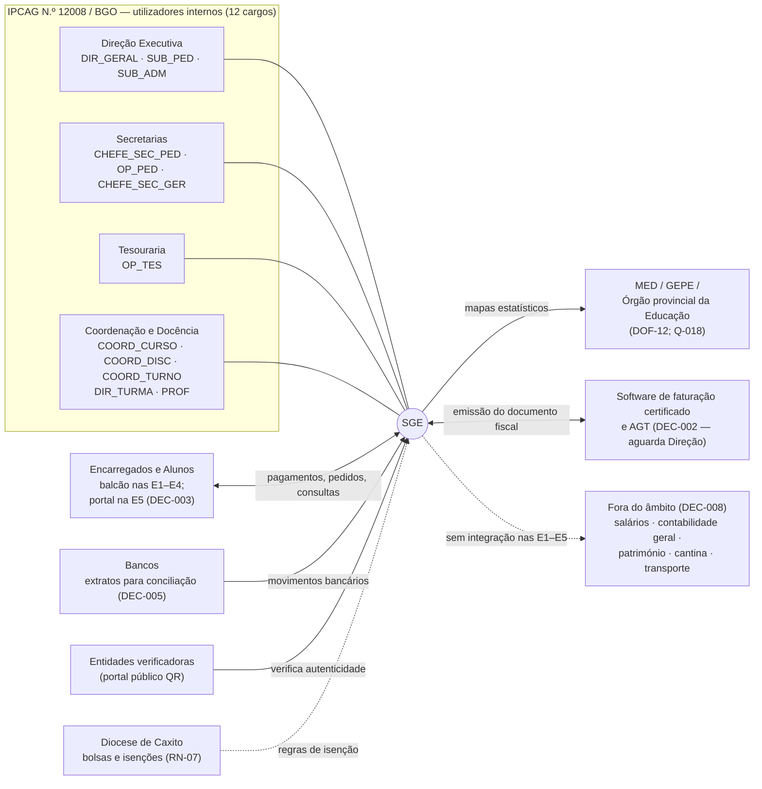
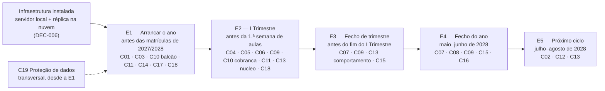

# Visão e Âmbito — SGE IPCAG N.º 12008 / BGO

> [!abstract] Navegação
> - **Painel Principal:** [[Inicio|Início do Vault]] | **Índice do Projeto:** [[00 - MOC SGE IPCAG 12008 BGO|MOC]] | **Plano:** [[00.1 - Plano de Engenharia de Requisitos]] (Fase A — lacunas L1 e L4)
> - **Decisões que esta nota aplica:** [[12 - Registo de Decisoes e Questoes em Aberto|REG-12]] (`DEC-001` a `DEC-008`)
> - **Especificação (v1.2):** [[01 - Dominio e Regras]] → [[02 - Fluxos de Trabalho]] → [[03 - User Stories]] → [[04 - Telas e Documentos]] → [[05 - Modelagem de Dados]]
> - **Notas da definição:** [[08 - Requisitos Nao Funcionais|RNF-08]] · [[09 - Integracoes, Infraestrutura e Operacao|OPS-09]] · [[10 - Migracao de Dados e Implantacao|MIG-10]] · [[11 - Protecao de Dados (APD)|APD-11]] · [[Verificacao das Referencias Legais|LEG-VER]]
> - **Descoberta (Fase B):** [[Guiao de Entrevistas por Cargo|DSC-01]] · [[Pedido de Artefactos a Escola|DSC-02]] · [[Questionario de Volumetria e Infraestrutura|DSC-03]] · [[Plano de Validacao de Pautas|VAL-01]] · [[Achados dos Documentos Reais - Lote 1|DESC-L1]]

> [!important] Estado desta nota
> - **Rascunho para aprovação da Direção Executiva do IPCAG** (o `DIR_GERAL` homologa; o `SUB_PED` e o `SUB_ADM` dão parecer — ver [[#10. Aprovação]]).
> - Aplica as decisões registadas no REG-12 a 2026-11-02: **`DEC-001` e `DEC-003` a `DEC-008` estão `decidida`** pelo analista responsável do projeto, com homologação da Direção pendente; **`DEC-002` (Faturação AGT) está `aguarda Direção`**.
> - As metas são **propostas a validar na Fase B**. Os valores de qualidade (tempos, disponibilidade, cópias de segurança) são detalhados no [[08 - Requisitos Nao Funcionais|RNF-08]] e, em caso de diferença, prevalece o RNF-08.

---

## 1. Problema e Contexto

### 1.1 A instituição

- **Instituto Politécnico Católico de Administração e Gestão (IPCAG) N.º 12008 / BGO — "Nossa Senhora do Rosário"**, Bairro Modular do Panguila, Município do Dande, Província do Bengo, Angola. Nos documentos reais da escola aparecem **dois números, 12008 e 8009** ([[Achados dos Documentos Reais - Lote 1|DESC-L1]] A3); o oficial está por confirmar (Q-027) e, no SGE, é um parâmetro da instituição (DEC-001).
- **Escola católica comparticipada**, sob tutela do Ministério da Educação (MED) e do Governo Provincial do Bengo, e da Diocese de Caxito. O cabeçalho real dos documentos diz "República de Angola / Governo da Província do Bengo / Gabinete Provincial da Educação" e não menciona o MED nem a Diocese (DESC-L1 A14; Q-035).
- **Direção real:** os documentos são assinados por uma **Coordenadora Geral da Comissão de Gestão** e por um **Coordenador para a Área Pedagógica**, não por um Director Geral e Subdirectores (DESC-L1 A4; Q-028).
- **Ensino Secundário Técnico-Profissional, II Ciclo:** 10ª, 11ª e 12ª Classes em regime trimestral e 13ª Classe em regime especial (Estágio Curricular e, segundo os planos curriculares, **Projecto Tecnológico** — DESC-L1 A6; Q-030).
- **Cursos segundo os planos curriculares recebidos** (Área de Formação "Administração e Serviços"): Contabilidade e Gestão, Gestão de Recursos Humanos, Gestão Empresarial, Estatística e Planeamento (DESC-L1 A5). Divergem da lista do DOC-01; confirmar se são todos (Q-029).
- **12 salas de aula e laboratórios, 2 turnos** (Manhã 07h30–12h35, Tarde 13h00–18h05), com capacidade para mais de 1.120 alunos segundo o DOC-01 §1.1. Os números reais por classe, curso e turno estão por confirmar ([[12 - Registo de Decisoes e Questoes em Aberto|Q-014]]).
- **Contexto de infraestrutura:** a especificação regista oscilações de energia e de internet no Panguila (RN-10), razão do desenho *Offline-First*.

### 1.2 Os problemas que o SGE resolve

> [!warning] Linha de base por medir
> A especificação v1.2 foi escrita a partir da legislação, sem entrevistas nem documentos reais da escola (lacuna L2). O primeiro lote de documentos reais ([[Achados dos Documentos Reais - Lote 1|DESC-L1]], só modelos em branco) **confirma esse risco**: as fórmulas de avaliação, a estrutura de direção e a lista de cursos não correspondem à especificação. Os problemas abaixo são os que a especificação **pretende resolver**. A situação atual de cada um (como é feito hoje, quanto tempo leva, quantos erros) é levantada na Fase B ([[Guiao de Entrevistas por Cargo|DSC-01]], [[Questionario de Volumetria e Infraestrutura|DSC-03]]) e regista-se na coluna "Linha de base" da secção 3.

| # | Problema | Quem é afetado | Consequência | Onde a especificação o trata |
| :---: | :--- | :--- | :--- | :--- |
| P1 | O cálculo das médias, transições e retenções tem muitas regras e exceções (`DISP`, cadeiras em atraso, veto LP + nuclear, 13ª Classe). | Alunos, `DIR_TURMA`, `SUB_PED`, Secretaria Pedagógica | Uma pauta errada é o erro mais caro e mais visível de um SGE (PLN-00, L3). | RN-01 a RN-06; Fluxos 03–06 |
| P2 | Um talão bancário pode ser reutilizado ou falsificado; um depósito pode pagar várias propinas ou vários irmãos. | Tesouraria, `SUB_ADM`, Encarregados | Perda de receita e conflitos com as famílias. | RN-09; máquina de estados 3.7; Fluxo 07 |
| P3 | A Secretaria Pedagógica não tem visibilidade da situação financeira do aluno. | Secretaria Pedagógica, Tesouraria | Documentos emitidos a alunos com propinas em atraso, ou idas e voltas entre balcões. | RN-08 (semáforo financeiro) |
| P4 | Documentos oficiais em papel podem ser falsificados e o registo físico é difícil de consultar. | Alunos, entidades externas, Secretaria Pedagógica | Certificados falsos; demora a confirmar autenticidade. | RN-10 (registo, QR Code); Fluxo 08 |
| P5 | Energia e internet instáveis interrompem o trabalho. | Professores, Secretaria, Tesouraria | Notas e pagamentos por registar ou perdidos. | RN-10 (ponto 4); DOC-05 §1.2 |
| P6 | Os mapas estatísticos oficiais exigem contagens por curso, classe, turno, género e idade. | `CHEFE_SEC_PED`, Direção | Recontagens manuais e atrasos no reporte. | `DOF-12`; `US-DOC-05` |
| P7 | A substituição de professores e as saídas de alunos a meio do ano ameaçam a continuidade das notas e da numeração. | Professores, `DIR_TURMA`, Secretaria | Notas perdidas ou listas de chamada renumeradas. | RN-04; RN-05 |

### 1.3 Diagrama de contexto

---

## 2. Visão

> [!quote] Declaração de visão (proposta)
> **Para** a Direção, as Secretarias, a Tesouraria, as Coordenações e os Professores do IPCAG N.º 12008 / BGO, **que** precisam de cumprir as regras do MED e da AGT e de servir alunos e encarregados num contexto de energia e internet instáveis, **o SGE é** o sistema de gestão escolar da instituição **que** acompanha o ano letivo de ponta a ponta, da matrícula à certificação: calcula pautas sem erros, controla a cobrança contra fraude, emite documentos oficiais verificáveis e continua a funcionar sem internet. **Ao contrário da** situação atual (a caracterizar na Fase B), **o SGE** integra a Secretaria Pedagógica, a Tesouraria e a docência numa só fonte de dados auditável, construída para a realidade e a linguagem do IPCAG.

---

## 3. Objetivos e Métricas

Cada objetivo liga-se às capacidades que o servem (PLN-00 §3, princípio 4: `Objetivo → Capacidade → Requisito`). Uma capacidade dentro do âmbito sem objetivo seria cortada; um objetivo sem capacidade seria uma lacuna.

| ID | Objetivo | Indicador (como se mede) | Meta proposta | Linha de base | Quando se mede | Capacidades |
| :---: | :--- | :--- | :--- | :--- | :--- | :--- |
| **O-01** | Pautas e resultados exatos | (1) Divergências por resolver entre o SGE e o recálculo das pautas oficiais do ano anterior ([[Plano de Validacao de Pautas\|VAL-01]]). (2) Pautas homologadas reabertas por erro de cálculo do sistema. | (1) **0** antes do arranque. (2) **0** em 2027/2028. | A medir na Fase D | Fase D; fecho de cada trimestre de 2027/2028 | C02, C05, C06, C07, C08 |
| **O-02** | Rotina pedagógica feita no SGE, sem registo paralelo | Percentagem de mini-pautas (turma × disciplina) e de sumários e faltas do I Trimestre de 2027/2028 registados no SGE. Os registos físicos exigidos por lei continuam e não contam como paralelos. | **100%** | A medir na Fase B | Fim do I Trimestre de 2027/2028 | C01, C04, C05, C06, C11 |
| **O-03** | Cobrança controlada e protegida contra fraude | (1) Pagamentos ligados a um borderô validado ou a uma operação TPA. (2) Reutilizações aceites de talão esgotado. (3) Sessões de caixa fechadas no fim do respetivo turno (RN-09.2). | (1) **100%**. (2) **0**. (3) **100%** | A medir na Fase B | Mensal, a partir da E1 | C10 |
| **O-04** | Documentos emitidos só com a situação financeira verificada | Percentagem de documentos sujeitos a taxa emitidos depois da verificação do semáforo financeiro (RN-08); emissões com pendência sem isenção homologada. | **100%**; **0** | A medir na Fase B | Mensal, a partir da E2 | C03, C09, C10 |
| **O-05** | Atendimento rápido ao balcão | (1) Tempo de resposta do sistema ao emitir recibo ou declaração. (2) Tempo total de atendimento ao balcão. | (1) **< 3 s** (PLN-00 §5.3; valor definitivo no RNF-08). (2) A fixar depois de medida a linha de base | A medir na Fase B ([[Questionario de Volumetria e Infraestrutura\|DSC-03]]) | Época de matrículas de 2027/2028 | C03, C09, C10 |
| **O-06** | Documentos oficiais verificáveis e histórico completo | (1) Certificados emitidos com registo de arquivo e código de verificação (RN-10). (2) Alunos da 12ª e da 13ª no arranque com o histórico da 10ª à 12ª completo no SGE. | (1) **100%**. (2) **100%** antes da E4 | A medir na migração ([[10 - Migracao de Dados e Implantacao\|MIG-10]]) | E1 (migração); E4 | C08, C09, C17 |
| **O-07** | Estatística oficial e indicadores de gestão sem recontagem | (1) Mapas `DOF-12` gerados a partir do SGE, sem recontagem manual, entregues no prazo oficial (prazo a confirmar — Q-LEG-15). (2) Painéis da Direção disponíveis com dados do próprio SGE. | (1) **100%** dos mapas de 2027/2028. (2) A partir da E3 | A medir na Fase B | Cada entrega oficial de mapas | C01, C15 |
| **O-08** | Funcionar com falhas de rede e de energia | (1) Lançamentos perdidos depois de até 7 dias de trabalho *offline* (PLN-00 §5.3). (2) Secretaria e Tesouraria a operar na rede local sem internet (DEC-006). (3) Perda máxima de dados e tempo de recuperação (PLN-00 §5.3; RNF-08). | (1) **0**. (2) Sem paragens por falta de internet. (3) ≤ 24 h e < 4 h | A medir na Fase B (infraestrutura — Q-006) | Registo de incidentes da C18 | C05, C06, C10, C18 |
| **O-09** | Proteção de dados e auditoria | (1) Ações críticas registadas em `audit_logs` (RN-10). (2) Acessos fora do âmbito do cargo detetados em auditoria. (3) Pedidos dos titulares respondidos no prazo legal ([[11 - Protecao de Dados (APD)\|APD-11]]). | (1) **100%**. (2) **0**. (3) **100%** | Não aplicável (capacidade nova) | Auditoria trimestral | C14, C19 |
| **O-10** | Adoção por todos os cargos | (1) Cargos, dos 12, com utilizadores ativos no primeiro mês da entrega que os serve. (2) Horas de formação até cada cargo executar as suas tarefas principais (PLN-00 §5.3). | (1) **12 de 12**. (2) **≤ 2 h** | Não aplicável | Um mês depois de cada entrega | C14, C18 |
| **O-11** | Encarregados e alunos informados sem se deslocarem à escola | Encarregados com acesso ativo ao portal. | A fixar na especificação da C12 (depende da Q-008) | A medir na Fase B (Q-008) | Depois da E5 | C12 |
| **O-12** | Disciplina registada e consultável | Participações disciplinares registadas no SGE. | **100%** depois da E5 | A medir na Fase B | Depois da E5 | C13 |
| **O-13** | Ano seguinte preparado a partir dos dados do SGE | (1) Matrículas de 2028/2029 geradas a partir da deliberação final do SGE, sem reintrodução de dados. (2) Dívidas e cadeiras em atraso transportadas sem reintrodução manual. | (1) **100%**. (2) **100%** | Não aplicável | Passagem de 2027/2028 para 2028/2029 | C16 |

> [!note] Dependência crítica do O-01
> A [[Verificacao das Referencias Legais|LEG-VER]] não encontrou o regulamento de avaliação publicado para o Ensino Secundário Técnico-Profissional (Q-LEG-01): as fórmulas `MT`/`MFD`, o recurso 40/60, o limite de faltas, a nota 7 e a fórmula da `MFC` não têm fonte confirmada. O O-01 só é mensurável depois de obtido esse regulamento e de corrigidas as regras na Fase C.
>
> Além disso, a Mini Pauta real da escola usa fórmulas que o RN-01 não conhece: uma **Prova Global** (`PG`) e uma **Classificação Anual** `CA = MT3 × 0,6 + PG × 0,4`, com componentes `MTP`/`PP`/`PT` ([[Achados dos Documentos Reais - Lote 1|DESC-L1]] A1 e A2; Q-025, Q-026). A referência para o O-01 é a prática validada com a escola, não só a lei.

---

## 4. Partes Interessadas

### 4.1 Utilizadores internos — os 12 cargos RBAC ([[01 - Dominio e Regras|DOC-01]] §2.1)

| Cargo | Código | Interesse principal no SGE | Capacidades em que é ator principal | Papel na definição |
| :--- | :---: | :--- | :--- | :--- |
| Director Geral | `DIR_GERAL` | Homologar pautas e documentos, aprovar bolsas, acompanhar indicadores pedagógicos e financeiros | C07, C09, C10 (bolsas), C15 | **Homologa** as decisões e a linha de base `v2.0` |
| Subdirector Pedagógico | `SUB_PED` | Abrir e fechar trimestres, homologar matrizes e conselhos de notas, autorizar reaberturas | C01, C04, C06, C07, C08 | Parecer nas decisões pedagógicas; aprova a Fase D |
| Subdirector Administrativo | `SUB_ADM` | Tabelas de propinas, estornos, fecho de caixa, ponto de funcionários | C10, C11, C15 | Parecer nas decisões financeiras (DEC-002, DEC-005); aprova a Fase D |
| Chefe da Secretaria Pedagógica | `CHEFE_SEC_PED` | Histórico externo, exames extraordinários, registo de certificados, mapas estatísticos | C03, C07, C09, C15, C17 | Entrevistado; valida migração e documentos |
| Operador da Secretaria Pedagógica | `OP_PED` | Inscrições, matrículas, turmas, emissão de declarações e boletins | C02, C03, C09 | Entrevistado; utilizador do balcão |
| Chefe da Secretaria Geral | `CHEFE_SEC_GER` | Expediente, cadastro de pessoal, ponto, supervisão da Tesouraria | C10, C11 | Entrevistado |
| Operador de Caixa / Tesouraria | `OP_TES` | Registar borderôs, liquidar propinas, emitir documentos de cobrança, fechar caixa | C10 | Entrevistado; utilizador do balcão |
| Coordenador de Curso | `COORD_CURSO` | Propor a distribuição docente; estágios, PAP e bancas da 13ª Classe | C04, C08 | Entrevistado |
| Coordenador de Disciplina | `COORD_DISC` | Dosificação e prova trimestral unificada (`NPT`) | C06 | Entrevistado |
| Coordenador de Turno | `COORD_TURNO` | Assiduidade de professores e alunos, salas, ocorrências disciplinares | C04, C05, C11, C13 | Entrevistado |
| Director de Turma | `DIR_TURMA` | Justificar faltas, consolidar a turma, submeter ao conselho de notas | C05, C07 | Entrevistado; valida os fluxos na Fase D |
| Professor | `PROF` | Lançar sumários, faltas e notas, também *offline* | C05, C06 | Entrevistado (amostra); valida a mini-pauta |

> [!note] Notas sobre os cargos
> - A [[Verificacao das Referencias Legais|LEG-VER]] (`COR-LEG-22`) indica que o DP n.º 93/21 usa "Coordenador de Turma" e não "Director de Turma", e que se aplica a instituições públicas (aplicabilidade ao IPCAG em Q-LEG-13). Esta nota mantém os termos do glossário do DOC-01 até essa correção ser decidida.
> - O [[C14 - Gestao de Contas e Acesso|CAP-C14]] propõe um perfil técnico fora dos 12 cargos para a administração do sistema; quem o ocupa depende da Q-013.
> - **Títulos reais (DESC-L1 A4):** a escola é hoje dirigida por uma **Comissão de Gestão**. Os documentos são assinados pela **Coordenadora Geral da Comissão de Gestão** (papel próximo do `DIR_GERAL`: declarações, "visto" na Pauta Geral, destinatária dos requerimentos), pelo **Coordenador para a Área Pedagógica** (papel próximo do `SUB_PED`: boletins, justificações de faltas, Pauta Geral) e pelo **Chefe da Secretaria Pedagógica** (Mini Pauta). Não foi visto nenhum documento assinado por um papel equivalente ao `SUB_ADM`. Proposta da DESC-L1: separar o **papel no sistema** (permissões RBAC) do **título do cargo impresso** (configurável). A correspondência fica por confirmar (Q-028).

### 4.2 Partes interessadas externas e de projeto

| Parte interessada | Relação com o SGE | Interesse / expectativa | Como participa | Servida a partir de | Decisões ligadas |
| :--- | :--- | :--- | :--- | :--- | :--- |
| **Encarregados de Educação** | Pagam propinas e emolumentos; representam alunos menores | Pagamento correto (irmãos, bolsas), documentos sem demora, informação sobre notas, faltas e dívidas | Ao balcão nas E1–E4; portal na E5; amostra consultada na Fase B (Q-008) | E1 (balcão); E5 (portal) | DEC-003, DEC-005 |
| **Alunos (e candidatos à 10ª Classe)** | Titulares dos dados académicos; menores na maioria | Notas e situação corretas, documentos verificáveis, consulta própria | Indireta (balcão); portal na E5 | E1; E5 (portal) | DEC-003 |
| **MED / GEPE / Gabinete Provincial da Educação do Bengo** | Tutela pedagógica; recebe os mapas estatísticos; fonte do regulamento de avaliação e do calendário. O Gabinete Provincial aparece no cabeçalho dos documentos reais, fornece modelos (ex.: boletim `DEE-PEEP-001-ACE`) e homologa a avaliação de desempenho do pessoal (DESC-L1 A14, A15) | Cumprimento das normas; mapas `DOF-12` corretos e no prazo; modelos oficiais respeitados | Fornece regulamentos e modelos (Q-005, Q-025, Q-035, Q-LEG-01, Q-LEG-15); designação oficial em Q-018 | E4 (`DOF-12`) | DEC-007 |
| **AGT** | Autoridade fiscal dos documentos de cobrança | Faturação conforme o DP n.º 71/25 e o SAF-T (AO), segundo a LEG-VER | Indireta: através do contabilista e do software escolhido | E1 | DEC-002 |
| **Diocese de Caxito** | Tutela católica; protocolo de isenções e bolsas, segundo a especificação. Não aparece no cabeçalho dos documentos reais (DESC-L1 A14) e as regras de bolsas e isenções ainda não foram recebidas (DESC-L1 §6) | Aplicação correta das isenções diocesanas (RN-07); eventual interesse noutras escolas (Q-009) | Define regras de isenção; possível financiador (Q-013); papel nos documentos por confirmar (Q-035) | E1 | DEC-001, DEC-008 |
| **Comissão de Gestão do IPCAG** | Órgão que dirige hoje a escola, segundo os documentos reais (DESC-L1 A4) | Ver a secção 4.1: os seus membros ocupam os papéis de direção | Assina declarações e pautas; destinatária dos requerimentos; provável autoridade de homologação (Q-028) | E1 | Todas (aprovação) |
| **APD — Agência de Proteção de Dados** | Supervisiona o tratamento de dados pessoais (Lei n.º 22/11) | Base legal, consentimento, conservação, direitos dos titulares, transferências | Eventual notificação ou autorização ([[11 - Protecao de Dados (APD)\|APD-11]], Q-016) | Desde a E1 | DEC-003, DEC-006 |
| **Bancos do IPCAG** | Recebem os pagamentos | Extratos para conciliação | Fornecem extratos (Q-007) | E1 | DEC-005 |
| **Empresas parceiras de estágio** | Recebem estagiários da 13ª Classe | Carta de apresentação e avaliação do estágio (`DOF-08`) | Supervisor de empresa dá a nota de estágio | E4 | — |
| **Entidades verificadoras** (MED, universidades, empregadores) | Leem o QR Code dos documentos | Confirmar autenticidade sem contactar a escola | Portal público de verificação (`US-DOC-03`) | E2 | DEC-006 |
| **Equipa do projeto** (analista responsável) e **equipa técnica** | Definem, constroem e operam o SGE | Âmbito estável, decisões a tempo, acesso à escola | Conduzem as Fases A–F; composição e orçamento em Q-013 | — | Todas |

---

## 5. Âmbito

### 5.1 Entregas e calendário (DEC-007)

O arranque em produção é no **início do Ano Letivo 2027/2028** (`DEC-007`). Os meses abaixo são indicativos (PLN-00 §2 e §6); as datas-limite exatas dependem do calendário escolar oficial de 2027/2028 (Q-005).

| Entrega | Tem de estar em produção antes de | Mês indicativo | Condições já conhecidas |
| :---: | :--- | :--- | :--- |
| **E1** | Início das matrículas de 2027/2028 | Antes de setembro de 2027 | Exige a `DEC-002` decidida (documento fiscal), a infraestrutura da `DEC-006` instalada e a migração (C17) reconciliada |
| **E2** | Primeira semana de aulas | Setembro de 2027 | Exige o horário (C04, `DEC-004`) e o regulamento de avaliação do ESTP (Q-LEG-01) |
| **E3** | Fim do I Trimestre | Fim do I Trimestre de 2027/2028 | — |
| **E4** | Conselhos finais, exames e certificação | Maio–junho de 2028 | Exige o histórico 10ª–12ª migrado e a resposta às Q-020 e Q-021 (Plataforma Nacional de Certificação, Diploma) |
| **E5** | Concurso de admissão de 2028/2029 | Julho–agosto de 2028 | A L8 (proteção de dados) fechada antes de abrir o portal (`DEC-003`) |

> [!note] Atribuições novas propostas por esta nota (confirmadas na `DEC-013`, 2026-11-05, com a C10 dividida em E1/E2 e o núcleo da C13 na E2/E3)
> O PLN-00 §6 não atribuía entrega à **C11** nem à **C19**. Esta nota propõe: C11 na **E1** (cadastro de pessoal, necessário às contas e à distribuição docente) e na **E2** (ponto); C19 **transversal desde a E1**, porque os dados pessoais são recolhidos logo na matrícula. A confirmar na Fase E.

> [!warning] Primeiro concurso de admissão
> Como a C02 só entra na E5, o concurso de admissão e as matrículas iniciais da 10ª Classe de 2027/2028 correm previsivelmente **fora do SGE**, e os admitidos entram por migração (C17). Fica como questão até ser confirmado (Q-017).

### 5.2 Âmbito por capacidade (C01–C20)

Legenda: **Dentro** · **Dentro (parcial)**: parte da capacidade fica fora · **Fora**. "Por decidir" marca o que depende de uma decisão ou questão em aberto.

| # | Capacidade | Âmbito | Entrega | Dentro do âmbito | Fora do âmbito / por decidir | Objetivos | Decisões e questões | Especificação |
| :---: | :--- | :---: | :---: | :--- | :--- | :--- | :--- | :--- |
| C01 | Estrutura académica e calendário | **Dentro** | E1 | Ano letivo, trimestres, cursos, classes, matrizes, salas, turnos, turmas; **Área de Formação e Especialidade**, com a lista real de cursos (DESC-L1 A5); **dados institucionais numa configuração parametrizável**, incluindo o número da instituição e os títulos dos cargos impressos | Separação de dados por várias escolas | O-02, O-07 | DEC-001; Q-005, Q-027, Q-028, Q-029 | DOC-01 §1.1; `US-GOV-01` a `03` |
| C02 | Admissão à 10ª Classe | **Dentro** | E5 | Vagas, inscrição, código de anonimato, prova, pauta de admitidos (`DOF-01`, `DOF-02`) | Concurso de 2027/2028 previsivelmente fora do SGE (Q-017). **Por decidir:** inscrição por portal (Q-LEG-12); Edital (Q-022) | O-01 | DEC-007; Q-017, Q-022; `COR-LEG-08` a `11` | Fluxo 01; `EP-ADM` |
| C03 | Matrícula e processo do aluno | **Dentro** | E1 | Matrícula inicial, confirmação, transferências, histórico externo, processo individual, encarregados (`DOF-03`), com os **campos reais** do boletim de matrícula e de confirmação (DESC-L1 A12: filiação, dois telefones do encarregado, escola e resultado anteriores, problema de saúde — dado sensível —, até duas cadeiras em atraso) e numeração anual; lista de documentos obrigatórios e cartão de estudante, a especificar | Matrícula pelos encarregados à distância (não há portal antes da E5). **Por decidir:** efeito da confirmação automática (Q-LEG-05, `COR-LEG-15`) | O-04, O-05 | DEC-003 | Fluxo 02; `EP-MAT` |
| C04 | Horários e distribuição de serviço docente | **Dentro** | E2 | Distribuição de serviço docente; **registo do horário semanal** introduzido ou importado de folha de cálculo; deteção de choques de professor, sala e turma; base para sumários e faltas | **Geração automática de horários** | O-02 | DEC-004, DEC-008; Q-011, Q-012 | [[C04 - Horarios e Distribuicao de Servico Docente\|CAP-C04]] |
| C05 | Assiduidade de alunos | **Dentro** | E2 | Sumários, faltas por tempo letivo, justificação (formulário numerado; quem assina: Q-032), retenção por faltas, trabalho *offline*; tipos de falta usados pela escola (por indisciplina, por não comparência — DESC-L1 A8) | — | O-01, O-02, O-08 | Q-032, Q-LEG-04 | Fluxo 03; `US-PED-02`; RN-03 |
| C06 | Avaliação e pautas | **Dentro** | E2 | Componentes trimestrais (`MAC`/`NPP`/`NPT` ou `MTP`/`PP`/`PT` — Q-026), **Prova Global e Classificação Anual** se confirmadas (DESC-L1 A1), mini-pautas *offline* (`DOF-04`) com as estatísticas impressas (DESC-L1 A10), substituição docente | — | O-01, O-02, O-08 | **Q-025**, Q-026, Q-LEG-01, Q-LEG-02 | Fluxo 03; `US-PED-01` a `05`; RN-01, RN-04 |
| C07 | Conselho de notas, transição e exames | **Dentro** | E3 e E4 | E3: conselho de notas trimestral, pauta geral (`DOF-05`). E4: recurso, transição, cadeiras em atraso, exame extraordinário (`DOF-07`) | — | O-01 | Q-025, Q-031; Q-LEG-03, Q-LEG-06; Q-023 | Fluxos 04–05; RN-02 |
| C08 | Regime da 13ª Classe | **Dentro** | E4 | Estágio, Projecto Tecnológico / PAP (terminologia por confirmar — DESC-L1 A6), júri, `MFC` (`DOF-08`) | — | O-01, O-06 | Q-030; Q-LEG-07; `COR-LEG-16`, `COR-LEG-17` | Fluxo 06; RN-06 |
| C09 | Emissão documental e certificação | **Dentro** | E2, E3 e E4 | E2: circuito real **requerimento → recibo de pedido → declaração** (DESC-L1 A11), declarações e guia de transferência (`DOF-09`); portal público de verificação por QR. E3: boletins (`DOF-06`). E4: certificados (`DOF-10`), registo de arquivo. Em todos: numeração anual por tipo de documento (DESC-L1 A13) e cabeçalho e rodapé oficiais | **Por decidir:** se o Diploma é emitido pelo Ministério e não pela escola (Q-021); registo na Plataforma Nacional de Certificação (Q-020); modelo oficial de cabeçalho (Q-035) | O-04, O-05, O-06 | Q-020, Q-021, Q-024, Q-027, Q-034, Q-035; `COR-LEG-18`, `COR-LEG-19` | Fluxo 08; RN-10 |
| C10 | Tesouraria | **Dentro (parcial)** | E1 (balcão: propinas, bolsas, documentos fiscais, caixa) + E2 (dívidas, acordos, relatórios, conciliação) — `DEC-013` | Tabelas de propinas e emolumentos, bolsas e isenções (RN-07), **registo manual de borderôs**, Conta Corrente, semáforo financeiro, fecho de caixa, **conciliação bancária por extrato**, gestão de dívidas e avisos de cobrança, relatórios financeiros de gestão | **Fora:** referências Multicaixa / gateway nas E1–E5 (reavaliar depois da E5); contabilidade geral. **Por decidir:** emissão do documento fiscal — certificar o SGE ou integrar com software certificado; se alguns emolumentos se pagam por RUPE ao Estado (DESC-L1 A15) | O-03, O-04, O-05, O-08 | **DEC-002 (aguarda Direção)**, DEC-005, DEC-008; Q-001 a Q-004, Q-007, Q-034 | Fluxo 07; `EP-TES`; RN-08, RN-09 |
| C11 | Recursos humanos | **Dentro (parcial)** | E1 e E2 | Cadastro de docentes e funcionários, incluindo o N.º de Agente (E1); ponto e assiduidade laboral (E2) | **Processamento salarial.** **Por decidir:** avaliação de desempenho anual do pessoal (DESC-L1 A15) | O-02 | DEC-008; Q-010, Q-036 | `US-DOC-04` |
| C12 | Comunicação com encarregados e alunos | **Dentro** | E5 | **Portal** de consulta (notas, faltas, dívidas), avisos e convocatórias; SMS a decidir na especificação da C12 | Qualquer acesso de encarregados ou alunos antes da E5, além do portal público QR | O-11 | DEC-003; Q-008 | A especificar (Fase C) |
| C13 | Disciplina e comportamento | **Dentro** | E2/E3 (núcleo: tipos de falta e comportamento) + E5 (resto) — `DEC-013` | Participações disciplinares, ocorrências, medidas e sanções do regulamento interno; avaliação do **comportamento** que já aparece no boletim (DESC-L1 A8) | — | O-12 | Q-032 | A especificar (Fase C); regulamento interno (PLN-00 §5.2) |
| C14 | Gestão de contas e acesso | **Dentro** | E1 | Ciclo de vida das contas dos 12 papéis, autenticação, recuperação de palavra-passe, MFA, sessões, troca de cargo; **papel no sistema separado do título impresso** (ex.: Coordenadora Geral da Comissão de Gestão — DESC-L1 A4) | Contas de encarregados e alunos antes da E5; separação de contas por escola | O-09, O-10 | DEC-001, DEC-003; Q-028 | [[C14 - Gestao de Contas e Acesso\|CAP-C14]] |
| C15 | Relatórios e indicadores | **Dentro (parcial)** | E3 e E4 | E3: painéis da Direção (aproveitamento, assiduidade, receitas, dívida) e estatísticas impressas nas pautas (positivas e negativas, transita, transita com deficiência, desistentes — DESC-L1 A10). E4: mapas estatísticos `DOF-12` | Indicadores de salários e de património | O-07 | DEC-008; Q-018, Q-LEG-15 | `US-DOC-05`; a especificar (Fase C) |
| C16 | Passagem de ano letivo | **Dentro** | E4 | Promoção em massa, turmas do ano seguinte, transporte de dívidas e de cadeiras em atraso, arquivo | — | O-13 | — | A especificar (Fase C) |
| C17 | Migração de dados e arranque | **Dentro** | E1 | Importação de alunos, histórico da 10ª à 12ª, dívidas, registos do livro de termos e, se o concurso correr fora do SGE, os admitidos de 2027/2028 | — | O-06 | DEC-007; Q-017 | [[10 - Migracao de Dados e Implantacao\|MIG-10]] |
| C18 | Operação do sistema | **Dentro** | E2 (infraestrutura antes da E1) | **Servidor local + réplica na nuvem**, cópias de segurança, recuperação, suporte, formação, atualizações | Alojamento só na nuvem ou só local | O-08, O-10 | DEC-006; Q-006, Q-013, Q-015 | [[09 - Integracoes, Infraestrutura e Operacao\|OPS-09]]; [[08 - Requisitos Nao Funcionais\|RNF-08]] |
| C19 | Proteção de dados | **Dentro** | Transversal, desde a E1 | Base legal, consentimento, conservação, direitos dos titulares, auditoria (`audit_logs`) | — | O-09 | DEC-003, DEC-006; Q-016 | [[11 - Protecao de Dados (APD)\|APD-11]]; RN-10 |
| C20 | Recursos e património | **Fora** | — | — | **Biblioteca, inventário e património, gestão de laboratórios** | — | DEC-008; Q-019 | — |

### 5.3 O que fica fora do âmbito

Ficam **fora das entregas E1–E5**. Cada um destes pontos só entra com um pedido de alteração registado no [[12 - Registo de Decisoes e Questoes em Aberto|REG-12]].

| # | Fica fora | Decisão | Como continua a ser feito |
| :---: | :--- | :--- | :--- |
| F-01 | Processamento salarial | DEC-008 | Fora do SGE; quem o faz hoje: Q-010 |
| F-02 | Biblioteca, inventário e património, gestão de laboratórios (C20) | DEC-008 | Fora do SGE; Q-019 |
| F-03 | Cantina | DEC-008 | Fora do SGE |
| F-04 | Transporte escolar | DEC-008 | Fora do SGE |
| F-05 | Contabilidade geral da escola | DEC-008 | Fora do SGE; o SGE fornece a Conta Corrente, a Tesouraria e o fecho de caixa |
| F-06 | Geração automática de horários | DEC-004, DEC-008 | Horário elaborado à mão e registado no SGE |
| F-07 | Ensino a distância e conteúdos pedagógicos | DEC-008 | Fora do SGE |
| F-08 | Compras e stocks | DEC-008 | Fora do SGE |
| F-09 | Uso por várias escolas (separação de dados por instituição) | DEC-001 | Instalação única IPCAG, com dados institucionais parametrizáveis |
| F-10 | Contas e portal para encarregados e alunos antes da E5 | DEC-003 | Atendimento ao balcão; portal na E5 |
| F-11 | Referências Multicaixa / gateway de pagamento | DEC-005 | Registo manual de borderôs; reavaliar depois da E5 |
| F-12 | Alojamento só na nuvem ou só local | DEC-006 | Servidor local + réplica na nuvem |

### 5.4 Por decidir (não é dentro nem fora)

| Tema | De que depende | Bloqueia |
| :--- | :--- | :--- |
| Quem emite o documento fiscal: o SGE certificado ou um software certificado integrado | **DEC-002** (aguarda Direção); Q-001 a Q-004; Q-LEG-16 a Q-LEG-19 | C10; **E1** |
| Registo na Plataforma Nacional de Certificação | Q-020 (Q-LEG-14) | C09; E4 |
| Emissão do Diploma pela escola ou pelo Ministério | Q-021 | C09; E4 |
| Inscrição no concurso de admissão por portal | Q-LEG-12 | C02; E5 |
| SMS como canal da C12 | Especificação da C12; Q-008; Q-013 | C12; E5 |
| Avaliação de desempenho anual do pessoal na C11 | Q-036 | C11 |
| Pagamento de emolumentos por RUPE ao Estado | Q-034 (Q-LEG-14) | C10; C09; DEC-005 |
| Fórmulas da Prova Global e da Classificação Anual no motor de pautas | Q-025, Q-026 (prioridade n.º 1 do [[Plano de Validacao de Pautas\|VAL-01]]) | C06; C07; **E2** |

---

## 6. Restrições

| ID | Restrição | Origem | Efeito no âmbito |
| :---: | :--- | :--- | :--- |
| R-01 | **Quadro legal angolano** (MED, AGT, APD). As referências da especificação estão a ser verificadas: a [[Verificacao das Referencias Legais\|LEG-VER]] encontrou diplomas revogados ou com objeto diferente e regras sem fonte publicada. | DOC-01; LEG-VER | Nenhuma regra legal entra em desenvolvimento sem fonte confirmada (Definition of Ready, PLN-00 §8) |
| R-02 | **Arranque só no início de um ano letivo** (no mínimo, de um trimestre). | PLN-00 §3, princípio 1; DEC-007 | Datas-limite das entregas fixadas pelo calendário de 2027/2028 |
| R-03 | **Energia e internet instáveis** no Panguila. | RN-10; DEC-006 | *Offline-First* nos professores; servidor local para os balcões |
| R-04 | **Linguagem ubíqua** do glossário do DOC-01 em ecrãs, documentos, dados e código. Os documentos reais usam outros termos ("Período" por Turno, "Cadeira" por Disciplina, `MTP`/`PP`/`PT`), que ficam por integrar como sinónimos ou termos oficiais (Q-026, Q-033). | DOC-01 §1; DESC-L1 A2, A9 | Proibidos termos de outros sistemas educativos |
| R-05 | **Segregação de funções** por cargo (matriz RBAC). A LEG-VER §3.10 indica que o DP n.º 93/21 não a impõe: mantém-se como requisito de controlo interno. | DOC-01 §2.2 | Cada função crítica só é acessível ao cargo previsto |
| R-06 | **Imutabilidade** dos documentos de cobrança e da trilha de auditoria. | RN-09; RN-10 | Correções só por documento de anulação (tipo legal a confirmar — DEC-002) |
| R-07 | **Dados de menores** e eventual transferência internacional. | Lei n.º 22/11; APD-11 | Sem acesso externo aos dados de alunos antes da E5; localização do alojamento condicionada (Q-016) |
| R-08 | **Uma escola, uma instalação.** | DEC-001 | Sem separação de dados por instituição |
| R-09 | **Equipamentos:** computador nos balcões; telemóvel Android nos professores (proposta do PLN-00 §5.3, a validar). | PLN-00 §5.3; RNF-08 | Interfaces adequadas a ecrãs pequenos e a impressão A4 |
| R-10 | **Equipa e orçamento** ainda por caracterizar. | Q-013 | Pode obrigar a cortar âmbito na Fase E (MoSCoW) ou a acionar o ponto de controlo da DEC-007 |

---

## 7. Pressupostos

Cada pressuposto é tratado como verdadeiro até à Fase B. Se se revelar falso, regista-se no REG-12 e reavalia-se a decisão indicada.

| ID | Pressuposto | Se for falso | Como se valida | Decisão afetada |
| :---: | :--- | :--- | :--- | :--- |
| PR-01 | A Direção disponibiliza documentos reais e pessoas de cada cargo para entrevista na Fase B. **Em parte confirmado:** o Lote 1 trouxe 15 documentos, mas só modelos em branco; faltam exemplares preenchidos e anonimizados para validar as pautas (DESC-L1 §6). | A especificação não é validada (L2); risco de construir algo que não corresponde à prática | [[Guiao de Entrevistas por Cargo\|DSC-01]]; [[Pedido de Artefactos a Escola\|DSC-02]]; [[Achados dos Documentos Reais - Lote 1\|DESC-L1]] | Todas |
| PR-02 | O órgão provincial fornece o regulamento de avaliação do ESTP em vigor a tempo da Fase C. | O motor de pautas (C06, C07) não pode ser construído; a E2 fica em risco | Q-LEG-01 | DEC-007 |
| PR-03 | A escola tem, ou pode instalar antes da E1, rede local, servidor e energia protegida. | A DEC-006 tem de ser revista | Q-006; [[Questionario de Volumetria e Infraestrutura\|DSC-03]] | DEC-006 |
| PR-04 | Os professores têm telemóvel Android ou acesso a um computador para lançar notas e faltas. | É preciso prever postos partilhados na escola | DSC-03 | DEC-006 |
| PR-05 | Se a DEC-002 for (b), o software de faturação certificado permite integração, ou pelo menos importação e exportação de ficheiros. | Dupla digitação no balcão; o O-05 fica em risco | Q-002 | DEC-002 |
| PR-06 | O histórico dos alunos atuais (10ª–12ª) e os registos do livro de termos existem em forma recuperável. | A E4 não consegue certificar os finalistas de 2027/2028 | [[10 - Migracao de Dados e Implantacao\|MIG-10]] | DEC-007 |
| PR-07 | O calendário de 2027/2028 mantém três trimestres, de setembro a julho. | As datas da secção 5.1 mudam | Q-005 | DEC-007 |
| PR-08 | Existe equipa e orçamento para construir e operar o SGE. | Corte de âmbito ou adiamento para 2028/2029 | Q-013 | DEC-007, DEC-008 |
| PR-09 | A Direção Executiva homologa as decisões sem alterações de fundo. | As secções 5 e 6 desta nota são revistas | Apresentação desta nota à Direção | DEC-001, DEC-003 a DEC-008 |
| PR-10 | A estrutura de direção que vai homologar (hoje, segundo os documentos, uma Comissão de Gestão) mantém-se até à aprovação da linha de base `v2.0`. | As aprovações têm de ser repetidas com a nova direção | Q-028 | Todas (aprovação) |

---

## 8. Critérios de Sucesso do Projeto

| ID | Critério | Como se verifica | Quando |
| :---: | :--- | :--- | :--- |
| CS-01 | Definição aprovada: linha de base `v2.0` homologada pela Direção Executiva, com as `DEC-001` a `DEC-008` homologadas (incluindo a `DEC-002` decidida) | Despacho ou ata da Direção registada no REG-12 | Fim da Fase F |
| CS-02 | Zero divergências por resolver no recálculo das pautas reais do ano anterior | Relatório do [[Plano de Validacao de Pautas\|VAL-01]] | Fim da Fase D |
| CS-03 | E1 em produção antes das matrículas de 2027/2028, com a migração reconciliada | Ata de arranque; relatório de reconciliação do MIG-10 | Antes das matrículas de 2027/2028 |
| CS-04 | Cada entrega E2–E5 em produção antes do momento do calendário que serve (secção 5.1) | Data de entrada em produção comparada com o calendário oficial | Ao longo de 2027/2028 |
| CS-05 | Metas dos objetivos O-01 a O-10 atingidas em 2027/2028; O-11 a O-13 no ciclo seguinte | Medição dos indicadores da secção 3 | Fecho de 2027/2028 e passagem para 2028/2029 |
| CS-06 | Nenhum processo dentro do âmbito mantido em papel paralelo no fim do I Trimestre de 2027/2028, além dos registos físicos exigidos por lei | Entrevistas de acompanhamento por cargo | Fim do I Trimestre de 2027/2028 |
| CS-07 | Âmbito controlado: nada da secção 5.3 entrou sem pedido de alteração registado | Revisão do REG-12 | Em cada entrega |

---

## 9. Ligação às Decisões

| Decisão | Estado (2026-11-02) | O que fixa nesta nota | Secções |
| :---: | :---: | :--- | :--- |
| [[12 - Registo de Decisoes e Questoes em Aberto#DEC-001 — Instalação única IPCAG ou produto multi-instituição\|DEC-001]] | `decidida` | Instalação única IPCAG, dados institucionais parametrizáveis | 5.2 (C01, C14), 5.3 (F-09), 6 (R-08) |
| [[12 - Registo de Decisoes e Questoes em Aberto#DEC-002 — Faturação AGT\|DEC-002]] | `aguarda Direção` | Quem emite o documento fiscal: fica por decidir; condiciona a E1 | 5.1 (E1), 5.2 (C10), 5.4, 6 (R-06), 7 (PR-05) |
| [[12 - Registo de Decisoes e Questoes em Aberto#DEC-003 — Portal ou aplicação para encarregados e alunos\|DEC-003]] | `decidida` | Portal para encarregados e alunos só na E5 | 4.2, 5.2 (C03, C12, C14), 5.3 (F-10), 6 (R-07) |
| [[12 - Registo de Decisoes e Questoes em Aberto#DEC-004 — Horários\|DEC-004]] | `decidida` | O SGE regista o horário feito à mão, com deteção de choques | 5.2 (C04), 5.3 (F-06) |
| [[12 - Registo de Decisoes e Questoes em Aberto#DEC-005 — Pagamentos\|DEC-005]] | `decidida` | Registo manual de borderôs na E1, com conciliação bancária; gateway fora | 3 (O-03), 5.2 (C10), 5.3 (F-11) |
| [[12 - Registo de Decisoes e Questoes em Aberto#DEC-006 — Alojamento\|DEC-006]] | `decidida` | Servidor local + réplica na nuvem; infraestrutura antes da E1 | 3 (O-08), 5.1, 5.2 (C18), 5.3 (F-12), 6 (R-03), 7 (PR-03) |
| [[12 - Registo de Decisoes e Questoes em Aberto#DEC-007 — Data de arranque\|DEC-007]] | `decidida` | Arranque no início de 2027/2028; ponto de controlo na Fase E | 3, 5.1, 6 (R-02), 8 |
| [[12 - Registo de Decisoes e Questoes em Aberto#DEC-008 — Fora do âmbito\|DEC-008]] | `decidida` | Lista do que fica fora do âmbito | 5.2 (C10, C11, C15, C20), 5.3 (F-01 a F-08) |

> [!tip] Questões que mais afetam esta nota
> As questões vivem no [[12 - Registo de Decisoes e Questoes em Aberto|REG-12]], e não aqui. As que mais afetam esta nota: **Q-005** (calendário 2027/2028), **Q-013** (equipa e orçamento), **Q-014** (volumetria), **Q-017** (primeiro concurso de admissão), **Q-020** e **Q-021** (certificação), e **Q-LEG-01** (regulamento de avaliação do ESTP, na LEG-VER).

---

## 10. Aprovação

| Papel | Cargo | Ação | Estado | Data |
| :--- | :---: | :--- | :---: | :---: |
| Proposta | Analista responsável do projeto | Elabora esta nota e as decisões do REG-12 | Feito (rascunho 0.1) | 2026-11-02 |
| Parecer pedagógico | `SUB_PED` | Revê os objetivos e o âmbito pedagógico (C01–C09, C13, C16) | pendente | — |
| Parecer administrativo e financeiro | `SUB_ADM` | Revê o âmbito financeiro e de RH (C10, C11, C15, C20) e a DEC-002 | pendente | — |
| Homologação | `DIR_GERAL` | Homologa a visão, o âmbito e as decisões DEC-001 a DEC-008 | pendente | — |

> [!note] Quem assina na prática
> Segundo os documentos reais ([[Achados dos Documentos Reais - Lote 1|DESC-L1]] A4), o papel `DIR_GERAL` é hoje exercido pela **Coordenadora Geral da Comissão de Gestão** e o papel `SUB_PED` pelo **Coordenador para a Área Pedagógica**. Não se identificou quem exerce o papel `SUB_ADM`. Os nomes dos signatários registam-se aqui só depois de confirmada a Q-028.

---

## 11. Histórico de Alterações

| Versão | Data | Alteração |
| :---: | :---: | :--- |
| 0.1 | 2026-11-02 | Criação (Fase A do PLN-00 — lacunas L1 e L4): problema, visão, 13 objetivos com métricas, partes interessadas, âmbito dentro/fora por capacidade C01–C20, entregas para o arranque em 2027/2028, restrições, pressupostos, critérios de sucesso e ligação a `DEC-001` a `DEC-008`. |
| 0.1 | 2026-11-02 | Integração dos achados dos documentos reais ([[Achados dos Documentos Reais - Lote 1\|DESC-L1]]): número 12008/8009, Comissão de Gestão e títulos reais dos cargos, cursos e Área de Formação, Projecto Tecnológico, Prova Global e Classificação Anual, faltas e comportamento, circuito das declarações, RUPE, avaliação de desempenho; questões Q-025 a Q-036 do REG-12; pressuposto PR-10. |
