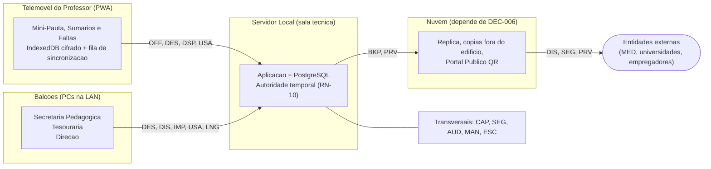
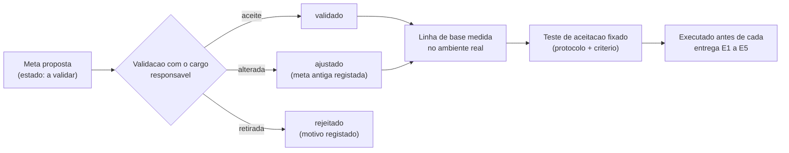

# Documento 08: Requisitos Não Funcionais — Metas Mensuráveis de Qualidade do SGE

> [!abstract] Navegação
> - **Painel Principal:** [[Inicio|Início do Vault]] | **Índice do Projeto:** [[00 - MOC SGE IPCAG 12008 BGO|MOC]] | **Plano:** [[00.1 - Plano de Engenharia de Requisitos]] (lacuna L5, §5.3)
> - **Especificação (v1.2):** [[01 - Dominio e Regras]] → [[02 - Fluxos de Trabalho]] → [[03 - User Stories]] → [[04 - Telas e Documentos]] → [[05 - Modelagem de Dados]]
> - **Definição complementar:** [[06 - Visao e Ambito]] | [[07 - Catalogo de Requisitos Funcionais]] | [[09 - Integracoes, Infraestrutura e Operacao]] | [[10 - Migracao de Dados e Implantacao]] | [[11 - Protecao de Dados (APD)]] | [[12 - Registo de Decisoes e Questoes em Aberto]]
> - **Áreas e Recursos:** [[Arquitetura de Software e DDD]] | [[Quadro Legal MED AGT e APD Angola]] | [[Verificacao das Referencias Legais]]
> - **Notas que consomem ou alimentam estas metas:** [[01 - Dominio e Regras|DOC-01]] `RN-16` (valores de palavra-passe, MFA e sessões) | [[Questionario de Volumetria e Infraestrutura]] (números reais da Fase B)

> [!important] Objetivo deste documento
> Transformar as qualidades esperadas do SGE ("rápido", "seguro", "funciona sem internet") em **metas mensuráveis e verificáveis**, ajustadas à realidade do Panguila: **energia instável**, **internet intermitente**, **telemóveis Android modestos** nas mãos dos professores, **balcões com PCs** na Secretaria e na Tesouraria e **literacia digital variável**. Fecha a lacuna **L5** do [[00.1 - Plano de Engenharia de Requisitos|Plano de Engenharia de Requisitos]]. A forma de operar o sistema para cumprir estas metas (backups, recuperação, suporte, atualizações) está em [[09 - Integracoes, Infraestrutura e Operacao]].

> [!warning] Estado: tudo `a validar`
> Todas as metas são **propostas**. O ponto de partida é o §5.3 do plano; o resto é proposta técnica desta nota. **Nenhuma meta foi ainda confirmada pela escola.** As metas que dependem de decisões pendentes estão marcadas com `depende de DEC-00x` e serão registadas em [[12 - Registo de Decisoes e Questoes em Aberto]]. As origens legais seguem o [[Quadro Legal MED AGT e APD Angola]] e aguardam a confirmação da lacuna **L3**.

> [!info] Alinhamento com as notas da Fase C (2026-11-02)
> - **Proteção de dados:** os requisitos provisórios `RNF-P-APD-01` a `14` e os prazos de conservação `PC-nn` de [[11 - Protecao de Dados (APD)]] estão incorporados neste catálogo (correspondência no §3.7.1).
> - **Contas e acesso:** as regras `RN-16.11` a `RN-16.13` do [[01 - Dominio e Regras|DOC-01]] remetem para esta nota os valores de palavra-passe, MFA e sessões (RNF-SEG-02 a 04).
> - **Termos fiscais:** segundo a [[Verificacao das Referencias Legais]], o DP n.º 292/18 foi revogado pelo DP n.º 71/25 e a lei fala de fatura, fatura-recibo, recibo e nota de crédito, não de "Nota de Estorno". Este catálogo usa os termos atuais do glossário do DOC-01 ("recibo", "Nota de Estorno") até essa correção ser decidida; os requisitos aplicam-se aos documentos fiscais, seja qual for o nome final.

---

## 1. Como Ler Este Catálogo

### 1.1 Estrutura de cada requisito

| Campo | Significado |
| :--- | :--- |
| **ID** | `RNF-<CAT>-nn`, em que `<CAT>` é o código da categoria (§1.2). O ID nunca é reutilizado; um requisito rejeitado mantém o ID com o estado `rejeitado`. |
| **Requisito** | O que o sistema (ou a sua operação) tem de garantir, numa frase. |
| **Métrica** | A grandeza que se mede, e como se mede. |
| **Meta proposta** | O valor a atingir. Sempre proposta até ser validada na Fase D. |
| **Verificação** | Como se prova que a meta foi cumprida: teste automático, teste manual, medição, inspeção ou ensaio. |
| **Origem** | De onde vem o requisito: `PLN §5.3` (plano), `RN-xx` (regra do [[01 - Dominio e Regras\|DOC-01]]), `US-xx` (história do [[03 - User Stories\|DOC-03]]), `DOC-0x` (nota da especificação), `Contexto` (realidade do Panguila), `Boa prática` (norma técnica reconhecida) ou lei. As leis marcadas com `*` são citadas segundo o [[Quadro Legal MED AGT e APD Angola]] e ainda não foram confrontadas com o texto oficial (L3). |
| **MoSCoW** | Prioridade (§1.3). |
| **Estado** | Situação de validação (§1.4). |

### 1.2 Categorias

| Código | Categoria | Pergunta a que responde |
| :---: | :--- | :--- |
| `CAP` | Capacidade e volumetria | Quantos alunos, utilizadores, documentos e anos de histórico? |
| `DES` | Desempenho | Quanto tempo se espera no balcão e no telemóvel? |
| `DIS` | Disponibilidade | Quando é que o sistema tem de estar a funcionar? |
| `OFF` | *Offline* e sincronização | Quanto tempo se trabalha sem rede, sem perder nada? |
| `BKP` | Backup e recuperação | Quanto se pode perder (RPO) e em quanto tempo se recupera (RTO)? |
| `SEG` | Segurança | Autenticação, MFA, sessões, cifragem, segregação de funções |
| `PRV` | Privacidade | Dados de alunos menores e encarregados (ligação à nota [[11 - Protecao de Dados (APD)]]) |
| `DSP` | Dispositivos e navegadores | Em que equipamentos funciona? |
| `IMP` | Impressão A4 / PDF | Os documentos oficiais saem corretos e verificáveis? |
| `USA` | Usabilidade e acessibilidade | Quanta formação é precisa e quão fácil é usar? |
| `LNG` | Língua e formatos | Português, datas, Kwanzas (`AOA`), notas, ordenação de nomes |
| `AUD` | Auditabilidade | O que tem de ficar provado, e por quanto tempo? |
| `MAN` | Manutenção e atualização | Como se atualiza sem parar a escola nem perder dados? |
| `ESC` | Escalabilidade | Até onde cresce sem redesenho? |

### 1.3 Prioridade MoSCoW

| Prioridade | Significado neste catálogo |
| :---: | :--- |
| **Must** | Obrigatório na primeira entrega em que a capacidade correspondente entra em produção (ver §4). Sem ele, a entrega não é aceite. |
| **Should** | Importante; só fica para uma entrega posterior com aprovação explícita da Direção. |
| **Could** | Desejável se houver tempo e orçamento. |
| **Won't** | Fora desta versão (registado para não se perder). |

### 1.4 Estados de validação

`a validar` → `validado` (meta aceite tal como está) · `ajustado` (meta alterada na validação; a meta antiga fica registada) · `rejeitado` (requisito retirado, com motivo). A passagem de estado acontece na Fase D (§6) e fica registada na ata de validação.

---

## 2. Condições de Referência para Medir

Uma meta só é mensurável se as condições de medição estiverem fixadas. Estas condições aplicam-se a todo o catálogo, salvo indicação em contrário.

### 2.1 Factos de base (da especificação atual)

| Facto | Valor | Fonte |
| :--- | :--- | :--- |
| Alunos atuais | cerca de 1.120 | [[00 - MOC SGE IPCAG 12008 BGO\|MOC]], DOC-01 §1.1 |
| Salas / laboratórios | 12 | DOC-01 §1.1 |
| Turnos e horários | Manhã 07h30–12h35; Tarde 13h00–18h05 | DOC-01 §1.1 (glossário: *Turno*) |
| Cargos com acesso | 12 cargos RBAC | DOC-01 §2.1 |
| Turma | Tem uma sala física fixa (1 a 12) | DOC-01 §1.1 (glossário: *Turma*) |
| Lançamento de notas e faltas | *Offline-First* no navegador do professor; balcões em servidor local na LAN com réplica na nuvem | RN-10 §4; DOC-05 §1.2 |

**Derivação:** se cada turma tem uma sala fixa e há 2 turnos, existem no máximo **24 turmas a funcionar em simultâneo** (12 × 2), o que dá hoje cerca de **47 alunos por turma** (1.120 ÷ 24). A meta de 1.500 alunos do §5.3 daria cerca de **63 alunos por turma** com as mesmas salas (ver questão Q08-01).

### 2.2 Hipóteses de cálculo (a substituir pelos números reais da Fase B)

> [!caution] Estes números não são factos
> São hipóteses explícitas para poder dimensionar enquanto não chegam os números reais pedidos no §5.2 do plano. Cada uma tem de ser substituída pelo valor real.

| ID | Hipótese | Valor usado | Substituir por |
| :---: | :--- | :--- | :--- |
| H1 | Disciplinas por classe | 12 | Matrizes curriculares oficiais (§5.2) |
| H2 | Duração da época de matrículas e confirmações | 10 dias úteis | Calendário real da última época |
| H3 | Pico diário face à média na época de matrículas | 2 × | Talões/recibos por dia do último setembro |
| H4 | Turmas atribuídas ao professor com mais turmas | 10 | Distribuição de serviço docente (§5.2) |
| H5 | Documentos digitalizados por processo individual | 5 ficheiros de até 500 KB | Lista de documentos obrigatórios (C03) |
| H6 | Dias letivos por mês | 22 | Calendário escolar do ano letivo |

### 2.3 Ambiente de referência

| Elemento | Definição para efeitos de medição |
| :--- | :--- |
| **PC de balcão de referência** | O PC **mais antigo** em uso na Secretaria Pedagógica ou na Tesouraria, segundo o inventário (§5.2 do plano), com o navegador suportado (RNF-DSP-01). |
| **Telemóvel de referência** | O telemóvel **mais fraco** em uso pelos professores segundo o inventário. Enquanto não houver inventário: Android 10, 2 GB de RAM, 16 GB de armazenamento com pelo menos 1 GB livre, ecrã de cerca de 5,5″ (proposta). |
| **Rede de referência (LAN)** | A rede local real do IPCAG, medida no posto mais afastado do servidor e na sala de aula com pior sinal Wi-Fi. |
| **Rede lenta de referência** | Perfil de rede lenta pré-definido nas ferramentas de programador do navegador (equivalente a 3G), até ser calibrado com medições reais no Panguila (Fase D). |
| **Base de dados de referência** | Base sintética com o volume das metas `CAP`: 1.500 alunos ativos e 15 anos letivos de histórico, gerada com dados fictícios (RNF-PRV-06). |
| **Percentil p95** | 95% das medições ficam abaixo do valor indicado. Mínimo de 20 medições por caso. |
| **Horário de serviço** | 07h00–18h30 nos dias letivos (cobre os 2 turnos com margem). |

### 2.4 Onde se aplicam as categorias

---

## 3. Catálogo de Requisitos Não Funcionais

### 3.1 Capacidade e volumetria (`CAP`)

| ID | Requisito | Métrica | Meta proposta | Verificação | Origem | MoSCoW | Estado |
| :--- | :--- | :--- | :--- | :--- | :--- | :---: | :---: |
| **RNF-CAP-01** | O sistema suporta o número de alunos com matrícula ativa num ano letivo, cumprindo todas as metas `DES`. | N.º de matrículas ativas na base de referência | **1.500** (cerca de +34% sobre os ~1.120 atuais) | Teste de carga com a base de referência | PLN §5.3; MOC | Must | `a validar` |
| **RNF-CAP-02** | O sistema suporta as contas de utilizador e as sessões em simultâneo previstas. | Contas ativas; sessões simultâneas sem degradação das metas `DES` | **150 contas**; **75 sessões simultâneas** (50% das contas, hipótese para o fim de turno em que muitos professores sincronizam ao mesmo tempo) | Teste de carga com 75 clientes simulados (balcão + sincronização) | PLN §5.3; Contexto | Must | `a validar` |
| **RNF-CAP-03** | O sistema suporta o número de turmas e o tamanho de turma da escola. | Turmas por ano letivo; alunos por turma | Até **40 turmas** por ano letivo; até **60 alunos** por turma (a mini-pauta continua a cumprir RNF-DES-03 com 60) | Teste com turmas sintéticas de 60 alunos | DOC-01 §1.1; derivação §2.1 | Must | `a validar` |
| **RNF-CAP-04** | O histórico académico, financeiro e documental fica consultável dentro do sistema, sem restaurar arquivos. | Anos letivos consultáveis na aplicação | **15 anos letivos**; dados mais antigos ficam em arquivo restaurável (RNF-BKP-08) | Consulta a processo individual, pauta e recibo do ano mais antigo da base de referência | PLN §5.3; RN-10 | Must | `a validar` |
| **RNF-CAP-05** | A Tesouraria aguenta o pico da época de matrículas e confirmações. | Recibos emitidos por dia e por hora, com RNF-DES-01 cumprido | **300 recibos/dia** e **60 recibos/hora** no conjunto dos postos (hipótese: 1.500 alunos ÷ 10 dias × 2 de pico; H2, H3) | Teste de carga; comparação com os talões do último setembro (§5.2) | PLN §5.2; Contexto | Must | `a validar` |
| **RNF-CAP-06** | Há espaço de armazenamento para os anexos dos processos (BI, atestados, despachos, comprovativos de bolsa). | GB de anexos por ano; limite por ficheiro; formatos aceites | Até **5 MB por ficheiro**; formatos PDF, JPEG e PNG; capacidade instalada para **≥ 5 anos** de crescimento previsto com 100% de margem (estimativa H5: cerca de 4 GB/ano para 1.500 processos) | Medição na Fase B (n.º e tamanho de documentos por processo); monitorização do espaço (OPS-09 §5.3) | DOC-05 (anexos de bolsas e dispensas); Contexto | Should | `a validar` |

### 3.2 Desempenho (`DES`)

Todos os tempos são medidos no **ambiente de referência** (§2.3) e no percentil **p95**, salvo indicação em contrário. Não incluem o tempo físico da impressora.

| ID | Requisito | Métrica | Meta proposta | Verificação | Origem | MoSCoW | Estado |
| :--- | :--- | :--- | :--- | :--- | :--- | :---: | :---: |
| **RNF-DES-01** | Emissão de recibo no balcão da Tesouraria (`DOF-11A`). | Tempo do clique em "Emitir" até o PDF estar pronto a imprimir, no PC de referência, via LAN | **< 3 s** | Medição automática (20+ emissões) com a base de referência | PLN §5.3; US-TES-03; MOD-TES-CXA | Must | `a validar` |
| **RNF-DES-02** | Emissão de declaração ou boletim individual no balcão da Secretaria (`DOF-09`, `DOF-06`). | Tempo do clique em "Emitir" até o PDF pronto | **< 3 s** | Medição automática | PLN §5.3; MOD-PED-DOC | Must | `a validar` |
| **RNF-DES-03** | Abrir a mini-pauta de uma turma no telemóvel do professor. | Tempo do toque na turma até a grelha estar utilizável | **< 2 s** com 50 alunos e dados já guardados no dispositivo; **< 3 s** com 60 alunos; **< 5 s** na primeira abertura via LAN | Medição no telemóvel de referência | PLN §5.3; US-PED-04; MOD-DOC-PAU | Must | `a validar` |
| **RNF-DES-04** | Gravação local de cada nota ou falta, com recálculo da `MT` no ecrã. | Tempo entre confirmar o valor e vê-lo gravado e a `MT` atualizada | **< 200 ms** (perceção de imediato) | Medição no telemóvel de referência, sem rede | US-PED-04; RN-01 | Must | `a validar` |
| **RNF-DES-05** | Sincronização de lançamentos pendentes. | Tempo para enviar e confirmar um lote | Lote de **500 operações**: **< 30 s** via LAN; **< 2 min** na rede lenta de referência | Teste com lote sintético; rede limitada por *software* | DOC-05 §1.2; Contexto | Should | `a validar` |
| **RNF-DES-06** | Pesquisa de aluno no balcão (nome, n.º de processo, BI). | Tempo da pesquisa até aos resultados | **< 1 s** com 15 anos de histórico | Medição automática com a base de referência | Contexto (balcão) | Must | `a validar` |
| **RNF-DES-07** | Geração de documentos coletivos. | Tempo até o PDF pronto | Mini-pauta `DOF-04` e pauta geral `DOF-05` de uma turma: **< 10 s**; mapa de fecho de caixa `DOF-11C`: **< 10 s**; mapa estatístico `DOF-12` da escola: **< 60 s** | Medição automática | DOC-04 Parte 2 | Should | `a validar` |
| **RNF-DES-08** | Operações em massa (deliberação anual de todas as turmas, passagem de ano, geração das 10 prestações de propina de todos os alunos) não bloqueiam o balcão. | Duração da operação; tempo de resposta do balcão durante a operação | Operação completa **< 15 min**; o balcão mantém RNF-DES-01 e RNF-DES-02 durante a execução | Teste de carga combinado | RN-02; RN-07; C16 | Should | `a validar` |
| **RNF-DES-09** | Resposta do portal público de verificação QR. | Tempo desde a leitura do QR até ao resultado, num telemóvel com rede móvel 4G | **< 3 s** | Medição externa a partir de rede móvel angolana | US-DOC-03; MOD-PUB-QR | Should | `a validar` |
| **RNF-DES-10** | Consumo de dados móveis do professor (muitos pagam os próprios dados). | MB descarregados | Primeira instalação da aplicação **≤ 5 MB**; sincronização de um dia típico **≤ 1 MB** | Medição do tráfego no telemóvel de referência | Contexto | Should | `a validar` |

### 3.3 Disponibilidade (`DIS`)

| ID | Requisito | Métrica | Meta proposta | Verificação | Origem | MoSCoW | Estado |
| :--- | :--- | :--- | :--- | :--- | :--- | :---: | :---: |
| **RNF-DIS-01** | O serviço na rede local está disponível no horário de serviço. | % do horário de serviço (07h00–18h30, dias letivos) com o serviço a responder | **≥ 99%** (cerca de 2 h 30 min de indisponibilidade por mês de 22 dias letivos; H6) | Monitorização contínua com relatório mensal (OPS-09 §5.3) | PLN §5.3 | Must | `a validar` |
| **RNF-DIS-02** | Os balcões funcionam sem internet. | % das funções de balcão disponíveis com a internet em baixo e a LAN ativa | **100%** de matrícula, confirmação, registo de borderô, emissão de recibo, fecho de caixa, declarações, boletins e pautas. Exceções aceites: SMS, email, portal QR e tudo o que dependa de DEC-002 / DEC-005 | Teste com a ligação à internet desligada | RN-10 §4; Arquitetura §2; Contexto | Must | `a validar` |
| **RNF-DIS-03** | Cortes de energia não derrubam o serviço nem corrompem dados. | Tempo que servidor, *switch* e *router* aguentam em bateria; casos de corrupção após cortes | Autonomia da UPS **≥ 30 min** ou até o gerador assumir a carga (o que for maior); encerramento ordenado **automático** antes de a bateria esgotar; **0** corrupções em 20 cortes simulados | Ensaio de corte de energia; verificação de integridade da base após cada corte | Contexto (energia instável) | Must | `a validar` |
| **RNF-DIS-04** | A manutenção planeada não interrompe o trabalho da escola. | Interrupções planeadas dentro do horário de serviço ou de um período de congelamento (RNF-MAN-01) | **0**; aviso aos utilizadores-chave **≥ 48 h** antes | Registo de manutenções (OPS-09 §5.4) | Contexto; Princípio 1 do plano | Must | `a validar` |
| **RNF-DIS-05** | Disponibilidade reforçada nos períodos críticos (matrículas, fecho de trimestre, conselhos de notas, exames, emissão de certificados). | % do horário de serviço disponível durante o período | **≥ 99,5%** (cerca de 35 min num período de 10 dias letivos) e suporte presencial (OPS-09 §5.6) | Monitorização; relatório do período | Plano §2 (calendário) | Should | `a validar` |
| **RNF-DIS-06** | O portal público QR e o acesso a partir de fora da escola estão disponíveis independentemente da internet do Panguila. | % do tempo disponível (24 h, 7 dias) | **≥ 99%** por mês (cerca de 7 h por mês) — `depende de DEC-006` | Monitorização externa a cada 5 min | US-DOC-03; RN-10 | Should | `a validar` |
| **RNF-DIS-07** | Existe um modo de contingência para o balcão quando o servidor local falha. | Tempo até ativar a contingência; % de atos de contingência registados no sistema após o regresso | Ativação **≤ 15 min**; **100%** dos atos registados depois. O que se pode emitir em contingência (sobretudo recibos) `depende de DEC-002` e da questão Q08-06. Segundo a [[Verificacao das Referencias Legais]] §4.5, o DP n.º 71/25 prevê um modo de contingência (art. 18.º) e a comunicação dos documentos à AGT, com bloqueio após 60 dias sem comunicar (art. 17.º); a aplicação ao IPCAG depende do seu regime de IVA (`Q-LEG-19`) | Simulação anual de falha do servidor (OPS-09 §5.2) | Contexto; RN-09; DP n.º 71/25* | Must | `a validar` |
| **RNF-DIS-08** | Um posto de balcão avariado é substituído rapidamente. | Tempo até um PC de reserva estar operacional no posto | **≤ 30 min** (PC de reserva pré-configurado) | Ensaio de substituição | Contexto | Should | `a validar` |

### 3.4 *Offline* e sincronização (`OFF`)

| ID | Requisito | Métrica | Meta proposta | Verificação | Origem | MoSCoW | Estado |
| :--- | :--- | :--- | :--- | :--- | :--- | :---: | :---: |
| **RNF-OFF-01** | O professor trabalha sem rede sem perder lançamentos. | Dias sem rede; lançamentos perdidos | **Até 7 dias** sem rede; **0** lançamentos perdidos | Ensaio de 7 dias offline com uso diário simulado e sincronização final | PLN §5.3; RN-10 §4; US-PED-04 | Must | `a validar` |
| **RNF-OFF-02** | A fila local tem capacidade para o pior caso de 7 dias. | Operações pendentes suportadas; espaço ocupado no dispositivo | **≥ 5.000 operações** pendentes (hipótese H4: 10 turmas × 60 alunos × 3 notas + faltas de 7 dias) ocupando **≤ 50 MB** | Teste de carga da fila no telemóvel de referência | DOC-05 §1.2; Contexto | Must | `a validar` |
| **RNF-OFF-03** | Os dados pendentes sobrevivem a tudo o que acontece a um telemóvel. | Lançamentos perdidos após fecho do navegador, reinício, bateria esgotada e atualização da aplicação | **0** perdas em 50 ciclos de interrupção | Teste de interrupção repetida no telemóvel de referência | US-PED-04; Contexto | Must | `a validar` |
| **RNF-OFF-04** | O armazenamento local não é apagado pelo navegador por falta de espaço. | Pedido de armazenamento persistente concedido; alerta de espaço | Armazenamento persistente pedido em **100%** das instalações; aviso ao professor quando o espaço livre for **< 100 MB** ou a persistência for recusada | Teste com o telemóvel quase cheio | Contexto (telemóveis modestos) | Must | `a validar` |
| **RNF-OFF-05** | Um reenvio nunca duplica lançamentos. | Lançamentos duplicados após reenvio do mesmo lote | **0** (chave de idempotência em `operacoes_sincronizacao`) | Teste com corte de rede a meio do envio, repetido 50 vezes | DOC-05 §1.2 e §3.6 | Must | `a validar` |
| **RNF-OFF-06** | O professor sabe sempre o que está por sincronizar. | Presença do indicador; informação mostrada | Indicador visível em **100%** dos ecrãs de lançamento com: n.º de pendentes, hora da última sincronização confirmada (hora do servidor) e estado "tudo sincronizado" | Inspeção dos ecrãs; teste de utilização | US-PED-04 (cenário 2) | Must | `a validar` |
| **RNF-OFF-07** | A sincronização acontece sozinha quando a rede volta. | Tempo entre a rede voltar (com a aplicação aberta) e a fila ficar vazia | **≤ 2 min**, sem ação do professor; também ao abrir a aplicação com rede | Teste de ligar/desligar a rede | US-PED-04; DOC-05 §1.2 | Must | `a validar` |
| **RNF-OFF-08** | Envios tardios para pautas fechadas nunca sobrescrevem a pauta e não se perdem. | Pautas fechadas alteradas por sincronização; envios rejeitados sem registo de conflito; tempo até ao aviso | **0** sobrescritas; **100%** dos envios rejeitados em `conflitos_sincronizacao`; aviso ao professor e ao `SUB_PED` na sincronização em que o conflito é criado | Teste: fechar o trimestre com um dispositivo offline e sincronizar depois | RN-10; DOC-05 §1.2 | Must | `a validar` |
| **RNF-OFF-09** | A hora do telemóvel nunca decide se um lançamento é aceite. | Decisões tomadas com base na hora do dispositivo | **0** (vale a hora do servidor) | Teste com o relógio do telemóvel adiantado e atrasado | RN-10; DOC-05 §3.6 | Must | `a validar` |
| **RNF-OFF-10** | Depois de um restauro de backup, os dispositivos conseguem reenviar o que já tinham enviado. | Dias de histórico de operações confirmadas guardado no dispositivo; lançamentos recuperados após restauro | O dispositivo guarda as operações já confirmadas durante **≥ 7 dias**; **100%** reenviadas quando o servidor, após restauro, pede reenvio desde uma data. **Em tensão** com `RF-C19-26` e `PC-18` da nota 11 (apagar as operações logo que o servidor confirma): decidir qual prevalece (Q08-14). A cópia contínua de RNF-BKP-02 já cobre as notas na maioria dos cenários; este requisito só faz diferença na perda total do edifício (DR-06) | Ensaio de recuperação de desastre (OPS-09 §5.2) | RNF-BKP-01; Contexto | Should | `a validar` |
| **RNF-OFF-11** | O professor lança offline sem voltar a autenticar-se, mas os dados locais ficam protegidos. | Possibilidade de lançar offline durante a janela de RNF-OFF-01; proteção local; efeito da desativação da conta e da falta de sincronização | Lançamento offline durante **7 dias** sem palavra-passe, com desbloqueio por PIN local (sessão `PESSOAL` de `RN-16.13` e `RN-16.15`); conta desativada → os pendentes só sobem em modo assistido e entram como conflito (`RN-16.9`), e os dados locais são apagados a seguir. Ao fim de N dias sem sincronizar (`PC-18`), os dados de leitura expiram; as operações pendentes **nunca expiram em silêncio**: a aplicação bloqueia novos lançamentos e pede sincronização (proposta: N = 14 dias, o dobro da janela *offline*) | Teste com sessão expirada, conta desativada e 15 dias sem rede | RN-10; RNF-SEG-05; C14; nota 11 (`RNF-P-APD-12`) | Must | `a validar` |
| **RNF-OFF-12** | A aplicação usa o mesmo endereço dentro e fora da escola, para a fila local não se dividir (os dados do navegador ficam presos ao endereço). | N.º de endereços distintos usados pela aplicação do professor | **1** endereço único — `depende de DEC-006` | Inspeção da configuração; teste dentro e fora da LAN | Contexto; Arquitetura §2 | Must | `a validar` |

### 3.5 Backup e recuperação (`BKP`)

| ID | Requisito | Métrica | Meta proposta | Verificação | Origem | MoSCoW | Estado |
| :--- | :--- | :--- | :--- | :--- | :--- | :---: | :---: |
| **RNF-BKP-01** | Perda máxima de dados aceitável em geral (RPO). | Horas de dados perdidos no pior caso | **≤ 24 h**, mesmo sem internet. Com internet e réplica ativa, `depende de DEC-006` | Ensaio de recuperação a partir do último backup | PLN §5.3 | Must | `a validar` |
| **RNF-BKP-02** | Perda máxima para dados fiscais e de auditoria (recibos, notas de estorno, fechos de caixa, documentos emitidos, `audit_logs`). | Minutos de dados perdidos no pior caso | **≤ 15 min**, através de cópia contínua para um segundo suporte **dentro do edifício** (não depende da internet). Justificação: um recibo impresso e perdido na base cria um salto na numeração (RN-09) | Ensaio: falha do disco principal a meio do turno | RN-09; RN-10 | Must | `a validar` |
| **RNF-BKP-03** | Tempo máximo para repor o serviço de balcão após perda do servidor (RTO). | Horas desde a declaração do incidente até o balcão voltar a emitir | **< 4 h** | Ensaio de recuperação de desastre cronometrado | PLN §5.3 | Must | `a validar` |
| **RNF-BKP-04** | Existe sempre uma cópia fora do edifício. | Idade da cópia mais recente fora do edifício | **≤ 24 h** quando há internet; **≤ 7 dias** em caso de internet prolongadamente em baixo (cópia física levada para fora). Meio e local `dependem de DEC-006` | Verificação semanal no registo de backups | PLN §5.3; Contexto | Must | `a validar` |
| **RNF-BKP-05** | Cumpre-se a regra 3-2-1 (3 cópias, 2 tipos de suporte, 1 fora do edifício). | Cópias, suportes e locais existentes | 3 / 2 / 1 verificados **todos os meses** | Lista de verificação mensal (OPS-09 §5.1) | Boa prática | Must | `a validar` |
| **RNF-BKP-06** | Os backups são testados por restauro, não apenas criados. | Frequência e resultado dos testes; tempo de restauro | Restauro de amostra **mensal**; ensaio completo de recuperação **por trimestre** (nas interrupções letivas); **100%** de sucesso; tempo medido ≤ RTO | Relatório de ensaio assinado pelo administrador técnico | Boa prática | Must | `a validar` |
| **RNF-BKP-07** | Os backups estão cifrados e as chaves guardadas à parte, pelo IPCAG. | Cópias cifradas; locais das chaves; quem detém as chaves | **100%** das cópias cifradas (AES-256); chaves guardadas em **2 locais distintos**, separadas das cópias, **geridas pelo IPCAG e nunca entregues ao fornecedor de nuvem** (`RNF-P-APD-02`) | Inspeção; teste de restauro usando a chave guardada | Lei n.º 22/11*; nota 11; Boa prática | Must | `a validar` |
| **RNF-BKP-08** | Retenção das cópias. | Cópias mantidas por tipo; idade da cópia mais antiga | **14** diárias, **8** semanais, **12** mensais e **1 por ano letivo** (no fecho do ano) guardada **10 anos** (`PC-29` da nota 11). Dados eliminados por prazo de conservação desaparecem das cópias no fim da rotação, o que deve constar do aviso de privacidade (`PC-20`) | Inspeção do catálogo de backups | Boa prática; nota 11 (`PC-20`, `PC-29`) | Should | `a validar` |
| **RNF-BKP-09** | Após um restauro, verifica-se a integridade antes de reabrir o balcão. | Saltos nas sequências de recibos e notas de estorno; contagens e somas de controlo; tempo da verificação | **0** saltos não explicados; relatório automático em **≤ 15 min** | Executado em cada ensaio de restauro | RN-09; RN-10 | Must | `a validar` |
| **RNF-BKP-10** | Pelo menos uma cópia não pode ser apagada nem alterada (proteção contra *ransomware* e erro humano). | Cópias imutáveis durante o período de retenção | **≥ 1** cópia imutável ou desligada da rede | Inspeção; tentativa controlada de apagar | Boa prática | Should | `a validar` |

### 3.6 Segurança (`SEG`)

| ID | Requisito | Métrica | Meta proposta | Verificação | Origem | MoSCoW | Estado |
| :--- | :--- | :--- | :--- | :--- | :--- | :---: | :---: |
| **RNF-SEG-01** | Cada pessoa tem a sua conta; nos balcões partilhados por turnos ninguém trabalha na sessão de outro. | Contas partilhadas | **0** contas partilhadas; **100%** das contas nominais | Revisão de contas; inspeção nos balcões | RN-10 (autoria em `audit_logs`); DOC-01 §2 | Must | `a validar` |
| **RNF-SEG-02** | Autenticação com 2 fatores (MFA) para os cargos com mais poder. | % de contas desses cargos com MFA ativo; funcionamento sem internet | **100%** das contas com atribuição de `DIR_GERAL`, `SUB_PED`, `SUB_ADM`, `CHEFE_SEC_GER`, `OP_TES` e `ADMIN_TEC` (`RN-16.12`); `CHEFE_SEC_PED` também, se tiver acesso a dados de saúde (`RNF-P-APD-10`; `Q-C14-11`). O 2.º fator tem de **funcionar sem internet** (RNF-DIS-02): aplicação autenticadora validada pelo servidor local; SMS só como fator adicional; códigos de recuperação impressos | Teste de autenticação com a internet desligada; revisão de contas | PLN §5.3; RN-09; RN-10; C14; nota 11 | Must | `a validar` |
| **RNF-SEG-03** | As sessões expiram e podem ser terminadas. | Minutos de inatividade até bloquear; duração máxima; sessões visíveis e revogáveis | Sessão `BALCAO`: bloqueio aos **15 min**, máximo **8 h**; sessão `PESSOAL` (telemóvel do professor): bloqueio aos **15 min** com desbloqueio por PIN e reautenticação completa a cada **7 dias** *offline*; sessão `ADMINISTRACAO`: termina aos **10 min**, máximo **2 h** (`RN-16.13`); o utilizador e a Direção veem e terminam sessões ativas | Teste manual cronometrado por tipo de sessão | PLN §5.3; C14 | Must | `a validar` |
| **RNF-SEG-04** | Política de palavra-passe adequada a literacia variável (valores pedidos por `RN-16.11`). | Comprimento mínimo; verificação contra palavras-passe comuns; bloqueio por tentativas | **≥ 10 caracteres**, frases-passe aceites; rejeição de palavras-passe comuns ou já divulgadas e das que contêm o nome de utilizador, o BI ou o telefone; sem regras de composição obrigatórias nem troca periódica forçada; bloqueio de **15 min** após **5** tentativas falhadas (o 2.º bloqueio no mesmo dia só se desfaz manualmente) | Testes automáticos | Boa prática (NIST SP 800-63B); C14 | Must | `a validar` |
| **RNF-SEG-05** | O ciclo de vida das contas acompanha o ciclo de vida das pessoas (capacidade C14). | Tempo entre a saída/mudança de cargo e a desativação/ajuste; contas de ex-funcionários ativas | Desativação **no próprio dia** (`RN-16.8`); revisão de acessos **por trimestre** (`RN-16.19`); **0** contas ativas de ex-funcionários | Revisão trimestral cruzando com o cadastro do RH | PLN C14; DOC-01 §2; C14 | Must | `a validar` |
| **RNF-SEG-06** | Todo o tráfego é cifrado, também dentro da LAN e na réplica (o funcionamento *offline* do navegador só é permitido em ligações seguras). | % de ligações em HTTPS ou canal cifrado; versão mínima de TLS | **100%** (balcões, telemóveis, sincronização, réplica, portal); TLS **1.2** no mínimo, **1.3** preferido; certificado válido, aceite pelos telemóveis sem configuração manual | Análise de configuração TLS; teste num telemóvel novo | Boa prática; Arquitetura §2; nota 11 (`RNF-P-APD-01`) | Must | `a validar` |
| **RNF-SEG-07** | Os dados guardados estão cifrados e as chaves são do IPCAG. | Suportes cifrados; quem detém as chaves | Disco do servidor, anexos, backups (RNF-BKP-07) e dados locais no telemóvel cifrados; chave dos dados locais **não guardada em claro** junto dos dados (ver Q08-12); chaves geridas pelo IPCAG, **nunca pelo fornecedor de nuvem** | Inspeção; tentativa de leitura direta dos ficheiros | Lei n.º 22/11*; DOC-05 §1.2; nota 11 (`RNF-P-APD-02`) | Must | `a validar` |
| **RNF-SEG-08** | A chave secreta do QR (`HMAC-SHA256`) está protegida e pode ser trocada sem invalidar documentos antigos. | Local da chave; identificação da versão da chave; tempo de troca | Chave **fora da base de dados**, com acesso restrito; cada código indica a versão da chave; troca em **≤ 24 h** em caso de suspeita, mantendo verificáveis os documentos já emitidos | Inspeção; ensaio de troca de chave | RN-10 | Must | `a validar` |
| **RNF-SEG-09** | O portal público resiste à adivinhação de códigos e não aparece em motores de pesquisa. | Consultas aceites por minuto e por origem; entropia do código impresso; páginas indexadas | **≤ 30 consultas/min** por endereço de origem; código com **≥ 64 bits** de aleatoriedade; **0** páginas de resultado indexáveis | Teste automático de enumeração; verificação das instruções de não indexação | MOD-PUB-QR (*rate limiting*); US-DOC-03; nota 11 (`RNF-P-APD-13`) | Must | `a validar` |
| **RNF-SEG-10** | A segregação de funções da matriz RBAC e das regras RLS está provada por testes. | % das células da matriz DOC-01 §2.2 e das regras DOC-05 §5 cobertas por testes negativos automáticos | **100%** | Bateria de testes automáticos executada em cada entrega | DOC-01 §2.2; DOC-05 §5; DP n.º 93/21* | Must | `a validar` |
| **RNF-SEG-11** | Vulnerabilidades conhecidas são corrigidas a tempo. | Dias até aplicar correções de segurança críticas; dependências auditadas | **≤ 7 dias** para críticas; auditoria de dependências em **cada entrega** | Registo de atualizações (OPS-09 §5.4) | Boa prática | Should | `a validar` |
| **RNF-SEG-12** | O acesso técnico privilegiado é separado do acesso de negócio e fica registado. | Acessos a dados de negócio pelo perfil `ADMIN_TEC`; acumulações de cargo não autorizadas; acessos diretos à base registados | **0** acessos do perfil `ADMIN_TEC` a notas, faltas, dados financeiros ou processos (`RN-16.17`); **0** acumulações fora das regras de `RN-16.5`; **100%** dos acessos diretos ao servidor e à base registados; conta de emergência selada (ver OPS-09 §5.5) | Revisão de contas; testes RBAC; inspeção dos registos | RN-09; RN-10; C14 | Must | `a validar` |
| **RNF-SEG-13** | O servidor e as cópias locais estão fisicamente protegidos. | Condições da sala técnica | Sala fechada à chave, com acesso restrito e registado; UPS e equipamento de rede na mesma sala | Inspeção física | Contexto | Should | `a validar` |
| **RNF-SEG-14** | Revisão de segurança independente. | Revisões feitas | **1** antes do arranque da E1 e **1 por ano** depois; **0** falhas críticas abertas no arranque | Relatório da revisão | Boa prática | Should | `a validar` |
| **RNF-SEG-15** | Existe um documento de segurança escrito e atualizado. | Existência e data da última revisão do documento (níveis de segurança, recursos protegidos, funções e obrigações por cargo) | Aprovado **antes da E1** e revisto **1 vez por ano** | Inspeção do documento e da ata de aprovação | Lei n.º 22/11* (art. 30.º, segundo a nota 11); nota 11 (`RNF-P-APD-04`) | Must | `a validar` |

### 3.7 Privacidade (`PRV`)

> [!info] Ligação à nota 11
> Os tratamentos de dados, a base legal, os consentimentos (alunos menores), os prazos de conservação e os direitos dos titulares são definidos em [[11 - Protecao de Dados (APD)]]. Aqui ficam apenas as **qualidades mensuráveis** que o sistema tem de ter para cumprir o que essa nota decidir.

| ID | Requisito | Métrica | Meta proposta | Verificação | Origem | MoSCoW | Estado |
| :--- | :--- | :--- | :--- | :--- | :--- | :---: | :---: |
| **RNF-PRV-01** | O portal QR mostra só o mínimo necessário para confirmar a autenticidade. | Campos devolvidos fora da lista aprovada (nota 11 §7.3); duração da resposta detalhada | **0** campos fora da lista; resposta detalhada durante o prazo de `PC-19` (proposta: 5 anos para documentos sem `Livro/Folha/Termo`) | Teste automático que compara a resposta com a lista aprovada | US-DOC-03 ("conforme política APD"); Lei n.º 22/11*; nota 11 | Must | `a validar` |
| **RNF-PRV-02** | As consultas a dados pessoais sensíveis ficam registadas (não só as alterações). | % das consultas a processo individual, atestados e conta corrente registadas | **100%**, consultáveis pela Direção | Teste: consultar e verificar o registo | Lei n.º 22/11*; RN-10 | Should | `a validar` |
| **RNF-PRV-03** | Os dados de saúde (atestados médicos, motivos de `DISP`, anexos clínicos de faltas) têm acesso mínimo e ficam num compartimento próprio. | Cargos com acesso ao conteúdo; separação do armazenamento | Só `CHEFE_SEC_PED` e `SUB_PED` (os restantes veem apenas a sigla `DISP`); armazenamento logicamente separado, com **chave de cifra própria** e políticas de acesso próprias | Testes RBAC/RLS negativos; inspeção do armazenamento | RN-01 (`DISP`); Lei n.º 22/11*; nota 11 (`RNF-P-APD-03`, `PC-05`, `PC-06`) | Must | `a validar` |
| **RNF-PRV-04** | Os prazos de conservação são aplicados pelo sistema. | % das categorias `PC-nn` da nota 11 §5 com prazo e ação de fim (eliminar, anonimizar, truncar) implementados | **100%** quando a nota 11 estiver aprovada; execução por lote aprovado e registado | Inspeção; relatório de dados fora do prazo | Nota 11 §5 (L8) | Must | `a validar` |
| **RNF-PRV-05** | Os direitos dos titulares (acesso, retificação) são exercidos sem esforço desproporcionado. | Tempo de trabalho para exportar todos os dados de um aluno ou encarregado | **≤ 30 min** de trabalho; prazo legal de resposta a confirmar na nota 11 | Ensaio com um processo fictício | Lei n.º 22/11* | Should | `a validar` |
| **RNF-PRV-06** | Ambientes de desenvolvimento, teste, demonstração e formação não usam dados reais, incluindo nos ensaios de migração. | Registos reais fora da produção | **0** (dados sintéticos ou anonimizados) | Inspeção dos ambientes | Boa prática; Lei n.º 22/11*; nota 11 (`RNF-P-APD-08`) | Must | `a validar` |
| **RNF-PRV-07** | Os dados ficam apenas em locais aprovados. | % das cópias (produção, réplica, backups, portal QR) em locais aprovados | **100%**; proposta da nota 11: **em Angola**, salvo notificação ou autorização prévia da APD registada na `DEC-006` (`RNF-P-APD-06`; `Q-016`) | Inventário de locais de dados | Lei n.º 22/11*; DEC-006; nota 11 | Must | `a validar` |
| **RNF-PRV-08** | Nos telemóveis pessoais dos professores só ficam os dados indispensáveis. | Dados guardados localmente; prazo de permanência | Apenas as turmas atribuídas; lista de alunos apagada no fim da alocação; operações apagadas quando o servidor confirma (salvo a decisão sobre RNF-OFF-10); o servidor pode ordenar a limpeza no contacto seguinte (dispositivo perdido, professor substituído) | Inspeção do armazenamento local | RN-04; Lei n.º 22/11*; nota 11 (`RF-C19-26`, `PC-18`) | Must | `a validar` |
| **RNF-PRV-09** | Existe resposta preparada para uma violação de dados. | Tempo entre a deteção e a avaliação pela Direção; tempo até à comunicação à APD | Avaliação em **≤ 24 h**; comunicação à APD logo que o incidente seja conhecido, com meta interna **≤ 72 h** (`RNF-P-APD-11`, a validar na nota 11) | Simulação de incidente | Lei n.º 22/11*; nota 11 | Should | `a validar` |
| **RNF-PRV-10** | SMS e emails não levam dados para além do aprovado. | Mensagens com dados fora da lista aprovada | **0** (modelos de mensagem aprovados na nota 11) | Revisão dos modelos | Lei n.º 22/11*; DEC-003 | Should | `a validar` |
| **RNF-PRV-11** | Os registos técnicos (servidor, erros, acessos) e os eventos de autenticação não guardam dados para além do prazo. | Idade máxima dos registos técnicos; idade máxima do IP completo | Registos técnicos e `eventos_autenticacao` (C14) **≤ 12 meses**; IP completo **≤ 90 dias**, depois truncado (`PC-26`, `PC-27`) | Inspeção automática mensal | Nota 11 (`RNF-P-APD-07`) | Should | `a validar` |
| **RNF-PRV-12** | Os ecrãs mostram só os dados de que a tarefa precisa. | Ecrãs que mostram o BI ou o NIF completos a cargos que não precisam deles | **0**: BI e NIF mascarados (por exemplo, só os últimos 4 caracteres) fora dos cargos que precisam do número completo; listas só com as colunas da tarefa | Revisão dos ecrãs por cargo | Nota 11 (`RNF-P-APD-09`) | Should | `a validar` |

#### 3.7.1 Correspondência com os requisitos provisórios da nota 11

| Nota 11 | Requisito(s) neste catálogo |
| :--- | :--- |
| `RNF-P-APD-01` Cifra em trânsito | RNF-SEG-06 |
| `RNF-P-APD-02` Cifra em repouso, chaves com o IPCAG | RNF-SEG-07, RNF-BKP-07 |
| `RNF-P-APD-03` Separação dos dados de saúde | RNF-PRV-03 |
| `RNF-P-APD-04` Documento de segurança | RNF-SEG-15 |
| `RNF-P-APD-05` Rastreabilidade das alterações de dados pessoais | RNF-AUD-09 |
| `RNF-P-APD-06` Residência dos dados | RNF-PRV-07 |
| `RNF-P-APD-07` Prazo dos registos técnicos | RNF-PRV-11 |
| `RNF-P-APD-08` Nenhum dado real fora da produção | RNF-PRV-06 |
| `RNF-P-APD-09` Minimização nos ecrãs | RNF-PRV-12 |
| `RNF-P-APD-10` MFA e expiração de sessão | RNF-SEG-02, RNF-SEG-03 |
| `RNF-P-APD-11` Resposta a incidentes | RNF-PRV-09 |
| `RNF-P-APD-12` Dispositivos dos professores | RNF-OFF-11, RNF-PRV-08, RNF-SEG-07 |
| `RNF-P-APD-13` Códigos QR não adivinháveis | RNF-SEG-09 |
| `RNF-P-APD-14` Auditoria imutável com prazo | RNF-AUD-03, RNF-AUD-07 |

### 3.8 Dispositivos e navegadores (`DSP`)

| ID | Requisito | Métrica | Meta proposta | Verificação | Origem | MoSCoW | Estado |
| :--- | :--- | :--- | :--- | :--- | :--- | :---: | :---: |
| **RNF-DSP-01** | PCs de balcão suportados. | Navegadores e resolução suportados | Chrome e Edge nas **2 últimas versões estáveis**; resolução mínima **1366 × 768** sem perda de funções; sistema operativo segundo o inventário | Teste no PC de referência | PLN §5.3 ("navegador moderno") | Must | `a validar` |
| **RNF-DSP-02** | Telemóveis dos professores suportados. | Versão Android mínima; RAM; navegador | **Android ≥ 10**, **≥ 2 GB de RAM**, Chrome atualizado; aplicação instalável no ecrã inicial (PWA). Confirmar que o Chrome ainda suporta Android 10 à data do arranque | Teste no telemóvel de referência | PLN §5.3; Contexto | Must | `a validar` |
| **RNF-DSP-03** | O lançamento de notas e faltas funciona num ecrã pequeno. | Largura mínima; deslocamento horizontal nas tarefas de lançamento | Ecrã de **360 px** de largura lógica; **0** tarefas de lançamento que obriguem a deslocar a grelha na horizontal | Teste no telemóvel de referência | US-PED-04; Contexto | Should | `a validar` |
| **RNF-DSP-04** | Espaço ocupado no telemóvel. | MB ocupados pela aplicação e pelos dados | **≤ 100 MB** no total (inclui RNF-OFF-02) | Medição no telemóvel de referência | Contexto | Should | `a validar` |
| **RNF-DSP-05** | Os postos não precisam de *software* adicional. | Programas a instalar além do navegador e dos *drivers* da impressora | **0** | Instalação de um posto novo | Contexto (operação simples) | Should | `a validar` |
| **RNF-DSP-06** | Outros dispositivos (iPhone, *tablets*). | Funções testadas nesses dispositivos | Fora do âmbito inicial: funcionam sem garantia. O navegador do iPhone pode apagar dados locais de sítios pouco usados, o que põe em risco RNF-OFF-01 (ver Q08-07) | Teste exploratório se houver utilizadores | Contexto | Could | `a validar` |

### 3.9 Impressão A4 / PDF (`IMP`)

| ID | Requisito | Métrica | Meta proposta | Verificação | Origem | MoSCoW | Estado |
| :--- | :--- | :--- | :--- | :--- | :--- | :---: | :---: |
| **RNF-IMP-01** | Os 12 documentos oficiais (`DOF-01` a `DOF-12`) saem em PDF no formato de página definido no DOC-04 Parte 2. | Documentos impressos a 100% sem cortes nem reescalamento | **12 / 12**: A4 retrato ou paisagem; `DOF-05` em A3 ou A4 paisagem em blocos; `DOF-06` em A5 ou 2 por folha A4 | Bateria de impressão nas impressoras reais da escola | DOC-04 Parte 2 | Must | `a validar` |
| **RNF-IMP-02** | O PDF é igual em qualquer posto. | Diferenças de paginação ou tipo de letra entre postos e navegadores | **0** (tipos de letra embebidos; PDF gerado no servidor) | Comparação do mesmo documento em 3 postos | DOC-04 Parte 2 | Must | `a validar` |
| **RNF-IMP-03** | Tudo se lê numa impressora laser a preto e branco. | Informação que só se distingue pela cor | **0**: as notas negativas distinguem-se também por negrito sublinhado, não só pelo vermelho | Impressão monocromática de `DOF-04`, `DOF-05` e `DOF-06` | DOC-04 (`DOF-04`); Contexto | Must | `a validar` |
| **RNF-IMP-04** | O QR é lido depois de impresso e fotocopiado. | Taxa de leitura em 3 telemóveis diferentes, no original e numa fotocópia | **100%**; QR com **≥ 20 mm** de lado e correção de erros de nível M ou superior | Teste de impressão e fotocópia | RN-10; US-DOC-03 | Must | `a validar` |
| **RNF-IMP-05** | Os documentos de arquivo permanente ficam num formato de longa duração. | Documentos guardados em PDF/A | **100%** de certificados, diplomas, termos e pautas gerais em PDF/A (ISO 19005) | Validação automática do formato | RN-10 (arquivo); Boa prática | Should | `a validar` |
| **RNF-IMP-06** | Uma reimpressão nunca passa por original. | Reimpressões sem a marca "2.ª via" ou sem registo | **0**: toda a reimpressão leva "2.ª via" e é registada em `audit_logs` | Teste de reimpressão | RN-10 | Must | `a validar` |
| **RNF-IMP-07** | O conteúdo encaixa no papel timbrado com marca de água e nos impressos pré-existentes. | Desvio de posição medido na folha impressa | **≤ 2 mm**; margens configuráveis por impressora | Impressão de teste com régua | DOC-04 (`DOF-09`, `DOF-10`) | Should | `a validar` |

### 3.10 Usabilidade e acessibilidade (`USA`)

| ID | Requisito | Métrica | Meta proposta | Verificação | Origem | MoSCoW | Estado |
| :--- | :--- | :--- | :--- | :--- | :--- | :---: | :---: |
| **RNF-USA-01** | Cada cargo aprende as suas tarefas principais numa formação curta. | Horas de formação; % de formandos que concluem as tarefas principais sem ajuda | **≤ 2 h** por cargo; **≥ 90%** concluem sem ajuda no fim da sessão | Sessão de formação com avaliação prática (OPS-09 §5.7) | PLN §5.3 | Must | `a validar` |
| **RNF-USA-02** | O atendimento no balcão não fica mais lento do que hoje. | Tempo médio de atendimento por tipo (recibo de propina, matrícula, declaração) | **Não superior** ao tempo atual em papel (medido na Fase D) e **≤ 2 min** para um recibo de propina com borderô novo (proposta) | Cronometragem antes (papel) e depois (protótipo/sistema) | Contexto | Should | `a validar` |
| **RNF-USA-03** | A satisfação com a facilidade de uso é aceitável. | Pontuação SUS (*System Usability Scale*) por grupo de cargos | **≥ 70** | Questionário SUS após testes com protótipo e após a formação | Boa prática | Should | `a validar` |
| **RNF-USA-04** | As mensagens de erro dizem, em linguagem simples, o que aconteceu e o que fazer. | Mensagens com códigos técnicos visíveis (ex.: "HTTP 403") | **0**; 100% das mensagens com a ação seguinte (ex.: "Encaminhe o encarregado para a Tesouraria") | Revisão das mensagens; teste com utilizadores | DOC-03 (os códigos HTTP são do servidor, não do ecrã) | Must | `a validar` |
| **RNF-USA-05** | As ações irreversíveis pedem confirmação com resumo. | Ações irreversíveis executáveis com um único clique | **0** (emitir recibo, fechar caixa, submeter mini-pauta, homologar, emitir certificado) | Inspeção dos ecrãs | RN-09; RN-10 | Must | `a validar` |
| **RNF-USA-06** | Legibilidade e acessibilidade básicas. | Contraste; tamanho do texto; alvos de toque | Contraste **≥ 4,5:1** (WCAG 2.1 AA); texto **≥ 16 px** no telemóvel; alvos de toque **≥ 48 dp** | Verificação automática e manual | Boa prática (WCAG 2.1) | Should | `a validar` |
| **RNF-USA-07** | Os balcões trabalham depressa só com o teclado. | Fluxos principais de balcão executáveis sem rato | **100%** de recibo, matrícula e declaração | Teste manual | Contexto (balcão) | Should | `a validar` |
| **RNF-USA-08** | A interface usa a linguagem da escola. | Rótulos fora do glossário do DOC-01; termos da lista de proibidos do DOC-01 §1 | **0** | Verificação automática dos textos contra o glossário | DOC-01 §1 | Must | `a validar` |
| **RNF-USA-09** | Há ajuda curta disponível sem internet. | Tarefas principais com guia acessível offline | **100%** das tarefas principais do professor | Teste com rede desligada | Contexto | Could | `a validar` |

### 3.11 Língua e formatos (`LNG`)

| ID | Requisito | Métrica | Meta proposta | Verificação | Origem | MoSCoW | Estado |
| :--- | :--- | :--- | :--- | :--- | :--- | :---: | :---: |
| **RNF-LNG-01** | Tudo em português, na norma usada em Angola. | % de interface, documentos e mensagens em português | **100%** | Revisão linguística | PLN §5.3 | Must | `a validar` |
| **RNF-LNG-02** | Datas, horas e fuso horário corretos. | Formatos mostrados; fuso | Datas `DD/MM/AAAA`; horas `HH:MM` (24 h); apresentação no fuso de Angola (UTC+1, sem hora de verão); gravação em UTC (como `audit_logs`) | Testes automáticos de formatação | PLN §5.3; DOC-05 §3.6 | Must | `a validar` |
| **RNF-LNG-03** | Valores em Kwanzas corretos ao cêntimo. | Formato; diferenças entre recibo, conta corrente e fecho de caixa | Formato `15.000,00 Kz` (milhares com ".", decimais com ","); cálculo em aritmética decimal exata; **0** diferenças de cêntimo | Testes automáticos com casos de rateio de borderô (RN-09.1) | PLN §5.3; RN-09 | Must | `a validar` |
| **RNF-LNG-04** | O arredondamento das notas é idêntico no telemóvel e no servidor. | Divergências entre o cálculo local e o do servidor numa bateria de casos-limite (x,49 / x,50) | **0** | Bateria automática executada nos dois lados | RN-01 (`round_med`); MOD-DOC-PAU | Must | `a validar` |
| **RNF-LNG-05** | Notas e valores por extenso corretos. | Erros na escrita por extenso (`DOF-08B`, `DOF-09B`, `DOF-10`) | **0** em todos os valores de 0 a 20 e nos valores monetários; forma a confirmar nos documentos reais (ex.: "dezasseis"; ver Q08-09) | Comparação automática com uma tabela aprovada pela Secretaria | DOC-04 Parte 2 | Must | `a validar` |
| **RNF-LNG-06** | A ordem alfabética dos nomes (que define o N.º de Ordem) segue as regras do português e o critério da Secretaria. | Diferenças face à ordenação manual em listas reais | **0** diferenças em 3 turmas reais; acentos e maiúsculas não alteram a ordem base | Comparação com 3 listas de chamada reais | RN-05 | Must | `a validar` |
| **RNF-LNG-07** | As exportações abrem corretamente no Excel da escola. | Ficheiros com acentos estragados ou colunas trocadas | **0**: XLSX, ou CSV em UTF-8 com separador ";" e decimais com "," | Abertura no Excel instalado na Secretaria | US-DOC-05; `DOF-12` | Must | `a validar` |
| **RNF-LNG-08** | Identificadores angolanos são validados. | Formatos validados | Telefone: indicativo +244 e 9 dígitos; BI/cédula e NIF: formato a confirmar (Q08-10) | Testes automáticos de validação | Contexto | Should | `a validar` |
| **RNF-LNG-09** | Nomes com acentos e sinais especiais (ç, ã, apóstrofos, hífenes) nunca se estragam. | Nomes alterados entre introdução, base, PDF e exportação | **0** (UTF-8 em todo o percurso) | Teste com lista de nomes difíceis | Contexto | Must | `a validar` |

### 3.12 Auditabilidade (`AUD`)

| ID | Requisito | Métrica | Meta proposta | Verificação | Origem | MoSCoW | Estado |
| :--- | :--- | :--- | :--- | :--- | :--- | :---: | :---: |
| **RNF-AUD-01** | Todas as ações críticas ficam em `audit_logs`. | % das ações críticas da lista do RN-10 que geram linha completa | **100%** | Teste automático por tipo de ação crítica | PLN §5.3; RN-10 | Must | `a validar` |
| **RNF-AUD-02** | Os eventos de segurança também ficam registados. | % registados: entradas (com e sem sucesso), MFA, mudanças de cargo e permissões, exportações em massa, restauros de backup, acessos técnicos diretos | **100%**: operações sobre contas em `audit_logs` (categoria `SEGURANCA_CONTAS`) e eventos de grande volume em `eventos_autenticacao` (`RN-16.18`) | Teste automático por tipo de evento | RN-10; C14; Boa prática | Must | `a validar` |
| **RNF-AUD-03** | Os registos de auditoria não podem ser alterados nem apagados fora dos lotes de conservação aprovados. | Alterações ou eliminações aceites em `audit_logs` e `operacoes_sincronizacao` fora de um lote de conservação aprovado e registado | **0** | Teste automático de tentativa de alteração | RN-10; DOC-05 §4.5; nota 11 (`RNF-P-APD-14`) | Must | `a validar` |
| **RNF-AUD-04** | Uma adulteração feita diretamente na base (mesmo por um administrador) é detetável. | Adulterações não detetadas | **0**: encadeamento criptográfico dos registos, verificado **diariamente** | Ensaio: alterar uma linha numa cópia e verificar a deteção | RN-10; Boa prática | Should | `a validar` |
| **RNF-AUD-05** | O relógio do servidor, que é a autoridade temporal, está certo. | Desvio face a uma referência de hora | **≤ 2 s** quando há internet; alerta se **> 30 s** | Monitorização (OPS-09 §5.3) | RN-10; Arquitetura §2 | Must | `a validar` |
| **RNF-AUD-06** | A Direção encontra depressa o que procura na auditoria. | Tempo de uma pesquisa filtrada | **< 5 s** com 15 anos de registos | Medição com a base de referência | US-DOC-05 | Should | `a validar` |
| **RNF-AUD-07** | Os registos de auditoria são conservados pelo prazo da sua categoria. | Prazo de conservação por categoria | O RN-10 diz "perpétuo"; a nota 11 propõe (`PC-15`): ações sobre registos permanentes **permanente**; ações financeiras **10 anos**; restantes eventos **3 anos**; IP e dispositivo truncados aos **90 dias**. A proposta exige alterar o RN-10 (`Q-APD-20`) | Inspeção | RN-10; Lei n.º 22/11*; nota 11 | Must | `a validar` |
| **RNF-AUD-08** | Um documento emitido continua verificável durante o prazo aprovado (um certificado é pedido durante décadas). | Documentos emitidos que deixaram de ser verificáveis antes do fim do prazo de `PC-19` / `PC-01` | **0**: o endereço impresso no QR usa um domínio próprio, controlado pela escola ou pela Diocese, e não muda; existe sempre a alternativa de digitar o código. Os títulos escolares podem ter de usar o QR da Plataforma Nacional de Certificação do DP n.º 227/25 (`COR-LEG-19`, `Q-LEG-14`; ver OPS-09 INT-10) | Teste anual com documentos antigos | RN-10; US-DOC-03; nota 11; DP n.º 227/25* | Must | `a validar` |
| **RNF-AUD-09** | Todas as inserções e alterações de dados pessoais identificam quem, quando e de onde (não só as ações críticas). | % das inserções e alterações de dados pessoais com autor, cargo, data e hora do servidor e origem | **100%** | Teste automático por tabela com dados pessoais | Nota 11 (`RNF-P-APD-05`); PLN §5.3 | Must | `a validar` |

### 3.13 Manutenção e atualização (`MAN`)

| ID | Requisito | Métrica | Meta proposta | Verificação | Origem | MoSCoW | Estado |
| :--- | :--- | :--- | :--- | :--- | :--- | :---: | :---: |
| **RNF-MAN-01** | As atualizações respeitam o calendário escolar. | Atualizações no horário de serviço ou em período de congelamento; duração | **0**; cada atualização **≤ 1 h**. Congelamento: épocas de matrícula, semanas de fecho de trimestre e conselhos de notas, exames, emissão de certificados | Registo de atualizações | Plano §2 e Princípio 1 | Must | `a validar` |
| **RNF-MAN-02** | Uma atualização com problemas desfaz-se depressa. | Tempo de reversão; backup imediatamente anterior | Reversão **≤ 30 min**; backup verificado antes de **100%** das atualizações | Ensaio de reversão num ambiente de testes | Boa prática | Must | `a validar` |
| **RNF-MAN-03** | Atualizar a aplicação do professor nunca perde lançamentos pendentes. | Lançamentos perdidos ao atualizar com a fila cheia | **0** | Teste de atualização com fila cheia no telemóvel de referência | RNF-OFF-03 | Must | `a validar` |
| **RNF-MAN-04** | O servidor aceita sincronização de versões anteriores da aplicação. | Dias durante os quais a versão anterior continua aceite | **≥ 7 dias** (cobre a janela *offline* de RNF-OFF-01) | Teste com cliente da versão anterior | RNF-OFF-01 | Must | `a validar` |
| **RNF-MAN-05** | As mudanças anuais previstas fazem-se por parametrização, sem programar. | Alterações de código para calendário, tabelas de preços, matrizes, vagas e limiares | **0** (feitas pelos cargos competentes no próprio sistema) | Ensaio de abertura de um ano letivo novo | DOC-01 (parâmetros); DOC-04 MOD-GOV-01, MOD-TES-TAB | Must | `a validar` |
| **RNF-MAN-06** | Documentação técnica, de operação e notas de versão estão atualizadas. | Entregas sem documentação atualizada | **0**; notas de versão em português a cada entrega | Revisão na aceitação de cada entrega | Boa prática | Should | `a validar` |
| **RNF-MAN-07** | Existe um ambiente de testes e formação separado da produção. | Ambientes disponíveis | **1** ambiente separado, com dados fictícios (RNF-PRV-06) | Inspeção | Boa prática | Should | `a validar` |
| **RNF-MAN-08** | As regras de negócio têm testes de regressão automáticos. | % dos exemplos documentados de RN-01 a RN-10 cobertos | **100%**, executados antes de cada atualização | Relatório dos testes | PLN Fase D (recalcular pautas reais) | Must | `a validar` |

### 3.14 Escalabilidade (`ESC`)

| ID | Requisito | Métrica | Meta proposta | Verificação | Origem | MoSCoW | Estado |
| :--- | :--- | :--- | :--- | :--- | :--- | :---: | :---: |
| **RNF-ESC-01** | O desempenho não se degrada com o acumular dos anos. | Metas `DES` cumpridas com 15 anos de histórico | **100%** | Teste de carga com a base de referência | PLN §5.3 | Must | `a validar` |
| **RNF-ESC-02** | Há margem para crescer sem redesenho. | Utilização do servidor no pico; volume suportado | No pico, CPU média **< 50%** e disco **< 70%**; a arquitetura suporta **2 ×** a meta de alunos só com reforço do servidor | Teste de carga a 2 × | Boa prática | Should | `a validar` |
| **RNF-ESC-03** | Suporte a várias instituições. | Isolamento de dados entre escolas; dados institucionais fora do código | `depende de DEC-001`. O REG-12 regista (a) instalação única, com dados institucionais parametrizáveis (homologação pendente): o isolamento entre escolas fica **Won't**; os dados institucionais (nome, número, NIF, cabeçalho dos `DOF`, salas, turnos) ficam em configuração, com **0** ocorrências escritas no código. Se a decisão mudar para (b), passa a **Must** com **0** fugas de dados entre escolas em testes | Revisão de código (dados institucionais); testes de isolamento (só na opção b) | PLN D1; REG-12 | Won't | `a validar` |
| **RNF-ESC-04** | Novos cursos, classes, turmas ou turnos entram sem programar. | Alterações de código necessárias | **0** | Ensaio: criar um curso e um turno fictícios | DOC-01 §1.1 | Should | `a validar` |

---

## 4. Matriz de Aplicabilidade (apoio à *Definition of Ready*)

A *Definition of Ready* (§8 do plano) exige que cada user story identifique os requisitos não funcionais aplicáveis. Esta matriz dá o ponto de partida por módulo do [[04 - Telas e Documentos|DOC-04]]. A coluna "Entrega" usa a proposta do §6 do plano.

| Módulo / Área | Requisitos não funcionais que se aplicam por defeito | Entrega |
| :--- | :--- | :---: |
| `MOD-TES-CXA`, `MOD-TES-EST` (Tesouraria) | RNF-DES-01, RNF-CAP-05, RNF-DIS-02, RNF-DIS-07, RNF-BKP-02, RNF-BKP-09, RNF-SEG-02, RNF-LNG-03, RNF-IMP-01 a 04, RNF-USA-02, RNF-USA-05, RNF-USA-07, RNF-AUD-01 | E1 |
| `MOD-PED-MAT`, `MOD-PED-HIST` (Matrículas) | RNF-DES-06, RNF-CAP-01, RNF-CAP-06, RNF-DIS-02, RNF-LNG-06, RNF-LNG-08, RNF-LNG-09, RNF-PRV-03, RNF-PRV-12, RNF-AUD-09 | E1 |
| `MOD-GOV-01` a `03` (Estrutura e ano letivo) | RNF-MAN-05, RNF-ESC-04, RNF-CAP-03 | E1 |
| Gestão de contas (C14) | RNF-SEG-01 a 05, RNF-AUD-02 | E1 |
| `MOD-DOC-PAU`, `MOD-DOC-FAL` (Mini-pauta e faltas) | RNF-DES-03 a 05, RNF-DES-10, todos os `RNF-OFF`, RNF-DSP-02 a 04, RNF-LNG-04, RNF-USA-01, RNF-MAN-03, RNF-MAN-04, RNF-PRV-08 | E2 |
| `MOD-PED-DOC` (Balcão de emissão documental) | RNF-DES-02, RNF-IMP-01 a 07, RNF-LNG-05, RNF-AUD-08, RNF-SEG-08 | E2 |
| `MOD-DOC-CON` (Conselho de notas, transição) | RNF-DES-07, RNF-DES-08, RNF-LNG-04, RNF-MAN-08, RNF-DIS-05 | E3 / E4 |
| `MOD-PUB-QR` (Portal público) | RNF-DES-09, RNF-DIS-06, RNF-SEG-08, RNF-SEG-09, RNF-PRV-01, RNF-AUD-08 | E2 |
| `MOD-GOV-05` (Mapas GEPE e auditoria) | RNF-DES-07, RNF-LNG-07, RNF-AUD-01 a 07 | E4 |
| Operação (C18) | Todos os `RNF-BKP`, RNF-DIS-01, 03, 04, 08, RNF-SEG-11 a 15, RNF-PRV-04, RNF-PRV-11, todos os `RNF-MAN` (ver [[09 - Integracoes, Infraestrutura e Operacao]]) | E1 (base) / E2 (completa) |

---

## 5. Dependências de Decisões Pendentes

A coluna "Estado no REG-12" reproduz o que [[12 - Registo de Decisoes e Questoes em Aberto]] regista a 2026-11-02. As decisões aí marcadas `decidida` aguardam homologação da Direção; enquanto isso, estes requisitos mantêm a marca `depende de DEC-00x`.

| Decisão | Estado no REG-12 (2026-11-02) | Requisitos afetados | Como afeta |
| :--- | :--- | :--- | :--- |
| `DEC-001` — Uma escola ou várias (D1) | `decidida`: (a) instalação única, parametrizável; homologação pendente | RNF-ESC-03; RNF-CAP-01 e 02 | Com várias escolas, a volumetria multiplica e o isolamento entre escolas passa a obrigatório. |
| `DEC-002` — Faturação AGT (D2) | `aguarda Direção`; proposta do analista: (b) *software* certificado atrás de um adaptador | RNF-DIS-02, RNF-DIS-07, RNF-BKP-02, RNF-DES-01 | Se o documento fiscal for emitido por *software* externo certificado, o tempo de emissão, o funcionamento sem internet e a recuperação dos documentos passam a depender desse *software* (ver OPS-09 §3.1). |
| `DEC-003` — Portal ou app para encarregados (D3) | `decidida`: (b) portal na E5; homologação pendente | RNF-CAP-02, RNF-DIS-06, RNF-SEG-02 a 04, RNF-PRV-10 | Um portal para encarregados acrescenta centenas de contas externas, carga a partir da internet e novos requisitos de autenticação. Com (b), estes efeitos só chegam na E5. |
| `DEC-005` — Pagamentos (D5) | `decidida`: (a) registo manual de borderôs na E1; (b) reavaliada depois da E5; homologação pendente | RNF-DIS-02, RNF-CAP-05, RNF-USA-02 | Com referências de pagamento, parte dos pagamentos deixa de passar pelo balcão e passa a depender da internet (ver OPS-09 §3.2). |
| `DEC-006` — Alojamento (D6) | `decidida`: (a) servidor local + réplica na nuvem, com condições (`Q-006`, `Q-015`, `Q-016`); homologação pendente | RNF-DIS-06, RNF-OFF-12, RNF-BKP-01, RNF-BKP-04, RNF-PRV-07 | Define onde fica o portal QR, se os professores sincronizam fora da escola, o RPO com internet, a cópia fora do edifício e a localização dos dados (ver OPS-09 §3.3 e §3.5). |
| `DEC-007` — Data de arranque (D7) | `decidida`: (a) início do Ano Letivo 2027/2028; homologação pendente | RNF-DSP-02, RNF-SEG-14, RNF-SEG-15, RNF-MAN-01 | Fixa a data a partir da qual se verifica o suporte ao Android 10 e se agendam a revisão de segurança, o documento de segurança e o primeiro congelamento. |

---

## 6. Como Medir Cada Requisito na Fase D

### 6.1 Princípio: validar a meta, medir a realidade, fixar o teste

Na Fase D ainda não existe sistema, só protótipos no Figma. Por isso, para cada requisito, a Fase D faz três coisas:

1. **Validar a meta** com o cargo responsável: a meta é a certa? É demasiado exigente ou insuficiente? O resultado passa o estado para `validado`, `ajustado` ou `rejeitado` (§1.4).
2. **Medir a linha de base** no ambiente real da escola: como é hoje (energia, rede, telemóveis, tempos de balcão em papel). Sem linha de base, uma meta como "não mais lento do que hoje" não tem significado.
3. **Fixar o teste de aceitação**: o protocolo exato (condições de referência do §2, instrumento, n.º de medições, critério de aprovação) que será executado antes de cada entrega entrar em produção.

### 6.2 Medições de linha de base a iniciar já (não precisam de sistema)

O [[Questionario de Volumetria e Infraestrutura]] (`DSC-03`) recolhe a maior parte destes números numa só passagem; a coluna "DSC-03" indica a secção que responde a cada medição. As medições M1, M2, M5, M7 e M8 vão além do questionário: exigem registo durante semanas ou um ensaio no local.

| # | Medição | Como | Duração / Amostra | DSC-03 | Alimenta |
| :---: | :--- | :--- | :--- | :---: | :--- |
| M1 | **Cortes de energia** (início, fim, se o gerador arrancou) | Caderno de ocorrências na Secretaria Geral; idealmente também um registo automático por um equipamento ligado à UPS | ≥ 4 semanas letivas | B.5 (complementa) | RNF-DIS-01, RNF-DIS-03, dimensionamento da UPS (OPS-09 §4) |
| M2 | **Cortes de internet** e velocidade real | Registo automático de conectividade a cada minuto (pequeno equipamento ou PC sempre ligado); teste de velocidade 3 vezes por dia | ≥ 4 semanas letivas | B.4 (complementa) | RNF-DIS-02, RNF-DES-05, perfil de rede lenta (§2.3), DEC-006 |
| M3 | **Inventário de telemóveis** dos professores | Formulário curto: marca/modelo, versão Android, RAM, espaço livre, tem dados móveis? usa para trabalho? | Todos os professores (ou ≥ 70%) | B.6 | RNF-DSP-02 a 04, telemóvel de referência, RNF-SEG-02 (quem pode usar aplicação de MFA) |
| M4 | **Inventário de PCs, impressoras e rede** | Visita técnica: modelo e idade dos PCs, sistema operativo, navegador, impressoras (laser? cor?), cablagem, Wi-Fi nas salas | 1 visita | B.1, B.2, B.3 | RNF-DSP-01, RNF-IMP-01 a 03, PC de referência, OPS-09 §4 |
| M5 | **Tempos de balcão atuais** em papel | Cronometrar atendimentos reais por tipo (recibo de propina, matrícula, declaração) | ≥ 10 atendimentos por tipo | A.6, A.7 (estimativa) | RNF-USA-02, RNF-DES-01, RNF-DES-02 |
| M6 | **Volume no pico** | Contar recibos/talões por dia na última época de matrículas e confirmações | Época completa | A.6, A.9 | RNF-CAP-05 (substitui H2 e H3) |
| M7 | **Sinal Wi-Fi e rede móvel nas salas** | Medição de sinal e velocidade em cada sala e na sala dos professores | 12 salas + espaços comuns | B.3 (complementa) | RNF-DES-03, RNF-DES-05, OPS-09 §4 (pontos de acesso) |
| M8 | **Impressão e leitura de QR** | Imprimir um PDF de teste com QR de vários tamanhos nas impressoras atuais, fotocopiar e ler com 3 telemóveis | 1 sessão | — | RNF-IMP-03, RNF-IMP-04 |
| M9 | **Convenções dos documentos reais** | Recolher 3 listas de chamada, 3 pautas e 3 certificados reais; registar critério de ordenação e escrita por extenso | 1 recolha (com os artefactos do §5.2) | — | RNF-LNG-05, RNF-LNG-06 |

### 6.3 Medição por categoria

| Categoria | Validar a meta com | Linha de base na Fase D | Instrumento na Fase D | Teste de aceitação antes de cada entrega |
| :--- | :--- | :--- | :--- | :--- |
| `CAP` | `SUB_PED`, `CHEFE_SEC_PED`, `SUB_ADM` | Números reais de alunos, turmas, professores, contas e recibos por dia (M6) | Listagens da Secretaria; talões e recibos do último setembro | Teste de carga com a base de referência ajustada aos números reais |
| `DES` | `OP_TES`, `OP_PED`, amostra de `PROF` | Tempos atuais em papel (M5); perceção do que é "esperar demasiado" | Cronómetro e ficha de registo | Medição automática p95 no PC e no telemóvel de referência |
| `DIS` | `DIR_GERAL`, `SUB_ADM` | Frequência e duração dos cortes de energia e internet (M1, M2) | Caderno de ocorrências; registo automático | Relatório mensal de disponibilidade da monitorização; ensaio de corte de energia |
| `OFF` | `SUB_PED`, amostra de 5 a 10 `PROF` | Quanto tempo ficam sem rede; onde e quando lançam (escola, casa); custo dos dados móveis | Questionário curto; M2, M7 | Ensaio de 7 dias offline com fila cheia, cortes a meio do envio e relógio adulterado |
| `BKP` | `DIR_GERAL`, `SUB_ADM` | O que existe hoje (cópias? onde? quem guarda?); local seguro fora do edifício | Entrevista e visita | Ensaio de restauro cronometrado com verificação de integridade |
| `SEG` | `DIR_GERAL`, `SUB_ADM` | Contas e PCs partilhados hoje; quem tem *smartphone* para o 2.º fator (M3) | Inventário; entrevista | Bateria de testes RBAC/RLS; teste de MFA sem internet; revisão de segurança |
| `PRV` | `DIR_GERAL` (com a nota 11) | Que dados se recolhem e onde se guardam hoje (atestados, fichas) | Inventário de tratamentos da nota 11 | Teste dos campos do portal QR; verificação dos registos de consulta |
| `DSP` | `CHEFE_SEC_GER` | Inventário (M3, M4) | Formulário e visita técnica | Testes no telemóvel e no PC mais fracos do inventário |
| `IMP` | `CHEFE_SEC_PED`, `OP_TES` | Impressoras, papel timbrado e modelos atuais (M4, M8) | Impressão de teste | Bateria de impressão dos 12 `DOF` nas impressoras reais |
| `USA` | Utilizadores reais de cada cargo | Tempo por tarefa e taxa de sucesso com os protótipos do Figma; SUS | Sessões moderadas com 5 utilizadores por grupo de cargos | Sessão de formação de 2 h com avaliação prática e SUS |
| `LNG` | `CHEFE_SEC_PED` | Convenções dos documentos reais (M9) | Comparação manual | Comparação automática com as listas e documentos reais recolhidos |
| `AUD` | `DIR_GERAL`, `SUB_PED`, `SUB_ADM` | Que ações querem ver auditadas e como as consultariam | Entrevista com a lista do RN-10 | Teste automático por tipo de ação; tentativa de alteração bloqueada |
| `MAN` | `DIR_GERAL`, `SUB_PED` | Datas dos períodos de congelamento; janela de manutenção aceitável | Calendário escolar do ano letivo | Ensaio de atualização e de reversão no ambiente de testes |
| `ESC` | `DIR_GERAL` (DEC-001) | Planos de crescimento (salas, cursos, turnos) | Entrevista | Teste de carga a 2 × e com 15 anos de histórico |

### 6.4 Registo dos resultados

- Cada sessão de validação gera uma **ata** (no `00 - Inbox`, depois arquivada no projeto) com: requisitos tratados, estado resultante, meta antiga e nova quando `ajustado`, e quem validou.
- As linhas de base (M1 a M9) ficam num anexo com os dados brutos, para que as metas possam ser revistas no futuro com base em números e não em memória.
- Quando a definição for congelada como `v2.0` (Fase F), nenhum requisito `Must` da Entrega 1 pode continuar `a validar`.

---

## 7. Questões em Aberto

Questões a transcrever para [[12 - Registo de Decisoes e Questoes em Aberto]] (a numeração local `Q08-nn` serve só para referência dentro desta nota). A coluna "Equivalente" indica a questão já registada noutra nota que cobre a mesma dúvida, para não a duplicar.

| ID | Questão | Afeta | Quem responde | Equivalente |
| :---: | :--- | :--- | :--- | :--- |
| Q08-01 | A meta de 1.500 alunos pressupõe mais salas ou turnos? Com 12 salas e 2 turnos dá cerca de 63 alunos por turma. | RNF-CAP-01, RNF-CAP-03 | `DIR_GERAL`, `SUB_PED` | Nova; `DSC-03` A.1 e A.2 dão os dados |
| Q08-02 | Quantos professores e funcionários vão ter conta? Quantos professores usam telemóvel próprio para trabalhar? | RNF-CAP-02, RNF-DSP-02 | `CHEFE_SEC_GER` | `Q-014`; `DSC-03` A.3, B.6 |
| Q08-03 | Quantos recibos se emitem no dia de maior movimento da época de matrículas, e quantos postos de Tesouraria existem? | RNF-CAP-05, RNF-DES-01 | `SUB_ADM`, `OP_TES` | `Q-014`; `DSC-03` A.6 |
| Q08-04 | O MFA deve abranger também o `CHEFE_SEC_PED`? Todos os titulares dos cargos com MFA têm *smartphone* para a aplicação autenticadora? | RNF-SEG-02 | `DIR_GERAL` | `Q-C14-11`, `Q-C14-03` |
| Q08-05 | Que prazos de conservação impõem a lei fiscal e a regulamentação do MED para recibos, pautas e processos? | RNF-BKP-08, RNF-PRV-04, RNF-AUD-07 | Nota 11; confirmação legal (L3) | Parcialmente respondida na nota 11 §5 (`PC-10`, `PC-15`, `PC-29`); falta a norma do MED (`Q-APD-08`) |
| Q08-06 | Quando o servidor local falha, a Tesouraria pode emitir documentos fiscais em contingência e registá-los depois? Em que condições? | RNF-DIS-07, RNF-BKP-02 | `SUB_ADM`; confirmação legal (L3, L7); DEC-002 | Parcialmente respondida: o DP n.º 71/25 prevê contingência (art. 18.º) segundo a [[Verificacao das Referencias Legais]] §4.5; falta saber se se aplica ao IPCAG (`Q-LEG-19`) e como funciona no *software* escolhido (`DEC-002`) |
| Q08-07 | Algum professor usa iPhone? Se sim, o funcionamento *offline* de 7 dias tem de ser garantido também aí? | RNF-DSP-06, RNF-OFF-01 | Inventário M3 | `DSC-03` B.6 |
| Q08-08 | Qual é exatamente o critério de ordenação alfabética usado hoje nas listas de chamada (nome completo tal como escrito? apelido?) | RNF-LNG-06, RN-05 | `CHEFE_SEC_PED` | Nova |
| Q08-09 | Que forma de escrita por extenso usam os certificados e pautas atuais (ex.: "dezasseis valores")? | RNF-LNG-05 | `CHEFE_SEC_PED` | Nova |
| Q08-10 | Qual o formato do n.º do Bilhete de Identidade, da cédula pessoal e do NIF a validar? | RNF-LNG-08 | `CHEFE_SEC_PED`; confirmação oficial | Nova |
| Q08-11 | Qual a janela de manutenção aceitável (depois das 18h30? sábados?) e quais as datas de congelamento do ano letivo? | RNF-DIS-04, RNF-MAN-01 | `DIR_GERAL`, `SUB_PED` | Datas: `Q-005`; janela: nova |
| Q08-12 | Como se protege a chave que cifra os dados locais no telemóvel: PIN do professor, bloqueio do telemóvel ou outra solução? (decisão técnica de arquitetura) | RNF-SEG-07, RNF-OFF-11 | Equipa técnica | Ligada a `RN-16.15` (PIN local) e `RNF-P-APD-12` |
| Q08-13 | Que qualidade de rede há nas salas onde os professores lançam faltas? Há Wi-Fi da escola para professores? | RNF-DES-03, RNF-DES-05, OPS-09 §4 | Medição M7 | `DSC-03` B.3 |
| Q08-14 | Prevalece a limpeza imediata das operações confirmadas no telemóvel (nota 11) ou a sua conservação durante 7 dias para reenvio após um restauro (RNF-OFF-10)? | RNF-OFF-10, RNF-PRV-08 | `DIR_GERAL`, com a nota 11 | `RF-C19-26`, `PC-18` |

---

## 8. Metas que Mais Precisam de Validação com a Escola

Por ordem de impacto no desenho e no custo:

1. **RPO de 15 min para dados fiscais (RNF-BKP-02) e contingência do balcão (RNF-DIS-07):** exigem um segundo suporte de cópia contínua e uma regra legal clara sobre documentos fiscais em contingência (Q08-06): o DP n.º 71/25 prevê contingência e comunicação à AGT, mas falta saber se se aplica ao IPCAG. Ligadas a `DEC-002`, ainda `aguarda Direção`.
2. **7 dias offline sem perdas (RNF-OFF-01, 02, 03):** dimensiona a aplicação do professor; depende do inventário de telemóveis (M3) e de se os professores sincronizam fora da escola (`DEC-006`).
3. **1.500 alunos, 150 contas e 75 sessões simultâneas (RNF-CAP-01 a 03):** a meta de alunos parece exceder a capacidade física atual (Q08-01).
4. **Autonomia de energia (RNF-DIS-03) e disponibilidade de 99% (RNF-DIS-01):** só são realistas depois de medir os cortes reais (M1) e saber se há gerador.
5. **MFA para Direção e Tesouraria sem internet (RNF-SEG-02):** depende de os titulares terem *smartphone* (Q08-04).
6. **Tempos de balcão (RNF-DES-01, RNF-USA-02) e formação ≤ 2 h (RNF-USA-01):** precisam da linha de base em papel (M5) e de testes com protótipos.
7. **Portal QR 24 h por dia e endereço permanente (RNF-DIS-06, RNF-AUD-08):** pressupõem um domínio próprio e alojamento fora do Panguila (`DEC-006`).

---

## 9. Rastreabilidade e Critérios de Aceitação da Capacidade C18 (Operação do Sistema — DEC-014)

Conforme decidido na [[12 - Registo de Decisoes e Questoes em Aberto#DEC-014 — Critérios de aceitação da operação (C18)|DEC-014]] (2026-11-08) e registado na [[Matriz de Rastreabilidade]] (`L-RF-02` fechada), a aceitação dos requisitos operacionais da capacidade **C18** é realizada diretamente pelas metas mensuráveis de qualidade deste catálogo e pelos procedimentos técnicos de [[09 - Integracoes, Infraestrutura e Operacao|OPS-09]], sem necessidade de criação de histórias de utilizador (US) funcionais no DOC-03.

| Requisito Funcional | Designação e Âmbito Operacional | RNF Correspondentes | Procedimento em OPS-09 | Critério de Aceitação / Método de Verificação | Entrega / Ponto de Controlo |
| :--- | :--- | :--- | :--- | :--- | :---: |
| **`RF-C18-01`** | Cópias de segurança diárias cifradas (regra 3-2-1: nuvem e disco externo) no fecho do turno e verificação de restauro | `RNF-BKP-01`, `RNF-BKP-04`, `RNF-BKP-05`, `RNF-BKP-06`, `RNF-BKP-07` | OPS-09 §5.1 | Execução diária automatizada às 19h30; cifra AES-256 com chaves em 2 locais físicos; rotação 3-2-1 confirmada mensalmente; ensaio de restauro de amostra mensal com relatório assinado pelo Administrador Técnico e visado pelo `SUB_ADM`. | **E1** (`Must`) |
| **`RF-C18-02`** | Replicação do servidor local para a nuvem com autoridade central e resolução determinística de conflitos | `RNF-BKP-01`, `RNF-DIS-06`, `RNF-OFF-08` | OPS-09 §3.5, §5.3 (`DEC-006`) | Sincronização assíncrona contínua com atraso ≤ 15 min quando há conectividade; fila local persistente tolerante a cortes; resolução de conflitos determinística conforme matriz RNF-OFF-08 tendo o servidor local como autoridade principal. | **E1** (`Must`) |
| **`RF-C18-03`** | Recuperação de desastre com RPO ≤ 24 h (geral) / ≤ 15 min (fiscal) e RTO < 4 h | `RNF-BKP-01`, `RNF-BKP-02`, `RNF-BKP-03`, `RNF-DIS-05`, `RNF-DIS-07` | OPS-09 §5.2 (cenários DR-05 / DR-06) | Simulação de desastre cronometrada em ambiente de ensaio antes do Go-Live de E1 e E2: reposição completa do balcão em RTO < 4 h e reconciliação documental sem saltos de numeração fiscal. | **E2** (`Must`) |
| **`RF-C18-04`** | Monitorização do servidor, réplica, backups e rede com alertas técnicos à administração | `RNF-DIS-01`, `RNF-DIS-03`, `RNF-AUD-04`, `RNF-SEG-04` | OPS-09 §5.3 (`MOD-SEG-01` e painel local) | Alertas automáticos no painel local da Secretaria Geral (verde/amarelo/vermelho) e por email/fila em caso de corte de energia UPS, atraso de backup > 1h, degradação de disco ou tentativa anómala de autenticação. | **E2** (`Should`) |
| **`RF-C18-05`** | Gestão de atualizações fora de períodos críticos do calendário com reversão em ≤ 30 min | `RNF-MAN-01`, `RNF-MAN-02`, `RNF-MAN-07`, `RNF-MAN-08` | OPS-09 §5.4 | Cumprimento do calendário de congelamento (proibição de deploys em matrículas, provas e conselhos); validação prévia obrigatória em staging com testes de regressão; rollback comprovado em ≤ 30 min em ensaio. | **E2** (`Should`) |
| **`RF-C18-06`** | Registo e acompanhamento de pedidos de suporte aos utilizadores (N0–N3) | `RNF-USA-09` | OPS-09 §5.6 | Caderno de procedimentos e triagem estruturado em níveis N0 (guias de 1 pág), N1 (utilizadores-chave), N2 (administrador técnico) e N3 (remoto); formulário de registo e cumprimento de tempos de resposta S1 (≤ 30 min) a S4 (≤ 2 dias). | **E2** (`Could`) |
| **`RF-C18-07`** | Ambiente de formação isolado com dados sintéticos ou anonimizados (≤ 2 h por cargo) | `RNF-USA-01`, `RNF-PRV-06`, `RNF-MAN-07` | OPS-09 §5.7; MIG-10 §9; PLN-00 §5.3 | Instância de treino funcionalmente idêntica à produção, contendo exclusivamente dados fictícios/mascarados; cumprimento da meta de formação prática em tempo ≤ 2 horas por perfil RBAC antes do Go-Live. | **E1** (`Must`) |
