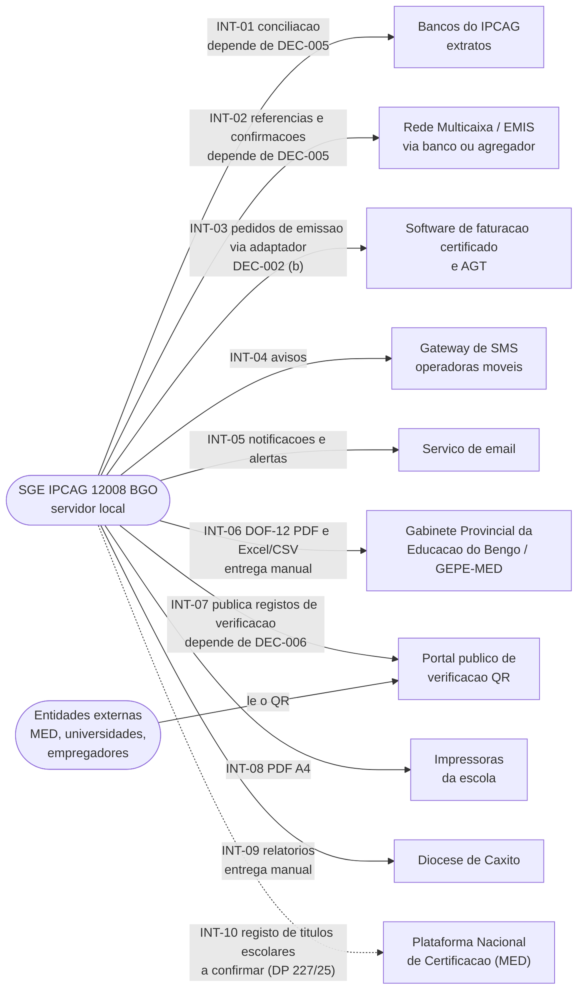
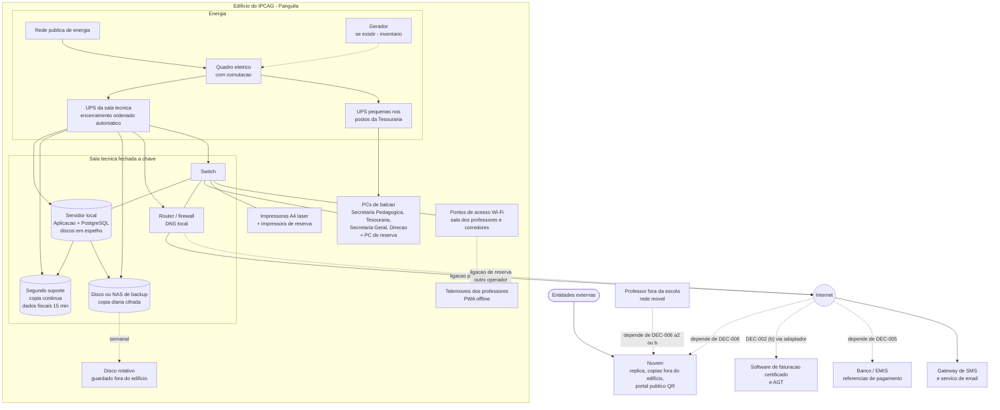
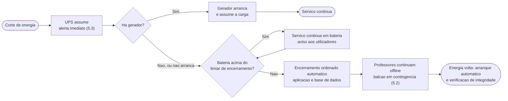
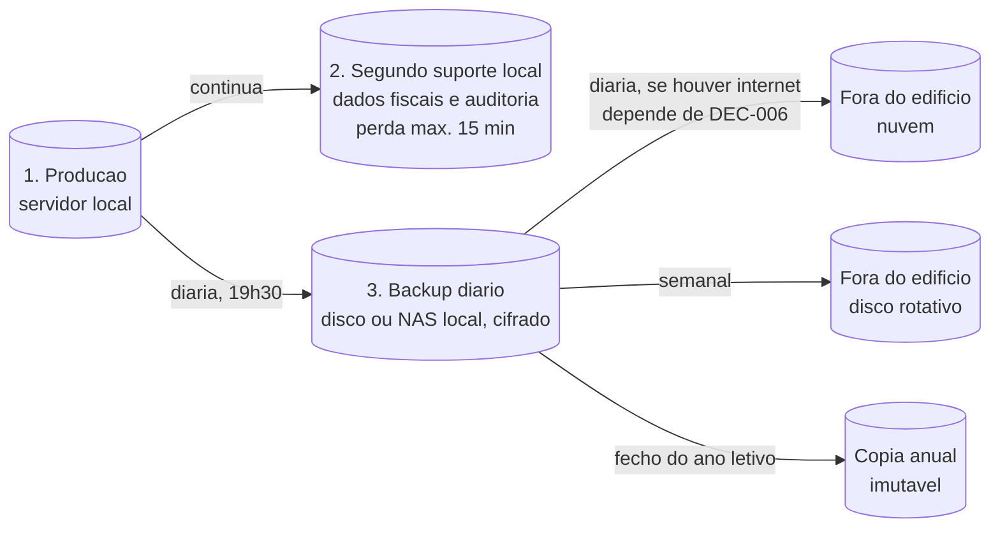
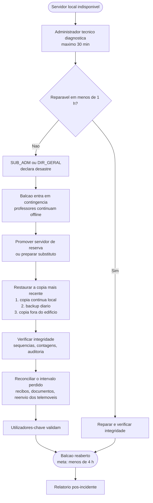

# Documento 09: Integrações, Infraestrutura e Operação — Ambiente Alvo e Continuidade do SGE

> [!abstract] Navegação
> - **Painel Principal:** [[Inicio|Início do Vault]] | **Índice do Projeto:** [[00 - MOC SGE IPCAG 12008 BGO|MOC]] | **Plano:** [[00.1 - Plano de Engenharia de Requisitos]] (lacunas L7 e L10, capacidade C18)
> - **Especificação (v1.2):** [[01 - Dominio e Regras]] → [[02 - Fluxos de Trabalho]] → [[03 - User Stories]] → [[04 - Telas e Documentos]] → [[05 - Modelagem de Dados]]
> - **Definição complementar:** [[06 - Visao e Ambito]] | [[07 - Catalogo de Requisitos Funcionais]] | [[08 - Requisitos Nao Funcionais]] | [[10 - Migracao de Dados e Implantacao]] | [[11 - Protecao de Dados (APD)]] | [[12 - Registo de Decisoes e Questoes em Aberto]]
> - **Áreas e Recursos:** [[Arquitetura de Software e DDD]] | [[Quadro Legal MED AGT e APD Angola]] | [[Verificacao das Referencias Legais]]
> - **Capacidades relacionadas:** [[01 - Dominio e Regras|DOC-01]] `RN-16` (perfil `ADMIN_TEC`, MFA, recuperação de acesso) | [[01 - Dominio e Regras|DOC-01]] `RN-13` (conciliação bancária)

> [!important] Objetivo deste documento
> Definir **com que sistemas externos o SGE comunica**, **em que infraestrutura corre** e **como é operado no dia a dia** (backups, recuperação de desastre, monitorização, atualizações, administração técnica, suporte, formação e custos) para cumprir as metas de [[08 - Requisitos Nao Funcionais]]. Fecha a lacuna **L10** e a capacidade **C18 — Operação do sistema** do [[00.1 - Plano de Engenharia de Requisitos|plano]], e prepara a decisão da lacuna **L7** (faturação AGT) descrevendo as alternativas.

> [!warning] Decisões por tomar — nada aqui assume a escolha
> Várias partes dependem de decisões ainda pendentes, que serão registadas em [[12 - Registo de Decisoes e Questoes em Aberto]]:
> - **`DEC-002`** — Faturação AGT (D2 do plano) → §3.1 — **decidida (b) a 2026-11-09**, homologação pendente
> - **`DEC-005`** — Pagamentos (D5) → §3.2
> - **`DEC-006`** — Alojamento (D6) → §3.3
>
> Para cada uma, as alternativas estão **lado a lado** e tudo o que delas depende está marcado `depende de DEC-00x`. Os valores de dimensionamento são **propostas a validar**; os custos estão listados **sem valores** (a orçamentar).
>
> **Estado no REG-12** (reproduzido, não decidido aqui): `DEC-002` `decidida` a 2026-11-09 na opção (b) — *software* certificado pela AGT atrás de um adaptador; o SGE gere o balcão e emite o recibo escolar interno —, homologação pendente; `DEC-005` `decidida` (a) registo manual de borderôs na E1, (b) reavaliada depois da E5; `DEC-006` `decidida` (a) servidor local + réplica na nuvem, com condições. Nenhuma está ainda homologada pela Direção, por isso as alternativas mantêm-se descritas por inteiro.

---

## 1. Âmbito e Princípios de Operação

### 1.1 O que esta nota cobre

| Parte | Conteúdo | Lacuna / Capacidade |
| :--- | :--- | :--- |
| §2 Integrações | Bancos, Multicaixa e referências de pagamento, AGT/SAF-T, SMS, email, exportação MED/GEPE, portal público QR, impressoras, Diocese | L7 (parcial), C10, C09, C15 |
| §3 Decisões pendentes | Alternativas lado a lado para `DEC-002`, `DEC-005` e `DEC-006` | L7, D2, D5, D6 |
| §4 Infraestrutura alvo | Servidor local, LAN, Wi-Fi, energia (UPS/gerador), internet, nuvem, diagrama | L10, C18 |
| §5 Operação | Backups 3-2-1, recuperação de desastre, monitorização, atualizações, administração técnica, suporte, formação, custos recorrentes | L10, C18 |
| §6 Calendário anual de operação | Tarefas de operação alinhadas com o ciclo do ano letivo | C18 |

### 1.2 Princípios

1. **A escola funciona primeiro; a internet é um bónus.** Nenhuma integração externa pode parar o balcão (RNF-DIS-02). Tudo o que precisa de internet tem fila e reenvio.
2. **Toda a integração tem um modo degradado** documentado: o que acontece, quem faz o quê e como se acerta depois.
3. **Operação à medida da escola.** Procedimentos curtos, listas de verificação e um administrador técnico local com apoio remoto — não uma equipa de informática que a escola não tem.
4. **O calendário manda.** Nada se altera nas épocas de matrícula, fecho de trimestre, conselhos de notas, exames e certificação (RNF-MAN-01; Princípio 1 do plano).
5. **Nada está protegido sem ensaio.** Um backup que nunca foi restaurado e uma contingência que nunca foi ensaiada contam como inexistentes (RNF-BKP-06, RNF-DIS-07).

---

## 2. Integrações

### 2.1 Mapa de integrações

### 2.2 Catálogo de integrações

| ID | Integração | Finalidade | Dados e sentido | Frequência | Forma provável (a confirmar) | Modo degradado | Depende de |
| :--- | :--- | :--- | :--- | :--- | :--- | :--- | :--- |
| **INT-01** | Bancos onde o IPCAG tem conta | Conciliar os borderôs registados com o que entrou de facto na conta; detetar talões falsos | **Entrada:** movimentos do extrato (data, valor, referência da operação). Nada sai do SGE | Diária ou semanal | Hoje: conferência física dos talões no fecho de caixa (Fluxo 07). Possível: importação do extrato em ficheiro descarregado do *homebanking* (formato por banco, a confirmar). A regra de conciliação é especificada na [[C10 - Cobranca, Relatorios Financeiros e Conciliacao\|C10]], como prevê o REG-12 para `DEC-005` | Conferência manual dos talões e do extrato em papel | `DEC-005`; `Q-007` |
| **INT-02** | Rede Multicaixa / referências de pagamento | Gerar uma referência por prestação ou emolumento e receber a confirmação automática do pagamento | **Saída:** referência, valor, validade. **Entrada:** confirmação (referência, valor, data/hora, identificador da operação) | Contínua | Através do banco, da EMIS (gestora da rede Multicaixa) ou de um agregador de pagamentos autorizado (a identificar) | Pagamento ao balcão com borderô (alternativa (a) de `DEC-005`, que se mantém) | `DEC-005` |
| **INT-03** | AGT — faturação e SAF-T (AO) | Cumprir as obrigações fiscais dos documentos de cobrança (hoje chamados "recibos" e "notas de estorno"; a lei fala de fatura, fatura-recibo, recibo e nota de crédito — [[Verificacao das Referencias Legais]] §4.2) | Com a `DEC-002` (b): o SGE envia os dados ao *software* certificado através do adaptador e recebe o número e o código (*hash*) do documento (`fatura_externa_numero`, `fatura_externa_hash`); o SAF-T e a comunicação à AGT são do *software* certificado | Por documento (comunicação em tempo real, se aplicável ao IPCAG) e periódica (SAF-T) | Ver §3.1 | Sem ligação, o balcão não bloqueia: recibo escolar provisório e pedido em `fila_emissao_fiscal`, regularizado quando o canal volta (`RN-09.5`); a contingência fiscal (DP n.º 71/25, art. 17.º–18.º) é do *software* certificado — ver Q08-06 de [[08 - Requisitos Nao Funcionais]] | `DEC-002`; `Q-LEG-19` |
| **INT-04** | Gateway de SMS | Avisos aos encarregados (cobrança, faltas, convocatórias) e, eventualmente, 2.º fator alternativo | **Saída:** número de telefone (+244) e texto de um modelo aprovado. **Entrada:** estado de entrega | Assíncrona, em fila | Contrato com operadora (Unitel, Africell, Movicel) ou agregador de SMS; condições e preço a apurar | Mensagens ficam em fila e são reenviadas; avisos urgentes em papel | `DEC-003`; nota [[11 - Protecao de Dados (APD)]] (RNF-PRV-10) |
| **INT-05** | Email | Notificações a funcionários, alertas técnicos de monitorização, envio de relatórios | **Saída:** mensagens a partir de um domínio da escola | Assíncrona, em fila | Fornecedor de envio de email com o domínio próprio configurado para não cair no lixo eletrónico | Fila com reenvio; alertas técnicos também no painel local (§5.3) | Domínio próprio (Q09-10) |
| **INT-06** | Exportação MED / GEPE | Reporte estatístico oficial | **Saída:** `DOF-12` em PDF e Excel/CSV (US-DOC-05) | Por trimestre e no fim do ano (a confirmar) | Exportação no SGE e entrega pelo canal que o Gabinete Provincial e o GEPE indicarem; modelo a confirmar com o último mapa enviado (§5.2 do plano) | A exportação não precisa de internet; a entrega faz-se depois | Q09-11 |
| **INT-07** | Portal público de verificação QR | Permitir a terceiros confirmar a autenticidade de documentos (`MOD-PUB-QR`, US-DOC-03) | **Saída do SGE:** registo mínimo de verificação de cada documento emitido ou anulado (RNF-PRV-01). **Entrada no portal:** consultas públicas | Publicação contínua; consultas a qualquer hora | Ver §2.3 | O código pode ser digitado manualmente; o portal indica a data da última atualização | `DEC-006` |
| **INT-08** | Impressoras | Imprimir os 12 documentos oficiais e os recibos | **Saída:** PDF gerado no servidor, impresso pelo navegador | Contínua no horário de serviço | Impressoras laser A4 em rede ou USB; A3 opcional para `DOF-05` | Imprimir noutro posto ou impressora de reserva; o PDF fica guardado para impressão posterior | Inventário (M4 da nota 08) |
| **INT-09** | Diocese de Caxito | Relatórios de bolsas, isenções diocesanas e, eventualmente, mapas financeiros | **Saída:** PDF / Excel (saída prevista em `MOD-TES-TAB`) | A definir | Exportação e entrega manual | Não aplicável | Q09-15 |
| **INT-10** | Plataforma Nacional de Certificação (MED) — **a confirmar** | Registo dos títulos escolares e QR oficial, segundo o DP n.º 227/25 (art. 8.º, n.º 3) citado na [[Verificacao das Referencias Legais]] (`COR-LEG-19`) | **Saída:** dados dos títulos emitidos (certificados). **Entrada:** eventualmente o QR ou o código da plataforma | Até 30 dias após o fim do ano letivo, segundo a mesma fonte | Desconhecida: não se sabe se a plataforma já funciona, nem se aceita ficheiro, formulário ou integração (`Q-LEG-14`) | Registo manual na plataforma, se existir | `Q-LEG-14`; Q09-18 |

### 2.3 Portal público de verificação QR (INT-07)

- **Onde fica:** `depende de DEC-006` (§3.3). Para cumprir RNF-DIS-06 (disponível 24 h, independentemente da energia e da internet do Panguila), o portal tem de estar alojado fora do edifício.
- **O que publica:** apenas o registo mínimo aprovado na nota [[11 - Protecao de Dados (APD)]] (RNF-PRV-01). O portal **não acede à base de dados de produção**; recebe do servidor local, num só sentido, os registos de verificação dos documentos emitidos e as anulações (por exemplo, um recibo anulado por Nota de Estorno).
- **Atualização:** proposta de **≤ 15 min** entre a emissão/anulação no servidor local e a publicação, quando há internet. Sem internet, o portal continua a responder com a última informação recebida e mostra "estado verificado em DD/MM/AAAA HH:MM".
- **Endereço permanente:** o QR impresso aponta para um domínio próprio da escola ou da Diocese, que nunca muda (RNF-AUD-08). Mudar de fornecedor de alojamento não pode invalidar os QR já impressos.
- **Proteção:** limite de consultas por origem, códigos com aleatoriedade suficiente e páginas não indexáveis por motores de pesquisa (RNF-SEG-09); cada consulta é registada (pós-condição de US-DOC-03) e o registo é guardado 12 meses (`PC-25` da nota 11).
- **Prazo da resposta detalhada:** para documentos sem `Livro/Folha/Termo` (declarações, boletins, recibos), a nota 11 propõe resposta detalhada durante 5 anos e depois apenas "documento emitido em [data] — contacte a Secretaria" (`PC-19`, RNF-PRV-01).
- **Chave HMAC:** fica no servidor local, nunca no portal; o portal só guarda os códigos já calculados (RNF-SEG-08).
- **Títulos escolares e Plataforma Nacional de Certificação:** se se confirmar que os certificados têm de levar o QR da plataforma nacional do DP n.º 227/25 (INT-10, `Q-LEG-14`), o portal da escola fica para os restantes documentos (declarações, boletins, recibos, pautas). Até haver resposta, o desenho do portal não muda.

### 2.4 Requisitos comuns a todas as integrações

| Requisito | Porquê | RNF |
| :--- | :--- | :--- |
| Credenciais e segredos fora do código e da base de dados, com acesso restrito | Evitar fugas e permitir troca de credenciais | RNF-SEG-07, RNF-SEG-12 |
| Fila de saída com reenvio e chave de idempotência | Internet intermitente não pode duplicar nem perder mensagens ou pagamentos | RNF-DIS-02, RNF-OFF-05 |
| Registo de cada troca (o quê, quando, resultado) | Investigar falhas e provar o que foi enviado | RNF-AUD-02 |
| Testes no ambiente de testes do fornecedor antes de produção | Nenhum teste com pagamentos ou documentos fiscais reais | RNF-MAN-07 |
| Modo degradado documentado e ensaiado | A escola sabe o que fazer quando o serviço externo falha | RNF-DIS-07 |
| Contrato com condições de serviço, suporte e saída (como recuperar os dados no fim do contrato) | Reduzir a dependência de um fornecedor | — |

---

## 3. Decisões Pendentes — Alternativas Lado a Lado

> [!info] Como ler esta secção
> Para cada decisão: o contexto, as alternativas **lado a lado** pelos mesmos critérios, a informação que falta para decidir e o que muda na especificação. **Não há recomendação**: a decisão cabe à Direção do IPCAG e fica registada em [[12 - Registo de Decisoes e Questoes em Aberto]].

### 3.1 `DEC-002` — Faturação AGT (decidida (b) a 2026-11-09)

> [!success] Decisão (2026-11-09, homologação pendente)
> A `DEC-002` adotou a **opção (b)**: os documentos fiscais (`FT`, `FR`, `RC`, `NC`, `RE`) são emitidos pelo *software* certificado pela AGT, através de um adaptador; o SGE gere o balcão (conta corrente, borderôs, semáforo, fecho de caixa) e emite o recibo escolar interno. Sem ligação, o balcão **não bloqueia**: recibo escolar provisório e pedido em `fila_emissao_fiscal`; a contingência fiscal é do *software* certificado. 🟡 Falta escolher o *software* (`Q-002`) e confirmar o regime de IVA (`DEC-026`). A comparação abaixo fica como registo das alternativas avaliadas.

**Contexto (antes da decisão).** A especificação atual (RN-09; DOC-05 Grupo 5; `DOF-11A`, `DOF-11B`, `DOF-11C`) trata recibos e notas de estorno como documentos fiscais imutáveis emitidos pelo próprio SGE, com numeração sequencial anual sem saltos. Não está decidido se o SGE será certificado pela AGT como *software* de faturação (com SAF-T AO) ou se se liga a um *software* já certificado (lacuna L7).

> [!note] Estado e enquadramento legal (2026-11-02, antes da decisão)
> - **REG-12 (então):** `aguarda Direção`. Proposta do analista: (b), com um adaptador como ponto único de emissão, de forma a poder mudar para (a) mais tarde. Para fechar: parecer fiscal (`Q-001`, `Q-003`), inventário do *software* atual (`Q-002`), custo e prazo (`Q-013`) e despacho do `DIR_GERAL`.
> - **Verificação legal** ([[Verificacao das Referencias Legais]] §4): o DP n.º 292/18 foi **revogado** pelo DP n.º 71/25; a base atual é o DP n.º 71/25, o DE n.º 683/25 e o Código do IVA. A obrigação de faturar existe mesmo com isenção de IVA; a correção faz-se por **nota de crédito**; no Regime Geral de IVA há comunicação em tempo real à AGT, com modo de contingência. Qual destas obrigações se aplica ao IPCAG depende do seu regime de IVA, ainda desconhecido (`Q-LEG-19`). A tabela abaixo incorpora estes pontos sem os repetir em detalhe.

| Critério | **(a) SGE certificado pela AGT, com SAF-T (AO)** | **(b) Integração com *software* de faturação já certificado** |
| :--- | :--- | :--- |
| Quem emite o documento fiscal | O SGE, como especificado no RN-09 | O *software* certificado; o SGE envia os dados e guarda o número e o estado devolvidos |
| Numeração sequencial e Nota de Estorno | Controladas pelo SGE (RN-09, RN-09.2) | Controladas pelo *software* externo; o SGE guarda uma cópia de referência |
| Ficheiro SAF-T (AO) | Gerado pelo SGE | Gerado pelo *software* externo |
| Certificação | O projeto cumpre os requisitos técnicos da AGT e obtém a validação: modelo de dados do DE n.º 683/25, comunicação à AGT, contingência e SAF-T, segundo a verificação legal (prazo e custo a confirmar junto da AGT) | Já obtida pelo fornecedor (confirmar validade e versão) |
| Motor anti-fraude de borderô (RN-09.1) | No SGE | Continua no SGE: o borderô é validado antes de pedir a emissão |
| Funcionamento sem internet (RNF-DIS-02) | Possível em modo de contingência (DP n.º 71/25, art. 18.º), com comunicação posterior à AGT antes do bloqueio por 60 dias sem comunicar (art. 17.º), se o regime de IVA do IPCAG o exigir (`Q-LEG-19`) | Só se o *software* externo funcionar na rede local ou tiver contingência local; se for apenas na nuvem, **a emissão de documentos fiscais para quando a internet cai** |
| Tempo de emissão (RNF-DES-01) | Controlado pelo SGE | Soma o tempo de resposta do *software* externo |
| Recuperação de desastre (RNF-BKP-02) | Totalmente a cargo da escola | Partilhada: os documentos fiscais ficam também no fornecedor |
| Risco de dupla digitação | Nenhum | Existe se não houver ligação automática (programática ou por ficheiro); obriga a conciliação diária SGE ↔ *software* |
| Alterações legais futuras | A equipa do SGE acompanha e adapta | O fornecedor acompanha; o SGE só adapta a integração |
| Natureza dos custos | Desenvolvimento, certificação e manutenção legal contínua | Licença ou assinatura, desenvolvimento da integração |
| Dependência de terceiros para emitir | Nenhuma | Do fornecedor (continuidade, preço, suporte, interface de integração) |
| Impacto na especificação | Nenhum no desenho atual; acrescentar os requisitos de certificação ao catálogo | Rever RN-09, DOC-05 Grupo 5 (`recibos_oficiais`, `notas_estorno` passam a espelho) e `DOF-11A` / `DOF-11B` |
| Prazo até estar operacional | Inclui o processo de certificação (duração a confirmar) | Inclui a escolha do fornecedor e a integração |

**Informação que faltava para decidir** (o que ainda está em aberto depois da decisão: o regime de IVA — `DEC-026` — e o *software* em uso — `Q-002`):
- Em que regime de IVA está o IPCAG (ou a Diocese, se for ela a faturar) e que obrigações concretas daí decorrem (*software* validado, fatura eletrónica, comunicação em tempo real)? (`Q-001`, parcialmente respondida; `Q-003`; `Q-LEG-16` a `Q-LEG-19`)
- A escola já usa algum *software* de faturação ou de contabilidade? (`Q-002`)
- Que requisitos, prazo e custo tem a validação junto da AGT? (`Q-013`)
- Que *software* certificado existe no mercado com interface de integração e contingência local?

**Quem decide:** Direção Executiva (`DIR_GERAL`, com parecer do `SUB_ADM`), como regista o REG-12, com parecer de um contabilista ou consultor fiscal.

### 3.2 `DEC-005` — Pagamentos (depende de DEC-005)

**Contexto.** A especificação atual (RN-09, RN-09.1; Fluxo 07; `MOD-TES-CXA`) assume que o encarregado paga no banco, ATM, TPA ou Multicaixa Express e apresenta o comprovativo, que o `OP_TES` regista como borderô com controlo de saldo.

> [!note] Estado no REG-12 (2026-11-02)
> `decidida` pelo analista, homologação da Direção pendente: **(a) na E1**, tal como especificado, com a conciliação bancária dentro da C10 (por importação de extrato, se o banco o fornecer — `Q-007`); **(b) fora das entregas E1–E5**, reavaliada depois da E5 como pedido de alteração. A comparação abaixo mantém-se para essa reavaliação e para a homologação.

| Critério | **(a) Registo manual de borderôs (como especificado)** | **(b) Integração com referências Multicaixa / gateway de pagamento** |
| :--- | :--- | :--- |
| Como paga o encarregado | No banco, ATM, TPA ou Multicaixa Express; leva o talão à Tesouraria | Recebe uma referência por prestação ou emolumento (impressa, por SMS ou no boletim) e paga em ATM, Multicaixa Express ou *homebanking* |
| Como o SGE sabe que foi pago | O `OP_TES` regista o borderô (RN-09.1) | Confirmação automática da rede (notificação recebida ou consulta periódica); o recibo é emitido automaticamente ou pelo `OP_TES` |
| Fraude de talões | Reduzida pela chave única e pelo controlo de saldo, mas um talão falso só é detetado na conciliação | Eliminada nos pagamentos por referência (a confirmação vem da rede); mantém-se nos restantes canais |
| Carga do balcão | Todos os pagamentos passam pelo balcão | Os pagamentos por referência dispensam deslocação |
| Conciliação bancária | Manual (talões contra extrato) | Automática para referências; manual para o resto |
| Dependência da internet | Nenhuma no balcão | Necessária para confirmar pagamentos: o servidor fala com o fornecedor e, se houver notificações, tem de as receber (ver §3.4) |
| Contratos | Nenhum novo | Com o banco, a EMIS ou um agregador autorizado (a identificar); condições e comissões a apurar |
| Segurança adicional | — | Segredos de integração, autenticação das notificações, idempotência |
| Modelo de dados | Como está (DOC-05 Grupo 5) | Nova entidade de referências de pagamento com estados; ligação ao borderô e ao recibo; rever a lista controlada 16 (canais) do DOC-05 §1.3 |
| Coexistência | — | **Não substitui (a)**: TPA e depósitos continuam; (b) acrescenta um canal |
| Natureza dos custos | Tempo de balcão e de conferência | Comissões por transação, integração e manutenção |
| Prazo | Nenhum adicional | Negociação, integração e testes com o fornecedor |

**Variante dentro de (a):** importação do extrato bancário em ficheiro para conciliação semiautomática dos borderôs (INT-01), sem contrato de gateway. Não é uma terceira alternativa da decisão; é a melhoria de (a) que o REG-12 coloca na C10.

**Informação que falta para decidir (ou reavaliar):** bancos e contas do IPCAG; se existe TPA e de que banco; se o banco disponibiliza referências de pagamento e extrato digital (`Q-007`); volume real de pagamentos (M6 da nota 08); quantos encarregados usam Multicaixa Express ou *homebanking* (`Q-008`); condições e comissões; se os emolumentos de certificados se pagam por referência ao Estado (`Q-LEG-14`).

**Quem decide:** `DIR_GERAL` e `SUB_ADM`.

### 3.3 `DEC-006` — Alojamento (depende de DEC-006)

**Contexto.** A especificação atual (RN-10 §4; [[Arquitetura de Software e DDD]] §2; DOC-05 §1.2) descreve a alternativa (a): servidor local na LAN com replicação assíncrona para a nuvem. As alternativas (b) e (c) obrigariam a rever esses textos.

> [!note] Estado no REG-12 (2026-11-02)
> `decidida` pelo analista, homologação da Direção pendente: **(a)**, com três condições — (1) o inventário da Fase B (`Q-006`) confirma rede local, energia protegida e internet suficiente para a réplica; (2) a questão da autoridade central (`Q-015`) é resolvida nesta nota — ver a proposta no §3.5; (3) a localização dos dados de menores (`Q-016`) é resolvida antes de escolher o fornecedor de nuvem. A comparação abaixo mantém-se completa para a homologação e para o caso de a condição (1) falhar.

| Critério | **(a) Servidor local + réplica na nuvem** | **(b) Só nuvem** | **(c) Só local** |
| :--- | :--- | :--- | :--- |
| Balcão com a internet em baixo (RNF-DIS-02) | Funciona (LAN) | **Para** | Funciona (LAN) |
| Professores fora da escola | Depende da sub-opção (a1/a2, abaixo) | Sincronizam a partir de qualquer rede | Só sincronizam na escola |
| Portal QR 24 h (RNF-DIS-06) | Na nuvem, independente do Panguila | Na nuvem | Depende da energia e da internet do Panguila e de expor o servidor local à internet |
| Cópia fora do edifício (RNF-BKP-04) | Na nuvem, mais disco rotativo | No fornecedor; recomenda-se cópia própria | Só disco rotativo levado à mão |
| Perda máxima com internet (RNF-BKP-01) | Minutos (replicação) | Definida pelo fornecedor | 24 h (o RPO de 15 min dos dados fiscais mantém-se pela cópia local, RNF-BKP-02) |
| Desastre no edifício (incêndio, roubo) | Recupera-se a partir da nuvem | Não afeta os dados | Recupera-se do disco rotativo (perda até 7 dias, RNF-BKP-04) |
| Energia | UPS/gerador para servidor e rede | Só PCs, rede e *router* — mas sem internet nada funciona | UPS/gerador para servidor e rede |
| Internet | Precisa para réplica e portal, não para o balcão | **Crítica**: no mínimo 2 ligações de operadores diferentes | Mínima |
| Complexidade de operação | A maior (2 locais, replicação, monitorização de ambos) | A menor localmente; depende do fornecedor | Média |
| Dados fora de Angola (RNF-PRV-07) | Réplica e portal: proposta da nota 11 é alojar **em Angola**, salvo notificação ou autorização prévia da APD (`RNF-PRV-07`, `Q-016`) | Todo o sistema sujeito à mesma regra | Não |
| Natureza dos custos recorrentes | Equipamento local, nuvem e internet | Nuvem e internet redundante | Equipamento local e internet básica |
| Compatibilidade com a especificação atual | É o desenho descrito no RN-10 §4 | Obriga a rever o RN-10 §4 e o desenho do balcão | Obriga a rever o RN-10 §4 (sem réplica) e o portal QR |

**Sub-opções de (a):**

| Sub-opção | Descrição | Consequência |
| :--- | :--- | :--- |
| **(a1) Nuvem passiva** | A nuvem guarda a réplica de leitura, as cópias fora do edifício e o portal QR. Só o servidor local aceita escritas. | Mais simples. Um professor em casa continua a lançar *offline* e sincroniza quando chega à escola (dentro dos 7 dias de RNF-OFF-01). |
| **(a2) Nuvem como ponto de sincronização** | Além de (a1), a nuvem recebe a fila dos professores fora da escola e entrega-a ao servidor local, que continua a ser a autoridade (RN-10). | Professores sincronizam de qualquer lado, mas aumenta a complexidade (conflitos, mesmo endereço dentro e fora — RNF-OFF-12). |

**Informação que falta para decidir (ou confirmar):** fiabilidade real da internet (M2 da nota 08; `Q-006`); existência de gerador (Q09-04); se os professores querem lançar fora da escola (escolha entre a1 e a2); restrições à localização dos dados (`Q-016`, nota 11); oferta de alojamento em Angola; orçamento (`Q-013`). A `DEC-001` está registada como instalação única, o que não pressiona para uma componente central multi-escola.

**Quem decide:** `DIR_GERAL`, ouvido o `SUB_ADM` (custos) e o `SUB_PED` (impacto nos professores).

### 3.4 Interdependências entre decisões

Estas consequências decorrem das próprias alternativas; servem para evitar combinações incoerentes, não para recomendar nenhuma.

| Combinação | Consequência |
| :--- | :--- |
| `DEC-002 (b)` com *software* de faturação só na nuvem | A emissão dos documentos fiscais depende da internet, em qualquer alternativa de `DEC-006`; o balcão continua a funcionar com o recibo escolar provisório e a `fila_emissao_fiscal` (`RN-09.5`), e os documentos são regularizados quando a ligação volta (RNF-DIS-02). |
| `DEC-005 (b)` com `DEC-006 (c)` | O servidor local tem de consultar periodicamente o fornecedor de pagamentos, porque receber notificações exige um ponto acessível da internet. |
| `DEC-006 (c)` | O portal QR depende da energia e da internet do Panguila; RNF-DIS-06 dificilmente se cumpre. |
| `DEC-003` com portal ou app para encarregados | Exige acesso público a partir da internet, logo uma componente na nuvem: (a) ou (b) de `DEC-006`. |
| `DEC-001 (b)` várias escolas | Favorece uma componente central na nuvem: (b), ou (a) com um servidor local por escola. |

### 3.5 Autoridade central com servidor local e réplica — proposta de resposta à `Q-015`

A `Q-015` do REG-12 pergunta qual dos dois servidores (local ou nuvem) é a autoridade sobre o estado do trimestre e como se resolvem conflitos entre um balcão *offline* e a nuvem. Proposta técnica, **a validar pela equipa técnica e homologar com a `DEC-006`**:

| # | Regra proposta | Porquê |
| :---: | :--- | :--- |
| A1 | **O servidor local é a única autoridade** sobre todas as escritas e sobre o estado de trimestres, mini-pautas, matrículas, borderôs e numeração de documentos. A hora que conta é a do servidor local (RN-10; RNF-OFF-09). | Uma só fonte de verdade evita duas numerações de recibos e dois estados do mesmo trimestre. |
| A2 | **A nuvem nunca decide.** Na sub-opção (a1) é só leitura (réplica, cópias, portal). Na sub-opção (a2) guarda filas de professores fora da escola e entrega-as ao servidor local, que aplica, rejeita ou envia para `conflitos_sincronizacao` como faria com um envio direto. | A regra de conflitos do DOC-05 §1.2 continua a valer sem alterações. |
| A3 | **Os balcões só escrevem no servidor local.** Se o servidor local estiver em baixo, o balcão passa a contingência (§5.2), **não** à nuvem. Por isso não existe conflito "balcão *offline* contra nuvem". | Elimina a segunda metade da `Q-015` pela raiz. |
| A4 | **Promoção da réplica só por declaração humana.** Num desastre (DR-06), a réplica na nuvem só passa a autoridade se o `DIR_GERAL` ou o `SUB_ADM` o declararem, e o servidor local antigo fica impedido de voltar a escrever até ser ressincronizado a partir da nova autoridade. Nunca há promoção automática. | Evita dois servidores a escrever ao mesmo tempo depois de um corte de rede. |
| A5 | **Regresso ao local depois de uma promoção** faz-se numa interrupção letiva, com verificação de integridade (RNF-BKP-09) antes e depois. | A troca de autoridade é rara e controlada. |

### 3.6 Correspondência com o REG-12

| Nesta nota | No REG-12 |
| :--- | :--- |
| §3.1 | `DEC-002`; `Q-001`, `Q-002`, `Q-003`, `Q-004`, `Q-013` (resolvida na `DEC-017`) |
| §3.2 | `DEC-005`; `Q-007`, `Q-008` |
| §3.3 | `DEC-006`; `DEC-017` (modelo financeiro e operação); `Q-006`, `Q-013` (resolvida), `Q-016` |
| §3.5 | `Q-015` (proposta de resposta) |
| §5.5, §5.6 | `DEC-017` (governação, operação N1–N3 e sustentabilidade orçamental) |

---

## 4. Infraestrutura Alvo

### 4.1 Diagrama

O diagrama mostra a alternativa (a) de `DEC-006`, que é a descrita na especificação atual. As ligações a tracejado dependem de decisões pendentes ou do inventário; §4.4 mostra o que muda em (b) e (c).

### 4.2 Componentes

> [!caution] Dimensionamento indicativo
> Os valores abaixo são **propostas** para orientar o orçamento. Têm de ser revistos depois de conhecida a volumetria real (nota 08 §2.2) e o inventário da infraestrutura existente (M4).

| Componente | Função | Proposta (a validar) | RNF | Existe hoje? |
| :--- | :--- | :--- | :--- | :---: |
| **Servidor local** | Aplicação, base de dados PostgreSQL, ficheiros anexos, geração de PDF | Equipamento de classe servidor ou estação robusta; 2 discos SSD em espelho; memória e processador escolhidos para cumprir RNF-ESC-02 (CPU média < 50% no pico) com a base de referência | RNF-DIS-01, RNF-CAP, RNF-ESC-02 | Inventário |
| **Segundo suporte de cópia contínua** | Garantir perda ≤ 15 min dos dados fiscais e de auditoria sem depender da internet | Variante 1: servidor de reserva em espera que recebe replicação contínua (também acelera o RTO). Variante 2: NAS que recebe os registos de transação contínuos | RNF-BKP-02, RNF-BKP-03 | Inventário |
| **Disco ou NAS de backup diário** | Cópia diária cifrada dentro do edifício | Capacidade para a retenção de RNF-BKP-08 | RNF-BKP-05, RNF-BKP-07 | Inventário |
| **Disco rotativo** | Cópia fora do edifício quando a internet não chega | 2 discos alternados semanalmente; local de guarda a definir (Q09-06) | RNF-BKP-04 | — |
| **UPS da sala técnica** | Manter servidor e rede durante cortes; encerrar ordenadamente | Autonomia ≥ 30 min ou até o gerador assumir; comunicação com o servidor para encerramento automático | RNF-DIS-03 | Inventário |
| **UPS nos postos da Tesouraria** | Terminar o atendimento em curso num corte | Pequena UPS por posto de caixa (proposta) | RNF-DIS-03, RNF-BKP-02 | Inventário |
| **Gerador** | Energia prolongada | Só se existir: arranque automático ou manual, combustível, ensaio mensal | RNF-DIS-01, RNF-DIS-03 | Q09-04 |
| **Router / firewall com DNS local** | Ligação à internet, segurança, e fazer o mesmo endereço do SGE apontar para o servidor local dentro da LAN | Equipamento gerível; DNS local configurado | RNF-OFF-12, RNF-SEG-06 | Inventário |
| **Ligação de internet principal** | Réplica, portal, SMS, email, integrações | Tipo e débito a definir após M2 | RNF-DIS-06 | Q09-05 |
| **Ligação de reserva** | Continuidade quando a principal falha | Rede móvel de um operador diferente da principal | RNF-DIS-06 | Q09-05 |
| **Switch e cablagem** | LAN dos balcões | Cablagem estruturada até cada posto de balcão (sem Wi-Fi nos balcões) | RNF-DIS-01 | Inventário |
| **Pontos de acesso Wi-Fi** | Sincronização dos professores na escola | Quantidade e localização definidas pela medição M7 (sala dos professores, corredores) | RNF-DES-05, RNF-OFF-07 | Q08-13 |
| **PCs de balcão + 1 de reserva** | Atendimento | Ver RNF-DSP-01; 1 PC de reserva pré-configurado | RNF-DIS-08 | Inventário |
| **Impressoras A4 laser + 1 de reserva** | Documentos oficiais e recibos | Laser A4 em rede; A3 se a escola optar pela `DOF-05` em A3 | RNF-IMP-01 a 04 | Inventário |
| **Domínio próprio e certificado TLS** | Endereço permanente do SGE e do portal QR | Domínio registado em nome da escola ou da Diocese; certificado reconhecido pelos telemóveis, com renovação automática | RNF-AUD-08, RNF-SEG-06, RNF-OFF-12 | Q09-10 |
| **Referência de hora** | Autoridade temporal do servidor | Sincronização do relógio com servidores públicos de hora quando há internet; os postos da LAN sincronizam com o servidor | RNF-AUD-05 | — |
| **Sala técnica** | Proteção física | Fechada à chave, ventilada, longe de humidade, acesso registado | RNF-SEG-13 | Inventário |
| **Nuvem** | Réplica, cópias fora do edifício, portal QR | `depende de DEC-006`; alojamento em Angola salvo autorização da APD (RNF-PRV-07); chaves de cifra geridas pelo IPCAG, nunca pelo fornecedor (RNF-SEG-07) | RNF-DIS-06, RNF-BKP-04, RNF-PRV-07 | — |

### 4.3 Energia: o que acontece num corte

### 4.4 O que muda em cada alternativa de `DEC-006`

| Componente | (a) Local + nuvem | (b) Só nuvem | (c) Só local |
| :--- | :---: | :---: | :---: |
| Servidor local, segundo suporte, UPS da sala técnica | Sim | Não (só PCs, rede e *router*) | Sim |
| Disco ou NAS de backup diário | Sim | Recomendado (cópia própria) | Sim |
| Disco rotativo | Sim (reserva da nuvem) | Não | Sim (única cópia fora do edifício) |
| Ligação de reserva à internet | Recomendada | **Obrigatória** | Opcional |
| Nuvem | Réplica, cópias, portal | Todo o sistema | Não |
| Portal QR | Na nuvem | Na nuvem | No servidor local, exposto à internet |
| DNS local com o mesmo endereço | Sim | Não necessário | Sim |

---

## 5. Operação

### 5.1 Backups 3-2-1

**Regra 3-2-1:** pelo menos **3 cópias** dos dados, em **2 tipos de suporte** diferentes, com **1 fora do edifício** (RNF-BKP-05). Os discos em espelho do servidor protegem contra a avaria de um disco, **não são backup**: um erro ou um *ransomware* é copiado instantaneamente para o espelho.

| Cópia | O quê | Onde | Frequência (proposta) | Retenção (RNF-BKP-08) | RNF |
| :--- | :--- | :--- | :--- | :--- | :--- |
| Produção | Tudo | Servidor local (discos em espelho) | — | — | — |
| Cópia contínua local | Base de dados completa, com prioridade para recibos, notas de estorno, fechos de caixa, documentos emitidos e `audit_logs` | Segundo suporte (§4.2) | Contínua | Até ao backup diário seguinte | RNF-BKP-02 |
| Backup diário | Base de dados, anexos, configuração, versão da aplicação | Disco ou NAS local, cifrado | Diária às **19h30** (depois do fim do turno da tarde, às 18h05, e do fecho de caixa) | 14 diárias, 8 semanais, 12 mensais | RNF-BKP-01, RNF-BKP-07 |
| Fora do edifício (nuvem) | Cópia do backup diário | Nuvem — `depende de DEC-006` | Diária, quando há internet | Igual ao backup diário | RNF-BKP-04 |
| Fora do edifício (disco rotativo) | Cópia do backup diário | Local seguro fora do edifício (Q09-06) | Semanal (2 discos alternados) | 2 semanas | RNF-BKP-04, RNF-BKP-10 |
| Cópia anual | Fotografia completa no fecho do ano letivo | Disco desligado e, se aplicável, nuvem | Anual | **10 anos** (`PC-29` da nota 11) | RNF-BKP-08, RNF-BKP-10 |

**Conservação e cópias:** quando um dado é eliminado ou anonimizado por prazo de conservação (nota 11 §5), continua nas cópias até ao fim da rotação; isto tem de constar do aviso de privacidade (`PC-20`).

**O que entra nos backups:** base de dados, ficheiros anexos, configuração, certificados e versão da aplicação. **As chaves** (cifragem dos backups, chave HMAC do QR) **nunca vão no mesmo suporte que os dados**: ficam em envelope selado em 2 locais distintos (proposta: cofre da escola e Diocese de Caxito, Q09-06), com acesso de 2 pessoas (RNF-BKP-07, RNF-SEG-08). Perder a chave dos backups equivale a perder os backups.

**Os telemóveis dos professores não são backup.** A fila local é temporária; o histórico de 7 dias de operações confirmadas (RNF-OFF-10) só serve para recuperar o intervalo perdido num restauro.

**Rotina de verificação:**

| Quando | O quê | Quem |
| :--- | :--- | :--- |
| Diário (automático) | Backup concluído, tamanho dentro do normal, cópia contínua sem atraso, cópia na nuvem enviada | Monitorização (§5.3) |
| Diário (2 min) | Ver o painel de estado: tudo verde? | Administrador técnico |
| Semanal | Trocar o disco rotativo e levá-lo para fora do edifício; registar a troca | Administrador técnico |
| Mensal | Restaurar uma amostra (ex.: um aluno, um dia de recibos) no ambiente de testes; verificar a regra 3-2-1 | Administrador técnico; resultado visto pelo `SUB_ADM` |
| Por trimestre (interrupção letiva) | Ensaio completo de recuperação de desastre (§5.2), cronometrado | Administrador técnico + N3; relatório ao `DIR_GERAL` |

### 5.2 Recuperação de desastre

#### Cenários

| ID | Cenário | Impacto | Resposta | Meta |
| :---: | :--- | :--- | :--- | :--- |
| **DR-01** | Corte de energia curto (dentro da autonomia da UPS) | Nenhum | UPS assume; gerador, se existir (§4.3) | Serviço contínuo |
| **DR-02** | Corte de energia prolongado sem gerador | Servidor encerrado ordenadamente | Professores continuam *offline*; balcão em contingência; arranque e verificação quando a energia volta | 0 dados perdidos (RNF-DIS-03) |
| **DR-03** | Internet em baixo (horas ou dias) | Réplica, portal (desatualizado), SMS, email e integrações em espera | Nada a fazer no balcão (RNF-DIS-02); filas esvaziam quando a internet volta; se > 7 dias, levar a cópia física para fora | Balcão sem impacto |
| **DR-04** | Avaria de um disco do servidor | Nenhum imediato (espelho) | Substituir o disco; reconstruir o espelho fora do horário | Sem paragem |
| **DR-05** | Avaria do servidor (equipamento) | Balcão parado | Procedimento abaixo; promover o servidor de reserva se existir | RTO < 4 h; perda ≤ 15 min nos dados fiscais |
| **DR-06** | Perda total do servidor e das cópias locais (incêndio, roubo, inundação) | Balcão parado; equipamento a substituir | Procedimento abaixo, restaurando da cópia fora do edifício | RTO a acordar com a Direção (depende da obtenção de equipamento); perda ≤ 24 h com nuvem, ≤ 7 dias só com disco rotativo |
| **DR-07** | Corrupção lógica, *ransomware* ou atualização com defeito grave | Dados errados ou cifrados | Isolar o servidor; restaurar a cópia imutável ou o último backup bom; reversão de atualização (RNF-MAN-02) | RTO < 4 h |
| **DR-08** | Conta comprometida ou chave HMAC exposta | Risco de fraude ou falsificação | Bloquear contas; trocar palavras-passe e chave HMAC (RNF-SEG-08); analisar `audit_logs`; avaliar notificação (nota 11) | Troca de chave ≤ 24 h |
| **DR-09** | Falha prolongada de um serviço externo (nuvem, SMS, pagamentos, faturação) | Depende do serviço | Modo degradado da integração (§2.2); acionar o contrato | Conforme o contrato |

#### Procedimento para DR-05 e DR-06 (perda do servidor local)

| Passo | O quê | Quem | Notas |
| :---: | :--- | :--- | :--- |
| 1 | **Diagnosticar** (máximo 30 min) e informar o `SUB_ADM` | Administrador técnico | Registar a hora de início: conta para o RTO |
| 2 | **Declarar o desastre** e ativar a contingência | `SUB_ADM` ou `DIR_GERAL` | Em contingência, o balcão emite o recibo escolar provisório e guarda os pedidos fiscais em `fila_emissao_fiscal` (`DEC-002` §5, `RN-09.5`); a contingência fiscal é do *software* certificado (Q08-06). Os atos de contingência são registados num formulário próprio para entrada posterior no sistema (RNF-DIS-07) |
| 3 | **Avisar os professores** | `SUB_PED` (via utilizadores-chave) | Continuar a lançar *offline*; **não reinstalar a aplicação nem limpar os dados do navegador** (perderiam a fila) |
| 4 | **Obter equipamento** | Administrador técnico | Promover o servidor de reserva (variante 1 do §4.2) ou preparar substituto |
| 5 | **Restaurar** a cópia mais recente disponível, por ordem: cópia contínua local → backup diário → cópia fora do edifício | Administrador técnico, com N3 | Restauro em produção só com 2 pessoas presentes (§5.5) |
| 6 | **Verificar a integridade** (RNF-BKP-09) | Administrador técnico | Relatório automático: sequências de recibos e notas de estorno sem saltos não explicados; contagens; encadeamento de `audit_logs` (RNF-AUD-04) |
| 7 | **Reconciliar o intervalo perdido** entre o ponto de restauro e a falha | `CHEFE_SEC_GER`, `CHEFE_SEC_PED`, `SUB_PED` | **Tesouraria:** comparar com as cópias em papel dos recibos e fechos de caixa emitidos depois do ponto de restauro; o tratamento de recibos em falta segue o RN-09 e `DEC-002` e **nunca reutiliza números** (questão para o registo de decisões). **Secretaria:** comparar com o livro físico de `Livro/Folha/Termo`. **Professores:** o servidor pede aos dispositivos o reenvio das operações desde o ponto de restauro (RNF-OFF-10) |
| 8 | **Validar** com os utilizadores-chave (emitir um recibo de teste em ambiente de testes, consultar um aluno, sincronizar um telemóvel) | Utilizadores-chave | — |
| 9 | **Reabrir o balcão** e introduzir os atos de contingência | `SUB_ADM` | Registar a hora: fim do RTO |
| 10 | **Relatório pós-incidente** em ≤ 5 dias úteis: causa, cronologia, dados perdidos, lições, ações | Administrador técnico | O restauro fica registado em `audit_logs` (RNF-AUD-02) |

**Ensaios:** restauro de amostra mensal e ensaio completo trimestral (RNF-BKP-06); simulação anual da contingência do balcão, com a Tesouraria e a Secretaria, durante uma interrupção letiva (RNF-DIS-07).

### 5.3 Monitorização

| O que se vigia | Limiar de alerta (proposta) | Frequência | Quem é avisado | RNF |
| :--- | :--- | :--- | :--- | :--- |
| A aplicação responde na LAN | 3 falhas seguidas | 1 min | Administrador técnico | RNF-DIS-01 |
| O portal QR responde a partir da internet | 2 falhas seguidas | 5 min | Administrador técnico; N3 | RNF-DIS-06 |
| UPS em bateria | Imediato | Contínua | Administrador técnico; `SUB_ADM` | RNF-DIS-03 |
| Bateria da UPS | Abaixo do limiar de encerramento → encerramento ordenado automático | Contínua | Automático; administrador técnico | RNF-DIS-03 |
| Saúde dos discos e do espelho | Qualquer degradação | Diária | Administrador técnico | RNF-BKP |
| Espaço em disco | > 70% aviso; > 85% crítico | 1 h | Administrador técnico | RNF-CAP-06, RNF-ESC-02 |
| Backup diário | Falha, ou tamanho a ±30% da média | Diária | Administrador técnico | RNF-BKP-01 |
| Cópia contínua local | Atraso > 15 min | Contínua | Administrador técnico | RNF-BKP-02 |
| Cópia fora do edifício | Idade > 24 h (com internet) ou > 7 dias | Diária | Administrador técnico; `SUB_ADM` | RNF-BKP-04 |
| Réplica na nuvem (se `DEC-006` for a) | Atraso > 15 min com internet ativa | Contínua | Administrador técnico | RNF-BKP-01 |
| Ligação à internet | Registo contínuo; alerta se > 4 h em baixo no horário de serviço | 1 min | Administrador técnico | RNF-DIS-06 |
| Relógio do servidor | Desvio > 30 s | 1 h | Administrador técnico | RNF-AUD-05 |
| Certificado TLS | < 21 dias para expirar | Diária | Administrador técnico | RNF-SEG-06 |
| Domínio | < 60 dias para expirar | Semanal | Administrador técnico; `SUB_ADM` | RNF-AUD-08 |
| Encadeamento de `audit_logs` | Qualquer quebra | Diária | `DIR_GERAL`; administrador técnico | RNF-AUD-04 |
| Falhas de autenticação | > 20 por hora numa conta ou origem | Contínua | Administrador técnico | RNF-SEG-04 |
| Uso da conta de emergência | Qualquer uso | Imediato | `DIR_GERAL` | RNF-SEG-12 |
| Conflitos de sincronização por decidir | > 48 h sem decisão | Diária | `SUB_PED` | RNF-OFF-08 |
| Professores com lançamentos por sincronizar | Pendentes há > 5 dias (antes do limite de 7) | Diária | O professor; `SUB_PED` | RNF-OFF-01 |
| Temperatura da sala técnica (se houver sensor) | Limiar indicado pelo fabricante do servidor | Contínua | Administrador técnico | RNF-SEG-13 |

**Alertas quando a internet está em baixo:** os alertas por email ou SMS ficam em fila. Por isso existe também um **painel de estado local** (verde / amarelo / vermelho) visível no PC da Secretaria Geral e acessível ao `SUB_ADM`, além do alarme sonoro da UPS.

**Conservação dos próprios registos:** os registos técnicos (servidor, erros, acessos) e os eventos de autenticação da C14 guardam-se **12 meses**, com o IP completo só **90 dias** (RNF-PRV-11; `PC-26`, `PC-27`).

**Relatório mensal** (administrador técnico → `SUB_ADM` e `DIR_GERAL`): disponibilidade no horário de serviço (RNF-DIS-01), backups e restauros, incidentes e severidades, conflitos de sincronização, ocupação de disco, cortes de energia e de internet.

### 5.4 Atualizações

| Tipo | Exemplos | Quem faz | Cadência (proposta) |
| :--- | :--- | :--- | :--- |
| Aplicação | Servidor, aplicação do professor (PWA), portal QR | N3, com o administrador técnico | Versões planeadas **mensais** fora dos períodos de congelamento; correções urgentes quando necessário |
| Segurança | Sistema operativo, PostgreSQL, dependências | Administrador técnico / N3 | Correções críticas em **≤ 7 dias** (RNF-SEG-11); dentro de um congelamento só com autorização do `DIR_GERAL` |
| Equipamento | *Firmware* de *router*, UPS, impressoras | Administrador técnico | Nas interrupções letivas |
| Parâmetros anuais | Calendário, tabelas de preços, matrizes, vagas | Os cargos competentes, no próprio sistema | **Não são atualizações técnicas** (RNF-MAN-05) |

**Períodos de congelamento** (sem atualizações planeadas — RNF-MAN-01): época de admissão e matrículas; primeira semana de aulas; semanas de fecho de cada trimestre e de conselhos de notas; épocas de exames (recurso e extraordinários); época de emissão de certificados e diplomas. As datas concretas saem do calendário do ano letivo configurado no `MOD-GOV-01` (Q08-11 da nota 08).

**Procedimento de cada atualização planeada:**
1. Anunciar aos utilizadores-chave com **≥ 48 h** de antecedência (RNF-DIS-04).
2. Aplicar primeiro no **ambiente de testes** com cópia pseudonimizada (RNF-MAN-07, RNF-PRV-06) e correr os testes de regressão das RN-01 a RN-10 (RNF-MAN-08).
3. Confirmar que existe **backup verificado** imediatamente anterior (RNF-MAN-02).
4. Aplicar **fora do horário de serviço**, com duração ≤ 1 h.
5. Testes rápidos: entrar, emitir um documento de teste, sincronizar um telemóvel de teste.
6. Monitorização reforçada nas 24 h seguintes.
7. Se algo falhar: **reverter em ≤ 30 min** (RNF-MAN-02).
8. Publicar as notas de versão em português (RNF-MAN-06).

**Aplicação do professor:** a nova versão nunca apaga a fila local (RNF-MAN-03) e o servidor aceita a versão anterior durante ≥ 7 dias (RNF-MAN-04), porque um professor pode estar *offline* quando a atualização sai.

### 5.5 Perfil de administração técnica

**Papel:** **Administrador Técnico do SGE**, com **um suplente** treinado (para não haver uma única pessoa de quem tudo depende). **Não é um dos 12 cargos RBAC** do DP n.º 93/21 (DOC-01 §2.1). Tem dois planos de acesso, que não se misturam:
- **Na aplicação:** o perfil técnico `ADMIN_TEC` definido no [[01 - Dominio e Regras|DOC-01]] (§2 e `RN-16`) (fora dos 12 cargos, numa lista fechada nova de perfis técnicos). Gere contas, sessões, fatores MFA e dispositivos, **sem acesso a notas, faltas, dados financeiros ou processos de alunos** (`RN-16.17`). A sua aprovação passa pela homologação da C14 e pela alteração da lista controlada 1 do DOC-05 §1.3 (Q09-08).
- **Na infraestrutura:** credenciais do sistema operativo, da base de dados, das cópias e da nuvem, guardadas fora da aplicação. É sobre estas que valem a regra das 2 pessoas e a conta de emergência (abaixo).

**Responsabilidades:**
- Verificação diária do painel de estado; troca semanal do disco rotativo; restauro mensal de amostra; participação no ensaio trimestral.
- Gestão de contas segundo a C14: executar as atribuições aprovadas pelos cargos competentes, desativar no próprio dia da saída, registar fatores MFA presencialmente e repor acessos com conferência do BI (`RN-16.12`, `RN-16.16`; RNF-SEG-05); revisão trimestral de acessos com o `SUB_ADM` (`RN-16.19`).
- Manter o **documento de segurança** (RNF-SEG-15) com o `SUB_ADM`: aprovado antes da E1, revisto anualmente.
- Primeira linha técnica (N2): impressoras, rede, postos, telemóveis com problemas de instalação.
- Aplicação de atualizações com o N3 (§5.4); execução do procedimento de recuperação de desastre (§5.2).
- Guarda do inventário de equipamento e do registo de incidentes.

**Competências:** operação básica de servidores e redes; backups e restauro; noções de PostgreSQL; segurança básica; boa comunicação com utilizadores de literacia digital variável. Pode ser uma pessoa interna (por exemplo, um professor ou funcionário com formação em informática) ou externa — a decidir (Q09-07).

**Regras de segregação:**
- **Nenhuma permissão de negócio** no perfil `ADMIN_TEC` (RNF-SEG-12). As acumulações seguem a C14 (`RN-16.5`): o `ADMIN_TEC` é incompatível com `DIR_GERAL`, `SUB_PED`, `SUB_ADM`, `CHEFE_SEC_PED`, `OP_PED`, `CHEFE_SEC_GER` e `OP_TES`; pode acumular com `PROF`, `DIR_TURMA` ou coordenações **só com autorização expressa do `DIR_GERAL`**, e as operações que fizer sobre contas de colegas são notificadas ao titular.
- Acesso direto à base de dados **só quando necessário e sempre registado** (RNF-SEG-12, RNF-AUD-02).
- **Regra das 2 pessoas** para: restauro em produção, troca da chave HMAC, abertura dos envelopes de chaves, uso da conta de emergência.
- **Conta de emergência:** credenciais em envelope selado, usada só com autorização do `DIR_GERAL`; cada uso é alertado (§5.3) e as credenciais são trocadas a seguir.

**Dedicação:** a definir com a Direção (Q09-07). Os períodos críticos do calendário exigem presença na escola.

**Matriz de responsabilidades (RACI)** — R: executa · A: responde pelo resultado · C: é consultado · I: é informado

| Atividade | `DIR_GERAL` | `SUB_ADM` | Administrador técnico | Utilizadores-chave | N3 (equipa de desenvolvimento / fornecedor) |
| :--- | :---: | :---: | :---: | :---: | :---: |
| Backups e verificação diária | I | A | R | — | C |
| Ensaio de recuperação | I | A | R | C | R |
| Declarar desastre e ativar contingência | A | R | C | I | C |
| Atualização planeada | I | A | R | I | R |
| Autorizar atualização dentro de um congelamento | A | C | C | I | C |
| Gestão de contas e revisão de acessos | I | A | R | C | — |
| Troca da chave HMAC | A | C | R | — | R |
| Suporte N1 | — | I | C | R | — |
| Formação contínua | I | A | C | R | C |

### 5.6 Suporte

**Níveis:**

| Nível | Quem | O que resolve |
| :---: | :--- | :--- |
| **N0** | O próprio utilizador | Guias de 1 página por tarefa, vídeos curtos descarregáveis, ajuda no ecrã (RNF-USA-09) |
| **N1** | **Utilizadores-chave**: 1 na Secretaria Pedagógica, 1 na Tesouraria / Secretaria Geral, 1 na Direção e 1 professor por turno (proposta) | Dúvidas de utilização, primeira triagem, registo do pedido |
| **N2** | Administrador técnico e suplente | Contas, postos, impressoras, rede, backups, primeira análise de erros |
| **N3** | Equipa de desenvolvimento ou fornecedor, remoto | Defeitos, atualizações, recuperação de desastre assistida, integrações |

**Severidade e tempos (propostas, contados dentro do horário de suporte):**

| Severidade | Definição | Exemplos | 1.ª resposta | Contorno / reposição | Resolução definitiva |
| :---: | :--- | :--- | :--- | :--- | :--- |
| **S1 Crítica** | Balcão parado, risco de perda de dados ou suspeita de violação de dados | Servidor em baixo; recibos não emitem; fuga de dados (avaliação pela Direção em ≤ 24 h e comunicação à APD conforme RNF-PRV-09) | ≤ 30 min | ≤ 4 h (RTO) | ≤ 5 dias úteis |
| **S2 Alta** | Função importante degradada, com alternativa | Um posto não imprime; um professor não sincroniza | ≤ 2 h | ≤ 1 dia útil | ≤ 10 dias úteis |
| **S3 Média** | Erro sem impacto imediato no atendimento | Relatório com formatação errada | ≤ 1 dia útil | — | Próxima versão |
| **S4 Pedido** | Dúvida, formação, sugestão | Como emitir uma 2.ª via | ≤ 2 dias úteis | — | Planeamento |

**Horários (propostas):**
- **N1 e N2:** dias letivos, **07h00–18h30**, presencial (coincide com o horário de serviço da nota 08).
- **N3:** a contratar (Q09-09); proposta: dias úteis em horário de expediente, com **prevenção contactável** nos períodos críticos (matrículas, fechos de trimestre, conselhos, certificação).
- **Fora destes horários:** apenas S1, pelo contacto de prevenção, se contratado.

**Canais e registo:** telefone e mensagem para pedidos urgentes; todos os pedidos ficam num **registo de pedidos** (data, quem, severidade, descrição, resolução). Nos pedidos de ajuda identifica-se o aluno **pelo n.º de processo**, nunca enviando fotografias de documentos ou dados pessoais por aplicações de mensagens pessoais (nota [[11 - Protecao de Dados (APD)]]). As causas mais frequentes alimentam a formação (§5.7) e as melhorias.

### 5.7 Formação

> [!note] Divisão com a nota 10
> O **plano de formação do arranque**, por cargo e por entrega, vive em [[10 - Migracao de Dados e Implantacao]]. Aqui fica o **modelo de formação contínua** que a operação mantém ao longo dos anos.

| Público | Conteúdo principal | Quando | Formato | Duração (proposta) |
| :--- | :--- | :--- | :--- | :--- |
| Direção (`DIR_GERAL`, `SUB_PED`, `SUB_ADM`) | Homologações, reaberturas, estornos, auditoria, painéis, decisões em contingência | Antes da E1 e da E3; reciclagem anual | Presencial | ≤ 2 h (RNF-USA-01) |
| Tesouraria (`OP_TES`, `CHEFE_SEC_GER`) | Borderô, recibo, fecho de caixa, contingência | Antes das matrículas (E1); reciclagem anual | Presencial no ambiente de formação, com simulação de pico | ≤ 2 h |
| Secretaria Pedagógica (`OP_PED`, `CHEFE_SEC_PED`) | Matrícula, chamada, documentos, `Livro/Folha/Termo` | Antes da E1; reciclagem anual | Presencial no ambiente de formação | ≤ 2 h |
| Professores e Directores de Turma | Instalar a aplicação, mini-pauta, faltas, trabalho *offline*, sincronização, conflitos | Semana anterior às aulas (E2); reciclagem anual | Presencial, em grupo por turno, **nos próprios telemóveis** | ≤ 2 h; complemento para DT |
| Coordenações | Dosificação, `NPT`, 13ª Classe | Antes das entregas respetivas | Presencial | ≤ 2 h |
| Utilizadores-chave (N1) | Tudo da sua área, triagem de pedidos, formar colegas | Antes de cada entrega | Presencial aprofundada | A definir |
| Administrador técnico e suplente | Operação, backups, restauro, recuperação de desastre, monitorização, atualizações | Antes da E1; ensaio trimestral | Prática no ambiente real | A definir |
| Novos funcionários e professores | Formação do cargo | À entrada; a conta só é ativada depois da formação básica (proposta) | Com o utilizador-chave da área | ≤ 2 h |

**Materiais:** guias de 1 página por tarefa, em português simples e com imagens dos ecrãs; vídeos curtos e leves (consumo de dados, RNF-DES-10), disponíveis também *offline*; ambiente de formação com dados fictícios (RNF-PRV-06). **Avaliação:** tarefa prática no fim de cada sessão e questionário SUS (RNF-USA-01, RNF-USA-03).

### 5.8 Custos recorrentes a considerar

> [!caution] Sem valores
> A lista identifica **o que** custa e **de que decisão depende**. Os valores ficam a orçamentar com propostas reais de fornecedores.

| Item | Natureza | Depende de | Notas |
| :--- | :--- | :--- | :--- |
| Ligação à internet principal | Mensal | — | Dimensionar depois da medição M2 |
| Ligação de reserva (outro operador) | Mensal | `DEC-006` | Obrigatória na alternativa (b) |
| Alojamento na nuvem (réplica, cópias, portal QR) | Mensal ou anual | `DEC-006` | Região dos dados: nota 11 |
| Domínio próprio | Anual | — | Essencial para RNF-AUD-08 e RNF-OFF-12 |
| Certificados TLS | Anual ou sem custo com renovação automática | — | Monitorizar expiração |
| Combustível e manutenção do gerador | Contínuo | Inventário | Só se existir gerador |
| Substituição das baterias das UPS | Periódica | — | Conforme a vida útil indicada pelo fabricante |
| Renovação de equipamento (servidor, discos, PCs, impressoras) | Ciclo plurianual | — | Prever um fundo de renovação |
| Discos de backup | Periódico | — | Inclui os discos rotativos |
| SMS | Por mensagem | `DEC-003` | Volume depende do uso aprovado |
| Envio de email | Mensal | — | Condições a apurar |
| Comissões de pagamento | Por transação | `DEC-005` | Só na alternativa (b) |
| Certificação AGT ou licença de *software* de faturação | Pontual e/ou anual | `DEC-002` | — |
| Revisão de segurança | Anual | — | RNF-SEG-14 |
| Suporte N3 e manutenção evolutiva | Contrato | — | Inclui adaptação a alterações legais (MED, AGT, APD) |
| Tempo do administrador técnico e do suplente | Contínuo | Q09-07 | — |
| Consumíveis de impressão (toner, papel A4, papel timbrado para certificados e diplomas) | Contínuo | — | Comparar com o consumo atual |
| Formação contínua | Anual | — | Reciclagem e novos funcionários |
| Dados móveis dos professores | Contínuo | `DEC-006`; Q09-13 | Decidir se a escola comparticipa ou oferece Wi-Fi |

---

## 6. Calendário Anual de Operação

As tarefas de operação seguem o ciclo do ano letivo do §2 do plano.

| Período | Tarefas de operação | Restrição |
| :--- | :--- | :--- |
| **Julho–Agosto** (preparação do ano) | Atualização maior; ensaio completo de recuperação de desastre; revisão de segurança anual; revisão de acessos; renovação de contratos e do domínio; formação da E1; cópia anual do ano anterior | Janela preferida para mudanças |
| **Agosto–Setembro** (admissão e matrículas) | Suporte reforçado na Tesouraria e na Secretaria; monitorização reforçada | **Congelamento** |
| **Setembro** (arranque das aulas) | Instalação da aplicação nos telemóveis; formação dos professores | **Congelamento** na primeira semana de aulas |
| **Setembro–Junho** (rotina trimestral) | Atualizações mensais planeadas; restauro de amostra mensal; revisão trimestral de acessos | Fora das semanas de fecho |
| **Fecho de cada trimestre** | Suporte reforçado; acompanhamento diário dos conflitos de sincronização | **Congelamento** |
| **Interrupções letivas** | Ensaio trimestral de recuperação; atualizações maiores; *firmware* | Janela preferida |
| **Junho–Julho** (fecho do ano, exames, certificação) | Suporte reforçado; cópia anual imutável no fecho | **Congelamento** |

---

## 7. Rastreabilidade com a Nota 08

| Secção desta nota | Requisitos não funcionais que operacionaliza |
| :--- | :--- |
| §2 Integrações | RNF-DIS-02, RNF-DIS-06, RNF-SEG-08, RNF-SEG-09, RNF-PRV-01, RNF-PRV-10, RNF-LNG-07, RNF-AUD-08 |
| §3 Decisões e autoridade central | RNF-DIS-02, RNF-DIS-07, RNF-BKP-01, RNF-BKP-04, RNF-OFF-09, RNF-OFF-12, RNF-PRV-07, RNF-ESC-03 |
| §4 Infraestrutura | RNF-DIS-01, RNF-DIS-03, RNF-DIS-08, RNF-BKP-02, RNF-SEG-06, RNF-SEG-13, RNF-AUD-05, RNF-OFF-12 |
| §5.1 Backups | RNF-BKP-01 a 10 |
| §5.2 Recuperação de desastre | RNF-BKP-03, RNF-BKP-06, RNF-BKP-09, RNF-DIS-07, RNF-OFF-10 |
| §5.3 Monitorização | RNF-DIS-01, RNF-DIS-06, RNF-AUD-04, RNF-AUD-05, RNF-OFF-01, RNF-OFF-08, RNF-PRV-11 |
| §5.4 Atualizações | RNF-DIS-04, RNF-MAN-01 a 08, RNF-SEG-11 |
| §5.5 Administração técnica | RNF-SEG-05, RNF-SEG-12, RNF-SEG-15, RNF-AUD-02 |
| §5.6 Suporte | RNF-DIS-05, RNF-BKP-03 |
| §5.7 Formação | RNF-USA-01, RNF-USA-03, RNF-PRV-06 |

---

## 8. Questões em Aberto

Questões a transcrever para [[12 - Registo de Decisoes e Questoes em Aberto]] (a numeração local `Q09-nn` serve só para referência dentro desta nota). A coluna "Equivalente" indica a questão já registada noutra nota que cobre a mesma dúvida, para não a duplicar.

| ID | Questão | Afeta | Quem responde | Equivalente |
| :---: | :--- | :--- | :--- | :--- |
| Q09-01 | Em que bancos tem o IPCAG conta? Existe TPA e de que banco? O banco disponibiliza extrato digital e referências de pagamento? Em que condições? | `DEC-005`, INT-01, INT-02 | `SUB_ADM` | `Q-007` |
| Q09-02 | Em que regime de IVA está o IPCAG e que obrigações de faturação daí decorrem (*software* validado, fatura eletrónica, comunicação em tempo real)? | `DEC-002`, INT-03, L3, L7 | `SUB_ADM` com contabilista; confirmação legal | `Q-001`, `Q-003`, `Q-LEG-19` |
| Q09-03 | A escola usa hoje algum *software* de faturação ou de contabilidade? | `DEC-002` | `SUB_ADM` | `Q-002` |
| Q09-04 | Existe gerador? Com que capacidade, arranque automático ou manual, e quem gere o combustível? | §4, RNF-DIS-03 | `CHEFE_SEC_GER` | `Q-006`; `DSC-03` B.5 |
| Q09-05 | Que ligação à internet existe hoje (tipo, operador, débito)? Há cobertura de um segundo operador no Panguila? | §4, `DEC-006` | `CHEFE_SEC_GER`; medição M2 | `Q-006`; `DSC-03` B.4 |
| Q09-06 | Onde pode ficar a cópia fora do edifício e os envelopes das chaves (Diocese de Caxito? cofre bancário?) e quem os guarda? | §5.1, RNF-BKP-04, RNF-BKP-07 | `DIR_GERAL` | Nova |
| Q09-07 | Quem será o administrador técnico e o suplente (interno ou externo)? Com que dedicação? | §5.5 | `DIR_GERAL` | `Q-013` (quem opera); `DSC-03` B.9 |
| Q09-08 | A Direção aprova o perfil técnico `ADMIN_TEC` proposto pela C14 (nova lista controlada no DOC-05 §1.3)? | §5.5, DOC-01 §2, DOC-05 §1.3 | `DIR_GERAL`; equipa técnica | Proposta já feita na C14 |
| Q09-09 | Quem presta o suporte N3 e em que condições e horário? | §5.6 | `DIR_GERAL` | `Q-013` |
| Q09-10 | A escola ou a Diocese já têm domínio na internet? Quem o regista e renova? | INT-05, INT-07, RNF-AUD-08 | `DIR_GERAL` | Nova |
| Q09-11 | O Gabinete Provincial da Educação do Bengo ou o GEPE usam um modelo de ficheiro ou uma plataforma própria para receber os mapas? Com que periodicidade? | INT-06, `DOF-12` | `CHEFE_SEC_PED` | Ligada a `Q-018` (designação do órgão) |
| Q09-12 | Que avisos podem ser enviados por SMS aos encarregados e quem suporta o custo? | INT-04, `DEC-003`, nota 11 | `DIR_GERAL` | `Q-008`, `Q-013` (a decidir na C12) |
| Q09-13 | Os professores usam dados móveis pagos por si? A escola oferece Wi-Fi ou comparticipa dados? | §4, §5.8 | `DIR_GERAL`, `SUB_ADM` | `DSC-03` B.6 (uso); custo: nova |
| Q09-14 | Os funcionários e professores têm email? (se não, a recuperação de palavra-passe é presencial) | INT-05, RNF-SEG-05 | `CHEFE_SEC_GER` | `Q-C14-03` |
| Q09-15 | A Diocese de Caxito precisa de receber relatórios periódicos (bolsas, isenções, mapas financeiros)? Em que formato e periodicidade? | INT-09 | `SUB_ADM` | Nova |
| Q09-16 | Há restrições à localização dos dados na nuvem (em Angola ou no estrangeiro)? | `DEC-006`, RNF-PRV-07, nota 11 | Nota 11; confirmação legal | `Q-016`; `RNF-PRV-07` |
| Q09-17 | Como se trata um documento fiscal impresso que se perdeu na base num desastre (sem reutilizar o número)? | §5.2 passo 7, RN-09, `DEC-002` | `SUB_ADM`; confirmação legal | Nova; com a `DEC-002` (b), os documentos fiscais ficam também no software certificado (OPS-09 §3.1) |
| Q09-18 | A Plataforma Nacional de Certificação do DP n.º 227/25 já funciona? Como se registam os títulos e se obtém o QR (ficheiro, formulário, integração)? | INT-10, RNF-AUD-08, §2.3 | `CHEFE_SEC_PED`; MED | `Q-LEG-14` |

---

## 9. O que Mais Precisa de Validação com a Escola

1. **As três decisões (`DEC-002`, `DEC-005`, `DEC-006`)** — `DEC-002` decidida (b) a 2026-11-09, com homologação pendente; o mais urgente é escolher o *software* certificado (`Q-002`) e confirmar o regime de IVA (`DEC-026`), porque os recibos existem desde a primeira matrícula. `DEC-005` e `DEC-006` têm escolha registada no REG-12 mas falta a homologação, e a `DEC-006` tem condições por cumprir (`Q-006`, `Q-015` — proposta no §3.5 —, `Q-016`).
2. **Quem opera o sistema (Q09-07, Q09-08, Q09-09)** — sem administrador técnico, suplente e suporte N3 definidos, nenhuma meta de backup ou recuperação é credível.
3. **Energia e internet reais (Q09-04, Q09-05; medições M1 e M2)** — determinam a UPS, o gerador, a ligação de reserva e a viabilidade de cada alternativa de alojamento.
4. **Local seguro fora do edifício e guarda das chaves (Q09-06)** — condição para cumprir a regra 3-2-1.
5. **Domínio próprio (Q09-10)** — condição para o QR dos diplomas continuar válido durante décadas.
6. **Tratamento de documentos fiscais em contingência e após desastre (Q08-06, Q09-17)** — questão legal que afeta diretamente o RN-09.
7. **Plataforma Nacional de Certificação (Q09-18)** — se existir e for obrigatória, muda o QR dos certificados e acrescenta uma integração (INT-10).
