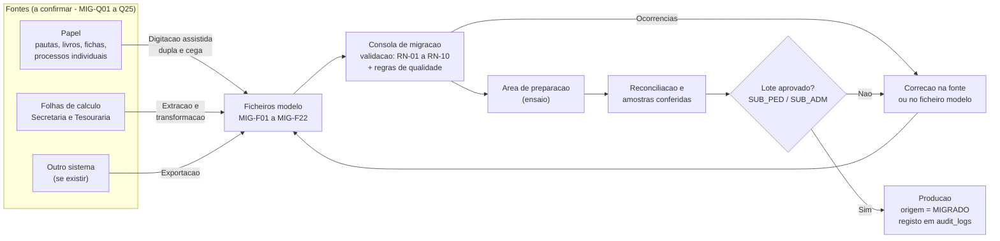
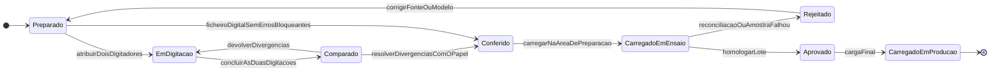
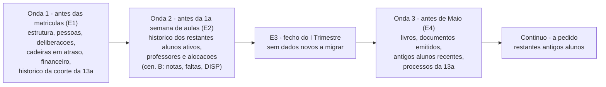
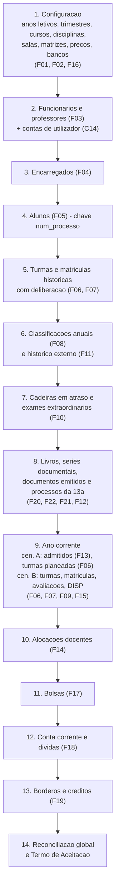

# Migração de Dados e Implantação — SGE IPCAG N.º 12008 / BGO

> [!abstract] Navegação
> - **Painel Principal:** [[Inicio|Início do Vault]] | **Índice do Projeto:** [[00 - MOC SGE IPCAG 12008 BGO|MOC]] | **Plano:** [[00.1 - Plano de Engenharia de Requisitos]] (lacuna **L9**, capacidade **C17**, §6 Entregas E1–E5)
> - **Especificação Atual (v1.2):** [[01 - Dominio e Regras]] → [[02 - Fluxos de Trabalho]] → [[03 - User Stories]] → [[04 - Telas e Documentos]] → [[05 - Modelagem de Dados]]
> - **Notas da Fase C relacionadas:** [[06 - Visao e Ambito]] | [[08 - Requisitos Nao Funcionais]] | [[09 - Integracoes, Infraestrutura e Operacao]] | [[11 - Protecao de Dados (APD)]] | [[12 - Registo de Decisoes e Questoes em Aberto]]

> [!important] Objetivo desta nota
> Definir **como entram no SGE os dados que a escola já tem** (alunos, encarregados, histórico de notas, cadeiras em atraso, dívidas, bolsas, Livro/Folha/Termo), **com que qualidade**, **como se prova que estão certos** e **como se faz o arranque** sem parar a escola. Fecha a lacuna **L9** e especifica a capacidade **C17** (Migração de dados e arranque), necessária logo na **E1** (ver o aviso sobre a 13ª Classe no §6 do plano).

> [!warning] Estado do conhecimento
> **Ainda não se conhece o conteúdo nem o volume de nenhuma fonte de dados da escola.** O Lote 1 de documentos reais ([[Achados dos Documentos Reais - Lote 1]]) mostrou só **modelos em branco**: o formato da ficha de matrícula e de confirmação (A12), das pautas (A1) e da numeração anual dos documentos (A13), e 4 planos curriculares (A5). Não sabemos ainda onde estão os registos preenchidos (papel, folhas de cálculo ou outro sistema) nem quantos são. Por isso, esta nota define **estratégias para cada tipo de fonte** e regista o que falta saber como **questões em aberto** (§10, `MIG-Q01`…`MIG-Q43`). Nenhum valor aqui é um facto sobre a escola, exceto os que constam da especificação v1.2 (≈ 1.120 alunos, 12 salas, 2 turnos, 10ª–13ª Classe) e dos Achados do Lote 1. Todas as metas, durações e amostras são **propostas a validar**.
>
> **Atenção às fórmulas:** as pautas reais usam `MTP`/`PP`/`PT`, `M1`–`M3/CF`, `PG` e `CA` (Achados A1), que a especificação v1.2 desconhece. Os modelos do histórico de notas (§4, `MIG-F08`) seguem as colunas do papel, e nenhuma fórmula da `RN-01` se aplica ao histórico antes da validação das pautas.
>
> **Decisão já registada:** `DEC-007` = arranque no **início do Ano Letivo 2027/2028** (decidida em 2026-11-02, homologação da Direção pendente; datas oficiais em falta — `Q-005`). Esta nota planeia por isso o **Cenário A** (§0.3).

---

## 0. Âmbito, Conceitos e Cenários de Arranque

### 0.1 Critério de conclusão desta nota
A definição da migração está completa quando **cada dado necessário às entregas E1–E4** tem: (1) **fonte** conhecida ou uma questão em aberto que a identifica; (2) **destino** no modelo de dados do DOC-05 (ou um ajuste proposto ao DOC-05); (3) **método de validação**. A verificação está na **Matriz de Cobertura** do §12.

### 0.2 Conceitos usados nesta nota

| Termo | Significado |
| :--- | :--- |
| **Data de corte** | Momento a partir do qual as fontes antigas deixam de ser alteradas e os seus valores são os que entram no SGE (ex.: dívidas "à data de corte"). |
| **Ficheiro modelo** | Ficheiro de importação com colunas e validações fixas (`MIG-F01`…`MIG-F22`, §4). Todas as fontes, seja qual for o tipo, são primeiro convertidas para um ficheiro modelo. |
| **Lote** | Unidade de trabalho e de aprovação: um ficheiro modelo carregado, ou um documento em papel digitado (ex.: a pauta geral de uma turma num ano letivo). |
| **Área de preparação** | Base de dados de ensaio, separada da produção, onde os lotes são validados, carregados e reconciliados antes da aprovação. |
| **Digitação assistida** | Introdução manual de dados a partir de papel, num ecrã que reproduz o documento físico, com listas pré-carregadas, dupla digitação e totais de controlo (§2.2). |
| **Origem `MIGRADO`** | Marca de proveniência gravada em cada registo que não nasceu de uma operação no SGE (§7.1). |
| **Carga delta** | Carga final que só traz o que mudou nas fontes entre o último ensaio e a data de corte. |
| **Ensaio geral** | Execução completa da migração, cronometrada, num ambiente igual ao de produção, com todas as reconciliações (§8.4). |
| **Ponto de não retorno** | Momento em que o SGE emite o primeiro documento oficial (recibo, comprovativo de matrícula). Depois dele já não é possível "apagar e voltar" (§8.7). |

### 0.3 Cenários de arranque (`DEC-007`)
O plano (§3, princípio 1) só admite arranque no **início de um ano letivo** ou, no mínimo, no **início de um trimestre**. A `DEC-007` escolheu o início do Ano Letivo 2027/2028 (**Cenário A**); o piloto a meio de 2026/2027 foi rejeitado e o ponto de controlo da decisão adia para 2028/2029 (de novo Cenário A) se a E1 não couber no prazo. O **Cenário B** fica descrito só como contingência, porque o volume e o risco da migração mudam muito entre os dois casos:

| Aspeto | **Cenário A — Início do ano letivo** *(recomendado)* | **Cenário B — Início do II ou III Trimestre** |
| :--- | :--- | :--- |
| Data de corte | Depois de homologadas as pautas gerais, os exames de recurso e as deliberações do ano anterior; antes do 1.º dia de matrículas | Fecho homologado do trimestre anterior |
| Concurso de admissão | Feito fora do SGE (a `C02` só chega na `E5`): migra-se a **lista de admitidos** para poder converter candidatos em matrícula (Fluxo 02, Cenário A) | Admitidos já matriculados: não se migram candidaturas |
| Matrículas do ano corrente | Feitas no SGE (Fluxo 02) | **Migradas**, com o `N.º de Ordem na Turma` já congelado (`RN-05`), incluindo as linhas de transferidos e anulados |
| Notas do ano corrente | Nenhuma | `MAC`, `NPP`, `NPT`, `MT` e faltas dos trimestres fechados |
| Conta corrente | Só dívidas e créditos de anos anteriores | Também as prestações do ano corrente (pagas, por pagar, isentas) |
| Recibos | Sequência do SGE começa com o ano letivo | Sequência do SGE começa a meio do ano: ver `MIG-Q15` |
| Turmas e alocações docentes | Planeadas pela escola e carregadas como configuração | Migradas tal como estão |
| Risco | Menor | Maior: mais dados, regras de congelamento e numeração fiscal a meio do ano |

> [!tip] Consequências da `DEC-007` para a migração
> - **Data de corte:** depois do fecho de 2026/2027 (pautas gerais, exames de recurso e deliberações homologados) e antes das matrículas de 2027/2028.
> - **Coorte da 13ª em 2027/2028** (`MIG-D13`): alunos que concluem a 12ª em 2026/2027; o histórico necessário cobre **pelo menos os anos letivos 2024/2025 a 2026/2027**, mais anos anteriores para repetentes e transferidos de entrada.
> - **Começar já:** as pautas de **2026/2027 estão a ser produzidas agora**, em papel. Pedir à Secretaria que as passe para o ficheiro modelo `MIG-F08` à medida que cada pauta é homologada reduz a digitação do verão de 2027, quando a Secretaria está no pico do fecho do ano (proposta, `MIG-Q26`).
> - **Primeiro concurso de admissão** (2027/2028) corre fora do SGE: os admitidos entram pelo `MIG-F13` (`MIG-D06`; `Q-017`).
> - Um **Não avançar** em 2027 (§8.6) leva a uma nova `DEC`: adiar para 2028/2029 (Cenário A) ou arrancar no início de um trimestre (Cenário B, mais dados a migrar).

### 0.4 Visão geral do processo

---

## 1. Inventário dos Dados a Migrar

Legenda — **Prioridade (MoSCoW):** `M` Must · `S` Should · `C` Could · `W` Won't (não se migra). **Cenário:** `A`, `B` ou ambos (§0.3). **Entrega:** a primeira entrega do §6 do plano que precisa do dado.

### 1.1 Inventário

| ID | Conjunto de dados | Porque é preciso (regra / fluxo / documento) | Cen. | Entrega | Prio. |
| :--- | :--- | :--- | :---: | :---: | :---: |
| **A — Estrutura académica e configuração** | | | | | |
| `MIG-D01` | Ano letivo de arranque, trimestres e respetivas datas | Tudo pertence a um Ano Letivo (`US-GOV-01`) | A/B | E1 | M |
| `MIG-D02` | Cursos técnicos, disciplinas e salas físicas | `C01`; cabeçalho das mini-pautas | A/B | E1 | M |
| `MIG-D03` | Matrizes curriculares em vigor (fator de faltas, limite de deficiências, nucleares, Língua Portuguesa, `DISP`, pesos da `MFC`) | `RN-02`, `RN-03`, `RN-06` | A/B | E1 | M |
| `MIG-D04` | Matrizes curriculares **históricas** (versões aplicadas aos alunos ativos e antigos alunos) e tabela de correspondência de nomes de disciplinas | Ligar cada nota antiga à disciplina certa; `DOF-09B`, `DOF-10` | A/B | E1 (coorte da 13ª) · E2 | M |
| `MIG-D05` | Tabela de propinas e emolumentos em vigor; bancos e IBAN da conta do IPCAG | `RN-07`, `RN-08`, `RN-09` | A/B | E1 | M |
| `MIG-D06` | Quadro de vagas e **lista de admitidos** do concurso do ano de arranque | Converter candidato em aluno (Fluxo 02, Cenário A) sem a `C02` | A | E1 | M |
| **B — Pessoas** | | | | | |
| `MIG-D07` | Funcionários e professores (cadastro) | Contas de utilizador (`C14`), Director de Turma, alocações, júris | A/B | E1 (Direção e balcões) · E2 (professores) | M |
| `MIG-D08` | Encarregados de educação | Deteção de irmãos (`RN-07`), borderô, recibo | A/B | E1 | M |
| `MIG-D09` | **Alunos ativos**: identificação civil e `N.º de Processo Individual` | Chave de todos os outros dados (`RN-05`) | A/B | E1 | M |
| `MIG-D10` | Lista de documentos entregues no processo individual | `C03`; pendências documentais | A/B | E1 | S |
| `MIG-D11` | **Antigos alunos** (diplomados, transferidos de saída, desistentes): identificação | 2.ª vias, declarações, certificados | A/B | E4 · a pedido | S |
| **C — Percurso académico** | | | | | |
| `MIG-D12` | Última matrícula e **deliberação final** de cada aluno ativo | Confirmação de matrícula e classe de destino (Fluxo 02, Cenário B) | A/B | E1 | M |
| `MIG-D13` | **Histórico 10ª–12ª da coorte que entra ou está na 13ª Classe** | Validador da 13ª (Fluxo 02, `E2.2`); `MFC` (`RN-06`); `DOF-08B`; `DOF-10` | A/B | **E1** | M |
| `MIG-D14` | Histórico das classes já concluídas pelos restantes alunos ativos | `DOF-09B`, `DOF-09C`; `MFC` futura; aviso da 13ª no §6 do plano | A/B | E2 | M |
| `MIG-D15` | Histórico externo de transferidos de entrada já transcrito em papel | `RN-06`, `RN-06.1` | A/B | E1 (13ª) · E2 | M |
| `MIG-D16` | **Cadeiras em atraso** (pendentes e eliminadas) e termos de exames extraordinários já realizados | `RN-02`; quadro do `DOF-03`; secção do `DOF-06`; bloqueio da 13ª | A/B | E1 | M |
| `MIG-D17` | Histórico dos antigos alunos (classificações, estágio, PAP, `MFC`) | 2.ª via do `DOF-10` | A/B | E4 · a pedido | S (recentes) / C (antigos) |
| `MIG-D18` | Processos da 13ª Classe em curso ou com PAP a repetir | Fluxo 06; `RN-06` | B (A: só repetentes de PAP) | E4 (E1 se houver repetentes) | M |
| `MIG-D19` | Empresas parceiras de estágio | Fluxo 06 | A/B | E4 | C |
| **D — Ano letivo corrente** | | | | | |
| `MIG-D20` | Turmas do ano em curso (código, curso, classe, turno, sala, Director de Turma) | A: turmas planeadas (configuração). B: turmas existentes, com chamada congelada | A/B | E1 | M |
| `MIG-D21` | Matrículas do ano em curso com `N.º de Ordem` e estado (ativa, transferida, anulada) | `RN-05`, `RN-05.1` | B | E1 | M |
| `MIG-D22` | Alocações docentes (distribuição de serviço por turma e disciplina) | `RN-04`; isolamento do `PROF` (RLS) | A/B | E2 | M |
| `MIG-D23` | Avaliações dos trimestres fechados (`MAC`, `NPP`, `NPT`, `MT`) e faltas justificadas/injustificadas por trimestre | `MFD` (`RN-01`); limite de faltas (`RN-03`); `DOF-04`, `DOF-05`, `DOF-06` | B | E2 | M |
| `MIG-D24` | Dispensas médicas em vigor | `RN-01.1` | B | E2 | S |
| **E — Financeiro** | | | | | |
| `MIG-D25` | **Dívidas de propinas** de anos anteriores, por aluno e prestação, à data de corte | Semáforo (`RN-08`); bloqueio da confirmação (Fluxo 02, `E2.1`) | A/B | E1 | M |
| `MIG-D26` | Conta corrente do ano em curso (prestações pagas, por pagar e isentas) | `RN-07`, `RN-08` | B | E1 | M |
| `MIG-D27` | **Créditos** a favor de encarregados (sobras de talão, adiantamentos) | `RN-09.1` | A/B | E1 | M |
| `MIG-D28` | **Bolsas**, isenções e descontos em vigor, com despacho | `RN-07` | A/B | E1 | M |
| `MIG-D29` | Borderôs já aceites antes do SGE (banco + n.º de operação) | Anti-fraude: impedir reutilização de talões antigos (`RN-09`) | A/B | E1 | S |
| `MIG-D30` | Emolumentos pagos e ainda não consumidos | `RN-08`, condição 2 | A/B | E1 | S (procedimento, §7.4) |
| `MIG-D31` | Recibos, notas de estorno e fechos de caixa anteriores ao SGE | Consulta | — | — | W (§7.4) |
| **F — Registo documental** | | | | | |
| `MIG-D32` | Livros de registo físico: tipos, livro aberto, última folha e último termo usados | `RN-10` | A/B | E4 (antes, se o SGE emitir termos ou certificados mais cedo) | M |
| `MIG-D33` | Documentos já emitidos com `Livro/Folha/Termo` (certificados, diplomas, termos de exame, atas de PAP) | Unicidade das coordenadas; 2.ª via; eventual verificação | A/B | E4 | S |
| `MIG-D34` | **Últimos números das séries documentais anuais** por tipo (`N.º __/IPCAG N.º <n.º> BGO/<ano>`): Boletim de Matrícula, Confirmação, Requerimento, Declaração, Justificação de Faltas… (Achados A13) | O SGE continua cada série sem repetir números; séries por ano civil já vão a meio em setembro de 2027 | A/B | E1 (matrícula, confirmação) · E2 (declarações, justificações) | M |

### 1.2 O que não se migra (e porquê)

| Dado | Decisão proposta | Motivo |
| :--- | :--- | :--- |
| Contas, palavras-passe e permissões de outro sistema | Não migrar: as contas são criadas de novo (`C14`) a partir do `MIG-D07` | Segurança; os 12 cargos RBAC são próprios do SGE |
| Recibos, notas de estorno e fechos de caixa antigos (`MIG-D31`) | Não recriar no SGE; migra-se só o **efeito** (saldo) | Imutabilidade AGT e sequência de recibos do SGE (§7.4) |
| Sumários e faltas diárias de anos anteriores | Não migrar (confirmar em `MIG-Q38`) | Nenhum documento ou regra do SGE os usa depois de fechado o ano |
| `MAC`, `NPP`, `NPT` de anos anteriores | Só se a fonte já for digital (`C`) | Certificados e `MFC` usam a classificação final por disciplina |
| Assiduidade de funcionários anterior ao arranque | Não migrar; o ponto começa no arranque | Sem regra que dependa do histórico (confirmar em `DEC-008`) |
| Dosificações e matrizes de `NPT` antigas | Não migrar | Só valem para o trimestre a que respeitam |
| Candidaturas de concursos anteriores | Não migrar (exceto o ano de arranque, Cenário A) | Sem uso posterior |
| Trilha de auditoria de um sistema anterior | Não migrar; o sistema antigo fica em consulta (`MIG-Q37`) | A `audit_logs` só regista ações feitas no SGE |

### 1.3 Volume
O volume real será medido na Fase B (levantamento de números do §5.2 do plano). Para planear a digitação, a quantidade de classificações históricas a introduzir é:

$$N_{\text{classificacoes}} = \sum_{c \in \{11, 12, 13\}} \text{Alunos}_c \times \sum_{k < c} \text{Disciplinas}_{k}$$

onde $\text{Alunos}_c$ é o número de alunos ativos na classe $c$ e $\text{Disciplinas}_k$ o número de disciplinas da matriz da classe anterior $k$ (10ª, 11ª, 12ª). Os antigos alunos somam-se à parte, consoante a resposta a `MIG-Q06`. A produtividade da digitação (classificações por hora) será **medida no ensaio-piloto** (§8.2), não estimada agora.

---

## 2. Fontes Prováveis e Estratégia por Tipo de Fonte

### 2.1 Fontes por conjunto de dados

Todas as fontes abaixo são **hipóteses** a confirmar na Fase B.

| Dados | Fontes possíveis (hipótese) | Questões | Se a fonte não existir ou estiver incompleta |
| :--- | :--- | :--- | :--- |
| `MIG-D09` Alunos, `MIG-D08` Encarregados | **Boletins de Matrícula e de Confirmação** em papel, numerados por ano letivo (formato conhecido: Achados A12); livro de matrículas; processos individuais; folhas de cálculo da Secretaria; outro sistema | `MIG-Q01`, `MIG-Q02`, `MIG-Q03`, `MIG-Q22` | Reconstruir a lista a partir das pautas gerais do último ano e dos processos individuais; completar o resto no balcão, na confirmação de matrícula (§2.2, tipo F4) |
| `MIG-D10` Processo individual | Pastas físicas | `MIG-Q27` | Registar só a lista de documentos em falta |
| `MIG-D12`–`MIG-D14`, `MIG-D17` Histórico | **Pautas de Aproveitamento Geral** homologadas (colunas `FALT`, `CF`, `PG`, `CA`, Resultado) e **Mini Pautas** (`MTP`, `PP`, `PT`, `M1`–`M3/CF`, `PG`, `CA`) — formatos conhecidos (Achados A1), conteúdos não; Boletins de Confirmação (resultado final anterior, até duas cadeiras em atraso); folhas de cálculo usadas para calcular as pautas; livros de termos | `MIG-Q04`, `MIG-Q05`, `MIG-Q06`, `MIG-Q07` | Reconstituição a partir de boletins, declarações já emitidas e livros de termos, com despacho do `SUB_PED` (risco `MIG-R01`) |
| `MIG-D15` Histórico externo | Guias de transferência e certificados parciais nos processos | `MIG-Q28` | Pedir 2.ª via à escola de origem |
| `MIG-D16` Cadeiras em atraso | Coluna de deficiências das pautas gerais; pautas e termos de exames extraordinários | `MIG-Q08` | Derivar das pautas gerais (`CFD` entre 7 e 9 com deliberação "Transita com Deficiência") e confirmar com o livro de termos |
| `MIG-D18`, `MIG-D19` 13ª Classe | Coordenação de Curso: fichas de estágio, atas de PAP | `MIG-Q29` | Digitação a partir das atas |
| `MIG-D20`–`MIG-D24` Ano corrente (B) | Mini-pautas, cadernetas dos professores, listas de turma, distribuição de serviço docente | `MIG-Q30` | Não há alternativa: sem estes dados o Cenário B não arranca |
| `MIG-D25`–`MIG-D30` Financeiro | Livro ou folha de cálculo de controlo de propinas; cadernetas de recibos; extratos bancários; software de faturação | `MIG-Q09`–`MIG-Q17` | Apuramento manual por aluno, conferido com o encarregado na confirmação de matrícula (`MIG-Q33`) |
| `MIG-D32`, `MIG-D33` Livros | Livros físicos de registo | `MIG-Q18`, `MIG-Q19`, `MIG-Q21` | Não há alternativa: verificação presencial obrigatória |
| `MIG-D07` Pessoal | Processos da Secretaria Geral; mapa de efetividade; folhas de cálculo | `MIG-Q24` | Recolha direta com ficha |
| `MIG-D03`, `MIG-D04` Matrizes | **Recebidos 4 planos curriculares oficiais** (Contabilidade e Gestão, Gestão de Recursos Humanos, Gestão Empresarial, Estatística e Planeamento — área "Administração e Serviços"; Achados A5); faltam versões anteriores e a confirmação de que são todos os cursos | `MIG-Q07` | Pedir cópia à Direção Provincial da Educação do Bengo |
| `MIG-D06` Admitidos (A) | Pauta de admissão impressa ou folha de cálculo do concurso de 2027/2028 | `Q-017`, `Q-005` | — |
| Qualquer | Eventual plataforma da Direção Provincial ou do MED | `MIG-Q25` | — |

### 2.2 Estratégia por tipo de fonte

#### Tipo F1 — Folhas de cálculo (Excel / CSV)
1. **Recolha de cópia**, nunca do ficheiro em uso; registar quem a entregou, a data e uma impressão digital do ficheiro (hash) para saber exatamente que versão foi usada.
2. **Identificar a versão oficial** com o responsável: é comum existirem várias cópias do mesmo ficheiro com conteúdos diferentes.
3. **Perfilagem**: colunas, percentagem de células vazias, formatos de data, valores distintos, duplicados. Resultado: relatório de perfil que alimenta as tabelas de correspondência.
4. **Transformação por procedimento reproduzível** (o mesmo procedimento corre no ensaio e na carga final, sem passos manuais não documentados) para o ficheiro modelo do §4.
5. **Validação na consola**, correção, carga na área de preparação e reconciliação (§6).
- **Armadilhas a verificar:** fórmulas em vez de valores, folhas escondidas, células unidas, datas guardadas como números de série, totais escritos à mão no meio dos dados, cores com significado ("vermelho = deve") que não estão em nenhuma coluna.

#### Tipo F2 — Outro sistema informático
1. Identificar produto, versão, fornecedor e contrato (`MIG-Q02`); pedir **exportação completa** (CSV ou cópia da base de dados) e a descrição dos campos.
2. Se não houver exportação: usar os relatórios do sistema (Excel ou PDF) e tratá-los como tipo F1 ou F3.
3. Confirmar que a escola é dona dos dados e pode extraí-los.
4. Se for software de faturação, os seus documentos fiscais **ficam nele** (§7.4); o sistema mantém-se em consulta durante o prazo a definir (`MIG-Q37`).

#### Tipo F3 — Papel (digitação assistida)
A digitação a partir de papel é o tipo de fonte mais provável para o histórico de notas e o mais arriscado. Regras:

1. **Um lote = um documento físico** (ex.: pauta geral da turma `IG11A-M` de um ano letivo; uma página do livro de propinas). O lote fica associado à fotografia ou digitalização das páginas (evidência).
2. **Pré-carga**: a lista de alunos (já migrada do `MIG-D09`) e as disciplinas da matriz da turma aparecem pré-preenchidas, **pela mesma ordem e com as mesmas colunas do papel**. O digitador só introduz valores.
3. **Totais de controlo**: o digitador introduz também o número de alunos da página e os totais do bloco estatístico que o papel já imprime (Achados A10) — na Mini Pauta, por trimestre, matriculados, avaliados, aprovados, reprovados e não avaliados; na Pauta Geral, positivas e negativas por disciplina e o número de alunos que transitam, transitam com deficiência, desistem e não transitam. O sistema compara com o que foi digitado.
4. **Recálculo imediato**: quando o papel tem `MT1`–`MT3` e `MFD`, o sistema recalcula com `round_med` (`RN-01`) e destaca divergências. **Não corrige**: o valor oficial homologado prevalece e a divergência fica registada (§5.2).
5. **Dupla digitação cega** para notas e montantes: dois digitadores diferentes introduzem o mesmo lote sem ver o trabalho um do outro; as diferenças vão para um terceiro (conferente), que decide olhando para o papel ou para a imagem.
6. **Digitação simples com conferência visual a 100%** só para dados de baixo risco (telefones, moradas).
7. **Quem digita**: funcionários com compromisso de confidencialidade (`MIG-Q26`). **Não se recomenda** usar alunos, por se tratar de dados de colegas menores (APD).
8. **Onde**: na consola de migração (área de preparação). Se a consola não estiver pronta a tempo, usar os ficheiros modelo em XLSX com listas pendentes e folhas protegidas, e carregá-los depois.

Ciclo de vida de um lote:

#### Tipo F4 — Recolha direta no balcão (atualização cadastral)
No **Cenário A**, todos os alunos ativos passam pelo balcão na confirmação de matrícula. Os dados que não são precisos **antes** desse momento (telefones atualizados, BI do encarregado, morada, documentos do processo em falta) podem entrar com **pendência de atualização** e ser completados pelo `OP_PED` no próprio atendimento. Isto reduz a digitação prévia. Não se aplica a dados que o próprio balcão precisa para decidir (deliberação, dívidas, cadeiras em atraso).

#### Tipo F5 — Fontes de reconciliação
Extratos bancários, o último mapa estatístico enviado à Direção Provincial, listas de bolseiros da Diocese de Caxito e listas oficiais assinadas pela Secretaria **não se carregam**: servem para provar que o que foi carregado está certo (§6).

### 2.3 Migração a pedido de antigos alunos
Migrar todos os antigos alunos antes do arranque pode ser impossível ou desnecessário (`MIG-Q06`). Proposta por ordem de prioridade:
1. Alunos ativos (Ondas 1 e 2, §8.2).
2. Diplomados e saídos mais recentes (Onda 3, antes da `E4`), número de anos a decidir.
3. Os restantes **só quando pedem um documento**: o `OP_PED` abre um **lote individual**, o histórico desse aluno é digitado (dupla digitação), conferido pelo `CHEFE_SEC_PED` e homologado pelo `SUB_PED`; só depois o documento é emitido. O prazo de resposta ao pedido fica por definir (`MIG-Q39`). A consola de migração mantém-se ativa, em modo restrito, para este fim (`RF-C17-15`).

---

## 3. Mapeamento para as Tabelas do DOC-05

### 3.1 A chave mestra: `num_processo`
O `N.º de Processo Individual` é **vitalício** e **nunca muda** (`RN-05`). Como a pasta física do aluno já tem (ou pode ter) um número, a migração não pode inventar um novo número para quem já o tem.

1. **Aluno com número legado único**: o número é **preservado literalmente** em `num_processo`. A validação do campo passa a aceitar o formato `PROC-AAAA-NNNNN` **e** os formatos legados encontrados no inventário (`MIG-Q03`).
2. **Números legados não únicos** (ex.: reiniciam todos os anos ou por curso): decisão da escola (`MIG-Q40`) entre (a) renumerar e reetiquetar as pastas, guardando o número antigo como alias, ou (b) manter o número antigo com um prefixo que o torne único. Nenhuma das opções é aplicada sem essa decisão.
3. **Aluno sem número**: recebe `PROC-{ano do 1.º ingresso}-{NNNNN}`, numa sequência reservada para a migração, e a pasta física é etiquetada.
4. **Alunos novos depois do arranque**: sequência normal do SGE, que começa acima do maior número migrado do mesmo ano, para não colidir.
5. **Todos os ficheiros com dados de alunos** (`MIG-F07` a `MIG-F21`) identificam o aluno **só pelo `num_processo`**, nunca pelo nome.
6. **Fusão de duplicados** (mesma pessoa com dois números): mantém-se o número mais antigo; o outro fica como alias (ajuste `AJ-05`) e a fusão fica em `audit_logs` (§7.2).

### 3.2 Ficheiro → tabelas de destino

| Ficheiro | Tabelas do DOC-05 | Chave natural (recarga sem duplicar) | Ligações obrigatórias | Transformações principais |
| :--- | :--- | :--- | :--- | :--- |
| `MIG-F01` Estrutura académica | `cursos_tecnicos`, `disciplinas`, `salas_fisicas`, `matrizes_curriculares`, `matriz_disciplinas` | Sigla do curso; código da disciplina; código da sala; (curso + classe + versão); (matriz + disciplina) | Matriz → curso; matriz_disciplina → disciplina | **Tabela de correspondência** entre nomes e abreviaturas antigas das disciplinas e o código do catálogo (indispensável ao `MIG-F08`) |
| `MIG-F02` Calendário | `anos_letivos`, `trimestres_letivos` | Código do ano (`2025/2026`); (ano + trimestre) | — | Anos anteriores criados já encerrados; trimestres antigos `Encerrado Oficialmente` |
| `MIG-F03` Funcionários | `funcionarios_docentes` (as `usuarios_sistema` são criadas depois, em `C14`) | N.º de agente; senão BI | — | Nome; telefone `+244`; categoria e vínculo para as listas do DOC-05 |
| `MIG-F04` Encarregados | `encarregados_educacao` | BI/NIF; senão telefone + nome (vai a revisão) | Funcionário (se for do IPCAG) | Nome; telefone; deteção de duplicados (§5.2) |
| `MIG-F05` Alunos | `alunos` | `num_processo`; BI único quando preenchido | Encarregado | Nome; datas; género `M`/`F`; tipo de documento |
| `MIG-F06` Turmas | `turmas` (+ `turma_disciplinas` geradas a partir da matriz) | (ano letivo + código da turma) | Curso, matriz, sala (opcional no histórico), Director de Turma (opcional no histórico) | Código antigo → padrão `IG10A-M`; turno `MANHA`/`TARDE` |
| `MIG-F07` Matrículas | `matriculas_anuais` | (`num_processo` + ano letivo + turma) | Aluno, turma | Deliberação antiga → lista 11 do DOC-05; estado → lista 9; histórico em `CONCLUIDA_NO_ANO` |
| `MIG-F08` Classificações anuais | `resultados_anuais_disciplina` | (`num_processo` + ano letivo + disciplina) | Matrícula; `turma_disciplina` | `DISP`/`RF`; inteiros; recálculo `round_med` com aviso de divergência |
| `MIG-F09` Avaliações do ano corrente (B) | `avaliacoes_trimestrais` | (matrícula + `turma_disciplina` + trimestre) | Matrícula; `turma_disciplina` | Decimais com vírgula; `MT` recalculada e comparada; faltas J/I nos totais do trimestre |
| `MIG-F10` Cadeiras em atraso | `cadeiras_em_atraso`, `exames_extraordinarios` | (`num_processo` + disciplina originária); (`Livro` + `Folha` + `Termo`) para os termos | Aluno; disciplina da matriz de origem | Estado → lista 12; coerência com `MIG-F07`/`MIG-F08` |
| `MIG-F11` Histórico externo | `historico_externo_transcricoes` | (aluno + classe equivalente + disciplina) | Aluno; disciplina da matriz | Homologação por lote pelo `SUB_PED` |
| `MIG-F12` 13ª Classe | `processos_13_classe`, `empresas_parceiras` | Matrícula da 13ª; NIF/nome da empresa | Matrícula; docentes (tutor, orientador, júri) | Estado → lista 13; recálculo de `MPC` e `MFC` (`RN-06`) com aviso |
| `MIG-F13` Admitidos (A) | `quadros_vagas_admissao`, `candidaturas_10a`, `codigos_anonimato` | (ano + curso + turno); (ano + BI/cédula), senão n.º de inscrição | Quadro de vagas | Resultado → `ADMITIDO_1A_OPCAO`, `ADMITIDO_2A_OPCAO_REPESCAGEM` ou `ADMITIDO_DESPACHO_LIMIAR`; `MFA` recalculada (`RN-01.2`); anonimato já descodificado |
| `MIG-F14` Alocações docentes | `alocacoes_docentes` | (`turma_disciplina` + professor + data de início) | `turma_disciplina`; funcionário | Um titular ativo por mini-pauta (`RN-04`) |
| `MIG-F15` Dispensas (B) | `dispensas_medicas` | (matrícula + `turma_disciplina`) | Matrícula; disciplina que permite `DISP` | Abrangência anual/trimestral |
| `MIG-F16` Preços e bancos | `tabelas_precos_emolumentos`, `bancos_angola` | (ano + código da rubrica); sigla do banco | Ano letivo | Montantes em `AOA` |
| `MIG-F17` Bolsas | `beneficios_bolsas_matricula` | (matrícula + tipo + mês de início) | Matrícula do ano em que vigora | Tipo → lista 14; percentagem; meses `1..10` |
| `MIG-F18` Conta corrente | `conta_corrente_propinas` | (matrícula + mês/ano de referência) | **Matrícula do ano a que a dívida pertence** (por isso o `MIG-F07` inclui as matrículas antigas dos devedores) | Estado → lista 15; montantes `AOA`; estado à data de corte |
| `MIG-F19` Borderôs e créditos | `borderos_bancarios` | (banco + n.º de operação) — o próprio `UNIQUE` anti-fraude | Banco; encarregado (opcional) | Estado → lista 17; saldo utilizado inicial |
| `MIG-F20` Livros | `livros_registo_fisico` *(tabela nova, `AJ-04`)* | (tipo de livro + n.º do livro) | — | — |
| `MIG-F21` Documentos emitidos | `documentos_oficiais_emitidos` | (tipo de livro + `Livro` + `Folha` + `Termo`) | Aluno (se identificado); livro | Tipo → `DOF-07`, `DOF-08`, `DOF-10` |
| `MIG-F22` Séries documentais | Tabela nova de séries de numeração (`AJ-18`) | (tipo de documento + ano da série) | — | Formato guardado como impresso (inclui o n.º da instituição, `MIG-Q43`) |

> [!note] Turma desconhecida em anos antigos
> Uma matrícula exige uma turma. Quando a fonte só indica curso e classe (ex.: um devedor antigo), propõe-se uma **turma histórica agregadora** por `ano + curso + classe` (ex.: `HIST-IG11-2023`), marcada `MIGRADO` e usada só para histórico e dívidas. A sua criação exige aprovação do `CHEFE_SEC_PED`.

### 3.3 Ajustes propostos ao DOC-05
> [!success] Decidido em 2026-11-05 — [[12 - Registo de Decisoes e Questoes em Aberto#DEC-010 — Integrar os ajustes da migração no modelo de dados|DEC-010]]
> Todos os ajustes foram aceites e estão integrados no [[05 - Modelagem de Dados|DOC-05]]: 3 tabelas novas no Grupo 6 (119 no total) e a §4.10 (registos migrados). Os BI ficam opcionais com pendência, a conta técnica é própria (`RN-16.21`) e a consola é o `MOD-MIG-01` (DOC-04, E1). A tabela abaixo fica como histórico.

O DOC-05 v1.2 não prevê dados migrados. Os ajustes seguintes são **propostas** para a próxima versão do DOC-05 (esta nota não altera o DOC-05):

| # | Ajuste | Tabelas | Porquê |
| :---: | :--- | :--- | :--- |
| `AJ-01` | Colunas de proveniência `origem_registo` (`SGE` por omissão ou `MIGRADO`), `lote_migracao_id` e `referencia_fonte` | `alunos`, `encarregados_educacao`, `funcionarios_docentes`, `anos_letivos`, `turmas`, `matriculas_anuais`, `resultados_anuais_disciplina`, `avaliacoes_trimestrais`, `historico_externo_transcricoes`, `cadeiras_em_atraso`, `exames_extraordinarios`, `processos_13_classe`, `candidaturas_10a`, `alocacoes_docentes`, `dispensas_medicas`, `beneficios_bolsas_matricula`, `conta_corrente_propinas`, `borderos_bancarios`, `documentos_oficiais_emitidos` | Marcar a origem e rastrear até à fonte (§7.1) |
| `AJ-02` | Tabela nova `lotes_migracao`: ficheiro modelo, fonte, data de corte, hash do ficheiro, contagens, estado do lote, conferido por, aprovado por e despacho | Nova | Unidade de aprovação e de auditoria |
| `AJ-03` | Tabela nova `ocorrencias_migracao`: lote, linha, regra, severidade, mensagem, decisão, decidido por | Nova | Relatório de qualidade e decisões sobre avisos |
| `AJ-04` | Tabela nova `livros_registo_fisico`: tipo de livro, n.º, estado (`ABERTO`/`ENCERRADO`), total de folhas, termos por folha, último termo usado antes do SGE, verificado por, data, fotografia. Formaliza o "Tipo de Livro" usado na chave única de `documentos_oficiais_emitidos` | Nova | Saber de onde o SGE continua a numeração (§7.5) |
| `AJ-05` | `alunos`: BI/cédula opcional com `tipo_documento_identificacao` e pendência (unicidade só quando preenchido); `num_processo` aceita formatos legados; aliases de números de processo após fusão; indicador `historico_conferido_para_certificacao` | `alunos` | §3.1, §5.2, §7.6 |
| `AJ-06` | `encarregados_educacao`: BI e NIF opcionais com pendência (unicidade só quando preenchidos); compatível com a separação BI/NIF da `ALT-05-01` ([[11 - Protecao de Dados (APD)]]) | `encarregados_educacao` | Encarregados antigos sem BI registado |
| `AJ-07` | Turmas históricas: sala e Director de Turma opcionais quando `MIGRADO`; a chave anti-colisão (ano + turno + sala) só se aplica com sala preenchida | `turmas` | A sala de turmas antigas raramente está registada |
| `AJ-08` | Colunas `CF`, `PG` e `CA` das pautas reais (Achados A1); `MT1`–`MT3` opcionais quando `MIGRADO` e a fonte só tem a classificação final; campo `origem_aprovacao` (frequência, Prova Global, recurso, extraordinário, transcrição — lista a fechar depois da A1) | `resultados_anuais_disciplina` | Pautas reais; o `DOF-09B` imprime a origem da aprovação |
| `AJ-09` | Prestação `PAGA` sem `itens_recibo` quando `MIGRADO`, com `referencia_documento_externo`; campo de valor em dívida se existirem pagamentos parciais (`MIG-Q12`) | `conta_corrente_propinas` | §7.4 |
| `AJ-10` | `saldo_utilizado_inicial_migrado` (o saldo utilizado deixa de ser só a soma das alocações) | `borderos_bancarios` | Talões antigos com sobra (§7.4) |
| `AJ-11` | `item_recibo`, `codigo_verificacao` e homologador opcionais quando `MIGRADO`; signatário original guardado como texto | `documentos_oficiais_emitidos`, `exames_extraordinarios` | Documentos emitidos antes do SGE (§7.5) |
| `AJ-12` | Item de recibo da taxa de inscrição opcional quando `MIGRADO` | `candidaturas_10a` | Admitidos do concurso feito em papel |
| `AJ-13` | Novos tipos de ação crítica: `CARGA_MIGRACAO`, `APROVACAO_LOTE_MIGRACAO`, `CORRECAO_DADO_MIGRADO`, `AJUSTE_SALDO_MIGRADO`, `FUSAO_REGISTOS_DUPLICADOS`, `CONFERENCIA_HISTORICO_CERTIFICACAO` | `audit_logs` | §7.2 |
| `AJ-14` | Conta técnica de migração, fora dos 12 cargos RBAC, desativada no fim. **Não é** o `ADMIN_TEC` proposto no [[C14 - Gestao de Contas e Acesso]], que por desenho não acede a notas nem a dados financeiros | `usuarios_sistema` | Autor técnico das cargas; depende de `C14` |
| `AJ-15` | Coluna `origem_nota` (citada na `RN-06.1` mas ausente do DOC-05) com o valor `MIGRADO` | `avaliacoes_trimestrais` | Cenário B |
| `AJ-17` | `alunos`: residência, município, data de emissão do BI, escola/classe/ano/resultado anteriores (campos reais da ficha, Achados A12) | `alunos` | `MIG-F05` |
| `AJ-18` | Tabela nova de séries de numeração documental: tipo, tipo de ano (civil/letivo), ano, formato, último número, origem `MIGRADO` | Nova | `MIG-F22` (A13) |
| `AJ-16` | Onde guardar a lista de documentos do processo individual: o DOC-04 (`MOD-PED-MAT`) tem `documentos_entregues_checklist`, o DOC-05 não | A decidir em `C03` | `MIG-D10` |

---

## 4. Modelos de Ficheiro de Importação

### 4.1 Convenções comuns a todos os ficheiros
- **Formato de trabalho:** XLSX, uma folha por ficheiro modelo, com listas pendentes que só aceitam os valores das listas fechadas do DOC-05 (§1.3) e folhas protegidas. **Formato de carga:** CSV UTF-8, separador `;`, primeira linha com os nomes das colunas exatamente como abaixo.
- **Datas:** `DD/MM/AAAA`; data e hora: `DD/MM/AAAA HH:MM`.
- **Números decimais:** vírgula decimal (`13,50`). **Montantes:** `AOA` com 2 casas decimais, vírgula decimal, sem separador de milhares e sem "Kz" (ex.: `15000,00`).
- **Notas:** inteiro `0`–`20`, ou `DISP` / `RF` apenas nas colunas que o indicam; `MAC`, `NPP`, `NPT` com até 2 casas decimais. **Célula vazia não é zero:** vazio = sem nota; `0` = nota zero.
- **Classe:** `10`, `11`, `12` ou `13`. **Turno:** `MANHA` ou `TARDE`. **Sim/Não:** `SIM` ou `NAO`.
- **Um registo por linha**, sem células unidas, sem fórmulas, sem linhas de totais.
- **Colunas comuns obrigatórias em todos os ficheiros:** `ref_fonte` (documento e página/linha de onde veio o dado, ex.: `Pauta Geral 2024/2025 IG11A-M, fl. 2, linha 17`) e `observacoes` (opcional). O identificador do lote é atribuído pela consola no carregamento.
- **Nome do ficheiro:** `MIG-F05_alunos_AAAAMMDD_vN.csv`.

Legenda da coluna **Obr.:** `S` obrigatória · `N` opcional · `C` condicional (regra na coluna Validação).

### 4.2 Especificação por ficheiro

#### `MIG-F01` — Estrutura académica *(5 folhas)*
| Folha | Colunas (Obr.) | Validações principais |
| :--- | :--- | :--- |
| `F01a_cursos` | `sigla` (S), `nome_oficial` (S), `titulo_profissional` (S), `area_formacao` (S), `especialidade` (N), `coordenador_n_agente` (N) | Sigla única; área de formação e especialidade vêm dos Achados A5 e esperam a entidade nova no DOC-05 |
| `F01b_disciplinas` | `codigo` (S), `nome_oficial` (S), `nomes_antigos` (N, separados por ` / `) | Código único; cada nome antigo aponta para um só código |
| `F01c_salas` | `codigo` (S), `nome` (S), `tipo` (S: `SALA_COMUM`/`LABORATORIO`), `lotacao_maxima` (S) | Lotação > 0 |
| `F01d_matrizes` | `sigla_curso` (S), `classe` (S), `versao` (S), `anos_letivos_aplicacao` (S), `fator_faltas` (S), `max_deficiencias_transicao` (S), `nota_minima_deficiencia` (S), `peso_mpc`/`peso_estagio`/`peso_pap` (C: obrigatórios na 13ª), `documento_oficial` (S) | (curso + classe + versão) único; os pesos vêm do documento oficial, nunca de um valor por omissão |
| `F01e_matriz_disciplinas` | `sigla_curso`, `classe`, `versao`, `codigo_disciplina`, `componente` (lista 4), `nuclear`, `lingua_portuguesa`, `permite_disp`, `tempos_semanais` (todas S) | No máximo uma disciplina `lingua_portuguesa = SIM` por matriz; nos planos recebidos só existe na 10ª e 11ª (Achados A7); tempos > 0 |

#### `MIG-F02` — Calendário
`ano_letivo` (S, `AAAA/AAAA`), `data_inicio` (S), `data_fim` (S), `estado` (S: `EM_CURSO`/`ENCERRADO`), `trimestre` (S: lista 5), `data_abertura_notas` (C), `data_fecho_notas` (C). Validação: datas dos trimestres dentro do ano; só um ano `EM_CURSO`.

#### `MIG-F03` — Funcionários e professores
| Coluna | Obr. | Formato | Validação |
| :--- | :---: | :--- | :--- |
| `n_agente` | C | texto | Único; obrigatório se existir (`MIG-Q24`) |
| `nome_completo` | S | texto | Normalizado (§5.2) |
| `bi` | S | texto | Único |
| `telefone` | S | `+244 9XX XXX XXX` | Formato do DOC-04 |
| `categoria` | S | `DOCENTE` / `ADMINISTRATIVO` / `DIRECAO` | — |
| `vinculo` | S | `QUADRO_ESTATAL_MED` / `COMPARTICIPADO_DIOCESE_CAXITO` | — |
| `cargo_rbac_proposto` | N | lista 1 | Só proposta: o cargo final é atribuído pela Direção em `C14` |
| `ativo` | S | `SIM`/`NAO` | — |

#### `MIG-F04` — Encarregados de educação
| Coluna | Obr. | Formato | Validação |
| :--- | :---: | :--- | :--- |
| `chave_encarregado` | S | texto | BI, NIF ou código provisório `ENC-TMP-NNNN`; único |
| `nome_completo` | S | texto | Normalizado |
| `bi` | C | texto | Aviso se vazio; único quando preenchido |
| `nif` | N | texto | Único quando preenchido (BI e NIF em campos separados, como propõe a `ALT-05-01` da nota 11) |
| `telefone_principal` | S | `+244 9XX XXX XXX` | Aviso se o mesmo telefone aparecer noutro encarregado |
| `telefone_alternativo` | N | idem | — |
| `parentesco` | S | lista a definir com a Secretaria | — |
| `morada` | N | texto | — |
| `e_funcionario_ipcag` | S | `SIM`/`NAO` | Se `SIM`, `n_agente` tem de existir no `MIG-F03` (desconto `FILHO_FUNCIONARIO`) |
| `n_agente` | C | texto | Obrigatório se `e_funcionario_ipcag = SIM` |

#### `MIG-F05` — Alunos (ativos e antigos)
| Coluna | Obr. | Formato | Validação |
| :--- | :---: | :--- | :--- |
| `num_processo` | C | texto ≤ 20 | Único; formato `PROC-AAAA-NNNNN` ou legado inventariado; se vazio, o sistema atribui (§3.1) e gera aviso |
| `nome_completo` | S | texto | Pelo menos 2 palavras; sem algarismos; normalizado |
| `data_nascimento` | S | `DD/MM/AAAA` | Data válida e passada; aviso se a idade for incoerente com a classe (limites parametrizáveis) |
| `genero` | S | `M`/`F` | — |
| `tipo_documento` | S | `BI` / `CEDULA` / `PASSAPORTE` / `NENHUM` | — |
| `numero_documento` | C | texto | Obrigatório se `tipo_documento ≠ NENHUM`; único por tipo; formato validado com amostras reais (`MIG-Q22`) |
| `nome_pai`, `nome_mae` | N | texto | Aviso se vazio em alunos da 12ª/13ª (o `DOF-10` imprime a filiação) |
| `naturalidade_municipio`, `naturalidade_provincia` | N | texto | Aviso se vazio em alunos da 12ª/13ª (`DOF-10`) |
| `nacionalidade` | N | texto | Aviso se vazio em alunos da 12ª/13ª (`DOF-10`) |
| `chave_encarregado` | S | texto | Tem de existir no `MIG-F04` |
| `ano_primeiro_ingresso` | S | `AAAA` | ≤ ano de arranque |
| `classe_ingresso` | S | `10`–`13` | — |
| `tipo_ingresso_inicial` | S | `MATRICULA_INICIAL_10A` / `TRANSFERENCIA_ENTRADA` | Se transferência, espera-se histórico no `MIG-F11` |
| `situacao_no_corte` | S | `ATIVO` / `DIPLOMADO` / `TRANSFERIDO_SAIDA` / `DESISTENTE` / `OUTRO` | Separa alunos ativos de antigos alunos |
| `pendencias_documentais` | N | lista separada por ` / ` | — |
| `data_emissao_documento` | N | `DD/MM/AAAA` | Campo real do Boletim de Matrícula ([[Achados dos Documentos Reais - Lote 1]], A12) |
| `residencia`, `municipio_residencia` | N | texto | Campos reais da ficha (A12); o DOC-05 não os tem em `alunos` (ajuste `AJ-17`) |
| `escola_anterior`, `classe_anterior`, `ano_anterior`, `resultado_final_anterior` | C | texto; `10`–`12`; `AAAA/AAAA`; texto | Campos reais da ficha (A12); obrigatórios para a 1.ª matrícula da 10ª e para transferidos |

> [!warning] Campos reais da ficha que **não** se migram (A12)
> **"Problema de saúde"** é dado de saúde: fica no processo físico (minimização; nota 11). **"Ocupação ou local de trabalho do pai"**: não se migra enquanto o SGE não tiver finalidade para ele (`MIG-Q42`).

#### `MIG-F06` — Turmas (ano corrente e históricas)
| Coluna | Obr. | Formato | Validação |
| :--- | :---: | :--- | :--- |
| `ano_letivo` | S | `AAAA/AAAA` | Existe no `MIG-F02` |
| `codigo_turma` | S | `<sigla><classe><letra>-<M/T>` (ex.: `IG10A-M`) ou `HIST-…` | Único por ano |
| `codigo_turma_antigo` | N | texto | Para conferência com o papel |
| `sigla_curso`, `classe`, `turno`, `versao_matriz` | S | — | Matriz existe para (curso + classe + versão) |
| `codigo_sala` | C | texto | Obrigatório no ano corrente; (ano + turno + sala) único |
| `dt_n_agente` | C | texto | Obrigatório no ano corrente; existe no `MIG-F03` |
| `chamada_congelada`, `data_congelamento` | C | `SIM`/`NAO`; data | Obrigatório no Cenário B |

#### `MIG-F07` — Matrículas e deliberações
| Coluna | Obr. | Formato | Validação |
| :--- | :---: | :--- | :--- |
| `num_processo` | S | texto | Existe no `MIG-F05` |
| `ano_letivo`, `codigo_turma` | S | — | Turma existe no `MIG-F06`; uma matrícula por aluno e ano, exceto transferência interna |
| `tipo_ingresso` | S | lista 8 | — |
| `num_ordem` | C | inteiro ≥ 1 | Obrigatório no ano corrente (B); (turma + n.º) único; igual ao da pauta impressa |
| `estado` | S | lista 9 | Histórico: `CONCLUIDA_NO_ANO`, `TRANSFERIDA_EXTERNA` ou `ANULADA_DESISTENTE` |
| `deliberacao_final` | C | lista 11 | Obrigatória se `estado = CONCLUIDA_NO_ANO` |
| `data_inativacao` | C | data | Obrigatória se transferida ou anulada |
| `n_boletim_matricula` | C | texto, ex.: `N.º 125/2026-2027` | Número anual do Boletim de Matrícula ou de Confirmação em papel (A12, A13); liga o registo ao documento físico |
| `turma_sala_ano_anterior` | N | texto | Campo real da Confirmação de Matrícula (A12); conferência com o `MIG-F07` do ano anterior |

A Confirmação de Matrícula real tem espaço para **até duas cadeiras em atraso** (A12): é fonte de conferência do `MIG-F10` (um aluno com mais de duas exige verificação na pauta). A escola chama "Período" ao turno (A9): o valor da fonte converte-se para `MANHA`/`TARDE`.

#### `MIG-F08` — Classificações anuais (histórico 10ª–12ª)

> [!important] Colunas reais das pautas (Lote 1, A1 e A2) — prevalecem sobre a tabela abaixo
> As pautas da escola **não** usam `MT1`–`MT3`/`MFD`/exame de recurso/`CFD`. A **Pauta de Aproveitamento Geral** tem por disciplina `FALT`, `CF`, `PG` (Prova Global) e `CA` (Classificação Anual), mais Observação e Resultado; a **Mini Pauta** tem `MTP`, `PP`, `PT`, `M1`, `M2` e, no III Trimestre, `MTP`, `PP`, `M3/CF`, `PG`, `CA`. O ficheiro de digitação reproduz **as colunas e os nomes do papel**:
>
> | Coluna | Obr. | Formato | Validação |
> | :--- | :---: | :--- | :--- |
> | `tipo_fonte` | S | `PAUTA_GERAL` / `MINI_PAUTA` | — |
> | `num_processo`, `ano_letivo`, `classe`, `codigo_disciplina` | S | — | Como na tabela abaixo |
> | `faltas` (`FALT`) | N | inteiro ≥ 0 | — |
> | `m1`, `m2` | N | `0`–`20` | Só da Mini Pauta |
> | `m3_cf` (`M3/CF`) | N | `0`–`20` | Só da Mini Pauta |
> | `cf` (`CF`) | C | `0`–`20` | Obrigatório se `tipo_fonte = PAUTA_GERAL`; se houver também `m3_cf`, aviso quando diferem (ajuda a responder à A1.1) |
> | `pg` (`PG`) | N | `0`–`20` | — |
> | `ca` (`CA`) | S | `0`–`20` | **Valor oficial impresso**; é a classificação que vai para o histórico enquanto a A1 não for validada |
> | `exame_recurso` | N | `0`–`20` | Só se a A1.4 confirmar que existe |
> | `resultado_oficial` | S | texto como impresso | Convertido para a lista 10 depois da validação |
>
> - **Recálculo:** a hipótese impressa `CA = MT3 × 0,6 + PG × 0,4` é testada **só como aviso**. As fórmulas da `RN-01` não se aplicam ao histórico antes da validação das pautas ([[Plano de Validacao de Pautas]]).
> - **Destino:** `resultados_anuais_disciplina` precisa das colunas `CF`, `PG` e `CA` (ajuste `AJ-08`, alinhado com o §4 dos Achados). As componentes trimestrais (`MTP`/`PP`/`PT`) só entram no Cenário B (`MIG-F09`), com a correspondência `MTP`≡`MAC`, `PP`≡`NPP`, `PT`≡`NPT` **pendente da A2**.
> - A tabela abaixo é a versão anterior, baseada no DOC-05 v1.2; mantém-se apenas como referência até a A1 ser validada.
| Coluna | Obr. | Formato | Validação |
| :--- | :---: | :--- | :--- |
| `num_processo`, `ano_letivo`, `classe` | S | — | Existe matrícula correspondente no `MIG-F07` |
| `codigo_disciplina` | S | código do catálogo | Pertence à matriz da turma dessa matrícula |
| `mt1`, `mt2`, `mt3` | N | inteiro `0`–`20` ou `DISP` | — |
| `mfd` | C | inteiro `0`–`20`, `DISP` ou `RF` | Se os `MT` existirem: recalculada; aviso se diferente |
| `nota_exame_recurso` | N | inteiro `0`–`20` | Só se `mfd < 10` |
| `cfd` | S | inteiro `0`–`20`, `DISP` ou `RF` | **Valor oficial da pauta geral desse ano**; se há exame, recalculada (`40%/60%`) e aviso se diferente. A eliminação posterior por exame extraordinário vem do `MIG-F10`, não altera este campo |
| `origem_aprovacao` | S | `FREQUENCIA` / `EXAME_RECURSO` / `TRANSCRICAO_EXTERNA` | — |
| `faltas_injustificadas_total` | N | inteiro ≥ 0 | — |
| `situacao_final` | S | lista 10 (estados finais) | Coerente com `cfd` |

#### `MIG-F09` — Avaliações e faltas do ano corrente *(só Cenário B)*
**Colunas reais (Achados A1, A2):** o ficheiro usa os nomes da Mini Pauta — `mtp`, `pp`, `pt` nos I e II Trimestres, `m1`/`m2`; no III Trimestre `mtp`, `pp`, `m3_cf`, `pg`, `ca`. A correspondência com `MAC`/`NPP`/`NPT` do DOC-05 espera a A2, e a fórmula da média trimestral espera a A1. As faltas por indisciplina e por não comparência do boletim real (A8) entram em colunas próprias até se decidir como se mapeiam. Versão anterior, para referência: `num_processo` (S), `ano_letivo` (S), `codigo_turma` (S), `codigo_disciplina` (S), `trimestre` (S: lista 5, só trimestres fechados), `mac`/`npp`/`npt` (C: `0,00`–`20,00`, vazios se `DISP`), `mt` (S: inteiro ou `DISP`, comparada com a fórmula validada), `faltas_justificadas` (S), `faltas_injustificadas` (S), `disp` (S: `SIM`/`NAO`). Validações: uma linha por (aluno + disciplina + trimestre); alunos transferidos ou anulados após o congelamento só têm linhas até à data de saída. As faltas diárias **só começam no SGE**; o total anual para a `RN-03` soma os totais migrados com os registos diários do SGE.

#### `MIG-F10` — Cadeiras em atraso e exames extraordinários *(2 folhas)*
| Folha | Colunas (Obr.) | Validações principais |
| :--- | :--- | :--- |
| `F10a_cadeiras` | `num_processo` (S), `codigo_disciplina` (S), `classe_origem` (S: `10`/`11`), `ano_letivo_origem` (S), `nota_origem` (S), `estado` (S: lista 12), `nota_aprovacao_final` (C), `data_eliminacao` (C) | `nota_origem` entre 7 e 9 só como aviso: o critério real de "transita com deficiência" espera a A1.5; coerente com `MIG-F08` (`ca` igual) e com `MIG-F07` (deliberação `TRANSITA_COM_DEFICIENCIA`); se `DEFICIENCIA_ELIMINADA`, nota ≥ 10 e data obrigatórias |
| `F10b_exames_extraordinarios` | `num_processo` (S), `codigo_disciplina` (S), `ano_letivo_epoca` (S), `nota_exame` (S), `tipo_livro` (S), `livro` (S), `folha` (S), `termo` (S), `data_exame` (S) | (livro + folha + termo) único; dentro do intervalo do livro no `MIG-F20` |

#### `MIG-F11` — Histórico externo
`num_processo` (S), `classe_equivalente` (S: `10`–`12`), `codigo_disciplina` (S), `escola_origem` (S), `provincia` (S), `n_guia_certificado` (S), `mfd_transcrita` (S: `10`–`20` ou `DISP`), `ficheiro_digitalizado` (C: nome do PDF; obrigatório se existir o documento, `MIG-Q28`), `homologado_em_papel` (S: `SIM`/`NAO`), `data_homologacao` (C). Validações: todas as disciplinas da matriz das classes anteriores à de ingresso preenchidas (`RN-06`); deficiências trazidas da escola de origem vão para o `MIG-F10`.

#### `MIG-F12` — Processos da 13ª Classe e empresas *(2 folhas)*
- `F12a_processos`: `num_processo`, `ano_letivo_13`, `estado` (lista 13), `nif_empresa`, `supervisor_externo`, `tutor_n_agente`, `data_inicio_estagio`, `data_fim_estagio`, `nota_estagio`, `tema_pap`, `orientador_n_agente`, `presidente_n_agente`, `vogal1_n_agente`, `vogal2_n_agente`, `data_defesa`, `nota_pap`, `ma10`, `ma11`, `ma12`, `mpc`, `mfc`, `tipo_livro`, `livro`, `folha`, `termo` — obrigatoriedade conforme o estado. Validações: os 3 membros do júri são diferentes; `MPC` e `MFC` recalculadas com os pesos da matriz (`RN-06`) e aviso se diferentes do papel; `MA10`–`MA12` coerentes com o `MIG-F08`. **Terminologia por confirmar (Achados A6):** nos planos curriculares, a 13ª Classe tem "Projecto Tecnológico" e Estágio, não "PAP"; as colunas `tema_pap`/`nota_pap` passam a seguir a ata real quando for recebida.
- `F12b_empresas`: `nome` (S), `nif` (N), `sector` (N), `morada_contacto` (N).

#### `MIG-F13` — Admitidos do concurso do ano de arranque *(só Cenário A, 2 folhas)*
- `F13a_quadro_vagas`: `ano_letivo`, `sigla_curso`, `turno`, `total_vagas`, `vagas_preenchidas`, `nota_minima_aplicada`, `despacho_ajuste` (C).
- `F13b_admitidos`: `n_inscricao` (S), `nome_completo` (S), `tipo_documento` / `numero_documento` (C), `genero` (S), `data_nascimento` (S), `escola_origem_9a` (S), `media_9a` (S), `curso_1a_opcao`, `turno_1a_opcao` (S), `curso_2a_opcao`, `turno_2a_opcao` (N), `nota_lp` (S), `nota_mat_esp` (S), `mfa` (S), `resultado` (S: só os três estados `ADMITIDO_*`). Validações: `MFA` recalculada (`RN-01.2`); sem documento repetido no mesmo ano; admitidos ≤ vagas, salvo despacho.

#### `MIG-F14` — Alocações docentes
`ano_letivo`, `codigo_turma`, `codigo_disciplina`, `n_agente_professor`, `data_inicio`, `titular_ativo` (todas S). Validações: um só titular ativo por (turma + disciplina) (`RN-04`); aviso para mini-pautas sem professor.

#### `MIG-F15` — Dispensas médicas *(só Cenário B)*
`num_processo`, `ano_letivo`, `codigo_turma`, `codigo_disciplina`, `abrangencia` (`ANUAL`/`TRIMESTRAL`), `trimestre` (C), `data_homologacao` (todas S salvo indicação). Validação: a disciplina tem `permite_disp = SIM` no `MIG-F01`. **Não se migram** o motivo clínico nem o atestado: dados de saúde ficam no processo físico (minimização; `ALT-05-09` e `PC-05` da nota 11).

#### `MIG-F16` — Tabela de preços e bancos *(2 folhas)*
- `F16a_precos`: `ano_letivo`, `codigo_rubrica` (`PROPINA_MENSAL`, `TAXA_ADMISSAO`, `TAXA_MATRICULA`, `TAXA_DECLARACAO`, `TAXA_EXAME_EXTRA`, `TAXA_DEFESA_PAP`, `TAXA_DIPLOMA` e outras que a tabela real tiver), `valor_aoa`, `dia_vencimento` (C), `regra_multa` (C). Fonte: tabela em vigor aprovada pelo `SUB_ADM`.
- `F16b_bancos`: `sigla`, `nome_oficial`, `iban_conta_ipcag`.

#### `MIG-F17` — Bolsas, isenções e descontos
| Coluna | Obr. | Formato | Validação |
| :--- | :---: | :--- | :--- |
| `num_processo`, `ano_letivo` | S | — | Existe matrícula do ano (Cenário A: ver `MIG-Q16`) |
| `tipo_beneficio` | S | lista 14 | `BOLSA_100` ⇒ 100%; `DESCONTO_IRMAOS` ⇒ encarregado com ≥ 2 educandos ativos; `FILHO_FUNCIONARIO` ⇒ encarregado funcionário |
| `percentagem` | S | `0`–`100` | — |
| `mes_inicio`, `mes_fim` | S | `1`–`10` | Um só benefício ativo por mês (`RN-07`) |
| `n_despacho`, `data_despacho` | S | texto; data | Sem despacho, o benefício não entra (vai à Direção) |
| `homologado_por` | S | texto | Nome e cargo de quem assinou |
| `ficheiro_comprovativo` | N | nome do PDF | — |

#### `MIG-F18` — Conta corrente e dívidas
| Coluna | Obr. | Formato | Validação |
| :--- | :---: | :--- | :--- |
| `num_processo`, `ano_letivo` | S | — | Existe matrícula desse ano no `MIG-F07` |
| `mes_referencia` | S | `MM/AAAA` | Dentro do ano letivo |
| `n_prestacao` | S | `1`–`10` | (matrícula + mês) único |
| `valor_bruto`, `valor_desconto`, `valor_multa`, `valor_liquido` | S | `AOA` | Coerência entre os quatro valores (a regra da multa está em `MIG-Q11`); desconto coerente com o `MIG-F17` |
| `data_limite` | S | data | — |
| `estado_no_corte` | S | `A_VENCER` / `PAGA` / `EM_ATRASO_COM_MULTA` / `ISENTA_BOLSEIRO_100` / `CANCELADA_POR_INATIVACAO` | `EM_ATRASO_COM_MULTA` só se `data_limite` < data de corte |
| `referencia_pagamento_externo` | C | texto | Obrigatória se `PAGA` (n.º do recibo antigo) |
- **Cenário A:** só as prestações **não pagas** de anos anteriores. **Cenário B:** as 10 prestações do ano corrente de todos os alunos, mais as dívidas antigas.

#### `MIG-F19` — Borderôs e créditos
| Coluna | Obr. | Formato | Validação |
| :--- | :---: | :--- | :--- |
| `banco_sigla`, `n_operacao` | S | texto | (banco + n.º de operação) único — no ficheiro e contra a base |
| `canal` | S | lista 16 | — |
| `data_hora_operacao` | S | `DD/MM/AAAA HH:MM` | Anterior à data de corte |
| `valor_total_talao` | S | `AOA` > 0 | — |
| `saldo_utilizado_no_corte` | S | `AOA` | ≤ valor total |
| `saldo_disponivel_no_corte` | S | `AOA` | = total − utilizado |
| `estado` | S | lista 17 | `ESGOTADO_TRANCADO` se disponível = 0 |
| `chave_encarregado` | N | texto | Existe no `MIG-F04` |
- Créditos que não correspondem a nenhum talão: `MIG-Q10`.

#### `MIG-F20` — Livros de registo físico
`tipo_livro` (S: lista a definir em `MIG-Q18`, ex.: termos de exame, registo de certificados/diplomas, atas de PAP), `n_livro` (S), `estado` (S: `ABERTO`/`ENCERRADO`), `data_abertura` (N), `total_folhas` (S), `termos_por_folha` (S), `ultima_folha_usada` (S), `ultimo_termo_usado` (S), `verificado_por` (S), `data_verificacao` (S), `fotografia_ultima_folha` (S). Validações: última folha ≤ total de folhas; a verificação é **presencial** e feita na semana do arranque de cada livro (§7.5).

#### `MIG-F21` — Documentos já emitidos com Livro/Folha/Termo
`tipo_documento` (S: `DOF-07`, `DOF-08`, `DOF-10`), `subtipo` (S: `CERTIFICADO`/`DIPLOMA`/`TERMO_EXAME`/`ATA_PAP`), `num_processo` (C), `nome_titular` (S, como escrito no livro), `tipo_livro`, `livro`, `folha`, `termo` (S), `data_emissao` (S), `curso` (C), `classificacao_final` (C), `n_via` (S). Validações: coordenadas únicas e dentro do intervalo do livro; titular sem `num_processo` fica como "não identificado" (aviso).

#### `MIG-F22` — Últimos números das séries documentais anuais *(A13)*
A escola numera quase todos os documentos com uma série **por tipo e por ano**: `N.º ___/IPCAG N.º <n.º> BGO/<ano>` (Achados A13). O ano da série varia: civil na declaração (`/2026`) e na justificação de faltas (`/2025`), letivo no Boletim de Matrícula e de Confirmação (`/2026-2027`). Com arranque em setembro de 2027, as séries por ano civil **já vão a meio**, e o SGE tem de continuar a partir do último número usado.

| Coluna | Obr. | Formato | Validação |
| :--- | :---: | :--- | :--- |
| `tipo_documento` | S | lista a fechar com a escola (Boletim de Matrícula, Confirmação, Requerimento, Declaração de Estudante, Justificação de Faltas…) | Uma linha por (tipo + ano) |
| `formato_impresso` | S | texto exatamente como no papel, incluindo o n.º da instituição | Não normalizar (ver `MIG-Q43`) |
| `tipo_ano` | S | `CIVIL` / `LETIVO` | — |
| `ano_serie` | S | `AAAA` ou `AAAA-AAAA` | — |
| `ultimo_numero_usado` | S | inteiro ≥ 0 | Verificado no registo de saída ou no último documento emitido |
| `data_ultimo_documento` | S | `DD/MM/AAAA` | ≤ data de corte |
| `verificado_por`, `data_verificacao` | S | texto; data | Verificação presencial na semana em que o SGE assume cada série |

**Destino:** tabela nova de séries de numeração documental (`AJ-18`). **Regra:** como nos livros (§7.5), cada série tem um ponto de passagem. Os documentos emitidos em papel entre o corte e esse ponto entram por carga delta, para não haver números repetidos.

---

## 5. Qualidade e Limpeza dos Dados

### 5.1 Classes de ocorrência

| Severidade | Efeito | Exemplos |
| :--- | :--- | :--- |
| **BLOQUEANTE** | O registo não entra | `num_processo` duplicado; nota fora de `0`–`20`; turma ou aluno inexistente; data impossível; borderô repetido; código antigo sem correspondência; texto corrompido por codificação |
| **AVISO** | Entra, com pendência visível e decisão registada em `ocorrencias_migracao` | BI em falta; filiação em falta; divergência entre média recalculada e valor oficial; idade incoerente com a classe; possível duplicado |
| **INFORMATIVO** | Transformação automática, listada para conferência por amostra | Nome normalizado; telefone reformatado; código de turma convertido |

### 5.2 Regras por tema

**Duplicados de alunos**
- Mesmo documento de identificação ⇒ mesma pessoa; se os nomes forem muito diferentes, revisão obrigatória (pode ser erro de digitação ou fraude).
- Nome normalizado igual (sem acentos, sem diferenças de maiúsculas e espaços) **e** mesma data de nascimento ⇒ duplicado provável.
- Nome muito semelhante (pequenas diferenças de grafia) **e** mesma data de nascimento **e** mesmo encarregado ⇒ duplicado provável.
- **Nunca fundir só pelo nome**: homónimos com datas diferentes são pessoas diferentes.
- A fusão é decidida pelo `CHEFE_SEC_PED` com o processo físico à frente e fica em `audit_logs` (`FUSAO_REGISTOS_DUPLICADOS`).

**Duplicados de encarregados**
- Mesmo BI/NIF ⇒ mesmo encarregado. Mesmo telefone com nome semelhante ⇒ revisão.
- Impacto direto no `DESCONTO_IRMAOS` (`RN-07`): um encarregado partido em dois faz perder o desconto; dois encarregados fundidos por engano dão um desconto indevido. Por isso, todos os casos prováveis são revistos manualmente.

**Nomes**
- Retirar espaços no início, no fim e repetidos; capitalização uniforme (convenção a confirmar em `MIG-Q23`).
- **Preservar acentos e cedilhas**; comparar sem acentos só para detetar duplicados.
- Não adivinhar abreviaturas ("Ma.", "Fco."): aviso para completar a partir do processo físico.
- Fontes no formato "APELIDO, Nome": converter e marcar como informativo.
- Texto corrompido por codificação (ex.: `ç` em vez de `ç`) é bloqueante.
- No Cenário A, o nome normalizado define a ordem alfabética do `N.º de Ordem` (`RN-05`). No Cenário B, o `N.º de Ordem` vem da pauta impressa e **nunca se recalcula**.

**Datas**
- O ficheiro modelo só aceita `DD/MM/AAAA`; na preparação, converter números de série do Excel e textos ("12-3-08", "12 de Março de 2008").
- Ambiguidade dia/mês (folha de cálculo configurada com outro formato): verificar o formato do ficheiro inteiro, não linha a linha.
- Anos com 2 algarismos: não converter automaticamente; aviso e confirmação.
- Datas impossíveis ou futuras: bloqueante. Idade incoerente com a classe: aviso (limites a definir com a Secretaria).

**BI e documentos de identificação em falta**
- A falta de BI **não bloqueia** a migração de um aluno ativo: entra com pendência `SEM_DOCUMENTO_IDENTIFICACAO`, mostrada ao `OP_PED` na confirmação de matrícula.
- O `DOF-10` (certificado e diploma) imprime o BI: a emissão fica bloqueada até a pendência ser resolvida.
- Registar o tipo de documento (BI, cédula pessoal, passaporte).
- O mesmo número de documento em dois alunos diferentes é bloqueante.
- A regra de formato do número é definida a partir de **amostras reais** recolhidas na Fase B (`MIG-Q22`); não se usa uma regra suposta.

**Telefones:** normalizar para `+244 9XX XXX XXX` (DOC-04); números incompletos geram aviso.

**Notas**
- `MT`, `MFD`, `CFD` inteiros; `MAC`, `NPP`, `NPT` com até 2 decimais; `DISP` e `RF` só onde permitido.
- **Recálculo de controlo**: as fórmulas da especificação (`RN-01`, `RN-02`, `RN-06`) **não correspondem às pautas reais** (Achados A1: `PG`, `CF`, `CA`). Até à validação das pautas ([[Plano de Validacao de Pautas]]), o histórico migrado só é verificado por intervalos, completude, totais de controlo e coerência entre `CF`, `M3/CF` e `CA`; a hipótese impressa `CA = MT3 × 0,6 + PG × 0,4` gera apenas aviso. Depois da validação, médias, deliberação e `MFC` passam a ser recalculadas com as fórmulas aprovadas. Uma divergência com o valor oficial **não é corrigida**: o valor homologado prevalece, a divergência fica em `ocorrencias_migracao` e é enviada ao `SUB_PED`. Estas divergências são também **material da Fase D** do plano: podem revelar uma regra mal especificada ou uma prática local.
- **Coerência:** classificação final (`CA`) negativa numa disciplina com resultado "Transita com Deficiência" ⇒ tem de existir cadeira em atraso no `MIG-F10` (o intervalo exato espera a A1.5). Disciplina reprovada na 12ª com deliberação "Apto para a 13ª Classe" ⇒ bloqueante, para revisão.
- **Completude:** número de disciplinas por aluno e classe igual ao da matriz. Falta ⇒ aviso, e o aluno fica bloqueado para certificação até estar completo.

**Montantes:** `AOA` com 2 casas; sem valores negativos; coerência entre bruto, desconto, multa e líquido; soma por aluno igual à da fonte.

**Códigos antigos:** tabelas de correspondência (curso, disciplina, turma, deliberação, estado de pagamento) mantidas pela equipa de migração e aprovadas pelo utilizador-chave do sector. Um valor sem correspondência é bloqueante.

### 5.3 Metas de qualidade (propostas a validar)

| Dado | Meta para avançar |
| :--- | :--- |
| Alunos ativos | 100% com `num_processo`, nome, data de nascimento, género, encarregado e classe; 0 duplicados por resolver |
| Documento de identificação dos alunos ativos | Sem meta bloqueante na E1; pendências listadas e resolvidas no balcão; obrigatório antes de qualquer `DOF-10` |
| Histórico da coorte da 13ª | 100% completo e conferido antes da E1 |
| Histórico dos restantes alunos ativos | 100% completo antes da E2 |
| Dívidas e créditos | Diferença de **0,00 Kz** entre o total migrado e o total da fonte aprovada, ou diferenças explicadas e aprovadas por despacho do `SUB_ADM` |
| Bolsas | 100% com despacho identificado |
| Erros bloqueantes | 0 |
| Avisos | 100% revistos (aceites com justificação ou corrigidos) |

---

## 6. Validação e Reconciliação

### 6.1 Controlos automáticos (relatório por lote e global)
- **Contagens de alunos** por curso, classe, turno, turma e género, comparadas com a lista oficial assinada pela Secretaria Pedagógica e com o último mapa estatístico enviado à Direção Provincial (as diferenças têm de ser explicadas: transferências, desistências posteriores ao mapa).
- **Contagens de classificações:** por (turma + ano + disciplina) igual ao número de alunos da pauta.
- **Totais de controlo:** soma das `CA` por pauta igual à soma introduzida a partir da pauta física; contagens de positivas e negativas por disciplina e de transitam / transitam com deficiência / desistentes / não transitam iguais à estatística impressa na Pauta Geral (Achados A10).
- **Cruzamentos:** `MIG-F08` × `MIG-F10` (deficiências); `MIG-F07` × `MIG-F08` (deliberação recalculada com as regras validadas, depois da A1 e da A7); `MIG-F17` × `MIG-F04` (irmãos e filhos de funcionários); `MIG-F18` × `MIG-F17` (desconto aplicado coerente com o benefício).
- **Integridade referencial:** 100% das ligações resolvidas.

### 6.2 Reconciliação financeira
1. **Total da dívida migrada = total das contas atuais à data de corte**, globalmente, por ano letivo, por curso e **por aluno**. Tolerância: 0,00 Kz.
2. Número de devedores igual nas duas fontes.
3. **Créditos:** soma dos saldos disponíveis dos borderôs migrados igual ao registo de créditos da Tesouraria; amostra cruzada com os extratos bancários.
4. **Bolsas:** número de beneficiários por tipo igual à lista homologada pela Direção (e pela Diocese de Caxito, quando aplicável).
5. **Cenário B:** total recebido no ano até à data de corte (fonte) igual à soma das prestações `PAGA` migradas, mais os emolumentos.
6. Cada diferença fica num **registo de diferenças** com causa e decisão: corrigir a fonte, corrigir a migração, ou aceitar com despacho do `SUB_ADM`.
7. O relatório de reconciliação é assinado pelo `CHEFE_SEC_GER` e pelo `SUB_ADM`.

### 6.3 Amostras conferidas
Os documentos gerados no ambiente de ensaio levam a marca de água **"ENSAIO — SEM VALIDADE"** (`RF-C17-12`). Dimensões das amostras: **propostas a validar**.

| Quem confere | O quê | Amostra proposta | Como |
| :--- | :--- | :--- | :--- |
| `CHEFE_SEC_PED` + `OP_PED` | Identificação do aluno | 10% dos alunos ativos, com pelo menos 5 por turma | Ficha do aluno no ensaio comparada campo a campo com o processo físico |
| `CHEFE_SEC_PED` | Histórico de notas | **100% da coorte da 13ª**; para os restantes, uma pauta completa por (turma + ano) mais 5% dos alunos | `DOF-09B` gerado em ensaio comparado com a pauta física |
| `SUB_PED` | Deliberações e cadeiras em atraso | 100% das cadeiras em atraso pendentes | Lista do ensaio comparada com as pautas gerais e o livro de termos |
| `CHEFE_SEC_GER` + `OP_TES` | Dívidas | 100% dos devedores acima de um valor a definir pelo `SUB_ADM`, mais 10% dos restantes | Extrato de conta corrente do ensaio comparado com o registo da Tesouraria |
| `SUB_ADM` | Créditos e bolsas | 100% | Lista do ensaio comparada com despachos e extratos bancários |
| `CHEFE_SEC_PED` | Livros de registo | 100% dos livros abertos | Conferência presencial da última folha usada |
| Encarregado de educação *(opcional, `MIG-Q33`)* | A sua dívida | Todos os que passam no balcão | Dívida migrada mostrada no `DOF-03` na confirmação; contestação registada e decidida pelo `SUB_ADM` |

### 6.4 Aprovação formal
1. **Por lote:** conferido pelo utilizador-chave do sector e homologado pelo cargo responsável — `SUB_PED` para dados pedagógicos, `SUB_ADM` para dados financeiros. Grava `APROVACAO_LOTE_MIGRACAO` em `audit_logs`.
2. **Por onda (§8.2): Termo de Aceitação da Migração**, assinado por `CHEFE_SEC_PED`, `SUB_PED`, `CHEFE_SEC_GER`, `SUB_ADM` e `DIR_GERAL`, com: data de corte, lista de lotes, relatórios de reconciliação, diferenças aceites, pendências conhecidas com responsável e prazo.
3. Sem Termo de Aceitação assinado, a decisão é **Não avançar** (§8.6).

---

## 7. Regras dos Dados Migrados

### 7.1 Proveniência
- Todo o registo migrado tem `origem_registo = MIGRADO`, `lote_migracao_id` e `referencia_fonte` (`AJ-01`). Estes três campos **nunca mudam** depois da aprovação do lote.
- Nos ecrãs internos, um indicador discreto mostra "Migrado — fonte: …". A proveniência **não é impressa** nos documentos oficiais: estes mostram os dados oficiais, e a origem é um metadado interno.
- O ficheiro do lote e as imagens da fonte ficam guardados como evidência pelo prazo a definir (`MIG-Q36`, nota 11).

### 7.2 Auditoria em `audit_logs`
| Ação (`AJ-13`) | Quando | Autor | Conteúdo |
| :--- | :--- | :--- | :--- |
| `CARGA_MIGRACAO` | Cada registo criado em produção | Conta técnica de migração (`AJ-14`) | `valor_novo_jsonb` = fotografia do registo; motivo = lote + `ref_fonte` |
| `APROVACAO_LOTE_MIGRACAO` | Homologação de cada lote | `SUB_PED` ou `SUB_ADM` | Lote, hash do ficheiro, contagens, n.º do despacho |
| `CORRECAO_DADO_MIGRADO` | Qualquer alteração depois da aprovação | Cargo que corrige | Valor antigo e novo, despacho, evidência |
| `AJUSTE_SALDO_MIGRADO` | Correção de dívida ou crédito migrado | `SUB_ADM` | Valor antigo e novo, despacho |
| `FUSAO_REGISTOS_DUPLICADOS` | Fusão de alunos ou encarregados | `CHEFE_SEC_PED` / `SUB_ADM` | Registos fundidos e registo mantido |
| `CONFERENCIA_HISTORICO_CERTIFICACAO` | Conferência do §7.6 | `CHEFE_SEC_PED` | Aluno, documentos físicos consultados |

A conta técnica é desativada logo após o Termo de Aceitação da última onda; a migração a pedido (§2.3) passa a ser feita por utilizadores nominais.

### 7.3 Correções depois do arranque
- **Nunca se apaga** um registo migrado aprovado; corrige-se com registo de valor antigo e novo (coerente com a `RN-10`).
- **Pedagógico** (identificação, histórico): o `OP_PED` ou o `CHEFE_SEC_PED` propõe com evidência (imagem da fonte); o `SUB_PED` homologa com despacho. As classificações migradas são tratadas como pautas `FECHADO_HOMOLOGADO`: alterá-las é uma ação crítica.
- **Financeiro**: só o `SUB_ADM`, por **ajuste de saldo migrado** com despacho (`RF-C17-13`). **Não** se usa nota de estorno (não existe recibo do SGE para estornar) nem se apaga a prestação.

### 7.4 Imutabilidade AGT e dados financeiros anteriores ao SGE
1. **O SGE não recria recibos antigos** em `recibos_oficiais`. Esta tabela só contém documentos fiscais emitidos pelo SGE (`RN-09`); criar recibos "retroativos" quebraria a sequência e simularia uma emissão que não aconteceu.
2. **Migra-se o efeito, não o documento**: prestações liquidadas antes do corte entram como `PAGA`, com `origem_registo = MIGRADO` e a referência ao recibo antigo, sem `itens_recibo` (`AJ-09`); prestações em dívida entram como `EM_ATRASO_COM_MULTA` ou `A_VENCER`.
3. **Os documentos fiscais antigos ficam no seu arquivo ou sistema de origem**, que tem de continuar consultável. O prazo de conservação obrigatório não está confirmado (`MIG-Q37`, verificação legal).
4. **Recibo antigo a anular depois do arranque** (ex.: talão falso descoberto mais tarde): a `notas_estorno` exige um recibo do SGE e não serve. Proposta: (a) a correção fiscal faz-se no regime ou sistema que emitiu o recibo — **procedimento a confirmar com o contabilista e na decisão `DEC-002`** (`MIG-Q14`); (b) no SGE, a dívida é reaberta por `AJUSTE_SALDO_MIGRADO` com despacho do `SUB_ADM`, e o borderô migrado passa a `INVALIDADO_POR_FRAUDE`.
5. **Numeração dos recibos**: a sequência do SGE começa no arranque. Se é permitido começar uma nova sequência, sobretudo a meio de um ano (Cenário B), e se a sequência é por ano civil ou letivo, são questões em aberto (`MIG-Q15`, `DEC-002`).
6. **Fecho de caixa**: nenhuma sessão de caixa é migrada. A primeira sessão do SGE abre no dia do arranque; os totais anteriores ficam nos mapas antigos.
7. **Borderôs antigos** (`MIG-D29`): entram em `borderos_bancarios` com `origem_registo = MIGRADO` e o saldo utilizado inicial (`AJ-10`). Desde o primeiro dia, o `UNIQUE(banco + n.º de operação)` impede que um talão já aceite antes do SGE seja apresentado de novo — é o principal ganho anti-fraude da migração.
8. **Emolumentos pagos e não consumidos** (`MIG-D30`): não há como criar um `item_recibo` sem recibo. Proposta: **esvaziar a fila antes do corte** (emitir no processo antigo os documentos já pagos) e tratar o resto por isenção formal com despacho do `DIR_GERAL` ou `SUB_ADM`, citando o recibo antigo (`MIG-Q17`).
9. Se `DEC-002` escolher integrar com software de faturação já certificado, os pontos 4 e 5 passam a depender desse software; o SGE regista apenas o saldo.

### 7.5 `RN-10`: Livro/Folha/Termo, documentos já emitidos e QR
1. **Ponto de passagem por livro**: a partir de uma data, cada livro físico passa a ser preenchido a partir do SGE. O último termo usado é verificado presencialmente e fotografado (`MIG-F20`); o SGE só atribui coordenadas **depois** desse ponto.
2. **Documentos já emitidos** (`MIG-F21`) entram em `documentos_oficiais_emitidos` com `origem_registo = MIGRADO`, **sem** código de verificação (não tinham QR), **sem** item de recibo e com o resumo congelado transcrito do livro (`AJ-11`). Isto garante a unicidade das coordenadas e permite saber se um aluno já recebeu certificado (2.ª via).
3. **Verificação pública de documentos antigos** — não têm QR. Opções para decisão (`MIG-Q20`):
   - (a) **não verificáveis no portal**, só consulta interna — *recomendada para a E4*;
   - (b) consulta pública por `Livro/Folha/Termo` + `num_processo` — exige decisão do `DIR_GERAL` e análise APD (risco de alguém percorrer coordenadas e obter dados de antigos alunos);
   - (c) **reemissão**: o titular pede uma nova via emitida pelo SGE, com QR (emolumento e regras de 2.ª via a confirmar, `MIG-Q21`).
4. **Período de transição**: até a E4 estar em produção, os certificados continuam em papel. Cada certificado ou termo emitido em papel entre o corte e a E4 tem de entrar no `MIG-F21` (carga delta), para não colidir com as coordenadas que o SGE vai atribuir.
5. **Exames extraordinários antigos**: os termos já registados entram em `exames_extraordinarios` (`MIG-F10b`) com as suas coordenadas.
6. **Séries documentais anuais** (Achados A13, `MIG-F22`): mesma lógica do ponto 1. Cada série (`N.º __/IPCAG N.º <n.º> BGO/<ano>`) tem um ponto de passagem; o SGE continua no último número + 1, e os documentos numerados em papel antes desse ponto entram por carga delta. Os números já emitidos em papel não se reutilizam, mesmo que o documento não esteja no SGE. O n.º da instituição impresso (12008 ou 8009, `MIG-Q43`) é guardado tal como está e não se corrige retroativamente.

### 7.6 Histórico migrado e certificação
- Antes do **primeiro** `DOF-09B`, `DOF-08B` ou `DOF-10` de um aluno com histórico migrado, o `CHEFE_SEC_PED` confere o histórico completo desse aluno com os registos físicos e marca `historico_conferido_para_certificacao` (`AJ-05`, `RF-C17-14`). Sem esta marca, a emissão fica bloqueada.
- Para a coorte da 13ª, esta conferência faz parte da amostra a 100% do §6.3 e fica concluída antes da E1.
- A `MFC` é calculada pelo SGE a partir de `MA10`, `MA11` e `MA12` migrados; se o papel já tiver estas médias, a comparação segue a regra de divergências do §5.2.

### 7.7 Proteção de dados durante a migração
- **Minimização:** só os campos dos ficheiros modelo; nenhum dado que o SGE não use. Em concreto: **não se migram** motivos clínicos nem atestados de `DISP` (`PC-05`); dos **antigos alunos sem dívida** não se migram telefones nem moradas (`PC-08`: contactos eliminados 1 ano após a saída); de candidatos só entram os admitidos (`PC-02`).
- **Onde ficam os ficheiros:** no servidor local da escola (`DEC-006`), em Angola (`RNF-PRV-07`), cifrados, com acesso só da equipa de migração. **Proibido** enviar por correio eletrónico pessoal, aplicações de mensagens, redes sociais ou serviços de nuvem não aprovados.
- **Equipa de migração externa** = subcontratado (tratamento `TRT-30` da nota 11): contrato com as obrigações do art. 23.º antes de tocar em dados reais.
- **Dados reais e ensaios (`RNF-PRV-06`):** a nota 11 proíbe dados reais em desenvolvimento, testes e formação, **incluindo nos ensaios de migração**. Proposta de compatibilização, a decidir com a nota 11 (`MIG-Q41`):
  - o **desenvolvimento e o teste da consola de migração** usam só dados sintéticos ou anonimizados (cumpre a regra tal como está);
  - a **área de preparação, o ensaio-piloto e os ensaios gerais** correm no **servidor de produção da escola**, numa base separada, com os mesmos controlos da produção (cifra, MFA, `audit_logs`, acesso nominal) e operados só por pessoas autorizadas. Fazem parte do próprio tratamento de migração (`TRT-30`) e não são um ambiente de teste;
  - **sem esta compatibilização**, os ensaios só podem usar cópias anonimizadas: servem para medir tempos e testar regras, mas **não permitem ensaiar a reconciliação da dívida nem as amostras conferidas** com dados reais (risco `MIG-R13`).
- **Ambiente de formação:** só dados fictícios (`RNF-PRV-06`; `RNF-PRV-06` da nota 08).
- Compromisso de confidencialidade assinado por quem digita ou confere (alinhado com o termo de sigilo da `ALT-05-17`).
- Destruição ou arquivo dos ficheiros intermédios e das imagens no fim do prazo a definir (`MIG-Q36`). Os **registos migrados** seguem os prazos da nota 11: registo académico permanente (`PC-01`), financeiro 10 anos (`PC-10`).
- Base legal, informação aos titulares e prazos de conservação: [[11 - Protecao de Dados (APD)]].

---

## 8. Plano de Arranque

### 8.1 Janela de arranque
- Só no **início de um ano letivo** ou de um **trimestre**; **nunca** a meio de um período de avaliação (plano, §3). A **`DEC-007`** fixou o **início do Ano Letivo 2027/2028** (Cenário A); as datas exatas dependem do calendário escolar oficial (`Q-005`).
- A carga final tem de terminar **antes do 1.º dia de matrículas de 2027/2028** (a E1 tem de estar pronta antes das matrículas, plano §6). O ponto **T** do §8.2 passa a data quando a `Q-005` for respondida.
- A migração faz-se em **ondas**, cada uma antes da entrega que precisa dela:

### 8.2 Calendário relativo (Cenário A; **T** = 1.º dia de matrículas no SGE)
Durações **propostas**, a recalibrar depois do ensaio-piloto.

| Quando | Atividade | Responsável | Resultado |
| :--- | :--- | :--- | :--- |
| Fase B (antes de T−20 sem.) | Responder às questões do §10; recolher amostras de cada fonte (`ART-14` do [[Pedido de Artefactos a Escola]]) | Equipa do projeto + utilizadores-chave | Inventário de fontes |
| Desde já até ao fecho de 2026/2027 | Pautas de 2026/2027 passadas para o `MIG-F08` à medida que são homologadas (§0.3) | `CHEFE_SEC_PED` | Menos digitação no verão de 2027 |
| T−16 sem. | Ficheiros modelo e tabelas de correspondência fechados; consola de migração disponível em ensaio | Equipa de migração | Modelos v1 |
| T−14 sem. | **Ensaio-piloto**: 2 turmas completas (uma delas da 12ª) + financeiro de um curso | Equipa + `CHEFE_SEC_PED` + `CHEFE_SEC_GER` | Produtividade medida; regras corrigidas |
| T−13 a T−5 sem. | Digitação assistida do histórico (prioridade: coorte da 13ª) e preparação dos ficheiros digitais | Equipa de digitação | Lotes conferidos |
| T−6 sem. | **Ensaio geral 1** (carga completa, cronometrada, com reconciliação) | Equipa | Relatório de ensaio |
| T−4 sem. | **Ensaio geral 2** (repetição depois das correções) + ensaio da reversão | Equipa | Guião de arranque final |
| T−3 a T−1 sem. | Formação E1 (§9); contas de utilizador criadas e testadas | Formadores | Utilizadores aptos |
| Data de corte (T−1 sem.) | Fecho das fontes: deliberações finais, dívidas, créditos e bolsas congelados | `CHEFE_SEC_PED`, `CHEFE_SEC_GER` | Fontes congeladas |
| T−3 a T−1 dias | Carga final (delta) em produção; reconciliação final; eventual pausa curta da Tesouraria (`MIG-Q32`) | Equipa + `SUB_ADM` | Relatórios assinados |
| T−1 dia | Reunião **Avançar / Não avançar**; Termo de Aceitação da Onda 1 | `DIR_GERAL` | Decisão em ata |
| **T** | Arranque: matrículas e primeira sessão de caixa no SGE | Todos | — |
| T a T+4 sem. | Suporte reforçado (§8.8) | Equipa | — |
| Antes da 1.ª semana de aulas | Onda 2 + formação E2; Termo de Aceitação da Onda 2 | Equipa + `SUB_PED` | — |
| Antes do fim do I Trimestre | Formação E3 | Formadores | — |
| Antes de Maio | Onda 3 + formação E4; Termo de Aceitação da Onda 3 | Equipa + `SUB_PED` | — |

### 8.3 Ordem de carga (dependências entre tabelas)

### 8.4 Ensaios
- **Ensaio-piloto**: valida os ficheiros modelo, mede a produtividade da digitação e testa as regras de qualidade com dados reais de poucas turmas.
- **Onde correm os ensaios com dados reais:** no servidor de produção da escola, em base separada e com controlos de produção — proposta sujeita à compatibilização com a `RNF-PRV-06` (§7.7, `MIG-Q41`).
- **Ensaio geral** (pelo menos dois): o **mesmo procedimento** da carga final, no servidor de produção (`DEC-006`), com uma cópia completa das fontes; cronometrado dentro da janela prevista; produz todos os relatórios do §6; gera em modo de ensaio o `DOF-03`, o `DOF-09B` e extratos de conta corrente para a conferência; inclui o ensaio da reversão (restauro do estado anterior à carga).
- **Critério de sucesso**: 0 bloqueantes; reconciliações fechadas; duração dentro da janela; nenhum passo manual fora do **guião de arranque** (cada passo com responsável, duração prevista e forma de verificação).

### 8.5 Operação em paralelo com o papel
- O plano pretende que a E1 permita operar **sem papel em paralelo** (§3, princípio 5). Uma duplicação completa de registos dobra o trabalho e não é recomendada.
- **Proposta: paralelo seletivo e limitado** (decisão em `MIG-Q31`):
  - **Tesouraria:** nas 2 primeiras semanas, o `CHEFE_SEC_GER` compara o `DOF-11C` de cada turno com uma folha simples de controlo dos talões recebidos. O procedimento de contingência se o SGE falhar depende das notas [[09 - Integracoes, Infraestrutura e Operacao]] e [[08 - Requisitos Nao Funcionais]]; qualquer emissão manual de recibos em contingência tem implicações fiscais a confirmar (`MIG-Q31`).
  - **Secretaria Pedagógica:** matrículas só no SGE; o `DOF-03` assinado vai para o processo físico, como já especificado.
  - **Professores (E2):** em 2–3 turmas-piloto, manter durante o I Trimestre o registo habitual em papel e comparar as mini-pautas antes da homologação (E3).
  - **Livros de registo:** continuam físicos por natureza (`RN-10`); o SGE atribui as coordenadas.
- **Fim do paralelo:** 2 semanas seguidas sem diferenças na Tesouraria; mini-pautas das turmas-piloto idênticas no fecho do I Trimestre.

### 8.6 Critérios de Avançar / Não avançar

| # | Critério | Verificado por | Obrigatório |
| :---: | :--- | :--- | :---: |
| 1 | Termo de Aceitação da onda assinado (§6.4) | `DIR_GERAL` | Sim |
| 2 | 0 erros bloqueantes; 100% dos avisos revistos | Equipa de migração | Sim |
| 3 | Reconciliação financeira com diferença 0,00 Kz, ou diferenças aprovadas por despacho | `SUB_ADM` | Sim |
| 4 | 100% dos alunos ativos carregados; contagens iguais à lista oficial | `CHEFE_SEC_PED` | Sim |
| 5 | Histórico completo e conferido da coorte da 13ª (sem ele, o validador bloqueia as matrículas na 13ª) | `SUB_PED` | Sim |
| 6 | Utilizadores de balcão e da Direção formados e aptos (§9.4); contas criadas e testadas | Formadores | Sim |
| 7 | Infraestrutura pronta (servidor, rede, impressoras, energia) e cópia de segurança restaurada com sucesso | Responsável de operação (nota 09) | Sim |
| 8 | Ensaio geral dentro da janela e reversão ensaiada | Equipa | Sim |
| 9 | Suporte reforçado escalado (pessoas e horários) | Equipa | Sim |
| 10 | Pendências conhecidas com responsável e prazo | `SUB_PED`, `SUB_ADM` | Sim |
| 11 | Encarregados informados (novo recibo, verificação da dívida) | Direção | Recomendado |
| 12 | *(Onda 3)* Livros abertos verificados presencialmente; documentos emitidos em papel após o corte carregados | `CHEFE_SEC_PED` | Sim (E4) |

**Decisão**: tomada pelo `DIR_GERAL` em reunião com `SUB_PED`, `SUB_ADM`, chefes de secretaria e equipa do projeto; registada em ata. **Não avançar** ⇒ a escola continua no processo antigo e regista-se uma nova `DEC` que substitui a `DEC-007`: adiar para 2028/2029 (Cenário A, como prevê o ponto de controlo da `DEC-007`) ou arrancar no início de um trimestre de 2027/2028 (Cenário B).

### 8.7 Plano de reversão
- **Antes do ponto de não retorno** (nenhum documento oficial emitido pelo SGE): reversão simples — suspender o SGE, repor o estado anterior à carga e reabrir as fontes antigas, que se mantiveram intactas.
- **Depois do ponto de não retorno**: **não existe "apagar e voltar"**. Os recibos do SGE são documentos fiscais válidos e imutáveis (`RN-09`). A reversão passa a ser uma **suspensão controlada**:
  1. o `DIR_GERAL` decide, ouvidos o `SUB_ADM` e o `SUB_PED`;
  2. exporta-se tudo o que o SGE produziu desde o arranque (recibos, matrículas, borderôs, dívidas atualizadas) em formato imprimível e em folha de cálculo;
  3. o processo antigo retoma com a transcrição desses movimentos;
  4. a base de dados do SGE fica congelada para auditoria (nunca apagada); os recibos emitidos continuam válidos (a numeração ao retomar fica para `MIG-Q15`).
- **Gatilhos propostos**: falha que impeça emitir recibos ou matricular durante mais de um dia letivo, sem contorno; erro de dados que afete muitos alunos sem correção possível em 48 h; perda de dados.
- Na Onda 1 a reversão é **total**: Secretaria e Tesouraria estão ligadas pelo semáforo financeiro (`RN-08`), por isso não se reverte só um dos módulos.

### 8.8 Suporte reforçado
- **Duração proposta**: 4 semanas depois de cada arranque de entrega. Na E1, que coincide com o pico das matrículas, presença física de um técnico nos **dois turnos** (Manhã 07h30–12h35, Tarde 13h00–18h05).
- **Níveis e severidades**: os da operação normal ([[09 - Integracoes, Infraestrutura e Operacao]] §5.6 — níveis `N0`–`N3`, severidades `S1`–`S4` e respetivos tempos). O suporte reforçado **acrescenta**, durante o período: o `N3` (equipa do projeto) presente na escola, em vez de remoto; prevenção contactável fora de horas para `S1`; e o registo de pedidos revisto todos os dias.
- **Dados migrados**: um erro num dado migrado que impeça um recibo ou uma matrícula é `S1`; os restantes seguem o processo de correção do §7.3.
- Reunião diária de 15 minutos com a Secretaria e a Tesouraria nas 2 primeiras semanas; relatório semanal à Direção.
- Verificação diária dos dados: fecho de caixa comparado com os talões; erros nos dados migrados tratados pelo processo do §7.3.
- Perguntas frequentes atualizadas; correções instaladas fora do horário letivo.
- **Fim do suporte reforçado**: 2 semanas sem incidentes críticos e número de pedidos a descer.

---

## 9. Plano de Formação por Cargo

> [!note] Divisão com a nota 09
> Aqui fica o **plano de formação do arranque**, por cargo e por entrega. A **formação contínua** (reciclagem anual, novos funcionários, administrador técnico) está na [[09 - Integracoes, Infraestrutura e Operacao]] §5.7.

### 9.1 Princípios
1. **No momento certo**: cada cargo é formado **até 2 semanas antes** de precisar da funcionalidade, por entrega (E1–E4).
2. **Em cascata**: a equipa do projeto forma os **utilizadores-chave** (os do nível `N1` da nota 09: 1 na Secretaria Pedagógica, 1 na Tesouraria / Secretaria Geral, 1 na Direção e 1 professor por turno — proposta), que formam os colegas do seu sector, com a equipa presente nas primeiras sessões.
3. **Prática primeiro**: pelo menos dois terços do tempo em exercícios com casos típicos da escola, representados com dados fictícios.
4. **Dados fictícios**: o ambiente de formação nunca tem dados reais (`RNF-PRV-06`).
5. **Meta de usabilidade** (`RNF-USA-01`): cada cargo executa as tarefas principais após **≤ 2 h** de formação, e ≥ 90% concluem sem ajuda. As horas extra da tabela do §9.2 são **prática supervisionada** ou **aprofundamento de utilizadores-chave**, não fazem parte da formação base.
6. **Aptidão antes da conta**: a conta de produção só é ativada depois de verificada a aptidão (§9.4; liga a `C14`).

### 9.2 Formação por cargo
Durações **propostas**.

| Cargo(s) | Entrega | Conteúdo (tarefas principais) | Duração | Quem forma → quem |
| :--- | :---: | :--- | :--- | :--- |
| `DIR_GERAL` | E1 (+ E3, E4) | Painéis; homologação de bolsas, pautas e diplomas; aprovação dos lotes e Termo de Aceitação; consulta de `audit_logs`; decisão de conflitos | 1 h individual + 30 min por entrega | Equipa → `DIR_GERAL` |
| `SUB_PED` | E1–E4 | Calendário e matrizes; homologação e correção de histórico migrado; reaberturas; conflitos de sincronização; `DISP`; conselho de notas; `MFC` | 1h30 por entrega | Equipa → `SUB_PED` |
| `SUB_ADM` | E1 | Tabelas de preços; bolsas; estornos; homologação do fecho de caixa; ajuste de saldo migrado; reconciliação | 2 h | Equipa → `SUB_ADM` |
| `CHEFE_SEC_PED` *(utilizador-chave pedagógico)* | E1, E2, E4 | Tudo o que faz o `OP_PED` + histórico externo, cadeiras em atraso, Livro/Folha/Termo, conferência de histórico migrado, consola de migração | 2 h (E1) + 2 h (E2) + 1h30 (E4) + participação nos ensaios | Equipa → `CHEFE_SEC_PED` |
| `OP_PED` | E1, E2 | Matrícula e confirmação (com atualização cadastral); encarregados e irmãos; semáforo financeiro; `DOF-03`; declarações `DOF-09` | 2 h + 1 h de prática supervisionada | `CHEFE_SEC_PED` (com a equipa) → `OP_PED` |
| `CHEFE_SEC_GER` *(utilizador-chave financeiro e RH)* | E1 | Supervisão do caixa; borderôs; fecho de caixa; cadastro de pessoal e ponto | 2 h + participação nos ensaios | Equipa → `CHEFE_SEC_GER` |
| `OP_TES` | E1 | Registo de borderô com saldo (irmãos, sobra, pagamento combinado, talão esgotado); recibo; pedido de estorno; fecho de caixa; contingência | 2 h + 1 h de casos práticos + 1 semana de acompanhamento ao balcão | `CHEFE_SEC_GER` + equipa → `OP_TES` |
| `COORD_CURSO` | E4 (E1 se houver repetentes de PAP) | Estágio, empresas parceiras, júri e PAP | 1h30 | Equipa → `COORD_CURSO` |
| `COORD_DISC` | E2 | Dosificação e matriz da `NPT`; apoio aos professores da disciplina | 1h30 + replicação | Equipa → `COORD_DISC` → `PROF` |
| `COORD_TURNO` | E2 | Ponto dos professores; ocupação das salas | 1 h | Equipa / `CHEFE_SEC_GER` → `COORD_TURNO` |
| `DIR_TURMA` | E2, E3 | Justificação de faltas; consolidação das mini-pautas; pauta geral; boletins | 1h30 (E2) + 1 h (E3) | Equipa / coordenadores → `DIR_TURMA` |
| `PROF` | E2 | Sumário e faltas; mini-pauta *offline* no telemóvel; sincronização e conflitos | 1h30 em grupos por turno + sessão de dúvidas | `COORD_DISC` e Directores de Turma de referência (com a equipa) → `PROF` |
| Equipa de digitação *(migração)* | Antes do ensaio-piloto | Digitação assistida; dupla digitação; regras de qualidade (§5); confidencialidade | 2 h + ensaio-piloto | Equipa de migração → digitadores |

A formação de quem vai administrar o sistema (cópias de segurança, atualizações) fica na nota [[09 - Integracoes, Infraestrutura e Operacao]].

### 9.3 Materiais
- **Guia rápido por tarefa**: 1 página A4 impressa, com os ecrãs e os passos.
- **Manual por cargo**: PDF, também disponível sem internet no servidor local.
- **Questionário SUS** no fim das sessões (`RNF-USA-03`).
- **Casos práticos com dados fictícios**: irmãos pagos com um só talão; aluno com cadeira em atraso a confirmar matrícula; transferido de entrada com histórico externo; professor *offline* que sincroniza depois de o trimestre fechar; dívida migrada contestada.
- **Vídeos curtos** guardados no servidor local (sem depender da internet).
- **Cartaz** com os contactos do suporte reforçado e as perguntas frequentes.
- **Lista de verificação de aptidão** por cargo.

### 9.4 Avaliação de aptidão
- Cada formando executa **sozinho**, no ambiente de formação, as tarefas principais do seu cargo, seguindo a lista de verificação.
- O formador regista e assina a aptidão; só depois a conta de produção é ativada.
- Quem não atinge a aptidão repete a sessão prática antes do arranque.

---

## 10. Questões em Aberto para a Escola

Estas questões devem entrar no [[Guiao de Entrevistas por Cargo]] da Fase B e ser transcritas para [[12 - Registo de Decisoes e Questoes em Aberto]] como `Q-nnn`. Algumas sobrepõem-se a questões já registadas na nota 12 e devem ser fundidas com elas, não duplicadas:

| Questão desta nota | Questão da nota 12 | Relação |
| :--- | :--- | :--- |
| `MIG-Q02` | `Q-002` | A `Q-002` cobre o software de faturação; a `MIG-Q02` acrescenta gestão escolar e a exportação dos dados |
| `MIG-Q14` | `Q-001` | O procedimento para anular um recibo antigo depende do regime fiscal da `Q-001` |
| `MIG-Q15` | `Q-004` | A `Q-004` trata o formato da numeração; a `MIG-Q15` o início da sequência no arranque |
| `MIG-Q30` | `DEC-007`, `Q-005` | Respondida em parte pela `DEC-007` (início de 2027/2028); faltam as datas (`Q-005`) |
| `MIG-D06` (admitidos) | `Q-017` | A `Q-017` pergunta se o concurso de 2027/2028 corre fora do SGE; esta nota já prevê a importação (`MIG-F13`) |
| Volume (§1.3) | `Q-014` | Os números reais da `Q-014` alimentam a fórmula do §1.3 |
| `MIG-Q34` | `Q-006` | A `Q-006` cobre a infraestrutura geral; a `MIG-Q34` só o espaço de formação |

| ID | Questão | Quem responde | Bloqueia |
| :--- | :--- | :--- | :---: |
| `MIG-Q01` | Onde estão hoje os dados de identificação dos alunos ativos (livro de matrículas, fichas, folhas de cálculo, outro sistema)? Quem os mantém atualizados? | `CHEFE_SEC_PED` | E1 |
| `MIG-Q02` | A escola usa algum software (gestão escolar, faturação, contabilidade)? Qual, que versão, que fornecedor? Permite exportar todos os dados? | `DIR_GERAL`, `SUB_ADM` | E1 |
| `MIG-Q03` | Como é numerado hoje o processo individual? É único e vitalício? Reinicia por ano ou por curso? Todos os alunos (ativos e antigos) têm número? Qual o formato? | `CHEFE_SEC_PED` | E1 |
| `MIG-Q04` | Onde estão as pautas gerais homologadas da 10ª à 12ª Classe? Desde que ano letivo? Há anos ou turmas em falta ou ilegíveis? | `CHEFE_SEC_PED` | E1 |
| `MIG-Q05` | As pautas antigas mostram `MT1`–`MT3`, `MFD` e exame de recurso, ou só a classificação final? | `CHEFE_SEC_PED` | E2 |
| `MIG-Q06` | Quantos anos de antigos alunos devem ser migrados à partida, e quais só a pedido? | `DIR_GERAL`, `SUB_PED` | E4 |
| `MIG-Q07` | Que versões de matriz curricular vigoraram em cada curso e classe nos anos em causa? Existem as cópias oficiais? | `SUB_PED` | E1 |
| `MIG-Q08` | Existe uma lista consolidada das cadeiras em atraso e dos exames extraordinários realizados? | `CHEFE_SEC_PED` | E1 |
| `MIG-Q09` | Onde e como estão registadas as dívidas de propinas (por aluno e por mês)? Até que ano letivo se cobram dívidas antigas? | `CHEFE_SEC_GER`, `SUB_ADM` | E1 |
| `MIG-Q10` | Existem créditos a favor de encarregados (adiantamentos, sobras de talões)? Como estão registados? Há créditos que não correspondem a um talão bancário? | `SUB_ADM` | E1 |
| `MIG-Q11` | As multas de mora já calculadas migram como dívida, ou a Direção decide outro tratamento no arranque? A multa faz parte do valor líquido da prestação? | `SUB_ADM`, `DIR_GERAL` | E1 |
| `MIG-Q12` | Existem pagamentos parciais de uma prestação? Como estão registados? | `CHEFE_SEC_GER` | E1 |
| `MIG-Q13` | A Tesouraria guarda a lista dos números de operação dos borderôs já aceites? Desde quando? | `CHEFE_SEC_GER` | — |
| `MIG-Q14` | Como são emitidos hoje os recibos (talão pré-numerado, software)? Qual o procedimento fiscal para anular um recibo emitido antes do SGE? | `SUB_ADM` + contabilista; `DEC-002` | E1 |
| `MIG-Q15` | A numeração dos recibos do SGE é por ano civil ou por ano letivo? Pode começar uma nova sequência no dia do arranque, sobretudo a meio de um ano? | `SUB_ADM` + verificação legal; `DEC-002` | E1 |
| `MIG-Q16` | Existe lista oficial das bolsas, isenções e descontos em vigor, com despachos? Renovam-se em cada ano letivo ou mantêm-se até revogação? O protocolo com a Diocese de Caxito está escrito? | `SUB_ADM`, `DIR_GERAL` | E1 |
| `MIG-Q17` | Há documentos pagos e ainda não emitidos ou levantados? Quantos e onde estão registados? | `CHEFE_SEC_PED`, `CHEFE_SEC_GER` | E1 |
| `MIG-Q18` | Que livros de registo físico existem (termos de exame, certificados/diplomas, atas de PAP, outros)? Quantos termos por folha? Qual o último número usado em cada um? Como se abre um livro novo? | `CHEFE_SEC_PED` | E4 |
| `MIG-Q19` | Existe registo dos certificados e diplomas já emitidos? Desde quando? | `CHEFE_SEC_PED` | E4 |
| `MIG-Q20` | O portal público deve verificar documentos antigos sem QR (opções do §7.5)? | `DIR_GERAL` (+ nota 11) | E4 |
| `MIG-Q21` | Como se emite hoje a 2.ª via de um certificado antigo? Recebe nova coordenada no livro? Que emolumento se cobra? | `CHEFE_SEC_PED` | E4 |
| `MIG-Q22` | Quantos alunos têm BI, só cédula ou nenhum documento? A escola aceita registar o aluno com pendência? Pode fornecer amostras para validar o formato dos números? | `CHEFE_SEC_PED` | E1 |
| `MIG-Q23` | Os nomes devem ser guardados e impressos em maiúsculas ou com iniciais maiúsculas? | `CHEFE_SEC_PED` | — |
| `MIG-Q24` | Onde estão os dados dos funcionários e professores? Todos têm n.º de agente? | `CHEFE_SEC_GER` | E1 |
| `MIG-Q25` | Existe alguma plataforma da Direção Provincial ou do MED onde a escola já regista alunos ou pautas, e de onde se possam extrair dados? | `SUB_PED` | — |
| `MIG-Q26` | Quem pode fazer a digitação assistida (funcionários, pessoal temporário)? Em que horário? Com que compromisso de confidencialidade? | `DIR_GERAL`, `SUB_ADM` | E1 |
| `MIG-Q27` | Os processos individuais físicos devem ser digitalizados na migração, ou basta a lista de documentos entregues? | `SUB_PED` (+ nota 11) | — |
| `MIG-Q28` | As guias e certificados dos transferidos de entrada estão nos processos e podem ser digitalizados? | `CHEFE_SEC_PED` | E1 |
| `MIG-Q29` | Onde estão as notas de estágio, os temas de PAP e a composição dos júris dos processos da 13ª em curso ou a repetir? | `COORD_CURSO` | E4 |
| `MIG-Q30` | Data de arranque: a `DEC-007` fixou o início de 2027/2028 (homologação da Direção pendente). Quais são as datas oficiais de matrículas e início das aulas (`Q-005`)? | `DIR_GERAL`, `SUB_PED` | Todas |
| `MIG-Q31` | A Direção aceita operação em paralelo com o papel? Em que processos e por quanto tempo? Que contingência para emitir recibos se o SGE falhar, e com que enquadramento fiscal? | `DIR_GERAL`, `SUB_ADM` | E1 |
| `MIG-Q32` | É aceitável uma pausa de 1 a 2 dias úteis no atendimento da Tesouraria para a carga final? | `SUB_ADM` | E1 |
| `MIG-Q33` | Os encarregados podem contestar a dívida migrada? Com que prazo e quem decide? | `SUB_ADM`, `DIR_GERAL` | E1 |
| `MIG-Q34` | Que equipamento e local existem para a formação (sala de informática, projetor, telemóveis dos professores)? | `CHEFE_SEC_GER`, `COORD_TURNO` | E1 |
| `MIG-Q35` | Quem são os utilizadores-chave de cada sector e turno? | `DIR_GERAL` | E1 |
| `MIG-Q36` | Quanto tempo se guardam os ficheiros de preparação e as imagens digitalizadas usadas na migração? (Os registos migrados seguem `PC-01` e `PC-10`; os ficheiros intermédios não têm prazo na nota 11.) | `DIR_GERAL` (+ nota 11) | E1 |
| `MIG-Q37` | O sistema ou arquivo antigo fica disponível para consulta depois do arranque? Durante quanto tempo, tendo em conta a conservação obrigatória de documentos fiscais? | `SUB_ADM` + verificação legal | E1 |
| `MIG-Q38` | Faltas diárias e avaliações parcelares de anos anteriores são necessárias para algum fim? (proposta: não migrar) | `SUB_PED` | — |
| `MIG-Q39` | Que prazo de resposta se garante a um antigo aluno que pede um documento e cujo histórico ainda não está migrado? | `CHEFE_SEC_PED` | E4 |
| `MIG-Q40` | Se os números de processo legados não forem únicos, a escola prefere renumerar (e reetiquetar as pastas) ou manter o número legado com um prefixo? | `SUB_PED`, `DIR_GERAL` | E1 |
| `MIG-Q42` | Que tipos de documento têm série anual própria? Cada série reinicia por ano civil ou por ano letivo? Onde fica registado o último número usado? A "ocupação do pai" da ficha de matrícula tem alguma finalidade? | `CHEFE_SEC_PED` | E1 |
| `MIG-Q43` | Qual é o número oficial da instituição: **12008** (matrícula, Pauta Geral) ou **8009** (boletins, mini-pauta, declarações, justificações)? Um substituiu o outro? Qual deve aparecer nos documentos do SGE? (Achados A3; parâmetro da instituição, `DEC-001`) | Comissão de Gestão | E1 |
| `MIG-Q41` | A área de preparação e os ensaios de migração com dados reais podem correr no servidor de produção da escola, com controlos de produção, como parte do tratamento `TRT-30`, sem violar a `RNF-PRV-06` (§7.7)? | Nota 11 (jurista / `DIR_GERAL`) | E1 |

---

## 11. Requisitos Funcionais Propostos para a `C17`
Propostas para o catálogo [[07 - Catalogo de Requisitos Funcionais]]; prioridade e entrega a confirmar na Fase E.

| ID | Requisito | Entrega | Prio. |
| :--- | :--- | :---: | :---: |
| `RF-C17-01` | Consola de migração, de acesso restrito, para carregar ficheiros modelo, validar e mostrar o relatório de ocorrências por linha | E1 | M |
| `RF-C17-02` | Área de preparação separada da produção; nada entra em produção sem lote aprovado | E1 | M |
| `RF-C17-03` | Validação com as mesmas regras de domínio do SGE (`RN-01` a `RN-10`) mais as regras de qualidade do §5 | E1 | M |
| `RF-C17-04` | Digitação assistida: grelha igual ao documento em papel, alunos e disciplinas pré-carregados, totais de controlo | E1 | M |
| `RF-C17-05` | Dupla digitação cega com comparação automática e resolução das divergências por um terceiro | E1 | M |
| `RF-C17-06` | Anexar ao lote a imagem da fonte | E1 | S |
| `RF-C17-07` | Recarga idempotente por chave natural (repetir uma carga não duplica registos) e carga delta | E1 | M |
| `RF-C17-08` | Deteção de duplicados (alunos e encarregados) e fusão controlada com auditoria | E1 | M |
| `RF-C17-09` | Recálculo de médias, deliberações e `MFC` com sinalização de divergências face aos valores oficiais | E1 | M |
| `RF-C17-10` | Relatórios de reconciliação (contagens, totais de controlo, dívida, créditos, bolsas) exportáveis | E1 | M |
| `RF-C17-11` | Marcação de proveniência e auditoria da carga, da aprovação e das correções | E1 | M |
| `RF-C17-12` | Documentos gerados em ensaio com a marca de água "ENSAIO — SEM VALIDADE" | E1 | S |
| `RF-C17-13` | Ajuste de saldo migrado com despacho do `SUB_ADM` | E1 | M |
| `RF-C17-14` | Conferência obrigatória do histórico migrado antes da primeira certificação de cada aluno | E2 | M |
| `RF-C17-15` | Migração a pedido de um antigo aluno (lote individual) depois do arranque | E4 | S |
| `RF-C17-16` | Fecho da consola após o último Termo de Aceitação (fica só o modo a pedido) e desativação da conta técnica | E4 | M |

---

## 12. Matriz de Cobertura E1–E4 (critério de conclusão)
Cada dado necessário às entregas E1–E4, com fonte (ou questão), destino e método de validação. A **E3** não exige dados novos: usa o que entrou nas Ondas 1 e 2 (`MIG-D16` para a secção de cadeiras em atraso do `DOF-06`; `MIG-D23` no Cenário B para o boletim anual).

| Dado | Entrega | Fonte (questão) | Ficheiro → destino | Validação |
| :--- | :---: | :--- | :--- | :--- |
| `MIG-D01` Ano letivo e trimestres | E1 | Calendário escolar oficial de 2027/2028 (`Q-005`) | `F02` → `anos_letivos`, `trimestres_letivos` | Conferência pelo `SUB_PED` |
| `MIG-D02` Cursos, disciplinas, salas | E1 | Arquivo da Subdireção Pedagógica (`MIG-Q07`) | `F01` → `cursos_tecnicos`, `disciplinas`, `salas_fisicas` | Conferência pelo `SUB_PED` |
| `MIG-D03` Matrizes em vigor | E1 | Documentos oficiais do MED (`MIG-Q07`) | `F01` → `matrizes_curriculares`, `matriz_disciplinas` | Conferência com o documento oficial; homologação `SUB_PED` |
| `MIG-D04` Matrizes históricas e correspondência | E1/E2 | Idem (`MIG-Q07`) | `F01` → idem (versões antigas) | Todas as disciplinas do `F08` com correspondência (bloqueante) |
| `MIG-D05` Preços e bancos | E1 | Tabela em vigor (`MIG-Q09`) | `F16` → `tabelas_precos_emolumentos`, `bancos_angola` | Aprovação `SUB_ADM` |
| `MIG-D06` Admitidos (A) | E1 | Pauta do concurso de 2027/2028 feito fora do SGE (`Q-017`) | `F13` → `quadros_vagas_admissao`, `candidaturas_10a`, `codigos_anonimato` | `MFA` recalculada; contagem = pauta |
| `MIG-D07` Funcionários e professores | E1/E2 | Secretaria Geral (`MIG-Q24`) | `F03` → `funcionarios_docentes` | Lista assinada pelo `CHEFE_SEC_GER` |
| `MIG-D08` Encarregados | E1 | Fichas / folhas de cálculo (`MIG-Q01`) | `F04` → `encarregados_educacao` | Duplicados revistos; atualização no balcão |
| `MIG-D09` Alunos ativos | E1 | Livro de matrículas / folhas de cálculo / sistema (`MIG-Q01`, `Q02`, `Q03`) | `F05` → `alunos` | Contagens = lista oficial; amostra 10% (§6.3) |
| `MIG-D10` Processo individual | E1 | Pastas físicas (`MIG-Q27`) | `F05` (pendências) → a definir (`AJ-16`) | Conferência no balcão |
| `MIG-D11` Antigos alunos (identificação) | E4 · a pedido | Livro de matrículas, processos arquivados, livros de registo (`MIG-Q03`, `MIG-Q06`) | `F05` (`situacao_no_corte` ≠ `ATIVO`) → `alunos` | Duplicados contra os alunos ativos; conferência na 1.ª certificação (§7.6) |
| `MIG-D12` Deliberação final | E1 | Pautas gerais do último ano (`MIG-Q04`) | `F06`, `F07` → `turmas`, `matriculas_anuais` | Recálculo `RN-02`; 100% das deficiências conferidas |
| `MIG-D13` Histórico da coorte da 13ª | E1 | Pautas gerais 10ª–12ª (`MIG-Q04`, `Q05`) | `F08` → `resultados_anuais_disciplina` | Dupla digitação; totais de controlo; **conferência a 100%** |
| `MIG-D14` Histórico dos restantes ativos | E2 | Idem | `F08` → idem | Dupla digitação; amostra (§6.3); conferência na 1.ª certificação |
| `MIG-D15` Histórico externo | E1/E2 | Guias nos processos (`MIG-Q28`) | `F11` → `historico_externo_transcricoes` | Completude `RN-06`; homologação por lote `SUB_PED` |
| `MIG-D16` Cadeiras em atraso | E1 | Pautas gerais, livro de termos (`MIG-Q08`) | `F10` → `cadeiras_em_atraso`, `exames_extraordinarios` | Cruzamento `F07`×`F08`×`F10`; conferência 100% `SUB_PED` |
| `MIG-D17` Histórico de antigos alunos | E4 | Pautas antigas, livros (`MIG-Q06`) | `F05`, `F07`, `F08`, `F12` | Conferência na 1.ª certificação (§7.6) |
| `MIG-D18` Processos da 13ª | E4 (E1) | Coordenação de Curso (`MIG-Q29`) | `F12` → `processos_13_classe` | Recálculo `MPC`/`MFC`; júri distinto |
| `MIG-D19` Empresas parceiras | E4 | Coordenação de Curso (`MIG-Q29`) | `F12b` → `empresas_parceiras` | Conferência `COORD_CURSO` |
| `MIG-D20` Turmas do ano corrente | E1 | Planeamento das turmas de 2027/2028 pela Secretaria Pedagógica (`Q-005`, `Q-014`) | `F06` → `turmas` | Unicidade sala/turno; conferência `CHEFE_SEC_PED` |
| `MIG-D21` Matrículas do ano corrente (B) | E1 | Listas de turma e pautas do I Trimestre | `F07` → `matriculas_anuais` | `N.º de Ordem` = pauta impressa; contagens |
| `MIG-D22` Alocações docentes | E2 | Distribuição de serviço docente (plano §5.2) | `F14` → `alocacoes_docentes` | Um titular por mini-pauta; conferência `SUB_PED` |
| `MIG-D23` Avaliações e faltas (B) | E2 | Mini-pautas homologadas | `F09` → `avaliacoes_trimestrais` | Dupla digitação; `MT` recalculada; amostra |
| `MIG-D24` Dispensas (B) | E2 | Despachos de `DISP` | `F15` → `dispensas_medicas` | Disciplina elegível; conferência `SUB_PED` |
| `MIG-D25` Dívidas | E1 | Registo da Tesouraria (`MIG-Q09`, `Q11`, `Q12`) | `F18` → `conta_corrente_propinas` | **Total = fonte (0,00 Kz)**; amostra; contestação (`MIG-Q33`) |
| `MIG-D26` Conta corrente do ano (B) | E1 | Idem | `F18` → idem | Total recebido = soma `PAGA` |
| `MIG-D27` Créditos | E1 | Registo da Tesouraria, extratos (`MIG-Q10`) | `F19` → `borderos_bancarios` | Total = fonte; cruzamento com extratos |
| `MIG-D28` Bolsas | E1 | Despachos, lista da Diocese (`MIG-Q16`) | `F17` → `beneficios_bolsas_matricula` | Contagem por tipo = lista homologada; 100% conferido `SUB_ADM` |
| `MIG-D29` Borderôs já aceites | E1 | Registo da Tesouraria (`MIG-Q13`) | `F19` → `borderos_bancarios` | Unicidade (banco + n.º de operação) |
| `MIG-D30` Emolumentos não consumidos | E1 | Registos da Secretaria e Tesouraria (`MIG-Q17`) | Procedimento (§7.4, ponto 8), sem ficheiro | Lista esvaziada antes do corte |
| `MIG-D34` Últimos números das séries documentais (A13) | E1 (matrícula) · E2 (declarações, justificações) | Registos de saída / último documento emitido (`MIG-Q42`, `MIG-Q43`) | `F22` → séries de numeração (`AJ-18`) | Verificação presencial; carga delta até ao ponto de passagem |
| `MIG-D31` Recibos e fechos antigos | — (não se migra) | Arquivo ou sistema de origem (`MIG-Q14`, `MIG-Q37`) | Ficam na origem; só o efeito entra via `F18`/`F19` | Reconciliação financeira do §6.2 |
| `MIG-D32` Livros de registo | E4 | Livros físicos (`MIG-Q18`) | `F20` → `livros_registo_fisico` (`AJ-04`) | Verificação presencial com fotografia |
| `MIG-D33` Documentos emitidos | E4 | Livros físicos (`MIG-Q19`) | `F21` → `documentos_oficiais_emitidos` | Unicidade de coordenadas; carga delta até à E4 |

---

## 13. Riscos Principais da Migração

| ID | Risco | Prob. | Impacto | Mitigação |
| :--- | :--- | :---: | :---: | :--- |
| `MIG-R01` | Histórico 10ª–12ª incompleto, perdido ou ilegível para alunos atuais da 12ª/13ª | Desconhecida | **Muito alto**: sem `MFC` nem certificados (E4); matrícula na 13ª bloqueada (E1) | Inventário das pautas logo na Fase B (`MIG-Q04`); prioridade à coorte da 13ª; reconstituição por boletins, declarações e livros com despacho do `SUB_PED` |
| `MIG-R02` | Dívidas sem fonte fiável ou dispersas | Desconhecida | **Alto**: semáforo vermelho errado bloqueia matrículas; conflitos com encarregados | Reconciliação a 0,00 Kz; amostra a 100% dos maiores devedores; contestação com processo (`MIG-Q33`); ajuste auditado |
| `MIG-R03` | A digitação assistida excede a capacidade da Secretaria, em plena preparação do ano | Média | Alto: atraso das Ondas 1 e 2 | Medir no ensaio-piloto; pessoal temporário com confidencialidade; antigos alunos só a pedido |
| `MIG-R04` | Números de processo legados duplicados ou em falta | Desconhecida | **Alto**: notas ou dívidas atribuídas ao aluno errado | Regras do §3.1; deteção de duplicados; fusão só com o processo físico |
| `MIG-R05` | Médias recalculadas divergem das pautas oficiais | Média | Médio: dúvidas sobre regras ou sobre os dados | Valor oficial prevalece; divergências enviadas ao `SUB_PED` e à Fase D |
| `MIG-R06` | Tratamento fiscal dos recibos anteriores ao SGE e da numeração por definir (`DEC-002`) | Alta (hoje sem resposta) | Alto: risco legal | Não recriar recibos; questões `MIG-Q14`/`Q15` levadas à verificação legal antes da E1 |
| `MIG-R07` | Colisão de Livro/Folha/Termo com registos físicos antigos | Média | Alto: documentos com coordenadas duplicadas | Verificação presencial; ponto de passagem por livro; carga delta até à E4 |
| `MIG-R08` | Arranque a meio do ano (Cenário B), se um "Não avançar" em 2027 levar a arrancar num trimestre em vez de adiar para 2028/2029 | Baixa (a `DEC-007` prefere adiar um ano) | Alto: muito mais dados e regras de congelamento | Preparar o Cenário A; cumprir o calendário do §8.2 com margem para os ensaios; se houver novo adiamento, preferir 2028/2029 (Cenário A) |
| `MIG-R13` | A regra `RNF-PRV-06` (nenhum dado real em ensaios de migração) não é compatibilizada | Média | Alto: reconciliação da dívida e amostras só verificadas na carga final, sem ensaio prévio | Decidir a `MIG-Q41` com a nota 11 antes do ensaio-piloto; ensaios com dados reais no servidor de produção, com controlos de produção |
| `MIG-R14` | O verão de 2027 junta o fecho de 2026/2027, a digitação do histórico e a preparação das matrículas na mesma Secretaria | Alta | Alto: atraso da Onda 1 | Digitar as pautas de 2026/2027 ao longo do ano (§0.3); reforço temporário de digitação (`MIG-Q26`) |
| `MIG-R09` | Fuga de dados pessoais de menores durante a migração | Média | **Alto** (APD) | §7.7: local controlado, cifra, minimização, confidencialidade, destruição |
| `MIG-R10` | Matrizes históricas desconhecidas ou com disciplinas renomeadas | Média | Alto: notas ligadas à disciplina errada no certificado | Recolher as matrizes oficiais (`MIG-Q07`); correspondência aprovada; bloqueante se faltar |
| `MIG-R11` | Dependência de uma pessoa que conhece as folhas de cálculo ou os livros | Média | Médio | Documentar as fontes na Fase B; utilizadores-chave com substituto |
| `MIG-R12` | Infraestrutura não pronta para os ensaios (servidor, energia, rede) | Desconhecida | Alto: ensaios adiados | Depende das notas 08 e 09; o ensaio geral é critério de Avançar |

---

## 14. Dependências

| Depende de | O quê |
| :--- | :--- |
| `DEC-002` (Faturação AGT) | Recibos antigos, anulações e numeração (§7.4) |
| `DEC-006` (Alojamento) | Onde ficam a área de preparação, os ficheiros e o ambiente de ensaio |
| `DEC-007` (Data de arranque — decidida: início de 2027/2028) | Cenário A; calendário do §8.2, que passa a datas com a `Q-005` |
| `DEC-005` (Pagamentos — decidida: registo manual de borderôs) | O `MIG-F19` alimenta a mesma tabela de borderôs; a conciliação bancária por extrato (C10) serve também para validar os créditos migrados |
| `DEC-008` (Fora do âmbito) | Confirma o que não se migra (§1.2) |
| [[08 - Requisitos Nao Funcionais]] | Anos de histórico consultável; meta de formação ≤ 2 h; tempos de resposta do suporte |
| [[09 - Integracoes, Infraestrutura e Operacao]] | Servidor, cópias de segurança, contingência, suporte e formação técnica |
| [[11 - Protecao de Dados (APD)]] | Base legal; tratamento `TRT-30`; compatibilização com a `RNF-PRV-06` (`MIG-Q41`); prazos `PC-01`, `PC-05`, `PC-08`, `PC-10`; separação BI/NIF (`ALT-05-01`); verificação pública de documentos antigos |
| [[12 - Registo de Decisoes e Questoes em Aberto]] | Registo das questões `MIG-Q01`…`MIG-Q43`, fundindo as sobreposições do §10 |
| [[Achados dos Documentos Reais - Lote 1]] e [[Plano de Validacao de Pautas]] | Formatos reais da matrícula (A12), das pautas (A1, A2) e da numeração (A13); fórmulas a validar antes de recalcular o histórico migrado |
| [[C14 - Gestao de Contas e Acesso]] | Criação das contas a partir do `MIG-D07`; conta técnica de migração (`AJ-14`), distinta do `ADMIN_TEC` |
| [[Guiao de Entrevistas por Cargo]] e [[Pedido de Artefactos a Escola]] | Já perguntam pelos dados a migrar (`ART-14`); as questões do §10 detalham essas perguntas |
| `C03` (Processo do aluno) | Lista de documentos obrigatórios (`AJ-16`) |
| `C16` (Passagem de ano) | A primeira passagem de ano usa as dívidas e cadeiras em atraso migradas |
| [[05 - Modelagem de Dados]] | Ajustes `AJ-01`…`AJ-18` (§3.3) |

> [!tip] Próximos passos
> 1. Levar as questões do §10 às entrevistas da Fase B e pedir uma **amostra real de cada fonte**.
> 2. Pedir à Secretaria que comece já a passar as pautas de 2026/2027 para o `MIG-F08` (§0.3) e decidir a `MIG-Q41` com a nota 11 antes do ensaio-piloto.
> 3. Avaliar os ajustes `AJ-01`…`AJ-18` para a próxima versão do [[05 - Modelagem de Dados]].
> 4. Depois da validação das pautas (Achados A1/A2), fechar a lista de colunas do `MIG-F08`/`MIG-F09` e retirar as versões "de referência" baseadas na v1.2.
> 4. Planear o ensaio-piloto assim que a consola de migração existir em ensaio.
