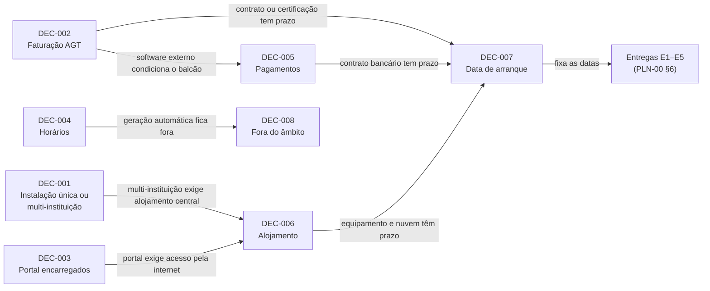

# Registo de Decisões e Questões em Aberto — SGE IPCAG N.º 12008 / BGO

> [!abstract] Navegação
> - **Painel Principal:** [[Inicio|Início do Vault]] | **Índice do Projeto:** [[00 - MOC SGE IPCAG 12008 BGO|MOC]] | **Plano:** [[00.1 - Plano de Engenharia de Requisitos]] (§7 — decisões D1–D8)
> - **Âmbito resultante:** [[06 - Visao e Ambito]]
> - **Especificação (v1.2):** [[01 - Dominio e Regras]] → [[02 - Fluxos de Trabalho]] → [[03 - User Stories]] → [[04 - Telas e Documentos]] → [[05 - Modelagem de Dados]]
> - **Enquadramento:** [[Quadro Legal MED AGT e APD Angola]] | [[Governacao Escolar Ensino Tecnico MED]]

> [!important] Para que serve este registo
> É a **única fonte** das decisões estratégicas do projeto (`DEC-nnn`) e das dúvidas por responder (`Q-nnn`). Um requisito que dependa de uma decisão `pendente` ou de uma questão `aberta` **não cumpre a *Definition of Ready*** ([[00.1 - Plano de Engenharia de Requisitos#8. Definition of Ready (quando um requisito está pronto para desenvolver)|PLN-00 §8]]).

---

## 0. Regras de Utilização

1. **Numeração:** `DEC-001`, `DEC-002`… e `Q-001`, `Q-002`… sequenciais e nunca reutilizados. As decisões `DEC-001` a `DEC-008` correspondem às decisões `D1` a `D8` do PLN-00 §7.
2. **Estados de uma decisão:**
   - `pendente` — analisada, ainda sem escolha.
   - `aguarda Direção` — a escolha cabe à Direção do IPCAG; a entrada indica **o que é preciso para a fechar**.
   - `decidida` — escolha registada, com data e quem decidiu.
3. **Estados de uma questão:** `aberta` ou `respondida` (com a resposta, a fonte e a data).
4. **Uma decisão `decidida` não se reescreve.** Para a mudar, regista-se uma nova `DEC-nnn` que a substitui e anota-se na antiga "substituída por `DEC-nnn`" (controlo de alterações — PLN-00 §3, princípio 6).
5. **Nada se inventa.** Factos legais, números e datas sem fonte confirmada ficam como `Q-nnn`, nunca como texto de decisão.
6. **Outras sessões / outros autores** acrescentam entradas no fim das secções 2 e 3 usando os modelos da secção 4, sem alterar as entradas existentes.

---

## 1. Quadro-Resumo das Decisões

| ID | Origem | Tema | Decisão | Estado | Data | Quem decidiu | Homologação da Direção |
| :---: | :---: | :--- | :--- | :---: | :---: | :--- | :---: |
| [[#DEC-001 — Instalação única IPCAG ou produto multi-instituição\|DEC-001]] | D1 | Instalação única ou multi-instituição | (a) Instalação única IPCAG, com dados institucionais parametrizáveis | `decidida` | 2026-11-02 | Analista responsável do projeto | pendente |
| [[#DEC-002 — Faturação AGT\|DEC-002]] | D2 | Faturação AGT | — *(proposta: (b) integrar com software certificado, atrás de um adaptador)* | `aguarda Direção` | — | — | — |
| [[#DEC-003 — Portal ou aplicação para encarregados e alunos\|DEC-003]] | D3 | Portal para encarregados e alunos | (b) Portal na E5; SMS avaliado na especificação da C12 | `decidida` | 2026-11-02 | Analista responsável do projeto | pendente |
| [[#DEC-004 — Horários\|DEC-004]] | D4 | Horários | (b) Registo do horário feito à mão, com importação e deteção de choques | `decidida` | 2026-11-02 | Analista responsável do projeto | pendente |
| [[#DEC-005 — Pagamentos\|DEC-005]] | D5 | Pagamentos | (a) Registo manual de borderôs na E1, com conciliação bancária na C10; (b) reavaliada depois da E5 | `decidida` | 2026-11-02 | Analista responsável do projeto | pendente |
| [[#DEC-006 — Alojamento\|DEC-006]] | D6 | Alojamento | (a) Servidor local + réplica na nuvem, a confirmar na Fase B | `decidida` | 2026-11-02 | Analista responsável do projeto | pendente |
| [[#DEC-007 — Data de arranque\|DEC-007]] | D7 | Data de arranque | (a) Início do Ano Letivo 2027/2028, com ponto de controlo na Fase E | `decidida` | 2026-11-02 | Analista responsável do projeto | pendente |
| [[#DEC-008 — Fora do âmbito\|DEC-008]] | D8 | Fora do âmbito | (a) Lista recomendada | `decidida` | 2026-11-02 | Analista responsável do projeto | pendente |
| [[#DEC-009 — Avançar com pendências de validação\|DEC-009]] | Equipa | Pendências de validação | Avançar para a construção; regulamento interno, recálculo de pautas e homologação resolvidos durante o projeto, com regras parametrizáveis e pontos de controlo | `decidida` | 2026-11-02 | Equipa do projeto | pendente |
| [[#DEC-010 — Integrar os ajustes da migração no modelo de dados\|DEC-010]] | VER-01 (#6) | Ajustes da migração (MIG-10 `AJ-nn`) | Aceitar todos; BI opcional com pendência; conta técnica própria; consola `MOD-MIG-01` na E1 | `decidida` | 2026-11-05 | Analista responsável do projeto | pendente |
| [[#DEC-011 — Pagamentos por RUPE no fecho de caixa\|DEC-011]] | VER-01 (#7); `Q-034` | RUPE no fecho de caixa | Canal próprio do caixa, sem documento fiscal do IPCAG, fora da receita e da conciliação bancária | `decidida` | 2026-11-05 | Analista responsável do projeto | pendente |
| [[#DEC-012 — Alinhar permissões RBAC e RLS\|DEC-012]] | VER-01 (#5) | Permissões: RBAC vs RLS | O DOC-01 manda; `ADMIN_TEC` só com dados técnicos; 5 casos da Secretaria; preços para todos e bolsas só para a Tesouraria e a Direção | `decidida` | 2026-11-05 | Analista responsável do projeto | pendente |
| [[#DEC-013 — Entregas e prioridades\|DEC-013]] | VER-01 (#9); `Q-038` | Entregas E1–E5 e prioridades | Saúde na E1; núcleo da C13 na E2/E3; C10 dividida em E1/E2; 3 regras de alinhamento RF ↔ US | `decidida` | 2026-11-05 | Analista responsável do projeto | pendente |
| [[#DEC-014 — Critérios de aceitação da operação (C18)\|DEC-014]] | Issue #14 (`L-RF-02`) | Aceitação de C18 por RNF vs US | (a) Aceitação pelas metas do RNF-08 e procedimentos do OPS-09; sem US funcionais no DOC-03; mapeamento RF ↔ RNF no DOC-07 | `decidida` | 2026-11-08 | Analista responsável do projeto | pendente |
| [[#DEC-015 — Âmbito e faseamento da Central de Avisos (C12 na E3 e E5)\|DEC-015]] | Issue #18 (`L-RF-07`); `Q-037` | Faseamento da C12: central de avisos vs portal | (b) Central de avisos interna (`US-COM-01` a `06`) na E3; canal impresso garantido e SMS complementar com teto; portal (`US-COM-07`, `08`) na E5 | `decidida` | 2026-11-09 | Analista responsável do projeto | pendente |
| [[#DEC-016 — Âmbito: Avaliação de desempenho e expediente geral fora das entregas E1–E5 (Q-036, Q-039)\|DEC-016]] | Issue #23 (`L-RF-08`); `Q-036`, `Q-039` | Âmbito: avaliação de desempenho e expediente geral | (a) Avaliação de desempenho e expediente geral fora das entregas E1–E5 (adicionados a DEC-008 como itens 9 e 10); RF-C19-33 e US-APD-07 passam a Won't | `decidida` | 2026-11-09 | Analista responsável do projeto | pendente |
| [[#DEC-017 — Governação, Operação e Sustentabilidade Financeira do SGE (Q-013)\|DEC-017]] | Issue #24; `Q-013` | Governação, operação e sustentabilidade financeira | (a) IPCAG é o dono do sistema e financia custos locais, nuvem e SMS (sob teto) via receitas de propinas; operação local por ADMIN_TEC (N1/N2) e suporte N3 externo sob SLA; resiliência offline garantida | `decidida` | 2026-11-09 | Analista responsável do projeto | pendente |
| [[#DEC-018 — Concurso de Admissão de 2027/2028 Fora do SGE e Importação dos Admitidos na E1 (Q-017)\|DEC-018]] | Issue #25; `Q-017` | Concurso de admissão 2027/2028: fora vs no SGE | (a) Concurso de admissão 2027/2028 corre fora do SGE (portal nacional `acessoetp.ao` / listas oficiais homologadas); admitidos importados na E1 via C17 (`MIG-D06`); capacidade C02 entra na E5 para 2028/2029 | `decidida` | 2026-11-09 | Analista responsável do projeto | pendente |
| [[#DEC-019 — Governação de Papéis: Ponto de Contacto APD e Separação entre Funções Pedagógicas e Financeiras (Q-APD-04, Q-C15-04)\|DEC-019]] | Issue #27; `Q-APD-04`, `Q-C15-04` | Governação de papéis: ponto de contacto APD e visibilidade financeira do DT | (a) Ponto de contacto APD tutelado pelo DIR_GERAL com operação pelo CHEFE_SEC_GER (sem 13º papel RBAC); DT e Professores sem acesso a dívidas nem semáforo financeiro (RN-17.3, DEC-012 confirmadas) | `decidida` | 2026-11-09 | Analista responsável do projeto | pendente |
| [[#DEC-020 — Título Jurídico e Enquadramento Institucional do IPCAG (Issue #38, Q-APD-01, Q-APD-02, Q-LEG-13)\|DEC-020]] | Issue #38; `Q-APD-01`, `Q-APD-02`, `Q-LEG-13` | Título jurídico e enquadramento institucional | (a) SGE desacoplado via parametros_instituicao suportando tanto acordo de gestão (DP 302/19) como parceria privada (DP 37/23); pedido de cópia do alvará/acordo remetido como HITL para questionário DSC-02 em PC-E1 (DEC-009) | `decidida` | 2026-11-09 | Analista responsável do projeto | pendente |

> [!note] Autoridade que aprova as decisões (registado a 2026-11-02)
> - **Aprova formalmente:** a **Direção Executiva do IPCAG**. O `DIR_GERAL` homologa; o `SUB_PED` e o `SUB_ADM` dão parecer nas decisões da sua área (pedagógica e administrativa/financeira).
> - **Propõe e decide para a equipa:** o **analista responsável do projeto** (externo ao IPCAG). As decisões `decidida` orientam já o trabalho de definição, mas só ficam firmes para a linha de base `v2.0` depois da homologação da Direção. A coluna "Homologação da Direção" passa a `homologada (data, despacho ou ata)` quando isso acontecer.
> - **`aguarda Direção`:** decisões que o analista entende caberem à Direção; não avançam sem despacho.
> - **Ocasião proposta para a homologação:** a apresentação da [[06 - Visao e Ambito]] à Direção Executiva (fim da Fase A).
>
> **Atualização (2026-11-02, segundo [[Achados dos Documentos Reais - Lote 1|DESC-L1]] A4):** os documentos reais são assinados por uma **Coordenadora Geral da Comissão de Gestão** e por um **Coordenador para a Área Pedagógica**, e não por um Director Geral e Subdirectores. Mantém-se a escolha do utilizador (a direção da escola aprova), mas **quem exerce hoje a homologação** fica por confirmar ([[#3. Questões em Aberto|Q-028]]). Até lá, onde este registo diz `DIR_GERAL`, `SUB_PED` e `SUB_ADM` deve ler-se "o titular atual desse papel".

### 1.1 Dependências entre decisões



---

## 2. Decisões

### DEC-001 — Instalação única IPCAG ou produto multi-instituição

- **Origem:** PLN-00 §7 `D1` · **Estado:** `decidida` · **Data:** 2026-11-02 · **Quem decidiu:** analista responsável do projeto · **Homologação da Direção:** pendente

**Contexto.** A especificação v1.2 foi escrita só para o IPCAG: o cabeçalho institucional dos documentos oficiais ([[04 - Telas e Documentos]] Parte 2), as 12 salas, os 2 turnos, o protocolo com a Diocese de Caxito (RN-07 em [[01 - Dominio e Regras]]). O [[05 - Modelagem de Dados]] não tem nenhuma entidade "instituição": as 44 tabelas e a RLS separam os dados por cargo, não por escola.

| Opção | Prós | Contras |
| :--- | :--- | :--- |
| **(a) Instalação única IPCAG** | Menor complexidade; a especificação atual serve tal como está; regras ajustadas à prática real da escola; entrega mais rápida. | Usar o SGE noutra escola obriga a refazer partes do modelo de dados, da RLS e dos documentos. |
| **(b) Multi-instituição desde o início** | Produto reutilizável (ex.: outras escolas da Diocese); custos repartidos. | Separar os dados por escola em praticamente todas as 44 tabelas e na RLS; parametrizar regras, cabeçalhos, numeração de recibos e de Livro/Folha/Termo por escola; alojamento central (choca com o servidor local por escola da DEC-006); mais testes; atrasa a E1. |
| **Variante recomendada de (a)** | Os dados institucionais (nome, número da escola, NIF, logótipo, cabeçalho, salas, turnos) ficam numa configuração única e não escritos no código. Custo baixo e deixa a porta aberta. | Passar mais tarde a multi-instituição continua a exigir trabalho (separação de dados e RLS). |

**Impacto.**
- *Capacidades:* com (b), C01, C09 (cabeçalhos e numeração por escola), C10 (numeração de recibos por escola), C14 (contas por escola), C15 (indicadores consolidados), C17, C18 e C19 (cada escola é responsável pelo tratamento dos seus dados). Com (a), nenhuma alteração ao que está especificado.
- *Entregas:* (b) atrasa a E1 e, por arrasto, todas as outras.

**Recomendação: (a) com a variante parametrizável.** O objetivo imediato é pôr o IPCAG a funcionar; a Fase B ainda pode revelar práticas locais que um produto genérico teria de acomodar; não está identificada nenhuma outra escola interessada ([[#3. Questões em Aberto|Q-009]]). A passagem a multi-instituição pode ser pedida depois da linha de base `v2.0`, como pedido de alteração.

> [!success] Decisão (2026-11-02)
> **(a) Instalação única IPCAG, com dados institucionais parametrizáveis.** Consequências para a Fase C: o [[05 - Modelagem de Dados]] não ganha separação de dados por escola; os dados institucionais (nome, número da escola, NIF, logótipo, cabeçalho dos `DOF`, salas, turnos) ficam numa configuração única, não escritos no código nem nos modelos de documento. A Q-009 deixa de bloquear e passa a informar uma eventual reavaliação futura.

---

### DEC-002 — Faturação AGT

- **Origem:** PLN-00 §7 `D2` (lacuna L7) · **Estado:** `aguarda Direção` · **Data:** — · **Quem decide:** Direção Executiva (`DIR_GERAL`, com parecer do `SUB_ADM`)

**Contexto.** A RN-09 ([[01 - Dominio e Regras]]) e o `DOF-11` (recibo, Nota de Estorno e Mapa de Fecho de Caixa) definem recibos sequenciais imutáveis e anulação apenas por Nota de Estorno, com base no DP n.º 292/18. Não está decidido se o SGE será **software de faturação certificado pela AGT** (com exportação SAF-T AO) ou se **integra com um software já certificado**. Também não está confirmado o que a lei exige ao IPCAG enquanto escola comparticipada ([[#3. Questões em Aberto|Q-001]] a [[#3. Questões em Aberto|Q-004]]).

> [!info] Atualização da base legal (2026-11-02, segundo [[Verificacao das Referencias Legais|LEG-VER]] §4)
> A verificação legal (L3/L7) concluiu que o **DP n.º 292/18 foi revogado pelo DP n.º 71/25** e que a base atual é o DP n.º 71/25, o DE n.º 683/25 e o Código do IVA. A lei obriga a emitir **fatura ou fatura-recibo** (não só recibo), mesmo com isenção de IVA, e a corrigir por **nota de crédito**; a "Nota de Estorno" da RN-09 não é um tipo legal. Se o IPCAG estiver no Regime Geral do IVA, pode estar obrigado à **fatura eletrónica** comunicada à AGT. A LEG-VER conclui que isto **aumenta o custo da opção (a)** e reforça a (b) com adaptador. **A LEG-VER não é parecer jurídico:** estas conclusões têm de ser confirmadas pelo contabilista (Q-LEG-16 a Q-LEG-20). As correções às notas existentes estão propostas na LEG-VER §5 (`COR-LEG-02`, `COR-LEG-03`, `COR-LEG-05`) e não são aplicadas aqui.

| Opção | Prós | Contras |
| :--- | :--- | :--- |
| **(a) SGE certificado como software de faturação, com SAF-T AO** | Controlo total; um só sistema no balcão, sem dupla digitação; a RN-09 já está desenhada neste sentido; funciona *offline* na rede local. | Processo de certificação com requisitos, prazo e custo ainda desconhecidos; obrigação de manter a conformidade a cada alteração legal; a equipa assume responsabilidade fiscal; a E1 fica dependente da certificação. |
| **(b) Integrar com software de faturação já certificado** | A conformidade fiscal fica com um fornecedor já certificado; a E1 não depende de uma certificação própria. | Dependência e custo de licença; a integração pode não existir (sem API, só importação de ficheiros); risco de dupla digitação no balcão; a numeração dos recibos passa a ser a do software externo; o software externo pode não funcionar *offline*. |

**Impacto.**
- *Capacidades:* C10 (núcleo da decisão), C09 (`DOF-11`), C15 (relatórios financeiros), C17 (importação de dívidas e de recibos anteriores), C18 (integrações e operação), C19.
- *Entregas:* **E1 crítica** — há recibos desde a primeira matrícula.

**Recomendação: (b), com um adaptador.** O SGE fica responsável pela Conta Corrente, pelos borderôs (RN-09), pelo semáforo financeiro (RN-08) e pelo fecho de caixa; a emissão do documento fiscal passa por **um único ponto de integração** (adaptador), de modo que se possa mudar para (a) mais tarde sem refazer a Tesouraria. **Condição:** a escolha só fica firme depois de respondidas a Q-001 (obrigação legal) e a Q-002 (software que a escola já usa).

> [!warning] Aguarda Direção (registado a 2026-11-02)
> O analista responsável entende que esta decisão cabe à Direção Executiva: tem impacto legal, fiscal e de custo. **Para a fechar é preciso:**
> 1. **Parecer fiscal escrito** (contabilista do IPCAG ou AGT) que responda à [[#3. Questões em Aberto|Q-001]] (obrigação de software certificado e SAF-T AO; tipos de documento), à [[#3. Questões em Aberto|Q-003]] (regime fiscal das propinas e emolumentos; quem é o adquirente) e às Q-LEG-16 a Q-LEG-19 da [[Verificacao das Referencias Legais|LEG-VER]] (documentos emitidos hoje, âmbito da isenção de IVA, bolsas de 100%, NIF e regime de IVA do IPCAG).
> 2. **Inventário do software de faturação atual** ([[#3. Questões em Aberto|Q-002]]): nome, licença, possibilidade de integração.
> 3. **Estimativa de custo e prazo** das duas opções (licença e integração em (b); processo de certificação e manutenção em (a)) — depende da [[#3. Questões em Aberto|Q-013]].
> 4. **Despacho do `DIR_GERAL`**, com parecer do `SUB_ADM`, a escolher (a) ou (b).
>
> **Prazo:** antes de a Fase E fechar a E1, porque há recibos desde a primeira matrícula. Com o arranque decidido para 2027/2028 (DEC-007), a decisão é necessária cedo na Fase C, para que a C10 possa ser especificada.
>
> **Enquanto aguarda:** a especificação da C10 na Fase C prevê um **único ponto de emissão do documento fiscal**, compatível com (a) e com (b). É um pressuposto de trabalho, não uma decisão. A Q-004 (formato da numeração dos recibos) fica dependente desta decisão.

---

### DEC-003 — Portal ou aplicação para encarregados e alunos

- **Origem:** PLN-00 §7 `D3` · **Estado:** `decidida` · **Data:** 2026-11-02 · **Quem decidiu:** analista responsável do projeto · **Homologação da Direção:** pendente

**Contexto.** A capacidade C12 (comunicação com encarregados e alunos) não está especificada. O único acesso externo previsto é o portal público de verificação por QR Code (`MOD-PUB-QR`, `US-DOC-03`). O Encarregado de Educação existe como cadastro (BI e telefone — [[01 - Dominio e Regras#1.2 Registo e Vínculo do Estudante|DOC-01 §1.2]]), mas não tem conta: `usuarios_sistema` só prevê os 12 cargos. A proteção de dados de menores (L8) ainda não está resolvida.

| Opção | Prós | Contras |
| :--- | :--- | :--- |
| **(a) Portal na E1/E2** | Transparência desde o início; menos filas na Secretaria e na Tesouraria (consulta de dívidas, faltas e notas). | Contas fora dos 12 cargos (C14); expõe na internet dados de menores antes de L8 estar resolvida; carga em época de matrícula; exige alojamento acessível pela internet (DEC-006); compete com o essencial da E1/E2. |
| **(b) Portal mais tarde (E5)** | A operação interna estabiliza primeiro; os dados já estão validados quando se abrem; L8 fica resolvida antes. | No primeiro ano, os encarregados continuam a deslocar-se à escola para saber de notas e dívidas. |
| **(c) Só SMS** | Chega a encarregados sem *smartphone* nem internet; simples. | Custo por mensagem e contrato com um fornecedor (desconhecidos); canal num só sentido; não substitui a consulta; dados pessoais enviados por SMS (APD). |

**Impacto.**
- *Capacidades:* C12 (núcleo), C14 (contas de encarregados e alunos), C19 (consentimento e direitos dos titulares), C10 e C06 (o que se mostra: dívidas, notas, faltas), C15, C18.
- *Entregas:* (a) acrescenta trabalho à E1/E2; (b) e (c) ficam na E5.

**Recomendação: (b) Portal na E5**, com o SMS avaliado como canal complementar na especificação da C12 (depende de [[#3. Questões em Aberto|Q-008]]). Abrir dados de menores à internet só depois de fechada a L8 é a opção mais segura.

> [!success] Decisão (2026-11-02)
> **(b) Portal para encarregados e alunos na E5.** Nas entregas E1 a E4 não há contas para encarregados nem alunos: o único acesso externo é o portal público de verificação por QR Code (`US-DOC-03`). A especificação da C12 (Fase C) decide se o SMS entra como canal complementar, com base na Q-008 e na Q-013 (custo). A L8 (proteção de dados) tem de estar fechada antes de a E5 abrir dados de menores à internet.

---

### DEC-004 — Horários

- **Origem:** PLN-00 §7 `D4` (capacidade C04) · **Estado:** `decidida` · **Data:** 2026-11-02 · **Quem decidiu:** analista responsável do projeto · **Homologação da Direção:** pendente

**Contexto.** Existe `alocacoes_docentes` (que professor leciona que disciplina em que turma, e desde quando), mas **não há horário semanal**. O professor regista sumários e faltas **por tempo letivo** (`US-PED-02`); a RN-03 calcula o limite de faltas a partir dos tempos letivos semanais; o DOC-01 diz que o `PROF` acede às turmas "atribuídas no horário letivo atual"; o Fluxo 03 refere uma "gestão de horários/alocações" pelo `SUB_PED` que não está especificada.

| Opção | Prós | Contras |
| :--- | :--- | :--- |
| **(a) O SGE gera horários automaticamente** | Poupa trabalho à Direção Pedagógica no início do ano; otimiza a ocupação das 12 salas e dos laboratórios. | Problema de otimização complexo (disponibilidade dos professores, laboratórios, turnos); esforço e risco altos; o resultado acaba quase sempre ajustado à mão; atrasa a E2. |
| **(b) O SGE regista o horário feito à mão** | Suficiente para sumários, faltas por tempo letivo, ponto docente e ocupação de salas; simples; a deteção de choques (professor, sala, turma) já dá muito valor. | O horário continua a ser elaborado fora do sistema e tem de ser introduzido (atenuável com importação de uma folha de cálculo). |

**Impacto.**
- *Capacidades:* C04 (núcleo), C05 e C06 (o tempo letivo é a base das faltas e do acesso à mini-pauta), C11 (ponto docente comparado com o horário), C01 (salas e turnos), C16 (horário do ano seguinte).
- *Entregas:* E2 (o horário tem de existir na primeira semana de aulas).

**Recomendação: (b)**, com deteção de choques e importação a partir de folha de cálculo. A geração automática (a) passa para a lista de fora do âmbito (DEC-008).

> [!success] Decisão (2026-11-02)
> **(b) O SGE regista o horário semanal feito à mão**, introduzido diretamente ou importado de uma folha de cálculo, com deteção de choques de professor, sala e turma. A C04 é especificada na Fase C para a E2 (nova estrutura de horário no [[05 - Modelagem de Dados]], ligada a `alocacoes_docentes`, salas e tempos letivos). Precisa da Q-011 (quem elabora e aprova) e da Q-012 (duração e número de tempos letivos). A geração automática fica fora do âmbito (DEC-008).

---

### DEC-005 — Pagamentos

- **Origem:** PLN-00 §7 `D5` · **Estado:** `decidida` · **Data:** 2026-11-02 · **Quem decidiu:** analista responsável do projeto · **Homologação da Direção:** pendente

**Contexto.** A RN-09 e a máquina de estados 3.7 do DOC-01 especificam o **registo manual de borderôs** pelo `OP_TES`, com unicidade `(banco, n.º de operação)` e controlo de saldo; os canais aceites são TPA, Transferência/Depósito e Multicaixa Express/Referência. A capacidade C10 não tem conciliação bancária (lacuna do PLN-00 §2.1).

| Opção | Prós | Contras |
| :--- | :--- | :--- |
| **(a) Registo manual de borderôs (como especificado)** | Já está especificado (RN-09, `US-TES-03`, `DOF-11`); sem contratos externos; funciona *offline* na rede local. | Um talão falso só é detetado por conciliação posterior; filas no balcão em época de matrícula; verificação manual. |
| **(b) Integração com referências Multicaixa / gateway de pagamento** | O pagamento chega já identificado (referência ligada ao aluno e à propina); elimina talões falsos; reduz filas; conciliação automática. | Contrato com banco ou entidade gestora; custos por transação desconhecidos; confirmação depende da internet; integração técnica e requisitos de segurança; obriga a rever a RN-09 e a máquina 3.7. |

**Impacto.**
- *Capacidades:* C10 (núcleo), C15 (receitas e dívida), C18 (integração), C09 (bloco bancário do recibo `DOF-11`).
- *Entregas:* E1.

**Recomendação: (a) na E1, tal como especificado; (b) reavaliada depois da E5**, com dados reais de volume e de fraude (Fase B). Em qualquer das opções, a **conciliação bancária** (por importação de extrato, se o banco o fornecer — [[#3. Questões em Aberto|Q-007]]) deve ser especificada dentro da C10.

> [!success] Decisão (2026-11-02)
> **(a) Registo manual de borderôs na E1**, tal como especificado na RN-09 e na máquina de estados 3.7. A **conciliação bancária** fica dentro do âmbito da C10 (por importação de extrato, se o banco o fornecer — Q-007). A integração com referências Multicaixa ou gateway (b) **não entra nas entregas E1–E5**: é reavaliada depois da E5, como pedido de alteração, com dados reais de volume e de fraude.

---

### DEC-006 — Alojamento

- **Origem:** PLN-00 §7 `D6` · **Estado:** `decidida` · **Data:** 2026-11-02 · **Quem decidiu:** analista responsável do projeto · **Homologação da Direção:** pendente

**Contexto.** A especificação já pressupõe a opção (a): a RN-10, ponto 4 ([[01 - Dominio e Regras]]), e o §1.2 de [[05 - Modelagem de Dados]] descrevem um servidor local na rede interna com replicação assíncrona para a nuvem, e professores a trabalhar *offline* no navegador. O portal de verificação por QR Code (`US-DOC-03`) tem de ser acessível pela internet por entidades externas. A energia e a internet no Panguila são instáveis (DOC-01, RN-10).

| Opção | Prós | Contras |
| :--- | :--- | :--- |
| **(a) Servidor local + réplica na nuvem** | Secretaria e Tesouraria funcionam sem internet; cópia fora do edifício; portal QR e futuro portal servidos a partir da nuvem; é o que a especificação já descreve. | Dois ambientes a operar (sincronização e conflitos); equipamento local, UPS e energia; custo da nuvem; alguém tem de cuidar do servidor local (C18). |
| **(b) Só nuvem** | Operação simples, sem servidor local; cópias de segurança geridas; acesso de qualquer lugar (Direção). | Sem internet, Secretaria e Tesouraria param (só os professores continuam *offline*); depende da qualidade da ligação no Panguila ([[#3. Questões em Aberto|Q-006]]); custo de dados. |
| **(c) Só local** | Sem custos de nuvem; os dados ficam no edifício. | Portal QR público impossível sem exposição direta à internet; sem cópia fora do edifício (perda total em caso de incêndio ou roubo); sem acesso remoto. |

**Impacto.**
- *Capacidades:* C18 (núcleo: cópias de segurança, recuperação, atualizações), C05/C06 (*offline* dos professores), C09 (portal QR), C10 (balcão *offline*), C12 (portal futuro), C17, C19 (onde ficam os dados de menores — [[#3. Questões em Aberto|Q-016]]).
- *Entregas:* a infraestrutura tem de estar instalada **antes da E1**, embora a C18 esteja na E2.

**Recomendação: (a)**, a confirmar com o inventário de infraestrutura da Fase B (Q-006). É preciso clarificar qual dos dois servidores é a autoridade sobre o estado do trimestre ([[#3. Questões em Aberto|Q-015]]).

> [!success] Decisão (2026-11-02)
> **(a) Servidor local na rede da escola + réplica na nuvem**, como já descrito na RN-10 e no DOC-05 §1.2. **Condições:** (1) o inventário de infraestrutura da Fase B (Q-006) confirma que a escola tem ou pode ter rede local, energia protegida e ligação à internet suficiente para a réplica; se não, a decisão é revista por nova `DEC`; (2) a Q-015 (que servidor é a autoridade central) é resolvida na especificação da C18 (`09 - Integracoes, Infraestrutura e Operacao`); (3) a Q-016 (onde podem ficar alojados dados de menores) é resolvida antes de escolher o fornecedor de nuvem. A [[11 - Protecao de Dados (APD)|APD-11]] §10 propõe, como critério de escolha, alojar em Angola a réplica, as cópias de segurança e o portal QR, salvo notificação ou autorização prévia da APD (`RNF-P-APD-06`, a validar). A infraestrutura local tem de estar instalada antes da E1.

---

### DEC-007 — Data de arranque

- **Origem:** PLN-00 §7 `D7` · **Estado:** `decidida` · **Data:** 2026-11-02 · **Quem decidiu:** analista responsável do projeto · **Homologação da Direção:** pendente

**Contexto.** O princípio 1 do PLN-00 manda arrancar em produção no **início de um Ano Letivo** (ou, no mínimo, de um trimestre), nunca a meio de um período de avaliação. À data deste registo (02/11/2026) decorre o Ano Letivo 2026/2027, que segundo o glossário do DOC-01 vai tipicamente de setembro a julho. A definição ainda tem por fazer as Fases B a F. As datas oficiais do calendário escolar seguinte não estão confirmadas ([[#3. Questões em Aberto|Q-005]]).

| Opção | Prós | Contras |
| :--- | :--- | :--- |
| **(a) Início do Ano Letivo 2027/2028** | Respeita o princípio 1; dá cerca de 9–10 meses para as Fases B–F, a construção da E1/E2, a migração e a formação; os dados de 2026/2027 ficam completos para importar. | Prazo apertado; a E4 (junho de 2028) depende de o histórico completo da 10ª à 12ª ter sido importado (aviso do PLN-00 §6); o concurso de admissão de 2027/2028 corre provavelmente fora do SGE ([[#3. Questões em Aberto|Q-017]]). |
| **(b) Início do II ou III Trimestre de 2026/2027 (piloto)** | Valor mais cedo; aprende-se com uso real. | Arranque a meio do ano; obriga a migrar notas de trimestres já lançados; a definição ainda não está validada (Fases B–D); risco alto para a pauta, o erro mais visível de um SGE. |
| **(c) Início do Ano Letivo 2028/2029** | Folga para validar e construir com calma. | Mais um ano inteiro em papel; risco de o projeto perder apoio. |

**Impacto.**
- *Capacidades:* C17 (o que migrar e de que ano), C18 (formação antes do arranque), C02 (o primeiro concurso pode ficar fora do SGE).
- *Entregas:* fixa a data-limite de **todas** as entregas E1–E5 (PLN-00 §6).

**Recomendação: (a) 2027/2028**, com um ponto de controlo: se a E1 não estiver aprovada na Fase E a tempo de construir, testar, migrar e formar antes das matrículas, o arranque passa para (c), registado como nova decisão.

> [!success] Decisão (2026-11-02)
> **(a) Arranque em produção no início do Ano Letivo 2027/2028**: a E1 tem de estar em produção antes das matrículas de 2027/2028 e as entregas seguintes antes dos momentos indicados no PLN-00 §6. **Ponto de controlo:** no fecho da Fase E, se a E1 aprovada não couber no tempo que falta para construir, testar, migrar e formar antes das matrículas, regista-se uma nova `DEC` que adia o arranque para 2028/2029. **Falta:** as datas oficiais do calendário escolar de 2027/2028 (Q-005), que transformam os meses indicativos em datas-limite, e saber como corre o primeiro concurso de admissão (Q-017).

---

### DEC-008 — Fora do âmbito

- **Origem:** PLN-00 §7 `D8` · **Estado:** `decidida` · **Data:** 2026-11-02 · **Quem decidiu:** analista responsável do projeto · **Homologação da Direção:** pendente

**Contexto.** O PLN-00 deixa por decidir o processamento salarial (C11) e os recursos e património (C20: biblioteca, inventário, laboratórios). A nota [[Governacao Escolar Ensino Tecnico MED]] atribui o "Património" ao `SUB_ADM`, mas nenhuma nota da especificação o detalha. Sem uma lista explícita do que fica fora, o âmbito cresce sem controlo (L1).

| Opção | Prós | Contras |
| :--- | :--- | :--- |
| **(a) Lista recomendada fora do âmbito:** processamento salarial; C20 (biblioteca, inventário e património, gestão de laboratórios); cantina; transporte escolar; contabilidade geral (o SGE faz Conta Corrente do aluno e caixa, não contabilidade da escola); geração automática de horários (DEC-004); ensino a distância e conteúdos pedagógicos; compras e stocks | Foco nas capacidades que a escola precisa para operar o ano letivo; reduz o risco de prazo. | Estes processos continuam fora do SGE (papel ou outros sistemas). |
| **(b) A lista (a), mas com o processamento salarial dentro** | Um só sistema para o pessoal (cadastro, ponto e salários). | Regras salariais e fiscais próprias (impostos, segurança social) que a especificação não cobre; quem processa hoje os salários não está confirmado ([[#3. Questões em Aberto|Q-010]]). |
| **(c) A lista (a), mas com a C20 dentro** | Controlo do património e da biblioteca. | Nova capacidade inteira por especificar (Fase C), sem ligação ao calendário letivo. |

**Impacto.**
- *Capacidades:* C11 fica reduzida a cadastro e ponto (`US-DOC-04`); C20 fica fora; C15 não inclui indicadores de salários nem de património.
- *Entregas:* nenhuma das capacidades excluídas estava nas entregas E1–E5, por isso a lista não atrasa nada; impede que entrem depois sem pedido de alteração.

**Recomendação: (a).** A C20 pode ser reavaliada depois da E5, como pedido de alteração.

> [!success] Decisão (2026-11-02, complementada a 2026-11-09 pela DEC-016)
> **(a) Ficam fora do âmbito da versão inicial (entregas E1–E5):**
> 1. Processamento salarial (a C11 fica reduzida a cadastro e ponto — `US-DOC-04`);
> 2. C20 — biblioteca, inventário e património, gestão de laboratórios;
> 3. Cantina;
> 4. Transporte escolar;
> 5. Contabilidade geral da escola (o SGE faz a Conta Corrente do aluno, a Tesouraria e o fecho de caixa);
> 6. Geração automática de horários (DEC-004);
> 7. Ensino a distância e conteúdos pedagógicos;
> 8. Compras e stocks;
> 9. **Avaliação de desempenho do pessoal** (`DEC-016`, `Q-036`): 10 indicadores GPE e homologação provincial fora do SGE nas entregas E1–E5; `RF-C19-33` e `US-APD-07` passam a `Won't` (fora da linha de base);
> 10. **Expediente geral e correspondência** (`DEC-016`, `Q-039`): registo de ofícios de entrada e saída fora do SGE (C21 não criada); a Secretaria Geral mantém o livro manual de protocolo de ofícios (fecha `L-RF-08`).
>
> Qualquer destes processos só entra por pedido de alteração registado neste documento. A Q-010 (quem processa hoje os salários) e a Q-019 (controlo do património fora do SGE) ficam para a Fase B, para documentar a fronteira com os sistemas ou o papel que continuam a existir.

---

### DEC-009 — Avançar com pendências de validação

- **Origem:** decisão da equipa após a Fase B · **Estado:** `decidida` · **Data:** 2026-11-02 · **Quem decidiu:** equipa do projeto · **Homologação da Direção:** pendente

**Contexto.** Três validações do PLN-00 ficaram por fazer: (1) obter o **regulamento interno** (tipos de ocorrência, medidas, escala de comportamento — C13); (2) **recalcular pautas preenchidas** do ano anterior para validar as fórmulas (`Q-025`; [[Plano de Validacao de Pautas]]); (3) **homologação das decisões** `DEC-001`–`DEC-009` pela Comissão de Gestão.

**Decisão.** A equipa avança para a integração da especificação e para a construção **sem esperar** por estas três validações, que serão resolvidas **durante o projeto**.

> [!success] Condições para avançar sem risco (2026-11-02)
> 1. **Tudo o que depende destas validações é parametrizável**, nunca fixo no código: fórmulas de avaliação (`M1`–`M3`, `CF`, `CA`, recurso, `MFC`), limiares (aprovação, deficiência, faltas, avisos), escala de comportamento, catálogo de ocorrências e medidas, títulos dos cargos e número da instituição.
> 2. **Pontos de controlo obrigatórios**, cada um a bloquear a entrega correspondente:
>    - **Antes da E2** (notas e faltas em produção): recálculo de pelo menos 3 pautas preenchidas, com zero divergências por explicar.
>    - **Antes da E3** (primeiro boletim): regulamento interno recebido e parâmetros da C13 configurados.
>    - **Antes da E1** (arranque): homologação das decisões `DEC-001`–`DEC-009` pela Comissão de Gestão.
> 3. As regras afetadas mantêm a marca **"provisória"** na especificação `v2.0` e no código, até o ponto de controlo respetivo ser cumprido.
> 4. Qualquer divergência encontrada muda **parâmetros**, não a arquitetura; se exigir mudar a arquitetura, entra por pedido de alteração neste registo.

**Impacto.** A *Definition of Ready* do PLN-00 §8 passa a aceitar regras `provisórias` desde que parametrizáveis e ligadas a um ponto de controlo. Os itens `Q-025`, `Q-030`, `Q-032`, `Q-C13-02` a `Q-C13-06` e a homologação passam a ser acompanhados como **riscos de projeto**, não como bloqueios da definição.

---

### DEC-010 — Integrar os ajustes da migração no modelo de dados

- **Origem:** verificação de consistência [[00.4 - Relatorio de Verificacao v2.0-rc1|VER-01]], grupo G6 ([issue #6](https://github.com/Angeloaqp/sge-ipcag-12008/issues/6)) · **Estado:** `decidida` · **Data:** 2026-11-05 · **Quem decidiu:** analista responsável do projeto · **Homologação da Direção:** pendente

**Contexto.** A [[10 - Migracao de Dados e Implantacao|MIG-10]] §3.3 propôs 18 ajustes (`AJ-01` a `AJ-18`) ao DOC-05 para receber os dados antigos da escola. Só 3 estavam integrados. O DOC-05 exigia BI único e obrigatório, o que impedia importar alunos e encarregados antigos sem BI. O `RF-C17-16` apontava para o `ADMIN_TEC`, e não havia ecrã para a migração.

**Opções.**
- (a) Aceitar todos os ajustes.
- (b) Aceitar só o essencial (proveniência, lotes e ocorrências).
- (c) Rejeitar e arrancar sem dados antigos.

**Decisão.**
1. **(a) Aceitar todos os ajustes.** Entram 3 tabelas novas no Grupo 6 do DOC-05 (`lotes_migracao`, `ocorrencias_migracao`, `livros_registo_fisico`), e o modelo passa de 116 para 119 tabelas. As regras dos registos `MIGRADO` ficam na §4.10 do DOC-05.
2. **BI opcional com pendência de identificação.** Continua único quando preenchido.
3. **Conta técnica de migração própria**, diferente do `ADMIN_TEC` (`RN-16.21`).
4. **Consola de migração `MOD-MIG-01`** no DOC-04, na entrega E1.

**Porquê.** Sem o histórico da 10ª à 12ª dos alunos atuais, a E4 não consegue emitir certificados (PLN-00 §6). As exceções só valem para registos `MIGRADO` em lote aprovado, por isso as regras normais do SGE não ficam mais fracas.

**Impacto.**
- **DOC-05:** Grupo 6, §4.9, §4.10, §6 e a lista 105.
- **DOC-01:** `RN-16.21`.
- **DOC-04:** `MOD-MIG-01`.
- **RF-07:** os 16 `RF-C17` passam a ter módulo.
- **Matriz:** a `L-RF-01` fica só sem US, que passa para a Fase 3.

---

### DEC-011 — Pagamentos por RUPE no fecho de caixa

- **Origem:** verificação de consistência [[00.4 - Relatorio de Verificacao v2.0-rc1|VER-01]], grupo G7 ([issue #7](https://github.com/Angeloaqp/sge-ipcag-12008/issues/7)); `Q-034` · **Estado:** `decidida` · **Data:** 2026-11-05 · **Quem decidiu:** analista responsável do projeto · **Homologação da Direção:** pendente

**Contexto.** Os documentos contradiziam-se:
- **Fora do caixa:** o DOC-05 (lista 16) dizia que a RUPE ficava fora do caixa.
- **Dentro do caixa:** o DOC-04, o `RF-C10-08` e a `US-TES-05` tratavam-na como canal do fecho.

As entrevistas dizem duas coisas:
- os emolumentos estatais pagam-se por RUPE (DESC-RESP R15);
- o fecho tem uma linha RUPE "quando aplicável" (R13).

**Opções.**
- (a) Fora do caixa, com registo do comprovativo e um quadro só informativo.
- (b) Canal do caixa.
- (c) Ignorar a RUPE.

**Decisão.** (b) **A RUPE é um canal do caixa**, ao lado de TPA, Transferência/Depósito e Multicaixa Express. Para respeitar a lei e manter as contas certas:
1. O balcão regista a **referência e o comprovativo RUPE**. **Não** se emite Fatura, Fatura-Recibo nem Recibo do IPCAG, porque o dinheiro é do Estado.
2. O fecho tem um **`Subtotal RUPE`**, e o caixa mostra também o **`Total Receita IPCAG`** (o total líquido menos a RUPE).
3. A RUPE **não é receita do IPCAG** (`RN-13.11.9`) e **não entra na conciliação bancária**, porque não passa pela conta da escola.

**Ainda por confirmar com a escola.** Que rubricas são estatais (lista 63). Isto é parametrizado na tabela de preços e não muda a arquitetura.

**Impacto.**
- **DOC-01:** `RN-09` (fecho), `RN-13.11.2` e `RN-13.11.9`.
- **DOC-02:** Fluxo 07 e Exceção E12.7.
- **DOC-04:** borderô, fecho e `DOF-11C`.
- **DOC-05:** lista 16 e `sessoes_fecho_caixa`.
- **RF-07:** `RF-C10-08`.

---

### DEC-012 — Alinhar permissões RBAC e RLS

- **Origem:** verificação de consistência [[00.4 - Relatorio de Verificacao v2.0-rc1|VER-01]], grupo G5 ([issue #5](https://github.com/Angeloaqp/sge-ipcag-12008/issues/5)) · **Estado:** `decidida` · **Data:** 2026-11-05 · **Quem decidiu:** analista responsável do projeto · **Homologação da Direção:** pendente

**Contexto.** A matriz de cargos (RBAC) do DOC-01 §2 e a matriz de segurança da base de dados (RLS) do DOC-05 §5 davam permissões diferentes em 14 casos. Havia ainda 3 incoerências dentro dos próprios documentos: quem homologa a Pauta Geral, quem cria o Ano Letivo e quem carrega o atestado médico.

**Decisão.**
1. **O DOC-01 manda.** O RLS implementa o RBAC. Quando o RLS tinha algo sensato que faltava, acrescentou-se primeiro ao DOC-01. Nas colunas agrupadas do RLS, cada papel tem só as permissões da sua coluna no DOC-01.
2. **`ADMIN_TEC`:** vê só dados técnicos:
   - metadados da sincronização (nova linha 27 do RBAC);
   - alertas técnicos (C15-g);
   - parâmetros sem dados de alunos (linha 1).
3. **Secretaria Pedagógica:**
   - só o `CHEFE_SEC_PED` cria e edita turmas; o `OP_PED` lê e imprime;
   - só o `SUB_PED` homologa transcrições;
   - a Secretaria regista pedidos de justificação entregues ao balcão, que o DT aprova;
   - o `CHEFE_SEC_PED` só lê e imprime a Pauta Geral;
   - o atestado é carregado pelo `OP_PED` e conferido pelo `CHEFE_SEC_PED`.
4. **Tesouraria e bolsas:**
   - o `OP_TES` vê os dados básicos da turma;
   - a tabela de preços pode ser lida por todos os cargos internos;
   - as bolsas só são vistas pela Tesouraria, pelo `SUB_ADM` e pelo `DIR_GERAL`; a Secretaria Pedagógica e o `SUB_PED` veem só o semáforo (`RN-08`).
5. **Homologações:**
   - Pauta Geral: `SUB_PED` + `DIR_GERAL`;
   - Ano Letivo: o `SUB_PED` cria e o `DIR_GERAL` homologa.

**Porquê.**
- Uma só fonte de permissões evita que o código implemente duas regras diferentes.
- Quem não decide não tem poder de editar ou homologar.
- A situação financeira das famílias fica protegida (`RN-08`, APD).

**Impacto.**
- **DOC-01:** linhas 1, 3, 7, 12, 13, 18, 19, C15-g e a nova linha 27; §3.4.
- **DOC-02:** Fluxo 03.
- **DOC-03:** `US-GOV-01`, `US-PED-03` e `US-PED-06`.
- **DOC-05:** §5, com uma nota de princípio e as linhas 1, 3, 4, 7a, 8, 15, 16, 17 e 21.

---

### DEC-013 — Entregas e prioridades

- **Origem:** verificação de consistência [[00.4 - Relatorio de Verificacao v2.0-rc1|VER-01]], grupo G9 ([issue #9](https://github.com/Angeloaqp/sge-ipcag-12008/issues/9)); `Q-038` · **Estado:** `decidida` · **Data:** 2026-11-05 · **Quem decidiu:** analista responsável do projeto · **Homologação da Direção:** pendente

**Contexto.** Havia 12 desalinhamentos de entrega (E1–E5) e de prioridade (MoSCoW) entre o RF-07, o DOC-03, a VIS-06 e o PLN-00. Exemplos:
- o compartimento de saúde estava na E2, mas era usado na E1;
- o boletim da E3 dependia da C13, que estava pendente;
- a C10 tinha 13 RF na E2, mas a VIS-06 e o PLN-00 punham-na toda na E1;
- havia 11 diferenças MoSCoW entre RF e US.

**Decisão.**
1. **Saúde:** o compartimento de saúde (`RF-C19-05`) sobe para a **E1**, com a matrícula. Os atestados da `DISP` usam-no a partir da E2.
2. **Boletim:** o **núcleo da C13** é antecipado (`Q-038`): tipos de falta (`US-DIS-01`, `RF-C13-01`) na **E2**; escala e comportamento trimestral (`US-DIS-04`, `RF-C13-02`/`-03`) na **E3**. Ocorrências, medidas e processos ficam na **E5**.
3. **Tesouraria:** a **C10 fica dividida**: E1 (balcão, propinas, bolsas, documentos fiscais, caixa) e E2 (dívidas, acordos, relatórios, conciliação). A VIS-06 e o PLN-00 §6 foram atualizados.
4. **Regras de alinhamento RF ↔ US:**
   - (1) uma US tem a entrega mais cedo e a prioridade mais alta dos RF de que é a única ou a primeira consumidora;
   - (2) um RF de proteção de dados ou de segurança vale desde a primeira entrega que o usa;
   - (3) um RF com partes em entregas diferentes indica as duas e conta na primeira.

**Aplicação.**
- `RF-C19-10` passa para a E1.
- `RF-C19-27` passa a ter duas entregas: guia na E2, carta de estágio na E4.
- `RF-C19-02` passa a ligar também à `US-PIN-09`.
- `RF-C05-03` deixa de ligar à `US-COM-08`.
- `US-CTA-14`, `US-DIS-02` e `US-DIS-06` passam a `Must`.
- A regra 🟡 da `DEC-002` passa a valer também para `RF-C10-08`, `-17`, `-20` e `RF-C19-11`.
- As contagens do RF-07 §4 e do DOC-03 foram recalculadas.
- Fica explícito que `RF-C10-26` (fora da linha de base) e `RF-C19-33` (condicional) não entram nos 222 da linha de base.

**Porquê.**
- Cada entrega tem de funcionar sozinha na data do calendário escolar.
- O primeiro boletim tem de sair completo, como o atual.
- A proteção de dados aplica-se desde o primeiro dado recolhido.

---

### DEC-014 — Critérios de aceitação da operação (C18)

- **Origem:** Issue #14 ([issue #14](https://github.com/Angeloaqp/sge-ipcag-12008/issues/14)); lacuna `L-RF-02` da [[Matriz de Rastreabilidade]] · **Estado:** `decidida` · **Data:** 2026-11-08 · **Quem decidiu:** analista responsável do projeto · **Homologação da Direção:** pendente

**Contexto.** Os 7 requisitos funcionais da capacidade C18 (Operação do sistema: backups diários cifrados, replicação e autoridade central, recuperação de desastre RTO/RPO, monitorização e alertas, gestão de atualizações fora de períodos críticos, suporte aos utilizadores e ambiente de formação isolado) não possuem histórias de utilizador (US) no DOC-03. A Matriz de Rastreabilidade registava a lacuna `L-RF-02` com a proposta de decidir se a C18 se aceita pelas metas do RNF-08 e procedimentos do OPS-09 ou por US.

**Opções.**
- **(a) Aceitação pelas metas do RNF-08 e procedimentos do OPS-09 (Recomendada).** As tarefas de operação e infraestrutura são atributos não funcionais de engenharia executados pelo Administrador Técnico e suporte N3, sem ecrãs de utilizador final nem regras de negócio escolar. Tratá-las como RNF mensuráveis (RPO ≤ 24h, RTO < 4h, regra 3-2-1, cronogramas de congelamento, SLAs de suporte) garante verificação técnica rigorosa por ensaios e medições sem poluir o catálogo de histórias funcionais (DOC-03).
- **(b) Criação de um épico operacional (`EP-OPS`) no DOC-03.** Criar histórias artificiais de utilizador ("Como Administrador Técnico, quero que o script de backup corra às 19h30...") para cobrir formalmente a coluna US. Gera redundância com o RNF-08 e mistura histórias de negócio pedagógico/financeiro com tarefas de sysadmin/DevOps.

**Decisão.** **(a) Aceitação pelas metas do RNF-08 e procedimentos do OPS-09.**
1. Os 7 requisitos `RF-C18-01` a `RF-C18-07` são aceites exclusivamente através das metas mensuráveis do [[08 - Requisitos Nao Funcionais|RNF-08]] e dos procedimentos operacionais de [[09 - Integracoes, Infraestrutura e Operacao|OPS-09]], dispensando a criação de User Stories funcionais artificiais no DOC-03.
2. **Matriz de Rastreabilidade e Aceitação de C18:**
   - **`RF-C18-01`** (Backups diários cifrados 3-2-1): aceite por `RNF-BKP-01`, `RNF-BKP-04`, `RNF-BKP-05`, `RNF-BKP-06`, `RNF-BKP-07` e `OPS-09` §5.1 (rotina diária às 19h30, rotação 3-2-1 e restauro de amostra mensal).
   - **`RF-C18-02`** (Replicação na nuvem e autoridade central): aceite por `RNF-BKP-01`, `RNF-DIS-06`, `RNF-OFF-08` e `OPS-09` §3.5 (atraso ≤ 15 min, fila tolerante a falhas e resolução determinística com autoridade no servidor local).
   - **`RF-C18-03`** (Recuperação RTO < 4h, RPO ≤ 24h geral / ≤ 15 min fiscal): aceite por `RNF-BKP-01`, `RNF-BKP-02`, `RNF-BKP-03`, `RNF-DIS-05`, `RNF-DIS-07` e `OPS-09` §5.2 (procedimento ensaiado de DR-05/DR-06 antes de E1 e E2).
   - **`RF-C18-04`** (Monitorização e alertas técnicos): aceite por `RNF-DIS-01`, `RNF-DIS-03`, `RNF-AUD-04`, `RNF-SEG-04` e `OPS-09` §5.3 (`MOD-SEG-01` e painel de estado local).
   - **`RF-C18-05`** (Atualizações e períodos de congelamento): aceite por `RNF-MAN-01`, `RNF-MAN-02`, `RNF-MAN-07`, `RNF-MAN-08` e `OPS-09` §5.4 (congelamento em épocas críticas, teste em staging e reversão em ≤ 30 min).
   - **`RF-C18-06`** (Suporte N0–N3 e tempos de resposta): aceite por `RNF-USA-09` e `OPS-09` §5.6 (caderno de suporte N0–N3, tempos S1 a S4 e relatório mensal de pedidos).
   - **`RF-C18-07`** (Ambiente de formação sintético/anonimizado, ≤ 2h por cargo): aceite por `RNF-USA-01`, `RNF-PRV-06`, `RNF-MAN-07` e `OPS-09` §5.7 / `MIG-10` §9.
3. No [[07 - Catalogo de Requisitos Funcionais|RF-07]], a coluna `US` dos requisitos de C18 passa a referenciar explicitamente estes critérios RNF e a secção correspondente de OPS-09, acompanhada de nota de aceitação técnica.
4. A lacuna `L-RF-02` da [[Matriz de Rastreabilidade]] é declarada **fechada**.

**Impacto.**
- **RF-07:** Coluna US preenchida com a ligação aos RNF correspondentes; contagem de RF sem cobertura de aceitação reduzida de 24 para 17.
- **RNF-08:** Secção §9 adicionada com o detalhe dos métodos de verificação e aceitação de C18.
- **DOC-03:** Mantido limpo de histórias de infraestrutura; nota explicativa em §0.
- **Matriz:** `L-RF-02` fechada.

---

### DEC-015 — Âmbito e faseamento da Central de Avisos (C12 na E3 e E5)

- **Origem:** Issue #18 ([issue #18](https://github.com/Angeloaqp/sge-ipcag-12008/issues/18)); questão `Q-037` (`Q-C12-01`); lacuna `L-RF-07` da [[Matriz de Rastreabilidade]] · **Estado:** `decidida` · **Data:** 2026-11-09 · **Quem decidiu:** analista responsável do projeto · **Homologação da Direção:** pendente

**Contexto.** A capacidade C12 (Comunicação com Encarregados e Alunos) encontrava-se atribuída integralmente à entrega E5 na linha de base original do [[06 - Visao e Ambito|VIS-06]] em virtude da `DEC-003` (portal para encarregados e alunos só na E5, para não abrir dados de menores à internet antes de fechada a proteção de dados). Contudo, a escola necessita de comunicar formalmente com os encarregados muito antes da E5: avisos de acumulação de faltas a 50% e 80% do limite (`RN-03.5`), avisos de cobrança de propinas em atraso (`RN-13.5`) e convocatórias formais (`DOF-21`) já são necessários no fecho do I Trimestre (E3), em conjunto com a entrega dos primeiros boletins (`DOF-06`). A questão `Q-037` e a nota `CAP-C12` propuseram autonomizar a **central de avisos interna** (impresso e SMS, sem exposição de dados na internet nem contas de utilizador externo) para a **E3**, mantendo o portal web de encarregados e alunos na **E5**.

**Opções.**
- **(a) Manter toda a C12 na E5.** Adiar qualquer automatização de avisos e convocatórias até julho-agosto de 2028.
  *Contra:* No primeiro ano letivo completo (2027/2028), a escola ficaria sem registo sistematizado de convocatórias nem avisos precoces de retenção por faltas no sistema, obrigando a Secretaria e os Directores de Turma a processos paralelos puramente manuais no momento em que os boletins do I Trimestre forem emitidos.
- **(b) Antecipar a Central de Avisos interna para a E3 e manter o Portal na E5 (Recomendada).** As histórias `US-COM-01` a `US-COM-06` (cobrindo os 7 requisitos `RF-C12-01` a `RF-C12-07`) entram na E3. O canal impresso (`DOF-21` e `DOF-22`) está sempre garantido e não depende de operadoras de telecomunicações nem de internet. O canal SMS funciona de forma complementar sob teto orçamental parametrizável (`RN-14.6`), degradando automaticamente para lista impressa diária em caso de falha ou esgotamento de saldo. O portal web externo (`US-COM-07`, `US-COM-08` e `US-CTA-14`) mantém-se na E5 (`DEC-003`), sem criar contas nem expor dados de menores à internet antes do encerramento da conformidade APD.

**Decisão.** **(b) Antecipar a Central de Avisos interna para a E3 e manter o Portal na E5.**
1. **Âmbito da E3 (Fecho do I Trimestre):** entram em produção os 7 requisitos `RF-C12-01` a `RF-C12-07` através das histórias `US-COM-01` a `US-COM-06` (`EP-COM`):
   - `US-COM-01`: Aprovação prévia de modelos de mensagem pelo `SUB_PED` e `SUB_ADM`, garantindo estrita conformidade com campos permitidos pela APD (sem valores de dívida, notas nem motivos disciplinares).
   - `US-COM-02`: Geração de avisos automáticos de faltas (50% e 80%) e propinas vencidas, sem repetição de gatilho no mesmo ano.
   - `US-COM-03`: Emissão de convocatórias numeradas (`DOF-21`, série anual `N.º ___/IPCAG/ano`) com controlo de comparência.
   - `US-COM-04`: Verificação de contactos telefónicos e lista de contactos a atualizar (`RN-14.3`).
   - `US-COM-05`: Painel de acompanhamento de envios, taxa de entrega e controlo de teto orçamental de SMS pelo `SUB_ADM` (`RN-14.6`).
   - `US-COM-06`: Registo de consentimento e recusa de avisos não essenciais (`RN-14.9`).
2. **Garantia de operação sem SMS:** O canal impresso (`DOF-21` e `DOF-22`) está disponível a custo zero desde a E3. A integração de SMS é ativada se houver contrato com fornecedor; na sua ausência, ou caso o teto orçamental mensal seja atingido, os avisos degradam sem perda para a lista impressa diária de turma para entrega pelo Director de Turma.
3. **Âmbito mantido na E5:** Os requisitos `RF-C12-08` e `RF-C12-09` (`US-COM-07`, `US-COM-08` e `US-CTA-14` — ativação e acesso ao portal web por encarregados e alunos) permanecem estritamente na **E5**, em conformidade com a `DEC-003`.
4. As questões `Q-037` e `Q-C12-01` são declaradas **respondidas** e a lacuna `L-RF-07` da Matriz de Rastreabilidade é declarada **fechada**.

**Impacto.**
- **VIS-06 §5:** E3 passa a incluir formalmente a Central de Avisos da C12; tabela de âmbito de capacidades atualizada.
- **DOC-03:** `US-COM-01` a `US-COM-06` atualizadas para Entrega E3. Distribuição de histórias ajustada: E3 passa de 14 para 20 US; E5 passa de 17 para 11 US.
- **DOC-07:** Coluna de entrega de `RF-C12-01` a `RF-C12-07` atualizada de `pendente (Q-037)` para `E3`. Totais de E3 atualizados de 15 para 22 RF.
- **Matriz:** `L-RF-07` fechada.

---

### DEC-016 — Âmbito: Avaliação de desempenho e expediente geral fora das entregas E1–E5 (Q-036, Q-039)

- **Origem:** Issue #23 ([issue #23](https://github.com/Angeloaqp/sge-ipcag-12008/issues/23)); questões `Q-036` e `Q-039`; lacuna `L-RF-08` da [[Matriz de Rastreabilidade]] · **Estado:** `decidida` · **Data:** 2026-11-09 · **Quem decidiu:** analista responsável do projeto · **Homologação da Direção:** pendente

**Contexto.** Duas questões estruturais de âmbito poderiam expandir significativamente o esforço de especificação e desenvolvimento sem ligação direta às necessidades críticas do primeiro ciclo letivo (2027/2028):
1. **`Q-036` (Avaliação de desempenho do pessoal):** Os documentos reais ([[Achados dos Documentos Reais - Lote 1|DESC-L1]] A15) revelaram fichas com 10 indicadores, classificação quantitativa/qualitativa e circuito de homologação pelo Gabinete Provincial. A sua inclusão exigiria tabelas dedicadas (`avaliacoes_desempenho`, `ALT-05-24`), permissões de chefia e fluxos de confidencialidade/contraditório (`RF-C19-33`, `US-APD-07`), embora a capacidade C11 tenha sido desenhada para focar estritamente em cadastro e assiduidade docente (`DEC-008`).
2. **`Q-039` (Expediente geral e correspondência):** A Secretaria Geral regista ofícios de entrada e saída manualmente num livro de protocolo (`Ofício N.º [seq]/IPCAG.SG/ano`). A inclusão no SGE criaria uma capacidade inteira nova (**C21**), com módulos e séries de numeração transversal, desviando o foco do núcleo de gestão escolar.

**Decisão.** **Exclusão formal de ambas as funções da linha de base inicial (entregas E1–E5), integrando a lista de fora do âmbito da `DEC-008` (itens 9 e 10):**
1. **Avaliação de desempenho (`Q-036`):** Mantém-se fora do SGE no ciclo 2027/2028. A C11 continua rigorosamente focada em cadastro de pessoal docente/administrativo (E1) e registo de ponto/assiduidade com mapa de efetividade exportado (E2). O requisito `RF-C19-33` passa de condicional para `Won't` (fora da linha de base), e a história `US-APD-07` passa a prioridade `Won't` (fora das E1–E5). A tabela `avaliacoes_desempenho` não é criada na base de dados de produção.
2. **Expediente geral (`Q-039`):** A capacidade C21 não é criada no SGE para as entregas E1–E5. A Secretaria Geral continua a utilizar o livro físico de protocolo para correspondência geral e ofícios institucionais. Os modelos de documentos escolares oficiais (`DOF-01` a `DOF-26`) mantêm as suas séries próprias em `series_numeracao_documental`. A lacuna `L-RF-08` da [[Matriz de Rastreabilidade]] é declarada **fechada**.
3. Ambas as funcionalidades podem ser reavaliadas após a E5 (julho–agosto de 2028), mediante pedido formal de alteração justificado pelo IPCAG.

**Impacto.**
- **VIS-06 §5:** Tabela §5.2 atualizada na linha C11; itens `F-13` e `F-14` acrescentados a §5.3; `Q-036` retirada de §5.4.
- **DOC-07:** `RF-C19-33` passa para prioridade `W` e estado `fora da linha de base`; `CAND-01` e `CAND-02` anotados como excluídos para E1–E5; tabela MoSCoW e totais recalculados (0 condicionais; 2 fora da linha de base).
- **DOC-03:** `US-APD-07` classificada como `Won't` (fora das E1–E5); totais MoSCoW atualizados para 104 Must, 21 Should, 3 Could, 2 Won't.
- **REG-12 / IDX-12:** `Q-036` e `Q-039` marcadas como `respondida (DEC-016)`.
- **Matriz:** `L-RF-08` fechada (0 lacunas abertas no projeto).

---

### DEC-017 — Governação, Operação e Sustentabilidade Financeira do SGE (Q-013)

- **Origem:** Issue #24 ([issue #24](https://github.com/Angeloaqp/sge-ipcag-12008/issues/24)); questão `Q-013` (e `Q09-07`, `Q09-09`, `Q09-12`); [[09 - Integracoes, Infraestrutura e Operacao|OPS-09]] §5.5, §5.6, §5.8; [[06 - Visao e Ambito|VIS-06]] `R-10`, `PR-08` · **Estado:** `decidida` · **Data:** 2026-11-09 · **Quem decidiu:** analista responsável do projeto · **Homologação da Direção:** pendente

**Contexto.** A questão estrutural `Q-013` ("Quem desenvolve, quem opera e quem paga o SGE?") condicionava pressupostos orçamentais da infraestrutura (`DEC-006`), da central de avisos por SMS (`DEC-015`) e de eventual licenciamento de software de faturação (`DEC-002`). Era necessário formalizar a divisão de responsabilidades de desenvolvimento, operação por níveis (N1 a N3) e sustentabilidade financeira do sistema no ciclo 2027/2028.

**Decisão.** **Definição formal do modelo de governança, suporte e sustentabilidade financeira:**
1. **Propriedade e Desenvolvimento:** O SGE é um software sob medida de instalação única para o **IPCAG N.º 12008 / BGO** (`DEC-001`), desenvolvido pela equipa técnica do projeto, com tutela institucional e acompanhamento da Direção da escola e da Diocese de Caxito.
2. **Modelo de Operação por Níveis:**
   - **N1 (Utilizadores-Chave):** 1 utilizador-chave na Secretaria Pedagógica, 1 na Tesouraria/Secretaria Geral, 1 na Direção e 1 docente por turno (`OPS-09` §5.6), designados pela Direção para apoio imediato e triagem presencial.
   - **N2 (Administração Técnica Local):** `ADMIN_TEC` (e suplente) designado internamente pela Direção (docente de informática/gestão ou técnico de secretaria), responsável pela gestão de contas, sessões, fatores MFA, dispositivos, verificação do painel de estado e backups diários 3-2-1 às 19h30 (`DEC-012`, `DEC-014`). O perfil `ADMIN_TEC` não tem acesso a dados pedagógicos nem financeiros (`RN-16.17`).
   - **N3 (Suporte Remoto e Manutenção):** Prestado pela equipa/fornecedor de desenvolvimento sob contrato de manutenção e SLA (resposta S1 em ≤ 30 min, reposição em ≤ 4 h, atualizações mensais fora de períodos de congelamento — `OPS-09` §5.6).
3. **Financiamento e Sustentabilidade Orçamental:**
   - **Custos locais e licenças:** Equipamento (servidor, UPS, PCs de balcão), papel e eventual software fiscal certificado (`DEC-002`) são suportados pelo orçamento operacional da escola a partir das receitas de propinas e emolumentos geridas pela Tesouraria (`C10`).
   - **Custos de Nuvem e Domínio:** Alojamento da réplica e portal QR (`DEC-006`) com custos mínimos suportados pelo IPCAG.
   - **Canal SMS:** Suportado pela escola sob **teto orçamental mensal pré-aprovado pelo `SUB_ADM`** (`RN-14.6`, `DEC-015`).
   - **Resiliência e Independência Operacional a Custo Zero:** O SGE é arquitetado para plena autonomia *offline* na rede local. Na eventualidade de contingência financeira severa (falta temporária de verba para SMS ou renovação de nuvem), o funcionamento letivo, avaliações, matrículas e caixa mantêm-se a 100% no servidor local, e os avisos e convocatórias degradam automaticamente para o canal impresso sem custos adicionais.
4. A questão `Q-013` é declarada **respondida**, mantendo-se os parâmetros de custo unitário para os questionários de volumetria e infraestrutura (`DSC-03`).

**Impacto.**
- **VIS-06:** Restrição `R-10` e pressuposto `PR-08` atualizados com referência à `DEC-017`.
- **OPS-09:** §3.6 atualizado com a formalização da `DEC-017`.
- **REG-12 / IDX-12:** `Q-013` passa a `respondida (DEC-017)`.

---

### DEC-018 — Concurso de Admissão de 2027/2028 Fora do SGE e Importação dos Admitidos na E1 (Q-017)

- **Origem:** Issue #25 ([issue #25](https://github.com/Angeloaqp/sge-ipcag-12008/issues/25)); questão `Q-017` (e `Q-LEG-12`); [[06 - Visao e Ambito|VIS-06]] §5.1, §5.2; [[10 - Migracao de Dados e Implantacao|MIG-10]] §2.1, §3.3 (`MIG-D06`), §7.1 (`MIG-F13`); conclusão da investigação legal #35 (`acessoetp.ao`) · **Estado:** `decidida` · **Data:** 2026-11-09 · **Quem decidiu:** analista responsável do projeto · **Homologação da Direção:** pendente

**Contexto.** A questão estrutural `Q-017` questionava se, arrancando o SGE na entrega E1 no início do Ano Letivo 2027/2028 (`DEC-007`), o concurso de admissão à 10ª classe desse primeiro ano letivo deveria ser gerido diretamente pelo SGE ou fora dele, com importação dos admitidos. A investigação #35 confirmou adicionalmente que o concurso de acesso ao ensino técnico se processa a nível nacional através do portal do MED (`acessoetp.ao`), com seriação centralizada/provincial e regras específicas de candidatura única por instituição.

**Decisão.** **Confirmação do modelo de admissão 2027/2028 e faseamento da C02:**
1. **Concurso de 2027/2028 Fora do SGE:** O processo de candidatura, prestação de provas e seriação para ingresso na 10ª classe no ano letivo 2027/2028 corre integralmente fora do SGE (via portal nacional do MED `acessoetp.ao` e/ou listas em papel/folha de cálculo homologadas pela Direção e Gabinete Provincial).
2. **Importação na E1 via Capacidade C17:** Os candidatos formalmente admitidos à 10ª classe para 2027/2028 são carregados no SGE na entrega **E1** através do motor de migração e preparação de dados (`MIG-D06` / `MIG-F13`, `US-MIG-01`), gerando os registos base de candidatos admitidos com código de proveniência `IMPORTADO`.
3. **Conversão Imediata em Aluno na Matrícula:** A matrícula da 10ª classe na E1 é processada pela Secretaria Pedagógica através da `US-MAT-01` (`RF-C03-01`), atribuindo o N.º de Processo Individual vitalício e abrindo o processo escolar a partir do registo de admitido importado.
4. **Entrada em Produção da C02 na E5:** A capacidade C02 (Gestão de Candidaturas e Admissão, `US-ADM-01` a `US-ADM-04`) entra em produção na entrega **E5** (Ciclo Letivo Seguinte), cobrindo o concurso de admissão para o ano letivo 2028/2029 (incluindo eventual importação parametrizada de ficheiros de resultados do portal nacional `acessoetp.ao`).
5. A questão `Q-017` é declarada **respondida**, estabilizando a linha de base das entregas E1 e E5 no `VIS-06 §5`.

**Impacto.**
- **VIS-06:** §5.1, §5.2 e tabela de capacidades confirmam formalmente a C02 na E5 e a importação de admitidos na E1 via C17 sob a `DEC-018`.
- **MIG-10:** §2.1, §3.3 (`MIG-D06`), §7.1 (`MIG-F13`) e §9.1 confirmam a fonte `MIG-D06` como requisito formal da E1.
- **DOC-02 / DOC-03 / DOC-07:** Exceção E1.9 do Fluxo 02, `EP-ADM`, `US-MAT-01` e `RF-C03-01` têm a sua dependência `Q-017` convertida em `DEC-018`.
- **REG-12 / IDX-12:** `Q-017` passa a `respondida (DEC-018)`.

---

### DEC-019 — Governação de Papéis: Ponto de Contacto APD e Separação entre Funções Pedagógicas e Financeiras (Q-APD-04, Q-C15-04)

- **Origem:** Issue #27 ([issue #27](https://github.com/Angeloaqp/sge-ipcag-12008/issues/27)); questões `Q-APD-04` e `Q-C15-04`; [[01 - Dominio e Regras|DOC-01]] §2 (`RN-16.20`, `RN-17.3`); [[04 - Telas e Documentos|DOC-04]] `MOD-GOV-09`; [[11 - Protecao de Dados (APD)|APD-11]] §8.2 (`ALT-04-01`); [[12 - Registo de Decisoes e Questoes em Aberto|REG-12]] `DEC-012` · **Estado:** `decidida` · **Data:** 2026-11-09 · **Quem decidiu:** analista responsável do projeto · **Homologação da Direção:** pendente

**Contexto.** A questão estrutural `Q-APD-04` interrogava sobre a criação de um papel RBAC próprio para o ponto de contacto de proteção de dados perante os titulares e a APD, bem como a atribuição da gestão de contas. A questão `Q-C15-04` perguntava se o Director de Turma deveria ter acesso à situação e pendências financeiras dos seus alunos, o que colidiria com a segregação de funções definida na `RN-17.3` e na `DEC-012`.

**Decisão.** **Definição formal das responsabilidades de proteção de dados e confirmação da segregação pedagógico-financeira:**
1. **Ponto de Contacto de Proteção de Dados (`Q-APD-04`):**
   - **Não se cria um 13.º papel RBAC:** O modelo de 12 papéis institucionais (`DOC-01 §2`) mais o perfil técnico `ADMIN_TEC` (`DEC-012`) é mantido sem alterações.
   - **Titularidade e Tutela Institucional:** O Responsável pelo Tratamento perante a APD é a escola (IPCAG N.º 12008 / BGO), representada legalmente pelo Diretor Geral (`DIR_GERAL`).
   - **Operação e Triagem:** A gestão operacional dos pedidos dos titulares (acesso, retificação, oposição) no módulo de Proteção de Dados (`MOD-GOV-09` / `EP-APD`) é atribuída ao **`DIR_GERAL`** e delegada ao **`CHEFE_SEC_GER`** (`Secretaria Geral`).
   - **Contactos nos Avisos:** Nos avisos de privacidade (`AV-01` a `AV-06`) e minutas, o ponto de contacto oficial é o endereço institucional da escola (`secretaria@ipcag.ao` / contacto telefónico oficial da Secretaria).
   - **Gestão Técnica de Contas:** Permanece atribuída ao perfil **`ADMIN_TEC`** (gestão de credenciais, sessões, MFA e dispositivos, sem acesso a dados pedagógicos ou financeiros, sob supervisão da Direção, conforme `DEC-012` e `DEC-017`).
2. **Separação Estrita entre Pedagógico e Financeiro (`Q-C15-04`):**
   - **Confirmação integral da `RN-17.3` e `DEC-012`:** O Diretor de Turma (`DIR_TURMA`) e os Professores (`PROF`) **NÃO têm visibilidade sobre dívidas, pagamentos, saldos ou o semáforo financeiro dos alunos**.
   - As avaliações académicas, assiduidade e notas são puramente pedagógicas e não podem ser condicionadas nem enviesadas pelo estado das propinas na sala de aula.
   - O controlo financeiro, cobrança e contacto com os encarregados em situação de mora competem em exclusivo à **Tesouraria (`OP_TES` / `SUB_ADM`)** e à Direção, sendo os avisos tramitados de forma reservada através da **Central de Avisos (`C12` / `EP-COM`)**.
3. As questões estruturais `Q-APD-04` e `Q-C15-04` são declaradas **respondidas (`DEC-019`)**.

**Impacto.**
- **DOC-01 / DOC-04:** `RN-17.3`, `RN-16.20` e `MOD-GOV-09` mantêm a estrutura estável; `MOD-GOV-09` acessível a `DIR_GERAL` e `CHEFE_SEC_GER`.
- **APD-11:** §8.2 e aviso institucional atualizados com os dados da Secretaria Geral sob `DEC-019`.
- **REG-12 / IDX-12:** `Q-APD-04` e `Q-C15-04` passam a `respondida (DEC-019)`.

---

### DEC-020 — Título Jurídico e Enquadramento Institucional do IPCAG (Issue #38, Q-APD-01, Q-APD-02, Q-LEG-13)

- **Origem:** Issue #38 ([issue #38](https://github.com/Angeloaqp/sge-ipcag-12008/issues/38)); investigação legal #36 ([issue #36](https://github.com/Angeloaqp/sge-ipcag-12008/issues/36)); questões `Q-APD-01`, `Q-APD-02`, `Q-LEG-13`; [[11 - Protecao de Dados (APD)|APD-11]] §10; [[01 - Dominio e Regras|DOC-01]] §1.1 (`RN-10.6`, `RN-10.7`); [[07 - Catalogo de Requisitos Funcionais|RF-07]] `RF-C01-07` · **Estado:** `decidida` · **Data:** 2026-11-09 · **Quem decidiu:** analista responsável do projeto · **Homologação da Direção:** pendente

**Contexto.** A investigação sobre o enquadramento na APD (#36) identificou que o estatuto legal exato do IPCAG oscila entre escola privada comparticipada da Diocese (Decreto Presidencial n.º 37/23) e escola pública de gestão eclesial (Acordo-Quadro Angola–Santa Sé, Decreto Presidencial n.º 302/19, art. 18.º, n.º 3). Era necessário clarificar se esta definição bloqueava a modelagem técnica e como é tratada no sistema.

**Decisão.** **Desacoplamento por parametrização e remessa probatória para controlo documental:**
1. **Desacoplamento Técnico Total:** A arquitetura do SGE é agnóstica quanto ao título jurídico específico da instituição. Os campos de enquadramento, número de alvará/decreto, tipo de entidade e cabeçalhos oficiais estão isolados em `parametros_instituicao` (`RF-C01-07`, `MOD-GOV-01`), suportando indistintamente a titularidade privada comparticipada ou de gestão pública confiada à Igreja.
2. **Dossiê APD:** A notificação perante a APD (`APD-11 §10`) é instruída prevendo a representação pela Diocese de Caxito e pelo IPCAG (arts. 27.º e 28.º da Lei n.º 22/11).
3. **Artefacto HITL:** A recolha da cópia física do documento constitutivo (alvará ou acordo de gestão) é classificada como tarefa humana a solicitar à Direção no questionário de governação (`DSC-02` / Issue #20) no ponto de controlo **PC-E1**, não bloqueando a linha de base funcional v2.0 conforme a regra da `DEC-009`.
4. As questões `Q-APD-01`, `Q-APD-02` e `Q-LEG-13` ficam resolvidas no plano estrutural da especificação.

**Impacto.**
- **RF-07 / DOC-01 / DOC-05:** `parametros_instituicao` e `RF-C01-07` confirmados como mecanismo de desacoplamento.
- **APD-11:** §10 alinhado com a flexibilidade institucional da notificação.
- **IDX-12:** `Q-APD-02` e `Q-LEG-13` registadas como resolvidas no plano arquitetural sob a `DEC-020`.

---

## 3. Questões em Aberto

| ID | Questão | Onde surgiu | Bloqueia | A quem perguntar | Fase | Estado | Resposta (fonte, data) |
| :---: | :--- | :--- | :--- | :--- | :---: | :---: | :--- |
| Q-001 | O IPCAG, como escola comparticipada, está obrigado a emitir os documentos de cobrança de propinas e emolumentos com software de faturação certificado pela AGT e a produzir o ficheiro SAF-T (AO)? Que tipos de documento se aplicam (fatura, fatura-recibo, recibo, nota de crédito) e a "Nota de Estorno" da RN-09 corresponde a algum deles? | L3, L7; RN-09 | DEC-002; C10; E1 | Contabilista do IPCAG; `SUB_ADM`; AGT | B | `aberta` | **Parcial** ([[Verificacao das Referencias Legais\|LEG-VER]] §4, 2026-11-02): a obrigação de emitir fatura/fatura-recibo existe mesmo com isenção de IVA (DP n.º 71/25); corrige-se por nota de crédito. A obrigação de fatura eletrónica depende do regime de IVA (Q-LEG-19). Falta confirmação do contabilista. |
| Q-002 | O IPCAG já usa algum software de faturação certificado? Qual, com que licença, e permite integração (API ou importação/exportação de ficheiros)? | DEC-002 | DEC-002 | `SUB_ADM`; `CHEFE_SEC_GER` | B | `aberta` | — |
| Q-003 | Que regime fiscal se aplica às propinas e aos emolumentos (isenções ou impostos)? Quem figura como adquirente no documento: o aluno ou o Encarregado de Educação (o `DOF-11A` mostra "BI/NIF do Encarregado")? | DEC-002; `DOF-11A` | DEC-002; C10 | Contabilista; AGT | B | `aberta` | **Parcial** (LEG-VER §4.4): o ensino está isento de IVA (CIVA, art. 12.º, n.º 1, l)), com menção obrigatória do motivo. Falta saber se a isenção cobre emolumentos e multas (Q-LEG-17) e quem é o adquirente. |
| Q-004 | O formato da numeração dos recibos é inconsistente entre notas: `RC 2026/00001` (DOC-01 §1.5), `RC IPCAG2026/000001` (RN-09), `RC IPCAG2026/000105` (`DOF-11A`) e `NE 2026/00012` (`US-TES-04`). Qual é o formato oficial? Se a DEC-002 for (b), o formato é o do software certificado. | Leitura DOC-01/03/04 | C09; C10 | `SUB_ADM` | B | `aberta` | **Parcial** (LEG-VER §4.3): a numeração legal é por tipo de documento e por ano fiscal. O formato concreto depende da DEC-002. Nos documentos não fiscais, a escola usa `N.º ___/IPCAG N.º <n.º> BGO/<ano>`, com uma numeração por tipo e por ano ([[Achados dos Documentos Reais - Lote 1\|DESC-L1]] A13). Faltam os recibos reais (DESC-L1 §6). |
| Q-005 | Quais são as datas oficiais do calendário escolar de 2027/2028 (matrículas e confirmações, início das aulas, fim de cada trimestre, épocas de exame) e que diploma as fixa? | DEC-007 | DEC-007; E1–E5 | `SUB_PED`; Direção Provincial da Educação do Bengo | B | `parcial` | Calendário-tipo descrito (agosto inscrições/admissão … julho recurso e encerramento) — [[Sintese das Respostas da Fase B\|DESC-RESP]] §3. Faltam as datas oficiais de 2027/2028. (2026-11-02) |
| Q-006 | Que infraestrutura existe hoje: servidor, computadores, rede local e Wi-Fi, ligação à internet (tipo, débito, fiabilidade), energia (rede pública, gerador, UPS)? | DEC-006; PLN-00 §5.2 | DEC-006; C18 | `SUB_ADM`; `CHEFE_SEC_GER` | B | `aberta` | — |
| Q-007 | Em que bancos o IPCAG recebe hoje as propinas, por que canais, e esses bancos fornecem extratos eletrónicos (para conciliação) ou pagamento por referência? | DEC-005; C10 | DEC-005; C10 | `SUB_ADM`; `OP_TES` | B | `parcial` | Canais: TPA, depósito/transferência, Multicaixa Express; conciliação manual com o extrato — [[Sintese das Respostas da Fase B\|DESC-RESP]]. Faltam bancos e extratos eletrónicos. (2026-11-02) |
| Q-008 | Que parte dos encarregados tem telemóvel, *smartphone* e internet, e por que canal preferem ser contactados? | DEC-003 | DEC-003; C12 | Secretaria Pedagógica; amostra de encarregados | B | `parcial` | Encarregados preferem SMS/WhatsApp; 20–30% dos telefones estão errados — [[Sintese das Respostas da Fase B\|DESC-RESP]] R26. (2026-11-02) |
| Q-009 | A Diocese de Caxito tem outras escolas interessadas em usar o SGE? Quem seria o dono de um produto comum? | DEC-001 | Não bloqueia; informa uma eventual reavaliação da DEC-001 | `DIR_GERAL`; Diocese de Caxito | B | `aberta` | — |
| Q-010 | Quem processa hoje os salários de docentes e funcionários (o IPCAG, a Diocese, o Estado para professores do quadro?) e com que ferramenta? | DEC-008; C11 | Fronteira da C11 (dados de pessoal que o SGE fornece a outro sistema) | `SUB_ADM`; `CHEFE_SEC_GER` | B | `respondida — a confirmar` | Salários fora do SGE; o SGE exporta o mapa mensal de efetividade e faltas — [[Sintese das Respostas da Fase B\|DESC-RESP]] R24. (2026-11-02) |
| Q-011 | Quem elabora e aprova o horário semanal, com que ferramenta e em que data? O Fluxo 03 atribui a "gestão de horários/alocações" ao `SUB_PED`, e o DOC-01 diz que o `COORD_CURSO` "propõe a distribuição docente". | DEC-004; Fluxo 03 | C04 | `SUB_PED`; `COORD_TURNO` | B | `respondida — a confirmar` | Coordenadores de Curso propõem a distribuição; o Coordenador para a Área Pedagógica consolida o horário em Excel (2–3 semanas em agosto) — [[Sintese das Respostas da Fase B\|DESC-RESP]]. (2026-11-02) |
| Q-012 | Quanto dura o tempo letivo (o DOC-01 §1.1 admite 45 ou 50 minutos) e quantos tempos cabem em cada turno (Manhã 07h30–12h35, Tarde 13h00–18h05)? | DEC-004; RN-03 | C04; C05 | `SUB_PED` | B | `respondida — a confirmar` | 6 tempos letivos por turno, de 45/50 min — [[Sintese das Respostas da Fase B\|DESC-RESP]] R22. Confirmar a duração exata. (2026-11-02) |
| Q-013 | Quem desenvolve, quem opera e quem paga o SGE (equipa, orçamento para equipamento, nuvem, licenças, SMS)? | Todas as DEC | Todas; VIS-06 §5 | `DIR_GERAL`; Diocese de Caxito | A/B | `respondida` | **Decidida na `DEC-017`** (2026-11-09): IPCAG é o dono do software e financia custos locais, nuvem e SMS (sob teto mensal) com receitas de propinas/emolumentos; operação N1 local, N2 interna (`ADMIN_TEC`) e N3 externa sob contrato/SLA; resiliência offline a custo zero garantida. |
| Q-014 | Quais são os números reais: alunos por classe, curso e turno; turmas; professores; funcionários; pagamentos por dia em época de matrícula? | PLN-00 §5.2 e §5.3 | Metas da VIS-06; RNF (`08`) | Secretaria Pedagógica; Tesouraria | B | `parcial` | Mais de 1.120 alunos, 40–45 por turma, mais de 250 mini-pautas por trimestre, 4–7 turmas por professor — [[Sintese das Respostas da Fase B\|DESC-RESP]] §5. (2026-11-02) |
| Q-015 | Com servidor local e réplica na nuvem, qual dos dois é a "autoridade central" sobre o estado do trimestre (DOC-05 §1.2, RN-10)? Como se resolvem conflitos entre um balcão *offline* e a nuvem? | DEC-006 | DEC-006; C18 | Equipa técnica | C | `aberta` | — |
| Q-016 | O tratamento destes dados (menores, alojamento na nuvem, eventualmente fora de Angola) exige notificação ou autorização prévia da APD? Onde podem ficar alojados os dados? | DEC-003; DEC-006; L8 | DEC-006; C19 | APD; jurista | B/C | `aberta` | **Parcial** ([[11 - Protecao de Dados (APD)\|APD-11]] §10): alojar fora de Angola é transferência internacional (notificação ou autorização prévia da APD, arts. 33.º–34.º); proposta `RNF-P-APD-06` de alojar em Angola. Pendente: Q-APD-19 e Q-APD-27. |
| Q-017 | Se o arranque for no início de 2027/2028, o concurso de admissão à 10ª Classe e as matrículas desse ano correm fora do SGE e os resultados são importados (C17)? A C02 só está prevista para a E5. | DEC-007; PLN-00 §6 | C02; C17; E1 | `SUB_PED`; `CHEFE_SEC_PED` | C | `respondida` | **Decidida na `DEC-018`** (2026-11-09): o concurso de admissão de 2027/2028 corre fora do SGE (portal nacional `acessoetp.ao` / listas homologadas); os admitidos são importados na E1 via C17 (`MIG-D06` / `MIG-F13`); a capacidade C02 entra em produção na E5 para o ano 2028/2029. |
| Q-018 | Qual é a designação oficial do órgão provincial que recebe os mapas estatísticos? O `DOF-12` refere "Gabinete Provincial da Educação do Bengo" e o PLN-00 refere "Direção Provincial da Educação do Bengo". | Leitura DOC-04 / PLN-00 | C15; L3 | `CHEFE_SEC_PED` | B | `aberta` | **Parcial** (LEG-VER, Q-LEG-15): o DP n.º 93/21 usa "Gabinete Provincial da Educação". Falta confirmar a designação atual no Bengo. |
| Q-019 | Com a C20 fora do âmbito (DEC-008), como continua a escola a controlar o património (a nota [[Governacao Escolar Ensino Tecnico MED]] atribui-o ao `SUB_ADM`)? | DEC-008 | Fronteira da C20 | `SUB_ADM` | B | `aberta` | **Parcial** (LEG-VER §3.10): o DP n.º 93/21, art. 18.º, a) atribui o património ao Subdirector Administrativo. Falta saber com que ferramenta é gerido hoje. |
| Q-020 | O registo dos títulos escolares na **Plataforma Nacional de Certificação**, com QR Code dessa plataforma (DP n.º 227/25, segundo a LEG-VER), entra no âmbito da C09? Em que entrega, e por integração automática ou registo manual? A plataforma já está a funcionar (Q-LEG-14)? | LEG-VER §0.1 (8) e `COR-LEG-19` | C09; C18; E4 | Direção Provincial da Educação do Bengo; `CHEFE_SEC_PED` | B/C | `parcial` | A escola refere livros com campos para o código e QR da Plataforma Nacional de Certificação — [[Sintese das Respostas da Fase B\|DESC-RESP]] R17. Decidir o âmbito. (2026-11-02) |
| Q-021 | Se o Diploma de fim de curso é emitido e assinado pelo Ministro da Educação (LEG-VER §0.1 (7), `COR-LEG-18`), o SGE emite só o Certificado e prepara o pedido do Diploma ao Ministério? Como se pede hoje o Diploma? | LEG-VER | C09 (`DOF-10`); E4 | `CHEFE_SEC_PED`; Direção Provincial | B | `respondida — a confirmar` | A escola emite o Certificado; o Diploma é do Ministério da Educação, o SGE exporta os dados — [[Sintese das Respostas da Fase B\|DESC-RESP]] R18. (2026-11-02) |
| Q-022 | Existe um **Edital** do concurso de admissão à 10ª Classe? O antigo Quadro Legal §2 referia-o, mas o DOC-04 não o especifica. | Nota da sessão de renomeação DOF (L11) | C02 | `CHEFE_SEC_PED` | B | `aberta` | — |
| Q-023 | Qual é a base legal do `DOF-07` (Pauta e Termo Oficial de Exame Extraordinário)? | Nota da sessão de renomeação DOF (L11) | C07; L3 | Direção Provincial; `SUB_PED` | B | `aberta` | — |
| Q-024 | O `DOF-11` (recibo, nota de estorno, fecho de caixa) aparece entre os tipos de `documentos_oficiais_emitidos`, mas recibos e notas de estorno vivem em `recibos_oficiais` e `notas_estorno` (DOC-05). Em que tabela fica o registo de emissão do `DOF-11`? Depende também da DEC-002. | Nota da sessão de renomeação DOF (L11) | C09; C10; DOC-05 | Equipa técnica | C | `aberta` | — |
| Q-025 | **Fórmulas reais de avaliação.** A Mini Pauta da escola usa `MTP`, `PP`, `PT` por trimestre; no III Trimestre não há `PT`, mas há `PG` (Prova Global) e `CA = MT3 × 0,6 + PG × 0,4` (Classificação Anual). Nada disto existe no RN-01. Como se calculam `M1`/`M2`/`M3` e `CF`; `MT3` é a média do III Trimestre ou a `CF`; a `PG` aplica-se a todas as disciplinas; existe exame de recurso; qual é a nota mínima e o critério de transição com deficiência? | [[Achados dos Documentos Reais - Lote 1\|DESC-L1]] A1 | C06; C07; RN-01; RN-02; O-01; E2 | `SUB_PED` / Coordenador para a Área Pedagógica | B | `parcial` | `M=(MTP+PP+PT)/3` (I e II); `CF` = média de M1–M3; `CA = CF×0,6 + PG×0,4`; aprovação `CA ≥ 10`; recurso com `CA < 10` e `CF ≥ 7`; deficiência: até 2 disciplinas de 7–9 na 10ª/11ª — [[Sintese das Respostas da Fase B\|DESC-RESP]] §1. Faltam a fórmula de `M3` e a do recurso; validar com pautas preenchidas. (2026-11-02) |
| Q-026 | **Nomenclatura das notas:** o modelo do Gabinete Provincial usa `MTP`/`PP`/`PT`/`MT` e o da escola `MAC`/`NPP`/`NPT`. Qual é a oficial na linguagem ubíqua, e `MAC` corresponde a `MTP`? | DESC-L1 A2 | C06; glossário DOC-01 | `SUB_PED` | B | `respondida — a confirmar` | `MTP`≡`MAC`, `PP`≡`NPP`, `PT`≡`NPT`; um campo, rótulo configurável por modelo — [[Sintese das Respostas da Fase B\|DESC-RESP]] §1. (2026-11-02) |
| Q-027 | **Número da instituição:** os documentos de matrícula e a Pauta Geral dizem **N.º 12008**; boletins, mini-pauta, declarações e justificações dizem **N.º 8009**. Qual é o oficial atual, e qual deve sair nos documentos do SGE? | DESC-L1 A3 | C01 (parâmetro institucional, DEC-001); C09 | Comissão de Gestão | B | `parcial` | A escola usa os dois números; explicação não conclusiva. Confirmar o oficial com o Gabinete Provincial — [[Sintese das Respostas da Fase B\|DESC-RESP]] §2. (2026-11-02) |
| Q-028 | **Estrutura de direção real:** os documentos são assinados por uma Coordenadora Geral da Comissão de Gestão e por um Coordenador para a Área Pedagógica. A escola é hoje dirigida por uma Comissão de Gestão (transitória?)? Que cargos existem de facto, quem assina e homologa cada documento e **quem homologa as decisões deste registo**? | DESC-L1 A4 | Autoridade de aprovação (§1); C14 (papéis RBAC vs títulos impressos); C09 | Comissão de Gestão | B | `respondida — a confirmar` | Comissão de Gestão: Coordenadora Geral + Coordenador para a Área Pedagógica (substitui no expediente corrente, não em certificados, pautas finais nem despachos financeiros) — [[Sintese das Respostas da Fase B\|DESC-RESP]] §2. (2026-11-02) |
| Q-029 | **Cursos oferecidos:** os planos curriculares recebidos são Contabilidade e Gestão, Gestão de Recursos Humanos, Gestão Empresarial e Estatística e Planeamento, todos da Área de Formação "Administração e Serviços", com um campo "Especialidade". O DOC-01 lista Informática de Gestão e Finanças, que não aparecem. São estes os quatro cursos, todos? | DESC-L1 A5 | C01; C02; matrizes | Secretaria Pedagógica | B | `respondida — a confirmar` | 4 cursos da área Administração e Serviços, especialidade `ADM_GESTÃO` — [[Sintese das Respostas da Fase B\|DESC-RESP]] §2. (2026-11-02) |
| Q-030 | **13ª Classe:** os planos têm "Projecto Tecnológico" (2 h na 12ª, 8 h na 13ª) e Estágio (20 h), e não "PAP". A PAP é a defesa do Projecto Tecnológico? Como se avalia na 12ª e na 13ª, e qual é a fórmula da `MFC`? | DESC-L1 A6; Q-LEG-07 | C08; RN-06; E4 | Coordenadores de curso | B | `parcial` | PAP = defesa pública do projeto/relatório de estágio; pré-requisitos e júri com membros externos descritos — [[Sintese das Respostas da Fase B\|DESC-RESP]] R20–R21. Faltam os pesos da `MFC`. (2026-11-02) |
| Q-031 | **Transição na 12ª Classe:** a Língua Portuguesa só existe na 10ª e na 11ª, por isso o veto "LP + nuclear" da RN-02 não se aplica na 12ª. Qual é a regra de transição e de conclusão na 12ª? | DESC-L1 A7; Q-LEG-06 | C07; RN-02; E4 | `SUB_PED` | B | `respondida — a confirmar` | Na 12ª não há transição com deficiência: aprova a todas e tem 0 cadeiras em atraso — [[Sintese das Respostas da Fase B\|DESC-RESP]] §1. (2026-11-02) |
| Q-032 | **Faltas e comportamento:** o boletim distingue "faltas por indisciplina", "faltas por não comparência" e "comportamento"; a justificação é um formulário numerado assinado pelo Director de Turma **e** pelo Coordenador para a Área Pedagógica (a RN-03 só prevê o Director de Turma). Que tipos de falta e de avaliação do comportamento existem, e qual é o circuito de justificação? | DESC-L1 A8 | C05; C13; RN-03 | Directores de Turma; `SUB_PED` | B | `respondida — a confirmar` | Faltas por indisciplina vs. não comparência; comportamento por trimestre; justificação numerada assinada por DT + Coordenador Pedagógico — [[Sintese das Respostas da Fase B\|DESC-RESP]] R2–R3. Falta a escala do comportamento. (2026-11-02) |
| Q-033 | **Termos da escola:** os documentos usam "Período" (Manhã/Tarde) em vez de "Turno" e "Cadeira" como sinónimo de "Disciplina". Ficam como sinónimos aceites nos documentos impressos, mantendo um só termo no sistema? | DESC-L1 A9 | Glossário DOC-01; R-04 da VIS-06 | `SUB_PED`; equipa do projeto | C | `aberta` | — |
| Q-034 | **Emolumentos e RUPE:** o formulário de pedido de declaração não tem campo de pagamento, e os pedidos do pessoal usam a RUPE (Referência Única de Pagamento ao Estado). Há taxa para as declarações dos alunos? Taxas e emolumentos dos alunos pagam-se por RUPE (ao Estado) ou à escola? | DESC-L1 A11 e A15; Q-LEG-14 | DEC-005; DEC-002; C10; C09 | Secretaria Pedagógica; Tesouraria | B | `respondida — a confirmar` | Emolumentos estatais por RUPE; emolumentos internos nas contas da escola — [[Sintese das Respostas da Fase B\|DESC-RESP]] R15. (2026-11-02). Tratamento no sistema decidido na `DEC-011` (2026-11-05); falta confirmar com a escola **que rubricas** são estatais (lista 63). |
| Q-035 | **Cabeçalho e rodapé reais:** o cabeçalho diz "República de Angola / Governo da Província do Bengo / Gabinete Provincial da Educação" e não menciona o MED nem a Diocese de Caxito; o rodapé traz códigos como `IPCAG.SG-ACE` e `DEE-PEEP-001-ACE`. Qual é o modelo oficial a usar e o que significam os códigos? | DESC-L1 A14 | C09 (`DOF-01` a `DOF-12`); DOC-04 Parte 2 | Comissão de Gestão; Gabinete Provincial | B | `respondida — a confirmar` | Cabeçalho: República de Angola / Governo da Província do Bengo / Gabinete Provincial da Educação / IPCAG; códigos de rodapé IPCAG.SG-ACE e DEE-PEEP-001-ACE — [[Sintese das Respostas da Fase B\|DESC-RESP]]. (2026-11-02) |
| Q-036 | **Avaliação de desempenho do pessoal** (10 indicadores, classificação quantitativa e qualitativa, homologação pelo Gabinete Provincial): entra na C11, ou fica fora do âmbito como o processamento salarial (DEC-008)? | DESC-L1 A15 | C11; DEC-008 | Comissão de Gestão; `CHEFE_SEC_GER` | B | `respondida` | **Decidida na `DEC-016`** (2026-11-09): fica fora do âmbito das entregas E1–E5 (adicionada a DEC-008 item 9 / F-13); C11 focada em cadastro e assiduidade; `RF-C19-33` e `US-APD-07` passam a `Won't`. |
| Q-037 | **SMS antes da E5?** A C12 propõe uma central de avisos (impresso + SMS) que não abre dados à internet; pode entrar na E3 com os avisos de faltas e propinas, deixando o portal na E5 (`DEC-003`)? Com que orçamento mensal? | [[C12 - Comunicacao com Encarregados e Alunos\|CAP-C12]] `Q-C12-01` | C12; C10; E3 | Comissão de Gestão; `SUB_ADM` | B | `respondida` | **Decidida na `DEC-015`** (2026-11-09): central de avisos interna (`US-COM-01` a `06`) na E3 com impresso garantido e SMS complementar com teto; portal (`US-COM-07`, `08`) na E5 (`DEC-003`). |
| Q-038 | **Núcleo da C13 na E2/E3?** O boletim real (`DOF-06`) imprime faltas por indisciplina e comportamento desde o I Trimestre; a C13 propõe levar esse núcleo para a E2/E3 e deixar ocorrências e processos disciplinares na E5. Exige pedido de alteração ao [[06 - Visao e Ambito]]. | [[C13 - Disciplina e Comportamento\|CAP-C13]] `Q-C13-01` | C13; DOF-06; E2/E3 | Comissão de Gestão | B | `respondida` | **Decidida na `DEC-013`** (2026-11-05): tipos de falta na E2 e comportamento na E3; resto da C13 na E5. Falta a homologação da Comissão de Gestão. |
| Q-039 | **Expediente geral e correspondência:** a Secretaria Geral regista à mão os ofícios de entrada e saída (`Ofício N.º [seq]/IPCAG.SG/ano`). Entra no âmbito do SGE (nova capacidade C21), e em que entrega? | [[Sintese das Respostas da Fase B\|DESC-RESP]] R25 | Âmbito ([[06 - Visao e Ambito]]) | Comissão de Gestão | B | `respondida` | **Decidida na `DEC-016`** (2026-11-09): fica fora do âmbito das entregas E1–E5 (adicionada a DEC-008 item 10 / F-14); Secretaria Geral mantém livro físico de protocolo de ofícios; lacuna `L-RF-08` fechada. |

### 3.1 Questões registadas noutras notas

> [!tip] Fase 3 — mapa único das perguntas em aberto (2026-11-08)
> As 283 perguntas espalhadas pelas notas (REG-12, `Q-LEG`, `Q-APD`, `Q08`, `Q09`, `MIG-Q` e `Q-Cxx`) vão ser triadas e seguidas no **[mapa do GitHub](https://github.com/Angeloaqp/sge-ipcag-12008/issues/11)**: já respondida, só parâmetro (`DEC-009`), muda a estrutura, ou legal. **Triagem feita a 2026-11-08:** o estado de todas as perguntas está no [[12.1 - Indice de Questoes em Aberto|índice único (IDX-12)]]: 195 parâmetros, 43 legais, 23 estruturais, 20 já respondidas e 2 técnicas.

Para manter uma só fonte por facto, as questões abaixo **continuam nas notas onde nasceram**; este registo só as indexa. Uma questão dessas que bloqueie uma `DEC-nnn` ou uma entrega deve ser copiada para a tabela acima com o próximo `Q-nnn`, citando o código de origem.

| Prefixo | Nota de origem | Tema |
| :--- | :--- | :--- |
| `Q-LEG-01` … `Q-LEG-23` | [[Verificacao das Referencias Legais\|LEG-VER]] §6 | Regulamento de avaliação do ESTP, admissão, 13ª Classe, faturação e IVA |
| `Q-APD-nn` | [[11 - Protecao de Dados (APD)\|APD-11]] | Proteção de dados, consentimento, conservação, transferência internacional |
| `Q-C03-nn`, `Q-C04-nn`, `Q-C10-nn`, `Q-C12-nn`, `Q-C13-nn`, `Q-C14-nn`, `Q-C15-nn`, `Q-C16-nn` | Notas de capacidade em `99 - Arquivo/Fontes Integradas v2.0/` (88 citadas na especificação — VER-01 §3) | Processo individual, horários, cobrança e conciliação, comunicação, disciplina, contas e acesso, painéis da Direção, passagem de ano |
| Questões próprias | [[08 - Requisitos Nao Funcionais\|RNF-08]], [[09 - Integracoes, Infraestrutura e Operacao\|OPS-09]], [[10 - Migracao de Dados e Implantacao\|MIG-10]] | Requisitos não funcionais, integrações e operação, migração |

---

## 4. Modelos para Novas Entradas

> [!tip] Como acrescentar
> Copia o modelo, usa o próximo número livre e acrescenta a entrada **no fim** da secção 2 (decisões) ou da tabela da secção 3 (questões). Atualiza também o quadro-resumo da secção 1 quando acrescentares uma decisão.

### 4.1 Modelo de decisão

```markdown
### DEC-nnn — <Tema da decisão>

- **Origem:** <nota e secção, lacuna ou capacidade> · **Estado:** `pendente` · **Data:** — · **Quem decidiu:** —

**Contexto.** <Porque é preciso decidir, citando as notas e as regras afetadas.>

| Opção | Prós | Contras |
| :--- | :--- | :--- |
| **(a) …** | … | … |
| **(b) …** | … | … |

**Impacto.**
- *Capacidades:* <C01–C20 afetadas e como.>
- *Entregas:* <E1–E5 afetadas e como.>

**Recomendação:** <opção e fundamento.>

**Decisão:** <opção escolhida, com condições> · **Para fechar (se `aguarda Direção`):** <o que falta>
```

### 4.2 Modelo de questão (linha da tabela da secção 3)

```markdown
| Q-nnn | <Pergunta clara, com uma resposta possível> | <Nota, regra ou decisão onde surgiu> | <DEC, C ou E que bloqueia> | <Cargo ou entidade> | <A–F> | `aberta` | — |
```

---

## 5. Histórico de Alterações

| Versão | Data | Alteração |
| :---: | :---: | :--- |
| 0.1 | 2026-11-02 | Criação: análise das decisões `DEC-001` a `DEC-008` (D1–D8 do PLN-00 §7) e questões `Q-001` a `Q-019`. Decisões percorridas com o analista responsável: DEC-001 e DEC-003 a DEC-008 `decidida` (homologação da Direção pendente); DEC-002 `aguarda Direção`. Autoridade de aprovação registada: Direção Executiva. |
| 0.1 | 2026-11-02 | Integração das conclusões da [[Verificacao das Referencias Legais\|LEG-VER]] (base legal da DEC-002; respostas parciais às Q-001, Q-003, Q-004, Q-005, Q-011, Q-018 e Q-019) e da [[11 - Protecao de Dados (APD)\|APD-11]] (DEC-006, Q-016). Novas questões Q-020 a Q-024 (Plataforma Nacional de Certificação, Diploma, Edital, `DOF-07`, `DOF-11`). Índice das questões noutras notas (§3.1). |
| 0.1 | 2026-11-02 | Integração dos achados dos documentos reais ([[Achados dos Documentos Reais - Lote 1\|DESC-L1]]): novas questões Q-025 a Q-036 (fórmulas reais, nomenclatura, número 12008/8009, Comissão de Gestão, cursos, Projecto Tecnológico, transição na 12ª, faltas e comportamento, termos, RUPE, cabeçalho, avaliação de desempenho); respostas parciais às Q-004 e Q-014; nota sobre quem exerce hoje a homologação (§1). |
| 0.2 | 2026-11-02 | Respostas das entrevistas da Fase B ([[Sintese das Respostas da Fase B\|DESC-RESP]]): Q-005, Q-007, Q-008, Q-014, Q-020, Q-025, Q-027, Q-030 parciais; Q-010, Q-011, Q-012, Q-021, Q-026, Q-028, Q-029, Q-031, Q-032, Q-034, Q-035 respondidas, a confirmar na validação. |
| 0.2 | 2026-11-02 | Especificação da C12 e da C13: novas questões Q-037 (SMS antes da E5) e Q-038 (núcleo da C13 na E2/E3). |
| 0.3 | 2026-11-02 | `DEC-009`: avançar para a construção com regulamento interno, recálculo de pautas e homologação resolvidos durante o projeto, com regras parametrizáveis e pontos de controlo antes da E1, E2 e E3. |
| 2.0-rc1 | 2026-11-05 | `DEC-010` (ajustes da migração aceites), `DEC-011` (pagamento RUPE no fecho de caixa), `DEC-012` (alinhamento RBAC/RLS) e `DEC-013` (entregas e prioridades E1–E5). |
| 2.0-rc2 | 2026-11-08 | `DEC-014`: aceitação da operação (C18) pelas metas mensuráveis do RNF-08 e procedimentos do OPS-09 (Issue #14). |
| 2.0-rc2 | 2026-11-09 | `DEC-015`: central de avisos interna (`US-COM-01` a `06`) entra na E3 com canal impresso garantido e SMS complementar com teto orçamental; portal web (`US-COM-07`, `08`) permanece na E5 (`DEC-003`). `Q-037` e `Q-C12-01` respondidas; lacuna `L-RF-07` fechada (Issue #18). |
| 2.0-rc2 | 2026-11-09 | `DEC-016`: avaliação de desempenho do pessoal (`Q-036`) e expediente geral de correspondência (`Q-039`) formalmente excluídos da linha de base das entregas E1–E5 e integrados na `DEC-008` (itens 9 e 10); `RF-C19-33` e `US-APD-07` passam a `Won't` (fora da linha de base); lacuna `L-RF-08` fechada (Issue #23). |
| 2.0-rc2 | 2026-11-09 | `DEC-017`: modelo de governação, operação (N1/N2/N3) e sustentabilidade financeira do SGE formalizado; `Q-013` respondida (Issue #24). |
| 2.0-rc2 | 2026-11-09 | `DEC-018`: concurso de admissão de 2027/2028 confirmado fora do SGE com importação dos admitidos na E1 via C17 (`MIG-D06`); C02 na E5 para 2028/2029; `Q-017` respondida (Issue #25). |
| 2.0-rc2 | 2026-11-09 | `DEC-019`: governação de papéis; ponto de contacto APD tutelado pelo `DIR_GERAL` com operação pelo `CHEFE_SEC_GER` em `MOD-GOV-09` (sem 13º papel RBAC; `Q-APD-04`); confirmação estrita de que DT e Professores não acedem a dívidas nem situação financeira dos alunos (`RN-17.3`, `Q-C15-04`); Issue #27 fechada. |
| 2.0-rc2 | 2026-11-09 | `DEC-020`: título jurídico e enquadramento institucional do IPCAG desacoplados por parametrização em `parametros_instituicao` (`RF-C01-07`); documento probatório remetido como HITL para o questionário `DSC-02` em PC-E1 (`DEC-009`); Issue #38 fechada (`Q-APD-01`, `Q-APD-02`, `Q-LEG-13`). |
