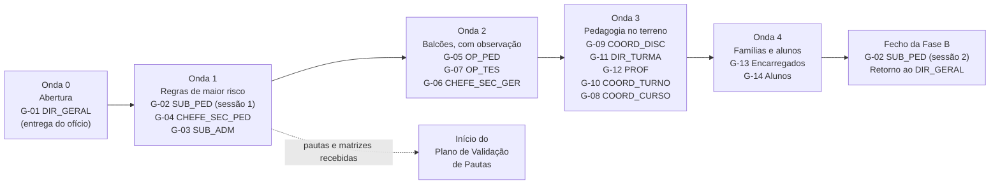

# Guião de Entrevistas por Cargo — Descoberta na Escola (Fase B)

> [!abstract] Navegação
> - **Painel Principal:** [[Inicio|Início do Vault]] | **Índice do Projeto:** [[00 - MOC SGE IPCAG 12008 BGO|MOC]] | **Plano mestre:** [[00.1 - Plano de Engenharia de Requisitos]] (§4 Fase B, lacuna L2)
> - **Kit de Descoberta e Validação:** **Guião de Entrevistas** → [[Pedido de Artefactos a Escola]] → [[Questionario de Volumetria e Infraestrutura]] → [[Plano de Validacao de Pautas]]
> - **Modelos:** [[Modelo de Nota de Entrevista]] | [[Modelo de Ata de Validacao]]
> - **Especificação que se valida:** [[01 - Dominio e Regras]] | [[02 - Fluxos de Trabalho]] | [[03 - User Stories]] | [[04 - Telas e Documentos]] | [[05 - Modelagem de Dados]]
> - **Questões e decisões:** [[12 - Registo de Decisoes e Questoes em Aberto]]
> - **Documentos reais já analisados:** [[Achados dos Documentos Reais - Lote 1]] | **Verificação legal:** [[Verificacao das Referencias Legais]]

> [!important] Objetivo deste guião
> Dar à equipa um roteiro único para entrevistar **os 12 cargos RBAC** (DOC-01 §2.1), **os encarregados de educação** e **os alunos**, de forma a: (1) descrever o processo **como é feito hoje** (AS-IS) e as suas dores; (2) recolher **números reais**; (3) **confrontar com a prática** cada regra, fluxo e user story pela qual o cargo responde; (4) levantar o que **ainda falta** na especificação: horários, disciplina, comunicação com encarregados, cobrança de dívidas, passagem de ano e dados atuais a migrar.
>
> Critério de saída da Fase B (plano §4): **cada um dos 12 cargos entrevistado ou representado** e artefactos do §5.2 recolhidos. A tabela do §6 controla essa cobertura.

---

## 1. Como Usar Este Guião

### 1.1 Princípios de condução

1. **Ouvir antes de confrontar.** Em cada guião, as partes **A** (processo atual) e **B** (números) vêm sempre antes da parte **C** (validação). Só depois de ouvir como se faz hoje se apresenta o que a especificação diz. Se se mostrar a regra primeiro, o entrevistado tende a concordar com ela.
2. **"Mostre-me" e "Conte-me a última vez".** Pedir para ver o documento, o livro ou o ficheiro Excel enquanto a pessoa explica. Pedir o **último caso real** (último erro de nota, último talão falso) em vez de opiniões gerais.
3. **Cada número tem fonte.** Registar se o número é **contado** (documento), **estimado** pelo entrevistado ou **desconhecido**. Nunca transformar uma estimativa em facto na nota.
4. **Não é uma avaliação de desempenho.** Explicar no início que se estuda o processo, não as pessoas. Erros descobertos em pautas ou recibos reais são tratados com confidencialidade (ver [[Plano de Validacao de Pautas]] §2.3).
5. **Proteção de dados.** Nas notas regista-se o **cargo**, não o nome (salvo autorização). Nenhuma cópia com dados pessoais sai da escola sem anonimização ([[Pedido de Artefactos a Escola]], Anexo B). Gravar áudio só com autorização expressa.
6. **Uma questão por facto.** O que não se conseguir responder fica como **questão em aberto** no [[12 - Registo de Decisoes e Questoes em Aberto]], com o cargo que deve responder.

### 1.2 Achados da verificação legal e dos documentos reais a ter presentes

> [!important] 📄 O que os documentos reais (Lote 1) já mostraram
> A análise das primeiras fotografias de documentos da escola, em [[Achados dos Documentos Reais - Lote 1]] (`DESC-L1`), confirma que a especificação **não corresponde à prática** em pontos críticos: fórmulas de avaliação com **Prova Global** e **Classificação Anual** (`CA = MT3 × 0,6 + PG × 0,4`), estrutura de direção com uma **Comissão de Gestão**, outra lista de cursos, dois números da instituição (12008 e 8009). Nas tabelas da parte C, o símbolo 📄 marca as perguntas que vêm desses documentos. As 10 perguntas prioritárias do `DESC-L1` §3 estão distribuídas assim:

| Prioridade | Pergunta (`DESC-L1` §3) | Achado | Guião |
| :---: | :--- | :---: | :---: |
| 1 | Fórmulas completas de `M1`/`M2`/`M3`, `CF`, `PG` e `CA`, arredondamento, nota mínima e recurso | A1 | [[#G-02 Subdirector Pedagógico — SUB_PED\|G-02]] |
| 2 | Nomenclatura oficial das notas: `MTP`/`PP`/`PT` ou `MAC`/`NPP`/`NPT` | A2 | G-02 (e G-09, G-12) |
| 3 | Número oficial da instituição: 12008 ou 8009 | A3 | [[#G-01 Director Geral — DIR_GERAL\|G-01]] |
| 4 | Estrutura de direção atual e quem assina e homologa cada documento | A4 | G-01 |
| 5 | Cursos oferecidos, áreas de formação e especialidades | A5 | [[#G-04 Chefe da Secretaria Pedagógica — CHEFE_SEC_PED\|G-04]] |
| 6 | Projecto Tecnológico vs PAP, avaliação na 12ª e 13ª, `MFC` | A6 | [[#G-08 Coordenador de Curso — COORD_CURSO\|G-08]] |
| 7 | Regra de transição na 12ª Classe sem Língua Portuguesa | A7 | G-02 |
| 8 | Faltas por indisciplina, avaliação do comportamento e circuito de justificação | A8 | [[#G-11 Director de Turma — DIR_TURMA\|G-11]] |
| 9 | Emolumentos de declarações e uso da RUPE | A11, A15 | G-04 (e G-07) |
| 10 | Significado das linhas destacadas e da sigla `MT` na estatística | A10 | G-04 |

> [!tip] Levar os documentos do Lote 1
> Levar impressas as fotografias dos modelos recebidos (Mini Pauta, Pauta Geral, boletins, fichas de matrícula, justificação de faltas) e pedir ao entrevistado que **explique coluna a coluna** um exemplar **preenchido**. É a forma mais rápida de fechar as prioridades 1, 2 e 10.

> [!warning] ⚖️ O que a verificação legal já encontrou
> A [[Verificacao das Referencias Legais]] (`LEG-VER`) confrontou a especificação com os diplomas publicados. Nas tabelas da parte C, o símbolo ⚖️ assinala onde o texto legal diverge da especificação ou onde não foi encontrada fonte. Os pontos principais:
> - **Avaliação do ESTP sem regulamento publicado encontrado:** `MT`/`MFD`, recurso 40/60, faltas `3 ×`, nota `7`, máximo de deficiências e veto LP + nuclear **não têm fonte** (`COR-LEG-13`). O regulamento do Ensino Geral (DE n.º 106/26) é diferente. A prática da escola e as pautas reais passam a ser a principal prova.
> - **Admissão:** a lei exige `≥ 10` em **cada** prova "mesmo que fiquem vagas por preencher" e desempata pela **menor idade**; a repescagem na 2ª opção não tem base nos diplomas lidos (`COR-LEG-08` a `10`).
> - **Matrícula:** a confirmação é **automática** e a reprovação por faltas injustificadas faz perder o direito à confirmação (`COR-LEG-14`, `15`).
> - **13ª Classe:** a PAP é a apresentação e defesa do relatório de estágio, com júri que inclui representantes dos trabalhadores e dos empregadores; existe a disciplina Projeto Tecnológico (`COR-LEG-16`).
> - **Certificação:** o **diploma** é emitido e assinado pelo Ministro; a escola emite o **certificado**. A lei fala em "livro de registo e/ou base de dados" e num QR da Plataforma Nacional de Certificação (`COR-LEG-18`, `19`).
> - **Tesouraria:** o DP n.º 292/18 foi **revogado** pelo DP n.º 71/25; a lei prevê fatura, fatura-recibo, recibo e **nota de crédito** (`COR-LEG-01` a `03`).
> - **Cargos:** o DP n.º 93/21 aplica-se a instituições públicas, usa "Coordenador de Turma" e prevê um "Coordenador GIVA" (`COR-LEG-21`, `22`).
>
> Estes achados **não se apresentam como factos ao entrevistado** antes de ouvir a prática. Quando a resposta esclarece uma pergunta `Q-LEG-nn` da nota de verificação, indicar o código na nota de entrevista.

### 1.3 Equipa e material

- **Duas pessoas por entrevista:** um **entrevistador** (conduz) e um **escriba** (regista na estrutura do [[Modelo de Nota de Entrevista]]). Nos grupos focais, o escriba também controla o tempo.
- **Material a levar:**
  - [ ] Este guião impresso (só a secção do cargo) e o guião de validação (parte C) com as referências
  - [ ] Cópia do ofício de [[Pedido de Artefactos a Escola]] e lista dos artefactos ainda pendentes desse cargo
  - [ ] Folhas do [[Questionario de Volumetria e Infraestrutura]] correspondentes ao cargo
  - [ ] Esquemas impressos dos fluxos a validar (diagramas do [[02 - Fluxos de Trabalho]]) para a pessoa poder apontar e corrigir
  - [ ] Material para tapar dados pessoais (marcador, papel) caso seja preciso fotografar um documento

### 1.4 Estrutura padrão de cada sessão

| Bloco | Tempo indicativo | Conteúdo |
| :--- | :---: | :--- |
| **Abertura** | 5 min | Apresentação, finalidade do SGE, confidencialidade, pedido de autorização para notas (e áudio, se aplicável). |
| **A. Processo atual e dores** | 30–40% | Perguntas abertas; pedir para mostrar documentos; último caso real. |
| **B. Números** | 10–15% | Volumes, tempos, frequências; marcar a fonte de cada número. |
| **C. Validação** | 30–40% | Apresentar cada regra/fluxo **depois** de ouvir a prática; registar ✅ confirma / ⚠️ diverge / ❓ não sabe. |
| **D. O que falta** | 10–15% | Temas ainda não especificados (§3). |
| **Fecho** | 5 min | Perguntas de fecho comuns (abaixo); confirmar artefactos prometidos e prazo. |

**Perguntas de fecho comuns (fazer em todas as entrevistas):**
1. Há alguma coisa importante sobre o seu trabalho que não perguntámos?
2. Se o sistema só pudesse resolver **um** problema seu, qual seria?
3. Quem mais devemos ouvir sobre este assunto?
4. Que documento nos pode mostrar ou emprestar (anonimizado) para confirmarmos o que disse?
5. Podemos voltar a contactá-lo para esclarecer dúvidas? Por que meio?

### 1.5 Depois da entrevista

1. Escrever a nota **no próprio dia ou no seguinte**, com o [[Modelo de Nota de Entrevista]], na pasta `00 - Inbox/` (plano §4, Fase B), com o nome `ENT-nn - <CARGO> - AAAA-MM-DD` (ex.: `ENT-03 - SUB_ADM - 2026-11-10`).
2. Preencher na nota a tabela de validação com o código de cada regra (`RN-xx`), fluxo e user story perguntados.
3. Passar as questões sem resposta para o [[12 - Registo de Decisoes e Questoes em Aberto]].
4. Atualizar a tabela de acompanhamento do [[Pedido de Artefactos a Escola]] (§3) e a cobertura deste guião (§6).
5. Na triagem semanal ([[00 - Guia de Triagem Inbox]]), mover a nota para `Descoberta e Validacao/`.

### 1.6 Legenda das referências

| Código | Significado | Onde está |
| :--- | :--- | :--- |
| `RN-xx` / `RN-xx §n` | Regra de negócio / ponto *n* dessa regra | [[01 - Dominio e Regras]] §4 |
| `RN-xx.y` | Sub-regra com nome próprio no DOC-01: `RN-01.1` (dispensa `DISP`), `RN-01.2` (admissão), `RN-02.1` (repetente), `RN-04.1` (avocação), `RN-05.1` (transferência interna e reativação), `RN-06.1` (histórico externo), `RN-09.1` (borderô por saldo), `RN-09.2` (fecho de caixa) | [[01 - Dominio e Regras]] §4 |
| Máquina `3.x` | Máquina de estados | [[01 - Dominio e Regras]] §3 |
| Matriz RBAC linha `n` | Linha da matriz de permissões | [[01 - Dominio e Regras]] §2.2 |
| Fluxo `nn` / `Ex.y` | Fluxo de trabalho / exceção | [[02 - Fluxos de Trabalho]] |
| `US-xxx-nn` | User story | [[03 - User Stories]] |
| `DOF-nn` | Documento oficial impresso (numeração da Parte 2 do DOC-04) | [[04 - Telas e Documentos]] |
| `Cxx` / `Lxx` / `Dx` | Capacidade / lacuna / decisão do plano | [[00.1 - Plano de Engenharia de Requisitos]] §1–§2, §7 |
| `ART-xx` | Artefacto pedido à escola | [[Pedido de Artefactos a Escola]] Anexo A |
| `G-xx` | Guião deste documento | §4 |

---

## 2. Ordem Proposta das Entrevistas

| Ordem | Guião | Cargo | Onda | Porquê nesta posição |
| :---: | :---: | :--- | :---: | :--- |
| 1 | G-01 | `DIR_GERAL` | 0 | Patrocina o trabalho, recebe o ofício e autoriza o acesso a pautas, recibos e livros de termos. Sem esta autorização nenhuma outra entrevista consegue ver documentos reais. Dá o contexto das decisões D1–D8. |
| 2 | G-02 | `SUB_PED` | 1 | Responde pelas regras RN-01 a RN-05, onde um erro é o mais caro de um SGE (plano §4). A validação de pautas demora e depende dele: tem de arrancar cedo. |
| 3 | G-04 | `CHEFE_SEC_PED` | 1 | Guarda as pautas, os livros de termos e o arquivo: é quem entrega os artefactos ART-01, ART-06, ART-07 e quem sabe que dados existem para migrar (C17). |
| 4 | G-03 | `SUB_ADM` | 1 | A Entrega 1 (plano §6) depende da Tesouraria (C10) e das decisões D2 (AGT) e D5 (pagamentos). Responde pelas regras RN-07 a RN-09. |
| 5 | G-05 | `OP_PED` | 2 | Executa matrículas e inscrições: confirma na prática os fluxos 01, 02 e 08. Inclui observação do balcão. |
| 6 | G-07 | `OP_TES` | 2 | Executa o fluxo 07: talões, recibos e fecho de caixa. Observar num dia de vencimento ou de matrícula. |
| 7 | G-06 | `CHEFE_SEC_GER` | 2 | Expediente, cadastro e ponto de funcionários (C11), supervisão da Tesouraria e correspondência com encarregados (C12). |
| 8 | G-09 | `COORD_DISC` | 3 | Prova trimestral unificada (`NPT`) e composição da `MAC`: necessário antes de falar com os professores. |
| 9 | G-11 | `DIR_TURMA` | 3 | Justificação de faltas, consolidação das mini-pautas e conselho de notas (fluxos 03 e 04). |
| 10 | G-12 | `PROF` | 3 | Utilizadores em maior número; viabilidade do lançamento *Offline-First* em telemóvel. |
| 11 | G-10 | `COORD_TURNO` | 3 | Horários (C04) e disciplina (C13), duas capacidades ausentes. Inclui ronda pelo turno. |
| 12 | G-08 | `COORD_CURSO` | 3 | Regime da 13ª Classe (fluxo 06), disciplinas nucleares e distribuição docente. |
| 13 | G-13 | Encarregados | 4 | Comunicação (C12, D3), pagamentos e cobrança vistos pelo outro lado do balcão. Precisa de convite da Direção. |
| 14 | G-14 | Alunos | 4 | Consulta de notas, faltas e horários; experiência da 13ª Classe. Precisa de autorização da Direção. |
| 15 | G-02 (2) | `SUB_PED` | Fecho | Segunda sessão para confrontar as divergências encontradas nas ondas 2 a 4 e no recálculo de pautas. |

> [!tip] Recomendação para começar
> Fazer **primeiro G-01 (DIR_GERAL)**, logo seguido de **G-02 (SUB_PED)** e **G-04 (CHEFE_SEC_PED)** na mesma semana. São as três entrevistas que desbloqueiam tudo o resto: a autorização e o ofício, as regras de avaliação de maior risco e o acesso às pautas reais para o [[Plano de Validacao de Pautas]]. **G-03 (SUB_ADM)** fecha a Onda 1, porque a Entrega 1 depende da Tesouraria.

> [!warning] Calendário
> Confirmar com o `SUB_PED` as semanas de provas trimestrais e de conselhos de notas e **não marcar entrevistas pedagógicas nessas semanas**. As observações de balcão (G-05, G-07) rendem mais num dia de vencimento de propinas ou em época de matrícula; se não houver nenhum dentro da Fase B, registar isso na nota.

---

## 3. Cobertura dos Temas em Falta na Especificação

Os temas abaixo não estão especificados (ou estão só parcialmente) e são perguntados em vários guiões. ● = pergunta principal; ○ = pergunta complementar.

| Tema (plano §2) | G-01 | G-02 | G-03 | G-04 | G-05 | G-06 | G-07 | G-08 | G-09 | G-10 | G-11 | G-12 | G-13 | G-14 |
| :--- | :---: | :---: | :---: | :---: | :---: | :---: | :---: | :---: | :---: | :---: | :---: | :---: | :---: | :---: |
| **Horários e distribuição docente** (C04, D4) | | ● | | | | | | ● | ○ | ● | | ○ | | ○ |
| **Disciplina e ocorrências** (C13) | ● | ○ | | | | | | | | ● | ● | ○ | ○ | ○ |
| **Comunicação com encarregados** (C12, D3) | ● | ○ | | ○ | ○ | ● | ○ | | | ○ | ● | ○ | ● | ● |
| **Cobrança de dívidas** (C10) | ● | | ● | | | ○ | ● | | | | | | ● | |
| **Passagem de ano** (C16) | | ● | ● | ● | ○ | | | ○ | | | ○ | | | |
| **Dados atuais a migrar** (C17, L9) | | ○ | ● | ● | ● | ● | ● | ○ | | | | | | |
| Contas e acesso (C14) | ● | | | | ○ | ● | ○ | | | | | ○ | | |
| Operação e suporte (C18, L10) | ● | | ○ | | | | ○ | | | | | | | |
| Proteção de dados (C19, L8) | ● | | | ● | | ○ | | | | | | | ● | |
| Painéis e indicadores (C15) | ● | ○ | ○ | | | | | | ○ | | | | | |
| Recursos humanos e salários (C11, D8) | ○ | | ● | | | ● | | | | | | | | |
| Processo individual e cartão de estudante (C03) | | | | ● | ● | | | | | | | | | ○ |

---

## 4. Guiões por Cargo

### G-01 Director Geral — DIR_GERAL

| Campo | Detalhe |
| :--- | :--- |
| **Objetivo** | Recolher a visão da Direção, os objetivos e o que significa "sucesso" (L1); obter o contexto das decisões D1–D8; obter patrocínio para as entrevistas e autorização para o pedido de artefactos; validar o que o Director homologa e assina. |
| **Quem entrevistar** | Quem dirige a escola: o Director Geral ou, segundo os documentos recebidos, a **Coordenadora Geral da Comissão de Gestão** (`DESC-L1` A4). Se a Direção o entender útil, um representante da Diocese de Caxito numa conversa separada. |
| **Duração** | 45–60 min na abertura + 30 min de retorno no fecho da Fase B. |
| **Artefactos a pedir ou ver** | Entrega do ofício ([[Pedido de Artefactos a Escola]]); ART-05, ART-08 (incluindo organigrama e despachos de nomeação), ART-11. |

**A. Processo atual e dores**
1. Quais são hoje os três problemas de gestão que mais tempo lhe tiram ou mais risco criam para a escola?
2. Que decisões toma hoje sem informação suficiente? Que informação gostaria de ter todas as semanas?
3. O que assina ou homologa num ano normal (pautas gerais, certificados, diplomas, bolsas, despachos)? Quanto tempo lhe ocupa? Alguma assinatura é delegada?
4. Como presta contas à Diocese de Caxito e à Direção Provincial da Educação do Bengo? Com que frequência e em que formato?
5. Já houve documentos falsificados em nome do IPCAG ou pedidos de confirmação de autenticidade (universidades, empregadores)? Como se responde hoje?
6. Houve tentativas anteriores de informatizar a escola? O que correu bem e o que correu mal?

**B. Números a recolher**
- Documentos assinados por mês, em época normal e em época alta.
- Bolsas e isenções concedidas no último ano, por tipo.
- Data desejada de arranque do sistema e momento do ano a evitar (D7).
- Ordem de grandeza do orçamento disponível para equipamento, internet e suporte, se a Direção o quiser partilhar.

**C. Validar regras e fluxos sob responsabilidade do cargo**

| Ref. | O que a especificação assume | Pergunta a fazer |
| :--- | :--- | :--- |
| `RN-07`, `US-TES-02` | Bolsas, isenções diocesanas e descontos são homologados pela Direção Executiva (`SUB_ADM` + `DIR_GERAL`) e só mudam as prestações futuras. | Quem decide hoje cada tipo de benefício? Há critérios escritos? Um benefício pode ser revogado a meio do ano? |
| Fluxo 04, `US-PED-06` | A Pauta Geral é homologada pelo `SUB_PED` **e** pelo `DIR_GERAL`. | Na prática, quem assina a pauta geral e em que momento? São sempre os dois? |
| Fluxo 01 `E1.5`/`E1.6`, `RN-01.2`, `US-ADM-04` | Corrigir nota de admissão depois da descodificação, repescar na 2ª opção ou baixar o limiar mínimo exige despacho conjunto `SUB_PED` + `DIR_GERAL`. ⚖️ `COR-LEG-08`, `10`: a lei exige `≥ 10` em cada prova mesmo com vagas sobrantes; a repescagem não tem base nos diplomas lidos. | Algum destes casos já aconteceu? Quem decidiu e onde ficou escrito? A Direção Provincial alguma vez autorizou admitir abaixo de 10? (`Q-LEG-10`, `Q-LEG-12`) |
| Matriz RBAC linha 14, `US-GOV-04`, Fluxo 04 `E4.1` | Só `SUB_PED` ou `DIR_GERAL` reabrem uma pauta fechada, com n.º de despacho, motivo e prazo. | Como se corrige hoje uma nota depois de a pauta estar afixada? Há despacho escrito? |
| Fluxo 08, `US-DOC-02`, `RN-10` | Certificados e diplomas são assinados pelo `DIR_GERAL` e levam Livro/Folha/Termo e código de verificação. ⚖️ `COR-LEG-18`: o diploma é emitido e assinado pelo Ministro; o certificado é emitido pela escola e assinado pelo Director e pelo Subdirector Pedagógico. | Quem emite e assina hoje o certificado e o diploma? Como se pede o diploma ao Ministério? Quantos por ano? Quem assina na ausência do Director? (`Q-LEG-14`) |
| DOC-01 §2.1 (12 cargos) | Doze cargos RBAC "segundo o DP n.º 93/21". ⚖️ `COR-LEG-21`, `22`: o DP n.º 93/21 aplica-se a instituições públicas, usa "Coordenador de Turma" e prevê um "Coordenador GIVA". | Que cargos existem de facto no IPCAG e com que designações? Há pessoas que acumulam cargos? Há cargos fora desta lista? O IPCAG aplica o DP n.º 93/21 por obrigação, por convénio ou por analogia? (`Q-LEG-13`) |
| Fluxo 08 `E8.1`, `RN-08` | Um aluno com dívida só recebe documento com isenção formal do `DIR_GERAL` ou do `SUB_ADM`. | Em que situações a Direção autoriza emitir documentos a alunos com dívida? Isso fica escrito? |
| 📄 `DESC-L1` A3 — **prioridade 3** | A especificação usa sempre "IPCAG N.º 12008". Os documentos recebidos usam **12008** (matrícula, Pauta Geral) e **8009** (boletins, Mini Pauta, declarações, requerimentos, justificações). | Qual é o número oficial atual? Um substituiu o outro? Qual deve aparecer nos documentos emitidos pelo sistema? |
| 📄 `DESC-L1` A4 — **prioridade 4** | Direção com `DIR_GERAL`, `SUB_PED` e `SUB_ADM`. Os documentos são assinados por uma **Coordenadora Geral da Comissão de Gestão** (declarações, visto na Pauta Geral), por um **Coordenador para a Área Pedagógica** (boletins, justificações, Pauta Geral) e pelo Chefe da Secretaria Pedagógica (Mini Pauta). | A escola é hoje dirigida por uma Comissão de Gestão? É transitória? Que cargos existem de facto? Quem assina e quem homologa cada documento (pauta geral, mini-pauta, boletim, declaração, justificação de faltas)? Quem responde pela área administrativa e financeira? |
| 📄 `DESC-L1` A14 | Cabeçalho "Ministério da Educação" e "Diocese de Caxito" (padrão do DOC-04). Os documentos reais usam "Governo da Província do Bengo / Gabinete Provincial da Educação" e códigos de rodapé (`IPCAG.SG-ACE`, `DEE-PEEP-001-ACE`). | Qual é o cabeçalho oficial a usar nos documentos? O que significam os códigos do rodapé? |

**D. O que falta na especificação**
- **[D1]** O sistema é só para o IPCAG ou outras escolas (por exemplo, da Diocese) poderão vir a usá-lo? *(registar a resposta; a decisão é tomada na Fase A)*
- **[D7, D8]** Quando deve o sistema estar a funcionar? O que deve ficar **fora** (salários, biblioteca, inventário, cantina, transporte)?
- **[C12, D3]** Como comunica hoje a escola com os encarregados? Que canal prefere a Direção? A escola aceitaria um custo por SMS?
- **[C13]** Que medidas disciplinares exigem decisão do Director, segundo o regulamento interno? Como ficam registadas e comunicadas?
- **[C10]** Qual a política perante dívidas: até onde vai a escola (bloquear documentos, impedir matrícula, impedir provas)? Há perdão de multas ou de dívidas? Quem decide?
- **[C19, L8]** Quem pode ver os dados dos alunos? Há regras sobre fotografias, afixação de pautas com nomes e conservação dos processos? Os encarregados assinam algum consentimento?
- **[C14, C18]** Quem será na escola o responsável pelo sistema (contas de utilizador, palavras-passe, cópias de segurança)? Existe técnico de informática? Interno ou contratado?
- **[C15]** Que indicadores quer ver num painel da Direção (aproveitamento, assiduidade, receitas, dívida)? Com que frequência?

---

### G-02 Subdirector Pedagógico — SUB_PED

| Campo | Detalhe |
| :--- | :--- |
| **Objetivo** | Validar as regras pedagógicas que produzem a pauta (RN-01 a RN-05), o calendário dos trimestres, o conselho de notas e o regime da 13ª Classe; levantar como se fazem horários e passagem de ano; obter acesso às pautas para o [[Plano de Validacao de Pautas]]. |
| **Quem entrevistar** | O Subdirector Pedagógico ou, segundo os documentos recebidos, o **Coordenador para a Área Pedagógica** (`DESC-L1` A4). O `CHEFE_SEC_PED` pode juntar-se na parte C. |
| **Duração** | Sessão 1: 90 min (calendário, avaliação, conselho de notas). Sessão 2: 90 min no fecho da Fase B (transição, recurso, 13ª Classe, admissão e divergências encontradas). |
| **Artefactos a pedir ou ver** | ART-01, ART-02, ART-08, ART-09, ART-10, ART-16. |

**A. Processo atual e dores**
1. Descreva o último ano letivo mês a mês: abertura, provas trimestrais, conselhos de notas, exames de recurso e exames extraordinários.
2. Como recebe hoje as notas dos professores (papel, Excel, outro)? Quem calcula as médias? Quem confere?
3. Onde costumam acontecer os erros de notas? Conte o último caso de nota errada que chegou a uma pauta afixada.
4. Como se substitui hoje um professor a meio do trimestre? O que acontece às notas já dadas?
5. Quem faz a distribuição de serviço docente e o horário, com que ferramenta e quanto tempo leva?
6. Como decorre um conselho de notas: quem participa, quanto tempo dura, o que se discute?

**B. Números a recolher**
- Turmas por classe e turno; professores (efetivos e colaboradores).
- No último ano: alunos que foram a exame de recurso; alunos que transitaram com cadeiras em atraso; retidos por faltas; retidos por notas; dispensas médicas (`DISP`) concedidas.
- Correções de pauta depois de afixada, por ano (ordem de grandeza).
- Dias que dura cada época de conselhos de notas.

**C. Validar regras e fluxos sob responsabilidade do cargo**

> [!warning] ⚖️ Regras de avaliação sem fonte publicada
> Segundo a [[Verificacao das Referencias Legais]] §3 (`COR-LEG-13`), nenhuma das regras de pauta abaixo tem fonte publicada encontrada. Para **cada** uma, perguntar também **"onde está escrito?"** e pedir cópia do documento (ART-16). Perguntar se a escola aplica, por analogia, o regulamento de avaliação do Ensino Geral (DE n.º 106/26), que tem regras diferentes (até 3 disciplinas de 7–9; veto LP + 2 disciplinas específicas; faltas contadas por trimestre). Perguntas da verificação legal a fechar aqui: `Q-LEG-01` a `Q-LEG-07`, `Q-LEG-09` a `Q-LEG-12`.

> [!important] 📄 Começar pelas linhas 📄
> Os documentos reais mostram uma estrutura de notas diferente da especificação (`DESC-L1` A1). **Começar pelas três primeiras linhas da tabela**, com uma Mini Pauta preenchida à frente. As linhas seguintes, com `MAC`/`NPP`/`NPT` e `MFD`, descrevem a especificação atual: usá-las para os pontos que a Mini Pauta não esclarecer (arredondamento, `DISP`, transição, faltas, 13ª Classe).

| Ref. | O que a especificação assume | Pergunta a fazer |
| :--- | :--- | :--- |
| 📄 `DESC-L1` A1 — **prioridade 1** | A especificação não tem `PG`, `CF` nem `CA`. A Mini Pauta da escola tem `MTP`, `PP`, `PT` e `M1`, `M2`; no III Trimestre `MTP`, `PP`, `M3/CF`, `PG` (Prova Global) e `CA` (Classificação Anual), com a fórmula impressa `CA = MT3 × 0,6 + PG × 0,4`. A Pauta Geral tem `FALT`, `CF`, `PG`, `CA` por disciplina. | Pedir para explicar a Mini Pauta **preenchida**, coluna a coluna, com um aluno real: como se obtêm `M1`, `M2` e `M3` (média simples? pesos?); o que é `CF` e como se calcula; se "MT3" na fórmula é `M3` ou `CF`; a que disciplinas e classes se aplica a Prova Global; como se arredonda; qual a nota mínima de aprovação na `CA`; se continua a haver exame de recurso, com que fórmula e como se relaciona com a `CA`; qual o critério de "transita com deficiência". Registar as respostas nos parâmetros P-01 a P-12 do [[Plano de Validacao de Pautas]] §2.4. |
| 📄 `DESC-L1` A2 — **prioridade 2** | Só `MAC`/`NPP`/`NPT`. Os boletins recebidos usam `MTP`/`PP`/`PT`/`MT` (modelo do Gabinete Provincial `DEE-PEEP-001-ACE`) e `MAC`/`NPP`/`NPT`/`MT2` (modelo da escola). | Qual é a nomenclatura oficial? `MAC` é o mesmo que `MTP`? Que modelo de boletim está em vigor e porque coexistem dois? |
| 📄 `DESC-L1` A7 — **prioridade 7** | O veto LP + nuclear (`RN-02 §4`) aplica-se a qualquer classe. Nos 4 planos recebidos, Língua Portuguesa (e toda a componente sócio-cultural) só existe na **10ª e 11ª**. | Qual é a regra de transição e de conclusão na 12ª Classe? O veto só se aplica na 10ª e 11ª? E o aluno da 12ª que aprovou tudo mas tem cadeiras em atraso por eliminar? |
| `RN-01 §2–§3`, `US-PED-04` | `MT = round_med((MAC+NPP+NPT)/3)`; arredondamento *half-up* (`9,50 → 10`). A `MFD` é calculada a partir das `MT` **já arredondadas**. | As `MT` impressas na mini-pauta são inteiras? A `MFD` usa as `MT` arredondadas ou as médias com décimas? Pedir para calcular em voz alta um caso real. |
| `RN-01 §1` | Todas as notas estão na escala `0–20`. | As notas parcelares (`MAC`, `NPP`, `NPT`) são sempre inteiras ou podem ter décimas? |
| `RN-01 §5`, `US-PED-06` | Exame de recurso: `CF = round_med(0,40 × MFD + 0,60 × Exame)` para alunos com `MFD < 10` "dentro dos parâmetros regulamentares". | É esta a ponderação? Qual a `MFD` mínima para ter direito a exame de recurso? Há limite de disciplinas a que o aluno pode ir a recurso? |
| `RN-01 §6` (`RN-01.1`), `US-PED-03`, Máquina 3.4 | `DISP` só em disciplinas elegíveis (ex.: Educação Física); sai do denominador da média; `DISP` num só trimestre → `MFD` = soma dos dois trimestres avaliados / 2. | Que disciplinas admitem `DISP`? Confirmar a divisão por 2. E se a `DISP` abranger 2 trimestres? Como aparece na pauta? |
| `RN-02 §3` | Na 10ª e 11ª o aluno é retido se tiver alguma disciplina com nota final `< 7` ou mais reprovações do que o limite (`2`, ou `3` por normativo do ano). | Qual o limite aplicado no último ano e que documento o fixa? (pedir cópia → ART-16) Confirmar o mínimo de `7`. |
| `RN-02 §4` | Veto absoluto: reprovar em Língua Portuguesa **e** numa disciplina nuclear impede a transição. | Que disciplinas são nucleares em cada curso e classe? Onde está escrito? Já houve casos? |
| `RN-02 §2–§3` | Na 12ª não há transição com cadeiras em atraso: o aluno fica retido "na 12ª classe (ou em regime de repetição das disciplinas reprovadas)". | O aluno reprovado numa disciplina da 12ª repete **a classe inteira** ou **só a disciplina**? *(a especificação admite as duas hipóteses)* |
| `RN-02 §6`, Fluxo 05, `US-DEF-01`, `US-DEF-02` | Cadeiras em atraso só se eliminam em exame extraordinário com nota `≥ 10`, até ao fim da 12ª; bloqueiam a 13ª. | Quantas épocas de exame extraordinário há por ano e quando? Pode o aluno frequentar de novo a disciplina em vez do exame? Que nota fica no histórico? |
| `RN-02 §7` (`RN-02.1`) | O repetente frequenta de novo todo o plano da classe e mantém as notas das classes anteriores. | O repetente refaz também as disciplinas em que já tinha aprovado? A nota antiga é substituída? |
| `RN-03`, `US-PED-02`, Fluxo 03 | Limite anual de faltas injustificadas = `F_mult × tempos semanais` (`F_mult` = 3 ou 4); ao ultrapassar, `Retido por Faltas` e sem direito a recurso. ⚖️ `COR-LEG-14`: no II Ciclo, quem reprova por faltas injustificadas perde o direito à confirmação de matrícula no ano seguinte. | Qual o fator e onde está escrito? O limite é anual ou por trimestre? Um tempo duplo conta como 1 ou 2 faltas? Atrasos contam como falta? Qual o prazo para justificar? O aluno retido por faltas pode confirmar matrícula no ano seguinte? (`Q-LEG-04`) |
| Fluxo 03 passo 1, `US-PED-01` | A `NPT` é uma prova trimestral unificada por classe e disciplina, supervisionada pelo `COORD_DISC` e validada pela Subdireção. | Acontece em todas as disciplinas? É no mesmo dia nos dois turnos? Quem corrige? |
| Máquina 3.1, Fluxo 04, `US-PED-06` | Mini-pauta submetida → `DIR_TURMA` consolida → conselho de notas → homologação `SUB_PED` + `DIR_GERAL`; depois disso ninguém edita. | O conselho de notas pode alterar notas ou deliberações? Quem escreve e assina a ata? (pedir modelo) |
| `RN-05`, `US-MAT-04` | A lista de chamada congela no fecho do I Trimestre; transferidos e desistentes mantêm a linha; entradas tardias recebem `N + 1`. | É assim que fazem? Em que momento a lista deixa realmente de mudar? |
| `RN-04`, `RN-04.1`, `US-PED-05` | Substituto herda a mesma mini-pauta; se o professor saiu sem substituto, o `SUB_PED` avoca e lança com base nas provas arquivadas. | Já teve de lançar notas de um professor que saiu? Como foi? As provas ficam arquivadas na escola? |
| `US-GOV-04`, Fluxo 04 `E4.1` | Reabertura cirúrgica por turma e disciplina, com despacho e janela de `1h–48h`. | Este prazo é realista? Quem executa a correção na prática? |
| `RN-06 §2`, `US-13C-02` | `MFC` = média ponderada de `MPC`, Nota de Estágio e Nota da PAP; exemplos: `(2·MPC + NE + NPAP)/4` ou `(MPC + NE + NPAP)/3` "conforme despacho". | Que fórmula usa o IPCAG e onde está escrita? A média de cada classe (`MA`) é arredondada antes de entrar na `MPC`? |
| `RN-01.2`, Fluxo 01, `US-ADM-03`, `US-ADM-04` | `MFA = round_med((LP + Mat/Esp)/2)`; mínimo `10`; desempate: maior nota de LP → maior média da 9ª → mais novo; repescagem na 2ª opção; limiar pode baixar por despacho. ⚖️ `COR-LEG-08` a `11`: a lei exige `≥ 10` em cada prova, desempata pela menor idade, não prevê redução do limiar nem repescagem, e só fixa idade mínima (15 anos). | Descrever o último concurso tal como foi feito e só depois confirmar cada ponto. A prova é um teste único com secções? Há quotas por turno? Que critério de desempate se usou? (`Q-LEG-09` a `Q-LEG-12`) |
| `US-GOV-01`, `US-GOV-02` | O `SUB_PED` define as datas dos 3 trimestres e homologa as matrizes curriculares com tempos semanais. | A 13ª Classe tem trimestres? As matrizes mudaram nos últimos anos? Podem coexistir alunos da mesma classe com matrizes diferentes? |

**D. O que falta na especificação**
- **[C04, D4] Horários:** quem faz o horário, quando, com que regras (professores que lecionam nos dois turnos, laboratórios, tempos de 45 ou 50 min)? Quantas vezes muda durante o ano? O registo de sumários e faltas precisa do horário para saber que aulas houve?
- **[C13] Disciplina:** quem regista participações disciplinares? Que medidas existem no regulamento? Têm efeito na avaliação ou nas faltas?
- **[C16] Passagem de ano:** como se formam as turmas do ano seguinte (mantém-se o grupo? reordena-se?) e quando? O que acontece aos retidos e aos que têm cadeiras em atraso? Onde se arquivam as pautas?
- **[C17] Migração:** que histórico de notas existe para os alunos que hoje estão na 11ª, 12ª e 13ª? Em papel ou Excel? Está completo? Sem ele não se emite o certificado (plano §6).
- **[C12]** Como chegam hoje as notas e as faltas aos encarregados?
- **[C15]** Que indicadores pedagógicos quer acompanhar (aproveitamento por turma, disciplina ou professor; faltas)?

---

### G-03 Subdirector Administrativo — SUB_ADM

| Campo | Detalhe |
| :--- | :--- |
| **Objetivo** | Validar as regras financeiras (RN-07, RN-08, RN-09), a tabela de preços e o controlo da Tesouraria; recolher o contexto das decisões D2 (faturação AGT) e D5 (pagamentos); perceber a cobrança de dívidas e a passagem de ano financeira. |
| **Quem entrevistar** | O Subdirector Administrativo. |
| **Duração** | 90 min. |
| **Artefactos a pedir ou ver** | ART-04, ART-05, ART-14 (registo de dívidas e pagamentos). |

**A. Processo atual e dores**
1. Descreva o circuito do dinheiro: desde que o encarregado paga até o valor estar conferido na conta da escola.
2. Como confere hoje o fecho de caixa? Quanto tempo leva? O que costuma falhar?
3. Como se deteta um talão falso ou usado duas vezes? Conte o último caso.
4. Como se anula hoje um recibo errado? Que documento se emite?
5. Como sabe, num dado dia, quem deve e quanto se deve no total?
6. Que relatórios financeiros produz e para quem (Direção, Diocese, outras entidades)?

**B. Números a recolher**
- Bancos e contas bancárias da escola; canais de pagamento aceites.
- Valor da propina e n.º de prestações por ano; n.º de itens da tabela de emolumentos.
- Alunos com bolsa ou desconto, por tipo; encarregados com 2 ou mais educandos.
- Recibos por mês; anulações por ano; talões falsos ou repetidos detetados por ano.
- Alunos com propinas em atraso no fim de cada trimestre; valor total em dívida de anos anteriores.

**C. Validar regras e fluxos sob responsabilidade do cargo**

| Ref. | O que a especificação assume | Pergunta a fazer |
| :--- | :--- | :--- |
| `US-TES-01`, Fluxo 01 passo 2 | Uma tabela anual em `AOA`: propina, inscrição no teste, matrícula/confirmação, exame extraordinário, defesa de PAP, documentos. | A propina é igual para todos os cursos, classes e turnos? A 13ª Classe paga propina? Que emolumentos existem? |
| DOC-01 §1.5, Fluxo 02 passos 4–5 | 10 prestações de setembro a junho; a de setembro paga-se na matrícula. | Confirmar n.º de prestações e meses. Há prestação em julho? |
| Máquina 3.6 | A prestação vence num dia fixo (ex.: 10 ou 15) e depois tem multa por mora parametrizada. | Qual o dia? A multa é fixa ou percentual? Acumula por mês? Quem pode perdoar? |
| `RN-07`, `US-TES-02` | Tipos: `BOLSA_100`, `BOLSA_50`/parcial, isenção diocesana, desconto de irmãos progressivo, filho de funcionário; um só benefício ativo por mês. | Confirmar os tipos e percentagens. Benefícios acumulam (ex.: bolsa + irmãos)? O desconto de filho de funcionário abrange só docentes ou todos? |
| `RN-08` | Qualquer propina em atraso bloqueia documentos, confirmação de matrícula, exames extraordinários e PAP. | É esta a política? Há exceções (guia de transferência, declaração para fins de saúde ou de bolsa)? |
| `RN-09.1` casos 1–3, `US-TES-03` | Um talão paga vários meses ou irmãos até esgotar o saldo; a sobra fica como crédito no talão; vários talões podem pagar um recibo. | A escola aceita guardar sobras como crédito ou devolve? Aceita pagamento parcial de uma prestação? |
| `RN-09 §1`, `US-TES-04`, Fluxo 07 `E7.3` | Recibos nunca se editam nem apagam; só a Nota de Estorno, autorizada pelo `SUB_ADM`, os anula. ⚖️ `COR-LEG-01` a `03`: o DP n.º 292/18 foi revogado pelo DP n.º 71/25; a lei prevê fatura, fatura-recibo, recibo e **nota de crédito** ("nota de estorno" não é tipo legal). | Como se faz hoje? Quem autoriza? Que documento fica? Que documentos fiscais emite hoje a Tesouraria? (`Q-LEG-16`) |
| Máquina 3.7, Fluxo 07 `E7.3` | Um talão declarado falso anula em cascata todos os recibos que o usaram e reabre as dívidas. | Concorda com este efeito? Como reage hoje a escola a um talão falso? |
| `RN-09.2`, `US-TES-05` | Fecho por turno com 3 subtotais: TPA, depósito/transferência, Multicaixa Express; homologado pelo `SUB_ADM`; estornos posteriores entram no caixa do dia do estorno. | A escola aceita **numerário**? Há outros canais? Quem homologa o fecho: o `SUB_ADM` ou o `CHEFE_SEC_GER`? *(a matriz RBAC linha 23 dá homologação aos dois)* |
| `RN-09 §1` | Recibos com numeração sequencial anual sem buracos (ex.: `RC IPCAG2026/000001`). ⚖️ `COR-LEG-04`: a lei pede numeração sequencial e cronológica por tipo de documento e por ano fiscal. | Como se numeram hoje os recibos (livro de recibos, programa)? A numeração reinicia por ano letivo ou por ano civil? |

**D. O que falta na especificação**
- **[L7, D2] AGT:** a escola emite hoje faturas ou recibos através de algum programa de faturação? Qual? Que obrigações perante a AGT cumpre hoje e quem trata delas (há contabilista)? Usar as perguntas `Q-LEG-16` a `Q-LEG-19` da [[Verificacao das Referencias Legais]]: documentos fiscais emitidos, operações isentas de IVA, documento de uma propina com bolsa de 100%, NIF e regime de IVA. *(não afirmar obrigações; registar a resposta)*
- **[D5] Pagamentos:** a escola tem interesse em pagamentos por referência ou integração com o banco? Há banco parceiro? Acesso a extratos em formato digital?
- **[C10] Cobrança de dívidas:** como e quando se avisa o encarregado? Há cartas ou modelos de aviso (→ ART-15)? Planos de pagamento? O que acontece no fim do ano a quem não pagou? A dívida passa para o ano seguinte? Prescreve?
- **[C10] Conciliação bancária:** como se confirma que o depósito entrou na conta? Com que frequência?
- **[C16] Passagem de ano financeira:** como se fecha a conta corrente do ano, transportam dívidas e se aprova a nova tabela?
- **[C17] Migração:** onde estão hoje os pagamentos e as dívidas (livro, Excel, programa)? Desde que ano?
- **[C11, D8] Salários e ponto:** o processamento salarial deve ficar dentro ou fora do SGE? Como supervisiona o ponto dos funcionários (`US-DOC-04`)?
- **[C15]** Que relatórios financeiros quer ver no sistema (receita por mês e canal, dívida por classe, bolsas)?

---

### G-04 Chefe da Secretaria Pedagógica — CHEFE_SEC_PED

| Campo | Detalhe |
| :--- | :--- |
| **Objetivo** | Validar os processos da Secretaria Pedagógica (pautas, histórico externo, exames extraordinários, Livro/Folha/Termo, emissão documental, mapa GEPE) e identificar com precisão os dados existentes a migrar. |
| **Quem entrevistar** | O Chefe da Secretaria Pedagógica + **observação de 2 h** no balcão, de preferência num dia de muita procura. |
| **Duração** | 90 min + 2 h de observação. |
| **Artefactos a pedir ou ver** | ART-01, ART-03, ART-06, ART-07, ART-11, ART-14. |

**A. Processo atual e dores**
1. Mostre-me como emite hoje uma declaração com notas, do pedido à entrega. Quanto tempo demora?
2. Onde e como se guarda o processo individual do aluno? E o arquivo de pautas de anos anteriores?
3. Como se emite o certificado de um aluno que terminou há vários anos?
4. Como se trata um aluno transferido de entrada? O que traz a guia de transferência?
5. Como se organiza uma época de exames extraordinários?
6. O que provoca mais reclamações dos encarregados no balcão?

**B. Números a recolher**
- Documentos emitidos por mês, por tipo (ver [[Questionario de Volumetria e Infraestrutura]] §A.5) e tempo médio de emissão.
- Transferidos de entrada e de saída por ano; alunos com cadeiras em atraso.
- Livros de termos em uso, por tipo de documento, e último número usado em cada um.
- Anos de arquivo existentes; processos individuais ativos e inativos.

**C. Validar regras e fluxos sob responsabilidade do cargo**

| Ref. | O que a especificação assume | Pergunta a fazer |
| :--- | :--- | :--- |
| `RN-10 §2`, `US-DOC-02`, Fluxo 08 caso C, `E8.2` | Certificados, diplomas e termos de exame têm de ter Livro, Folha e Termo, únicos por tipo de livro. ⚖️ `COR-LEG-19`: o DP n.º 227/25 exige "livro de registo e/ou base de dados", número sequencial, código alfanumérico e QR da Plataforma Nacional de Certificação; folha e termo são prática a confirmar. | Há um livro por tipo de documento? A numeração do termo reinicia por livro, por folha ou por ano? Quantos termos cabem numa folha? Os certificados da 12ª também levam termo? Como se regista uma 2ª via? A escola já regista títulos na Plataforma Nacional de Certificação? (`Q-LEG-14`) |
| `COR-LEG-20` | ⚖️ O DP n.º 227/25 fixa a emissão de declarações em até 5 dias úteis. | Quanto tempo demora hoje uma declaração, do pedido à entrega? Há casos acima de 5 dias úteis? |
| `RN-06.1`, `US-MAT-03`, Fluxo 02 cenário C | A Secretaria transcreve a `MFD` de cada disciplina das classes anteriores a partir da guia/certificado da escola de origem; o `SUB_PED` homologa. | As guias trazem notas por disciplina e por classe? E se a escola de origem tiver disciplinas com outro nome ou outra carga horária (equivalências)? Quem decide? |
| `RN-06.1`, Fluxo 02 `E2.5` | Transferência a meio do ano com `MT1`/`MT2` vindas da guia. | Acontece? As médias trimestrais vêm na guia? |
| Fluxo 05, `US-DEF-01`, `US-DEF-02` | Inscrição em exame extraordinário com emolumento por disciplina; nota lançada pelo `CHEFE_SEC_PED` com termo; homologação pelo `SUB_PED`. | Confirmar o circuito. Quem constitui o júri? Como se publica o resultado? |
| `RN-08`, Fluxo 08 `E8.1` | Sem quitação na Tesouraria nenhum documento é emitido; nem o chefe pode contornar sem isenção formal. | Como sabe hoje se o aluno tem dívidas? Confia no recibo apresentado? Há exceções? |
| Fluxo 08 `E8.3` | Declarações só com notas de trimestres já homologados. | É a prática? Pedem-se declarações com notas a meio do trimestre? |
| Fluxo 08 caso B, `RN-05` | A guia de transferência de saída cancela as propinas futuras e mantém a linha do aluno na pauta. | Confirmar o circuito e as assinaturas da guia de transferência (`DOF-09C`). |
| `RN-10 §3`, `US-DOC-03` | Todos os documentos oficiais levam código e QR Code verificáveis por entidades externas. | Como se verifica hoje a autenticidade de um documento quando uma universidade ou empresa pergunta? Quantos pedidos por ano? |
| `RN-05 §1`, `US-MAT-01` | N.º de Processo Individual único, sequencial e vitalício (ex.: `PROC-2026-00412`). | Qual o formato atual? Foi sempre único? Há duplicados ou números reutilizados? |
| `US-DOC-05`, `DOF-12` | Mapa estatístico GEPE por curso, classe, turma, turno, género e faixa etária. | Formato, frequência, a quem se envia e quanto tempo leva hoje a preparar? (pedir o último → ART-11; `Q-LEG-15`) |
| Matriz RBAC linha 8, `US-PED-03` | `DISP`: o `CHEFE_SEC_PED` regista o atestado; o `SUB_PED` homologa. | Confirmar. Onde ficam arquivados os atestados? |
| 📄 `DESC-L1` A5 — **prioridade 5** | Cursos do glossário: Contabilidade e Gestão, Informática de Gestão, Finanças, Gestão de RH, Administração e Serviços. Planos recebidos: Contabilidade e Gestão, Gestão de RH, Gestão Empresarial, Estatística e Planeamento, todos da **área de formação** "Administração e Serviços"; a Pauta Geral tem um campo "Especialidade" (`ADM_GESTÃO`). | Que cursos oferece hoje a escola, em que classes e períodos? Os 4 planos recebidos são todos? Informática de Gestão e Finanças existem? O que é a "Especialidade" e onde se usa? |
| 📄 `DESC-L1` A11, A15 — **prioridade 9** | Emolumento pago antes da emissão e semáforo financeiro (`RN-08`). Os formulários de pedido de declaração **não têm campo de pagamento**; os pedidos do pessoal ao Gabinete Provincial usam a **RUPE**. | Há taxa para declarações? Como e onde se paga? Os emolumentos dos alunos pagam-se por RUPE ou na Tesouraria da escola? (cruzar com G-07) |
| 📄 `DESC-L1` A10 — **prioridade 10** | A especificação não define as estatísticas impressas nas pautas. A Mini Pauta tem `MT`, `AV`, `AP`, `RP`, `NV` por trimestre; a Pauta Geral conta positivas e negativas por disciplina e alunos que transitam, transitam com deficiência, desistentes e não transitam, e tem linhas destacadas a cor. | O que significam as linhas a cor? Na estatística, `MT` quer dizer "matriculados"? As percentagens são sobre os avaliados ou sobre os matriculados? |
| 📄 `DESC-L1` A11 | Pedido de documento ao balcão (Fluxo 08). O circuito real é: requerimento numerado → recibo de pedido destacável → declaração numerada, assinada pela Coordenadora Geral e autenticada com carimbo a óleo. | Confirmar o circuito e os prazos. Quem numera o requerimento e a declaração? |
| 📄 `DESC-L1` A12, A13 | Ficha de matrícula com os campos do DOC-05. As fichas reais têm numeração anual (`N.º __/2026-2027`), comprovativo destacável, dois telefones do encarregado, escola e resultado anteriores, "problema de saúde" e, na confirmação, até duas cadeiras em atraso. Quase todos os documentos usam `N.º ___/IPCAG N.º <n.º> BGO/<ano>`, uma sequência por tipo. | Que documentos o aluno entrega com a ficha (falta a lista — ART-03)? Quem numera cada tipo de documento e onde se regista o último número? Quem pode ver o campo "problema de saúde"? |

**D. O que falta na especificação**
- **[C17, L9] Dados a migrar:** que registos existem para os alunos atuais (notas da 10ª e 11ª dos que estão na 12ª e 13ª), onde (papel, Excel), de que anos, com que qualidade (legível, completo, sem duplicados)? Quem poderia ajudar a digitar ou conferir? (→ ART-14)
- **[C16] Passagem de ano:** como se criam as turmas do ano seguinte, as listas e as confirmações? Como se arquiva o ano que termina?
- **[C03] Processo individual:** que documentos são exigidos ao aluno? Existe cartão de estudante? Quem o emite e com que dados?
- **[C19] Proteção de dados:** quem pode consultar os processos? Durante quanto tempo se guardam? Os encarregados pedem para ver ou corrigir dados?
- **[C12]** Como se avisam os encarregados de que um documento está pronto ou de prazos de matrícula?

---

### G-05 Operador da Secretaria Pedagógica — OP_PED

| Campo | Detalhe |
| :--- | :--- |
| **Objetivo** | Compreender o atendimento diário (inscrições no teste de admissão, matrículas, confirmações, turmas, declarações) e os picos de procura; validar os fluxos de balcão. |
| **Quem entrevistar** | 1–2 operadores (um de cada turno, se houver) + **observação de 2 h** do balcão. |
| **Duração** | 60 min + 2 h de observação. |
| **Artefactos a pedir ou ver** | ART-03 (ficha de matrícula e lista de documentos); ficha de inscrição do concurso (ART-02). |

**A. Processo atual e dores**
1. Descreva um dia normal e um dia em época de matrícula. Quantas pessoas atende?
2. Mostre-me a ficha de matrícula e o que confere nos documentos do aluno.
3. Como organiza as listas das turmas? Por ordem alfabética de quê?
4. O que acontece quando falta um documento ao aluno?
5. Que erros acontecem mais (nomes mal escritos, datas trocadas, alunos em duplicado)?
6. Como sabe se o aluno pagou a matrícula ou a taxa do documento?

**B. Números a recolher**
- Atendimentos por dia em época normal e no pico; tempo por matrícula, por confirmação e por inscrição.
- Inscrições no último concurso de admissão; confirmações de matrícula no início do ano.
- Proporção de alunos que só têm cédula pessoal (sem BI).
- Declarações e boletins impressos por dia.

**C. Validar regras e fluxos sob responsabilidade do cargo**

| Ref. | O que a especificação assume | Pergunta a fazer |
| :--- | :--- | :--- |
| `US-ADM-01`, Fluxo 01 passo 4 | Inscrição com BI/cédula, data de nascimento, encarregado, média da 9ª classe, 1ª e 2ª opção de curso e turno. | Que dados se recolhem hoje? Pede-se a 2ª opção? Como se comprova a média da 9ª? |
| Fluxo 01 `E1.2` | O mesmo BI não se inscreve duas vezes no mesmo concurso. | Já houve tentativas de dupla inscrição? |
| Fluxo 01 `E1.7` | Limites de idade parametrizados; fora deles, só com despacho de exceção do `SUB_PED`. | Que limites se aplicam? Como se verificam? |
| `US-MAT-01`, Fluxo 02 cenário A | O n.º de processo é criado ao converter o candidato admitido em aluno. | Quando se atribui hoje o n.º de processo? Quem o atribui? |
| `US-MAT-02`, Fluxo 02 cenário B, `E2.1` | A confirmação fica bloqueada se houver propinas do ano anterior em atraso. ⚖️ `COR-LEG-15`: segundo o DP n.º 167/23, art. 50.º, a confirmação é automática e da responsabilidade da escola, e a matrícula incompleta é anulada 60 dias após o início do ano. | Como se faz hoje a confirmação: o encarregado tem de vir ao balcão? É bloqueada por dívidas? O que se diz ao encarregado? O que acontece às matrículas incompletas? (`Q-LEG-05`) |
| Fluxo 02 passo 2, `E2.4` | O operador escolhe a turma respeitando a lotação da sala e liga o encarregado pelo BI. | Quem decide a turma de cada aluno? Os encarregados têm BI e telefone registados? |
| `RN-05`, `US-MAT-04` | Lista por ordem alfabética **do nome completo**, congelada após o I Trimestre. | Ordenam pelo primeiro nome ou pelo apelido? Como tratam acentos e nomes compostos? |
| `RN-08`, `US-DOC-01` | Declarações e boletins só se imprimem com semáforo verde. | Hoje, como se confirma isso? |

**D. O que falta na especificação**
- **[C03]** Que documentos se pedem para o processo individual? Fotografias? Cartão de estudante?
- **[C12]** Como se avisam os encarregados de prazos e documentos prontos?
- **[C16]** Como se organiza a fila das confirmações em massa no início do ano?
- **[C17]** Existem listas de alunos em Excel? Quem as mantém? Há várias versões que não batem certo?
- **[C14]** O computador e a conta são partilhados entre colegas? Há palavra-passe?

---

### G-06 Chefe da Secretaria Geral — CHEFE_SEC_GER

| Campo | Detalhe |
| :--- | :--- |
| **Objetivo** | Compreender o expediente, a correspondência, o arquivo, o cadastro e o ponto de funcionários; o papel na supervisão da Tesouraria; a entrada e saída de pessoal (contas de utilizador). |
| **Quem entrevistar** | O Chefe da Secretaria Geral. |
| **Duração** | 60 min. |
| **Artefactos a pedir ou ver** | ART-15 (livro de ponto, modelos de correspondência); ART-04 (mapa de fecho de caixa). |

**A. Processo atual e dores**
1. Quais são as tarefas do expediente geral num mês típico?
2. Como se controla o ponto de professores e funcionários? Quem fecha o mês? Para que serve o resultado?
3. Como se regista a correspondência oficial de entrada e saída?
4. Que papel tem no dia a dia da Tesouraria?

**B. Números a recolher**
- Funcionários docentes e não docentes, por tipo de vínculo.
- Documentos de expediente por mês.
- Faltas de funcionários por mês (ordem de grandeza).

**C. Validar regras e fluxos sob responsabilidade do cargo**

| Ref. | O que a especificação assume | Pergunta a fazer |
| :--- | :--- | :--- |
| `US-DOC-04`, Matriz RBAC linha 24 | O `CHEFE_SEC_GER` cria e edita o cadastro e o ponto; o `SUB_ADM` homologa; o `COORD_TURNO` regista o ponto do seu turno. | Quem regista hoje o ponto (livro, assinatura, relógio)? O coordenador de turno participa? |
| Matriz RBAC linhas 20 e 23, `US-TES-05` | O `CHEFE_SEC_GER` pode corrigir borderôs e homologar o fecho de caixa. | Na prática confere o caixa? Antes ou depois do `SUB_ADM`? |
| Contexto DDD 5, `RN-04` | O cadastro de docentes alimenta a atribuição de turmas. | Quem avisa a Secretaria Pedagógica quando um professor entra ou sai? |

**D. O que falta na especificação**
- **[C11, D8]** Quem processa os salários e com que ferramenta? Deve entrar no SGE?
- **[C12]** Quem prepara convocatórias e cartas aos encarregados (incluindo avisos de dívida)?
- **[C14]** Quando um funcionário entra ou sai, quem deve criar ou desativar a sua conta? Como se fica a saber?
- **[C17]** Onde está hoje o cadastro de funcionários?
- **[C19]** Quem tem acesso aos dados pessoais dos funcionários?

---

### G-07 Operador de Caixa / Tesouraria — OP_TES

| Campo | Detalhe |
| :--- | :--- |
| **Objetivo** | Observar e validar o atendimento da Tesouraria: registo de talões, recibos, pagamento de irmãos, sobras de saldo, fecho de caixa e pontos de fraude. |
| **Quem entrevistar** | Operadores de caixa dos dois turnos + **observação de 2 h**, idealmente num dia de vencimento ou em época de matrícula. |
| **Duração** | 60 min + 2 h de observação. |
| **Artefactos a pedir ou ver** | ART-04 (recibos, talões e mapa de fecho, anonimizados). |

**A. Processo atual e dores**
1. Mostre-me um pagamento do início ao fim: o que o encarregado traz, o que confere, o que escreve, o que entrega.
2. Como abre e fecha o turno de caixa?
3. Como faz quando um encarregado paga dois filhos com um só talão?
4. E quando o talão tem valor a mais ou a menos?
5. Como deteta um talão repetido ou falso? Já lhe aconteceu?
6. Quando se engana num recibo, o que faz?
7. Quais são as horas e os dias de maior fila?

**B. Números a recolher**
- Pagamentos por dia em época normal e no pico; tempo por atendimento.
- Distribuição por canal (TPA, depósito/transferência, Multicaixa Express, outros).
- Talões com sobra por mês; erros e anulações por mês.
- Operadores por turno; recibos emitidos por talão (média).

**C. Validar regras e fluxos sob responsabilidade do cargo**

| Ref. | O que a especificação assume | Pergunta a fazer |
| :--- | :--- | :--- |
| `RN-09.1`, `US-TES-03`, Fluxo 07 passo 2 | Cada talão é registado com banco, n.º de operação, data/hora e valor; o par banco + n.º de operação é único. | Todos os comprovativos (TPA, transferência, Multicaixa Express) têm n.º de operação legível? Pode o mesmo número aparecer em bancos diferentes? |
| `RN-09.1` caso 1, Fluxo 07 passo 2B | Um talão paga irmãos ou vários meses até esgotar o saldo. | Confirmar com um caso real observado. |
| `RN-09.1` caso 2, Fluxo 07 `E7.4` | A sobra fica guardada no talão para o mês seguinte. | Faz isso hoje? Como regista a sobra? |
| Fluxo 07 `E7.1` | Talão esgotado reutilizado → bloqueio, mostra os recibos onde foi usado e alerta. | Como saberia hoje que o talão já foi usado? |
| Fluxo 07 `E7.3`, `US-TES-04` | O operador não edita nem anula recibos; pede estorno ao `SUB_ADM`. | Confirmar. Quanto tempo demora uma anulação? |
| `RN-09.2`, `US-TES-05`, Fluxo 07 passo 3 | Fecho por turno com 3 subtotais por canal; talões físicos entregues ao `SUB_ADM`. | Recebe numerário? Trabalha mais de um operador na mesma caixa e turno? |
| Máquina 3.2, `US-ADM-02` | O recibo da taxa de inscrição torna o candidato apto para exame. | Como sabe hoje a Secretaria que o candidato pagou? |
| `RN-08` | A Secretaria Pedagógica só vê "verde/vermelho", sem ver valores. | Como pede hoje a Secretaria a confirmação de pagamento? |
| 📄 `DESC-L1` A11, A15 — prioridade 9 | Todos os emolumentos se pagam na Tesouraria da escola, com recibo. Os pedidos do pessoal ao Gabinete Provincial usam a **RUPE** e os pedidos de declaração dos alunos não têm campo de pagamento. | Os alunos pagam algum emolumento por RUPE (ao Estado) em vez de na escola? Quais? A declaração de estudante tem taxa? (cruzar com G-04) |

**D. O que falta na especificação**
- **[C10]** O operador avisa os encarregados em atraso? Tem lista de devedores? Calcula as multas à mão?
- **[C12]** Os encarregados pedem o extrato da conta corrente? Como se dá hoje essa informação?
- **[C17]** Onde está o registo dos pagamentos deste ano (livro, Excel, programa)?
- **[C14, C18]** O computador da caixa é partilhado? O que faz quando falta energia ou internet durante o atendimento?

---

### G-08 Coordenador de Curso — COORD_CURSO

| Campo | Detalhe |
| :--- | :--- |
| **Objetivo** | Validar a matriz do curso (disciplinas nucleares), a proposta de distribuição docente e todo o regime da 13ª Classe (estágio, PAP, `MFC`). |
| **Quem entrevistar** | Os coordenadores de curso (sessão conjunta) e, a seguir, aprofundar com o curso que tem mais alunos na 13ª Classe. |
| **Duração** | 60–75 min. |
| **Artefactos a pedir ou ver** | ART-09; ART-01 (parte da 13ª Classe); ART-07 (carta de estágio e ata de PAP em uso). |

**A. Processo atual e dores**
1. Como se distribuem os alunos da 13ª pelas empresas? Quem procura as empresas?
2. Como se acompanha o estágio (relatórios, visitas, assiduidade)?
3. Como se escolhem o tema da PAP e o orientador? Como se marca a defesa?
4. Como se calcula hoje a nota final do curso? Quem calcula e quem confere?
5. Como se prepara a proposta de distribuição de serviço docente do curso?

**B. Números a recolher**
- Alunos na 13ª Classe por curso; empresas parceiras ativas.
- Duração do estágio (horas ou semanas); defesas de PAP por época; épocas de defesa por ano; reprovações em PAP.
- Professores do curso.

**C. Validar regras e fluxos sob responsabilidade do cargo**

| Ref. | O que a especificação assume | Pergunta a fazer |
| :--- | :--- | :--- |
| `US-GOV-02`, `RN-02 §4` | Cada matriz marca as disciplinas nucleares (`is_nuclear`). | Quais são as nucleares do curso, por classe? Qual o documento oficial? |
| Máquina 3.5, `US-13C-01`, Fluxo 06 passo 1 | Só entra na 13ª quem tem a 10ª–12ª concluídas e zero cadeiras em atraso. | Há alunos a começar o estágio com cadeiras pendentes? |
| Fluxo 06 passo 2 | Empresa + supervisor externo + tutor interno; tema da PAP + orientador. | Confirmar papéis. Há co-orientador? O tutor e o orientador podem ser a mesma pessoa? |
| Fluxo 06 passo 3 | Nota de estágio `0–20`, aprovação com `≥ 10`. | Quem atribui a nota (supervisor, tutor, média dos dois)? Com que componentes? |
| Fluxo 06 passo 4, Máquina 3.5 | Defesa só com estágio aprovado, parecer do orientador, banca constituída, propinas em dia e taxa paga. | O estágio termina antes da PAP ou decorrem em paralelo? A ordem está certa? |
| DOC-01 §1.4, Fluxo 06 `E6.3` | PAP = projeto técnico-científico; banca com pelo menos 3 membros (presidente, arguente, orientador); ninguém acumula dois papéis. ⚖️ `COR-LEG-16`: a lei descreve a PAP como apresentação e defesa do **relatório de estágio**, com júri que inclui representantes dos trabalhadores e dos empregadores, e exige aprovação na disciplina **Projeto Tecnológico**. | A PAP é um projeto próprio ou a defesa do relatório de estágio? Há membros externos ou de empresas no júri? Quem nomeia a banca? Existe a disciplina Projeto Tecnológico? A 13ª tem outras disciplinas além do estágio? (`Q-LEG-07`) |
| Fluxo 06 `E6.2` | Reprovação na PAP → nova época com nova taxa. | Confirmar. Há limite de tentativas? |
| `RN-06 §2`, `US-13C-02` | Fórmula da `MFC` conforme despacho curricular do curso. | Que fórmula se usa? (cruzar com G-02) |
| `DOF-08A`, `DOF-08B` | Carta de apresentação de estágio e ata de defesa da PAP. | Pedir os modelos em uso. |
| 📄 `DESC-L1` A6 — **prioridade 6** | A prova final da 13ª chama-se "PAP". Nos 4 planos curriculares recebidos, a 13ª Classe tem a disciplina **Projecto Tecnológico** (8 h/semana) e o **Estágio Curricular Supervisionado** (20 h/semana); o Projecto Tecnológico começa na 12ª (2 h/semana). | A PAP é a defesa do Projecto Tecnológico? Que nome se usa nos documentos? Como se avalia o Projecto Tecnológico na 12ª e na 13ª, e o estágio? Que fórmula dá a `MFC`? |

**D. O que falta na especificação**
- **[C04]** Critérios da distribuição docente: quem propõe, quem aprova, quando; professores partilhados entre cursos e turnos.
- **[C12]** Comunicação com as empresas parceiras (protocolos, fichas de avaliação).
- Existe na escola um Coordenador GIVA ou outro responsável pela ligação às empresas? Que papel tem nos estágios? (`COR-LEG-22`)
- Algum curso é de dupla certificação? (`Q-LEG-08`)
- **[C16]** O que acontece ao aluno que não conclui a 13ª no ano letivo?
- **[C17]** Que dados da 13ª Classe em curso teriam de entrar no sistema no arranque?

---

### G-09 Coordenador de Disciplina — COORD_DISC

| Campo | Detalhe |
| :--- | :--- |
| **Objetivo** | Validar a dosificação, a prova trimestral unificada (`NPT`) e a composição da `MAC`; perceber como se garante a uniformidade entre turmas e turnos. |
| **Quem entrevistar** | 2–3 coordenadores de disciplina: uma da componente socio-cultural (de preferência Língua Portuguesa), uma científica e uma técnica. |
| **Duração** | 60 min (sessão conjunta). |
| **Artefactos a pedir ou ver** | Uma dosificação trimestral e a matriz de uma `NPT` (sem enunciado, se for confidencial). |

**A. Processo atual e dores**
1. Como se prepara a prova trimestral: prazos, quem elabora, quem aprova, como se reproduz?
2. Como se garante que as turmas dos dois turnos fazem a mesma prova?
3. Como se faz a dosificação e como se acompanha o seu cumprimento?
4. Como chega ao coordenador a informação sobre as notas das turmas?

**B. Números a recolher**
- Professores e turmas por disciplina.
- Dias entre a prova e a entrega das notas; provas de 2ª chamada por trimestre.

**C. Validar regras e fluxos sob responsabilidade do cargo**

| Ref. | O que a especificação assume | Pergunta a fazer |
| :--- | :--- | :--- |
| `US-PED-01`, Fluxo 03 passo 1 | O `COORD_DISC` regista a dosificação e a estrutura da `NPT` unificada; a Subdireção valida. | O que deve o sistema guardar da dosificação: só o plano, ou também o cumprimento? |
| `RN-01`, DOC-01 §1.3 | A `MAC` é **uma nota** de `0–20` lançada pelo professor. 📄 Na Mini Pauta da escola esta componente chama-se `MTP`, Média de Trabalho Prático (`DESC-L1` A1, A2). | A `MTP` (ou `MAC`) resulta de várias notas? Com que pesos? A escola quer registar essas notas parciais no sistema? Que nome se usa? |
| `RN-01 §3` | Cada trimestre tem uma `NPP` e uma `NPT` (na Mini Pauta: `PP` e `PT`). | E se o aluno faltar à prova? Há 2ª chamada? Que nota se lança entretanto? |
| `RN-01 §3–§4` | Os três trimestres têm a mesma estrutura. 📄 A Mini Pauta não tem `PT` no III Trimestre e tem uma **Prova Global** (`PG`) que entra na Classificação Anual (`DESC-L1` A1). | Confirmar que o III Trimestre não tem prova trimestral. Quem elabora a Prova Global? É unificada para todas as turmas, como a `PT`? Em que disciplinas e classes se faz? |

**D. O que falta na especificação**
- **[C04]** Os tempos semanais da matriz correspondem aos do horário real?
- **[C15]** Que indicadores de aproveitamento por disciplina e por turma gostaria de ver?

---

### G-10 Coordenador de Turno — COORD_TURNO

| Campo | Detalhe |
| :--- | :--- |
| **Objetivo** | Compreender o controlo diário do turno (assiduidade de professores e alunos, salas, ocorrências) e recolher o que falta sobre **horários** e **disciplina**. |
| **Quem entrevistar** | Coordenadores de turno da manhã e da tarde + **ronda de 1 h** pelo turno. |
| **Duração** | 60 min + 1 h de observação. |
| **Artefactos a pedir ou ver** | ART-10 (horário); ART-15 (registo de ocorrências, livro de ponto, livro de sumários). |

**A. Processo atual e dores**
1. Descreva o início do turno: o que verifica e onde regista.
2. O que acontece quando um professor falta? A turma fica sem aula? Fica registado?
3. Como se gerem as salas e os laboratórios (reservas, trocas)?
4. Como se registam as ocorrências disciplinares e quem é informado?
5. Como se tratam os atrasos dos alunos?

**B. Números a recolher**
- Faltas de professores por semana; ocorrências disciplinares por mês.
- Salas e laboratórios em uso por turno; turmas por turno; tempos letivos por dia.

**C. Validar regras e fluxos sob responsabilidade do cargo**

| Ref. | O que a especificação assume | Pergunta a fazer |
| :--- | :--- | :--- |
| DOC-01 §1.1 | Manhã 07h30–12h35; tarde 13h00–18h05; tempos de 45 ou 50 min. | Confirmar horários, duração dos tempos e intervalos. |
| DOC-01 §1.1, `US-GOV-03` | Cada turma tem uma sala fixa (1 a 12). | Todas as turmas têm sala fixa? Como se usam os laboratórios? |
| Matriz RBAC linha 11 | O `COORD_TURNO` pode corrigir faltas registadas no seu turno. | Em que situações corrige faltas? |
| Matriz RBAC linha 24, `US-DOC-04` | O `COORD_TURNO` regista o ponto dos professores do turno. | Como o faz hoje? |
| `RN-03`, `US-PED-02` | O professor regista as faltas por tempo letivo; o `DIR_TURMA` justifica. | Como sabe o coordenador que um aluno está a faltar muito? |

**D. O que falta na especificação**
- **[C04, D4] Horários:** quem faz o horário, como muda durante o ano, como se detetam choques de professor ou sala, como se afixa? O sistema deve **gerar** o horário ou só **registá-lo**?
- **[C13] Disciplina:** que tipos de ocorrência existem e que medidas prevê o regulamento (→ ART-08)? Quem decide cada medida? Como se regista e comunica ao encarregado? Fica no processo do aluno?
- **[C12]** Como se contacta um encarregado com urgência (doença, incidente)?
- **[C05]** Como se registam dias sem aulas (feriados, atividades da escola) e faltas coletivas?

---

### G-11 Director de Turma — DIR_TURMA

| Campo | Detalhe |
| :--- | :--- |
| **Objetivo** | Validar a justificação de faltas, a consolidação das mini-pautas, o conselho de notas e a relação com os encarregados. |
| **Quem entrevistar** | 3–4 directores de turma (classes e turnos diferentes, pelo menos um da 12ª Classe). |
| **Duração** | 60–75 min (grupo). |
| **Artefactos a pedir ou ver** | Dossier de turma; ata de conselho de notas anonimizada; modelo de convocatória (ART-15). |

**A. Processo atual e dores**
1. Que registos e dossiers mantém como director de turma?
2. Como recebe e regista as justificações de faltas?
3. Como junta as notas de todas as disciplinas antes do conselho? Quanto tempo leva?
4. Como entrega os boletins aos encarregados? Em reunião?
5. Como contacta os encarregados? Os telefones estão atualizados?

**B. Números a recolher**
- Alunos por turma; justificações de faltas por mês.
- Horas de preparação de um conselho de notas.
- Percentagem de encarregados presentes nas reuniões; encarregados sem telefone.

**C. Validar regras e fluxos sob responsabilidade do cargo**

| Ref. | O que a especificação assume | Pergunta a fazer |
| :--- | :--- | :--- |
| `RN-03 §2`, `US-PED-02`, Fluxo 03 `E3.2` | Só o `DIR_TURMA` (ou a Secretaria/Subdireção Pedagógica) justifica faltas, dentro do prazo regulamentar. | Qual o prazo? Que documentos aceita? Pode justificar depois do prazo? |
| `RN-03 §3` | Ao ultrapassar o limite, o aluno fica automaticamente `Retido por Faltas`. | É avisado antes de acontecer? Seria útil um alerta preventivo? Com que antecedência? |
| Máquina 3.1, Fluxo 04 passo 1 | O `DIR_TURMA` consolida e envia ao conselho; a partir daí os professores não editam. | Há professores que entregam atrasado? O que acontece hoje? |
| `US-PED-06`, Máquina 3.1 | A ata do conselho de notas é validada pelo `DIR_TURMA`. | Quem escreve a ata e em que formato? |
| `RN-05`, `US-MAT-04` | O n.º de ordem não muda depois do I Trimestre. | Confirmar a prática na sua turma. |
| `DOF-06`, `US-DOC-01`, `RN-08` | O semáforo financeiro bloqueia documentos com taxa (ex.: 2ª via de boletim). | O boletim trimestral normal é entregue a todos os alunos, ou também depende de as propinas estarem em dia? |
| DOC-01 §2.1 | O cargo chama-se "Director de Turma". ⚖️ `COR-LEG-22`: o DP n.º 93/21 usa "Coordenador de Turma". 📄 Os documentos da escola usam os dois nomes (`DESC-L1` A4). | Que designação se usa no IPCAG, nos documentos e nas nomeações? |
| 📄 `DESC-L1` A8 — **prioridade 8** | Só faltas justificadas e injustificadas; só o Director de Turma justifica (`RN-03 §2`); não há avaliação do comportamento. O boletim regista **faltas por indisciplina**, **faltas por não comparência** e **comportamento**; a justificação é um **formulário numerado** com intervalo de dias, motivo, documentos anexos e lista de professores e disciplinas afetados, assinado pelo Director de Turma **e** pelo Coordenador para a Área Pedagógica. | O que é uma falta por indisciplina e quem a marca? Conta para o limite de faltas? Como se avalia o "Comportamento", com que escala e quem o atribui? Mostre-me o circuito da justificação: quem preenche, quem assina, onde se arquiva e como ficam a saber os professores das disciplinas afetadas. |

**D. O que falta na especificação**
- **[C12]** Que canais usa com os encarregados? Gostaria que o sistema enviasse avisos de faltas ou convocatórias?
- **[C13]** Como regista e participa problemas de disciplina na turma?
- **[C16]** No fim do ano, o director de turma participa nas confirmações ou na formação das turmas seguintes?

---

### G-12 Professor — PROF

| Campo | Detalhe |
| :--- | :--- |
| **Objetivo** | Compreender o trabalho do professor com sumários, faltas e notas; avaliar se o lançamento *Offline-First* em telemóvel é viável; validar as regras que o professor aplica. |
| **Quem entrevistar** | Grupo de 5–8 professores: componentes curriculares diferentes, os dois turnos, pelo menos um de Educação Física, um da 12ª/13ª, um que tenha sido júri de PAP ou de exame, e níveis diferentes de à-vontade com tecnologia. |
| **Duração** | 90 min (grupo) + inquérito rápido sobre telemóveis ([[Questionario de Volumetria e Infraestrutura]] §B.6). |
| **Artefactos a pedir ou ver** | Caderneta do professor ou folha onde calcula as notas (anonimizada); livro de sumários. |

**A. Processo atual e dores**
1. Como regista hoje os sumários e as faltas?
2. Como calcula as médias (papel, calculadora, Excel no telemóvel)?
3. Quanto tempo leva a preencher uma mini-pauta? Quantas turmas tem?
4. Já entregou uma mini-pauta com um erro? Como foi corrigido?
5. Onde prepara as notas? Tem acesso a computador ou rede na escola?
6. Leciona noutra escola? Em quantos turnos?

**B. Números a recolher**
- Turmas por professor; alunos por turma; tempos semanais.
- Tempo de preenchimento de uma mini-pauta.
- Quantos têm *smartphone* e dados móveis (inquérito §B.6).

**C. Validar regras e fluxos sob responsabilidade do cargo**

| Ref. | O que a especificação assume | Pergunta a fazer |
| :--- | :--- | :--- |
| `RN-01 §2–§3`, `US-PED-04` | `MT = round_med((MAC+NPP+NPT)/3)`, mostrada inteira na mini-pauta. Ex.: `MAC 12, NPP 9, NPT 10 → 31/3 = 10,33 → MT 10`. 📄 A Mini Pauta da escola usa `MTP`, `PP`, `PT` e, no III Trimestre, `M3/CF`, `PG` e `CA = MT3 × 0,6 + PG × 0,4` (`DESC-L1` A1). | Usar com os professores os nomes da Mini Pauta da escola. Pedir ao grupo que calcule o exemplo e diga como o lançaria hoje. Pedir também que expliquem como preenchem as colunas do III Trimestre (`M3/CF`, `PG`, `CA`): quem calcula e com que ferramenta? |
| `US-PED-04`, `RN-10 §4` | Lançamento no telemóvel, a funcionar sem rede e a sincronizar depois. | Usaria o telemóvel pessoal? Em que condições? Preferia um computador na sala de professores? |
| Fluxo 03 `E3.3` | Se a pauta fechar enquanto o professor estava sem rede, a sincronização é rejeitada e fica um conflito para a Subdireção. | Isto é aceitável? O que deveria acontecer? |
| Máquina 3.1, `US-PED-04` | Submeter a mini-pauta bloqueia a edição pelo professor. | Qual o prazo realista entre a prova e a entrega das notas? |
| `RN-03`, `US-PED-02` | O professor regista a falta por tempo letivo e não a justifica. | Regista por tempo ou por dia? Confirma que não justifica? |
| `RN-04`, `US-PED-05` | Um professor substituto encontra todas as notas anteriores na mesma mini-pauta. | Já substituiu ou foi substituído? Como recebeu as notas? |
| `US-PED-03`, `RN-01.1` | `DISP` em Educação Física com atestado homologado. | (Professor de Educação Física) Como trata hoje os alunos dispensados? |
| `US-DEF-02`, `US-13C-02` | Notas de exame extraordinário e de PAP são registadas pela Secretaria/Coordenação, com o professor como júri. | Como se registam hoje as notas dos júris? |

**D. O que falta na especificação**
- **[C04]** Como recebe o horário? Muda durante o ano?
- **[C12]** Contacta diretamente os encarregados? Como?
- **[C13]** Como participa uma ocorrência disciplinar em sala?
- **[C14]** Aceitaria ter uma conta pessoal com palavra-passe? Partilha o telemóvel com familiares?

---

### G-13 Encarregados de Educação

| Campo | Detalhe |
| :--- | :--- |
| **Objetivo** | Compreender a experiência das famílias com pagamentos, documentos, informação sobre notas e faltas e comunicação com a escola; recolher preferências de canal para a decisão D3. |
| **Quem entrevistar** | Grupo focal de 6–10 encarregados **convidados pela Direção**: educandos em classes diferentes, alguns com 2 ou mais educandos, algum com bolsa, alguns que vivam longe, com e sem *smartphone*; dos dois turnos. |
| **Duração** | 60–75 min, em horário a combinar com a Direção. |
| **Cuidados** | Não discutir casos individuais de dívida em grupo; pedir autorização para tomar notas; linguagem simples, **sem siglas**; o escriba regista as citações sem nomes. |

**A. Processo atual e dores**
1. Como paga as propinas? Onde vai depositar? Quanto tempo e dinheiro gasta nisso?
2. Quanto tempo espera na Tesouraria e na Secretaria?
3. Como sabe as notas e as faltas do seu educando? Quando?
4. Como é chamado para reuniões? Chega a tempo?
5. Já pediu uma declaração? Quanto tempo esperou?
6. Já teve algum problema com um pagamento (talão recusado, recibo errado)?

**B. Números a recolher** (inquérito curto e anónimo no fim da sessão)
- Tipo de telemóvel (*smartphone* / básico); internet no telemóvel; uso de Multicaixa Express.
- Tempo de deslocação até à escola; n.º de educandos no IPCAG.

**C. Validar regras e fluxos (explicar em linguagem simples)**

| Ref. | O que a especificação assume | Pergunta a fazer |
| :--- | :--- | :--- |
| `RN-08`, Fluxo 08 | Sem propinas em dia, a escola não emite documentos. | Sabiam desta regra? Parece-lhes justa? Em que casos não deveria aplicar-se? |
| `RN-09.1`, Fluxo 07 | Um só depósito pode pagar vários filhos e vários meses; o que sobra fica como crédito. | Seria útil? Como fazem hoje? |
| `RN-07` | Desconto de irmãos e bolsas aplicados automaticamente. | Conhecem as regras dos descontos? Como se pede uma bolsa? |
| `RN-10 §3`, `US-DOC-03` | Os documentos da escola terão um código para confirmar que são verdadeiros. | Seria útil (por exemplo, para candidaturas a emprego ou universidade)? |
| `DOF-11A`, Fluxo 07 | O recibo identifica o aluno e o que foi pago. | O que precisa de ver no recibo (meses pagos, aluno, saldo em dívida)? |

**D. O que falta na especificação**
- **[C12, D3]** Por que meio prefere receber informação da escola (SMS, chamada, aplicação no telemóvel, página na internet, papel)? Sobre o quê (faltas, notas, dívidas, reuniões, avisos gerais)? Com que frequência?
- **[C10]** Como prefere ser avisado de uma propina em atraso? Um plano de pagamento ajudaria?
- **[C13]** Como é informado hoje de um problema de comportamento do educando?
- **[C19]** Que preocupações tem com os dados e a fotografia do educando num sistema informático? Gostaria de poder consultar ou corrigir esses dados?

---

### G-14 Alunos

| Campo | Detalhe |
| :--- | :--- |
| **Objetivo** | Recolher a experiência dos alunos com notas, faltas, horários e documentos e, na 13ª Classe, com o estágio e a PAP; testar o interesse num acesso próprio ao sistema. |
| **Quem entrevistar** | Grupo focal de 6–10 alunos (de preferência delegados de turma) das 10ª à 13ª Classes, dos dois turnos; incluir, se aceitarem, um aluno transferido de outra escola e um repetente. |
| **Duração** | 60 min. |
| **Cuidados** | Realizar **com autorização da Direção** e seguindo a prática da escola para atividades com alunos menores (confirmar se é necessária autorização escrita do encarregado); um funcionário da escola pode estar presente; não registar nomes. |

**A. Processo atual e dores**
1. Como e quando fica a saber as suas notas? Percebe como é calculada a média?
2. Como sabe quantas faltas tem? Já foi apanhado de surpresa pelo excesso de faltas?
3. Como recebe o horário e as mudanças de horário?
4. (13ª) Como encontrou o estágio? Como está a ser acompanhada a PAP?
5. Que documentos pede à escola e para quê?

**B. Números a recolher** (inquérito curto e anónimo)
- *Smartphone*, internet no telemóvel, uso de email.

**C. Validar regras e fluxos (explicar em linguagem simples)**

| Ref. | O que a especificação assume | Pergunta a fazer |
| :--- | :--- | :--- |
| `RN-01` | A média do trimestre é a média de três notas, arredondada (ex.: `10,33 → 10`; `9,50 → 10`). | É assim que entendem? Alguma vez acharam a média errada? |
| `RN-03` | Cada disciplina tem um limite de faltas injustificadas. | Conhecem o limite? Como o descobriram? |
| `RN-05` | O n.º de chamada não muda depois do I Trimestre. | Já mudou o seu número a meio do ano? |
| Fluxo 06 | 13ª Classe: estágio, depois PAP com banca de júri. | (13ª) Corresponde ao que está a viver? O que falta? |

**D. O que falta na especificação**
- **[C12]** Seria útil consultar notas, faltas e horário no telemóvel? E o encarregado ver o mesmo?
- **[C13]** Conhecem o regulamento interno? Como são informados das regras?
- **[C03]** Têm cartão de estudante? Para que o usam?

---

## 5. Perguntas Guardadas para a Segunda Sessão com o SUB_PED

Usar esta secção para juntar, durante as ondas 2 a 4, as divergências que só a Subdireção Pedagógica pode decidir. Cada linha deve ter a nota de entrevista de origem.

| # | Divergência ou dúvida | Origem (`ENT-nn` / `DIV-nn`) | Regra afetada | Resposta do `SUB_PED` |
| :---: | :--- | :---: | :---: | :--- |
| 0 | Fórmulas da Mini Pauta que não ficarem fechadas na sessão 1 (`M1`–`M3`, `CF`, "MT3", `PG`, `CA`, recurso) | `DESC-L1` A1 | `RN-01`, `RN-02` | |
| 1 | | | | |
| 2 | | | | |
| 3 | | | | |

---

## 6. Registo de Cobertura (Critério de Saída da Fase B)

Registar o **cargo** de quem foi ouvido (não o nome, salvo autorização). "Representado" significa que outro cargo respondeu por este, com justificação.

| Guião | Cargo / grupo | Ouvido(s) | Data | Nota(s) | Estado |
| :---: | :--- | :--- | :---: | :---: | :---: |
| G-01 | `DIR_GERAL` | | | `ENT-` | ⬜ por agendar |
| G-02 | `SUB_PED` (sessão 1 e 2) | | | `ENT-` | ⬜ por agendar |
| G-03 | `SUB_ADM` | | | `ENT-` | ⬜ por agendar |
| G-04 | `CHEFE_SEC_PED` | | | `ENT-` | ⬜ por agendar |
| G-05 | `OP_PED` | | | `ENT-` | ⬜ por agendar |
| G-06 | `CHEFE_SEC_GER` | | | `ENT-` | ⬜ por agendar |
| G-07 | `OP_TES` | | | `ENT-` | ⬜ por agendar |
| G-08 | `COORD_CURSO` | | | `ENT-` | ⬜ por agendar |
| G-09 | `COORD_DISC` | | | `ENT-` | ⬜ por agendar |
| G-10 | `COORD_TURNO` | | | `ENT-` | ⬜ por agendar |
| G-11 | `DIR_TURMA` | | | `ENT-` | ⬜ por agendar |
| G-12 | `PROF` | | | `ENT-` | ⬜ por agendar |
| G-13 | Encarregados de Educação | | | `ENT-` | ⬜ por agendar |
| G-14 | Alunos | | | `ENT-` | ⬜ por agendar |

Estados: ⬜ por agendar · 📅 agendada · ✅ realizada e nota escrita · 🔁 representado por outro cargo · ❌ não realizada (justificar).

---

## 7. Para Onde Vão as Respostas

| O que se recolhe | Destino |
| :--- | :--- |
| Confirmações e divergências de regras, fluxos e user stories | Atualização de [[01 - Dominio e Regras]], [[02 - Fluxos de Trabalho]] e [[03 - User Stories]] na Fase C |
| Questões sem resposta e decisões D1–D8 | [[12 - Registo de Decisoes e Questoes em Aberto]] |
| Respostas às perguntas `Q-LEG-nn` | [[Verificacao das Referencias Legais]] §6 e [[12 - Registo de Decisoes e Questoes em Aberto]] |
| Números e infraestrutura | [[Questionario de Volumetria e Infraestrutura]] → requisitos não funcionais (plano §5.3) |
| Pautas, boletins e matrizes | [[Plano de Validacao de Pautas]] (Fase D) |
| Temas em falta (§3) | Catálogo de requisitos funcionais (plano §5.1, capacidades C04, C10, C12, C13, C16, C17) |
| Dados existentes a migrar | Plano de migração de dados e implantação (plano §5.1, L9) |
