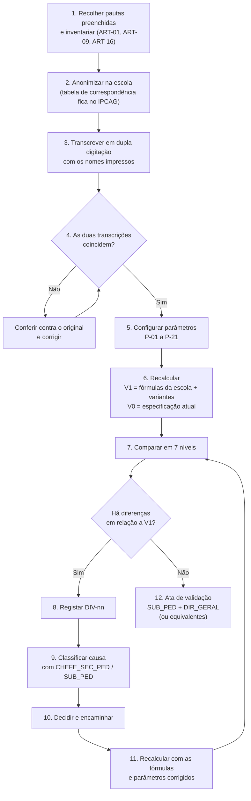

# Plano de Validação de Pautas — Recálculo de Pautas Reais

> [!abstract] Navegação
> - **Painel Principal:** [[Inicio|Início do Vault]] | **Índice do Projeto:** [[00 - MOC SGE IPCAG 12008 BGO|MOC]] | **Plano mestre:** [[00.1 - Plano de Engenharia de Requisitos]] (§4 Fase D e dica "A técnica de validação mais valiosa")
> - **Kit de Descoberta e Validação:** [[Guiao de Entrevistas por Cargo]] → [[Pedido de Artefactos a Escola]] → [[Questionario de Volumetria e Infraestrutura]] → **Plano de Validação de Pautas**
> - **Documentos reais já analisados:** [[Achados dos Documentos Reais - Lote 1]] (`DESC-L1`, sobretudo A1, A2, A6, A7, A8, A10)
> - **Regras afetadas:** [[01 - Dominio e Regras]] (`RN-01`, `RN-02`, `RN-03`, `RN-05`, `RN-06`) | **Fluxos:** [[02 - Fluxos de Trabalho]] (Fluxos 03, 04, 05, 06) | **Ata:** [[Modelo de Ata de Validacao]]

> [!important] Objetivo
> Descobrir, com **pautas oficiais preenchidas do último ano letivo concluído** (o modelo de Pauta Geral do Lote 1 já é de 2025/2026), **as fórmulas que a escola realmente aplica**, e provar que o sistema as reproduz **exatamente**.
>
> Os primeiros documentos reais mostram que a escola **não** usa o RN-01 tal como está escrito (`DESC-L1` A1). A legenda impressa da Mini Pauta do Professor mostra:
> - componentes por trimestre `MTP` (Média de Trabalho Prático), `PP` (Prova do Professor) e `PT` (Prova Trimestral), com médias trimestrais `M1`, `M2`;
> - no III Trimestre **não há `PT`**: as colunas são `MTP`, `PP`, `M3/CF`, seguidas de `PG` (**Prova Global**) e `CA` (**Classificação Anual**);
> - a fórmula impressa **`CA = MT3 × 0,6 + PG × 0,4`**; a Pauta Geral tem, por disciplina, as colunas `FALT`, `CF`, `PG`, `CA`.
>
> Por isso o recálculo **parte destas fórmulas reais**. A parte que a legenda não diz (§2.4) é testada como hipótese contra as pautas preenchidas. A especificação atual (`RN-01`, `RN-02`) entra só como termo de comparação, para medir o que tem de ser reescrito.
>
> Critério de saída da Fase D para os cálculos (plano §4): **zero divergências por resolver** e aprovação pelo `SUB_PED` e pelo `DIR_GERAL` (ou os cargos equivalentes da estrutura real, §2.2).

---

## 1. O Que Se Valida

| Cálculo ou regra | O que se recalcula | Origem da fórmula | Documentos-fonte |
| :--- | :--- | :--- | :--- |
| Médias do I e II Trimestres | `M1`, `M2` a partir de `MTP`, `PP`, `PT` | Componentes impressos (`DESC-L1` A1); combinação por confirmar (P-02) | Mini Pautas `DOF-04` **preenchidas** (ART-01a) |
| Média do III Trimestre | `M3` a partir de `MTP` e `PP` (sem `PT`) | A1; combinação por confirmar (P-03) | Idem |
| Classificação de frequência | `CF` (coluna `M3/CF` da Mini Pauta; coluna `CF` da Pauta Geral) | A1; significado por confirmar (P-05) | `DOF-04`, `DOF-05` (ART-01a, ART-01b) |
| **Classificação Anual** | `CA = MT3 × 0,6 + PG × 0,4` | **Fórmula impressa** (A1); "MT3" por esclarecer (P-06) | `DOF-04`, `DOF-05` |
| Arredondamento | Todas as médias e classificações | Hipótese `round_med` do `RN-01 §2` (P-08) | Todos |
| Exame de recurso | Existência, acesso e fórmula | Não aparece nos modelos recebidos; `RN-01 §5` como hipótese (P-10) | Pautas de recurso, se existirem (ART-01c) |
| Dispensa médica | Tratamento de `DISP` | `RN-01.1` como hipótese (P-11) | `DOF-04`, `DOF-05` |
| Transição, retenção e cadeiras em atraso | Contagem de negativas, retenção, transição com deficiência, veto LP + nuclear **só na 10ª e 11ª** (Língua Portuguesa só existe nessas classes — A7), regime da 12ª, repetentes | `RN-02` como hipótese (P-12 a P-17) | `DOF-05` e atas dos conselhos (ART-01b); planos curriculares recebidos (ART-09) |
| Eliminação de cadeiras em atraso | Exame extraordinário e efeito na média | `RN-02 §6` (P-17) | `DOF-07` (ART-01c) |
| Faltas | Limite, tipos de falta (indisciplina, não comparência — A8), marcação de retenção | `RN-03` como hipótese (P-18) | `DOF-04`, `DOF-06` |
| Numeração | Posição e n.º de ordem de transferidos, desistentes e entradas tardias | `RN-05` | `DOF-04`, `DOF-05` |
| **Estatísticas impressas** | Mini Pauta: `MT` (matriculados?), `AV`, `AP`, `RP`, `NV` por trimestre; Pauta Geral: positivas e negativas por disciplina, transitam, transitam com deficiência, desistentes, não transitam | Colunas impressas (A10); fórmulas por confirmar | `DOF-04`, `DOF-05` |
| 13ª Classe | Projecto Tecnológico, Estágio Curricular, `MFC` | Planos curriculares (A6); `RN-06 §2` como hipótese (P-20, P-21) | ART-01e; certificados `DOF-10` |
| *Extensão opcional (§8)* | `MFA`, ordenação, desempates e repescagem do concurso de admissão | `RN-01.2` e verificação legal | `DOF-02` (ART-02) |

> [!note] Nomenclatura
> Transcrever sempre com os nomes **tal como impressos** em cada documento e registar o código do modelo: o boletim do Gabinete Provincial (`DEE-PEEP-001-ACE`) e a Mini Pauta usam `MTP`/`PP`/`PT`; o boletim da escola usa `MAC`/`NPP`/`NPT` (`DESC-L1` A2). A equivalência `MAC ≡ MTP` fica por confirmar (P-01).
> **Colisão de siglas:** `PT` = Prova Trimestral. O **Projecto Tecnológico** escreve-se sempre por extenso nesta validação.

**Fora deste plano:** regras financeiras (`RN-07` a `RN-09`), validadas nas sessões com a Tesouraria e registadas em [[Modelo de Ata de Validacao|atas de validação]] próprias.

---

## 2. Preparação

### 2.1 Pré-requisitos

- [x] Planos curriculares recebidos para 4 cursos — Contabilidade e Gestão, Gestão de Recursos Humanos, Gestão Empresarial, Estatística e Planeamento (Lote 1; confirmar se são todos os cursos, `DESC-L1` A5).
- [x] Modelos **em branco** da Mini Pauta do Professor, da Pauta de Aproveitamento Geral e de dois boletins (Lote 1): a estrutura das colunas já é conhecida.
- [ ] **Pautas preenchidas e anonimizadas** das turmas da amostra (§2.5). **Bloqueante:** sem elas não se recalcula nada.
- [ ] Fórmulas da escola confirmadas na entrevista [[Guiao de Entrevistas por Cargo#G-02 Subdirector Pedagógico — SUB_PED|G-02]] (parâmetros P-01 a P-10).
- [ ] Ofício do [[Pedido de Artefactos a Escola]] autorizado; entrevista [[Guiao de Entrevistas por Cargo#G-04 Chefe da Secretaria Pedagógica — CHEFE_SEC_PED|G-04]] realizada.
- [ ] Normativos e instrutivos de avaliação aplicados pela escola (ART-16).
- [ ] Turmas da amostra escolhidas com o Chefe da Secretaria Pedagógica (§3).

### 2.2 Papéis

| Quem | Papel |
| :--- | :--- |
| **Equipa — 2 transcritores** | Transcrevem as pautas de forma independente (dupla digitação). |
| **Equipa — 1 analista** | Configura os parâmetros, recalcula, compara e regista as divergências. |
| **`CHEFE_SEC_PED`** | Escolhe as turmas, guarda a tabela de correspondência dos códigos anónimos, confere divergências contra os originais. |
| **`SUB_PED`** | Confirma as fórmulas e os parâmetros, explica divergências e decide as que tocam em regras. |
| **`DIR_GERAL`** | Aprova o resultado final na ata de validação. |

> [!warning] Estrutura real de direção (`DESC-L1` A4)
> Os documentos recebidos são assinados por uma **Coordenadora Geral da Comissão de Gestão** e por um **Coordenador para a Área Pedagógica**, não por "Director Geral" e "Subdirector Pedagógico". Até a entrevista G-01 confirmar a estrutura atual, entender `SUB_PED` como "quem responde pela área pedagógica" e `DIR_GERAL` como "quem dirige a escola", e registar na ata o **título real** de quem aprova.

### 2.3 Anonimização e confidencialidade

1. **Código do aluno:** `T<turma>-<n.º de ordem>` (ex.: `T2-14`). As turmas passam a `T1`, `T2`, `T3`…
2. A **tabela de correspondência** (código ↔ nome, n.º de processo, turma real) é feita e guardada **na escola**, pelo Chefe da Secretaria Pedagógica. Não sai da escola.
3. Transcreve-se apenas o necessário: n.º de ordem, notas, faltas por tipo, marcações (`DISP`, transferido, anulado, linhas destacadas a cor), resultado e observação. **Não** se transcrevem nomes, n.º de processo, BI, idade ou contactos. A coluna **Género** só se transcreve como contagem, para conferir as estatísticas (N7).
4. A folha de cálculo de recálculo fica **fora do vault**, em pasta de acesso restrito à equipa. No vault entram apenas o **registo de divergências (anonimizado)** (§6) e as atas.
5. **Erros encontrados nas pautas oficiais** são comunicados apenas à Direção (compromisso n.º 6 do Anexo B do [[Pedido de Artefactos a Escola]]). O objetivo é validar o sistema, não auditar a escola. Se um erro afetar o resultado de um aluno real, a decisão sobre o que fazer é **exclusivamente da Direção**.
6. O Lote 1 incluiu uma avaliação de desempenho **preenchida e com dados pessoais** (`DESC-L1` §5). Nos próximos lotes, pedir só modelos em branco ou cópias anonimizadas segundo o [[Pedido de Artefactos a Escola]] §2, e **tapar os dados antes de fotografar**.

### 2.4 Parâmetros a confirmar antes de calcular

Preencher com o `SUB_PED` (ou o Coordenador para a Área Pedagógica). Um parâmetro sem fonte confirmada mantém a hipótese indicada **e** gera uma questão no [[12 - Registo de Decisoes e Questoes em Aberto]]. A coluna "Documentos reais" resume o que o Lote 1 já mostrou.

| # | Parâmetro | Documentos reais (Lote 1) | Hipótese da especificação | Valor confirmado | Fonte |
| :---: | :--- | :--- | :--- | :---: | :--- |
| P-01 | Nomenclatura oficial e equivalência `MTP ≡ MAC`, `PP ≡ NPP`, `PT ≡ NPT` | Dois modelos de boletim com nomes diferentes (A2) | `MAC`, `NPP`, `NPT` (`RN-01`) | | |
| P-02 | Como se obtêm `M1` e `M2` a partir de `MTP`, `PP`, `PT` (média simples? pesos?) | Componentes impressos; combinação **não** impressa (A1) | `(MAC + NPP + NPT)/3` (`RN-01 §3`) | | |
| P-03 | Como se obtém `M3` a partir de `MTP` e `PP` | III Trimestre **sem** `PT` (A1) | Igual aos outros trimestres (`RN-01 §3`) | | |
| P-04 | Notas parcelares inteiras ou com décimas | Não se vê nos modelos em branco | Escala `0–20` (`RN-01 §1`) | | |
| P-05 | O que é `CF` e como se calcula (coluna `M3/CF`) | Coluna `M3/CF` na Mini Pauta; `CF` na Pauta Geral (A1) | `MFD = (MT1 + MT2 + MT3)/3` (`RN-01 §4`) | | |
| P-06 | "MT3" na fórmula da `CA`: é `M3` ou `CF`? | `CA = MT3 × 0,6 + PG × 0,4` impresso (A1) | Não existe `CA` | | |
| P-07 | A Prova Global aplica-se a todas as disciplinas e classes, ou só às que terminam nesse ano? | Colunas `PG` na Mini Pauta e na Pauta Geral (A1) | Não existe `PG` | | |
| P-08 | Arredondamento de `M1`–`M3`, `CF` e `CA`; as médias intermédias são arredondadas antes de entrarem no cálculo seguinte? | Não impresso | `round_med` *half-up*; `MFD` com `MT` arredondadas (`RN-01 §2–§3`) | | |
| P-09 | Nota mínima de aprovação na `CA` | Não impresso | `MFD ≥ 10` (`RN-01 §4`) | | |
| P-10 | Exame de recurso: existe? Quem tem acesso? Fórmula? Relação com a `CA`? | Não aparece nos modelos recebidos | `40% MFD + 60% exame` (`RN-01 §5`) | | |
| P-11 | Disciplinas que admitem `DISP` | — | Ex.: Educação Física (`RN-01.1`) | | |
| P-12 | Critério de "transita com deficiência" (nota mínima, número máximo de disciplinas) | A Pauta Geral conta "transitam com deficiência" (A10) | Notas `7–9`; máximo `2`, ou `3` por normativo (`RN-02 §3`) | | |
| P-13 | Veto Língua Portuguesa + disciplina nuclear | Língua Portuguesa só existe na **10ª e 11ª** (A7) | LP + 1 nuclear, em qualquer classe (`RN-02 §4`) | | |
| P-14 | Disciplinas nucleares por curso e classe | Verificar se os 4 planos recebidos as identificam | Marcadas na matriz (`is_nuclear`) | | |
| P-15 | Regra de transição e de conclusão na 12ª Classe (incluindo o aluno que aprovou tudo mas ainda tem cadeiras em atraso por eliminar) | Sem Língua Portuguesa na 12ª (A7) | Sem transição com cadeiras; o caso das cadeiras pendentes não está definido (`RN-02 §2`, Fluxo 05 `E5.2`) | | |
| P-16 | Um aluno retido por faltas numa disciplina fica retido na classe | — | Sim (`RN-02 §3`) | | |
| P-17 | A nota do exame extraordinário substitui a negativa na média da classe | — | Sim (Fluxo 05 passo 5) | | |
| P-18 | Limite de faltas; se as faltas por indisciplina e por não comparência contam para o limite | O boletim distingue os dois tipos e regista o comportamento (A8) | `F_mult × tempos semanais`, anual, só faltas injustificadas (`RN-03 §1`) | | |
| P-19 | Tempos semanais por disciplina | Nos 4 planos recebidos (ART-09) | Na matriz | | |
| P-20 | 13ª Classe: avaliação do Projecto Tecnológico (na 12ª e na 13ª) e do estágio; fórmula da `MFC` | Projecto Tecnológico 2 h/semana na 12ª e 8 h na 13ª, mais Estágio 20 h (A6) | `MFC` com `MPC`, Nota de Estágio e Nota da PAP (`RN-06 §2`) | | |
| P-21 | Médias de cada classe (`MA`) arredondadas antes da `MPC` | — | Não arredondadas (`RN-06 §2`) | | |

> [!warning] ⚖️ Hipóteses da especificação sem fonte publicada
> Segundo a [[Verificacao das Referencias Legais]] §3 (`COR-LEG-13`, `COR-LEG-17`), nenhum regulamento de avaliação do ESTP publicado foi encontrado. O regulamento do Ensino Geral (DE n.º 106/26), usado como termo de comparação, difere nos pontos P-12 (até **3** disciplinas de 7–9), P-13 (LP + **duas** disciplinas específicas da área de formação) e P-18 (faltas contadas **por trimestre**, 3/4/5 conforme 1, 2 ou mais tempos semanais). A nota levanta também a hipótese de a `MFC` contar o estágio duas vezes (P-20, `COR-LEG-16`).
>
> Para cada parâmetro, registar a **fonte que a escola indicar** (normativo, instrutivo, circular, legenda impressa ou prática) e pedir cópia (ART-16). Sem documento, a fonte é "prática da escola" e o parâmetro gera uma questão no registo, ligada às perguntas `Q-LEG-01` a `Q-LEG-07`.

### 2.5 Pedido de pautas preenchidas

> [!important] O Lote 1 trouxe só modelos em branco
> Os modelos mostram as colunas, mas não as contas. Para validar as fórmulas é preciso pedir à Secretaria Pedagógica (ART-01) **exemplares preenchidos e homologados** do último ano letivo concluído, **anonimizados** segundo o [[Pedido de Artefactos a Escola]] §2 (nomes tapados, posição na lista mantida).

Para **cada turma da amostra** (§3.1), pedir:

- [ ] **Mini Pautas do Professor preenchidas** de **todas** as disciplinas, com os três trimestres: `MTP`, `PP`, `PT`, `M1`, `M2`, `M3/CF`, `PG`, `CA`, faltas e a estatística `MT`/`AV`/`AP`/`RP`/`NV`.
- [ ] **Pauta de Aproveitamento Geral preenchida e homologada**: `FALT`, `CF`, `PG`, `CA` por disciplina, Resultado, Observação, estatística final e linhas destacadas a cor.
- [ ] **Boletins preenchidos** de 3 a 5 alunos (para comparar com a pauta e ver as faltas por indisciplina e o comportamento).
- [ ] **Pautas de exame de recurso** e de exame extraordinário, se existirem, e as **atas dos conselhos de notas**.
- [ ] **13ª Classe:** notas do Projecto Tecnológico e do estágio, `MFC` e as classificações das 10ª, 11ª e 12ª Classes de cada aluno.

> [!tip] Candidata a T1
> O modelo de Pauta Geral recebido é da **10ª A, Contabilidade e Gestão, Tarde, 2025/2026**. Pedir a **versão preenchida dessa mesma turma** poupa uma escolha e permite comparar logo com o modelo em branco.

---

## 3. Escolha da Amostra

### 3.1 Turmas

Escolher, com o Chefe da Secretaria Pedagógica, **pelo menos 3 turmas do último ano letivo concluído**, privilegiando as que têm mais casos especiais (§3.2). As turmas têm cerca de 37–45 alunos (`DESC-L1` A16).

| Código | Classe | Porquê | Documentos necessários |
| :---: | :--- | :--- | :--- |
| **T1** | 10ª ou 11ª | Únicas classes com Língua Portuguesa, logo o único sítio onde pode haver veto LP + nuclear (A7), e onde existe transição com deficiência. Candidata: 10ª A de Contabilidade e Gestão, Tarde (§2.5). | Mini Pautas de todas as disciplinas, Pauta Geral, ata do conselho, pauta de recurso |
| **T2** | 12ª | Sem Língua Portuguesa: regra de transição e conclusão por confirmar (P-15); início do Projecto Tecnológico; eliminação de cadeiras em atraso antigas | Idem + pautas de exame extraordinário dos alunos com cadeiras em atraso |
| **T3** | 13ª | Projecto Tecnológico + Estágio Curricular; cálculo da `MFC` (P-20) | Notas do Projecto Tecnológico e do estágio, `MFC` oficial e as classificações das 10ª, 11ª e 12ª **de cada aluno** (certificado `DOF-10` ou processo individual) |
| **T4** *(recomendada)* | Outra 10ª/11ª, de outro curso e período | Outro plano curricular (Gestão de RH, Gestão Empresarial ou Estatística e Planeamento) e o período da Manhã | Idem T1 |

> [!note] Histórico dos alunos da 13ª
> Para recalcular a `MFC` de um aluno que esteve na 13ª no último ano letivo concluído, são precisas as suas classificações finais de **três anos anteriores** (previsivelmente 10ª em 2022/2023, 11ª em 2023/2024 e 12ª em 2024/2025, se nunca repetiu). Confirmar com o Chefe da Secretaria Pedagógica se essa informação está no certificado, no processo individual ou só nas pautas antigas.

### 3.2 Casos obrigatórios

A amostra tem de conter **pelo menos um exemplo de cada caso**. Assinalar o aluno anónimo que o cobre.

| Caso | Descrição | Regra / parâmetro | Aluno(s) | Coberto |
| :---: | :--- | :--- | :--- | :---: |
| C-01 | Aluno aprovado em todas as disciplinas | `CA`, `RN-02 §2` | | ⬜ |
| C-02 | `DISP` nos 3 trimestres | `RN-01.1`, P-11 | | ⬜ |
| C-03 | `DISP` num único trimestre | `RN-01.1`, P-11 | | ⬜ |
| C-04 | Transferido de **saída** depois do I Trimestre (linha mantida) | `RN-05` | | ⬜ |
| C-05 | Transferido de **entrada** a meio do ano, com notas da escola de origem | `RN-06.1`, `RN-05` | | ⬜ |
| C-06 | Entrada tardia depois do congelamento da chamada (`N + 1`) | `RN-05` | | ⬜ |
| C-07 | Desistente / anulado | `RN-05` | | ⬜ |
| C-08 | Exame de recurso **aprovado** (se existir) | P-10 | | ⬜ |
| C-09 | Exame de recurso **reprovado** (se existir) | P-10 | | ⬜ |
| C-10 | Transita com deficiência (10ª/11ª) | P-12 | | ⬜ |
| C-11 | Retido por veto Língua Portuguesa + disciplina nuclear (**só 10ª/11ª**) | P-13, P-14 | | ⬜ |
| C-12 | Retido por nota muito baixa numa disciplina | P-12 | | ⬜ |
| C-13 | Retido por excesso de disciplinas com negativa | P-12 | | ⬜ |
| C-14 | Retido por faltas numa disciplina | P-16, P-18 | | ⬜ |
| C-15 | 12ª com cadeira em atraso da 10ª/11ª eliminada em exame extraordinário | P-17 | | ⬜ |
| C-16 | 12ª com negativa (retido ou outra situação) | P-15 | | ⬜ |
| C-17 | Repetente (classe anterior já concluída) | `RN-02.1` | | ⬜ |
| C-18 | 13ª Classe aprovado com `MFC` | P-20, P-21 | | ⬜ |
| C-19 | Média exatamente a meio (`x,5`) antes de arredondar | P-08 | | ⬜ |
| C-20 | Nota corrigida depois de a pauta ser homologada (se existir) | `US-GOV-04`, `RN-10` | | ⬜ |
| C-21 | Disciplina em que `M3` ≠ `CF` | P-06 | | ⬜ |
| C-22 | Prova Global com nota muito diferente da média (ex.: `PG` negativa com média positiva) | P-06, P-09 | | ⬜ |
| C-23 | Disciplina sem Prova Global (se existir) | P-07 | | ⬜ |
| C-24 | Aluno com faltas por indisciplina ou por não comparência registadas | P-18 | | ⬜ |
| C-25 | Linha destacada a cor na Pauta Geral | A10 | | ⬜ |

> [!tip] Onde aparece um `x,5` (caso C-19) e porque os casos C-21 e C-22 são decisivos
> - Com notas inteiras (P-04), a `CA` impressa (`(3·MT3 + 2·PG)/5`) só dá múltiplos de `0,2`, e uma média de três notas só dá `0`, `0,33` ou `0,67`: **nunca** exatamente `0,5`. O arredondamento *half-up* só é posto à prova em **divisões por 2 ou por 4**, como uma `M3` que seja a média de `MTP` e `PP` (hipótese de P-03), uma `DISP` de um só trimestre, a `MFA` ou uma `MFC` com pesos `2+1+1`, e em médias com décimas. Procurar esses casos de propósito.
> - As hipóteses "MT3 = `M3`" e "MT3 = `CF`" (P-06) dão a **mesma** `CA` sempre que `M3` e `CF` são iguais ou próximas e a `PG` é parecida. Só os casos **C-21** e **C-22** as distinguem (ver o exemplo em §5.3).

### 3.3 Completar a amostra

1. Se um caso não existir nas turmas escolhidas, pedir ao Chefe da Secretaria Pedagógica **alunos isolados** de outras turmas do mesmo ano que o tenham (amostra intencional por casos).
2. Se não existir no último ano, procurar no ano anterior.
3. Se o caso nunca aconteceu na escola, marcar **"inexistente"** com a confirmação do `SUB_PED`. A regra fica validada só contra o texto legal ou a legenda impressa: registar o risco no [[12 - Registo de Decisoes e Questoes em Aberto]].

### 3.4 Volume de trabalho

Estimar antes de começar, com os números do [[Questionario de Volumetria e Infraestrutura]] (§A.1) e dos planos curriculares (ART-09):

`linhas a transcrever ≈ Σ turmas (n.º de alunos × n.º de disciplinas × 3 trimestres)`, cada linha com as componentes (`MTP`, `PP`, `PT` ou só `MTP`, `PP` no III Trimestre), a média trimestral e as faltas, mais uma linha final por aluno e disciplina (`CF`, `PG`, `CA`, recurso) e um resultado por aluno.

Como a transcrição é feita duas vezes (§4 passo 3), planear o tempo de **dois** transcritores.

---

## 4. Procedimento Passo a Passo

1. **Recolher e inventariar.** Pedir as pautas **preenchidas** do §2.5 e registar cada documento na tabela de acompanhamento do [[Pedido de Artefactos a Escola]] (§3). Confirmar que, para cada turma, há **todas** as disciplinas do plano curricular e os três trimestres.
2. **Anonimizar na escola.** Com o Chefe da Secretaria Pedagógica, atribuir os códigos `T<turma>-<n.º de ordem>` e preencher a tabela de correspondência, que fica na escola (§2.3).
3. **Transcrever em dupla digitação.** Dois membros da equipa transcrevem, cada um sozinho, as mesmas pautas para a folha `Notas` (§5.1), **com os nomes de coluna impressos** e **copiando também os valores calculados da pauta oficial** (`M1`–`M3`, `CF`, `CA`, resultado, estatísticas) nas colunas `_oficial`. A `PG` é uma nota de prova: transcreve-se, não se calcula.
4. **Conferir as transcrições.** Comparar as duas versões célula a célula (`=SE(A2=B2;"";"≠")`). Cada diferença é verificada **no original** e corrigida. Só a versão conferida segue para o passo 5.
5. **Configurar os parâmetros.** Preencher a folha `Parametros` com os valores confirmados em §2.4 e o plano curricular de cada turma (disciplinas, tempos semanais, nucleares, elegíveis para `DISP`). Enquanto P-01 a P-10 não estiverem confirmados, usar a hipótese principal **V1** (§5.3).
6. **Recalcular.** Calcular tudo com **V1** (fórmulas da escola) e com as variantes de diagnóstico V2–V7. Calcular também **V0** (especificação atual), só para medir a distância entre a especificação e a prática.
7. **Comparar em 7 níveis**, sempre o valor calculado em V1 (ou na fórmula já confirmada) contra o valor oficial:
   - **N1 — Células:** `M1`, `M2`, `M3`, `CF`, `CA` (e `CF` do recurso, se existir).
   - **N2 — Situação na disciplina:** positiva, negativa, recurso, retido por faltas, `DISP`.
   - **N3 — Resultado final do aluno:** transita, transita com deficiência, não transita, desistente (e motivo).
   - **N4 — 13ª Classe:** médias das classes, `MPC`, `MFC`.
   - **N5 — Faltas** *(se houver dados)*: limite calculado vs. marcação de retenção, por tipo de falta.
   - **N6 — Numeração:** posição e n.º de ordem de transferidos, desistentes e entradas tardias.
   - **N7 — Estatísticas impressas:** `MT`/`AV`/`AP`/`RP`/`NV` da Mini Pauta e positivas, negativas, transitam, transitam com deficiência, desistentes e não transitam da Pauta Geral.
8. **Registar cada diferença** em relação a V1 no registo de divergências (§6), uma linha por campo diferente, com o código `DIV-nn`. As diferenças entre **V0** e os valores oficiais **não** se registam linha a linha: resumem-se numa divergência por regra da especificação (ex.: "`RN-01 §3–§4` não prevê Prova Global nem `CA`"), com decisão `CORRIGIR-ESPEC`.
9. **Classificar a causa provável** (códigos em §6.2). Primeiro excluir erro de transcrição (`TRANS`) voltando ao original; depois levar as restantes ao Chefe da Secretaria Pedagógica e ao `SUB_PED`. A variante que coincide com o valor oficial é a primeira pista.
10. **Decidir e encaminhar** (códigos em §6.3):
    - fórmula ou regra da especificação errada → proposta de nova versão da regra no [[01 - Dominio e Regras]] (Fase C), citando o `DIV-nn` e o achado `DESC-L1` correspondente;
    - parâmetro → valor confirmado na folha `Parametros` e nota para a configuração do sistema;
    - sem resposta → questão no [[12 - Registo de Decisoes e Questoes em Aberto]];
    - erro humano na pauta oficial → sem alteração à especificação; comunicado apenas à Direção (§2.3).
11. **Recalcular de novo** com as fórmulas e os parâmetros corrigidos. Repetir os passos 7 a 10 até não restar nenhuma divergência por decidir.
12. **Fechar com uma ata** ([[Modelo de Ata de Validacao]]), com o registo de divergências anexo e a aprovação do `SUB_PED` e do `DIR_GERAL` (ou dos cargos equivalentes, §2.2).

---

## 5. Folha de Cálculo de Recálculo

### 5.1 Estrutura

| Folha | Conteúdo | Colunas principais |
| :--- | :--- | :--- |
| `Parametros` | Valores P-01 a P-21 com fonte; plano curricular por turma | `turma`, `disciplina`, `tempos_semanais`, `is_nuclear`, `admite_disp`, `is_lingua_portuguesa`, `tem_prova_global` |
| `Alunos` | Um registo por aluno da amostra | `codigo`, `turma`, `classe`, `n_ordem`, `marcacao` (transferido, anulado, entrada tardia, repetente, linha a cor), `casos` (C-xx) |
| `Notas` | Uma linha por aluno, disciplina e trimestre | `codigo`, `disciplina`, `trimestre`, `MTP`, `PP`, `PT` (vazio no III), `DISP`, `faltas_indisciplina`, `faltas_nao_comparencia`, `faltas_justificadas`, `M_oficial`, `modelo_documento` |
| `Finais` | Uma linha por aluno e disciplina | `CF_oficial`, `PG`, `CA_oficial`, `FALT_oficial`, `exame_recurso`, `exame_extra`, `situacao_oficial` |
| `Resultado` | Uma linha por aluno | `resultado_oficial`, `observacao_oficial`, `n_negativas`, `veto`, `resultado_V1` |
| `Estatisticas` | Uma linha por turma, disciplina e trimestre; e o resumo da Pauta Geral | `MT`, `AV`, `AP`, `RP`, `NV` oficiais e calculados; positivas, negativas, transitam, transitam com deficiência, desistentes, não transitam |
| `MFC` | Uma linha por aluno da 13ª | `MA10`, `MA11`, `MA12`, `nota_projecto_tecnologico`, `nota_estagio`, `MPC_oficial`, `MFC_oficial` |
| `Divergencias` | Cópia de trabalho do registo do §6 | Ver §6.1 |

### 5.2 Fórmulas a testar (Excel ou LibreOffice em português)

`round_med(x) = ⌊x + 0,5⌋` (`RN-01 §2`, hipótese P-08). Para evitar erros de vírgula flutuante (ex.: `9,4999999` em vez de `9,5`), arredondar primeiro a 6 casas decimais. As linhas marcadas "hipótese" são substituídas pelo valor confirmado em §2.4 logo que exista.

| Cálculo | Origem | Fórmula (exemplo de colunas) |
| :--- | :--- | :--- |
| `round_med(x)` | `RN-01 §2` (P-08) | `=INT(ARRED(x;6)+0,5)` |
| `M1`, `M2` | Hipótese P-02: média simples das 3 componentes | `=INT(ARRED((MTP+PP+PT)/3;6)+0,5)` |
| `M3` | Hipótese P-03: média simples das 2 componentes | `=INT(ARRED((MTP+PP)/2;6)+0,5)` |
| `CF` | Hipótese P-05: média das três médias trimestrais arredondadas | `=INT(ARRED((M1+M2+M3)/3;6)+0,5)` |
| `CA` com "MT3" = `M3` | **Fórmula impressa** (A1) + hipótese P-06 (a) | `=INT(ARRED(0,6*M3+0,4*PG;6)+0,5)` |
| `CA` com "MT3" = `CF` | **Fórmula impressa** (A1) + hipótese P-06 (b) | `=INT(ARRED(0,6*CF+0,4*PG;6)+0,5)` |
| `M` com `DISP` num trimestre | `RN-01.1` (P-11) | Média só dos trimestres avaliados, ex.: `=INT(ARRED((M1+M3)/2;6)+0,5)` |
| Recurso *(se existir)* | Hipótese `RN-01 §5` (P-10), escrita para a `MFD`; não se sabe se na escola entra a `CF` ou a `CA` | `=INT(ARRED(0,4*NOTA_FREQ+0,6*EXAME;6)+0,5)`, com `NOTA_FREQ` = `CF` ou `CA` *(trocar pela fórmula confirmada)* |
| N.º de negativas | `RN-02 §1` | `=CONTAR.SE(CA_do_aluno;"<"&P09)` + disciplinas retidas por faltas (P-16), sem `DISP` |
| Veto LP + nuclear *(só 10ª/11ª)* | `RN-02 §4` (P-13) | `=E(CA_LP<P09; CONTAR.SE.S(CA_do_aluno;"<"&P09; nuclear_do_aluno;VERDADEIRO)>0)` |
| Resultado 10ª/11ª | `RN-02 §2–§5` (P-12, P-13) | 0 negativas → `Transita`; senão, nota abaixo do mínimo de deficiência, retenção por faltas ou negativas acima do máximo → `Não transita`; senão, veto → `Não transita (LP + nuclear)`; senão → `Transita com deficiência` |
| Resultado 12ª | P-15 | Conforme a regra confirmada |
| Limite de faltas | `RN-03 §1` (P-18) | `=F_mult*tempos_semanais`; retenção se as faltas que contam > limite |
| `MA` da classe | `RN-06 §2` (P-17, P-21) | `=MÉDIA(classificações finais da classe sem DISP)` |
| `MPC` | `RN-06 §2` | `=INT(ARRED((MA10+MA11+MA12)/3;6)+0,5)` |
| `MFC` | P-20 | Fórmula confirmada; hipótese da especificação: `=INT(ARRED((P_MPC*MPC+P_NE*NE+P_NPAP*NPAP)/(P_MPC+P_NE+P_NPAP);6)+0,5)` |
| `AV`, `AP`, `RP`, `NV` | A10 (fórmulas por confirmar) | `AV = CONTAR(M_trimestre)`; `AP = CONTAR.SE(M_trimestre;">="&P09)`; `RP = AV − AP`; `NV = MT − AV` |
| Positivas / negativas da Pauta Geral | A10 | `=CONTAR.SE(CA_disciplina;">="&P09)`; percentagem sobre avaliados ou sobre matriculados (confirmar) |

> [!note] Separadores
> As fórmulas usam a convenção portuguesa (`;` entre argumentos, `,` decimal; `ARRED`, `SE`, `E`, `CONTAR.SE`). Numa folha configurada em inglês, usar `ROUND`, `IF`, `AND`, `COUNTIF`, `,` entre argumentos e `.` decimal.

### 5.3 Variantes de diagnóstico

As variantes servem para descobrir **qual** é a fórmula que a escola aplica e **porque** um valor oficial é diferente. A variante que reproduz o valor oficial vai para a coluna "Variante que coincide" do registo.

| Variante | O que calcula | Serve para |
| :---: | :--- | :--- |
| **V0** | Especificação atual (DOC-01 v1.2): `MT = (MAC + NPP + NPT)/3` nos 3 trimestres, `MFD`, recurso 40/60 | Medir a distância entre a especificação e a prática; espera-se que divirja (A1) |
| **V1** | **Hipótese principal da escola:** `M1`, `M2` = média simples de `MTP`, `PP`, `PT`; `M3` = média simples de `MTP`, `PP`; `CF` = média das três médias arredondadas; `CA = M3 × 0,6 + PG × 0,4`; tudo com `round_med`. É substituída pelas fórmulas confirmadas em P-01 a P-10. | Ponto de partida do recálculo |
| **V2** | Como V1, mas "MT3" na `CA` = `CF` | Decidir P-06 |
| **V3** | `CF` e `CA` calculadas com as médias trimestrais **sem** arredondar | Decidir P-08 |
| **V4** | Corte das décimas (parte inteira) em vez de arredondamento | Detetar cálculos manuais que truncam (ex.: `10,67 → 10`) |
| **V5** | Critérios de transição alternativos (máximo de `2` ↔ `3` disciplinas; outro mínimo de deficiência) | Decidir P-12 |
| **V6** | 13ª e cadeiras: `MA` arredondadas; pesos alternativos da `MFC`; nota de exame extraordinário que **não** substitui a negativa | Decidir P-17, P-20, P-21 |
| **V7** | Regulamento do Ensino Geral (DE n.º 106/26), tal como descrito na [[Verificacao das Referencias Legais]] §3.5–§3.7: até 3 disciplinas de 7–9; veto LP + 2 específicas; faltas por trimestre (3/4/5) | Ver se a escola aplica esse regulamento por analogia (`Q-LEG-01`, `Q-LEG-04`, `Q-LEG-06`) |

> [!example] Exemplo de preenchimento (dados fictícios, só para ilustrar o método)
> Aluno `T1-07`, uma disciplina. I e II Trimestres: `MTP 11, PP 11, PT 10` → `32/3 = 10,67` → `M1 = M2 = 11`. III Trimestre: `MTP 10, PP 9` → `19/2 = 9,5` → `M3 = 10` (hipótese P-03). `CF = round_med((11 + 11 + 10)/3) = round_med(10,67) = 11`. Prova Global `PG = 8`.
> - **V1 (MT3 = `M3`):** `CA = round_med(0,6 × 10 + 0,4 × 8) = round_med(9,2) = 9`.
> - **V2 (MT3 = `CF`):** `CA = round_med(0,6 × 11 + 0,4 × 8) = round_med(9,8) = 10`.
>
> Se a pauta oficial mostrar `CA = 10`, regista-se `DIV-nn` com valor oficial `10`, calculado (V1) `9`, regra "`CA` (A1)", variante que coincide `V2`, causa provável `PARAM` (P-06) e decisão `QUESTAO` até o `SUB_PED` confirmar. Com `PG = 12` as duas hipóteses dariam a mesma `CA` (`11`): é por isso que os casos C-21 e C-22 são obrigatórios.

---

## 6. Modelo de Registo de Divergências

### 6.1 Registo

Uma linha por **campo** diferente. O aluno é sempre identificado pelo código anónimo.

| ID | Turma | Aluno (anónimo) | Disciplina | Nível / campo | Valor oficial | Valor calculado (V1) | Regra / parâmetro | Variante que coincide | Causa provável | Decisão | Responsável | Estado | Ata |
| :---: | :---: | :---: | :--- | :---: | :---: | :---: | :---: | :---: | :---: | :--- | :---: | :---: | :---: |
| DIV-01 | | | | | | | | | | | | 🔴 aberta | |
| DIV-02 | | | | | | | | | | | | 🔴 aberta | |
| DIV-03 | | | | | | | | | | | | 🔴 aberta | |

Estados: 🔴 aberta · 🟡 em análise · 🟢 resolvida (com decisão e ata).

### 6.2 Códigos de causa provável

| Código | Significado | Como confirmar |
| :---: | :--- | :--- |
| `TRANS` | Erro de transcrição da equipa | Voltar ao original; corrigir a folha |
| `PAUTA` | Erro de cálculo ou de escrita na pauta oficial | Confirmar com o Chefe da Secretaria Pedagógica; comunicar só à Direção |
| `REGRA` | A fórmula ou regra usada no recálculo difere da prática ou da norma | Explicação do `SUB_PED` e, se possível, documento (ART-16) |
| `PARAM` | A fórmula está certa, mas um parâmetro (P-01 a P-21) estava errado | Valor confirmado e fonte |
| `EXCEC` | Exceção ou prática local não documentada | Descrição do `SUB_PED`; frequência do caso |
| `CONSELHO` | Decisão deliberada do conselho de notas | Ata do conselho (ART-01b) |
| `DADO` | Dado em falta, ilegível ou contraditório no original | Original; pedir outra fonte |
| `NORMA` | Normativos contraditórios ou por confirmar | Encaminhar para a verificação das referências legais (lacuna L3) |

### 6.3 Códigos de decisão

| Código | Decisão | Encaminhamento |
| :---: | :--- | :--- |
| `CORRIGIR-ESPEC` | Alterar a regra na especificação | Nova versão da `RN` no [[01 - Dominio e Regras]] (Fase C), citando `DIV-nn` e o achado `DESC-L1` |
| `PARAMETRIZAR` | Tornar o valor um parâmetro configurável por ano letivo | Atualizar a matriz/configuração no DOC-01 e DOC-05 |
| `NOVA-REGRA` | Registar uma exceção ou prática como regra nova | Nova sub-regra no [[01 - Dominio e Regras]] e cenário BDD no [[03 - User Stories]] |
| `QUESTAO` | Sem resposta: precisa de decisão ou de documento | [[12 - Registo de Decisoes e Questoes em Aberto]] |
| `SEM-ALTERACAO` | Erro humano (transcrição ou pauta oficial); a regra mantém-se | Nenhum na especificação; `PAUTA` comunicado só à Direção |

---

## 7. Critérios de Conclusão

A validação de pautas está concluída quando **todos** os pontos abaixo se verificam:

- [ ] **Fórmulas da escola confirmadas por escrito:** P-01 a P-10 com valor e fonte, assinados na ata pelo `SUB_PED` (ou Coordenador para a Área Pedagógica).
- [ ] **Cobertura da amostra:** pelo menos 3 turmas (T1, T2, T3) com pautas **preenchidas** recalculadas a 100%, e todos os casos C-01 a C-25 cobertos ou marcados "inexistente" com confirmação do `SUB_PED`.
- [ ] **Qualidade da transcrição:** 100% das linhas transcritas em dupla digitação e conferidas contra o original.
- [ ] **Restantes parâmetros:** P-11 a P-21 com valor confirmado e fonte, ou com questão aberta no [[12 - Registo de Decisoes e Questoes em Aberto]].
- [ ] **Zero divergências por resolver:** todas as linhas do registo com causa, decisão e estado 🟢.
- [ ] **Recálculo final limpo:** com as fórmulas e os parâmetros confirmados, o recálculo reproduz **100%** dos valores oficiais nos níveis N1 a N7, com exceção apenas das divergências classificadas `PAUTA`/`SEM-ALTERACAO` e confirmadas pelo `SUB_PED`.
- [ ] **Especificação atualizada:** a distância medida por V0 e cada divergência `REGRA`, `PARAM` ou `EXCEC` deram origem a uma alteração proposta no DOC-01 (`RN-01`, `RN-02`, glossário com `MTP`, `PP`, `PT`, `PG`, `CF`, `CA`) ou a uma questão registada, com referência ao `DIV-nn` e ao `DESC-L1`.
- [ ] **Casos de teste reais:** os casos validados (anonimizados) ficam disponíveis como exemplos com **números reais** para os critérios BDD de `US-PED-03`, `US-PED-04`, `US-PED-06`, `US-DEF-02` e `US-13C-02`, como exige a *Definition of Ready* (plano §8).
- [ ] **Aprovação:** ata de validação assinada pelo `SUB_PED` e pelo `DIR_GERAL`, ou pelos cargos equivalentes da estrutura real (§2.2), com o Chefe da Secretaria Pedagógica como participante.

---

## 8. Extensão Opcional — Concurso de Admissão (`RN-01.2`)

Se a pauta do último concurso (ART-02) for recebida, aplicar o mesmo método:

1. Transcrever, por candidato anónimo, as notas de cada prova ou secção, a média da 9ª Classe, a idade, a 1ª e 2ª opção e o resultado oficial.
2. Recalcular `MFA = round_med((Nota_LP + Nota_Mat_Esp)/2)` — aqui o `x,5` aparece com frequência (divisão por 2): **bom teste ao arredondamento**.
3. **Variante da especificação:** reordenar por curso/turno de 1ª opção, aplicar as vagas, os desempates (maior nota de LP → maior média da 9ª → mais novo) e a repescagem na 2ª opção (Fluxo 01 passo 9, `E1.4`, `E1.6`).
4. Recalcular também a **variante legal** descrita na [[Verificacao das Referencias Legais]] §3.9 (`COR-LEG-08`, `09`): `≥ 10` em **cada** prova, sem redução do limiar mesmo com vagas sobrantes, e desempate pela **menor idade**.
5. Comparar o resultado (admitido, excedente, nota inferior ao mínimo) com a pauta oficial, registar qual das duas variantes a escola seguiu, e registar as divergências no mesmo registo (§6), com o nível `ADM`. Uma admissão abaixo de 10 numa prova é sinalizada só à Direção (§2.3), tal como os erros de pauta.

---

## 9. Ligações

- Documentos reais já analisados: [[Achados dos Documentos Reais - Lote 1]].
- Entrevistas que preparam esta validação: [[Guiao de Entrevistas por Cargo]] (G-02, G-04, G-08, G-09, G-11).
- Documentos pedidos: [[Pedido de Artefactos a Escola]] (ART-01, ART-02, ART-09, ART-16).
- Registo das sessões com a escola: [[Modelo de Ata de Validacao]].
