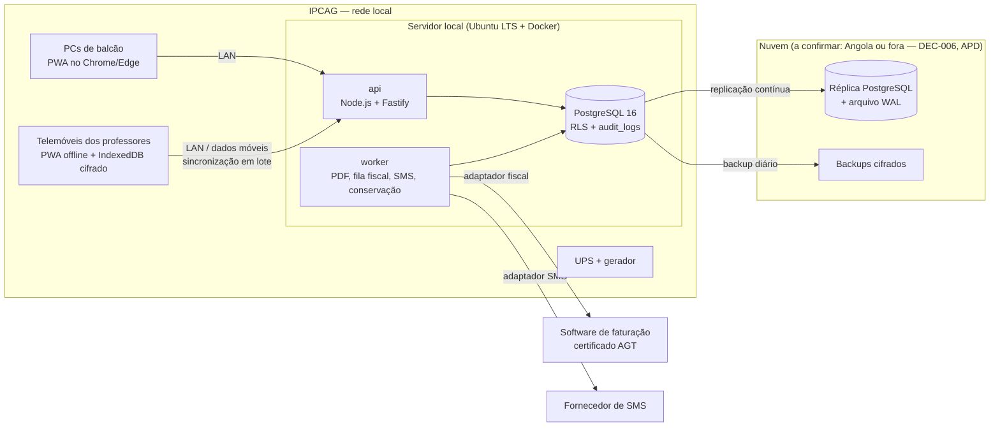

# 13 — Arquitetura Técnica do SGE

> [!abstract] Em resumo
> O SGE é construído como **uma só aplicação TypeScript**, com dois executáveis:
> - um **servidor no IPCAG**, com a API, o PostgreSQL e os serviços de PDF, fiscal e SMS, e uma **réplica na nuvem**;
> - uma **aplicação web instalável (PWA)**, usada nos PCs de balcão e nos telemóveis dos professores, que **trabalha offline** com uma fila própria de operações.
>
> As **regras de domínio** (cálculo de médias, transições, semáforo, validações) vivem num pacote único, **sem dependências**, que corre igual no telemóvel e no servidor.
>
> - **Base:** especificação congelada [`v2.0`](https://github.com/Angeloaqp/sge-ipcag-12008/releases/tag/v2.0). As escolhas de fundo são a `DEC-027` do [[12 - Registo de Decisoes e Questoes em Aberto|REG-12]]. Os pormenores estão nos registos técnicos `ADR-T01` a `ADR-T14` (§5).
> - **Quem constrói:** o analista responsável dirige e revê; agentes de IA escrevem o código, sempre com testes (`ADR-T11`).
> - **Onde:** um repositório **novo e privado**, separado deste vault. Lê a especificação daqui, pela etiqueta `v2.0`.

---

## 1. Restrições que a v2.0 já fixa

| Restrição | Valor | Fonte |
| :--- | :--- | :--- |
| Base de dados | PostgreSQL, com isolamento por RLS | [[05 - Modelagem de Dados\|DOC-05]] §5 |
| Alojamento | Servidor local na escola + réplica na nuvem | `DEC-006`; [[09 - Integracoes, Infraestrutura e Operacao\|OPS-09]] |
| Offline | Professor até **7 dias** sem rede, 0 lançamentos perdidos, ≥ 5.000 operações em fila | RNF-OFF-01 a 03 |
| Balcões sem internet | 100% das funções com a LAN ativa | RNF-DIS-02 |
| Dispositivos | PCs: Chrome e Edge recentes, ecrã 1366 × 768. Telemóveis: Android ≥ 10, ≥ 2 GB de RAM, PWA instalável, ecrã de 360 px | RNF-DSP-01 a 03 |
| Desempenho | Recibo ou declaração em PDF < 3 s; mini-pauta < 2 s com 50 alunos | RNF-DES-01 a 03 |
| Capacidade | 1.500 alunos, 150 contas, 75 sessões simultâneas, 40 turmas | RNF-CAP-01 a 03 |
| Recuperação | RPO ≤ 24 h em geral e ≤ 15 min para dados fiscais e de auditoria; RTO < 4 h | RNF-BKP-01 a 03 |
| Disponibilidade | ≥ 99% das 07h00 às 18h30; UPS ≥ 30 min | RNF-DIS-01, 03 |
| Faturação | Emissor certificado externo, através de um adaptador; o balcão nunca bloqueia | `DEC-002`; `RN-09.5` |
| Parâmetros | Fórmulas, limiares, textos e prazos são **dados**, nunca constantes no código | `DEC-009` |
| Segurança | MFA para os cargos sensíveis, PIN local, sessões curtas no balcão, cifra em trânsito e em repouso | `RN-16`; RNF-SEG |

---

## 2. Visão geral



**Princípios:**
1. **O servidor local é a autoridade** (`RN-10`). A réplica serve para recuperação e, mais tarde, para o portal da E5. Nunca recebe escritas na E1–E4.
2. **Os balcões trabalham na LAN.** A internet só é precisa para a réplica, o emissor fiscal, os SMS e a sincronização dos telemóveis fora da escola.
3. **Regras uma só vez.** O pacote `dominio` é TypeScript puro. A PWA usa-o para validar e calcular offline; a API usa-o para decidir. O resultado final é sempre o do servidor.

---

## 3. Estrutura do código (repositório privado)

```
sge-ipcag-12008-sistema/        (monorepo pnpm)
├── packages/
│   ├── dominio/      regras puras: RN-01..RN-18, máquinas de estado, round_med, semáforo — sem I/O
│   ├── contratos/    esquemas zod partilhados: API, operações de sincronização, eventos
│   └── ui/           componentes React comuns (grelha de mini-pauta, formulários, impressão)
├── apps/
│   ├── api/          Fastify: autenticação, RBAC → RLS, endpoints por contexto, receção da fila
│   ├── web/          React + Vite PWA: workspaces 01–05 (DOC-04), modo offline do professor
│   └── worker/       tarefas: PDF (DOF-01..26), fila_emissao_fiscal, avisos/SMS, conservação APD
├── db/
│   ├── migrations/   SQL versionado (tabelas, triggers, políticas RLS) — fonte: DOC-05
│   └── seeds/        dados de teste fictícios (nunca dados reais — RNF-PRV-06)
├── docs/             ADR técnicos novos e ligação à especificação v2.0
└── infra/            docker-compose, scripts de backup/restauro, monitorização
```

**Módulos por contexto (DOC-01 §0).** Dentro de `apps/api` e de `packages/dominio`, o código divide-se pelos **7 contextos delimitados**:
1. Governação;
2. Coordenação e Docência;
3. Secretaria Pedagógica;
4. Tesouraria e Fiscalidade;
5. Secretaria Geral e RH;
6. Auditoria e Estatística;
7. Comunicação.

Cada contexto expõe **uma interface pequena** (comandos e consultas) e esconde as suas tabelas: módulos "profundos" (skill `codebase-design`). Os contextos falam entre si por essa interface. Um exemplo é o **semáforo financeiro** (`RN-08`): a Tesouraria publica-o e a Secretaria só o lê.

---

## 4. Como os requisitos se ligam ao código

| Especificação | No código |
| :--- | :--- |
| Regras `RN-xx` | Funções puras em `packages/dominio`, cada uma com testes que citam o ID da regra |
| Máquinas de estado (DOC-01 §3) | Tabela de transições declarativa por entidade; a guarda corre no domínio e a escrita na transação |
| Tabelas e RLS (DOC-05) | Migrações SQL em `db/migrations`; uma política RLS por linha da matriz §5 |
| RBAC (DOC-01 §2) | Papel e escopo da sessão → variáveis da sessão PostgreSQL (`SET app.papel`, `app.escopo`) lidas pelas políticas RLS |
| Módulos `MOD-xxx` (DOC-04) | Rotas da PWA e endpoints da API com o mesmo código |
| Documentos `DOF-xx` | Modelos HTML em `apps/worker/modelos`, lidos de `modelos_documento` |
| Histórias `US-xxx` | Testes de aceitação (cenários BDD) em Playwright e testes de API |
| Parâmetros 🟡 (`DEC-009`) | Tabelas `parametros_*`; nenhum valor de regra escrito no código |

---

## 5. Registos de decisão técnica (ADR)

Estado de cada ADR: `proposta` até o analista a aceitar. Mudar um ADR aceite exige um ADR novo.

### ADR-T01 — TypeScript em todo o sistema *(aceite: `DEC-027`)*
- **Decisão:** Node.js 22 LTS no servidor e React 18 na PWA, ambos em TypeScript estrito.
- **Porquê:** as regras de avaliação e de validação têm de correr iguais offline e no servidor. É também a combinação que os agentes de IA dominam melhor.
- **Consequência:** o pacote `dominio` não pode importar nada de Node nem do navegador.

### ADR-T02 — Monorepo privado separado do vault *(aceite: `DEC-027`)*
- **Decisão:** repositório GitHub privado `sge-ipcag-12008-sistema`, com pnpm workspaces. A especificação é referida pela etiqueta `v2.0` deste vault.
- **Porquê:** um sistema com dinheiro e dados pessoais não deve ter o código público. A especificação continua aberta à consulta.

### ADR-T03 — PostgreSQL 16 com RLS e migrações em SQL *(proposta)*
- **Decisão:** as migrações SQL escritas à mão são a fonte do esquema. O acesso faz-se com **Kysely** (query builder tipado), sem ORM pesado.
- **Porquê:**
  - as travas do DOC-05 §4 exigem SQL explícito: triggers de imutabilidade fiscal, `audit_logs` só de acrescentar e RLS por papel;
  - um ORM esconderia isso.
- **Testes:** cada política RLS tem um teste que tenta ler e escrever com cada papel.

### ADR-T04 — Sincronização offline por fila própria de operações *(aceite: `DEC-027`)*
- **Decisão:** a PWA guarda cada lançamento como **operação** (`tipo`, `chave_idempotencia`, `dispositivo`, `data_local`, `dados`) numa fila em IndexedDB. Envia em lote quando há rede. O servidor regista em `operacoes_sincronizacao`, aplica pela ordem e devolve o resultado por operação: aceite, rejeitada ou conflito, que vai para `conflitos_sincronizacao`.
- **Regras:** as do DOC-05 §1.2.
  - o servidor decide sempre;
  - um reenvio com a mesma chave é ignorado;
  - uma pauta fechada rejeita a operação e gera conflito para o `SUB_PED`.
- **Sem bibliotecas de sincronização de terceiros.**

### ADR-T05 — PWA com IndexedDB cifrado e PIN local *(proposta)*
- **Decisão:**
  - React + Vite + `vite-plugin-pwa` (service worker com cache dos ecrãs do professor);
  - Dexie sobre IndexedDB;
  - cifra AES-GCM pela WebCrypto, com uma chave derivada do PIN (PBKDF2) e uma chave do dispositivo autorizado (`RN-16.15`).
- **Porquê:**
  - cumpre os 7 dias offline e a proteção dos dados no telemóvel (RNF-OFF-11, RNF-PRV-08);
  - não precisa de loja de aplicações.
- **A validar no protótipo P1 (§6).**

### ADR-T06 — Autenticação própria *(proposta)*
- **Decisão:**
  - palavras-passe com Argon2id;
  - TOTP para MFA, validado no servidor local, sem serviço externo;
  - sessões por cookie `HttpOnly` com expiração por tipo (`BALCAO`, `PESSOAL`);
  - reautenticação antes das ações críticas (`RN-16.11` a `RN-16.14`).
- **Porquê:** a entrada tem de funcionar sem internet (MOD-SEG-02), o que exclui fornecedores de identidade na nuvem.

### ADR-T07 — PDF a partir de HTML, gerado no servidor *(proposta)*
- **Decisão:** os modelos dos `DOF` são HTML/CSS em A4, convertidos em PDF por **Playwright (Chromium)** no `worker`, com um pool aquecido para cumprir os 3 s. O QR leva o código HMAC-SHA256 (`RN-10.3`).
- **Porquê:** o mesmo HTML serve para pré-visualizar e para imprimir. Os cabeçalhos e rodapés vêm de `modelos_documento`.
- **A validar no protótipo P2.**

### ADR-T08 — Adaptador fiscal como porta *(proposta; segue a `DEC-002`)*
- **Decisão:** a interface `EmissorFiscal` tem as operações `emitir(FT|FR|RC)`, `anular(NC|RE)` e `estado()`. Há duas implementações:
  - `EmissorFalso`, para desenvolvimento e testes;
  - a do software certificado, quando a escola o escolher (`Q-002`, DSC-06).
- O `worker` consome a `fila_emissao_fiscal` com repetição e alerta.
- **Porquê:** a E1 pode ser construída e testada antes de se saber o fornecedor.

### ADR-T09 — Avisos e SMS por adaptador *(proposta; E3, `DEC-015`)*
- **Decisão:** a interface `CanalSms` tem uma implementação falsa e a do fornecedor que for contratado. A janela 07h–20h, os tetos e as tentativas ficam no `worker` (`RN-14`).

### ADR-T10 — Implantação com Docker Compose num servidor Ubuntu LTS *(proposta)*
- **Decisão:**
  - **Serviços:** `api`, `worker`, `web` (estáticos) e `postgres`, num servidor da escola com discos em espelho e UPS.
  - **Réplica:** replicação física contínua do PostgreSQL para a nuvem.
  - **Backups:** **pgBackRest** com arquivo de WAL (RPO ≤ 15 min para dados fiscais) e backup diário cifrado (RNF-BKP).
  - **Atualizações:** só fora dos períodos de congelamento (OPS-09 §5.6).
- **A confirmar:** o fornecedor e o país da nuvem (`DEC-006`, notificação à APD — investigação #36).

### ADR-T11 — Testes primeiro *(proposta)*
- **Decisão:**
  - **Domínio:** desenvolvimento orientado por testes (skill `tdd`), com Vitest, nas regras do `dominio`. Cada teste cita a `RN`. Os exemplos numéricos do DOC-03 entram como casos de teste.
  - **API e base de dados:** testes de integração com PostgreSQL real em contentor (Testcontainers), incluindo RLS por papel.
  - **Aceitação:** os cenários BDD das US correm em Playwright.
  - **Sincronização:** um teste de contrato e um teste de 7 dias simulados.
- **Regra para os agentes:** nenhum código entra sem teste. O analista revê cada pull request (skill `code-review`).

### ADR-T12 — Registos técnicos e monitorização *(proposta)*
- **Decisão:**
  - logs estruturados (pino), sem dados pessoais e com rotação no prazo `PC-27`;
  - verificação de saúde e alertas para o `ADMIN_TEC`;
  - `audit_logs` só para ações de negócio (DOC-05 §4.9).

### ADR-T13 — Parâmetros como dados *(proposta; `DEC-009`)*
- **Decisão:**
  - **Onde vivem:** fórmulas, pesos, limiares, prazos, textos e títulos estão nas tabelas `parametros_*` e `modelos_documento`. São versionados por ano letivo e lidos pelo `dominio` como argumentos.
  - **Fórmulas:** são expressões de um conjunto fechado de operações (média, média ponderada, `round_med`), escolhidas por configuração. Nunca é código livre.
- **Porquê:** quando a escola responder aos questionários, muda-se a configuração e não o código.

### ADR-T14 — Língua e formatos *(proposta)*
- **Decisão:**
  - **Interface:** em português europeu/angolano.
  - **Formatos:** datas `DD/MM/AAAA`, moeda `AOA` com separador de milhares, horas em `Africa/Luanda`.
  - **Glossário:** os nomes no código seguem o glossário do DOC-01 §1, por exemplo `matricula`, `mini_pauta`, `bordero`.

---

## 6. Riscos e protótipos antes da E1

| # | Risco | Protótipo (skill `prototype`) | Critério de sucesso |
| :---: | :--- | :--- | :--- |
| P1 | A sincronização offline não aguenta 7 dias e 5.000 operações num Android de 2 GB | PWA mínima: mini-pauta de 60 alunos, fila cifrada, sincronização contra uma API falsa | RNF-OFF-01 a 03 e RNF-DES-03 cumpridos num telemóvel real |
| P2 | O PDF não sai em menos de 3 s no servidor da escola | `DOF-11A` e `DOF-09` gerados por Playwright num PC de gama baixa | RNF-DES-01 e 02 |
| P3 | A RLS fica lenta com 1.500 alunos e 150 contas | Esquema do Grupo 3 + Grupo 4 com dados fictícios | Consultas da mini-pauta e da pauta geral < 200 ms |

---

## 7. Próximos passos

1. **Aceitar ou ajustar** os ADR em `proposta` (T03, T05 a T14).
2. **Criar o repositório privado** e o esqueleto do monorepo (`ADR-T02`).
3. **Fazer os protótipos P1 a P3.**
4. **Escrever a especificação de construção da E1** (skill `to-spec`) e dividi-la em tickets (skill `to-tickets`). Começar pelos fundamentos:
   - estrutura académica (C01);
   - contas e acesso (C14);
   - migração (C17);
   - depois matrícula (C03) e tesouraria de balcão (C10).

## 8. Histórico

| Versão | Data | Alteração |
| :---: | :---: | :--- |
| 0.1 | 2026-11-09 | Primeira versão (Fase 5 da [[00.3 - Proposta de Organizacao Documental\|ORG-00]]), a partir da v2.0 e da `DEC-027` |
