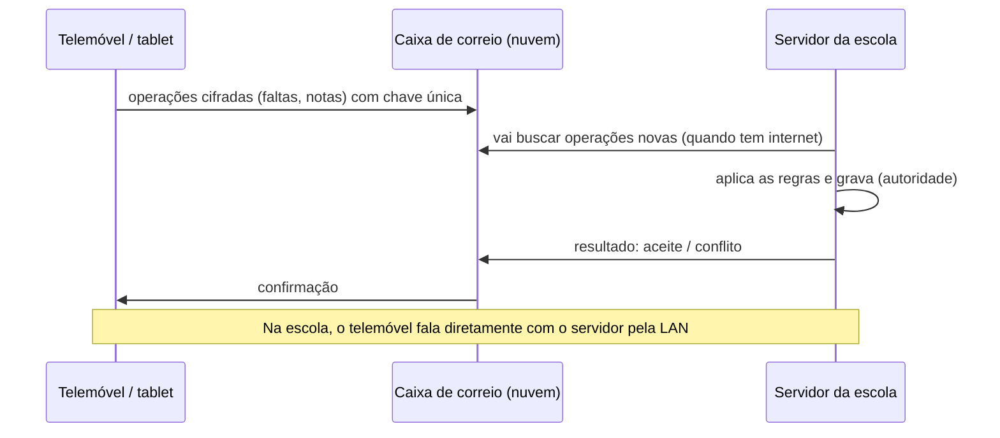
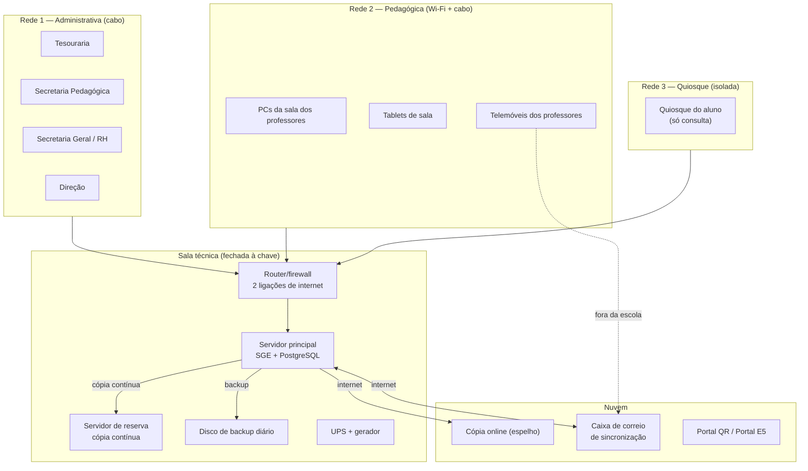

# 13.1 — Topologia da Escola e Canais de Acesso

> [!abstract] Em resumo
> Esta nota parte da **ideia do analista** (2026-11-10):
> - um computador principal com o sistema;
> - a rede desse computador usada por todas as áreas;
> - um PC onde os alunos consultam as notas;
> - um PC para os professores;
> - uma base de dados online sempre atualizada;
> - uma aplicação em tablets e telefones para lançar faltas online ou localmente.
>
> A nota cruza-a com o que já está decidido na v2.0 ([[13 - Arquitetura Tecnica|ARQ-13]], [[09 - Integracoes, Infraestrutura e Operacao|OPS-09]], `DEC-003`, `DEC-006`, `RN-16.15`) e propõe a versão melhorada.
>
> **Conclusão:** a ideia está certa no essencial e cabe no que já foi planeado. Precisa de **4 melhorias** para ser fiável e segura numa escola com cortes de internet e de energia:
> 1. **um servidor de reserva**;
> 2. **três redes separadas**;
> 3. **a base online como espelho**, e não como base principal;
> 4. **uma "caixa de correio" na nuvem** para os telemóveis sincronizarem fora da escola.
>
> Traz ainda **2 canais novos**, o quiosque do aluno e o tablet de sala. **Decidido na `DEC-028`** (2026-11-10), que é o primeiro pedido de alteração à v2.0.

---

## 1. A ideia, comparada com o que já está decidido

| # | Ideia | O que a v2.0 já diz | Proposta |
| :---: | :--- | :--- | :--- |
| 1 | **Um computador principal** com o sistema | Servidor local na sala técnica, com discos em espelho e UPS (`DEC-006`, OPS-09 §4) | ✅ Mantém-se, com uma melhoria: um **segundo computador de reserva** que recebe a cópia contínua e assume em minutos se o principal avariar. Hoje isto é só uma "variante" no OPS-09 |
| 2 | **Todas as áreas usam a rede** desse computador | LAN com cabo nos balcões e Wi-Fi para os professores | ✅ Mantém-se, com uma melhoria: **3 redes separadas** (§3). O quiosque dos alunos nunca deve estar na mesma rede da Tesouraria |
| 3 | **PC para os alunos** consultarem as notas | Os alunos só têm acesso na **E5**, pelo portal (`DEC-003`) | 🆕 **Quiosque do aluno** (§4.6). Precisa de pedido de alteração e de regras de proteção de dados |
| 4 | **PC para os professores** acederem ao perfil e lançarem notas | Os professores usam a PWA no telemóvel; a sala dos professores tem Wi-Fi | 🆕 **Posto da sala dos professores** (§4.3): mesma aplicação, mas num PC partilhado, que **não guarda dados offline** (`RN-16.15`) |
| 5 | **Base de dados online sempre atualizada** | Réplica contínua na nuvem; o servidor local é a autoridade (`RN-10`, ARQ-13 `ADR-T10`) | ✅ Mantém-se, com um esclarecimento: a base online é um **espelho** atualizado em segundos, e **não a base principal** (§2). Se fosse a principal, os balcões paravam sempre que a internet caísse (RNF-DIS-02) |
| 6 | **Aplicação em tablets ou telefones** para faltas, **online ou localmente** | PWA offline no telemóvel do professor, com fila de 7 dias (`ADR-T04`/`T05`) | ✅ Mantém-se, e acrescentam-se duas coisas: o **tablet de sala** (§4.5), dispositivo da escola, e a **caixa de correio na nuvem** (§2.2), para o telemóvel sincronizar também fora da escola |

---

## 2. A base de dados "online": espelho, não principal

### 2.1 Porque é que o servidor da escola tem de mandar

No Panguila, a internet e a energia falham. Se a base principal estivesse na nuvem, cada falha de internet parava:
- a matrícula;
- o caixa;
- as declarações;
- a pauta.

Com o servidor na escola a mandar, **tudo continua a funcionar na rede local**. A nuvem recebe as alterações **em segundos** quando há internet; quando a internet volta, apanha o atraso sozinha.

| Situação | Balcões e sala dos professores | Telemóveis e tablets | Cópia online |
| :--- | :--- | :--- | :--- |
| Normal | Trabalham na LAN | Sincronizam na escola (Wi-Fi) ou fora (caixa de correio) | Atualizada em segundos |
| Internet em baixo | **Continuam** (LAN) | Na escola continuam; fora guardam na fila (até 7 dias) | Fica para trás e recupera depois |
| Servidor principal avaria | O **servidor de reserva** assume (meta < 4 h; com reserva quente, minutos) | Continuam offline e sincronizam com o servidor que estiver ativo | Continua a ser cópia de segurança |
| Corte de energia | A UPS aguenta ≥ 30 min ou até o gerador assumir (RNF-DIS-03) | Não são afetados (bateria) | — |

### 2.2 Caixa de correio na nuvem (sincronizar fora da escola)

O professor lança as faltas em casa ou na rua, e o telemóvel envia as operações para uma **caixa de correio na nuvem**. A caixa **só guarda, cifradas, as operações em espera**; **não decide nada**. O servidor da escola vai buscá-las, aplica as regras (trimestre aberto, turma do professor…) e deixa a resposta na caixa. O telemóvel recebe a confirmação ou o conflito.

Assim, "online ou localmente" funciona **sem duas bases a mandar ao mesmo tempo**: o servidor da escola continua a ser a única autoridade (`RN-10`). A caixa usa o mesmo formato de operações da fila (`ADR-T04`).

---

## 3. Topologia física: três redes separadas

**Regras da rede:**
- **Rede 1 (Administrativa):** com cabo, sem Wi-Fi nos balcões (OPS-09). Chega a todas as funções do SGE, segundo o cargo de cada um.
- **Rede 2 (Pedagógica):** Wi-Fi com palavra-passe da escola. Só chega à API do SGE e à internet. Os telemóveis pessoais entram aqui.
- **Rede 3 (Quiosque):** só chega a **um** endereço, o da consulta do aluno. Não tem internet nem acesso às outras redes. Um aluno que mexa no quiosque não consegue chegar à Tesouraria.

---

## 4. Canais de acesso

| # | Canal | Quem | Onde | O que faz | Entrega |
| :---: | :--- | :--- | :--- | :--- | :---: |
| 4.1 | **Balcões** | Secretarias, Tesouraria | Rede 1 | Matrícula, caixa, documentos, RH | E1 |
| 4.2 | **Direção** | `DIR_GERAL`, `SUB_PED`, `SUB_ADM` | Rede 1 (e fora, com MFA) | Homologações, painéis, alertas | E1–E3 |
| 4.3 | **Sala dos professores** 🆕 | Professores, DT, coordenadores | Rede 2, PC partilhado | Perfil, notas, sumários, horário. **Sessão pessoal curta, sem dados guardados no PC** | E2 |
| 4.4 | **Telemóvel do professor** | Professores | Rede 2 ou fora (caixa de correio) | Notas, faltas e sumários **offline até 7 dias** | E2 |
| 4.5 | **Tablet de sala** 🆕 | O professor da aula | Rede 2, um por sala | **Chamada rápida** e sumário. É dispositivo da escola: entra com o PIN do professor e não guarda dados de outras turmas | E2 |
| 4.6 | **Quiosque do aluno** 🆕 | Alunos | Rede 3 | Notas **homologadas**, faltas, horário e avisos **do próprio aluno** | **E3** (`DEC-028`) |
| 4.7 | **Portal online** | Encarregados e alunos | Internet | O mesmo que o quiosque, mais as prestações do educando | E5 (`DEC-003`) |
| 4.8 | **Portal QR público** | Qualquer pessoa | Internet | Verificar a autenticidade de um documento | E2 |

### 4.6 Quiosque do aluno — regras propostas

- **Entrada:** o aluno passa o **cartão de estudante com QR** (`DOF-13`, C03) e escreve um **PIN pessoal**. Sem cartão, não entra. É o mesmo princípio do portal: a conta do aluno (C14 §11).
- **O que mostra:**
  - só as **notas homologadas** (nunca as provisórias);
  - as faltas;
  - o horário;
  - os avisos.
- **O que não mostra:** dados de saúde, processos disciplinares e valores em dívida. Para a dívida, aparece só "dirija-se à Tesouraria" (`RN-08`, APD-11).
- **Proteção:**
  - o ecrã fecha sozinho após **60 s** sem uso;
  - o quiosque não imprime;
  - tem filtro de privacidade no ecrã;
  - cada consulta fica registada (APD).
- **Aluno menor:** a consulta das próprias notas pelo aluno está coberta pelo aviso de privacidade da matrícula (APD-11 §4). A confirmar na revisão da APD-11.

### 4.5 Tablet de sala — regras propostas

- **Dispositivo:** é da escola e está registado como dispositivo autorizado (`RN-16.15`), com o tipo `PARTILHADO_SALA`.
- **Entrada:** o professor entra com o **seu PIN**, e o tablet mostra só a aula que lhe corresponde no horário publicado (C04).
- **No fim da aula:** sincroniza e **apaga** os dados locais. Não acumula dados de várias turmas.
- **Vantagem:** a chamada demora segundos e não depende do telemóvel nem dos dados móveis do professor.

---

## 5. Outras melhorias que ajudam de facto a escola

Todas já estão planeadas; aqui ficam só as ligações a esta topologia:
- **Avisos aos encarregados quando o aluno falta** (C12, E3 — `DEC-015`): a falta lançada no tablet gera o aviso automático.
- **Alerta precoce** de alunos em risco por faltas ou notas (C15, E3), visível para o DT e para a Direção.
- **Painel da Direção** em tempo real na rede administrativa (C15).
- **Documentos com QR verificável** (`RN-10.3`).
- **Escola que funciona sem internet:** é o teste de aceitação principal (RNF-DIS-02).

---

## 6. O que isto muda na v2.0

A v2.0 está congelada. Os canais novos entram por **pedido de alteração** no [[12 - Registo de Decisoes e Questoes em Aberto|REG-12]]:

| Mudança | Onde | Tipo |
| :--- | :--- | :--- |
| Quiosque do aluno | `DEC-003` (alunos só na E5), C12/C14 §11, DOC-04 (novo módulo), APD-11 | Âmbito e proteção de dados |
| Tablet de sala | `RN-16.15` (tipo de dispositivo partilhado), DOC-05 `dispositivos_autorizados`, C04 | Regra e dados |
| Posto da sala dos professores | `RN-16.13` (tipo de sessão), DOC-04 | Regra (pequena) |
| Caixa de correio na nuvem | ARQ-13 `ADR-T04`/`T10`, OPS-09, APD-11 (dados cifrados fora da escola — `DEC-006`) | Técnica e proteção de dados |
| Servidor de reserva quente | OPS-09 §4.2 (passa de variante a escolha), orçamento (`DEC-017`) | Infraestrutura |
| Três redes separadas | OPS-09 §4 | Infraestrutura |

## 7. Histórico

| Versão | Data | Alteração |
| :---: | :---: | :--- |
| 1.0 | 2026-11-10 | Decidido na `DEC-028`: quiosque na E3; telemóvel e tablet de sala; caixa de correio na nuvem; servidor de reserva pronto; 3 redes |
| 0.1 | 2026-11-10 | Proposta a partir da ideia do analista, cruzada com a v2.0 |
