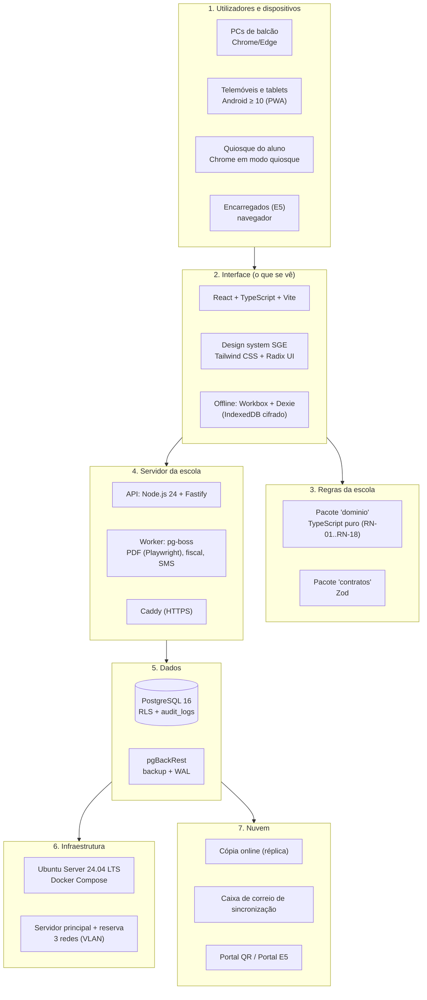

# 13.2 — Catálogo de Tecnologias do SGE

> [!abstract] Para que serve
> É a **lista única e completa** de todas as tecnologias do SGE, organizada pelas **camadas do desenho do sistema**: do equipamento na escola até às ferramentas de quem programa. Cada linha diz **o que é**, **para que serve no SGE** e **porquê**, com ligação à especificação v2.0, à [[13 - Arquitetura Tecnica|ARQ-13]] e à [[13.1 - Topologia e Canais de Acesso|ARQ-13.1]].
>
> **Estado:**
> - ✅ **decidido**: vem da `DEC-027`, da `DEC-028` ou de um `ADR-T` já aceite;
> - 🔵 **proposto aqui**: falta a aceitação do analista;
> - 🟡 **depende da escola**: inventário, fornecedor ou orçamento.
>
> **Regra geral das escolhas:**
> - tecnologias **gratuitas**, **muito usadas** e **bem conhecidas pelos agentes de IA** (`DEC-027`);
> - **o menor número possível de peças**, porque cada peça a mais é mais uma coisa a manter numa escola com pouco apoio técnico.

---

## 0. Desenho do sistema em camadas

---

## 1. Dispositivos e equipamento (camada física)

| Peça | Tecnologia | Para que serve no SGE | Porquê | Estado |
| :--- | :--- | :--- | :--- | :---: |
| Servidor principal | Computador de classe servidor (x86-64), **2 SSD em espelho (RAID 1)**, ≥ 16 GB RAM | Corre o SGE e a base de dados | `DEC-006`; OPS-09 §4.2 | ✅ / 🟡 modelo |
| Servidor de reserva | Igual ao principal, a receber cópia contínua | Assume em minutos se o principal avariar | `DEC-028`; RNF-BKP-02/03 | ✅ / 🟡 orçamento |
| Energia | **UPS** online (≥ 30 min) com encerramento automático; gerador | O sistema não cai nem corrompe dados nos cortes | RNF-DIS-03 | ✅ / 🟡 inventário |
| Router/firewall | **OPNsense** (gratuito) num pequeno equipamento dedicado, com **2 ligações de internet** | Segurança, as 3 redes (VLAN), DNS local, VPN de manutenção | `DEC-028`; RNF-DIS-06 | 🔵 |
| Switch | Switch **gerível com VLAN** | Separa as redes administrativa, pedagógica e quiosque | `DEC-028` | ✅ |
| Wi-Fi | Pontos de acesso com **WPA2/WPA3** e SSID por rede | Professores e tablets na rede pedagógica | OPS-09; medição M7 | ✅ / 🟡 quantidade |
| PCs de balcão | Windows ou Linux + **Chrome/Edge** atualizados, 1366 × 768 | Secretarias, Tesouraria, Direção | RNF-DSP-01 | ✅ |
| Telemóveis e tablets | **Android ≥ 10, ≥ 2 GB RAM**, Chrome | Faltas, notas, sumários offline | RNF-DSP-02; `DEC-028` | ✅ |
| Quiosque do aluno | PC com ecrã tátil opcional, **Chrome em modo quiosque** (`--kiosk`), conta Windows/Linux restrita | Consulta das notas pelo aluno | `DEC-028` | 🔵 |
| Leitor de QR no quiosque | Câmara do PC ou leitor USB de códigos | Entrada com o cartão de estudante (`DOF-13`) | `DEC-028` | 🔵 |
| Impressoras | **Laser A4 em rede** (+ 1 de reserva) | Recibos, declarações, pautas | RNF-IMP | ✅ |

## 2. Sistema operativo e contentores (no servidor)

| Peça | Tecnologia | Para que serve | Porquê | Estado |
| :--- | :--- | :--- | :--- | :---: |
| Sistema operativo | **Ubuntu Server 24.04 LTS** | Base do servidor principal e do de reserva | Suporte longo (5 anos), gratuito, o mais documentado | ✅ (`ADR-T10`) |
| Contentores | **Docker Engine + Docker Compose** | Instala e atualiza o SGE sempre da mesma forma | Repor o serviço em < 4 h (RNF-BKP-03) | ✅ (`ADR-T10`) |
| Proxy e HTTPS | **Caddy** | Recebe os pedidos, serve a aplicação e trata os certificados TLS | Configuração muito simples; HTTPS automático (RNF-SEG-06) | 🔵 |
| Certificados | Domínio da escola + **Let's Encrypt** (desafio DNS) | Cadeado válido nos telemóveis, também dentro da LAN | OPS-09 §4.2 | 🔵 / 🟡 domínio |
| Hora | **chrony** (NTP) | Hora certa para a auditoria e os documentos | RNF-AUD-05 | 🔵 |
| Monitorização | **Uptime Kuma** (gratuito) | Avisa o `ADMIN_TEC` se o SGE, a base ou a réplica param | RNF-DIS-01; `ADR-T12` | 🔵 |

## 3. Dados

| Peça | Tecnologia | Para que serve | Porquê | Estado |
| :--- | :--- | :--- | :--- | :---: |
| Base de dados | **PostgreSQL 16** | As 121 tabelas do DOC-05 | Robusto, gratuito, com segurança por linha | ✅ (`ADR-T03`) |
| Segurança por linha | **RLS** do PostgreSQL | Cada cargo só vê o que o DOC-01 permite | `DEC-012`; DOC-05 §5 | ✅ |
| Acesso a dados no código | **Kysely** (SQL com tipos) | Consultas seguras sem esconder o SQL | `ADR-T03` | ✅ |
| Migrações | **SQL versionado** + **dbmate** | Criar e alterar as tabelas de forma controlada | Simples, sem ORM | 🔵 (dbmate) |
| Filas de tarefas | **pg-boss** (fila dentro do PostgreSQL) | PDF, fila fiscal, SMS, conservação | **Sem servidor extra** (sem Redis): uma peça a menos | 🔵 |
| Cópia contínua | **Replicação física (streaming)** | Servidor de reserva e cópia online em segundos | `DEC-028`; RNF-BKP-02 | ✅ |
| Backup | **pgBackRest** com arquivo WAL, cifrado | Backup diário + recuperação ao minuto | RNF-BKP-01 a 08 | ✅ (`ADR-T10`) |
| Dinheiro | Valores em **kwanzas inteiros (cêntimos em `bigint`)** | Nunca há erros de arredondamento nos montantes | `RN-09`; `RN-13` | 🔵 |

## 4. Servidor (backend)

| Peça | Tecnologia | Para que serve | Porquê | Estado |
| :--- | :--- | :--- | :--- | :---: |
| Linguagem | **TypeScript 5** | Todo o código | `DEC-027` | ✅ |
| Execução | **Node.js 24 LTS** | Corre a API e o worker | Versão de suporte longo instalada | ✅ |
| API | **Fastify 5** | Endpoints por contexto (DOC-01 §0) e receção da fila offline | Rápido, com validação integrada | ✅ |
| Validação | **Zod** (pacote `contratos`) | Mesmas regras de formato no telemóvel e no servidor | `ADR-T04` | ✅ |
| Palavras-passe | **Argon2id** | Guardar palavras-passe com segurança | `RN-16.11`; `ADR-T06` | ✅ |
| Dois fatores | **TOTP** (biblioteca `otplib`) | MFA sem internet | `RN-16.12`; `ADR-T06` | ✅ |
| Sessões | Cookies `HttpOnly` + tabela `sessoes_utilizador` | Sessões de balcão curtas, pessoais e de quiosque | `RN-16.13` | ✅ |
| PDF | **Playwright (Chromium)** | DOF-01 a DOF-26 em A4 | `ADR-T07`; RNF-DES-01/02 | ✅ |
| QR | **qrcode** + **HMAC-SHA256** (`node:crypto`) | QR verificável dos documentos | `RN-10.3` | ✅ |
| Registos técnicos | **pino** | Logs sem dados pessoais | `ADR-T12`; `PC-27` | ✅ |
| Datas | **date-fns** + `Africa/Luanda` | Calendário escolar, prazos | `ADR-T14` | 🔵 |

## 5. Regras da escola (domínio)

| Peça | Tecnologia | Para que serve | Porquê | Estado |
| :--- | :--- | :--- | :--- | :---: |
| Pacote `dominio` | **TypeScript puro**, sem dependências | Médias, transições, semáforo, faltas, máquinas de estado | Corre igual offline e no servidor (`ADR-T01`) | ✅ |
| Parâmetros | Lidos de `parametros_*` | Fórmulas, pesos e limiares configuráveis | `DEC-009`; `ADR-T13` | ✅ |

## 6. Interface (frontend) e offline

| Peça | Tecnologia | Para que serve | Porquê | Estado |
| :--- | :--- | :--- | :--- | :---: |
| Biblioteca de ecrãs | **React 18** | Todos os ecrãs: balcões, professores, quiosque, portal | `DEC-027`; `ADR-T01` | ✅ |
| Construção | **Vite** | Compilar a aplicação | Rápido e simples | ✅ |
| App instalável | **PWA** com **vite-plugin-pwa (Workbox)** | Instala no telemóvel; funciona sem rede | RNF-DSP-02; `ADR-T05` | ✅ |
| Base local | **Dexie** (IndexedDB) | Fila de operações e dados da turma no telemóvel | `ADR-T04`/`T05`; RNF-OFF | ✅ |
| Cifra local | **Web Crypto (AES-GCM)** + PIN | Dados no telemóvel protegidos | `RN-16.15`; RNF-PRV-08 | ✅ |
| Navegação | **TanStack Router** | Rotas dos workspaces (DOC-04) com tipos | Rotas seguras e organizadas | 🔵 |
| Dados do servidor | **TanStack Query** | Carregar, guardar em cache e atualizar dados | Funciona bem com offline | 🔵 |
| Formulários | **React Hook Form** + Zod | Matrícula, recibos, lançamentos | Rápido com o teclado (RNF-USA-07) | 🔵 |
| Gráficos | **Apache ECharts** | Painéis da Direção (C15) | Muitos tipos de gráfico, bom em ecrãs pequenos | 🔵 |

## 7. Design system (a cara do SGE)

| Peça | Tecnologia | Para que serve | Porquê | Estado |
| :--- | :--- | :--- | :--- | :---: |
| Estilos | **Tailwind CSS** com **tokens** (cores, tipos, espaços) | Aparência igual em todos os ecrãs | Um só sítio para mudar cores e tamanhos | 🔵 |
| Componentes acessíveis | **Radix UI** (via **shadcn/ui**) | Botões, menus, diálogos, tabelas acessíveis com teclado | RNF-USA-06/07 (WCAG 2.1 AA, teclado) | 🔵 |
| Ícones | **Lucide** | Ícones simples e consistentes | Gratuito, leve | 🔵 |
| Tipografia | **Inter** (ou a fonte do sistema), mínimo **16 px** no telemóvel | Legibilidade | RNF-USA-06 | 🔵 |
| Impressão | CSS de impressão A4 + modelos `modelos_documento` | Documentos oficiais iguais aos reais | DOC-04 Parte 2 | ✅ |
| Desenho dos ecrãs | **Figma** (o FigJam já é usado) | Protótipos dos ecrãs antes de programar | [[Quadros de Arquitetura no Figma]] | 🔵 |
| Regras do design | Contraste ≥ 4,5:1; texto ≥ 16 px; alvos de toque ≥ 44 px; confirmação nas ações irreversíveis; mensagens simples; termos do glossário | Base obrigatória do design system | RNF-USA-01 a 08 | ✅ (requisitos) |

> [!note] O design system ainda não existe como documento
> Estas tecnologias são as **ferramentas**. O **design system** propriamente dito tem de ser criado como passo próprio: identidade (cores do IPCAG, emblema), componentes, padrões de ecrã por workspace e o modo quiosque.

## 8. Integrações externas

| Peça | Tecnologia | Para que serve | Porquê | Estado |
| :--- | :--- | :--- | :--- | :---: |
| Faturação AGT | **Adaptador** (porta `EmissorFiscal`) → software certificado (API HTTP ou ficheiro) | FT, FR, RC, NC, RE | `DEC-002`; `ADR-T08` | ✅ / 🟡 fornecedor (`Q-002`) |
| SMS | **Adaptador** (porta `CanalSms`) → operador angolano (API HTTP) | Avisos e convocatórias | `DEC-015`; `ADR-T09` | ✅ / 🟡 fornecedor |
| Email | SMTP (opcional) | Recuperação de acesso e relatórios | `RN-16.16` (opcional) | 🔵 |
| Plataforma Nacional de Certificação | **Exportação** (CSV/PDF) para registo manual | Registo dos títulos em 30 dias | #26; #40 | ✅ |
| Importação de dados antigos | Ficheiros modelo **CSV/XLSX** (`MIG-Fnn`), lidos com **SheetJS** | Migração (C17) | `DEC-010`; MIG-10 | 🔵 (SheetJS) |

## 9. Nuvem

| Peça | Tecnologia | Para que serve | Porquê | Estado |
| :--- | :--- | :--- | :--- | :---: |
| Servidor na nuvem | **1 máquina virtual Ubuntu 24.04** (a mesma receita Docker) | Cópia online, caixa de correio e portal | Igual ao servidor da escola: menos a aprender | 🔵 / 🟡 fornecedor e país (`DEC-006`, APD) |
| Cópia online | **PostgreSQL 16** em réplica | Espelho atualizado em segundos | `DEC-028` | ✅ |
| Caixa de correio | **Serviço Fastify pequeno** + PostgreSQL | Guarda as operações cifradas dos telemóveis fora da escola | `DEC-028`; ARQ-13.1 §2.2 | ✅ |
| Ligação escola ↔ nuvem | **WireGuard** (VPN) | Túnel cifrado para a replicação e a caixa | Simples e muito seguro | 🔵 |
| Backups fora do edifício | **pgBackRest** para armazenamento de objetos (S3 compatível) | Cópia cifrada fora da escola | RNF-BKP-04 | 🔵 / 🟡 fornecedor |

## 10. Qualidade e testes

| Peça | Tecnologia | Para que serve | Porquê | Estado |
| :--- | :--- | :--- | :--- | :---: |
| Testes unitários | **Vitest** | Regras da escola (cada RN com teste) | `ADR-T11` | ✅ |
| Testes com base de dados | **Testcontainers** (PostgreSQL real) | RLS por cargo, travas do DOC-05 §4 | `ADR-T11` | ✅ |
| Testes de aceitação | **Playwright** | Cenários BDD das US | `ADR-T11` | ✅ |
| Testes de carga | **k6** | 1.500 alunos, 75 sessões, 3 s no recibo | RNF-CAP, RNF-DES | 🔵 |
| Acessibilidade | **axe-core** (com Playwright) | Verificar contraste e teclado automaticamente | RNF-USA-06/07 | 🔵 |
| Estilo do código | **ESLint + Prettier** | Código uniforme | Padrão do mercado | 🔵 |

## 11. Desenvolvimento e entrega (DevOps)

| Peça | Tecnologia | Para que serve | Porquê | Estado |
| :--- | :--- | :--- | :--- | :---: |
| Repositório do código | **GitHub privado** `sge-ipcag-12008-sistema` | Guardar e rever o código | `DEC-027` | ✅ |
| Repositório da documentação | **GitHub público** `sge-ipcag-12008` + **Obsidian** | Especificação e decisões | Fase 1 | ✅ |
| Gestor de pacotes | **pnpm** (workspaces) | Monorepo | ARQ-13 §3 | ✅ |
| Integração contínua | **GitHub Actions** | Testes a cada alteração | `ADR-T11` | ✅ |
| Imagens Docker | **GitHub Container Registry** (privado) | Versões prontas a instalar na escola | `ADR-T10` | 🔵 |
| Atualização de dependências | **Dependabot** | Avisos de segurança | RNF-SEG | 🔵 |
| Editor | **Cursor** ou **VS Code** | Escrever e rever código | Já instalados | ✅ |
| Agentes de IA | **Claude Code** (e outros) | Programar com testes, sob revisão | `DEC-027` | ✅ |
| Tarefas | **GitHub Issues** | Tickets por entrega | AGENTS.md | ✅ |

---

## 12. O que fica de fora, e porquê

| Tecnologia | Porque não |
| :--- | :--- |
| Base de dados só na nuvem (Firebase, Supabase como principal) | Os balcões parariam sem internet (`RN-10`, RNF-DIS-02) |
| App nativa Android (Kotlin, Flutter) | A PWA chega para o offline e evita a loja de aplicações e uma segunda linguagem |
| Redis, Kafka, microserviços | Peças a mais para uma escola com 1.500 alunos; o PostgreSQL faz as filas |
| ORM pesado (Prisma, TypeORM) | Esconderia o SQL de que a RLS e as travas fiscais precisam (`ADR-T03`) |
| Bibliotecas de sincronização de terceiros | `DEC-027`: fila própria com o servidor como autoridade |
| Fornecedores de identidade na nuvem (Auth0, Google) | A entrada tem de funcionar sem internet (`ADR-T06`) |
| **Next.js** (renderização no servidor) | O professor tem de trabalhar 7 dias sem chegar ao servidor. Uma app React + Vite guardada no telemóvel faz isso de forma natural; a renderização no servidor complica o offline |
| **NestJS** | Compatível e avaliado a 2026-11-10. O analista preferiu **manter o Fastify**, que é mais simples e direto. Os módulos por contexto (DOC-01 §0) fazem-se com plugins do Fastify |
| **JWT** (tokens sem estado) | Não se consegue cancelar na hora, e a `RN-16` exige terminar sessões e suspender contas de imediato. Usam-se sessões no servidor, com cookie `HttpOnly` |
| **Cloudflare R2 / armazenamento na nuvem para documentos** | Atestados, BI e fotos de menores fora de Angola exigem autorização da APD (#36, #37). Os ficheiros ficam no servidor da escola; na nuvem só ficam os backups cifrados |
| **WebSockets / Socket.io** | Não está na especificação e não funciona offline. A caixa de alertas (C15) chega. Se for preciso mais tarde, usa-se SSE |

## 13. Histórico

| Versão | Data | Alteração |
| :---: | :---: | :--- |
| 0.2 | 2026-11-10 | Comparação com um stack alternativo (Next.js, NestJS, Prisma, Redis/BullMQ, JWT, Cloudflare R2, WebSockets): o analista decidiu **manter o Fastify**; razões na §12 |
| 0.1 | 2026-11-10 | Catálogo inicial: todas as camadas, ligadas à v2.0, à ARQ-13 e à ARQ-13.1 |
