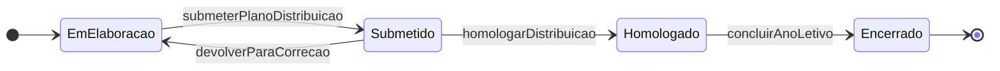
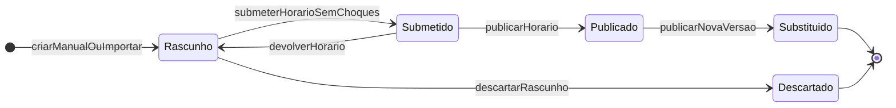
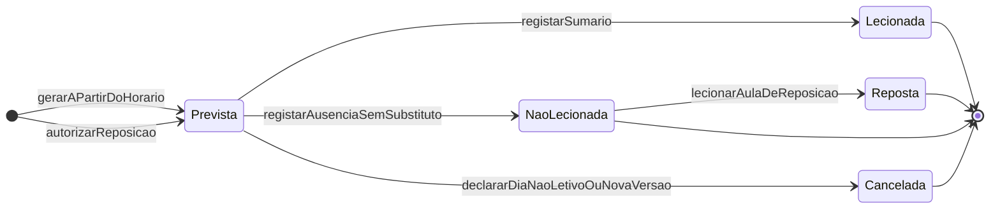
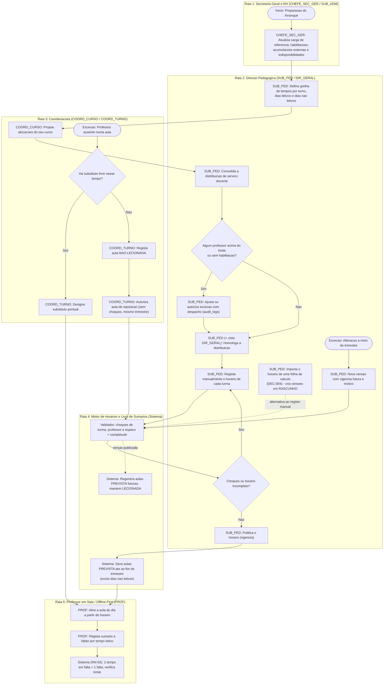

# C04 — Horários e Distribuição de Serviço Docente

> [!abstract] Navegação
> - **Painel Principal:** [[Inicio|Início do Vault]] | **Índice do Projeto:** [[00 - MOC SGE IPCAG 12008 BGO|MOC]] | **Plano:** [[00.1 - Plano de Engenharia de Requisitos]] (§2.1 — `C04`, lacuna `L6`)
> - **Especificação base (v1.2):** [[01 - Dominio e Regras]] → [[02 - Fluxos de Trabalho]] → [[03 - User Stories]] → [[04 - Telas e Documentos]] → [[05 - Modelagem de Dados]]
> - **Capacidades novas relacionadas:** [[C16 - Passagem de Ano Letivo]] | [[C03 - Processo Individual do Aluno]]
> - **Decisões e questões:** [[12 - Registo de Decisoes e Questoes em Aberto]] (`DEC-004` — Horários, **decidida**; `Q-011`, `Q-012`) | **Visão e âmbito:** [[06 - Visao e Ambito]] (`O-02`, `F-06`)
> - **Dados reais da escola:** [[Achados dos Documentos Reais - Lote 1]] (`DESC-L1` — A5, A6, A8, A9) | **Requisitos não funcionais:** [[08 - Requisitos Nao Funcionais]]

> [!warning] Estado deste documento
> Rascunho `0.2` para integração posterior. **Não altera** DOC-01 a DOC-05. Todas as regras (`RN-P-C04-nn`), user stories (`US-HOR-nn`), módulos (`MOD-HOR-nn`), documentos (`DOF-P-C04-nn`) e questões (`Q-C04-nn`) têm **identificadores provisórios**, a renumerar na integração. A lista de alterações a fazer em cada DOC está no §13.

> [!important] Decisão `DEC-004` — decidida (homologação da Direção pendente)
> O [[12 - Registo de Decisoes e Questoes em Aberto|REG-12]] fixou a opção **(b): o SGE regista o horário semanal feito à mão, introduzido diretamente ou importado de uma folha de cálculo, com deteção de choques de professor, sala e turma**. A **geração automática de horários fica fora do âmbito** (`DEC-008`; `F-06` da [[06 - Visao e Ambito|VIS-06]]). Por isso, a "proposta automática" da versão `0.1` desta nota foi substituída pela **importação do horário** (`RN-P-C04-18`, `US-HOR-11`).

> [!example] O que os documentos reais da escola mudam nesta capacidade (`DESC-L1`)
> - **A5 — Carga semanal real:** os quatro planos curriculares recebidos (Contabilidade e Gestão, Gestão de Recursos Humanos, Gestão Empresarial, Estatística e Planeamento) têm **32 "Horas Curriculares Semanais" na 10ª, 11ª e 12ª Classes** e **28 na 13ª** (Projecto Tecnológico 8 h + Estágio Curricular Supervisionado 20 h), confirmado nas fotografias dos quatro planos. Se cada "hora curricular" for um tempo letivo, **32 tempos de 45 min não cabem em 5 dias nas janelas de turno do DOC-01** (`RN-P-C04-01.4`, `Q-C04-18`).
> - **A9 — "Período":** a escola chama "Período" (Manhã/Tarde) ao que a especificação chama "Turno". Esta nota mantém **Turno** como termo do sistema (glossário do DOC-01) e usa **"Período"** como rótulo nos documentos impressos, à espera da `Q-033` do REG-12. "Cadeira" é sinónimo de "Disciplina" nos impressos.
> - **A6 — 13ª Classe:** a 13ª tem a disciplina **Projecto Tecnológico** (8 h/semana), que começa na 12ª (2 h), além do Estágio (20 h, fora da escola). O Projecto Tecnológico pode precisar de horário (`Q-C04-14`).
> - **A8 — Faltas:** o boletim real distingue "faltas por não comparência" e "faltas por indisciplina" (`RN-P-C04-13.3`).
> - **A1 — Fórmulas de avaliação por confirmar:** esta capacidade não calcula notas. Só a referência ao limite de faltas do `RN-03` depende de regras pedagógicas por validar, e os exemplos com esse limite ficam marcados **"a validar"**.

---

## 1. Objetivo e Âmbito

### 1.1 Objetivo
Dar ao SGE a base temporal que hoje falta: **quem ensina o quê, a que turma, em que dia, em que tempo letivo e em que espaço**. Sem horário semanal, o registo de sumários e de faltas por tempo letivo (`RN-03`, `US-PED-02`) não tem âncora, e a frase do DOC-01 §2.1 sobre o `PROF` — acesso às turmas "que lhe estão atribuídas no horário letivo atual" — não tem objeto no modelo de dados.

**Problema que resolve (plano §2.1):** existe `alocacoes_docentes`, mas não há horário semanal; o professor pode registar faltas em qualquer data sem verificação, e o modelo atual guarda o sumário dentro de cada falta de aluno (ver §8.3, nota sobre `sumarios_e_faltas_alunos`).

**Objetivo da [[06 - Visao e Ambito|VIS-06]]:** **`O-02` — Rotina pedagógica feita no SGE, sem registo paralelo** (100% das mini-pautas e dos sumários e faltas do I Trimestre de 2027/2028 registados no SGE). A VIS-06 §5.2 classifica a `C04` como **dentro do âmbito**, na entrega **E2**.

### 1.2 Dentro do âmbito
1. **Distribuição de serviço docente:** carga letiva semanal por professor, limites, reduções por cargo, acumulações, habilitações e ligação a `alocacoes_docentes` (`RN-04`).
2. **Grelha semanal** por turma, por professor e por espaço (sala ou laboratório), dentro dos tempos letivos de cada turno (**Manhã 07h30–12h35**, **Tarde 13h00–18h05** — DOC-01 §1.1), com **deteção de choques** de professor, de espaço e de turma.
3. **Ligação ao registo de sumários e de faltas por tempo letivo** (`RN-03`), incluindo o funcionamento *Offline-First* (`RN-10`).
4. **Substituições** pontuais e prolongadas, **aulas não lecionadas**, **aulas de reposição** e **alterações do horário a meio do trimestre**, com versões e vigência.
5. **Calendário de dias não letivos** (feriados, pausas, atividades), necessário para calcular as aulas previstas.
6. **Importação do horário** elaborado fora do SGE (folha de cálculo), com a mesma validação de choques (`DEC-004`).

### 1.3 Fora do âmbito
- Processamento salarial e efeitos remuneratórios da carga letiva ou das faltas do professor (capacidade `C11`, decisão `D8`).
- **Geração automática de horários** (`DEC-004`, `DEC-008`; `F-06` da VIS-06).
- Estágio Curricular Supervisionado da 13ª Classe (20 h/semana, fora da escola — DESC-L1 A6). O **Projecto Tecnológico** (2 h na 12ª, 8 h na 13ª) entra no horário se tiver sessões presenciais na escola (`Q-C04-14`, ligada à `Q-030` do REG-12).
- Reserva de espaços para eventos (auditório, reuniões) não ligados a aulas.
- Comunicação de alterações do horário aos encarregados (capacidade `C12`).

### 1.4 Rastreabilidade
| Elemento | Ligação |
| :--- | :--- |
| Capacidade | `C04` (plano §2.1), lacuna `L6` |
| Entrega proposta | **E2 — I Trimestre** (plano §6): "Professores começam a dar faltas e notas no primeiro dia" |
| Regras existentes usadas | `RN-03` (faltas por tempo letivo), `RN-04` (desacoplamento professor ↔ notas e substituição), `RN-05` (lista ordenada por `N.º de Ordem`), `RN-10` (auditoria e *Offline-First*) |
| Fluxos existentes tocados | Fluxo 03 (rotina pedagógica, substituição docente) |
| User stories existentes tocadas | `US-GOV-03`, `US-PED-02`, `US-PED-05` |
| Módulos existentes tocados | `MOD-GOV-03`, `MOD-DOC-FAL`, `MOD-DOC-PAU`, `MOD-GER-RH` |
| Tabelas existentes tocadas | `alocacoes_docentes`, `funcionarios_docentes`, `salas_fisicas`, `matriz_disciplinas`, `sumarios_e_faltas_alunos`, `anos_letivos`, `operacoes_sincronizacao`, `conflitos_sincronizacao` |
| Decisão | `DEC-004` (D4 do plano §7) — `decidida`: registo à mão e importação, com deteção de choques; geração automática fora (`DEC-008`) |
| Objetivo | `O-02` (VIS-06 §3) |
| Questões do REG-12 | `Q-011` (quem elabora e aprova o horário), `Q-012` (duração e n.º de tempos), `Q-028` (estrutura de direção real), `Q-030` (Projecto Tecnológico), `Q-032` (tipos de falta), `Q-033` (Período / Turno) |
| Dados reais | `DESC-L1` A5, A6, A8, A9 |

---

## 2. Termos Novos Propostos para o Glossário (DOC-01 §1)

| Termo proposto | Código | Definição proposta |
| :--- | :---: | :--- |
| **Grelha de Tempos do Turno** | `GRELHA_TURNO` | Sequência ordenada de **Tempos Letivos** e **Intervalos**, com hora de início e de fim, definida por `Ano Letivo + Turno`, sempre contida na janela do turno (Manhã 07h30–12h35; Tarde 13h00–18h05). |
| **Distribuição de Serviço Docente** | `DSD` | Conjunto homologado, por Ano Letivo, das alocações de professores às Mini-Pautas (`turma_disciplinas`), com a carga letiva semanal resultante de cada professor e os cargos que acumula. |
| **Carga Letiva Semanal** | `CARGA_LETIVA` | Número de tempos letivos por semana atribuídos a um professor: soma dos `Tempos Letivos Semanais` (DOC-01 §1.1) das disciplinas de que é titular vigente. |
| **Horário Semanal da Turma** | `HORARIO_TURMA` | Versão datada (com vigência) da distribuição das disciplinas da turma pelos dias e tempos letivos do seu turno, com o espaço de cada aula. |
| **Aula Prevista / Aula Lecionada** | `AULA` | Ocorrência concreta, numa data, de um bloco de um ou mais tempos letivos consecutivos de uma disciplina numa turma. Nasce **Prevista** a partir do horário e passa a **Lecionada** quando o sumário é registado. |
| **Substituição Pontual** | `SUBST_PONTUAL` | Designação de outro professor para lecionar aulas concretas (datas e tempos) de um titular ausente, **sem** alterar `alocacoes_docentes` e **sem** dar acesso às notas da Mini-Pauta. Distingue-se da **Substituição Docente** do `RN-04` (prolongada). |
| **Aula de Reposição** | `REPOSICAO` | Aula marcada fora do horário semanal para compensar uma aula não lecionada da mesma turma e disciplina, dentro do mesmo trimestre. |
| **Acumulação** | `ACUMULACAO` | (1) **Interna:** exercício simultâneo de docência e de um cargo (Director de Turma, Coordenador de Curso, de Disciplina ou de Turno); (2) **Externa:** exercício de funções docentes noutra instituição, declarado e autorizado. |
| **Choque de Horário** | `CHOQUE` | Violação de exclusividade no mesmo dia, turno e tempo letivo: o mesmo **professor**, o mesmo **espaço** ou a mesma **turma** em duas aulas ao mesmo tempo. |
| **Hora Curricular Semanal** | `HORAS_CURR_SEM` | Unidade da carga semanal nos planos curriculares oficiais do MED/DNESTP (DESC-L1 A5: 32 na 10ª–12ª, 28 na 13ª). A equivalência com o **Tempo Letivo** (DOC-01 §1.1) está por confirmar (`Q-C04-18`); até lá, o sistema guarda os dois valores. |
| **Período** *(sinónimo nos impressos)* | — | Termo usado pela escola nos documentos (DESC-L1 A9) para o **Turno** (Manhã/Tarde). No sistema mantém-se `TURNO`; os documentos impressos podem usar o rótulo "Período" (`Q-033`). |

---

## 3. Regras de Negócio Provisórias (`RN-P-C04-nn`)

> [!note] Parâmetros sem valor conhecido
> Onde a regra depende de um número que a escola ou a lei ainda não confirmaram (duração do tempo letivo, limites de carga, prazos), a regra é especificada como **parâmetro** e a pergunta fica no §11. Nenhum desses valores foi inventado.

### RN-P-C04-01: Grelha de Tempos Letivos por Turno
1. Para cada `Ano Letivo + Turno`, a `SUB_PED` define a grelha ordenada de tempos letivos e intervalos (`tempos_letivos_turno`).
2. **Contenção na janela do turno:** o primeiro elemento começa em hora `>=` início do turno e o último termina em hora `<=` fim do turno (Manhã `07h30–12h35`; Tarde `13h00–18h05`). Não pode haver sobreposição nem buracos não declarados entre elementos.
3. A duração de cada tempo letivo é um parâmetro do turno (o glossário admite **45 ou 50 minutos** — DOC-01 §1.1, `TEMPOS_SEM`; `Q-012` do REG-12).
4. **Aritmética de validação com os dados reais (DESC-L1 A5):** cada janela de turno tem **305 minutos** (07h30–12h35; 13h00–18h05). Os planos curriculares reais pedem **32 horas curriculares semanais** na 10ª, 11ª e 12ª. Se cada hora curricular for um tempo letivo e a semana tiver 5 dias:
   - são precisos pelo menos 2 dias com **7 tempos** (32 = 7 + 7 + 6 + 6 + 6);
   - com tempos de **45 min**, 7 tempos ocupam **315 min**, mais do que os 305 min da janela, **mesmo sem intervalos**;
   - com tempos de **50 min**, nem a semana chega: 32 × 50 = 1.600 min, mais do que 5 × 305 = 1.525 min;
   - só tempos de **até 43 min** (7 × 43 = 301 min) ou aulas num 6.º dia tornam a carga possível.

   Logo, **pelo menos um dos dados atuais está errado ou incompleto**: a janela dos turnos do DOC-01, a duração do tempo letivo, os dias letivos ou a equivalência "1 hora curricular = 1 tempo letivo". A grelha real **tem de ser recolhida** (`Q-C04-01`, `Q-C04-18`) e o sistema não assume nenhuma.
5. Os **dias letivos da semana** são um parâmetro do Ano Letivo (proposta inicial: segunda a sexta-feira, a confirmar na `Q-C04-02`; o ponto 4 mostra que o sábado pode ser necessário).
6. A grelha só pode ser alterada enquanto não existir nenhuma versão de horário `PUBLICADO` que a use; depois disso, qualquer alteração exige nova grelha com data de vigência e republicação dos horários afetados.

### RN-P-C04-02: Capacidade Semanal da Turma
1. Para cada turma da 10ª à 12ª Classe (e da 13ª, se o Projecto Tecnológico tiver horário): $\sum \text{tempos\_letivos\_semanais}_{\text{matriz}} \le N_{\text{dias letivos}} \times N_{\text{tempos do turno}}$.
2. Se a soma exceder a capacidade, o sistema avisa a `SUB_PED` na homologação da matriz ou da grelha e **bloqueia a publicação** de qualquer horário dessa turma (o horário nunca poderia ficar completo — `RN-P-C04-08`).
3. **Caso real (DESC-L1 A5):** com 5 dias × 6 tempos = `30` lugares semanais, **todas** as turmas da 10ª à 12ª dos quatro cursos recebidos (`32` horas curriculares semanais) ficariam impossíveis de horarizar. Esta verificação é a primeira a correr com a grelha real (`Q-C04-18`).
4. A carga da 13ª Classe (`28` h) inclui `20` h de Estágio fora da escola; só as horas de Projecto Tecnológico com sessões presenciais contam para a capacidade do turno (`Q-C04-14`).

### RN-P-C04-03: Distribuição de Serviço Docente Homologada
1. A Distribuição de Serviço Docente é um **plano por Ano Letivo** (`planos_distribuicao_servico`) que agrupa as alocações propostas em `alocacoes_docentes`.
2. O `COORD_CURSO` propõe as alocações das turmas do seu curso (DOC-01 §2.1: "propõe a distribuição docente"); a `SUB_PED` consolida, corrige e **homologa**; o `DIR_GERAL` apõe visto (a confirmar na `Q-C04-03` / `Q-011`). Segundo a resposta parcial registada na `Q-011` do REG-12 (verificação legal), o DP n.º 93/21, art. 17.º, a), atribui a formação de turmas e os horários ao Subdirector Pedagógico; falta confirmar se o diploma se aplica ao IPCAG e quem assina na prática, porque os documentos reais são assinados por uma Comissão de Gestão e por um "Coordenador para a Área Pedagógica" (DESC-L1 A4, `Q-028`).
3. Ao homologar, cada alocação proposta passa a vigente, com `data_inicio` igual à data de início das aulas, mantendo a regra do DOC-05: **no máximo 1 titular vigente por `turma_disciplina`** (`RN-04`).
4. Uma `turma_disciplina` sem titular pode ser homologada com a marca **"Sem Docente Atribuído"** (situação real de falta de professor). Fica em alerta permanente para a `SUB_PED` e as suas aulas registam-se como não lecionadas (`RN-P-C04-14`).
5. Depois da homologação, as alterações individuais seguem o `RN-04` (substituição prolongada, `US-PED-05`), não uma nova versão do plano.

### RN-P-C04-04: Carga Letiva Semanal e Limites
1. $\text{Carga}(p, d) = \sum \text{tempos\_letivos\_semanais}$ das `turma_disciplinas` de que o professor $p$ é titular vigente na data $d$.
2. O **limite máximo** aplicável a $p$ resulta de `regras_carga_letiva` (por categoria ou vínculo — Estatal MED ou Comparticipado Diocese de Caxito, DOC-05 `funcionarios_docentes`), **menos as reduções** por cargos acumulados (`RN-P-C04-06`), salvo valor individual definido pelos RH.
3. **Enquanto a escola não fornecer os limites** (`Q-C04-04`), o sistema apenas mostra a carga e não bloqueia. Quando existirem limites:
   - exceder o limite **bloqueia** a homologação da alocação;
   - a `SUB_PED` pode autorizar a exceção com **n.º de despacho e justificação**, gravados em `audit_logs` (evento `EXCECAO_CARGA_LETIVA`).
4. Uma carga **abaixo da carga de referência** (contratual) do professor gera apenas um aviso para a `SUB_PED` e para a `CHEFE_SEC_GER`.

### RN-P-C04-05: Habilitação para a Disciplina
1. Os RH registam as disciplinas para as quais cada professor está habilitado (`habilitacoes_docentes`), concretizando o "cadastro ativo de docentes habilitados" do DOC-01 §0.
2. Alocar um professor a uma disciplina sem habilitação registada **não bloqueia**, mas exige justificação da `SUB_PED` no plano (a confirmar na `Q-C04-06`).

### RN-P-C04-06: Acumulações
1. **Internas (derivadas, sem digitação):** o sistema identifica automaticamente quem é `DIR_TURMA` (`turmas`), `COORD_CURSO` (`cursos_tecnicos`), `COORD_DISC` (`disciplinas`) e `COORD_TURNO` (cargo RBAC) e aplica as reduções de carga parametrizadas.
2. **Externas (declaradas):** o professor que leciona noutra instituição declara-o nos RH (`acumulacoes_docentes`) com a entidade, a carga semanal externa e o horário externo. A declaração precisa de autorização com despacho (cargo autorizador a confirmar na `Q-C04-05`).
3. O horário externo autorizado gera **indisponibilidades** automáticas (`RN-P-C04-07`).
4. Se a carga externa conta ou não para o limite global é uma questão em aberto (`Q-C04-05`); até lá, é apenas mostrada.

### RN-P-C04-07: Indisponibilidades do Professor
1. Cada indisponibilidade identifica `professor + dia da semana + turno + tempo inicial + tempo final + motivo + vigência` (`indisponibilidades_docentes`).
2. Na validação do horário, uma aula marcada numa indisponibilidade do titular é um **choque bloqueante**, que só a `SUB_PED` pode autorizar com justificação.

### RN-P-C04-08: Composição e Completude do Horário da Turma
1. Uma versão do horário da turma é composta por **aulas do horário** (`aulas_horario`): `dia + tempo inicial + n.º de tempos consecutivos + turma_disciplina + espaço`.
2. **Espaço por omissão:** a sala própria da turma (`turmas.sala_fisica_id`). Disciplinas com `tipo_espaco_requerido` na matriz (ex.: laboratório) exigem um espaço desse tipo.
3. **Completude:** para cada `turma_disciplina`, a soma dos tempos no horário tem de ser **exatamente igual** a `tempos_letivos_semanais` da matriz. Faltar ou sobrar um tempo impede a publicação.
4. A completude depende só dos lugares no horário, não do professor: uma disciplina "Sem Docente Atribuído" pode estar completa.
5. A sala própria de uma turma **nunca** é atribuída a outra turma do mesmo turno, mesmo quando a turma está num laboratório (coerente com a chave `UNIQUE(Ano Letivo + Turno + Sala Física)` de `turmas`).

### RN-P-C04-09: Deteção de Choques (Bloqueantes)
Para cada `dia d`, `turno t` e `tempo letivo k`, dentro do período de vigência da versão:
1. **Choque de Turma:** uma turma tem no máximo **1** aula em `(d, k)`. A exceção para desdobramento de turma depende da `Q-C04-07`.
2. **Choque de Professor:** um professor (titular vigente da `turma_disciplina`, ou substituto designado) está em no máximo **1** aula em `(d, t, k)`, considerando todas as turmas, as reposições marcadas para essa data e as suas indisponibilidades. Manhã e Tarde não se sobrepõem, por isso o mesmo professor pode lecionar nos dois turnos.
3. **Choque de Espaço:** um espaço (`salas_fisicas`) acolhe no máximo **1** aula em `(d, t, k)`.
4. A validação corre **a cada gravação** (só sobre a aula alterada) e **na submissão** (sobre todas as turmas do turno), listando cada par de aulas em conflito.
5. **Não existe publicação com choques bloqueantes.** As aulas conjuntas de duas turmas (ex.: Educação Física), se existirem, ficam dependentes da `Q-C04-07`.
6. O professor de uma aula é sempre **derivado** da alocação vigente (`alocacoes_docentes`) e nunca copiado para o horário. Por isso, qualquer nova alocação (substituição prolongada do `RN-04`) é revalidada contra os horários publicados (`RN-P-C04-14.4`).

### RN-P-C04-10: Avisos Pedagógicos (Não Bloqueantes)
Parâmetros opcionais que geram avisos, mas não impedem a publicação:
1. Máximo de tempos da mesma disciplina por dia (`matriz_disciplinas.max_tempos_por_dia`).
2. Máximo de tempos letivos diários por professor.
3. Professor com aulas nos dois turnos no mesmo dia.
4. Disciplina com titular sem habilitação registada (`RN-P-C04-05`).

### RN-P-C04-11: Publicação, Versões e Alterações a Meio do Trimestre
1. Cada versão do horário tem `data_inicio_vigencia` e, quando substituída, `data_fim_vigencia`. Para cada turma, existe **no máximo 1 versão `PUBLICADO` vigente em cada data**.
2. **Publicar** exige: 0 choques bloqueantes, completude (`RN-P-C04-08`) e homologação pela `SUB_PED`. A publicação gera as **aulas previstas** (`aulas_registadas` no estado `PREVISTA`) desde `data_inicio_vigencia` até ao fim do trimestre aberto, excluindo os dias não letivos (`RN-P-C04-12`).
3. **Alteração a meio do trimestre:** cria-se uma nova versão com `data_inicio_vigencia >= data atual` e motivo obrigatório. Ao publicar:
   - a versão anterior recebe `data_fim_vigencia = nova data_inicio - 1 dia` e passa a `SUBSTITUIDO`;
   - as aulas `PREVISTA` com data `>=` nova vigência são canceladas e regeneradas a partir da nova versão;
   - as aulas `LECIONADA` e `NAO_LECIONADA` nunca são alteradas e mantêm a ligação à versão em que ocorreram;
   - o `DIR_TURMA`, os professores afetados e o `COORD_TURNO` recebem aviso, e grava-se o evento `HORARIO_ALTERADO` em `audit_logs`.
4. **Proibição de alteração retroativa:** uma versão não pode começar numa data passada. A única exceção é a correção de erro de registo pela `SUB_PED`, com despacho, e só se nenhuma aula das datas afetadas estiver `LECIONADA`.
5. Ao abrir o II ou o III Trimestre, as aulas previstas são geradas a partir da versão vigente nessa data.

### RN-P-C04-12: Calendário de Dias Não Letivos
1. A `SUB_PED` regista os dias sem aulas (`dias_nao_letivos`): feriado, pausa letiva, atividade escolar ou outro motivo, aplicados a toda a escola, a um turno ou a uma turma.
2. Não se geram aulas previstas nesses dias. Se o dia for registado depois da geração, as aulas `PREVISTA` desse dia passam a `CANCELADA` (não contam como aulas por dar).

### RN-P-C04-13: Sumário e Faltas por Tempo Letivo (Ligação a `RN-03`)
1. A chamada abre-se **sempre a partir de uma aula** (`PREVISTA` do horário ou reposição autorizada). O sistema preenche turma, disciplina, data e tempos letivos; o professor não os digita.
2. O **sumário é registado uma vez por aula** (não por aluno). A aula passa a `LECIONADA`.
3. Para cada aluno ausente, o professor indica os tempos letivos em falta (por omissão, todos os tempos do bloco). **Cada tempo em falta conta 1 falta** para o limite do `RN-03` ($\text{Limite\_Faltas}_d = F_{\text{mult}} \times T_{\text{sem}}$, fator **a validar**), mantendo o atributo `N.º de Tempos de Falta` de `sumarios_e_faltas_alunos`. O boletim real distingue **faltas por não comparência** e **faltas por indisciplina** (DESC-L1 A8): a chamada regista o **tipo de falta** em cada tempo, e o efeito de cada tipo no limite do `RN-03` fica por confirmar (`Q-C04-13`, `Q-032` do REG-12; a ALT-05-26 da [[11 - Protecao de Dados (APD)|APD-11]] propõe o mesmo atributo).
4. A lista apresenta os alunos ordenados pelo `N.º de Ordem na Turma` (`RN-05`). Os alunos `TRANSFERIDO` ou `ANULADO` aparecem bloqueados.
5. **Só o professor efetivo da aula** (titular vigente ou substituto designado) pode registar o sumário e as faltas dessa aula. O registo de aulas fora do horário só é possível como reposição autorizada (`RN-P-C04-15`). Isto impede faltas em datas sem aula.
6. Uma aula `NAO_LECIONADA` ou `CANCELADA` **não admite faltas**.
7. **Prazo do sumário:** existe um prazo parametrizado depois do fim da aula (`Q-C04-12`). Ultrapassado o prazo, o sumário em falta gera um alerta para o `COORD_TURNO`; o registo tardio continua possível ao professor enquanto o trimestre estiver `Aberto / Em Curso`, mas fica marcado `fora_de_prazo` (evento `SUMARIO_FORA_DE_PRAZO`). Isto respeita o *Offline-First*: um sumário guardado offline dentro do prazo e sincronizado mais tarde usa a hora local assinada só para esta marca; a aceitação continua a depender do estado do trimestre no servidor (DOC-05 §1.2).
8. A justificação de faltas não é tratada aqui: segue o `RN-03.2` e o `US-PED-02`. O circuito real (formulário numerado assinado pelo Director de Turma **e** pelo Coordenador para a Área Pedagógica) está na `Q-032` (DESC-L1 A8).

### RN-P-C04-14: Substituição Pontual, Aula Não Lecionada e Substituição Prolongada
1. **Ausência do titular numa aula concreta:** o `COORD_TURNO` desse turno regista a ausência e, se houver substituto, **designa-o para essas aulas**. O substituto:
   - tem de estar livre nesse `(d, t, k)` (sem choque — `RN-P-C04-09`);
   - ganha permissão para registar **o sumário e as faltas dessas aulas**, e nada mais;
   - **não ganha acesso** às notas (`MAC`, `NPP`, `NPT`) da Mini-Pauta, que continuam ligadas à alocação (`RN-04`).
2. A aula guarda `professor_titular_no_momento` (fotografia) e `professor_efetivo` (quem lecionou), à semelhança dos metadados de autoria do `RN-04.2`.
3. **Sem substituto:** a aula passa a `NAO_LECIONADA` com motivo `FALTA_PROFESSOR`; não se registam faltas de alunos e a aula fica elegível para reposição.
4. **Substituição prolongada (`RN-04`, `US-PED-05`):** a `SUB_PED` encerra a alocação do Professor A e cria a do Professor B. O horário não muda, mas o sistema **valida imediatamente** se o Professor B fica com choques nos horários publicados. Havendo choque, a substituição é bloqueada até a `SUB_PED` publicar, na mesma operação, uma nova versão do horário que o resolva.
5. A fronteira entre pontual e prolongada (número de dias) é decisão da `SUB_PED`, não um automatismo (`Q-C04-09`).
6. As aulas `NAO_LECIONADA` com motivo `FALTA_PROFESSOR` ficam visíveis à `CHEFE_SEC_GER` para o controlo de ponto (`assiduidade_funcionarios`), sem nenhum efeito automático (efeitos laborais pertencem à `C11` — `Q-C04-10`).

### RN-P-C04-15: Aulas de Reposição
1. Qualquer aula `NAO_LECIONADA` pode ter uma reposição, proposta pelo professor ou pelo `COORD_TURNO` e **autorizada pelo `COORD_TURNO`** do turno da turma. Fora do turno da turma, a autorização é da `SUB_PED` (a confirmar na `Q-C04-11`).
2. A reposição passa pela mesma validação de choques (turma, professor e espaço), contra o horário vigente e as outras reposições dessa data.
3. A reposição tem de ocorrer **dentro do mesmo trimestre** da aula original, antes de a Mini-Pauta da disciplina passar a `Submetida ao Director de Turma`, para que as faltas entrem no trimestre certo.
4. Quando a reposição fica `LECIONADA`, a aula original passa a `REPOSTA`. As faltas da reposição contam normalmente para o `RN-03`.
5. *Nota de capacidade:* as 12 salas estão ocupadas pelas turmas dos dois turnos (`UNIQUE(Ano Letivo + Turno + Sala Física)`), pelo que uma reposição noutro turno só é possível num espaço livre (ex.: laboratório). O validador mostra os espaços livres.

### RN-P-C04-16: Indicadores de Cumprimento
1. $\text{Taxa de cumprimento} = \dfrac{\text{aulas LECIONADA} + \text{aulas REPOSTA}}{\text{aulas previstas} - \text{aulas CANCELADA}}$, por `turma_disciplina`, professor, turma, curso e trimestre.
2. Os indicadores são informativos (não existe limiar legal conhecido) e alimentam os painéis de gestão da [[C15 - Paineis de Gestao da Direcao|C15]]: o `IND-05` (taxa de assiduidade, que precisa dos tempos letivos dados) e o `IND-16` (ocupação de salas por tempo letivo) passam a ler `aulas_registadas` e `aulas_horario`.

### RN-P-C04-17: Acesso do Professor Ligado ao Horário
1. O acesso do `PROF` às **notas** da Mini-Pauta continua a depender da alocação vigente (`RN-04`, `US-PED-04` Cenário 3).
2. O acesso ao **registo de aulas** (sumário e faltas) depende de ser o professor efetivo da aula (`RN-P-C04-13.5`).
3. O ecrã inicial do professor apresenta as aulas do dia a partir do horário vigente, também em modo offline (o horário da semana fica descarregado no dispositivo).

### RN-P-C04-18: Importação do Horário Elaborado Fora do SGE (`DEC-004`)
1. A `SUB_PED` (ou quem elabora o horário — `Q-011`) pode **importar** o horário de um turno a partir de uma folha de cálculo num **modelo fornecido pelo SGE**: uma linha por aula com `turma`, `dia`, `tempo inicial`, `n.º de tempos`, `disciplina` e `espaço`. O professor **não** se importa: continua a ser derivado da alocação vigente (`RN-P-C04-09.6`).
2. Cada linha é validada como se fosse colocada à mão: turma, disciplina e espaço existentes no Ano Letivo; dia e tempo dentro da grelha (`RN-P-C04-01`); choques (`RN-P-C04-09`); indisponibilidades (`RN-P-C04-07`); completude (`RN-P-C04-08`).
3. A importação cria versões em **`RASCUNHO`** (nunca publica) e devolve um relatório com as linhas aceites, as linhas rejeitadas (n.º da linha e motivo) e os choques encontrados. O ficheiro importado fica guardado como ficheiro de origem da versão.
4. Uma reimportação para a mesma turma substitui o rascunho anterior, nunca uma versão `PUBLICADO`; alterar um horário publicado continua a seguir o `RN-P-C04-11`.
5. **Geração automática: fora do âmbito** (`DEC-004`, `DEC-008`). O sistema não propõe horários.

---

## 4. Máquinas de Estado

### 4.1 Plano de Distribuição de Serviço Docente (`PLANO_DSD`)

| Estado Origem | Evento | Estado Destino | Quem Dispara | Condições de Guarda |
| :--- | :--- | :--- | :--- | :--- |
| `Em Elaboração` | `submeterPlanoDistribuicao` | `Submetido` | `SUB_PED` (com propostas dos `COORD_CURSO`) | Todas as `turma_disciplinas` das turmas da 10ª à 12ª têm titular proposto **ou** a marca "Sem Docente Atribuído". |
| `Submetido` | `devolverParaCorrecao` | `Em Elaboração` | `SUB_PED`, `DIR_GERAL` | Motivo obrigatório. |
| `Submetido` | `homologarDistribuicao` | `Homologado` | `SUB_PED` (+ visto `DIR_GERAL`, `Q-C04-03`) | Nenhum professor acima do limite sem despacho de exceção (`RN-P-C04-04`). As alocações passam de `PROPOSTA` a `VIGENTE`. Evento `DISTRIBUICAO_HOMOLOGADA` em `audit_logs`. |
| `Homologado` | `concluirAnoLetivo` | `Encerrado` | Sistema ([[C16 - Passagem de Ano Letivo]]) | Ano Letivo passa a `ENCERRADO` (evento também usado pela [[C14 - Gestao de Contas e Acesso\|C14]]). |

### 4.2 Versão do Horário da Turma (`HORARIO_TURMA`)

| Estado Origem | Evento | Estado Destino | Quem Dispara | Condições de Guarda |
| :--- | :--- | :--- | :--- | :--- |
| `Rascunho` | `submeterHorarioSemChoques` | `Submetido` | Quem elabora o horário (`SUB_PED` ou delegado — `Q-C04-03`, `Q-011`) | 0 choques bloqueantes (`RN-P-C04-09`) e completude (`RN-P-C04-08`). |
| `Submetido` | `publicarHorario` | `Publicado` | `SUB_PED` | `data_inicio_vigencia >= hoje` (exceto correção do `RN-P-C04-11.4`). Gera as aulas `PREVISTA`. Evento `HORARIO_PUBLICADO`. |
| `Publicado` | `publicarNovaVersao` | `Substituído` | Sistema (ao publicar a versão seguinte) | Define `data_fim_vigencia`; regenera as aulas previstas futuras (`RN-P-C04-11.3`). |

### 4.3 Aula (`AULA` — Livro de Sumários)

| Estado Origem | Evento | Estado Destino | Quem Dispara | Condições de Guarda |
| :--- | :--- | :--- | :--- | :--- |
| `Prevista` | `registarSumario` | `Lecionada` | Professor efetivo (`PROF`) | Trimestre `Aberto / Em Curso`; data da aula `<=` hoje; sumário não vazio. Regista as faltas por tempo (`RN-P-C04-13`). |
| `Prevista` | `registarAusenciaSemSubstituto` | `Não Lecionada` | `COORD_TURNO` (ou `SUB_PED`) | Motivo de uma lista fechada (§8.4). Sem faltas de alunos. |
| `Prevista` | `declararDiaNaoLetivoOuNovaVersao` | `Cancelada` | Sistema | Dia não letivo registado (`RN-P-C04-12`) ou nova versão do horário (`RN-P-C04-11`). |
| `Não Lecionada` | `lecionarAulaDeReposicao` | `Reposta` | Sistema (quando a reposição ligada fica `Lecionada`) | Reposição autorizada no mesmo trimestre (`RN-P-C04-15`). |

> [!note] Correção de um sumário
> Uma aula `Lecionada` pode ter o sumário e as faltas corrigidos pelo próprio professor enquanto a Mini-Pauta estiver `Aberta para Docente`. Depois, a correção segue a reabertura auditada (`US-GOV-04`), tal como as notas.

---

## 5. Fluxo Ponta a Ponta (Caminho Feliz e Exceções)

### 5.1 Atores e Contextos
- **Atores RBAC:** `SUB_PED`, `DIR_GERAL`, `COORD_CURSO`, `COORD_TURNO`, `CHEFE_SEC_GER`, `SUB_ADM`, `DIR_TURMA`, `PROF`.
- **Contextos DDD:** *Governação & Direção Executiva* ↔ *Coordenação & Docência* ↔ *Secretaria Geral & RH* (DOC-01 §0).

### 5.2 Pré-condições e Gatilho
- **Pré-condições:** Ano Letivo homologado; matrizes curriculares ativas; turmas criadas com sala própria e Mini-Pautas (`US-GOV-03`); cadastro de professores ativo nos RH.
- **Gatilho:** preparação do arranque do ano (plano §2, fase "4. Arranque — Turmas, horários, distribuição docente").

### 5.3 Diagrama em Raias

### 5.4 Passo a Passo do Caminho Feliz
1. **RH (`CHEFE_SEC_GER`):** confirma os professores ativos, a carga de referência, as habilitações por disciplina, as acumulações externas autorizadas e as indisponibilidades (`US-HOR-02`).
2. **Parametrização (`SUB_PED`):** define a grelha de tempos de cada turno, os dias letivos e os dias não letivos conhecidos (`US-HOR-01`). O sistema confirma a capacidade semanal de cada turma (`RN-P-C04-02`).
3. **Proposta (`COORD_CURSO`):** cada coordenador propõe os titulares das disciplinas das turmas do seu curso; os professores de disciplinas transversais são distribuídos pela `SUB_PED`.
4. **Consolidação e homologação (`SUB_PED` + visto `DIR_GERAL`):** o sistema mostra a carga de cada professor, as reduções por cargo e os avisos; a `SUB_PED` resolve ou autoriza as exceções e homologa (`US-HOR-03`).
5. **Horário (`SUB_PED` ou delegado):** regista as aulas de cada turma na grelha, ou importa o horário feito numa folha de cálculo; o validador indica os choques a cada gravação ou no relatório de importação (`US-HOR-04`, `US-HOR-11`).
6. **Publicação (`SUB_PED`):** sem choques e com o horário completo, publica-o com data de vigência; o sistema gera as aulas previstas (`US-HOR-05`).
7. **Rotina diária (`PROF`):** o professor abre a aula do dia, regista o sumário e marca as faltas por tempo letivo; o motor do `RN-03` atualiza contadores e alertas (`US-HOR-06`).

### 5.5 Caminhos de Exceção
- **E-C04.1 — Carga acima do limite:** a homologação fica bloqueada até ajuste ou despacho de exceção (`RN-P-C04-04`).
- **E-C04.2 — Choque ao gravar uma aula:** a gravação é aceite no rascunho, mas fica marcada a vermelho com a aula em conflito; a submissão é bloqueada (`RN-P-C04-09`).
- **E-C04.3 — Disciplina sem professor no arranque:** o horário publica-se com a marca "Sem Docente Atribuído"; as aulas registam-se como `NAO_LECIONADA` (`SEM_PROFESSOR_ATRIBUIDO`) e a taxa de cumprimento mostra o problema (`RN-P-C04-03.4`).
- **E-C04.4 — Professor falta a uma aula:** substituição pontual (`US-HOR-07`) ou aula não lecionada seguida de reposição (`US-HOR-08`).
- **E-C04.5 — Substituição prolongada com choque:** a nova alocação do `RN-04` é bloqueada até haver nova versão do horário sem choque (`RN-P-C04-14.4`).
- **E-C04.6 — Alteração do horário a meio do trimestre:** nova versão, apenas com vigência futura (`US-HOR-09`).
- **E-C04.7 — Feriado declarado depois da publicação:** as aulas previstas desse dia passam a `CANCELADA` (`RN-P-C04-12`).
- **E-C04.8 — Dois dispositivos registam a mesma aula offline** (ex.: titular e substituto): o primeiro a sincronizar fica aplicado; o segundo gera `conflitos_sincronizacao` com o motivo `AULA_JA_SUMARIADA`, para decisão da `SUB_PED`.
- **E-C04.9 — Professor tenta registar uma aula sem aula prevista:** bloqueado (`HTTP 422`), com a indicação de pedir reposição (`RN-P-C04-13.5`).

### 5.6 Pós-condições
- Distribuição de serviço docente homologada e alocações vigentes em `alocacoes_docentes`.
- Horário publicado por turma, com versões históricas, e aulas previstas geradas para o trimestre.
- Livro de sumários digital com faltas por tempo letivo, base do `RN-03`, da Mini-Pauta (`DOF-04`) e dos indicadores de cumprimento.

---

## 6. User Stories (`US-HOR-nn`) com Critérios BDD

> [!note] Números dos exemplos
> As **cargas semanais das disciplinas são reais**: vêm do plano curricular de **Técnico de Contabilidade e Gestão** (DESC-L1 A5) — 10ª: Língua Portuguesa 3, Educação Física 2, Matemática 4, Informática de Gestão 2; 11ª: Contabilidade Financeira 4, Noções de Direito 3; 12ª: Contabilidade Analítica 6; total de 32 h na 10ª–12ª. Os códigos de turma (`CG10A-T`, `CG11A-M`…) seguem o padrão do DOC-04 (`MOD-GOV-03`); professores, datas, grelhas e fatores de faltas são **ilustrativos**. A grelha de tempos e o horário real substituem-nos na Fase B (plano §5.2; ainda em falta segundo o DESC-L1 §6).

### `US-HOR-01`: Parametrizar a Grelha de Tempos Letivos por Turno e o Calendário de Dias Não Letivos
- **História:** *Como* **Subdirector Pedagógico (`SUB_PED`)**, *quero* **definir os tempos letivos e os intervalos de cada turno, os dias letivos da semana e os dias sem aulas**, *para* **que horários, aulas previstas e faltas por tempo letivo tenham uma base temporal única e verificável**.
- **Rastreabilidade:** `RN-P-C04-01`, `RN-P-C04-02`, `RN-P-C04-12`, `RN-03` | Fluxo §5.
- **Pré-condições:** Ano Letivo `2026/2027` homologado; utilizador `SUB_PED`.
- **Critérios de Aceitação (BDD):**
  - **Cenário 1 (Sucesso — Grelha dentro da janela do turno):**
    - **Dado** que o `SUB_PED` define para o Turno da Manhã 7 tempos de 40 min e intervalos que somam 25 min, com o 1.º tempo às `07h30` e o fim do 7.º tempo às `12h35` *(valores ilustrativos — `Q-C04-01`)*,
    - **Quando** grava a grelha,
    - **Então** o sistema aceita-a (280 min de aulas + 25 min de intervalos = 305 min) e mostra a capacidade semanal: 5 dias × 7 tempos = `35` lugares, suficiente para as `32` horas curriculares da 10ª Classe de Contabilidade e Gestão.
  - **Cenário 2 (Bloqueio — Tempo fora da janela):**
    - **Dado** uma grelha da Tarde cujo último tempo termina às `18h10`,
    - **Quando** o `SUB_PED` tenta gravá-la,
    - **Então** o sistema rejeita com `HTTP 422`: *"O 6.º tempo termina às 18h10, depois do fim do Turno da Tarde (18h05)"*.
  - **Cenário 3 (Bloqueio — Matriz real maior do que a grelha):**
    - **Dado** que a matriz real da `11ª Classe` de *Contabilidade e Gestão* soma `32` horas curriculares semanais (DESC-L1 A5) e a grelha da Manhã tem 6 tempos de 45 min (`30` lugares por semana),
    - **Quando** o `SUB_PED` homologa a grelha,
    - **Então** o sistema mostra o aviso *"A turma CG11A-M precisa de 32 tempos e o turno só tem 30"* e marca as turmas desse curso e classe como **impossíveis de publicar** até à correção.
  - **Cenário 4 (Sucesso — Feriado depois da publicação):**
    - **Dado** um horário publicado e um dia registado como feriado depois da geração das aulas,
    - **Quando** o `SUB_PED` grava o dia não letivo,
    - **Então** todas as aulas `PREVISTA` desse dia passam a `CANCELADA` e não contam como aulas por dar.
  - **Cenário 5 (Bloqueio — 7 tempos de 45 min não cabem no turno):**
    - **Dado** uma grelha da Manhã com 7 tempos de 45 min a começar às `07h30`,
    - **Quando** o `SUB_PED` tenta gravá-la,
    - **Então** o sistema rejeita com `HTTP 422`: *"7 tempos de 45 min (315 min) excedem a janela do Turno da Manhã (305 min)"* — a situação que os planos reais tornam provável (`RN-P-C04-01.4`).
- **Pós-condições:** registos em `tempos_letivos_turno` e `dias_nao_letivos`; evento `GRELHA_TEMPOS_HOMOLOGADA` em `audit_logs`.

### `US-HOR-02`: Registar a Carga de Referência, as Habilitações, as Acumulações e as Indisponibilidades do Professor
- **História:** *Como* **Chefe da Secretaria Geral (`CHEFE_SEC_GER`)**, *quero* **registar no cadastro de cada professor a carga letiva de referência, as disciplinas para que está habilitado, as acumulações externas e as indisponibilidades**, *para* **que a distribuição de serviço e o horário respeitem a situação real de cada professor**.
- **Rastreabilidade:** `RN-P-C04-04` a `RN-P-C04-07` | `MOD-GER-RH`, `US-DOC-04`.
- **Pré-condições:** professor ativo em `funcionarios_docentes`.
- **Critérios de Aceitação (BDD):**
  - **Cenário 1 (Sucesso — Acumulação externa autorizada gera indisponibilidades):**
    - **Dado** que o Professor A declara lecionar noutra escola às terças e quintas no Turno da Tarde (tempos 1 a 4) e o cargo autorizador (`Q-C04-05`) aprova com o despacho `DESP-DG-021/2026`,
    - **Quando** a `CHEFE_SEC_GER` grava a acumulação,
    - **Então** o sistema cria 2 indisponibilidades (terça e quinta, Tarde, tempos 1–4) ligadas à acumulação e grava o despacho em `audit_logs`.
  - **Cenário 2 (Bloqueio — Acumulação sem autorização):**
    - **Dado** uma acumulação externa no estado `DECLARADA`, ainda sem despacho,
    - **Quando** a `SUB_PED` tenta usá-la como justificação de indisponibilidade,
    - **Então** o sistema mostra a indisponibilidade apenas como aviso, sem efeito bloqueante, até à autorização.
  - **Cenário 3 (Segurança RBAC):**
    - **Dado** um utilizador `PROF`,
    - **Quando** tenta alterar a carga de referência do seu próprio cadastro,
    - **Então** a API rejeita com `HTTP 403 Forbidden`; o professor pode apenas ler os seus dados.
- **Pós-condições:** registos em `funcionarios_docentes` (atributos novos), `habilitacoes_docentes`, `acumulacoes_docentes` e `indisponibilidades_docentes`.

### `US-HOR-03`: Propor e Homologar a Distribuição de Serviço Docente com Controlo de Carga
- **História:** *Como* **Coordenador de Curso (`COORD_CURSO`)** e **Subdirector Pedagógico (`SUB_PED`)**, *queremos* **propor e homologar os titulares de cada disciplina de cada turma, vendo a carga letiva resultante de cada professor**, *para* **arrancar o ano com uma distribuição completa, equilibrada e dentro dos limites aplicáveis**.
- **Rastreabilidade:** `RN-P-C04-03` a `RN-P-C04-06`, `RN-04` | Fluxo 03, `US-PED-05`.
- **Pré-condições:** turmas e Mini-Pautas criadas (`US-GOV-03`); plano `Em Elaboração`.
- **Critérios de Aceitação (BDD):**
  - **Cenário 1 (Sucesso — Carga calculada e homologação):**
    - **Dado** que o Professor B é proposto como titular de *Contabilidade Financeira* (`4` h na 11ª) em `CG11A-M` e `CG11B-M`, de *Contabilidade Analítica* (`6` h na 12ª) em `CG12A-T` e é `DIR_TURMA` de `CG11A-M`,
    - **Quando** o `SUB_PED` abre o plano,
    - **Então** o sistema mostra `Carga = 4 + 4 + 6 = 14 tempos/semana`, a acumulação interna "Director de Turma (CG11A-M)" e a redução aplicável (se parametrizada), e permite homologar.
  - **Cenário 2 (Bloqueio — Limite excedido sem despacho):**
    - **Dado** que existe um limite parametrizado e a carga proposta do Professor C o excede,
    - **Quando** o `SUB_PED` tenta homologar o plano,
    - **Então** o sistema bloqueia com `HTTP 422`: *"Professor C excede o limite de carga letiva; ajuste a distribuição ou registe despacho de exceção"*; com o despacho registado, a homologação avança e grava `EXCECAO_CARGA_LETIVA` em `audit_logs`.
  - **Cenário 3 (Sucesso com alerta — Disciplina sem professor):**
    - **Dado** que *Matemática* (`4` h) de `CG10A-T` não tem professor proposto,
    - **Quando** o `SUB_PED` a marca como "Sem Docente Atribuído" e homologa,
    - **Então** o plano fica `Homologado` com o alerta permanente *"1 disciplina sem docente"* no painel da `SUB_PED`.
  - **Cenário 4 (Segurança RBAC — Coordenador fora do seu curso):**
    - **Dado** um `COORD_CURSO` de *Contabilidade e Gestão*,
    - **Quando** tenta propor um titular para uma turma de *Gestão de Recursos Humanos*,
    - **Então** a API rejeita com `HTTP 403 Forbidden`.
- **Pós-condições:** `planos_distribuicao_servico` `Homologado`; `alocacoes_docentes` com `estado_alocacao = VIGENTE`; emissão do `DOF-P-C04-01`.

### `US-HOR-04`: Registar Manualmente o Horário Semanal da Turma com Deteção de Choques em Tempo Real
- **História:** *Como* **Subdirector Pedagógico (`SUB_PED`)** (ou quem ele designar — `Q-C04-03`), *quero* **colocar cada disciplina da turma nos dias e tempos letivos do turno, escolhendo o espaço, e ver os choques no momento**, *para* **produzir um horário sem conflitos de professor, de espaço ou de turma**.
- **Rastreabilidade:** `RN-P-C04-07` a `RN-P-C04-10` | `MOD-HOR-03`.
- **Pré-condições:** distribuição homologada; grelha do turno homologada; versão do horário em `Rascunho`.
- **Critérios de Aceitação (BDD):**
  - **Cenário 1 (Sucesso — Aula sem choques):**
    - **Dado** que *Informática de Gestão* (`2` h na 10ª) de `CG10A-T` exige laboratório e o `Lab. Informática 01` está livre à segunda-feira, tempos 3–4 da Tarde,
    - **Quando** o utilizador coloca ali um bloco de 2 tempos,
    - **Então** o sistema grava a aula e mostra *"Informática de Gestão: 2 de 2 tempos colocados"*.
  - **Cenário 2 (Bloqueio — Choque de professor):**
    - **Dado** que o Professor B já leciona em `CG11B-M` à quarta-feira, tempo 2,
    - **Quando** o utilizador coloca *Contabilidade Financeira* de `CG11A-M` (titular: Professor B) à quarta-feira, tempo 2,
    - **Então** a aula fica marcada a vermelho com *"Choque de Professor: Professor B já está em CG11B-M (quarta, tempo 2)"* e a versão não pode ser submetida.
  - **Cenário 3 (Bloqueio — Choque de espaço):**
    - **Dado** que o `Lab. Informática 01` já está ocupado por `CG11A-T` à segunda-feira, tempo 3 da Tarde,
    - **Quando** o utilizador tenta colocar ali `CG10A-T`,
    - **Então** o sistema indica *"Choque de Espaço: Lab. Informática 01 ocupado por CG11A-T (segunda, tempo 3)"* e sugere os laboratórios livres.
  - **Cenário 4 (Bloqueio — Indisponibilidade do professor):**
    - **Dado** que o Professor A tem indisponibilidade à terça-feira, Tarde, tempos 1–4 (acumulação externa autorizada),
    - **Quando** o utilizador coloca uma aula do Professor A nesse período,
    - **Então** o sistema indica o choque com a indisponibilidade; só a `SUB_PED` pode gravar uma exceção, com justificação registada em `audit_logs`.
- **Pós-condições:** linhas em `aulas_horario` da versão em `Rascunho`.

### `US-HOR-05`: Validar a Completude e Publicar o Horário, Gerando as Aulas Previstas
- **História:** *Como* **Subdirector Pedagógico (`SUB_PED`)**, *quero* **publicar o horário de cada turma só quando estiver completo e sem choques, com data de vigência**, *para* **que professores, Directores de Turma e Coordenadores de Turno trabalhem sobre um horário oficial e para que o sistema saiba que aulas estavam previstas**.
- **Rastreabilidade:** `RN-P-C04-08`, `RN-P-C04-11` | `MOD-HOR-03`, `DOF-P-C04-02`.
- **Pré-condições:** versão `Submetido`.
- **Critérios de Aceitação (BDD):**
  - **Cenário 1 (Sucesso — Publicação e geração):**
    - **Dado** que o horário de `CG10A-T` tem as `32` horas curriculares da matriz colocadas, 0 choques e vigência a partir de `14/09/2026`,
    - **Quando** o `SUB_PED` publica,
    - **Então** a versão passa a `Publicado`, o sistema gera as aulas `PREVISTA` desde `14/09/2026` até ao fim do I Trimestre (excluindo os dias não letivos) e grava `HORARIO_PUBLICADO` em `audit_logs`.
  - **Cenário 2 (Bloqueio — Horário incompleto):**
    - **Dado** que *Educação Física* (`2` h na 10ª) de `CG10A-T` tem `1` de `2` tempos colocados,
    - **Quando** o `SUB_PED` tenta publicar,
    - **Então** o sistema rejeita com `HTTP 422`: *"Horário incompleto: Educação Física (1 de 2 tempos)"*.
  - **Cenário 3 (Segurança RBAC):**
    - **Dado** um `COORD_TURNO`,
    - **Quando** tenta publicar um horário,
    - **Então** a API rejeita com `HTTP 403 Forbidden` (pode propor alterações de espaço, mas não publicar).
- **Pós-condições:** `horarios_turma` `Publicado`; `aulas_registadas` em `PREVISTA`; `DOF-P-C04-02` disponível para impressão.

### `US-HOR-06`: Registar o Sumário e as Faltas por Tempo Letivo a partir do Horário (Offline-First)
- **História:** *Como* **Professor (`PROF`)**, *quero* **abrir a aula do dia já preenchida a partir do horário, escrever o sumário uma vez e marcar as faltas tempo a tempo, mesmo sem rede**, *para* **cumprir a regra de faltas proporcional aos tempos letivos (`RN-03`) sem digitar datas, disciplinas ou número de tempos**.
- **Rastreabilidade:** `RN-P-C04-13`, `RN-P-C04-17`, `RN-03`, `RN-05`, `RN-10` | `US-PED-02`, `MOD-DOC-FAL`, `MOD-HOR-04`.
- **Pré-condições:** aula `PREVISTA` de que o utilizador é professor efetivo; trimestre `Aberto / Em Curso`.
- **Critérios de Aceitação (BDD):**
  - **Cenário 1 (Sucesso — Bloco de 2 tempos com faltas parciais):**
    - **Dado** que a aula de *Língua Portuguesa* (`3` h na 10ª) de `CG10A-T` de `15/10/2026` ocupa os tempos 3 e 4, o aluno `N.º 08` faltou aos 2 tempos e o aluno `N.º 12` chegou só para o tempo 4,
    - **Quando** o `PROF` escreve o sumário, marca `N.º 08` nos tempos 3–4 e `N.º 12` só no tempo 3, e grava,
    - **Então** a aula passa a `Lecionada`, o aluno `N.º 08` soma `2` faltas injustificadas e o aluno `N.º 12` soma `1`, e o motor do `RN-03` recalcula o saldo face ao limite da disciplina (ex.: `12` faltas para `3` tempos semanais com fator `4` — **fator a validar**; o efeito do atraso depende da `Q-C04-13`).
  - **Cenário 2 (Sucesso — Sem faltas, sumário guardado):**
    - **Dado** que nenhum aluno faltou,
    - **Quando** o `PROF` regista apenas o sumário,
    - **Então** a aula fica `Lecionada` com o sumário guardado (o que o modelo atual, que guarda o sumário dentro de cada falta, não permite — §8.3).
  - **Cenário 3 (Sucesso — Offline):**
    - **Dado** que não há rede, e o horário da semana e a lista da turma estão no `IndexedDB`,
    - **Quando** o `PROF` regista o sumário e as faltas,
    - **Então** a operação entra na fila de sincronização com `Chave de Idempotência` e é aplicada quando a rede regressa, se o trimestre continuar aberto (DOC-05 §1.2).
  - **Cenário 4 (Bloqueio — Aula que não é do professor ou data sem aula):**
    - **Dado** que o `PROF` não é o professor efetivo da aula de *Matemática* de `CG10A-T` de hoje, ou tenta criar uma aula num dia em que a disciplina não tem tempo no horário,
    - **Quando** tenta registar sumário ou faltas,
    - **Então** a API rejeita com `HTTP 403` (aula de outro professor) ou `HTTP 422` (*"Não há aula prevista; peça uma reposição ao Coordenador de Turno"*).
  - **Cenário 5 (Bloqueio — Faltas em aula não lecionada):**
    - **Dado** uma aula `Não Lecionada`,
    - **Quando** alguém tenta registar faltas nessa aula,
    - **Então** o sistema rejeita com `HTTP 409 Conflict`.
- **Pós-condições:** `aulas_registadas` em `Lecionada`; linhas em `sumarios_e_faltas_alunos` ligadas à aula e aos tempos; contadores do `RN-03` atualizados.

### `US-HOR-07`: Designar Substituição Pontual ou Registar Aula Não Lecionada
- **História:** *Como* **Coordenador de Turno (`COORD_TURNO`)**, *quero* **registar a ausência de um professor numa aula e designar um substituto livre, ou marcar a aula como não lecionada**, *para* **que os alunos não fiquem sem registo, que o substituto possa fazer a chamada e que a aula perdida fique identificada para reposição**.
- **Rastreabilidade:** `RN-P-C04-14`, `RN-04` | `MOD-HOR-05`.
- **Pré-condições:** aula `PREVISTA` no turno do `COORD_TURNO`.
- **Critérios de Aceitação (BDD):**
  - **Cenário 1 (Sucesso — Substituto livre):**
    - **Dado** que o titular de *Noções de Direito* (`3` h na 11ª) de `CG11B-M` faltou à aula de `20/10/2026` (tempo 5) e o Professor D não tem aula nesse tempo,
    - **Quando** o `COORD_TURNO` designa o Professor D,
    - **Então** a aula guarda o titular e o efetivo (Professor D), o Professor D vê-a nas aulas do dia e pode registar sumário e faltas, e grava-se `SUBSTITUICAO_PONTUAL` em `audit_logs`.
  - **Cenário 2 (Bloqueio — Substituto com choque):**
    - **Dado** que o Professor E tem aula em `CG12A-M` no mesmo tempo,
    - **Quando** o `COORD_TURNO` o tenta designar,
    - **Então** o sistema rejeita com `HTTP 409`: *"Choque de Professor: Professor E está em CG12A-M (tempo 5)"*.
  - **Cenário 3 (Bloqueio — Substituto pontual sem acesso às notas):**
    - **Dado** que o Professor D é substituto pontual em `CG11B-M`,
    - **Quando** tenta abrir a Mini-Pauta de *Noções de Direito* para lançar notas,
    - **Então** a API rejeita com `HTTP 403` (o acesso às notas depende de `alocacoes_docentes` — `RN-04`).
  - **Cenário 4 (Sucesso — Sem substituto):**
    - **Dado** que não há professor livre,
    - **Quando** o `COORD_TURNO` regista a aula como não lecionada com motivo `FALTA_PROFESSOR`,
    - **Então** a aula passa a `Não Lecionada`, fica elegível para reposição e aparece à `CHEFE_SEC_GER` no controlo de ponto, sem efeito automático.
- **Pós-condições:** `aulas_registadas` atualizada; evento em `audit_logs`.

### `US-HOR-08`: Agendar e Registar uma Aula de Reposição
- **História:** *Como* **Professor (`PROF`)** com aprovação do **Coordenador de Turno (`COORD_TURNO`)**, *quero* **marcar uma aula de reposição para uma aula não lecionada, num tempo e espaço livres**, *para* **cumprir o programa da disciplina e manter a contagem de faltas correta**.
- **Rastreabilidade:** `RN-P-C04-15`, `RN-03` | `MOD-HOR-05`.
- **Pré-condições:** aula original `Não Lecionada` no trimestre aberto.
- **Critérios de Aceitação (BDD):**
  - **Cenário 1 (Sucesso):**
    - **Dado** a aula `Não Lecionada` de *Noções de Direito* de `CG11B-M` de `20/10/2026`, e a turma, o titular e a sala própria livres a `24/10/2026`, tempo 6,
    - **Quando** o `PROF` pede a reposição e o `COORD_TURNO` autoriza,
    - **Então** é criada uma aula `PREVISTA` do tipo `REPOSICAO` ligada à original; quando o sumário é registado, a original passa a `Reposta` e as faltas contam para o `RN-03`.
  - **Cenário 2 (Bloqueio — Choque na data da reposição):**
    - **Dado** que a turma `CG11B-M` já tem *Matemática* a `24/10/2026`, tempo 6,
    - **Quando** se tenta autorizar a reposição,
    - **Então** o sistema rejeita com `HTTP 409` (choque de turma).
  - **Cenário 3 (Bloqueio — Fora do trimestre):**
    - **Dado** que a Mini-Pauta de *Noções de Direito* de `CG11B-M` já está `Submetida ao Director de Turma`,
    - **Quando** se tenta marcar uma reposição de uma aula do I Trimestre,
    - **Então** o sistema rejeita com `HTTP 422`: *"Reposições só dentro do trimestre da aula original e antes da submissão da Mini-Pauta"*.
- **Pós-condições:** `aulas_registadas` com o tipo `REPOSICAO` e a ligação `aula_reposta_id`.

### `US-HOR-09`: Alterar o Horário a Meio do Trimestre com Nova Versão e Vigência
- **História:** *Como* **Subdirector Pedagógico (`SUB_PED`)**, *quero* **publicar uma nova versão do horário de uma turma a partir de uma data futura**, *para* **responder a substituições, mudanças de espaço ou de distribuição sem apagar o que já foi lecionado e registado**.
- **Rastreabilidade:** `RN-P-C04-11`, `RN-P-C04-14.4` | `MOD-HOR-03`.
- **Pré-condições:** versão `Publicado` vigente.
- **Critérios de Aceitação (BDD):**
  - **Cenário 1 (Sucesso — Nova versão futura):**
    - **Dado** que a versão 1 do horário de `CG11A-M` está vigente desde `14/09/2026` e já há 40 aulas `Lecionada`,
    - **Quando** o `SUB_PED` publica a versão 2 com vigência a partir de `02/11/2026` e o motivo *"Troca de laboratório"*,
    - **Então** a versão 1 recebe `data_fim_vigencia = 01/11/2026` e passa a `Substituído`, as aulas `PREVISTA` desde `02/11/2026` são regeneradas, as 40 aulas lecionadas ficam intactas e os professores e o `DIR_TURMA` recebem aviso.
  - **Cenário 2 (Bloqueio — Vigência retroativa):**
    - **Dado** que hoje é `05/11/2026`,
    - **Quando** o `SUB_PED` tenta publicar uma versão com vigência a partir de `01/11/2026`, havendo aulas lecionadas entre `01/11` e `04/11`,
    - **Então** o sistema rejeita com `HTTP 422`: *"Não é possível alterar o horário de datas com aulas já lecionadas"*.
  - **Cenário 3 (Bloqueio — Substituição prolongada que gera choque):**
    - **Dado** que o `SUB_PED` substitui o Professor A pelo Professor B em *Contabilidade Financeira* de `CG11A-M` (`RN-04`) e o Professor B leciona `CG11B-M` à quarta-feira, tempo 2, tal como `CG11A-M`,
    - **Quando** confirma a substituição,
    - **Então** o sistema bloqueia-a com `HTTP 409` e propõe criar, na mesma operação, uma nova versão do horário que elimine o choque.
- **Pós-condições:** nova versão `Publicado`; versão anterior `Substituído`; evento `HORARIO_ALTERADO` em `audit_logs`.

### `US-HOR-10`: Consultar e Imprimir Horários e o Mapa de Cumprimento de Aulas
- **História:** *Como* **Director de Turma (`DIR_TURMA`)**, **Professor (`PROF`)** ou **Coordenador de Turno (`COORD_TURNO`)**, *quero* **ver e imprimir o horário da turma, do professor ou do espaço e a taxa de cumprimento das aulas**, *para* **acompanhar o funcionamento letivo e detetar disciplinas com aulas por dar**.
- **Rastreabilidade:** `RN-P-C04-16` | `MOD-HOR-06`, `DOF-P-C04-02`.
- **Pré-condições:** horário publicado.
- **Critérios de Aceitação (BDD):**
  - **Cenário 1 (Sucesso — Taxa de cumprimento):**
    - **Dado** que *Matemática* (`4` h, em aulas de 1 tempo) de `CG10A-T` tinha `48` aulas previstas em 12 semanas do I Trimestre, `2` canceladas por feriado, `40` lecionadas e `3` repostas,
    - **Quando** o `DIR_TURMA` consulta o mapa,
    - **Então** o sistema mostra a taxa $(40 + 3) / (48 - 2) = 43 / 46 \approx 93{,}5\%$ e as `3` aulas ainda não lecionadas nem repostas.
  - **Cenário 2 (Segurança RBAC — Âmbito):**
    - **Dado** um `PROF`,
    - **Quando** consulta o horário de um colega,
    - **Então** vê apenas os horários das turmas onde leciona e o seu próprio; o mapa de cumprimento de outros professores devolve `HTTP 403`.
- **Pós-condições:** nenhuma alteração de dados; exportação em PDF (A4 paisagem).

### `US-HOR-11`: Importar o Horário Elaborado numa Folha de Cálculo
- **História:** *Como* **Subdirector Pedagógico (`SUB_PED`)**, *quero* **importar o horário de um turno feito numa folha de cálculo, com a mesma validação que o registo à mão**, *para* **não ter de voltar a digitar as aulas de todas as turmas quando o horário já foi elaborado fora do sistema** (`DEC-004`).
- **Rastreabilidade:** `RN-P-C04-18`, `RN-P-C04-08`, `RN-P-C04-09` | `DEC-004` | `MOD-HOR-03`.
- **Pré-condições:** distribuição homologada; grelha homologada; folha de cálculo no modelo fornecido pelo SGE.
- **Critérios de Aceitação (BDD):**
  - **Cenário 1 (Sucesso — Importação em rascunho):**
    - **Dado** um ficheiro com as aulas das 12 turmas do Turno da Tarde, uma linha por aula (turma, dia, tempo inicial, n.º de tempos, disciplina, espaço), em que cada turma soma as `32` horas curriculares da sua matriz,
    - **Quando** o `SUB_PED` importa o ficheiro,
    - **Então** o sistema cria 12 versões em `Rascunho`, guarda o ficheiro de origem e mostra o relatório com as linhas aceites, `0` rejeitadas e `0` choques, sem publicar nenhuma versão.
  - **Cenário 2 (Rejeição parcial — Linhas inválidas e choques):**
    - **Dado** que a linha 57 indica a disciplina *Física* na turma `CG10A-T` (inexistente na matriz de Contabilidade e Gestão) e as linhas 80 e 143 põem o mesmo professor em duas turmas à terça-feira, tempo 2,
    - **Quando** o `SUB_PED` importa,
    - **Então** o relatório mostra a linha 57 rejeitada (*"A disciplina não pertence à matriz da turma"*) e o choque de professor entre as linhas 80 e 143; os rascunhos ficam com as aulas válidas e não podem ser submetidos enquanto houver choques ou disciplinas incompletas.
  - **Cenário 3 (Sucesso — Importar sobre um horário publicado):**
    - **Dado** que `CG10A-T` já tem uma versão `Publicado`,
    - **Quando** o `SUB_PED` importa um ficheiro com aulas dessa turma,
    - **Então** o sistema cria uma **nova versão em `Rascunho`** e pede a data de início de vigência e o motivo (`RN-P-C04-11`); a versão publicada não é tocada.
- **Pós-condições:** versões em `Rascunho` com origem `IMPORTADO` e ficheiro de origem; evento `HORARIO_IMPORTADO` em `audit_logs`.

> [!note] Geração automática retirada
> A "proposta automática de horário" da versão `0.1` desta nota foi retirada: está **fora do âmbito** por `DEC-004` e `DEC-008` (`F-06` da VIS-06).

---

## 7. Ecrãs, Módulos e Documentos Propostos

> Seguem o formato do DOC-04, Parte 1 (arquitetura da informação sem UI). Figma por fazer.

### `MOD-HOR-01`: Grelha de Tempos Letivos e Calendário de Dias Não Letivos (`US-HOR-01`) — Workspace 01
- **Perfis:** Escrita `SUB_PED`; homologação `SUB_PED`/`DIR_GERAL`; leitura de todos os perfis internos.
- **Entradas:**
  | Campo | Tipo | Obrigatório | Regra |
  | :--- | :---: | :---: | :--- |
  | `ano_letivo_id` / `turno` | `UUID` / `ENUM` | Sim | `MANHA` ou `TARDE`. |
  | `elementos[].ordem` / `tipo` | `SMALLINT` / `ENUM` | Sim | `TEMPO_LETIVO` ou `INTERVALO`. |
  | `elementos[].hora_inicio` / `hora_fim` | `TIME` | Sim | Contidos na janela do turno; sem sobreposição (`RN-P-C04-01`). |
  | `dias_letivos_semana` | `ENUM[]` | Sim | Parâmetro do Ano Letivo (`Q-C04-02`). |
  | `dias_nao_letivos[].data` / `motivo` / `abrangencia` | `DATE` / `ENUM` / `ENUM` | Sim | Escola, turno ou turma. |
- **Comandos:** `DefinirGrelhaTurno`, `HomologarGrelha`, `RegistarDiaNaoLetivo`.
- **Saídas:** capacidade semanal por turma (`RN-P-C04-02`).

### `MOD-HOR-02`: Distribuição de Serviço Docente e Carga Letiva (`US-HOR-02`, `US-HOR-03`) — Workspace 01 e 04
- **Perfis:** Proposta `COORD_CURSO` (seu curso); consolidação e homologação `SUB_PED`; visto `DIR_GERAL`; dados de RH `CHEFE_SEC_GER`.
- **Entradas:** `turma_disciplina_id`, `docente_id` (ou `SEM_DOCENTE`), `despacho_excecao`, `justificacao`; no RH: `carga_letiva_referencia_tempos`, `habilitacoes[]`, `acumulacoes[]`, `indisponibilidades[]`.
- **Validações:** `RN-P-C04-03` a `RN-P-C04-07`.
- **Comandos:** `ProporAlocacao`, `SubmeterPlanoDistribuicao`, `HomologarDistribuicao`, `AutorizarExcecaoCarga`.
- **Saídas:** grelha professor × turma com a carga total, as reduções e os avisos; `DOF-P-C04-01`.

### `MOD-HOR-03`: Editor do Horário Semanal com Validador de Choques (`US-HOR-04`, `US-HOR-05`, `US-HOR-09`, `US-HOR-11`) — Workspace 01
- **Perfis:** Edição `SUB_PED` (ou delegado — `Q-C04-03`); propostas de espaço `COORD_TURNO`; publicação `SUB_PED`.
- **Entradas:**
  | Campo | Tipo | Obrigatório | Regra |
  | :--- | :---: | :---: | :--- |
  | `horario_turma_id` | `UUID` | Sim | Versão em `Rascunho`. |
  | `dia_semana` / `tempo_inicial` / `n_tempos` | `ENUM` / `SMALLINT` / `SMALLINT` | Sim | Dentro da grelha do turno da turma. |
  | `turma_disciplina_id` | `UUID` | Sim | Disciplina da matriz da turma. |
  | `sala_fisica_id` | `UUID` | Sim | Por omissão, a sala própria; tipo compatível com `tipo_espaco_requerido`. |
  | `data_inicio_vigencia` / `motivo_alteracao` | `DATE` / `TEXT` | Sim | `>= hoje`; motivo obrigatório a partir da versão 2 (`RN-P-C04-11`). |
  | `ficheiro_importacao` | `FILE` (folha de cálculo) | Não | Modelo fornecido pelo SGE; uma linha por aula (`RN-P-C04-18`). |
- **Validações:** choques em tempo real (`RN-P-C04-09`), completude (`RN-P-C04-08`), avisos (`RN-P-C04-10`).
- **Comandos:** `ColocarAula`, `MoverAula`, `RetirarAula`, `SubmeterHorario`, `PublicarHorario`, `CriarNovaVersao`, `DescarregarModeloImportacao`, `ImportarHorarioFolhaCalculo`.
- **Saídas:** vistas por turma, por professor e por espaço; lista de choques; `DOF-P-C04-02`.

### `MOD-HOR-04`: Livro de Sumários e Chamada por Tempo Letivo (*Offline-First*) (`US-HOR-06`) — Workspace 03
> Estende o `MOD-DOC-FAL`: a "Chamada Diária" deixa de pedir `data_aula` e `tempos_aula` e passa a partir de uma aula.
- **Perfis:** `PROF` (professor efetivo da aula); correção fora de prazo `COORD_TURNO`/`SUB_PED`.
- **Entradas:** `aula_registada_id` (escolhida na lista "Aulas de hoje"), `sumario` (`VARCHAR(300)`, obrigatório), `faltas[].matricula_id` + `faltas[].tempos[]`.
- **Validações:** `RN-P-C04-13`; armazenamento local do horário semanal e da lista congelada da turma no `IndexedDB`.
- **Comandos:** `AbrirAula`, `RegistarSumarioEFaltas`, `SincronizarAulas`.
- **Saídas:** contadores de faltas por disciplina (`RN-03`) e alerta aos `80%` do limite (já previsto no `MOD-DOC-FAL`).

### `MOD-HOR-05`: Consola do Turno — Substituições Pontuais, Aulas Não Lecionadas e Reposições (`US-HOR-07`, `US-HOR-08`) — Workspace 03
- **Perfis:** `COORD_TURNO` (do seu turno); supervisão `SUB_PED`; pedido de reposição `PROF`.
- **Entradas:** `aula_registada_id`, `docente_substituto_id`, `motivo_nao_lecionada`, `reposicao.data` / `tempo` / `espaco`.
- **Validações:** `RN-P-C04-14`, `RN-P-C04-15`.
- **Comandos:** `RegistarAusenciaProfessor`, `DesignarSubstitutoPontual`, `MarcarAulaNaoLecionada`, `PedirReposicao`, `AutorizarReposicao`.
- **Saídas:** quadro das aulas do turno em tempo real (previstas, lecionadas, sem sumário, não lecionadas); lista de professores livres por tempo.

### `MOD-HOR-06`: Consulta de Horários e Mapa de Cumprimento (`US-HOR-10`) — Workspaces 01 e 03
- **Perfis:** todos os perfis internos, com âmbito (`R*`) conforme o §9.
- **Saídas:** horário por turma, professor e espaço; taxa de cumprimento (`RN-P-C04-16`) por disciplina, professor, turma e curso.

### Documentos propostos (códigos provisórios)
| Código | Documento | Formato | Conteúdo mínimo | Assinaturas |
| :--- | :--- | :--- | :--- | :--- |
| `DOF-P-C04-01` | **Mapa de Distribuição de Serviço Docente** | A4 paisagem | Por professor: n.º de agente, nome, vínculo, disciplinas × turmas × tempos, carga total, cargos acumulados, reduções, acumulação externa autorizada, exceções com despacho. | `SUB_PED`; visto `DIR_GERAL` (`Q-C04-03`, `Q-C04-16`; títulos impressos configuráveis — DESC-L1 A4, `Q-028`) |
| `DOF-P-C04-02` | **Horário Semanal** (vista Turma, Professor ou Espaço) | A4 paisagem | Grelha dias × tempos do turno com disciplina, professor e espaço; versão e vigência; rótulo **"Período"** para o turno (DESC-L1 A9, `Q-033`); cabeçalho institucional parametrizado (o modelo real difere do DOC-04 — DESC-L1 A14, `Q-035`) e rodapé `RN-10`. | `SUB_PED` (título impresso configurável — `Q-028`) |

> [!question] Documento oficial?
> Não se sabe se a Direção Provincial ou o MED exigem um modelo próprio de mapa de distribuição de serviço docente ou de horário (`Q-C04-16`). Se existir, o modelo recolhido na Fase B substitui estas propostas.

---

## 8. Modelo de Dados — Tabelas Novas e Atributos Novos

> [!note] Verificação contra o DOC-05
> Confirmado que nenhuma das 44 tabelas do DOC-05 cobre a grelha de tempos, as versões do horário, as aulas do horário, as aulas registadas, os dias não letivos, as habilitações, as acumulações ou as indisponibilidades. **`alocacoes_docentes` é reutilizada** como linha da distribuição de serviço (não se cria tabela paralela).

### 8.1 Tabelas novas (Grupo 1 — Estrutura Académica e Grupo 2 — Alocação Docente e RH)

| Tabela proposta | Grupo | Papel | Atributos principais | Chaves e regras |
| :--- | :---: | :--- | :--- | :--- |
| **`tempos_letivos_turno`** | 1 | Grelha de tempos letivos e intervalos de cada turno. | ID; Ano Letivo; Turno; Ordem; Tipo (`TEMPO_LETIVO`/`INTERVALO`); Hora de Início; Hora de Fim; Vigência | `UNIQUE(Ano Letivo + Turno + Ordem + Vigência)`; contenção na janela do turno (`RN-P-C04-01`). |
| **`dias_nao_letivos`** | 1 | Feriados, pausas e atividades sem aulas. | ID; Ano Letivo; Data; Motivo (lista fechada); Abrangência (`ESCOLA`/`TURNO`/`TURMA`) + Turno ou Turma; Registado por | `UNIQUE(Ano Letivo + Data + Abrangência + Alvo)`. Pode vir a pertencer à capacidade `C01`. |
| **`planos_distribuicao_servico`** | 2 | Cabeçalho anual da Distribuição de Serviço Docente. | ID; Ano Letivo; Estado (§4.1); Submetido por/em; Homologado por (`SUB_PED`)/em; Visto (`DIR_GERAL`)/em | `UNIQUE(Ano Letivo)`. |
| **`regras_carga_letiva`** | 2 | Parâmetros de limite e de redução de carga. | ID; Ano Letivo; Critério (`CATEGORIA`/`VINCULO`/`CARGO_ACUMULADO`); Valor do Critério; Efeito (`LIMITE_MAXIMO`/`REDUCAO`); Tempos; Base legal ou despacho | Sem valores pré-carregados (`Q-C04-04`). |
| **`habilitacoes_docentes`** | 2 | Disciplinas para que cada professor está habilitado. | ID; Professor; Disciplina; Comprovativo (ficheiro); Registado por | `UNIQUE(Professor + Disciplina)`. |
| **`acumulacoes_docentes`** | 2 | Acumulações externas declaradas e autorizadas. | ID; Professor; Ano Letivo; Entidade externa; Carga semanal externa; Estado (`DECLARADA`/`AUTORIZADA`/`RECUSADA`/`CESSADA`); Despacho; Autorizado por/em | Só `AUTORIZADA` gera indisponibilidades bloqueantes (`RN-P-C04-06`). |
| **`indisponibilidades_docentes`** | 2 | Períodos em que o professor não pode ter aulas. | ID; Professor; Dia da Semana; Turno; Tempo Inicial; Tempo Final; Motivo; Acumulação de origem (opcional); Vigência | Restrição bloqueante na validação (`RN-P-C04-07`). |
| **`horarios_turma`** | 1 | Versões do horário semanal de cada turma. | ID; Turma; N.º da Versão; Estado (§4.2); Data de Início e de Fim de Vigência; Motivo da Alteração; Publicado por (`SUB_PED`)/em; Origem (`MANUAL`/`IMPORTADO` — `DEC-004`); Ficheiro de Origem (ligação a `ficheiros_digitalizados` da [[C03 - Processo Individual do Aluno\|C03]], se importado) | `UNIQUE(Turma + N.º da Versão)`; no máximo 1 `PUBLICADO` vigente por turma e data. |
| **`aulas_horario`** | 1 | Lugares semanais de cada versão (dia, tempos, disciplina, espaço). | ID; Versão do Horário; Dia da Semana; Tempo Inicial; N.º de Tempos; Disciplina da Turma (`turma_disciplina`); Espaço (`salas_fisicas`) | Sem professor (derivado de `alocacoes_docentes` — `RN-P-C04-09.6`). Validação de choques de turma e de espaço por `(Dia + Turno + Tempo)`. |
| **`aulas_registadas`** | 4 | Livro de sumários: cada aula concreta numa data. | ID; Aula do Horário (opcional nas reposições); Disciplina da Turma; Data; Tempos Letivos (ordens); Espaço; Tipo (`NORMAL`/`SUBSTITUICAO_PONTUAL`/`REPOSICAO`); Estado (§4.3); Professor Titular no Momento; Professor Efetivo; Designado por; Motivo de Não Lecionada; Aula Reposta (ligação); **Sumário**; Fora de Prazo?; `idempotency_key`; Versão da Linha | `UNIQUE(Disciplina da Turma + Data + Tempo Inicial)`. Só aulas `LECIONADA` aceitam faltas (`RN-P-C04-13.6`). |

### 8.2 Atributos novos em tabelas existentes

| Tabela existente | Atributo novo | Motivo |
| :--- | :--- | :--- |
| `anos_letivos` | **Dias Letivos da Semana** (lista) | `RN-P-C04-01.5`. |
| `funcionarios_docentes` | **Carga Letiva de Referência (tempos/semana)**; **Carga Letiva Máxima Individual** (opcional, sobrepõe-se a `regras_carga_letiva`); **Categoria Docente** (lista fechada a definir — `Q-C04-04`) | `RN-P-C04-04`. |
| `alocacoes_docentes` | **Plano de Distribuição** (ligação); **Estado da Alocação** (`PROPOSTA`/`VIGENTE`/`ENCERRADA`); **Despacho e Justificação de Exceção** (carga ou habilitação) | `RN-P-C04-03`; o atributo existente "Titular Ativo?" passa a ser `TRUE` apenas em `VIGENTE`. |
| `salas_fisicas` | **Tipo de Espaço** ganha valores (ex.: `ESPACO_DESPORTIVO`) — a confirmar na `Q-C04-08` | Choques de espaço em Educação Física e laboratórios. |
| `matriz_disciplinas` | **Tipo de Espaço Requerido** (opcional); **Máximo de Tempos por Dia** (opcional); **Horas Curriculares Semanais** do plano oficial, guardadas ao lado dos Tempos Letivos Semanais até à resposta à `Q-C04-18` | `RN-P-C04-08.2`, `RN-P-C04-10.1`, DESC-L1 A5. |
| `sumarios_e_faltas_alunos` | **Aula Registada** (ligação obrigatória); **Tempos Letivos em Falta** (lista de ordens, coerente com o atual "N.º de Tempos de Falta"); **Tipo de Falta** (`NAO_COMPARENCIA`/`INDISCIPLINA` — DESC-L1 A8, a validar na `Q-032`; mesma proposta na ALT-05-26 da APD-11) | `RN-P-C04-13`. O atributo **"Sumário da Aula" passa para `aulas_registadas`** (ver §8.3). |
| `operacoes_sincronizacao` | **Tabela de Destino** ganha o valor `aulas_registadas` | *Offline-First* do livro de sumários. |
| `conflitos_sincronizacao` | **Motivo do Conflito** ganha `AULA_JA_SUMARIADA` e `AULA_NAO_PREVISTA` | E-C04.8 e E-C04.9. |
| `assiduidade_funcionarios` | **Aulas Não Lecionadas por Falta do Professor** (ligação ou contagem, opcional) | Visibilidade para o ponto (`RN-P-C04-14.6`), sem efeito automático; detalhe pertence à `C11`. |

### 8.3 Nota sobre `sumarios_e_faltas_alunos`
O DOC-05 guarda o **sumário dentro de cada falta de aluno** ("Matrícula + Disciplina da Turma + Trimestre + Data da Aula + N.º de Tempos de Falta + Sumário"). Isto tem duas consequências: (1) uma aula **sem faltas não tem onde guardar o sumário**; (2) com 3 ausentes, o mesmo sumário fica repetido 3 vezes. A proposta é guardar o sumário uma vez em `aulas_registadas` e manter `sumarios_e_faltas_alunos` só para as faltas (podendo, na integração, mudar o nome para `faltas_alunos`). É a alteração estrutural mais importante desta capacidade e fica para decisão na integração. Resolve também a dependência registada na [[C15 - Paineis de Gestao da Direcao|C15]] para o `IND-05` (taxa de assiduidade), que hoje é indisponível pela mesma razão.

### 8.4 Listas fechadas novas (DOC-05 §1.3)
| Lista proposta | Valores |
| :--- | :--- |
| Tipo de Elemento da Grelha | `TEMPO_LETIVO`, `INTERVALO` |
| Estados do Plano de Distribuição | `EM_ELABORACAO`, `SUBMETIDO`, `HOMOLOGADO`, `ENCERRADO` |
| Estados da Alocação Docente | `PROPOSTA`, `VIGENTE`, `ENCERRADA` |
| Estados da Versão do Horário | `RASCUNHO`, `SUBMETIDO`, `PUBLICADO`, `SUBSTITUIDO`, `DESCARTADO` |
| Origem da Versão do Horário | `MANUAL`, `IMPORTADO` |
| Tipos de Aula | `NORMAL`, `SUBSTITUICAO_PONTUAL`, `REPOSICAO` |
| Estados da Aula | `PREVISTA`, `LECIONADA`, `NAO_LECIONADA`, `CANCELADA`, `REPOSTA` |
| Motivos de Aula Não Lecionada | `FALTA_PROFESSOR`, `SEM_PROFESSOR_ATRIBUIDO`, `ATIVIDADE_ESCOLAR`, `FORCA_MAIOR` (ex.: falta de energia), `OUTRO` |
| Motivos de Dia Não Letivo | `FERIADO`, `PAUSA_LETIVA`, `ATIVIDADE_ESCOLAR`, `OUTRO` |
| Estados da Acumulação Externa | `DECLARADA`, `AUTORIZADA`, `RECUSADA`, `CESSADA` |

### 8.5 Eventos novos em `audit_logs`
`GRELHA_TEMPOS_HOMOLOGADA`, `DISTRIBUICAO_HOMOLOGADA`, `EXCECAO_CARGA_LETIVA`, `ACUMULACAO_AUTORIZADA`, `HORARIO_IMPORTADO`, `HORARIO_PUBLICADO`, `HORARIO_ALTERADO`, `EXCECAO_CHOQUE_INDISPONIBILIDADE`, `SUBSTITUICAO_PONTUAL`, `AULA_NAO_LECIONADA`, `REPOSICAO_AUTORIZADA`, `SUMARIO_FORA_DE_PRAZO`.

---

## 9. Permissões por Cargo RBAC (Linhas Novas para a Matriz do DOC-01 §2.2)

Legenda igual à do DOC-01 §2.2 (`C`, `R`, `R*`, `U`, `H`, `A`, `P`, `—`).

| Recurso / Ação | `DIR_GERAL` | `SUB_PED` | `SUB_ADM` | `CHEFE_SEC_PED` | `OP_PED` | `CHEFE_SEC_GER` | `OP_TES` | `COORD_CURSO` | `COORD_DISC` | `COORD_TURNO` | `DIR_TURMA` | `PROF` |
| :--- | :---: | :---: | :---: | :---: | :---: | :---: | :---: | :---: | :---: | :---: | :---: | :---: |
| **H1. Grelha de tempos e dias não letivos** | `R, H` | `C, R, U, H` | `R` | `R` | `R` | `R` | `—` | `R` | `R` | `R` | `R` | `R` |
| **H2. Carga de referência, habilitações, acumulações e indisponibilidades** | `R, H` *(autoriza acumulação — `Q-C04-05`)* | `R` | `R, H` | `R*` | `—` | `C, R, U` | `—` | `R*` | `R*` | `R*` | `—` | `R*` *(próprio)* |
| **H3. Plano de Distribuição de Serviço Docente** | `R, H, P` *(visto)* | `C, R, U, H, P` | `R, P` | `R, P` | `R` | `R, P` | `—` | `C*, R*, U*` *(proposta do seu curso)* | `R*` | `R*` | `R*` | `R*` *(própria carga)* |
| **H4. Horário semanal (elaboração e publicação)** | `R, P` | `C, R, U, H, P` | `R` | `R, P` | `R, P` | `R` | `—` | `R*` | `R*` | `R*, U*` *(espaços do turno, só proposta)*, `P*` | `R*, P*` | `R*, P*` |
| **H5. Livro de sumários e chamada por tempo letivo** | `R` | `R, H` | `—` | `R` | `R` | `—` | `—` | `R*` | `R*` | `R*, U*` | `R*` | `C*, R*, U*` *(aulas em que é professor efetivo)* |
| **H6. Substituições pontuais, aulas não lecionadas e reposições** | `R` | `R, H` | `—` | `R` | `—` | `R` *(ponto)* | `—` | `R*` | `R*` | `C*, R*, U*, H*` *(do seu turno)* | `R*` | `C*, R*` *(pede reposição)* |
| **H7. Mapa de cumprimento de aulas** | `R, P` | `R, P` | `R` | `R` | `—` | `R` | `—` | `R*, P*` | `R*` | `R*, P*` | `R*` | `R*` *(próprio)* |
| **H8. Importação do horário (folha de cálculo)** | `R` | `C, R` | `—` | `R` | `—` | `—` | `—` | `—` | `—` | `—` | `—` | `—` |

**Isolamento na base de dados (DOC-05 §5):** o `PROF` só lê as `aulas_registadas` de que é professor efetivo e os horários das turmas onde leciona; o `COORD_TURNO` só escreve nas aulas do seu turno; o substituto pontual só escreve na aula para que foi designado, sem acesso a `avaliacoes_trimestrais`; o `OP_TES` não tem acesso a nenhuma tabela desta capacidade.

---

## 10. Requisitos Não Funcionais Aplicáveis (a quantificar no `08 - Requisitos Nao Funcionais`)

| Categoria | Requisito | Meta inicial proposta (a validar) |
| :--- | :--- | :--- |
| *Offline* | O horário da semana e a lista da turma ficam no dispositivo do professor; o registo de aulas funciona sem rede. | **RNF-OFF-01** a **RNF-OFF-09** do [[08 - Requisitos Nao Funcionais\|08]]: até 7 dias sem rede, 0 lançamentos perdidos, a hora do servidor decide (RNF-OFF-09). As aulas registadas entram na capacidade da fila local (RNF-OFF-02). |
| Desempenho | A validação de uma aula colocada no editor é imediata; a validação completa de um turno (ou de uma importação) corre em segundo plano. | Proposta nova para o `08`: < 1 s por aula; < 30 s por turno completo ou por importação de um turno. Gravação local de cada falta: **RNF-DES-04** (< 200 ms). |
| Usabilidade | Chamada por tempo letivo em telemóvel Android básico, com a turma ordenada pelo `N.º de Ordem`. | **RNF-DSP-03** (ecrã de 360 px sem deslocar a grelha); proposta nova: sumário e faltas de uma turma real de 37–45 alunos (DESC-L1 A16) em < 1 min. |
| Dispositivos | O editor do horário é usado em PC; a consulta e a chamada em telemóvel. | **RNF-DSP-01** (PC, 1366 × 768) e **RNF-DSP-02** (Android ≥ 10). |
| Auditabilidade | Publicações, alterações, exceções e substituições em `audit_logs`. | 100% (plano §5.3). |
| Impressão | `DOF-P-C04-01` e `DOF-P-C04-02` em A4 paisagem. | — |

---

## 11. Questões para a Escola (`Q-C04-nn`)

> A mover para o [[12 - Registo de Decisoes e Questoes em Aberto]] na integração. As que já existem no REG-12 estão indicadas (`Q-0nn`) e não devem ser duplicadas.

| ID | Questão | A quem | Bloqueia |
| :---: | :--- | :--- | :--- |
| `Q-C04-01` | Qual é a grelha real de cada turno: duração do tempo letivo (45 ou 50 min), número de tempos, horas de início e fim, duração e posição dos intervalos? (recolher o horário atual — plano §5.2). **= `Q-012` do REG-12.** | `SUB_PED`, `COORD_TURNO` | `RN-P-C04-01`, `US-HOR-01` |
| `Q-C04-02` | Quais são os dias letivos da semana? Há atividades letivas ao sábado (ex.: reposições)? | `SUB_PED` | `RN-P-C04-01.5` |
| `Q-C04-03` | Quem elabora o horário (Subdireção Pedagógica, comissão de horários, coordenadores)? A distribuição de serviço é homologada só pela `SUB_PED` ou também pelo `DIR_GERAL`? **= `Q-011` do REG-12** (resposta parcial: DP n.º 93/21, art. 17.º, a); liga à `Q-028`, estrutura de direção real). | `DIR_GERAL`, `SUB_PED` | `RN-P-C04-03`, RBAC H3/H4 |
| `Q-C04-04` | Que limites semanais de carga letiva se aplicam, por categoria e por vínculo (Quadro Estatal MED vs. Comparticipado Diocese de Caxito)? Que reduções existem por cargo (Director de Turma, Coordenadores, Direção)? Qual é o diploma ou regulamento? | `SUB_PED`, `SUB_ADM`, `CHEFE_SEC_GER` | `RN-P-C04-04` (fica só informativa até à resposta) |
| `Q-C04-05` | A acumulação de funções noutra escola é permitida? Quem a autoriza? A carga externa conta para o limite? | `DIR_GERAL`, `SUB_ADM` | `RN-P-C04-06` |
| `Q-C04-06` | Pode alocar-se um professor a uma disciplina fora da sua área de formação? Com que autorização? | `SUB_PED` | `RN-P-C04-05` |
| `Q-C04-07` | Existem desdobramentos de turma (metade da turma em laboratório com outro professor) ou aulas conjuntas de turmas (ex.: Educação Física)? | `SUB_PED`, `COORD_CURSO` | `RN-P-C04-09.1` e `.5` |
| `Q-C04-08` | Que espaços existem além das 12 salas (laboratórios, campo desportivo)? São partilhados por turmas dos dois turnos? Cada turma tem sempre sala própria? (O boletim real de confirmação pede a "sala" do ano anterior, um indício de sala própria por turma — DESC-L1 A12.) | `COORD_TURNO` | `RN-P-C04-08`, `salas_fisicas` |
| `Q-C04-09` | Na falta de um professor, quem designa o substituto? O substituto leciona a matéria ou faz atividade de ocupação, e isso conta como aula dada? A partir de quantos dias se passa a substituição prolongada (`RN-04`)? | `COORD_TURNO`, `SUB_PED` | `RN-P-C04-14` |
| `Q-C04-10` | A falta do professor conta-se por tempo letivo ou por dia? Que efeito tem no ponto? | `CHEFE_SEC_GER`, `SUB_ADM` | `RN-P-C04-14.6` (liga a `C11`) |
| `Q-C04-11` | As reposições são obrigatórias? Em que prazo? Podem ser noutro turno ou ao sábado? Quem as autoriza? | `SUB_PED`, `COORD_TURNO` | `RN-P-C04-15` |
| `Q-C04-12` | Há prazo para escrever o sumário? As lições são numeradas? É exigido livro de sumários em papel (ex.: para inspeção)? | `SUB_PED` | `RN-P-C04-13.7` |
| `Q-C04-13` | O aluno que chega atrasado tem falta a esse tempo? As "faltas por indisciplina" e as "faltas por não comparência" do boletim real (DESC-L1 A8) contam ambas para o limite do `RN-03`? Ligada à **`Q-032`** do REG-12. | `SUB_PED`, `DIR_TURMA` | `RN-P-C04-13.3`, `RN-03` |
| `Q-C04-14` | O **Projecto Tecnológico** (2 h na 12ª, 8 h na 13ª — DESC-L1 A6) tem aulas ou sessões presenciais com horário? A 13ª Classe ocupa sala? Ligada à **`Q-030`** do REG-12. | `COORD_CURSO` | Âmbito §1.3; liga a [[C16 - Passagem de Ano Letivo]] |
| `Q-C04-15` | Com que antecedência se comunica uma alteração de horário? Quantas alterações há, em média, por trimestre? | `SUB_PED` | `RN-P-C04-11` |
| `Q-C04-16` | A Direção Provincial ou o MED exigem um modelo oficial de mapa de distribuição de serviço docente ou de horário? | `SUB_PED` | `DOF-P-C04-01`, `DOF-P-C04-02` |
| `Q-C04-17` | Quem define os feriados, as pausas e os dias de atividade da escola (incluindo celebrações religiosas próprias da escola católica)? | `DIR_GERAL`, `SUB_PED` | `RN-P-C04-12` |
| `Q-C04-18` | **Prioritária.** As "Horas Curriculares Semanais" dos planos oficiais (32 na 10ª–12ª — DESC-L1 A5) correspondem a tempos letivos? Se sim, como cabem 32 tempos por semana: tempos de menos de 45 min, aulas ao sábado, ou turnos mais longos do que 07h30–12h35 / 13h00–18h05 (`RN-P-C04-01.4`)? | `SUB_PED`, `COORD_TURNO` | `RN-P-C04-01`, `RN-P-C04-02`, `US-HOR-01`; janelas de turno do DOC-01 |

---

## 12. *Definition of Ready* (Plano §8) — Estado desta Capacidade

| Critério do plano §8 | Estado | Observação |
| :--- | :---: | :--- |
| Ligado a um objetivo do `06 - Visao e Ambito` e a uma capacidade | ✅ | Capacidade `C04`; objetivo `O-02` da VIS-06; âmbito "dentro", entrega E2 (VIS-06 §5.2). |
| Prioridade MoSCoW e entrega atribuídas | ✅ *(proposta)* | Ver tabela abaixo; confirmação na Fase E. |
| Regras existem no DOC-01 e foram validadas na Fase D | ⏳ *Escola* | Regras escritas neste documento (§3); integração no DOC-01 em §13; validação na Fase D. |
| Critérios BDD com pelo menos uma exceção e exemplos numéricos | ✅ | Cada `US-HOR` tem cenário de bloqueio e números concretos; as cargas semanais já são reais (DESC-L1 A5); grelhas, datas e fatores de faltas continuam ilustrativos. |
| Ecrã/documento desenhado e tabelas no DOC-05 | 🟡 | Arquitetura da informação em §7 (formato DOC-04); Figma por fazer; tabelas especificadas em §8, a integrar no DOC-05. |
| RNF aplicáveis identificados | ✅ | §10. |
| Sem questões em aberto no `12` | ⏳ *Escola* | `DEC-004` decidida (falta a homologação da Direção); 18 questões (§11), das quais a `Q-C04-18` bloqueia qualquer grelha. |
| Aprovado pelo cargo responsável | ⏳ *Escola* | Responsável: `SUB_PED`. |

**Prioridade e entrega propostas:**
| User story | MoSCoW | Entrega |
| :--- | :---: | :---: |
| `US-HOR-01`, `US-HOR-03`, `US-HOR-04`, `US-HOR-05`, `US-HOR-06` | Must | E2 |
| `US-HOR-02`, `US-HOR-07`, `US-HOR-09` | Must | E2 |
| `US-HOR-08`, `US-HOR-10` | Should | E2 |
| `US-HOR-11` (importação) | Should | E2 |

---

## 13. Alterações a Integrar na Especificação (DOC-01 a DOC-05)

> Lista para a sessão de integração. Nada disto foi aplicado.

**DOC-01 — Domínio e Regras**
1. §1.1 Glossário: acrescentar os termos do §2 (Grelha de Tempos do Turno, Distribuição de Serviço Docente, Carga Letiva Semanal, Horário Semanal da Turma, Aula Prevista/Lecionada, Substituição Pontual, Aula de Reposição, Acumulação, Choque de Horário, Hora Curricular Semanal) e os sinónimos impressos "Período" (= Turno) e "Cadeira" (= Disciplina), conforme a resposta à `Q-033`.
   - §1.1 `TURNO` e `TEMPOS_SEM`: rever as janelas 07h30–12h35 / 13h00–18h05 e a duração de 45 ou 50 min, que não comportam as 32 horas curriculares semanais reais (`RN-P-C04-01.4`, `Q-C04-18`).
2. §2.1, perfil `PROF`: a referência a "horário letivo atual" passa a apontar para o horário publicado (`RN-P-C04-17`); perfil `COORD_TURNO`: acrescentar a designação de substitutos pontuais e a autorização de reposições.
3. §2.2 Matriz RBAC: acrescentar as linhas H1–H8 do §9 (ou desdobrar a linha 3 "Turmas, Turnos, Salas e Atribuição Docente").
4. §3: acrescentar as máquinas de estado do Plano de Distribuição, da Versão do Horário e da Aula (§4).
5. §4: acrescentar as regras `RN-P-C04-01` a `RN-P-C04-18` com numeração definitiva (sugestão: nova `RN-11 — Horários e Distribuição de Serviço Docente`, com sub-regras) e ligar o `RN-03` ao `RN-P-C04-13` ("cada tempo em falta = 1 falta; faltas só em aulas lecionadas").
6. `RN-04.3`: acrescentar que a substituição prolongada é validada contra os horários publicados (`RN-P-C04-14.4`).

**DOC-02 — Fluxos de Trabalho**
1. Novo fluxo "Distribuição de Serviço Docente, Horário e Livro de Sumários" a partir do §5.
2. Fluxo 03: o passo "PROF regista sumário e faltas diárias" passa a partir da aula do horário; a substituição do `SUB_PED` passa a referir a validação de choques; acrescentar as exceções E-C04.4, E-C04.8 e E-C04.9.

**DOC-03 — User Stories**
1. Novo épico (sugestão: `EP-HOR`) com `US-HOR-01` a `US-HOR-11`.
2. `US-PED-02`: acrescentar a pré-condição "aula `PREVISTA` do horário publicado" e o cenário de faltas parciais por tempo.
3. `US-PED-05`: acrescentar o cenário de bloqueio por choque de horário do professor substituto.

**DOC-04 — Telas e Documentos**
1. Parte 1: acrescentar `MOD-HOR-01` a `MOD-HOR-06` à árvore dos workspaces (diagrama inicial) e às secções 1 e 3.
2. `MOD-DOC-FAL`: a "Chamada Diária" deixa de ter `data_aula`/`tempos_aula` digitados e passa a partir de `aula_registada_id`.
3. `MOD-GOV-03`: o comando `AlocarProfessorDisciplina` passa a fazer parte do `MOD-HOR-02`.
4. `MOD-GER-RH`: acrescentar carga de referência, habilitações, acumulações e indisponibilidades.
5. Parte 2: decidir se `DOF-P-C04-01` e `DOF-P-C04-02` entram na numeração oficial (`DOF-13`…) ou ficam como relatórios internos (`Q-C04-16`).

**DOC-05 — Modelagem de Dados**
1. Acrescentar as 10 tabelas do §8.1 (o total passa de 44 para 54, sem contar as das outras capacidades) e as respetivas ligações no ERD.
2. Aplicar os atributos novos do §8.2 e as listas fechadas do §8.4.
3. Decidir a alteração estrutural de `sumarios_e_faltas_alunos` (§8.3).
4. §5 (RLS): acrescentar as regras de isolamento do §9 e a linha nova na Matriz Resumo.
5. `matriz_disciplinas`: carregar as matrizes reais dos quatro cursos (DESC-L1 A5) com as horas curriculares semanais.

---

## 14. Histórico de Versões

| Versão | Data | Alterações |
| :---: | :--- | :--- |
| 0.1 | 2026-11-02 | Primeira versão: regras, máquinas de estado, fluxo, `US-HOR-01` a `US-HOR-11`, módulos, dados, RBAC e questões. |
| 0.2 | 2026-11-02 | `DEC-004` decidida no REG-12: geração automática retirada e substituída pela importação de folha de cálculo (`RN-P-C04-18`, `US-HOR-11`). Dados reais do [[Achados dos Documentos Reais - Lote 1\|DESC-L1]]: cargas de 32 h (10ª–12ª) e 28 h (13ª) (A5) e o conflito com as janelas dos turnos (`Q-C04-18`); "Período" como rótulo impresso (A9); Projecto Tecnológico (A6); tipos de falta (A8); exemplos com disciplinas reais de Contabilidade e Gestão. Ligação ao objetivo `O-02`, às questões `Q-011`, `Q-012`, `Q-028`, `Q-030`, `Q-032` e `Q-033` do REG-12 e às metas do `08`. Evento de fecho alinhado com a C14 (`concluirAnoLetivo`). |
