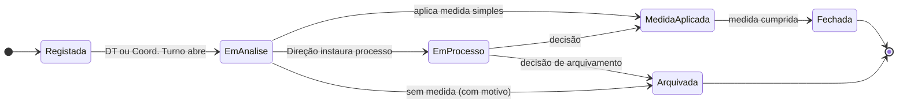
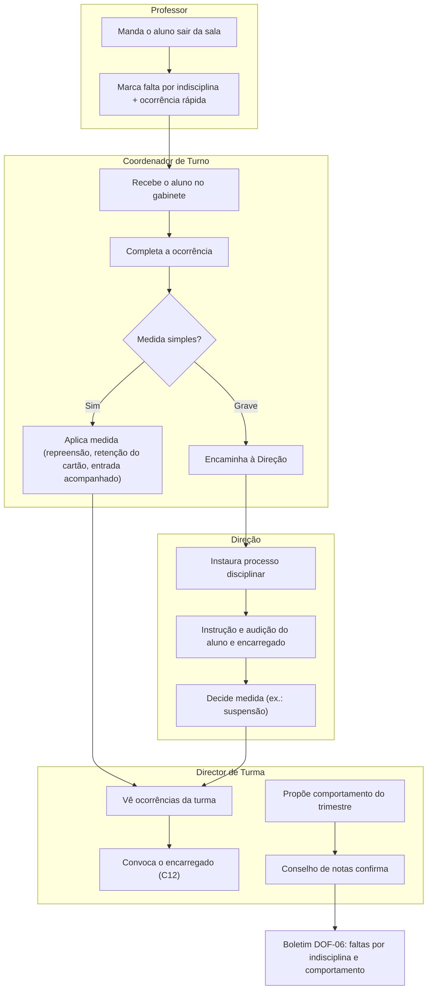

# C13 — Disciplina e Comportamento

> [!abstract] Navegação
> - **Painel Principal:** [[Inicio|Início do Vault]] | **Índice do Projeto:** [[00 - MOC SGE IPCAG 12008 BGO|MOC]] | **Plano:** [[00.1 - Plano de Engenharia de Requisitos]] (§2.1 — `C13`, lacuna `L6`)
> - **Especificação base (v1.2):** [[01 - Dominio e Regras]] (RN-03 faltas) → [[02 - Fluxos de Trabalho]] (Fluxo 03) → [[03 - User Stories]] (`US-PED-02`) → [[04 - Telas e Documentos]] (`DOF-06`) → [[05 - Modelagem de Dados]] (`sumarios_e_faltas_alunos`)
> - **Decisões e questões:** [[12 - Registo de Decisoes e Questoes em Aberto]] (`Q-032`) | **Visão e âmbito:** [[06 - Visao e Ambito]] (`O-12`; C13 na E5)
> - **Capacidades relacionadas:** [[C12 - Comunicacao com Encarregados e Alunos|C12]] (convocatórias) | [[C03 - Processo Individual do Aluno|C03]] (processo individual) | [[C15 - Paineis de Gestao da Direcao|C15]] (indicadores) | [[C04 - Horarios e Distribuicao de Servico Docente|C04]] (tempos letivos)
> - **Notas transversais:** [[11 - Protecao de Dados (APD)|11 - APD]] (`Q-APD-32`, `ALT-05-26`, `ALT-04-20`)
> - **Prática real:** [[Achados dos Documentos Reais - Lote 1]] (A8) | [[Sintese das Respostas da Fase B]] (R1, R2; G-02 A6, G-10 A4–A5)

> [!warning] Estado deste documento
> Rascunho `0.1` para integração posterior. **Não altera** DOC-01 a DOC-05. Regras (`RN-P-C13-nn`), user stories (`US-DIS-nn`), módulos (`MOD-DIS-nn`) e questões (`Q-C13-nn`) têm **identificadores provisórios**. **O regulamento interno da escola ainda não foi recebido**: tipos de ocorrência, medidas e escala de comportamento ficam **parametrizáveis** até lá.

> [!example] O que a escola nos disse e mostrou
> - O boletim real tem **Faltas por indisciplina**, **Faltas por não comparência** e **Comportamento** (Lote 1, A8).
> - Quando o professor manda um aluno sair da sala, isso gera uma falta por indisciplina; o aluno vai ao gabinete do Coordenador de Turno, que regista num **livro físico de ocorrências**, pode reter o cartão ou emitir uma convocatória para o aluno só entrar acompanhado do encarregado, e informa o Director de Turma (G-10 A4).
> - Medidas referidas: advertência, repreensão e suspensão (esta decidida pela Direção) (dossiê §3).
> - O comportamento é avaliado por trimestre e confirmado no conselho de notas (G-02 A6).
> - Atrasos: tolerância de 10–15 minutos no 1.º tempo; depois, o aluno espera pelo 2.º tempo e leva falta no 1.º (G-10 A5).

---

## 1. Objetivo e Âmbito

### 1.1 Objetivo
Substituir o livro físico de ocorrências por um registo único, ligado às faltas e ao boletim, que permita ao Director de Turma e à Direção acompanhar cada aluno, aplicar medidas de forma coerente e justificar decisões, protegendo dados sensíveis de menores.

### 1.2 Dentro do âmbito
1. **Tipos de falta**: não comparência vs. indisciplina, com ligação à ocorrência.
2. **Ocorrências disciplinares** em sala e no recinto.
3. **Medidas disciplinares** parametrizadas conforme o regulamento interno.
4. **Processo disciplinar** para casos graves, com direito de defesa.
5. **Avaliação do comportamento por trimestre**, impressa no boletim (`DOF-06`).
6. **Atrasos** dos alunos com tolerância no 1.º tempo.

### 1.3 Fora do âmbito
- Disciplina do pessoal (docentes e funcionários) — fica com a Secretaria Geral e o Gabinete Provincial.
- Acompanhamento psicológico e social (dados de saúde).
- Uniforme e material: só entram como **tipo de ocorrência** se o regulamento o previr.

### 1.4 Entrega proposta — **pedido de alteração**
O [[06 - Visao e Ambito]] coloca a C13 na **E5**. Mas o boletim real (`DOF-06`), emitido logo no **fim do I Trimestre (E3)**, já imprime as faltas por indisciplina e o comportamento. Proposta:
- **Núcleo na E2/E3**: tipos de falta (RN-P-C13-01) e comportamento trimestral (RN-P-C13-07) — sem eles o boletim real não se emite.
- **Resto na E5**: ocorrências, medidas, processo disciplinar.

Isto é uma alteração ao âmbito e deve ser registada no REG-12 e aprovada (`Q-C13-01`).

---

## 2. Termos Novos Propostos para o Glossário (DOC-01 §1)

| Termo | Código | Definição |
| :--- | :--- | :--- |
| **Falta por Não Comparência** | `FALTA_NAO_COMPARENCIA` | Ausência do aluno a um tempo letivo. Pode ser justificada (RN-03). |
| **Falta por Indisciplina** | `FALTA_INDISCIPLINA` | Falta marcada quando o professor manda o aluno sair da sala por comportamento. Liga-se sempre a uma ocorrência. |
| **Ocorrência Disciplinar** | `OCORRENCIA` | Registo de um facto de comportamento contrário ao regulamento, em sala ou no recinto, com data, local, relator e descrição. |
| **Medida Disciplinar** | `MEDIDA` | Consequência aplicada a uma ocorrência (ex.: advertência, repreensão registada, suspensão), conforme o regulamento interno. |
| **Processo Disciplinar** | `PROC_DISC` | Procedimento formal para ocorrências graves, com instrução, audição do aluno e do encarregado e decisão da Direção. |
| **Comportamento Trimestral** | `COMPORTAMENTO` | Avaliação do comportamento do aluno no trimestre, proposta pelo Director de Turma e confirmada no conselho de notas. |

---

## 3. Regras de Negócio Provisórias (`RN-P-C13-nn`)

### RN-P-C13-01: Tipos de Falta
1. Cada falta de aluno tem tipo `NAO_COMPARENCIA` ou `INDISCIPLINA`.
2. A falta por indisciplina é marcada pelo professor no momento em que manda o aluno sair e **exige uma ocorrência ligada** (criada pelo professor ou completada pelo Coordenador de Turno até ao fim do dia).
3. Uma falta por indisciplina **não pode ser justificada** pelo circuito da RN-03 (`Q-C13-03`).
4. As duas contam para o limite de faltas da RN-03, **a confirmar** (`Q-C13-03`).
5. O boletim e a pauta somam os dois tipos em separado, como no modelo real.

### RN-P-C13-02: Atrasos
1. No 1.º tempo letivo de cada turno há uma tolerância parametrizável (por defeito 15 min).
2. Depois da tolerância, o aluno aguarda o tempo seguinte e leva falta de não comparência no 1.º tempo.
3. Atrasos dentro da tolerância podem ser registados; um número de atrasos por mês (parâmetro) gera ocorrência automática (`Q-C13-04`).

### RN-P-C13-03: Registo de Ocorrências
1. Podem registar: `PROF` (em sala), `COORD_TURNO` (recinto e ocorrências encaminhadas), `DIR_TURMA`, Direção.
2. Campos obrigatórios: aluno(s), data e hora, tempo letivo ou local, tipo, gravidade (`LEVE`, `GRAVE`, `MUITO_GRAVE`), descrição factual, relator, testemunhas (opcional).
3. A descrição é factual; não admite juízos sobre saúde ou família (APD).
4. Uma ocorrência com vários alunos cria um registo por aluno, ligado ao mesmo facto, sem que um aluno veja o registo do outro.
5. Depois de fechada, a ocorrência não se apaga: corrige-se por retificação com motivo (`audit_logs`).

### RN-P-C13-04: Catálogo Parametrizável
1. Tipos de ocorrência, medidas e quem pode aplicar cada medida são **tabelas de parâmetros** aprovadas pela Direção a partir do regulamento interno.
2. Catálogo inicial proposto (a validar com o regulamento): tipos — saída de sala por indisciplina, conflito ou agressão, linguagem ofensiva, dano ao património, fraude em prova, atrasos reiterados, uniforme; medidas — advertência oral, repreensão registada, convocatória do encarregado, retenção do cartão de estudante, entrada só acompanhado do encarregado, suspensão de N dias.

### RN-P-C13-05: Aplicação de Medidas
| Medida (proposta) | Quem decide | Exige processo disciplinar | Comunica ao encarregado |
| :--- | :--- | :---: | :---: |
| Advertência oral | `PROF`, `COORD_TURNO`, `DIR_TURMA` | Não | Não |
| Repreensão registada | `DIR_TURMA`, `COORD_TURNO` | Não | Sim (impresso ou convocatória) |
| Convocatória do encarregado | `DIR_TURMA`, `COORD_TURNO`, Direção | Não | Sim (C12) |
| Retenção do cartão / entrada acompanhado | `COORD_TURNO` | Não | Sim |
| Suspensão | Direção (`DIR_GERAL` / Coordenadora Geral) | **Sim** | Sim, por escrito |

1. Cada medida liga-se à ocorrência e fica com data, decisor e fundamento.
2. Os dias de **suspensão** não geram faltas injustificadas automáticas (`Q-C13-05`).
3. A convocatória disciplinar é emitida pela central de avisos da [[C12 - Comunicacao com Encarregados e Alunos|C12]], sem o motivo no SMS.

### RN-P-C13-06: Processo Disciplinar
1. Instaurado pela Direção para ocorrências `MUITO_GRAVE` ou que possam levar a suspensão.
2. Passos: instauração com nomeação de instrutor → audição do aluno e do encarregado (direito de defesa) → relatório → decisão da Direção → notificação → eventual recurso (`Q-C13-06`).
3. Prazos máximos de cada passo são parâmetros do regulamento.
4. Peças anexadas: declarações, participação, documentos.

### RN-P-C13-07: Comportamento Trimestral
1. O Director de Turma propõe a avaliação de comportamento de cada aluno antes do conselho de notas, vendo as ocorrências e as faltas por indisciplina do trimestre.
2. O conselho de notas confirma ou altera; a decisão fica na ata do conselho.
3. A escala é **parametrizável** (`Q-C13-02`): qualitativa (ex.: Muito Bom, Bom, Suficiente, Insuficiente) ou numérica.
4. A avaliação é impressa no boletim (`DOF-06`) e fica fechada com a homologação da Pauta Geral (mesma trava temporal da Máquina de Estado 3.1).
5. **Não entra no cálculo das notas** (`CA`, `CF`) nem na transição, salvo regra do regulamento (`Q-C13-02`).

### RN-P-C13-08: Proteção dos Dados Disciplinares
1. Quem vê: o relator, o `DIR_TURMA` da turma, o `COORD_TURNO` do turno, `SUB_PED` e Direção. O `PROF` vê as que registou.
2. **Não aparecem** em declarações, certificados, guias de transferência nem no portal (só a nota de comportamento — C12 `RN-P-C12-10`).
3. Prazo de conservação proposto: até ao fim do ciclo do aluno; processos com suspensão, mais 5 anos (a validar — `Q-APD-32`).
4. Nunca se enviam motivos disciplinares por SMS (APD-11 §7.4).

---

## 4. Máquinas de Estado

### 4.1 Ocorrência (`OCORRENCIA`)

### 4.2 Processo Disciplinar (`PROC_DISC`)
`Instaurado` → `EmInstrucao` → `AudicaoRealizada` → `Decidido` → (`EmRecurso` → `Decidido`) → `Concluido`. A transição para `Decidido` exige a audição registada (ou a recusa do aluno/encarregado em comparecer, com prova da convocatória).

---

## 5. Fluxo Ponta a Ponta

**Exceções:**
- **Professor sem rede no momento:** a falta e a ocorrência rápida ficam offline e sincronizam (mesmo mecanismo das faltas).
- **Ocorrência registada no aluno errado:** retificação com motivo; o aluno errado deixa de a ver associada e fica o registo em `audit_logs`.
- **Encarregado não comparece à audição:** o processo segue com prova da convocatória (C12).

---

## 6. User Stories (`US-DIS-nn`) com Critérios BDD

### `US-DIS-01`: Marcar Falta por Indisciplina em Sala
**Como** professor, **quero** marcar uma falta por indisciplina quando mando um aluno sair **para que** fique registada e acompanhada.
- **Dado** o 3.º tempo de Matemática, **Quando** marco falta por indisciplina ao aluno n.º 14, **Então** o sistema pede uma descrição curta e cria a ocorrência ligada.
- **Dado** uma falta por indisciplina, **Quando** o Director de Turma tenta justificá-la pelo circuito da RN-03, **Então** o sistema recusa (`Q-C13-03`).

### `US-DIS-02`: Completar e Tratar Ocorrência
**Como** Coordenador de Turno, **quero** completar a ocorrência e aplicar uma medida simples **para que** o caso fique resolvido e registado.
- **Dado** uma ocorrência `LEVE`, **Quando** aplico "retenção do cartão", **Então** o Director de Turma é notificado no sistema.
- **Dado** uma ocorrência `MUITO_GRAVE`, **Quando** tento aplicar "suspensão", **Então** o sistema indica que é preciso um processo disciplinar da Direção.

### `US-DIS-03`: Conduzir Processo Disciplinar
**Como** Direção, **quero** instaurar e decidir um processo disciplinar **para que** a suspensão respeite o direito de defesa.
- **Dado** um processo sem audição registada, **Quando** tento decidir, **Então** o sistema recusa, salvo se houver convocatória com falta de comparência registada.

### `US-DIS-04`: Propor e Confirmar o Comportamento do Trimestre
**Como** Director de Turma, **quero** propor o comportamento de cada aluno vendo as ocorrências **para que** o conselho decida com base em factos.
- **Dado** um aluno com 3 ocorrências no trimestre, **Quando** abro a proposta, **Então** vejo-as resumidas ao lado da escala.
- **Dado** a Pauta Geral homologada, **Quando** tento alterar o comportamento, **Então** o sistema exige reabertura auditada (US-GOV-04).

### `US-DIS-05`: Registar Atrasos com Tolerância
**Como** Coordenador de Turno, **quero** registar entradas tardias **para que** se apliquem a tolerância e as faltas corretamente.
- **Dado** uma tolerância de 15 min e o 1.º tempo às 07h30, **Quando** o aluno entra às 07h50, **Então** fica com falta de não comparência no 1.º tempo.

### `US-DIS-06`: Consultar o Histórico Disciplinar com Restrições
**Como** `SUB_PED`, **quero** ver o histórico disciplinar de um aluno **para que** decida casos graves com informação completa.
- **Dado** um professor que não registou a ocorrência, **Quando** tenta abri-la, **Então** não tem acesso.
- **Dado** um pedido de declaração de estudos, **Quando** é emitida, **Então** não inclui nenhuma ocorrência.

---

## 7. Ecrãs e Módulos Propostos

| Módulo | Workspace | Conteúdo | US |
| :--- | :--- | :--- | :--- |
| `MOD-DIS-01` Registo Rápido em Sala | 03 (Docência, offline) | Falta por indisciplina + ocorrência curta na grelha de faltas | US-DIS-01 |
| `MOD-DIS-02` Gabinete do Turno | 03 | Ocorrências do turno, atrasos, medidas simples | US-DIS-02, 05 |
| `MOD-DIS-03` Dossier Disciplinar da Turma | 03 | Ocorrências da turma, proposta de comportamento | US-DIS-04 |
| `MOD-DIS-04` Processos Disciplinares | 01 (Direção) | Instauração, instrução, audição, decisão | US-DIS-03, 06 |
| `MOD-DIS-05` Parâmetros do Regulamento | 01 | Tipos, medidas, escala de comportamento, tolerâncias | RN-P-C13-04 |

**Documentos (códigos provisórios):** `DOF-P-C13-01` Participação de ocorrência; `DOF-P-C13-02` Notificação de decisão disciplinar. O `DOF-06` (boletim) passa a imprimir faltas por tipo e comportamento.

---

## 8. Modelo de Dados — Tabelas Novas e Atributos Novos

### 8.1 Tabelas novas
| Tabela | Papel | Atributos principais |
| :--- | :--- | :--- |
| `tipos_ocorrencia` | Catálogo do regulamento | ID; designação; gravidade por defeito; ativo |
| `medidas_disciplinares_catalogo` | Catálogo de medidas | ID; designação; cargos que podem aplicar; exige processo (S/N); comunica ao encarregado (S/N) |
| `ocorrencias_disciplinares` | Cada ocorrência | ID; matrícula; data/hora; tempo letivo ou local; tipo; gravidade; descrição; relator; testemunhas; estado (§4.1); falta ligada |
| `medidas_aplicadas` | Medidas por ocorrência | ID; ocorrência; medida; decisor; data; fundamento; dias (suspensão); cumprida em |
| `processos_disciplinares` | Processos formais | ID; ocorrência(s); instrutor; estado (§4.2); datas de cada passo; decisão; recurso |
| `comportamento_trimestral` | Avaliação por trimestre | ID; matrícula; trimestre; proposta do DT; valor final; confirmado no conselho em; estado (aberto/fechado) |
| `atrasos_alunos` | Entradas tardias | ID; matrícula; data; tempo letivo; minutos de atraso; dentro da tolerância (S/N) |

### 8.2 Atributos novos em tabelas existentes
- `sumarios_e_faltas_alunos`: `tipo_falta` (`NAO_COMPARENCIA`, `INDISCIPLINA`); `ocorrencia_id` (obrigatório se indisciplina).
- `matriculas_anuais`: nenhum (comportamento fica na tabela própria, por trimestre).

### 8.3 Listas fechadas novas
`TIPO_FALTA`, `GRAVIDADE_OCORRENCIA`, `ESTADO_OCORRENCIA`, `ESTADO_PROC_DISC`.

### 8.4 Regras de integridade novas
- Falta com `tipo_falta = INDISCIPLINA` sem `ocorrencia_id` só é aceite até ao fim do dia letivo; depois bloqueia o fecho do trimestre da turma.
- `comportamento_trimestral` fica só de leitura quando a Pauta Geral do trimestre é homologada.

### 8.5 Eventos novos em `audit_logs`
`OCORRENCIA_REGISTADA`, `OCORRENCIA_RETIFICADA`, `MEDIDA_APLICADA`, `PROCESSO_DECIDIDO`, `COMPORTAMENTO_ALTERADO`.

---

## 9. Permissões por Cargo RBAC

| Ação | `DIR_GERAL` | `SUB_PED` | `COORD_TURNO` | `DIR_TURMA` | `PROF` | Secretaria |
| :--- | :---: | :---: | :---: | :---: | :---: | :---: |
| Registar ocorrência | ✅ | ✅ | ✅ | ✅ | ✅ (em sala) | — |
| Ver ocorrências | ✅ | ✅ | ✅ (seu turno) | ✅ (sua turma) | Só as que registou | — |
| Aplicar medida simples | ✅ | ✅ | ✅ | ✅ | Advertência oral | — |
| Instaurar e decidir processo | ✅ | ✅ (instrução) | — | — | — | — |
| Propor comportamento | — | — | — | ✅ | — | — |
| Confirmar comportamento | Conselho de notas (presidido por `SUB_PED`) | | | | | — |
| Parâmetros do regulamento | ✅ | ✅ | — | — | — | — |

---

## 10. Requisitos Não Funcionais Aplicáveis
- `RNF-DIS-02` / offline: o registo rápido em sala funciona sem rede.
- `RNF-PRV-03` (acesso mínimo a dados sensíveis): aplica-se às ocorrências.
- Novo `RNF-P-C13-01`: marcar uma falta por indisciplina com ocorrência rápida em menos de 30 s no telemóvel.

---

## 11. Questões para a Escola (`Q-C13-nn`)

| ID | Questão | A quem | Bloqueia |
| :--- | :--- | :--- | :--- |
| `Q-C13-01` | Aprova levar o núcleo (tipos de falta + comportamento) para a E2/E3, deixando ocorrências e processos na E5? | Comissão de Gestão | §1.4 |
| `Q-C13-02` | Qual é a escala do comportamento e conta para alguma decisão (transição, bolsas, quadro de honra)? | `SUB_PED` | RN-P-C13-07 |
| `Q-C13-03` | A falta por indisciplina conta para o limite da RN-03? Pode alguma vez ser justificada? | `SUB_PED` | RN-P-C13-01 |
| `Q-C13-04` | Quantos atrasos por mês geram ocorrência? A tolerância é igual nos dois turnos? | `COORD_TURNO` | RN-P-C13-02 |
| `Q-C13-05` | Os dias de suspensão contam como faltas? Há trabalho a cumprir durante a suspensão? | Direção | RN-P-C13-05 |
| `Q-C13-06` | O regulamento interno prevê recurso das decisões disciplinares? Para quem e em que prazo? Pedido: **cópia do regulamento interno** (artefacto do PLN-00 §5.2). | Comissão de Gestão | RN-P-C13-04, 06 |
| `Q-C13-07` | A participação disciplinar fica no processo individual físico/digital do aluno (C03)? Até quando? | Secretaria Pedagógica | RN-P-C13-08 |

---

## 12. *Definition of Ready* (Plano §8)

| Critério | Estado |
| :--- | :--- |
| Ligado a objetivo e capacidade | ✅ `O-12`, C13 |
| Prioridade e entrega | 🟡 Proposta de divisão E2/E3 + E5 (`Q-C13-01`) |
| Regras validadas | ❌ Falta o regulamento interno |
| BDD com exceções e números reais | ✅ |
| Ecrãs e tabelas | ✅ propostos |
| RNF identificados | ✅ |
| Sem questões em aberto | ❌ `Q-C13-01` a `07` |
| Aprovado pelo cargo responsável | ❌ |

---

## 13. Alterações a Integrar na Especificação

| DOC | Alteração |
| :--- | :--- |
| [[01 - Dominio e Regras]] | Termos do §2; RN-03 passa a distinguir os tipos de falta; regras `RN-P-C13-01` a `08`; linhas RBAC do §9 |
| [[02 - Fluxos de Trabalho]] | Fluxo 03: marcação de falta por indisciplina e atrasos; Fluxo 04: confirmação do comportamento no conselho; novo fluxo disciplinar (§5) |
| [[03 - User Stories]] | Novo épico `EP-DIS` com `US-DIS-01` a `06`; `US-PED-02` com tipos de falta |
| [[04 - Telas e Documentos]] | `MOD-DIS-01` a `05`; `DOF-06` com faltas por tipo e comportamento; `DOF-P-C13-01/02` |
| [[05 - Modelagem de Dados]] | Tabelas do §8.1; `tipo_falta` e `ocorrencia_id` em `sumarios_e_faltas_alunos`; listas e eventos novos; RLS do §9 |
| [[C15 - Paineis de Gestao da Direcao]] | Indicador de ocorrências por turma e tipo |

---

## 14. Histórico

| Versão | Data | Alteração |
| :---: | :---: | :--- |
| 0.1 | 2026-11-02 | Criação a partir do Lote 1 (A8), das entrevistas da Fase B e da APD-11. |
