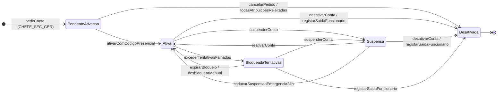
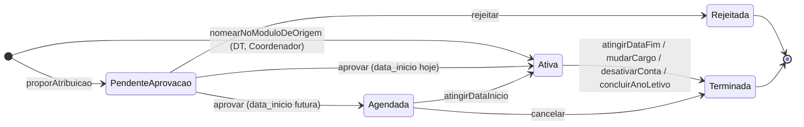
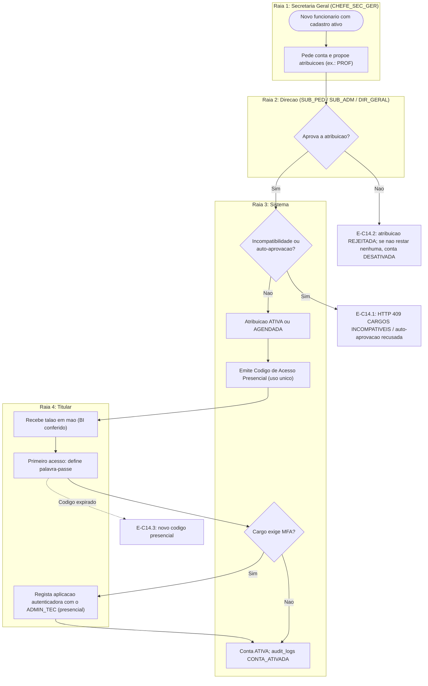
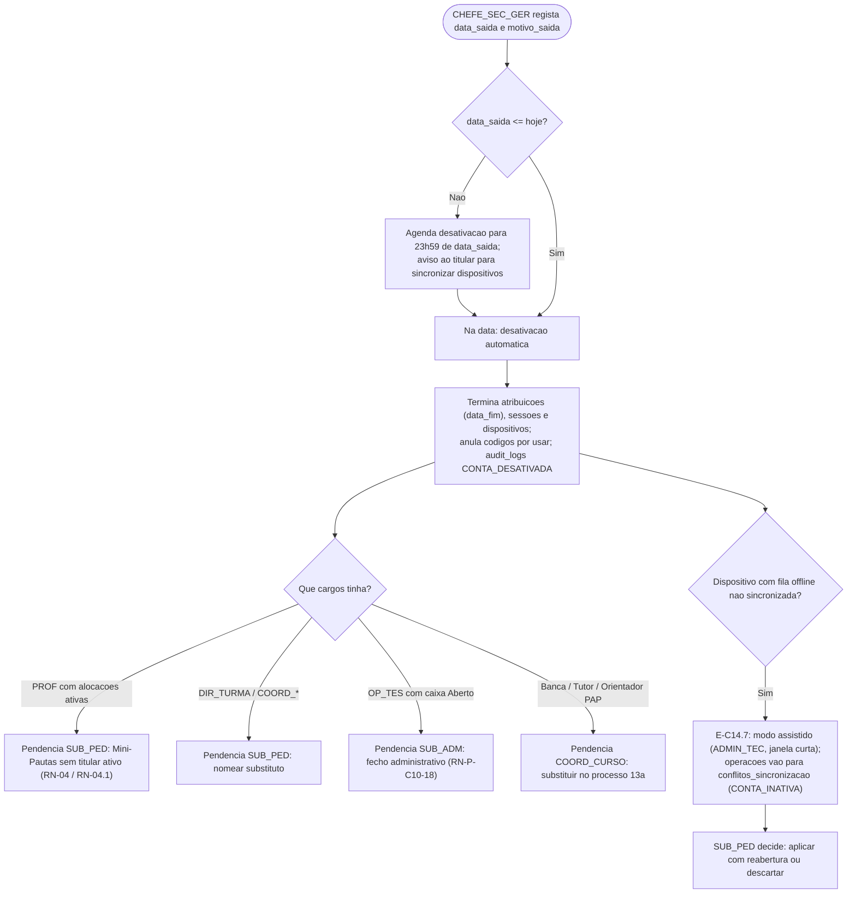
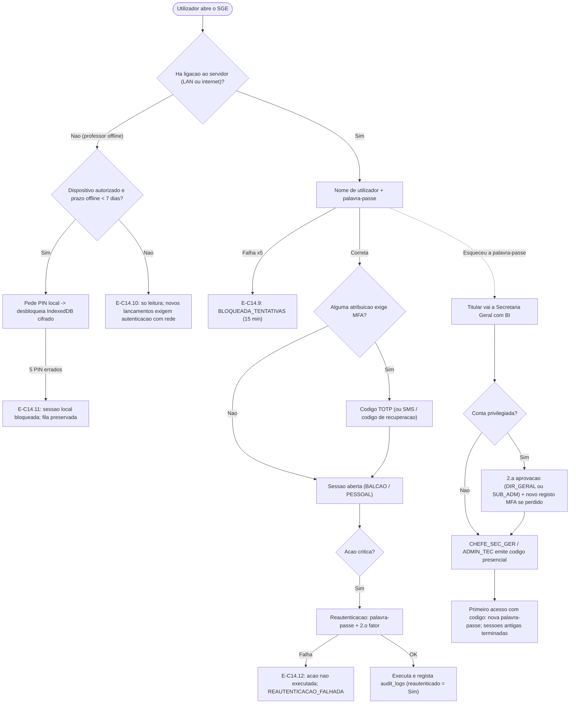

# C14 — Gestão de Contas e Acesso

> [!abstract] Navegação
> - **Painel Principal:** [[Inicio|Início do Vault]] | **Índice do Projeto:** [[00 - MOC SGE IPCAG 12008 BGO|MOC]] | **Plano:** [[00.1 - Plano de Engenharia de Requisitos|PLN-00]] (§2.1 `C14`, §5.3 Segurança, §8 *Definition of Ready*)
> - **Especificação base:** [[01 - Dominio e Regras]] (§2 RBAC, `RN-10`) → [[02 - Fluxos de Trabalho]] (Fluxo 03 *Offline-First*) → [[03 - User Stories]] → [[04 - Telas e Documentos]] (`MOD-GOV-04`, `MOD-GER-RH`) → [[05 - Modelagem de Dados]] (§3.2, §3.6, §5)
> - **Capacidades relacionadas:** [[C10 - Cobranca, Relatorios Financeiros e Conciliacao]] (fecho administrativo de caixa) | [[C15 - Paineis de Gestao da Direcao]] (indicadores de contas e dispositivos)
> - **Notas transversais:** [[06 - Visao e Ambito]] (objetivos `O-09`, `O-10`) | [[08 - Requisitos Nao Funcionais]] (`RNF-SEG-01` a `05`, `RNF-SEG-12`, `RNF-OFF-11`) | [[11 - Protecao de Dados (APD)]] (`PC-27`) | [[12 - Registo de Decisoes e Questoes em Aberto]] (`DEC-001`, `DEC-003`, `DEC-006`, `Q-013`, `Q-028`) | [[Achados dos Documentos Reais - Lote 1]] (`A4`) | [[10 - Migracao de Dados e Implantacao]] (conta técnica de migração)

> [!important] Estado desta nota
> Rascunho `0.2` que especifica a capacidade `C14` (🟡 no PLN-00 §2.1). Todas as regras têm ID provisório `RN-P-C14-nn` e só passam a `RN-xx` quando forem integradas no [[01 - Dominio e Regras|DOC-01]] e validadas na Fase D. Os valores numéricos marcados como **proposta** são pontos de partida para validar, não factos.
>
> **Versão 0.2 (2026-11-02):** alinhada com as decisões já registadas no REG-12 (`DEC-001` instalação única, `DEC-003` portal na E5, `DEC-006` servidor local com réplica na nuvem); com o achado **A4** dos documentos reais (a escola é dirigida por uma **Comissão de Gestão** e assina com títulos que não são os do DOC-01), que dá origem à separação entre **papel no sistema** e **título do cargo** (`RN-P-C14-20`); com o prazo de conservação proposto pela APD-11 (`PC-27`); e com as metas da nota 08 que já consomem estas regras.

---

## 1. Objetivo e Âmbito

### 1.1 Objetivo
Garantir que **cada pessoa entra no SGE com a sua própria conta**, recebe **apenas os cargos e o escopo** que a Direção lhe atribuiu, **perde o acesso no momento em que deixa a função** e que **a autoria de tudo o que fez fica preservada** para sempre nos registos (notas, faltas, recibos, documentos e `audit_logs`).

### 1.2 Dentro do âmbito
- Ciclo de vida da conta interna: pedido, aprovação, ativação, mudança de cargo, acumulação de cargos, suspensão, desativação.
- Atribuição de cargos RBAC **com escopo e vigência** (ex.: `PROF` + `DIR_TURMA` da turma `IG10A-M`).
- Autenticação: palavra-passe, segundo fator (MFA), PIN local para trabalho *offline*, sessões e expiração, reautenticação para ações críticas.
- Recuperação de acesso **sem depender de email** (reposição presencial).
- Perfil de **administração técnica** (`ADMIN_TEC`), fora dos 12 papéis RBAC do DOC-01.
- Separação entre o **papel no sistema** (conjunto de permissões RBAC) e o **título do cargo** impresso nos documentos, configurável pela escola (`RN-P-C14-20`, achado A4).
- Auditoria de todas as operações de conta e de autenticação.

### 1.3 Fora do âmbito ou condicionado
| Tema | Situação | Onde é tratado |
| :--- | :--- | :--- |
| Contas de encarregados de educação e alunos | **`DEC-003` decidida: portal na E5.** Não entram na E1; o esboço fica no §11 para ser detalhado com a `C12` | §11 desta nota e `C12` |
| Conta técnica usada nas cargas de migração | Definida no [[10 - Migracao de Dados e Implantacao\|MIG-10]]; é **distinta** do `ADMIN_TEC` e não lhe herda permissões | `C17` |
| Cadastro civil e laboral do funcionário | Continua a pertencer a `MOD-GER-RH` / `funcionarios_docentes` | `C11` |
| Acesso ao servidor, à base de dados e às cópias de segurança | Fora do RBAC da aplicação | `C18` / [[09 - Integracoes, Infraestrutura e Operacao]] |
| Autenticação única com serviços externos (Google, Microsoft, etc.) | Não prevista | — |
| Separação de contas por escola | **`DEC-001` decidida: instalação única IPCAG**, com dados institucionais parametrizáveis. Não há separação de contas por escola; os títulos dos cargos são dados institucionais (`RN-P-C14-20`) | [[12 - Registo de Decisoes e Questoes em Aberto]] |

### 1.4 O que já existe e o que falta na especificação v1.2
| Elemento atual | Onde | Limitação que esta nota resolve |
| :--- | :--- | :--- |
| `usuarios_sistema` com **um único** `Cargo Oficial RBAC` e `Conta Ativa? Sim/Não` | DOC-05 §3.2 | Não suporta acumulação (`PROF` + `DIR_TURMA`), escopo, vigência, suspensão nem bloqueio temporário. |
| Escopo do `DIR_TURMA`, `COORD_CURSO` e `COORD_DISC` guardado nas tabelas de origem (`turmas`, `cursos_tecnicos`, `disciplinas`) | DOC-05 §3.1 | Não há histórico de quem ocupou o cargo e quando; o escopo do `COORD_TURNO` (que turno?) **não está modelado** em lado nenhum. |
| Matriz RLS | DOC-05 §5 | Não tem coluna para `COORD_TURNO` e junta `OP_TES` com `CHEFE_SEC_GER`; não cobre um perfil técnico. |
| Reautenticação | DOC-04 `MOD-GOV-04` | Prevista apenas para a reabertura de pautas; falta a lista completa de ações críticas. |
| Fila *offline* com identificador do dispositivo | DOC-05 `operacoes_sincronizacao` | Não existe registo de dispositivos autorizados nem PIN local. |
| `audit_logs` com `usuario_id` e `cargo_rbac` | DOC-05 §3.6, `RN-10` | Com vários cargos por conta, não se sabe ao abrigo de qual atribuição a ação foi feita. |

---

## 2. Termos Novos para o Glossário (DOC-01 §1)

| Termo (Linguagem Ubíqua) | Código | Definição proposta |
| :--- | :---: | :--- |
| **Conta de Utilizador** | `CONTA` | Identidade de acesso de **uma única pessoa** ao SGE. Para o pessoal interno, liga-se 1:1 a um registo de `funcionarios_docentes`. Nunca é partilhada nem reutilizada. |
| **Atribuição de Cargo** | `ATRIB_CARGO` | Ligação entre uma Conta e um **Título do Cargo** (e, através dele, um Papel no Sistema), com **escopo**, **data de início**, **data de fim** e referência ao despacho de nomeação. Uma conta pode ter várias atribuições ativas. |
| **Escopo do Cargo** | `ESCOPO` | Parte da escola onde o cargo atua: `INSTITUICAO`, `CURSO`, `DISCIPLINA`, `TURNO`, `TURMA` ou `ALOCACOES_DOCENTES`. Corresponde ao `R*` da matriz RBAC do DOC-01 §2.2. |
| **Papel no Sistema** | `PAPEL` | Conjunto fechado de permissões RBAC identificado por um dos 12 códigos do DOC-01 (`DIR_GERAL`, `SUB_PED`, …, `PROF`) ou pelo perfil técnico `ADMIN_TEC`. É interno: **nunca aparece impresso** nos documentos. |
| **Título do Cargo** | `TITULO_CARGO` | Designação oficial do cargo tal como a escola a usa e imprime nos documentos (ex.: *Coordenadora Geral da Comissão de Gestão*, *Coordenador para a Área Pedagógica*). Configurável; cada título está ligado a um Papel no Sistema (`RN-P-C14-20`). |
| **Administrador Técnico** | `ADMIN_TEC` | Perfil técnico proposto, fora dos 12 papéis do DOC-01 e da estrutura orgânica da escola, que gere contas, sessões e dispositivos **sem acesso a notas, faltas, dados financeiros ou processos de alunos**. |
| **Dispositivo Autorizado** | `DISPOSITIVO` | Telemóvel ou computador registado por um utilizador para guardar dados cifrados e trabalhar *offline* (Mini-Pauta e faltas). |
| **PIN Local** | `PIN` | Código numérico curto, definido pelo utilizador num Dispositivo Autorizado, que desbloqueia a sessão local cifrada quando não há rede. Nunca substitui a palavra-passe numa autenticação no servidor. |
| **Segundo Fator** | `MFA` | Prova adicional de identidade (código temporário de uma aplicação autenticadora, SMS ou código de recuperação) exigida, além da palavra-passe, aos cargos de risco elevado. |
| **Reautenticação** | `REAUT` | Confirmação da identidade imediatamente antes de uma ação crítica, mesmo com sessão aberta. |
| **Código de Acesso Presencial** | `COD_PRESENCIAL` | Código de uso único entregue em mão ao titular, após conferência do BI, para ativar a conta ou repor o acesso. |

---

## 3. Regras de Negócio Provisórias (`RN-P-C14-nn`)

> [!note] "Cargo RBAC" = Papel no Sistema
> Nas regras abaixo, os códigos `DIR_GERAL`, `SUB_PED`, …, `PROF` designam **papéis no sistema** (permissões), como no DOC-01 §2. O nome que a escola dá a cada cargo e imprime nos documentos é configurável e ligado a um destes papéis (`RN-P-C14-20`). Segundo a [[Verificacao das Referencias Legais|LEG-VER]], o DP n.º 93/21 aplica-se a "Instituições Públicas" e não menciona as comparticipadas; por isso os 12 papéis são o modelo de permissões da especificação, e não uma lista de cargos imposta por lei à escola.

### RN-P-C14-01 — Conta nominal, única e nunca reutilizada
1. Cada conta interna pertence a **uma só pessoa** registada em `funcionarios_docentes` (relação 1:1).
2. São proibidas contas genéricas ou partilhadas (ex.: `tesouraria1`, `secretaria`), incluindo para o `ADMIN_TEC`.
3. O `nome_utilizador` de uma conta desativada **nunca é atribuído a outra pessoa**.
4. Não existe a funcionalidade "entrar como outro utilizador" (*impersonation*), nem para o `ADMIN_TEC` nem para a Direção.

### RN-P-C14-02 — A conta nasce do cadastro e de uma aprovação
1. Só se pede conta para quem tem cadastro **ativo** em `funcionarios_docentes` com Nome, N.º do BI e Telefone preenchidos.
2. O pedido é feito pelo `CHEFE_SEC_GER` (dono do cadastro de pessoal — DOC-01 §2.2, linha 24) e inclui **pelo menos uma Atribuição de Cargo** proposta.
3. Cada atribuição é **aprovada por um cargo de Direção** segundo a natureza do cargo pedido (proposta a validar — `Q-C14-01`):

| Cargo pedido | Aprova |
| :--- | :--- |
| `CHEFE_SEC_PED`, `OP_PED`, `COORD_CURSO`, `COORD_DISC`, `COORD_TURNO`, `DIR_TURMA`, `PROF` | `SUB_PED` ou `DIR_GERAL` |
| `CHEFE_SEC_GER`, `OP_TES` | `SUB_ADM` ou `DIR_GERAL` |
| `SUB_PED`, `SUB_ADM`, `ADMIN_TEC` | `DIR_GERAL` |
| `DIR_GERAL` | Ver `RN-P-C14-04` (arranque e substituição) |

4. **Quatro olhos:** quem pede não pode aprovar o mesmo pedido, e ninguém aprova uma atribuição para si próprio.

### RN-P-C14-03 — Atribuição de cargo com escopo e vigência (acumulação de cargos)
1. Uma conta pode ter **várias atribuições ativas ao mesmo tempo**. As permissões efetivas são a **união** das permissões de cada atribuição ativa, **cada uma limitada ao seu escopo**.
2. Escopo por cargo:

| Cargo | Tipo de escopo | Origem do escopo (fonte única) |
| :--- | :--- | :--- |
| `DIR_GERAL`, `SUB_PED`, `SUB_ADM`, `CHEFE_SEC_PED`, `OP_PED`, `CHEFE_SEC_GER`, `OP_TES`, `ADMIN_TEC` | `INSTITUICAO` | A própria atribuição |
| `COORD_CURSO` | `CURSO` | Nomeação em `cursos_tecnicos.coordenador_atual` (`MOD-GOV-02`) |
| `COORD_DISC` | `DISCIPLINA` | Nomeação em `disciplinas.coordenador_atual` |
| `COORD_TURNO` | `TURNO` (`MANHA` / `TARDE`) | A própria atribuição (**escopo novo**, hoje inexistente) |
| `DIR_TURMA` | `TURMA` | Comando `NomearDirectorTurma` (`MOD-GOV-03`) em `turmas.director_turma` |
| `PROF` | `ALOCACOES_DOCENTES` | Alocações ativas em `alocacoes_docentes` (`RN-04`) — não se duplica a lista de turmas na atribuição |

3. Quando o escopo vem de uma nomeação noutro módulo, **a nomeação é o gatilho**: o sistema cria (ou termina) automaticamente a atribuição correspondente, com `origem = NOMEACAO`. Assim o histórico "quem foi Director de Turma da `IG10A-M` entre que datas" fica em `atribuicoes_cargo` sem duplicar a fonte.
4. `DIR_TURMA`, `COORD_CURSO` e `COORD_DISC` exigem que o funcionário tenha **categoria `Docente`** em `funcionarios_docentes` (o DOC-01 define o Director de Turma como "professor designado"). Para o `COORD_TURNO`, ver `Q-C14-06`.
5. Uma atribuição **nunca é editada no lugar**: mudar de cargo ou de escopo termina a atribuição anterior (`data_fim`) e cria uma nova.

### RN-P-C14-04 — Arranque e substituição do papel `DIR_GERAL`
1. Na instalação, a primeira atribuição com o papel `DIR_GERAL` é registada pelo `ADMIN_TEC` com a **referência do ato de nomeação** e fica em `audit_logs` com a categoria `SEGURANCA_CONTAS`. Pelos documentos reais (achado A4), o título ligado a este papel será, em princípio, o de *Coordenadora Geral da Comissão de Gestão* — hipótese a confirmar (`Q-028` do REG-12, `Q-C14-14`).
2. A substituição posterior de quem tem o papel `DIR_GERAL` exige a referência do novo ato de nomeação e a confirmação de um segundo papel de Direção (`SUB_PED` ou `SUB_ADM`) — **proposta**, porque a entidade que nomeia a direção de uma escola comparticipada (e de uma Comissão de Gestão) não está documentada no vault (`Q-C14-01`).

### RN-P-C14-05 — Cargos incompatíveis (segregação de funções)
O DOC-01 §2 estabelece que "nenhum operador acumule funções incompatíveis (ex.: quem cobra propinas na Tesouraria não altera notas nem emite certificados; quem lança notas não valida borderôs bancários)". Desse princípio deriva-se a matriz abaixo (**proposta a confirmar com a prática da escola** — `Q-C14-05`). O sistema recusa a aprovação de uma atribuição que crie uma combinação proibida (`HTTP 409 — CARGOS INCOMPATÍVEIS`).

| Cargo A | Incompatível com | Fundamento |
| :--- | :--- | :--- |
| `OP_TES` | `PROF`, `DIR_TURMA`, `COORD_DISC`, `COORD_CURSO`, `OP_PED`, `CHEFE_SEC_PED` | Quem cobra não altera notas nem emite documentos (DOC-01 §2) |
| `CHEFE_SEC_GER` (edita borderôs — linha 20) | `PROF`, `DIR_TURMA`, `OP_PED`, `CHEFE_SEC_PED` | Quem lança notas não valida borderôs (DOC-01 §2) |
| `SUB_ADM` | `OP_TES` | Quem homologa o caixa e emite estornos não pode ser o operador do caixa |
| `ADMIN_TEC` | `DIR_GERAL`, `SUB_PED`, `SUB_ADM`, `CHEFE_SEC_PED`, `OP_PED`, `CHEFE_SEC_GER`, `OP_TES` | Quem gere contas não pode acumular cargos que aprovam, homologam, cobram ou emitem documentos |
| `ADMIN_TEC` | `PROF`, `DIR_TURMA`, `COORD_*` | **Permitido só com autorização expressa do `DIR_GERAL`** (caso realista: o professor de Informática ser o administrador técnico); todas as operações de conta que fizer sobre colegas notificam o titular e entram no resumo semanal do `DIR_GERAL` |

### RN-P-C14-06 — Estados da conta
A conta segue a máquina de estado do §4.1 (`PENDENTE_ATIVACAO`, `ATIVA`, `BLOQUEADA_TENTATIVAS`, `SUSPENSA`, `DESATIVADA`). Só uma conta `ATIVA` abre sessão. A transição para `DESATIVADA` é **definitiva**.

### RN-P-C14-07 — Desativação preserva a autoria
1. É proibido o `DELETE` físico de linhas de `usuarios_sistema`, `funcionarios_docentes` e `atribuicoes_cargo` (mesma proteção que `audit_logs` — `RN-10`).
2. Na desativação: todas as atribuições ativas recebem `data_fim`; todas as sessões terminam; todos os dispositivos são revogados; os códigos presenciais por usar são anulados.
3. Todos os registos históricos continuam a mostrar o autor com o nome completo e a indicação `(conta desativada em DD/MM/AAAA)` — por exemplo, `lancado_por_usuario_id` numa Mini-Pauta, o operador num Recibo Oficial ou o emissor de um documento.

### RN-P-C14-08 — A saída do funcionário desativa a conta e gera pendências
1. Quando o `CHEFE_SEC_GER` regista a **saída** em `funcionarios_docentes` (`data_saida` + `motivo_saida`), o sistema agenda a desativação para as `23h59` dessa data, ou executa-a de imediato se a data for hoje ou já tiver passado (**proposta** — `Q-C14-12`).
2. A desativação cria pendências automáticas para os responsáveis, sem decidir por eles:

| Situação encontrada | Pendência criada para | Regra de origem |
| :--- | :--- | :--- |
| `PROF` com alocações ativas em `alocacoes_docentes` | `SUB_PED`: lista das Mini-Pautas sem titular com conta ativa (substituir ou avocar) | `RN-04`, `RN-04.1` |
| `DIR_TURMA` de uma turma | `SUB_PED`: nomear novo Director de Turma | `MOD-GOV-03` |
| `COORD_CURSO` / `COORD_DISC` / `COORD_TURNO` | `SUB_PED`: nomear substituto | DOC-01 §2.1 |
| `OP_TES` com sessão de caixa `Aberto` | `SUB_ADM`: **fecho administrativo de caixa** | [[C10 - Cobranca, Relatorios Financeiros e Conciliacao]] `RN-P-C10-18` |
| Membro de Banca de PAP, Tutor ou Orientador com processo em curso | `COORD_CURSO`: substituir no `processos_13_classe` | `RN-06` |

3. Uma conta com sessão de caixa `Aberto` **pode** ser desativada (a pessoa pode ter saído sem aviso); a sessão de caixa fica bloqueada a novos recibos até ao fecho administrativo.

### RN-P-C14-09 — Operações *offline* de contas que deixaram de estar ativas
1. Um dispositivo de uma conta `SUSPENSA` ou `DESATIVADA` deixa de sincronizar automaticamente; as operações locais continuam cifradas no dispositivo e **não se perdem**.
2. Quando a saída é registada com antecedência, o sistema avisa o titular, na sincronização seguinte, para sincronizar tudo antes da data de saída.
3. Depois da desativação, a subida só acontece em **modo assistido**: o `ADMIN_TEC` autoriza o dispositivo por uma janela curta (**proposta: 2 h**) e todas as operações recebidas entram em `conflitos_sincronizacao` com o motivo novo `CONTA_INATIVA`, para decisão do `SUB_PED` (nunca são aplicadas automaticamente).

### RN-P-C14-10 — Suspensão temporária
1. Motivos: licença prolongada, processo disciplinar, suspeita de conta comprometida, ou outro com justificação escrita.
2. Quem suspende: `DIR_GERAL` ou `SUB_ADM` (qualquer conta); `SUB_PED` (contas cujas atribuições ativas sejam todas pedagógicas). O `ADMIN_TEC` pode fazer uma **suspensão de emergência por segurança**, válida no máximo **24 h** (**proposta**), que caduca se não for confirmada por `DIR_GERAL` ou `SUB_ADM`.
3. Efeitos: termina sessões, revoga a confiança dos dispositivos (sem apagar a fila local — `RN-P-C14-09`), mantém as atribuições (não lhes dá `data_fim`).
4. A reativação devolve a conta a `ATIVA` com as mesmas atribuições ainda vigentes e obriga a nova autenticação completa.

### RN-P-C14-11 — Política de palavra-passe (valores a fixar no [[08 - Requisitos Nao Funcionais]])
1. Segue a orientação atual do NIST SP 800-63B: **comprimento em vez de regras de composição**, sem troca periódica forçada, verificação contra listas de palavras-passe comuns ou comprometidas.
2. **Proposta:** mínimo de **10 caracteres**; aceita espaços e frases-passe; proibido conter o `nome_utilizador`, o N.º do BI ou o telefone do titular.
3. Troca obrigatória apenas: no primeiro acesso, após reposição, ou por suspeita de comprometimento.
4. Armazenamento só como **hash lento com sal** (ex.: Argon2id). Nunca encriptação reversível. O atributo do DOC-05 "Credencial Encriptada (Hash de Senha)" passa a "Hash da Palavra-passe".
5. **Bloqueio por tentativas (proposta):** 5 falhas consecutivas → `BLOQUEADA_TENTATIVAS` durante 15 min; o bloqueio seguinte, no mesmo dia, dura até desbloqueio manual pelo `ADMIN_TEC` ou `CHEFE_SEC_GER`. A mensagem de erro nunca revela se o utilizador existe.

### RN-P-C14-12 — Segundo fator (MFA) obrigatório para Direção, Tesouraria e Administração Técnica
1. O MFA é obrigatório para qualquer conta com uma atribuição ativa de `DIR_GERAL`, `SUB_PED`, `SUB_ADM`, `OP_TES`, `CHEFE_SEC_GER` ou `ADMIN_TEC` (PLN-00 §5.3: "MFA obrigatório para Direção e Tesouraria"; o `CHEFE_SEC_GER` entra porque supervisiona a Tesouraria e homologa fechos de caixa; o `ADMIN_TEC` entra porque gere contas). Para o `CHEFE_SEC_PED` ver `Q-C14-11`.
2. Fatores aceites, por ordem de preferência:
   - **Aplicação autenticadora (TOTP)** — funciona sem internet no telemóvel e é validada pelo servidor local na LAN, por isso **não depende de ligação à internet** (essencial com a `DEC-006` decidida: servidor local + réplica na nuvem).
   - **SMS** para o telefone registado — **só se existir integração SMS** ([[09 - Integracoes, Infraestrutura e Operacao]]); nunca é o único fator registado.
   - **Códigos de recuperação** impressos (proposta: 10 códigos de uso único), entregues em envelope fechado no registo do MFA.
3. O registo e a remoção de um fator são **presenciais**, feitos pelo `ADMIN_TEC` na presença do titular, com conferência do BI.
4. Se uma atribuição que exige MFA for aprovada para uma conta sem fator registado, essa atribuição só fica efetiva depois do registo do fator.

### RN-P-C14-13 — Sessões e expiração
| Tipo de sessão | Onde | Inatividade | Duração máxima | Sessões simultâneas |
| :--- | :--- | :--- | :--- | :--- |
| `BALCAO` | Postos fixos da Tesouraria e das Secretarias | **15 min** → ecrã bloqueado; desbloqueio com palavra-passe (PLN-00 §5.3) | Fim do turno de trabalho; **proposta: máximo 8 h**, depois nova autenticação completa (com MFA se aplicável) | `OP_TES`: **1** (uma nova sessão termina a anterior, com aviso); restantes: proposta 3 |
| `PESSOAL` | Telemóvel ou computador do próprio (sobretudo professores) | Ecrã bloqueado após 15 min (proposta); desbloqueio com PIN local | Renovação silenciosa enquanto o dispositivo estiver autorizado; reautenticação completa a cada **7 dias offline** (`RN-P-C14-15`) | Proposta 3 |
| `ADMINISTRACAO` | Consola do `ADMIN_TEC` | **10 min** (proposta) → sessão termina | **2 h** (proposta) | 1 |

1. As permissões são avaliadas **no servidor em cada pedido**: uma mudança de cargo ou uma suspensão tem efeito imediato, sem esperar pelo fim da sessão.
2. O utilizador vê as suas sessões ativas e pode terminá-las; `DIR_GERAL`, `SUB_ADM` e `ADMIN_TEC` podem terminar qualquer sessão (com registo em `audit_logs`).
3. Uma sessão de caixa (`sessoes_fecho_caixa`) só aceita recibos emitidos a partir de uma sessão de utilizador `BALCAO` ativa do mesmo `OP_TES`.

### RN-P-C14-14 — Reautenticação para ações críticas
1. As ações abaixo exigem reautenticação **imediatamente antes** da execução, mesmo com sessão aberta (generaliza o `MOD-GOV-04`):

| Ação crítica | Módulo / Regra |
| :--- | :--- |
| Reabrir pauta homologada; trancar após correção | `MOD-GOV-04`, `RN-10` |
| Homologar Conselho de Notas e Pauta Geral | `MOD-DOC-CON` |
| Descodificar o anonimato do concurso de admissão | `MOD-PED-ADM`, `RN-01.2` |
| Decidir conflitos de sincronização (resolver ou descartar) | DOC-05 `conflitos_sincronizacao` |
| Atribuir `Livro, Folha e Termo` e emitir Certificado ou Diploma | `MOD-PED-DOC`, `RN-10` |
| Emitir Nota de Estorno; declarar borderô invalidado por fraude | `MOD-TES-EST`, `RN-09` |
| Homologar Fecho de Caixa; fecho administrativo de caixa | `MOD-TES-EST`, `RN-P-C10-18` |
| Conceder, alterar ou revogar bolsa; homologar tabela de preços; perdoar multa; homologar acordo de pagamento | `MOD-TES-TAB`, `RN-07`, [[C10 - Cobranca, Relatorios Financeiros e Conciliacao]] |
| Aprovar atribuição de cargo; suspender, reativar ou desativar conta; repor acesso; registar ou remover MFA | Esta nota |
| Alterar parâmetros de segurança | Esta nota |
| Exportar listas com dados pessoais (alunos, encarregados, devedores) | `RN-P-C10-17`, `RN-P-C15-11` |

2. Método: palavra-passe **e** segundo fator para contas com MFA; palavra-passe para as restantes. **O PIN local nunca serve para reautenticar** (o `MOD-GOV-04` passa de "palavra-passe/PIN" para "palavra-passe + segundo fator").
3. A reautenticação vale para **um único pedido** (que pode conter um lote, ex.: homologar várias turmas de uma vez).
4. Falha → a ação não é executada e grava-se `REAUTENTICACAO_FALHADA` em `eventos_autenticacao`; 3 falhas seguidas (proposta) terminam a sessão.
5. A linha de `audit_logs` da ação crítica regista `reautenticado = Sim` e o método usado.

### RN-P-C14-15 — Dispositivo autorizado e PIN local (trabalho *offline* dos professores)
1. **Âmbito:** só a Mini-Pauta e o registo de faltas (`PROF`, `DIR_TURMA`) funcionam *offline* no dispositivo (DOC-05 §1.2). A Tesouraria e as Secretarias trabalham contra o **servidor local na LAN** (`RN-10` §4) e não usam PIN.
2. **Registo do dispositivo:** feito pelo próprio titular, com ligação ao servidor, após autenticação completa. Um dispositivo pode ser registado por mais do que uma conta, cada uma com o seu PIN e a sua área cifrada separada.
3. **PIN (proposta):** 6 dígitos, definidos pelo titular; proibidos PIN triviais (`000000`, `123456`, data de nascimento). O PIN **nunca é enviado ao servidor**; serve para desbloquear a chave local que cifra o `IndexedDB`.
4. **Erros de PIN (proposta):** 5 erros seguidos bloqueiam a sessão local; o desbloqueio exige autenticação completa com rede. **A fila de operações não é apagada** (a perda de notas é pior do que o risco de manter os dados cifrados).
5. **Prazo *offline*:** o dispositivo pode trabalhar sem contacto com o servidor até **7 dias** (meta proposta do PLN-00 §5.3). Depois disso continua a mostrar os dados mas **não aceita novos lançamentos** até haver autenticação completa; a fila já guardada sincroniza normalmente.
6. **Escopo em cache:** o dispositivo só guarda as turmas do escopo atual. Quando uma alocação termina, a turma é apagada do dispositivo **depois** de a fila dessa turma ter subido.
7. **Perda ou roubo:** o titular, o `ADMIN_TEC` ou o `SUB_PED` revogam o dispositivo; o servidor recusa as sincronizações desse dispositivo (exceto em modo assistido, `RN-P-C14-09`).
8. **Sem sincronizar por muito tempo:** a nota 08 (`RNF-OFF-11`) e a APD-11 (`PC-18`) acrescentam que, ao fim de N dias sem sincronizar (proposta: 14), os dados de leitura expiram no dispositivo, e que as operações pendentes **nunca expiram em silêncio**: a aplicação bloqueia novos lançamentos e pede sincronização. Depois de uma subida assistida de uma conta desativada (`RN-P-C14-09`), os dados locais são apagados.
9. **Limite assumido:** o PIN protege contra acesso casual. O risco residual de um dispositivo roubado é tratado pela revogação, pelo prazo *offline* e pela cifra local — a confirmar no [[08 - Requisitos Nao Funcionais]].

### RN-P-C14-16 — Recuperação de acesso sem email
1. **Canal por omissão: reposição presencial.** O titular apresenta-se com o BI ao `CHEFE_SEC_GER` ou ao `ADMIN_TEC`, que introduz o n.º do BI apresentado; o sistema só confirma se coincide com `funcionarios_docentes.n_bi`, sem mostrar o número completo (`RNF-PRV-12`), e emite um **Código de Acesso Presencial** de uso único (proposta: válido 24 h), entregue em mão num talão interno. No acesso seguinte, o titular define nova palavra-passe; todas as sessões anteriores terminam.
2. **Contas privilegiadas** (atribuição ativa de `DIR_GERAL`, `SUB_PED`, `SUB_ADM`, `OP_TES`, `CHEFE_SEC_GER` ou `ADMIN_TEC`): a reposição exige a aprovação de um segundo cargo (`DIR_GERAL` ou `SUB_ADM`, nunca o próprio titular) e, se o titular perdeu o fator, novo registo presencial do MFA.
3. **Quem não pode repor:** ninguém repõe o próprio acesso; o `ADMIN_TEC` não repõe contas com atribuição `ADMIN_TEC` (só com aprovação do `DIR_GERAL`); o `CHEFE_SEC_GER` só repõe contas sem atribuições privilegiadas.
4. **Canais opcionais:** SMS para o telefone registado (só se houver integração SMS e só para contas não privilegiadas); email institucional (só se a escola o tiver — `Q-C14-03`).
5. **PIN esquecido:** não é reposição de conta. O titular autentica-se com palavra-passe (com rede) e define novo PIN nesse dispositivo.
6. Cada reposição notifica o titular no acesso seguinte ("O seu acesso foi reposto em DD/MM/AAAA às HH:MM por [nome]").

### RN-P-C14-17 — Fronteiras do perfil `ADMIN_TEC`
| Pode | Não pode |
| :--- | :--- |
| Ver a lista de contas (nome, cargos, escopos, estado, último acesso) e os dados de identificação mínimos para conferir o BI numa reposição | Ler ou alterar **notas, faltas, pautas, dispensas, cadeiras em atraso, processos da 13ª Classe** |
| Emitir códigos de ativação e de reposição (`RN-P-C14-16`) | Ler ou alterar **conta corrente, recibos, borderôs, estornos, bolsas, tabelas de preços, fecho de caixa** |
| Desbloquear contas bloqueadas por tentativas; terminar sessões | Ler processos individuais de alunos, encarregados ou candidatos |
| Registar e remover fatores MFA (presencial) | **Aprovar** atribuições de cargo, ou atribuir cargos a si próprio |
| Autorizar e revogar dispositivos; abrir o modo assistido de sincronização | Decidir conflitos de sincronização ou ver o conteúdo das operações (vê apenas contagens e estados) |
| Configurar parâmetros técnicos dentro dos limites aprovados (`parametros_seguranca`) | Alterar ou apagar `audit_logs` ou `eventos_autenticacao` |
| Ler a auditoria da categoria `SEGURANCA_CONTAS` e os `eventos_autenticacao` | Ler a auditoria pedagógica ou financeira |
| Fazer suspensão de emergência (máx. 24 h) | Entrar como outro utilizador |

O acesso técnico ao servidor e à base de dados fica fora desta matriz e é governado pelo `C18` (ver `Q-C14-02` e `RNF-SEG-12` da nota 08). A **conta técnica de migração** do [[10 - Migracao de Dados e Implantacao|MIG-10]] é outra conta, com regras próprias, e não é um `ADMIN_TEC`.

### RN-P-C14-18 — Auditoria de todas as operações de conta
1. Cada operação administrativa sobre contas grava uma linha em `audit_logs` com a **categoria nova** `SEGURANCA_CONTAS`: `CONTA_PEDIDA`, `ATRIBUICAO_APROVADA`, `ATRIBUICAO_REJEITADA`, `ATRIBUICAO_TERMINADA`, `CONTA_ATIVADA`, `CONTA_SUSPENSA`, `CONTA_REATIVADA`, `CONTA_DESATIVADA`, `ACESSO_REPOSTO`, `MFA_REGISTADO`, `MFA_REMOVIDO`, `DISPOSITIVO_AUTORIZADO`, `DISPOSITIVO_REVOGADO`, `SINCRONIZACAO_ASSISTIDA_ABERTA`, `SESSAO_TERMINADA_POR_TERCEIRO`, `CONTA_DESBLOQUEADA`, `PARAMETRO_SEGURANCA_ALTERADO`.
2. Os eventos de grande volume (acesso com sucesso, falha de palavra-passe, falha de MFA, bloqueio, reautenticação, bloqueio local de PIN reportado na sincronização) vão para a tabela nova `eventos_autenticacao` (*append-only*), para não encher `audit_logs`.
3. `audit_logs` passa a guardar também a **atribuição** ao abrigo da qual a ação foi feita (`atribuicao_cargo_id`), a sessão e se houve reautenticação.
4. Nunca se guarda a palavra-passe tentada; o nome de utilizador tentado só fica registado quando corresponde a uma conta existente.
5. Cada titular pode consultar o seu próprio histórico de acessos (direito de acesso — [[11 - Protecao de Dados (APD)]]). Prazo de conservação de `eventos_autenticacao` proposto pela APD-11 (`PC-27`): **12 meses**, com o IP completo truncado aos **90 dias** (também na nota 08, `RNF-PRV-11`) — a validar com a Direção.

### RN-P-C14-19 — Revisão periódica de acessos
1. No início de cada Ano Letivo **e de cada trimestre** (periodicidade da nota 08, `RNF-SEG-05`), o sistema gera a **Lista de Revisão de Acessos** (todas as contas ativas, atribuições, títulos, papéis, escopos, último acesso) para o `DIR_GERAL` e o `SUB_ADM` confirmarem ou terminarem cada atribuição, cruzando com o cadastro de pessoal.
2. As atribuições com escopo de turmas do ano anterior (`DIR_TURMA`) terminam automaticamente no evento `concluirAnoLetivo` (ligação ao [[C16 - Passagem de Ano Letivo|C16]]).
3. Contas sem acesso há mais de **90 dias** (proposta) aparecem destacadas na lista e no [[C15 - Paineis de Gestao da Direcao|painel do DIR_GERAL]] (`IND-25`).

### RN-P-C14-20 — Papel no sistema separado do título do cargo (achado A4)
1. **Problema:** os documentos reais da escola são assinados por uma *Coordenadora Geral da Comissão de Gestão*, por um *Coordenador para a Área Pedagógica*, pela *Chefe da Secretaria Pedagógica* e por um *Director de Turma* também chamado *Coordenador de turma* (DESC-L1 A4). A especificação assume `DIR_GERAL`, `SUB_PED` e `SUB_ADM`. A estrutura pode mudar (a Comissão de Gestão pode ser transitória — `Q-028`) sem que mudem as permissões de que cada função precisa.
2. **Regra:** o sistema guarda duas coisas diferentes:
   - o **Papel no Sistema** — um dos 12 códigos do DOC-01 ou `ADMIN_TEC`; define **o que a pessoa pode fazer** (matriz RBAC, RLS, MFA, reautenticação, incompatibilidades);
   - o **Título do Cargo** — texto configurável, registado em `cargos_institucionais`; define **como o cargo se chama e aparece impresso** nos blocos de assinatura dos `DOF-xx`, nos ecrãs e nas listas.
3. Cada título liga-se a **exatamente um** papel. Vários títulos podem ligar-se ao mesmo papel (ex.: *Director de Turma* e *Coordenador de Turma* → `DIR_TURMA`). Uma Atribuição de Cargo escolhe um **título**; o papel vem do título.
4. **Mapeamento inicial proposto a partir dos documentos reais (hipóteses a confirmar com a Comissão de Gestão — `Q-C14-14`):**

| Título impresso nos documentos reais | Papel proposto | Evidência (DESC-L1 A4) |
| :--- | :--- | :--- |
| Coordenadora Geral da Comissão de Gestão | `DIR_GERAL` | Assina declarações; "visto" na Pauta Geral; destinatária dos requerimentos |
| Coordenador para a Área Pedagógica | `SUB_PED` | Assina boletins, justificações de faltas e a Pauta Geral |
| Chefe da Secretaria Pedagógica | `CHEFE_SEC_PED` | Assina a Mini-Pauta |
| Director de Turma / Coordenador de turma | `DIR_TURMA` | Boletins |
| *(sem equivalente visto nos documentos)* | `SUB_ADM` | Não se sabe quem exerce hoje as funções administrativas e financeiras — `Q-C14-14` |

5. **Mudar um título não muda permissões:** renomear *Coordenadora Geral da Comissão de Gestão* para outro título (ex.: no fim de uma Comissão de Gestão) não altera nenhuma atribuição nem nenhum acesso. Mudar o **papel** ligado a um título com atribuições ativas é proibido: cria-se um título novo e as atribuições migram por término e nova atribuição (`RN-P-C14-03` §5).
6. **Documentos impressos:** o bloco de assinatura de cada `DOF-xx` mostra o **título** e o **nome** de quem tinha a atribuição ativa na data da assinatura, lidos de `atribuicoes_cargo` + `cargos_institucionais`. O documento emitido guarda esse texto congelado (como o "Resumo Congelado dos Dados Impressos" de `documentos_oficiais_emitidos`), para que uma mudança posterior de título não altere documentos já emitidos.
7. **Órgãos colegiais:** se a escola for dirigida por uma comissão e alguma homologação exigir decisão colegial (mais do que uma pessoa), isso **não** é tratado por esta regra; fica como questão (`Q-C14-14`) e, se confirmado, como regra de homologação no DOC-01.
8. Quem configura: o `CHEFE_SEC_GER` propõe títulos e mapeamentos; o `DIR_GERAL` homologa (reautenticação). O `ADMIN_TEC` não altera títulos nem mapeamentos.

---

## 4. Máquinas de Estado

### 4.1 Conta de Utilizador (`CONTA`)

| Estado Origem | Evento | Estado Destino | Quem Dispara | Condições de Guarda |
| :--- | :--- | :--- | :--- | :--- |
| `[novo]` | `pedirConta` | `PENDENTE_ATIVACAO` | `CHEFE_SEC_GER` | Cadastro ativo com Nome, BI e Telefone; pelo menos uma atribuição proposta (`RN-P-C14-02`). |
| `PENDENTE_ATIVACAO` | `ativarComCodigoPresencial` | `ATIVA` | Titular | Pelo menos uma atribuição **aprovada**; código presencial válido e não usado; palavra-passe conforme `RN-P-C14-11`; MFA registado se alguma atribuição o exigir (`RN-P-C14-12`). |
| `PENDENTE_ATIVACAO` | `cancelarPedido` | `DESATIVADA` | `CHEFE_SEC_GER` ou Sistema | Todas as atribuições rejeitadas, ou pedido cancelado com motivo. |
| `ATIVA` | `excederTentativasFalhadas` | `BLOQUEADA_TENTATIVAS` | Sistema | 5 falhas consecutivas (proposta). |
| `BLOQUEADA_TENTATIVAS` | `expirarBloqueio` / `desbloquearManual` | `ATIVA` | Sistema (15 min) / `ADMIN_TEC` ou `CHEFE_SEC_GER` | No 2.º bloqueio do dia só o desbloqueio manual é aceite. |
| `ATIVA` / `BLOQUEADA_TENTATIVAS` | `suspenderConta` | `SUSPENSA` | `DIR_GERAL`, `SUB_ADM`, `SUB_PED` (contas pedagógicas), `ADMIN_TEC` (emergência) | Motivo obrigatório; reautenticação (`RN-P-C14-14`). |
| `SUSPENSA` | `reativarConta` | `ATIVA` | `DIR_GERAL`, `SUB_ADM` (ou `SUB_PED` se foi quem suspendeu) | Reautenticação; a suspensão de emergência caduca sozinha às 24 h se não for confirmada. |
| `ATIVA` / `SUSPENSA` / `BLOQUEADA_TENTATIVAS` | `desativarConta` / `registarSaidaFuncionario` | `DESATIVADA` | `DIR_GERAL`, `SUB_ADM`, ou Sistema (a partir da saída registada) | Efeitos do `RN-P-C14-07` e pendências do `RN-P-C14-08`. Irreversível. |

### 4.2 Atribuição de Cargo (`ATRIB_CARGO`)

| Estado Origem | Evento | Estado Destino | Quem Dispara | Condições de Guarda |
| :--- | :--- | :--- | :--- | :--- |
| `[nova]` | `proporAtribuicao` | `PENDENTE_APROVACAO` | `CHEFE_SEC_GER` | Escopo válido para o cargo (`RN-P-C14-03`). |
| `[nova]` | `nomearNoModuloDeOrigem` | `ATIVA` | `SUB_PED` / `CHEFE_SEC_PED` (via `MOD-GOV-02`/`03`) | A nomeação já é um ato homologado no módulo de origem; o sistema só regista a vigência. |
| `PENDENTE_APROVACAO` | `aprovar` | `AGENDADA` ou `ATIVA` | Aprovador do `RN-P-C14-02` | Aprovador ≠ requerente ≠ titular; sem incompatibilidade (`RN-P-C14-05`); categoria `Docente` quando exigida; referência do despacho preenchida. |
| `ATIVA` | `atingirDataFim` / `mudarCargo` / `desativarConta` / `concluirAnoLetivo` | `TERMINADA` | Sistema ou aprovador | `data_fim` preenchida; nunca se apaga a linha. |

### 4.3 Dispositivo Autorizado
`AUTORIZADO` → `REVOGADO` (por titular, `ADMIN_TEC`, `SUB_PED`, ou automaticamente na suspensão/desativação). Um dispositivo `REVOGADO` só volta a ser usado com um **novo registo** (nova linha), nunca reativando a linha antiga.

---

## 5. Fluxos (Mermaid) com Exceções

### 5.1 Fluxo C14-A — Entrada de funcionário e ativação da conta

**Exceções:**
- **E-C14.1 — Combinação de cargos proibida ou auto-aprovação:** recusa com `HTTP 409`; o pedido fica `PENDENTE_APROVACAO` para correção.
- **E-C14.2 — Atribuição rejeitada:** o motivo é obrigatório; se a conta ficar sem atribuições aprovadas, passa a `DESATIVADA` (o nome de utilizador não é reutilizado).
- **E-C14.3 — Código presencial expirado ou já usado:** o titular volta à Secretaria Geral; o código antigo fica `EXPIRADO`/`ANULADO`.
- **E-C14.4 — Palavra-passe recusada** (curta, comum ou com dados pessoais): mensagem explica a regra, sem revelar listas.
- **E-C14.5 — Cadastro incompleto** (sem BI ou telefone): o pedido não é criado.

### 5.2 Fluxo C14-B — Saída do funcionário (desativação com pendências)

**Exceções:**
- **E-C14.6 — Saída registada por engano:** antes da data agendada, o `CHEFE_SEC_GER` pode anular o agendamento (auditado). Depois da desativação não há volta: se a pessoa regressar, cria-se **uma conta nova** (novo nome de utilizador) ligada ao mesmo cadastro e o histórico das duas contas aparece junto no cadastro.
- **E-C14.7 — Fila *offline* por sincronizar:** ver `RN-P-C14-09`.
- **E-C14.8 — Caixa aberto:** a sessão de caixa fica bloqueada a novos recibos até ao fecho administrativo pelo `SUB_ADM`.

### 5.3 Fluxo C14-C — Autenticação, PIN local, reautenticação e recuperação presencial

**Exceções:**
- **E-C14.9 — Tentativas excedidas:** bloqueio temporário; o 2.º bloqueio do dia exige desbloqueio manual.
- **E-C14.10 — Prazo *offline* esgotado:** o dispositivo mostra os dados, não aceita novos lançamentos; a fila existente não se perde.
- **E-C14.11 — PIN errado 5 vezes:** bloqueio local; desbloqueio só com autenticação completa e rede.
- **E-C14.12 — Reautenticação falhada:** a ação crítica não acontece; 3 falhas seguidas terminam a sessão.
- **E-C14.13 — Telemóvel com a aplicação autenticadora perdido:** o titular usa um código de recuperação; se não o tiver, segue o caminho de conta privilegiada (segunda aprovação + novo registo presencial).

---

## 6. User Stories (BDD)

> [!note] Sobre os exemplos
> Os nomes de pessoas são fictícios. Os valores de política (10 caracteres, 5 tentativas, 15 min, 7 dias, 6 dígitos) são **propostas** desta nota ou metas propostas do PLN-00 §5.3, e serão substituídos pelos valores aprovados no [[08 - Requisitos Nao Funcionais]].

### `US-CTA-01`: Pedir e aprovar a conta de um funcionário novo
- **História:** *Como* **Chefe da Secretaria Geral (`CHEFE_SEC_GER`)**, *quero* **pedir a conta de um funcionário recém-admitido com os cargos e escopos propostos**, *para* **que a Direção aprove o acesso antes de a pessoa começar a trabalhar no SGE**.
- **Rastreabilidade:** `RN-P-C14-01`, `-02`, `-03`, `-05`, `-18` | Fluxo C14-A | `C14`.
- **Prioridade (proposta):** `Must` | **Entrega:** `E1`.
- **Pré-condições:** Cadastro em `funcionarios_docentes` com Nome, BI e Telefone; utilizador autenticado como `CHEFE_SEC_GER`.
- **Critérios de Aceitação:**
  - **Cenário 1 (Sucesso — Professor novo):**
    - **Dado** que o docente *Mateus Kiala* tem cadastro ativo com categoria `Docente`,
    - **Quando** o `CHEFE_SEC_GER` pede a conta com a atribuição `PROF` (escopo `ALOCACOES_DOCENTES`) e o `SUB_PED` a aprova com a referência do despacho,
    - **Então** a conta fica `PENDENTE_ATIVACAO`, a atribuição fica `ATIVA` e são gravados `CONTA_PEDIDA` e `ATRIBUICAO_APROVADA` em `audit_logs` (categoria `SEGURANCA_CONTAS`).
  - **Cenário 2 (Bloqueio — Auto-aprovação):**
    - **Dado** um pedido de atribuição `COORD_CURSO` cujo titular é o próprio `SUB_PED`,
    - **Quando** o `SUB_PED` tenta aprová-lo,
    - **Então** o sistema recusa com `HTTP 403 — APROVAÇÃO DE ATRIBUIÇÃO PRÓPRIA NÃO PERMITIDA` e o pedido fica a aguardar a aprovação do `DIR_GERAL`.
  - **Cenário 3 (Bloqueio — Cadastro incompleto):**
    - **Dado** um cadastro sem N.º do BI,
    - **Quando** o `CHEFE_SEC_GER` tenta pedir a conta,
    - **Então** o sistema recusa com `HTTP 422 — CADASTRO INCOMPLETO (BI EM FALTA)` e nenhuma conta é criada.
- **Pós-condições:** Linhas em `usuarios_sistema` e `atribuicoes_cargo`; eventos em `audit_logs`.

### `US-CTA-02`: Ativar a conta com código presencial e definir a palavra-passe
- **História:** *Como* **funcionário com conta aprovada**, *quero* **ativar a conta com o código que recebi em mão e escolher a minha palavra-passe**, *para* **entrar no SGE sem que ninguém mais conheça a minha credencial**.
- **Rastreabilidade:** `RN-P-C14-06`, `-11`, `-12`, `-16` | Fluxo C14-A.
- **Prioridade (proposta):** `Must` | **Entrega:** `E1`.
- **Pré-condições:** Conta `PENDENTE_ATIVACAO` com pelo menos uma atribuição aprovada; Código de Acesso Presencial emitido.
- **Critérios de Aceitação:**
  - **Cenário 1 (Sucesso):**
    - **Dado** o código presencial emitido hoje às `08h10` para *Mateus Kiala*,
    - **Quando** às `09h00` ele introduz o código e a frase-passe `rio dande ao fim da tarde`,
    - **Então** a conta passa a `ATIVA`, o código fica `USADO` e grava-se `CONTA_ATIVADA`.
  - **Cenário 2 (Bloqueio — Palavra-passe fraca):**
    - **Dado** o mesmo código válido,
    - **Quando** ele escolhe `123456789`,
    - **Então** o sistema recusa com a mensagem *"Escolha uma palavra-passe com pelo menos 10 caracteres que não seja comum nem contenha os seus dados"* e a conta continua `PENDENTE_ATIVACAO`.
  - **Cenário 3 (Bloqueio — Código expirado):**
    - **Dado** um código emitido há 25 h (validade proposta de 24 h),
    - **Quando** o titular o introduz,
    - **Então** o sistema recusa com `HTTP 410 — CÓDIGO EXPIRADO` e indica que deve pedir novo código na Secretaria Geral.
- **Pós-condições:** `usuarios_sistema.estado_conta = ATIVA`; `codigos_acesso_presencial.estado = USADO`.

### `US-CTA-03`: Acumular cargos com escopo (`PROF` + `DIR_TURMA`)
- **História:** *Como* **Subdirector Pedagógico (`SUB_PED`)**, *quero* **nomear um professor como Director de Turma sem lhe tirar o cargo de professor**, *para* **que ele lance notas nas suas disciplinas e justifique faltas apenas na turma que dirige**.
- **Rastreabilidade:** `RN-P-C14-03`, `-05` | `RN-03`, `RN-04` | `MOD-GOV-03`.
- **Prioridade (proposta):** `Must` | **Entrega:** `E1`.
- **Pré-condições:** Conta `ATIVA` com atribuição `PROF`; turma `IG10A-M` criada.
- **Critérios de Aceitação:**
  - **Cenário 1 (Sucesso — União de permissões limitada ao escopo):**
    - **Dado** que a professora *Esperança Nzinga* leciona Matemática na `IG10A-M` e na `CG11B-T`,
    - **Quando** o `SUB_PED` executa `NomearDirectorTurma` da `IG10A-M` para ela,
    - **Então** o sistema cria a atribuição `DIR_TURMA` (escopo `TURMA = IG10A-M`, `origem = NOMEACAO`), ela passa a justificar faltas de qualquer disciplina da `IG10A-M`, continua a lançar notas de Matemática nas duas turmas, e **não** consegue justificar faltas na `CG11B-T` (`HTTP 403`).
  - **Cenário 2 (Bloqueio — Cargos incompatíveis):**
    - **Dado** que a mesma professora tem a atribuição `PROF` ativa,
    - **Quando** o `CHEFE_SEC_GER` propõe para ela a atribuição `OP_TES` e o `SUB_ADM` tenta aprovar,
    - **Então** o sistema recusa com `HTTP 409 — CARGOS INCOMPATÍVEIS (OP_TES × PROF — DOC-01 §2)`.
  - **Cenário 3 (Sucesso — Substituição do Director de Turma):**
    - **Dado** que *Esperança Nzinga* é `DIR_TURMA` da `IG10A-M` desde `15/09/2026`,
    - **Quando** o `SUB_PED` nomeia outro docente em `10/02/2027`,
    - **Então** a atribuição dela fica `TERMINADA` com `data_fim = 10/02/2027`, a nova fica `ATIVA`, e as justificações que ela fez continuam a mostrar o nome dela como autora.
- **Pós-condições:** `atribuicoes_cargo` com o histórico completo; `turmas.director_turma` atualizado.

### `US-CTA-04`: Mudar de cargo sem perder histórico nem deixar dados no dispositivo
- **História:** *Como* **Subdirector Pedagógico (`SUB_PED`)**, *quero* **terminar uma alocação ou um cargo e atribuir outro**, *para* **que o acesso acompanhe a função real da pessoa a cada momento**.
- **Rastreabilidade:** `RN-P-C14-03`, `-13`, `-15` | `RN-04`.
- **Prioridade (proposta):** `Must` | **Entrega:** `E1`.
- **Pré-condições:** Conta `ATIVA` com dispositivo autorizado que guarda em cache a Mini-Pauta de Física da `IG10A-M`.
- **Critérios de Aceitação:**
  - **Cenário 1 (Sucesso — Fim da alocação com fila por sincronizar):**
    - **Dado** que o professor tem 3 operações de Física da `IG10A-M` por sincronizar,
    - **Quando** o `SUB_PED` termina a alocação dele nessa disciplina (`RN-04`) e o dispositivo volta a ter rede,
    - **Então** as 3 operações sobem primeiro (e, como a alocação terminou, entram em `conflitos_sincronizacao` com o motivo `ALOCACAO_DOCENTE_ENCERRADA`), e só depois a Mini-Pauta de Física da `IG10A-M` é apagada do dispositivo.
  - **Cenário 2 (Sucesso — Efeito imediato no servidor):**
    - **Dado** uma sessão aberta no computador da sala de professores,
    - **Quando** a alocação termina,
    - **Então** o pedido seguinte desse professor à Mini-Pauta de Física da `IG10A-M` recebe `HTTP 403`, sem precisar de terminar a sessão.

### `US-CTA-05`: Suspender e reativar uma conta
- **História:** *Como* **Subdirector Administrativo (`SUB_ADM`)**, *quero* **suspender temporariamente a conta de um funcionário em licença ou sob suspeita**, *para* **impedir o acesso sem perder as suas atribuições nem o seu histórico**.
- **Rastreabilidade:** `RN-P-C14-10`, `-14`, `-18`.
- **Prioridade (proposta):** `Should` | **Entrega:** `E1`.
- **Critérios de Aceitação:**
  - **Cenário 1 (Sucesso — Licença):**
    - **Dado** um `OP_TES` em licença a partir de `01/03/2027`,
    - **Quando** o `SUB_ADM`, após reautenticação, suspende a conta com o motivo *"Licença de maternidade"*,
    - **Então** a conta passa a `SUSPENSA`, as sessões terminam, as atribuições mantêm-se sem `data_fim` e grava-se `CONTA_SUSPENSA`.
  - **Cenário 2 (Exceção — Suspensão de emergência não confirmada):**
    - **Dado** que o `ADMIN_TEC` suspendeu às `10h00` uma conta com acessos suspeitos fora do horário,
    - **Quando** às `10h00` do dia seguinte nenhum `DIR_GERAL` ou `SUB_ADM` confirmou a suspensão,
    - **Então** a conta volta a `ATIVA`, exige autenticação completa no próximo acesso e o `DIR_GERAL` recebe o alerta *"Suspensão de emergência caducada sem decisão"*.

### `US-CTA-06`: Desativar a conta na saída do funcionário preservando a autoria
- **História:** *Como* **Chefe da Secretaria Geral (`CHEFE_SEC_GER`)**, *quero* **registar a saída de um funcionário e que o sistema desative a conta e avise quem tem de agir**, *para* **que ninguém mantenha acesso depois de sair e nenhuma pauta ou caixa fique sem responsável**.
- **Rastreabilidade:** `RN-P-C14-07`, `-08`, `-09` | `RN-04`, `RN-04.1`, `RN-09.2` | Fluxo C14-B.
- **Prioridade (proposta):** `Must` | **Entrega:** `E1`.
- **Critérios de Aceitação:**
  - **Cenário 1 (Sucesso — Professor que sai a meio do II Trimestre):**
    - **Dado** que o professor *Mateus Kiala* tem alocações ativas em Matemática na `IG10A-M` e na `IG10B-M`,
    - **Quando** o `CHEFE_SEC_GER` regista `data_saida = 14/01/2027` (hoje) com motivo `FIM_CONTRATO`,
    - **Então** a conta passa a `DESATIVADA`, as atribuições recebem `data_fim = 14/01/2027`, o `SUB_PED` recebe a pendência *"2 Mini-Pautas sem titular ativo: Matemática IG10A-M, Matemática IG10B-M"*, e as notas do I Trimestre continuam a mostrar *"Lançado por: Mateus Kiala (conta desativada em 14/01/2027)"*.
  - **Cenário 2 (Exceção — Operador de caixa com sessão aberta):**
    - **Dado** um `OP_TES` com a sessão de caixa do Turno da Manhã `Aberto`,
    - **Quando** a sua saída é registada às `11h00`,
    - **Então** a conta é desativada, a sessão de caixa deixa de aceitar recibos e o `SUB_ADM` recebe a pendência bloqueante *"Fecho administrativo de caixa necessário"* (`RN-P-C10-18`).
  - **Cenário 3 (Bloqueio — Tentativa de apagar a conta):**
    - **Dado** qualquer conta com registos associados,
    - **Quando** alguém tenta eliminá-la,
    - **Então** a operação não existe na interface e a base de dados recusa o `DELETE` (proteção igual à de `audit_logs`).

### `US-CTA-07`: Entrar com segundo fator (Direção e Tesouraria)
- **História:** *Como* **Operador de Tesouraria (`OP_TES`)**, *quero* **confirmar a minha identidade com um código da aplicação autenticadora**, *para* **que ninguém emita recibos em meu nome mesmo que descubra a minha palavra-passe**.
- **Rastreabilidade:** `RN-P-C14-12`, `-13` | PLN-00 §5.3.
- **Prioridade (proposta):** `Must` | **Entrega:** `E1`.
- **Critérios de Aceitação:**
  - **Cenário 1 (Sucesso — Sem internet, só com a LAN):**
    - **Dado** que a ligação à internet da escola está em baixo mas o servidor local responde,
    - **Quando** o `OP_TES` introduz a palavra-passe e o código de 6 dígitos da aplicação autenticadora,
    - **Então** a sessão `BALCAO` abre normalmente (a validação TOTP é feita no servidor local).
  - **Cenário 2 (Bloqueio — Código errado repetido):**
    - **Dado** a palavra-passe correta,
    - **Quando** o código MFA falha 5 vezes seguidas,
    - **Então** a conta passa a `BLOQUEADA_TENTATIVAS` e grava-se `MFA_FALHADO` (×5) e `CONTA_BLOQUEADA` em `eventos_autenticacao`.
  - **Cenário 3 (Exceção — Telemóvel perdido):**
    - **Dado** que o operador perdeu o telemóvel,
    - **Quando** usa um dos 10 códigos de recuperação impressos,
    - **Então** entra, esse código fica inutilizado, o sistema mostra *"Restam 9 códigos de recuperação — registe novo fator com o Administrador Técnico"*.

### `US-CTA-08`: Repor o acesso presencialmente, sem email
- **História:** *Como* **professor que esqueceu a palavra-passe e não tem email institucional**, *quero* **repor o acesso na Secretaria Geral apresentando o meu BI**, *para* **voltar a lançar notas no mesmo dia**.
- **Rastreabilidade:** `RN-P-C14-16`, `-17` | Fluxo C14-C.
- **Prioridade (proposta):** `Must` | **Entrega:** `E1`.
- **Critérios de Aceitação:**
  - **Cenário 1 (Sucesso — Conta não privilegiada):**
    - **Dado** que o professor apresenta o BI ao `CHEFE_SEC_GER` e o número coincide com o cadastro,
    - **Quando** o `CHEFE_SEC_GER` emite o código de reposição,
    - **Então** o código é entregue em mão num talão interno, válido até à mesma hora do dia seguinte; no acesso seguinte o professor define nova palavra-passe, todas as sessões antigas terminam e grava-se `ACESSO_REPOSTO`.
  - **Cenário 2 (Exceção — Conta privilegiada):**
    - **Dado** que quem pede é o `SUB_ADM`,
    - **Quando** o `ADMIN_TEC` tenta emitir o código,
    - **Então** o sistema exige a aprovação do `DIR_GERAL` antes de emitir, e o código só é gerado depois dessa aprovação.
  - **Cenário 3 (Bloqueio — Repor o próprio acesso):**
    - **Dado** o `ADMIN_TEC` autenticado,
    - **Quando** tenta emitir um código de reposição para a sua própria conta,
    - **Então** o sistema recusa com `HTTP 403 — REPOSIÇÃO DO PRÓPRIO ACESSO NÃO PERMITIDA`.

### `US-CTA-09`: Lançar notas *offline* com PIN local
- **História:** *Como* **Professor (`PROF`)**, *quero* **desbloquear a Mini-Pauta no meu telemóvel com um PIN quando não há rede no Panguila**, *para* **continuar a lançar notas e faltas sem perder nada até voltar a ter ligação**.
- **Rastreabilidade:** `RN-P-C14-15` | `RN-10` §4 | DOC-05 §1.2 | Fluxo 03.
- **Prioridade (proposta):** `Must` | **Entrega:** `E2` (o lançamento de notas entra na E2; o registo do dispositivo pode entrar na E1).
- **Pré-condições:** Dispositivo autorizado; última autenticação completa há menos de 7 dias.
- **Critérios de Aceitação:**
  - **Cenário 1 (Sucesso — Dia sem rede):**
    - **Dado** que o professor sincronizou na segunda-feira às `07h40`,
    - **Quando** na quarta-feira, sem rede, introduz o PIN e lança `MAC = 12`, `NPP = 11`, `NPT = 14` para o aluno n.º 7,
    - **Então** o ecrã mostra `MT = 12` (`round_med(37/3) = round_med(12,33)`), a operação fica na fila cifrada com a sua chave de idempotência e sobe quando houver rede.
  - **Cenário 2 (Exceção — PIN errado 5 vezes):**
    - **Dado** 4 operações na fila,
    - **Quando** alguém introduz 5 PIN errados,
    - **Então** a sessão local bloqueia, as 4 operações continuam guardadas, e o desbloqueio só acontece com nome de utilizador e palavra-passe quando houver rede.
  - **Cenário 3 (Exceção — Prazo *offline* esgotado):**
    - **Dado** que a última autenticação completa foi há 8 dias,
    - **Quando** o professor tenta lançar uma nota nova,
    - **Então** o dispositivo mostra *"Ligue-se à rede da escola e entre com a palavra-passe para continuar a lançar"*, mantendo a fila existente intacta.
  - **Cenário 4 (Exceção — Dispositivo revogado por roubo):**
    - **Dado** que o telemóvel foi revogado pelo `ADMIN_TEC`,
    - **Quando** esse dispositivo tenta sincronizar,
    - **Então** o servidor recusa com `HTTP 401 — DISPOSITIVO REVOGADO` e grava o evento em `eventos_autenticacao`.

### `US-CTA-10`: Sessões e expiração no balcão da Tesouraria
- **História:** *Como* **Subdirector Administrativo (`SUB_ADM`)**, *quero* **que as sessões dos balcões bloqueiem por inatividade e que cada operador só tenha uma sessão de caixa ativa**, *para* **que ninguém emita recibos num posto deixado aberto**.
- **Rastreabilidade:** `RN-P-C14-13` | `RN-09.2`.
- **Prioridade (proposta):** `Must` | **Entrega:** `E1`.
- **Critérios de Aceitação:**
  - **Cenário 1 (Sucesso — Inatividade):**
    - **Dado** um `OP_TES` com sessão `BALCAO` sem atividade desde as `09h00`,
    - **Quando** são `09h15`,
    - **Então** o ecrã fica bloqueado e só desbloqueia com a palavra-passe do mesmo operador.
  - **Cenário 2 (Exceção — Segunda sessão do mesmo operador):**
    - **Dado** que o `OP_TES` tem sessão aberta no posto 1,
    - **Quando** entra no posto 2,
    - **Então** a sessão do posto 1 termina com o motivo `NOVA_SESSAO_BALCAO` e o posto 1 mostra *"Sessão terminada: entrou noutro posto às HH:MM"*.

### `US-CTA-11`: Reautenticar antes de uma ação crítica
- **História:** *Como* **Subdirector Pedagógico (`SUB_PED`)**, *quero* **confirmar a minha identidade imediatamente antes de reabrir uma pauta**, *para* **que uma sessão esquecida aberta não permita alterar notas homologadas**.
- **Rastreabilidade:** `RN-P-C14-14` | `MOD-GOV-04` | `US-GOV-04`.
- **Prioridade (proposta):** `Must` | **Entrega:** `E1`.
- **Critérios de Aceitação:**
  - **Cenário 1 (Sucesso):**
    - **Dado** o despacho `DESP-DG-IPCAG-008/2026` para reabrir Matemática da `IG10A-M` por 24 h,
    - **Quando** o `SUB_PED` introduz a palavra-passe e o código TOTP,
    - **Então** a reabertura é executada e a linha de `audit_logs` regista `reautenticado = Sim`, `metodo = PALAVRA_PASSE_TOTP`.
  - **Cenário 2 (Bloqueio — Código errado):**
    - **Dado** o mesmo pedido,
    - **Quando** o código TOTP está errado,
    - **Então** a pauta continua `Fechado / Homologado`, grava-se `REAUTENTICACAO_FALHADA` e, à 3.ª falha seguida, a sessão termina.

### `US-CTA-12`: Administrar contas sem ver notas nem finanças
- **História:** *Como* **Administrador Técnico (`ADMIN_TEC`)**, *quero* **desbloquear contas, terminar sessões e revogar dispositivos**, *para* **resolver problemas de acesso sem ter acesso aos dados pedagógicos e financeiros**.
- **Rastreabilidade:** `RN-P-C14-17`, `-18`.
- **Prioridade (proposta):** `Must` | **Entrega:** `E1`.
- **Critérios de Aceitação:**
  - **Cenário 1 (Sucesso — Desbloqueio):**
    - **Dado** uma conta `BLOQUEADA_TENTATIVAS` pela 2.ª vez no dia,
    - **Quando** o `ADMIN_TEC` a desbloqueia,
    - **Então** a conta passa a `ATIVA`, o titular é notificado no acesso seguinte e grava-se `CONTA_DESBLOQUEADA`.
  - **Cenário 2 (Bloqueio — Abrir uma Mini-Pauta):**
    - **Dado** o `ADMIN_TEC` autenticado,
    - **Quando** pede a Mini-Pauta de qualquer turma,
    - **Então** a API devolve `HTTP 403` e a política RLS não devolve nenhuma linha de `avaliacoes_trimestrais`.
  - **Cenário 3 (Bloqueio — Aprovar um cargo):**
    - **Dado** um pedido de atribuição `OP_PED` pendente,
    - **Quando** o `ADMIN_TEC` tenta aprová-lo,
    - **Então** o sistema recusa com `HTTP 403 — APROVAÇÃO RESERVADA À DIREÇÃO`.

### `US-CTA-13`: Auditar contas e rever acessos no início do ano letivo
- **História:** *Como* **Director Geral (`DIR_GERAL`)**, *quero* **consultar a auditoria de contas e confirmar a lista de acessos no início de cada ano letivo**, *para* **garantir que só tem acesso quem tem função atribuída**.
- **Rastreabilidade:** `RN-P-C14-18`, `-19` | `RN-10` | `C16`.
- **Prioridade (proposta):** `Should` | **Entrega:** `E1` (consulta) / `E4` (revisão anual ligada à passagem de ano).
- **Critérios de Aceitação:**
  - **Cenário 1 (Sucesso — Lista de revisão):**
    - **Dado** o arranque do Ano Letivo `2027/2028`,
    - **Quando** o `DIR_GERAL` abre a Lista de Revisão de Acessos,
    - **Então** vê todas as contas ativas com cargos, escopos e último acesso, as contas sem acesso há mais de 90 dias destacadas, e pode terminar cada atribuição com motivo (reautenticação obrigatória).
  - **Cenário 2 (Sucesso — Término automático):**
    - **Dado** que o Ano Letivo `2026/2027` foi concluído (`concluirAnoLetivo`),
    - **Quando** o `DIR_GERAL` consulta as atribuições `DIR_TURMA`,
    - **Então** todas as de turmas de `2026/2027` estão `TERMINADA` com o motivo `CONCLUSAO_ANO_LETIVO`.

### `US-CTA-14` *(E5 — `DEC-003` decidida: portal na E5)*: Ativar a conta de um encarregado de educação no portal
- **História:** *Como* **Encarregado de Educação**, *quero* **ativar a minha conta do portal na Secretaria Pedagógica**, *para* **consultar as notas, faltas e propinas dos meus educandos**.
- **Estado:** a `DEC-003` decidiu o portal para a **E5**. A história fica como referência e é detalhada com a especificação da `C12` (o que se mostra, SMS, consentimentos da APD-11).
- **Rastreabilidade:** §11 desta nota | `C12` | `DEC-003`.
- **Prioridade (proposta):** `Should` | **Entrega:** `E5`.
- **Critério de aceitação de referência (a detalhar com a `C12`):**
  - **Dado** um encarregado com 2 educandos ativos, **Quando** ativa a conta com o código entregue contra apresentação do BI, **Então** vê apenas os dados desses 2 educandos e nunca os de outros alunos.
  - **Exceção:** **Dado** um código de ativação já usado, **Quando** é introduzido de novo, **Então** o sistema recusa e indica que o encarregado deve voltar à Secretaria Pedagógica.

### `US-CTA-15`: Configurar os títulos dos cargos e ligá-los aos papéis do sistema
- **História:** *Como* **Chefe da Secretaria Geral (`CHEFE_SEC_GER`)**, com homologação da **direção da escola (papel `DIR_GERAL`)**, *quero* **registar os títulos reais dos cargos (ex.: *Coordenadora Geral da Comissão de Gestão*) e ligar cada um a um papel do sistema**, *para* **que os documentos saiam com os títulos que a escola usa e que uma mudança de estrutura não obrigue a mexer nas permissões**.
- **Rastreabilidade:** `RN-P-C14-20`, `-03` | DESC-L1 A4 | REG-12 `Q-028`.
- **Prioridade (proposta):** `Must` | **Entrega:** `E1` (os documentos da E1 já levam blocos de assinatura).
- **Pré-condições:** Papéis do sistema carregados; utilizador `CHEFE_SEC_GER` autenticado.
- **Critérios de Aceitação:**
  - **Cenário 1 (Sucesso — Comissão de Gestão):**
    - **Dado** que o `CHEFE_SEC_GER` regista o título *Coordenadora Geral da Comissão de Gestão* ligado ao papel `DIR_GERAL` e o título *Coordenador para a Área Pedagógica* ligado a `SUB_PED`, e a direção homologa,
    - **Quando** a Secretaria Pedagógica emite uma Declaração de Estudos (`DOF-09A`) assinada por quem tem a atribuição com o primeiro título,
    - **Então** o bloco de assinatura mostra *"A Coordenadora Geral da Comissão de Gestão"* e o nome da titular, e nunca o código `DIR_GERAL`.
  - **Cenário 2 (Sucesso — Renomear sem mexer em permissões):**
    - **Dado** o título *Coordenadora Geral da Comissão de Gestão* com uma atribuição ativa,
    - **Quando** a direção homologa a mudança do texto do título para *Directora Geral*,
    - **Então** as permissões da titular não mudam, os documentos emitidos a partir desse momento mostram o novo título, e as declarações já emitidas continuam a mostrar o título antigo (texto congelado no documento).
  - **Cenário 3 (Bloqueio — Mudar o papel de um título em uso):**
    - **Dado** o título *Coordenador para a Área Pedagógica* ligado a `SUB_PED` com uma atribuição ativa,
    - **Quando** alguém tenta ligá-lo ao papel `SUB_ADM`,
    - **Então** o sistema recusa com a mensagem *"Este título tem atribuições ativas. Crie um título novo e transfira as atribuições"*.
  - **Cenário 4 (Bloqueio — Título sem papel):**
    - **Dado** um título registado sem papel ligado,
    - **Quando** o `CHEFE_SEC_GER` o tenta usar num pedido de conta,
    - **Então** o sistema recusa: um título só pode ser atribuído depois de ligado a um papel e homologado.
- **Pós-condições:** linhas em `cargos_institucionais`; evento `TITULO_CARGO_HOMOLOGADO` em `audit_logs` (categoria `SEGURANCA_CONTAS`).

---

## 7. Ecrãs e Módulos (formato DOC-04)

> Propõe-se um **Workspace 05 — Segurança e Administração de Acessos** e um módulo novo no Workspace 01.

### `MOD-GOV-06`: Gestão de Contas, Cargos e Escopos (`US-CTA-01`, `-03`, `-05`, `-06`, `-13`, `-15`)
- **Perfis:** `CHEFE_SEC_GER` *(pedir, registar saída, propor títulos de cargos)*; `SUB_PED` / `SUB_ADM` / `DIR_GERAL` *(aprovar conforme `RN-P-C14-02`, suspender, desativar, rever acessos)*; `DIR_GERAL` *(homologar títulos e o seu papel)*.
- **Sub-ecrã "Títulos dos Cargos" (`RN-P-C14-20`):** lista de títulos com o papel ligado, o texto impresso (masculino/feminino, se a escola o usar — `Q-C14-14`), vigência e n.º de atribuições ativas; comandos `RegistarTituloCargo`, `AlterarTextoTitulo`, `HomologarTituloCargo`, `DesativarTituloCargo` (só sem atribuições ativas).
- **Dados de entrada:**

| Campo | Tipo | Obrigatório | Regra |
| :--- | :---: | :---: | :--- |
| `funcionario_docente_id` | `UUID` | Sim | Cadastro ativo com Nome, BI e Telefone. |
| `nome_utilizador` | `VARCHAR(40)` | Sim | Único para sempre; proposta de formato `nome.apelido`. |
| `email_institucional` | `VARCHAR` | Não | Só se existir (`Q-C14-03`). |
| `atribuicoes[].cargo_institucional_id` | `UUID` | Sim | Título do cargo homologado; o papel (12 papéis + `ADMIN_TEC`) vem do título (`RN-P-C14-20`). |
| `atribuicoes[].tipo_escopo` / `escopo_id` | `ENUM` / `UUID` | Sim | Coerente com o cargo (`RN-P-C14-03`). |
| `atribuicoes[].data_inicio` / `data_fim` | `DATE` | Sim / Não | `data_fim >= data_inicio`. |
| `atribuicoes[].referencia_despacho` | `VARCHAR(40)` | Sim | Ex.: `DESP-DG-IPCAG-012/2026`. |
| `motivo` (suspensão, desativação, rejeição) | `TEXT` | Sim | Mínimo 20 caracteres (proposta). |

- **Regras de validação:** incompatibilidades (`RN-P-C14-05`); quatro olhos; reautenticação nas ações da §3 `RN-P-C14-14`.
- **Comandos:** `PedirConta`, `ProporAtribuicao`, `AprovarAtribuicao`, `RejeitarAtribuicao`, `TerminarAtribuicao`, `SuspenderConta`, `ReativarConta`, `DesativarConta`, `RegistarSaidaFuncionario`, `GerarListaRevisaoAcessos`.
- **Saídas:** ficha da conta (atribuições ativas e históricas); lista de pendências criadas pela desativação; **Lista de Revisão de Acessos** (PDF/CSV, interna).

### `MOD-SEG-01`: Consola de Administração Técnica (`US-CTA-08`, `-12`)
- **Perfis:** `ADMIN_TEC` (exclusivo); `CHEFE_SEC_GER` usa apenas a função "Emitir código presencial" e "Desbloquear" para contas não privilegiadas.
- **Funções:** emitir códigos presenciais (ativação e reposição) com campo "BI conferido: Sim"; desbloquear; terminar sessões; registar/remover MFA; autorizar/revogar dispositivos; abrir sincronização assistida; parâmetros de segurança; leitura da auditoria `SEGURANCA_CONTAS` e de `eventos_autenticacao`.
- **Saídas:** **Talão Interno de Código de Acesso** (nome, nome de utilizador, código, validade, quem emitiu — não é documento oficial `DOF`); resumo semanal de operações do `ADMIN_TEC` para o `DIR_GERAL`.

### `MOD-SEG-02`: Autenticação, MFA, Bloqueio de Ecrã e Reautenticação (`US-CTA-02`, `-07`, `-10`, `-11`)
- **Perfis:** todos os utilizadores internos.
- **Ecrãs:** entrada (nome de utilizador + palavra-passe); segundo fator; ativação com código presencial; ecrã bloqueado por inatividade; diálogo de reautenticação (mostra a ação que vai ser executada).
- **Regras:** mensagens de erro genéricas; validação TOTP no servidor local; nenhuma dependência de serviço externo para entrar.

### `MOD-SEG-03`: Dispositivos e PIN Local (`US-CTA-09`)
- **Perfis:** `PROF`, `DIR_TURMA` (próprios dispositivos); `SUB_PED` (revogar dispositivos de docentes).
- **Funções:** registar dispositivo; definir/alterar PIN; ver prazo *offline* restante; ver operações por sincronizar; revogar.

### `MOD-SEG-04`: A Minha Conta
- **Perfis:** todos.
- **Funções:** sessões ativas (terminar); histórico de acessos próprio; cargos e escopos atuais; dispositivos; códigos de recuperação restantes; alterar palavra-passe.

---

## 8. Modelo de Dados — Tabelas e Atributos Novos (sem duplicar o DOC-05)

### 8.1 Tabelas novas (Grupo 2 — Utilizadores, Cargos e RH)

| Tabela | Papel | Atributos principais | Chaves e regras |
| :--- | :--- | :--- | :--- |
| **`cargos_institucionais`** | Títulos dos cargos usados pela escola e o papel do sistema a que cada um dá acesso (`RN-P-C14-20`, achado A4). | ID; Texto do título (e variante feminina/masculina, se usada); Papel no Sistema (12 papéis + `ADMIN_TEC`); Tipo de escopo exigido; Imprime-se em blocos de assinatura? (Sim/Não); Ordem de apresentação; Estado (`PROPOSTO`, `HOMOLOGADO`, `INATIVO`); Proposto por; Homologado por + Data; Vigência | Um título tem exatamente 1 papel. O papel de um título com atribuições ativas não pode mudar. Alterações de texto auditadas; os documentos já emitidos guardam o texto congelado. |
| **`atribuicoes_cargo`** | Vigência de cada cargo de uma conta, com escopo (`RN-P-C14-03`). | ID; Conta; **Título do Cargo** (ligação a `cargos_institucionais`; o papel vem do título); Tipo de Escopo; ID do Escopo (curso, disciplina, turma ou turno); Data de Início; Data de Fim; Estado (`PENDENTE_APROVACAO`, `AGENDADA`, `ATIVA`, `REJEITADA`, `TERMINADA`); Origem (`PEDIDO`, `NOMEACAO`); Referência do Despacho; Pedido por; Aprovado por + Data; Motivo de Rejeição/Término; Autorização do `DIR_GERAL` para `ADMIN_TEC` + docente | Sem sobreposição de vigência para o mesmo `(Conta + Cargo + Escopo)`. Um só `DIR_TURMA` ativo por turma. Proibido `DELETE`. |
| **`sessoes_utilizador`** | Sessões abertas e terminadas (`RN-P-C14-13`). | ID; Conta; Tipo (`BALCAO`, `PESSOAL`, `ADMINISTRACAO`); Dispositivo; IP; Hash do *token*; Criada em; Última atividade; Expira em; MFA verificado (Sim/Não); Terminada em; Motivo de fim (`LOGOUT`, `INATIVIDADE`, `EXPIRACAO`, `NOVA_SESSAO_BALCAO`, `TERMINADA_POR_TERCEIRO`, `CONTA_SUSPENSA`, `CONTA_DESATIVADA`, `REAUTENTICACAO_FALHADA`) | `OP_TES`: no máximo 1 sessão `BALCAO` ativa. |
| **`dispositivos_autorizados`** | Dispositivos que podem guardar dados cifrados e sincronizar (`RN-P-C14-15`). | ID; Conta; Identificador do dispositivo; Descrição; Plataforma; Registado em; Estado (`AUTORIZADO`, `REVOGADO`); Revogado por + Motivo; Última sincronização; Última autenticação completa; Prazo *offline* até; Janela de sincronização assistida até | `UNIQUE(Conta + Identificador)` enquanto `AUTORIZADO`. O PIN **não** é guardado no servidor. |
| **`fatores_autenticacao`** | Segundos fatores de cada conta (`RN-P-C14-12`). | ID; Conta; Tipo (`TOTP`, `SMS`, `CODIGOS_RECUPERACAO`); Segredo cifrado (TOTP) / telefone (SMS) / hashes dos códigos; Estado (`ATIVO`, `REMOVIDO`); Registado em + por (presencial); Último uso | Só `ADMIN_TEC` regista/remove; o segredo nunca é exportado. |
| **`codigos_acesso_presencial`** | Códigos de uso único para ativação e reposição (`RN-P-C14-16`). | ID; Conta; Finalidade (`ATIVACAO`, `REPOSICAO`); Hash do código; Emitido por; Aprovado por (2.º cargo em contas privilegiadas); BI conferido (Sim/Não); Emitido em; Expira em; Usado em; Estado (`EMITIDO`, `USADO`, `EXPIRADO`, `ANULADO`) | Emissor ≠ titular; o código em claro só aparece no talão impresso. |
| **`eventos_autenticacao`** | Registo de grande volume de acessos e falhas (`RN-P-C14-18`). | ID sequencial; Data/hora UTC; Conta (opcional); Tipo (`ACESSO_SUCESSO`, `PALAVRA_PASSE_FALHADA`, `MFA_FALHADO`, `CONTA_BLOQUEADA`, `REAUTENTICACAO_SUCESSO`, `REAUTENTICACAO_FALHADA`, `PIN_BLOQUEADO_LOCAL`, `DISPOSITIVO_REVOGADO_RECUSADO`); IP; Dispositivo; Sessão | *Append-Only*, como `audit_logs`. Conservação definida no `11`. |
| **`parametros_seguranca`** | Valores da política (comprimento mínimo, tentativas, tempos de sessão, prazo *offline*, validade de códigos). | ID; Chave; Valor; Limite mínimo/máximo aprovado; Versão; Alterado por; Data | Cada alteração gera `PARAMETRO_SEGURANCA_ALTERADO` em `audit_logs`; o `ADMIN_TEC` só altera dentro dos limites aprovados pela Direção. |

### 8.2 Atributos novos ou alterados em tabelas existentes

| Tabela (DOC-05) | Alteração proposta |
| :--- | :--- |
| `usuarios_sistema` | **Retirar** `Cargo Oficial RBAC` (passa para `atribuicoes_cargo`). **Substituir** `Conta Ativa? Sim/Não` por `estado_conta` (lista fechada nova). **Separar** "Nome de Utilizador / Email Institucional" em `nome_utilizador` (obrigatório, único) e `email_institucional` (opcional). **Renomear** "Credencial Encriptada (Hash de Senha)" para `hash_palavra_passe`. **Acrescentar:** `palavra_passe_alterada_em`, `exige_troca_palavra_passe`, `tentativas_falhadas_consecutivas`, `bloqueada_ate`, `ultimo_acesso_em`, `ativada_em`, `desativada_em`, `motivo_desativacao`, `tipo_conta` (`INTERNA`; `ENCARREGADO` e `ALUNO` dependem de `DEC-003`). |
| `funcionarios_docentes` | **Acrescentar:** `data_saida`, `motivo_saida` (`FIM_CONTRATO`, `TRANSFERENCIA`, `APOSENTACAO`, `RESCISAO`, `FALECIMENTO`, `OUTRO`). **Categoria:** acrescentar `Prestador de Serviços` se o `ADMIN_TEC` for externo (`Q-C14-02`). |
| `audit_logs` | **Acrescentar:** `categoria_evento` (`PEDAGOGICO`, `FINANCEIRO`, `DOCUMENTAL`, `SEGURANCA_CONTAS`) para a RLS por categoria; `atribuicao_cargo_id`; `sessao_id`; `reautenticado` (Sim/Não) e método. |
| `operacoes_sincronizacao` | "Identificador do Dispositivo / Navegador" passa a ligação a `dispositivos_autorizados`. |
| `conflitos_sincronizacao` | Lista de motivos: acrescentar `CONTA_INATIVA` (`RN-P-C14-09`). |
| `cursos_tecnicos`, `disciplinas`, `turmas` | Sem alteração: continuam a ser a fonte da nomeação; cada nomeação cria/termina a linha correspondente em `atribuicoes_cargo`. |

### 8.3 Listas fechadas novas (DOC-05 §1.3)
- **Perfis Técnicos (fora dos 12 papéis do DOC-01):** `ADMIN_TEC`.
- **Estados do Título do Cargo:** `PROPOSTO`, `HOMOLOGADO`, `INATIVO`.
- **Lista 1 do DOC-05 §1.3 ("Cargos Oficiais RBAC"):** passa a chamar-se **"Papéis no Sistema (RBAC)"**, com os mesmos 12 valores; os títulos impressos saem de `cargos_institucionais`.
- **Estados da Conta:** `PENDENTE_ATIVACAO`, `ATIVA`, `BLOQUEADA_TENTATIVAS`, `SUSPENSA`, `DESATIVADA`.
- **Estados da Atribuição de Cargo:** `PENDENTE_APROVACAO`, `AGENDADA`, `ATIVA`, `REJEITADA`, `TERMINADA`.
- **Tipos de Escopo:** `INSTITUICAO`, `CURSO`, `DISCIPLINA`, `TURNO`, `TURMA`, `ALOCACOES_DOCENTES`.
- **Tipos de Sessão:** `BALCAO`, `PESSOAL`, `ADMINISTRACAO`.
- **Tipos de Fator:** `TOTP`, `SMS`, `CODIGOS_RECUPERACAO`.
- **Estados do Dispositivo:** `AUTORIZADO`, `REVOGADO`.

### 8.4 Isolamento RLS das tabelas novas

| Tabela | Titular | `ADMIN_TEC` | `CHEFE_SEC_GER` | `SUB_PED` | `SUB_ADM` | `DIR_GERAL` | Restantes |
| :--- | :---: | :---: | :---: | :---: | :---: | :---: | :---: |
| `atribuicoes_cargo` | Lê as suas | Lê todas | Cria pedidos; lê todas | Aprova pedagógicas; lê todas | Aprova administrativas; lê todas | Aprova todas; lê todas | Sem acesso |
| `sessoes_utilizador` | Lê e termina as suas | Lê e termina | Sem acesso | Sem acesso | Lê e termina | Lê e termina | Sem acesso |
| `dispositivos_autorizados` | Gere os seus | Lê, autoriza, revoga | Sem acesso | Revoga de docentes | Lê | Lê | Sem acesso |
| `fatores_autenticacao` | Vê tipo e data (nunca o segredo) | Regista/remove | Sem acesso | Sem acesso | Sem acesso | Sem acesso | Sem acesso |
| `codigos_acesso_presencial` | — | Emite | Emite (não privilegiadas) | Sem acesso | Aprova 2.º | Aprova 2.º | Sem acesso |
| `eventos_autenticacao` | Lê os seus | Lê todos | Sem acesso | Sem acesso | Lê todos | Lê todos | Sem acesso |
| `parametros_seguranca` | — | Altera dentro dos limites | Sem acesso | Sem acesso | Lê | Aprova limites | Sem acesso |
| `cargos_institucionais` | Lê | Lê | Propõe títulos e mapeamentos | Lê | Lê | Homologa | Lê (texto do título, para ecrãs e documentos) |

---

## 9. Permissões por Cargo (linhas novas para a matriz do DOC-01 §2.2)

Legenda igual à do DOC-01 (`C`, `R`, `R*`, `U`, `H`, `A`, `P`, `—`), mais a coluna proposta `ADMIN_TEC`. **Todas as 26 linhas existentes do DOC-01 ficam `—` para o `ADMIN_TEC`**, exceto as linhas novas abaixo.

| Recurso / Ação | `DIR_GERAL` | `SUB_PED` | `SUB_ADM` | `CHEFE_SEC_PED` | `OP_PED` | `CHEFE_SEC_GER` | `OP_TES` | `COORD_CURSO` | `COORD_DISC` | `COORD_TURNO` | `DIR_TURMA` | `PROF` | `ADMIN_TEC` |
| :--- | :---: | :---: | :---: | :---: | :---: | :---: | :---: | :---: | :---: | :---: | :---: | :---: | :---: |
| **C14-a. Pedido de conta e proposta de atribuição** | `R` | `R` | `R` | `—` | `—` | `C, R, U` | `—` | `—` | `—` | `—` | `—` | `—` | `R` |
| **C14-b. Aprovação de atribuição de cargo** | `H` *(todas)* | `H*` *(pedagógicas)* | `H*` *(administrativas)* | `—` | `—` | `—` | `—` | `—` | `—` | `—` | `—` | `—` | `—` |
| **C14-c. Emissão de código presencial (ativação/reposição)** | `H` *(2.º)* | `—` | `H` *(2.º)* | `—` | `—` | `C*` *(não privilegiadas)* | `—` | `—` | `—` | `—` | `—` | `—` | `C` |
| **C14-d. Suspensão / reativação de conta** | `H` | `H*` *(contas pedagógicas)* | `H` | `—` | `—` | `—` | `—` | `—` | `—` | `—` | `—` | `—` | `H*` *(emergência 24 h)* |
| **C14-e. Desativação de conta / registo de saída** | `H` | `—` | `H` | `—` | `—` | `C` *(saída)* | `—` | `—` | `—` | `—` | `—` | `—` | `—` |
| **C14-f. Desbloqueio por tentativas e fim de sessões de terceiros** | `U` | `—` | `U` | `—` | `—` | `U*` *(não privilegiadas)* | `—` | `—` | `—` | `—` | `—` | `—` | `U` |
| **C14-g. Registo e remoção de MFA** | `—` | `—` | `—` | `—` | `—` | `—` | `—` | `—` | `—` | `—` | `—` | `—` | `C, U` |
| **C14-h. Dispositivos autorizados e PIN** | `R` | `R, A*` *(docentes)* | `R` | `—` | `—` | `—` | `—` | `—` | `—` | `—` | `C*, A*` *(próprios)* | `C*, A*` *(próprios)* | `R, A`, sincronização assistida |
| **C14-i. Parâmetros de segurança** | `H` *(limites)* | `—` | `R` | `—` | `—` | `—` | `—` | `—` | `—` | `—` | `—` | `—` | `U` *(dentro dos limites)* |
| **C14-j. Auditoria `SEGURANCA_CONTAS` e `eventos_autenticacao`** | `R, P` | `—` | `R` | `—` | `—` | `—` | `—` | `—` | `—` | `—` | `—` | `—` | `R` |
| **C14-k. Lista de Revisão de Acessos** | `H, P` | `R` | `H, P` | `—` | `—` | `R` | `—` | `—` | `—` | `—` | `—` | `—` | `R` |
| **C14-m. Títulos dos cargos e ligação aos papéis (`RN-P-C14-20`)** | `H` | `R` | `R` | `R` | `R` | `C, R, U` | `R` | `R` | `R` | `R` | `R` | `R` | `R` |
| **C14-l. A Minha Conta (sessões, histórico, dispositivos próprios)** | `R, U*` | `R, U*` | `R, U*` | `R, U*` | `R, U*` | `R, U*` | `R, U*` | `R, U*` | `R, U*` | `R, U*` | `R, U*` | `R, U*` | `R, U*` |

---

## 10. Requisitos Não Funcionais Aplicáveis
Os valores definitivos estão na [[08 - Requisitos Nao Funcionais|nota 08]], que já consome as regras desta nota.

| Categoria (PLN-00 §5.3) | Aplicação nesta capacidade | Metas da nota 08 |
| :--- | :--- | :--- |
| Segurança | MFA para Direção, Tesouraria e `ADMIN_TEC`; bloqueio de ecrã aos 15 min nos balcões; hash lento das palavras-passe; segredos TOTP cifrados; `ADMIN_TEC` sem acesso a dados de negócio. | `RNF-SEG-02`, `RNF-SEG-03`, `RNF-SEG-04`, `RNF-SEG-12` |
| Ciclo de vida das contas | Contas nominais; desativação no próprio dia da saída; revisão de acessos por trimestre. | `RNF-SEG-01`, `RNF-SEG-05` |
| Disponibilidade | A autenticação **funciona só com o servidor local** (sem internet), sem fornecedor externo de identidade — coerente com a `DEC-006` (servidor local + réplica na nuvem). | — |
| *Offline* | Até 7 dias de trabalho com PIN local sem perder lançamentos; pendentes nunca expiram em silêncio. | `RNF-OFF-01`, `RNF-OFF-11` |
| Auditabilidade | 100% das operações de conta em `audit_logs`; acessos e falhas em `eventos_autenticacao`. | `RNF-AUD-02` |
| Proteção de dados | `eventos_autenticacao` conservados 12 meses, IP completo 90 dias (APD-11 `PC-27`); na reposição presencial o operador **introduz** o n.º do BI apresentado e o sistema só responde se coincide, sem mostrar o número completo. | `RNF-PRV-11`, `RNF-PRV-12` |
| Usabilidade | Entrar com MFA em ≤ 30 s no balcão (proposta); mensagens de erro em linguagem simples (os códigos `HTTP` das histórias são para os testes, não para o ecrã). | `RNF-USA-01`, `RNF-USA-04` |
| Capacidade | 150 utilizadores (meta proposta do PLN-00), com histórico completo de atribuições. | — |

---

## 11. Contas de Encarregados e Alunos — para a E5 (`DEC-003` decidida)

> [!info] `DEC-003` decidida: portal na E5
> O REG-12 decidiu o portal para encarregados e alunos na **E5** (o SMS é avaliado na especificação da `C12`). Nada desta secção entra na E1. Os pontos abaixo são o ponto de partida a detalhar com a `C12` e com os consentimentos da [[11 - Protecao de Dados (APD)|APD-11]].

1. `tipo_conta = ENCARREGADO` ligada a `encarregados_educacao` (BI/NIF) e `tipo_conta = ALUNO` ligada a `alunos` — E5.
2. Escopo: apenas os próprios educandos (encarregado) ou o próprio processo (aluno); só leitura; nunca dados de outros alunos — E5.
3. Ativação presencial na Secretaria Pedagógica contra o BI, com registo do consentimento do encarregado para alunos menores — E5.
4. Recuperação presencial ou por SMS (se a `C12` adotar SMS); sem MFA obrigatório (a validar) — E5.
5. Desativação automática quando a matrícula deixa de estar ativa e não há dívidas nem documentos por levantar (a validar) — E5.

---

## 12. Questões para a Escola

| ID | Questão | Porque importa | Quem responde |
| :---: | :--- | :--- | :--- |
| `Q-C14-01` | Quem nomeia formalmente cada cargo (incluindo os membros da Comissão de Gestão) e que documento o comprova (n.º de despacho)? Concorda com a tabela de aprovadores do `RN-P-C14-02`? | Define quem aprova atribuições e o campo `referencia_despacho`. | Direção da escola |
| `Q-C14-02` | Quem será o Administrador Técnico: um funcionário interno (ex.: professor de Informática), um técnico contratado, ou a equipa de desenvolvimento durante a garantia? Quem guarda as credenciais do servidor? *(Liga à `Q-013` do REG-12.)* | Define a categoria no cadastro, as incompatibilidades e o controlo do acesso ao servidor (`C18`). | Direção da escola, `SUB_ADM` |
| `Q-C14-03` | Os funcionários têm email institucional? Todos têm telemóvel? A Direção e a Tesouraria têm *smartphone* para a aplicação autenticadora? | Define os canais de recuperação e de MFA. | `CHEFE_SEC_GER` |
| `Q-C14-04` | Os professores vão usar telemóvel pessoal para lançar notas? Há dispositivos partilhados (computador da sala de professores)? | Define o registo de dispositivos e o PIN. | `SUB_PED`, professores |
| `Q-C14-05` | Que acumulações existem hoje na prática (ex.: um operador da Secretaria que também dá aulas; o Chefe da Secretaria Geral que leciona)? A matriz de incompatibilidades do `RN-P-C14-05` é aplicável? | Uma regra demasiado rígida pode impedir a escola de funcionar. | Direção da escola |
| `Q-C14-06` | Há um Coordenador de Turno por turno? Tem de ser docente? | Define o escopo `TURNO` e a categoria exigida. | `SUB_PED` |
| `Q-C14-07` | Um professor em licença deve manter o acesso (ex.: para consultar) ou ficar suspenso? | Define o uso da suspensão. | `SUB_PED`, `SUB_ADM` |
| `Q-C14-08` | Qual é o horário real de trabalho da Tesouraria e das Secretarias (para a duração máxima da sessão de balcão)? | Define a expiração absoluta. | `CHEFE_SEC_GER` |
| `Q-C14-09` | Os postos de balcão são partilhados entre operadores no mesmo turno? | Afeta o bloqueio de ecrã e a sessão única do `OP_TES`. | `CHEFE_SEC_GER` |
| `Q-C14-10` | A escola quer um termo de responsabilidade de utilização assinado na ativação da conta? | Possível novo documento interno e requisito APD. | Direção da escola |
| `Q-C14-11` | O Chefe da Secretaria Pedagógica (que emite certificados e atribui Livro/Folha/Termo) também deve usar MFA? *(Igual à `Q08-04` da nota 08.)* | Alarga a lista do `RN-P-C14-12`. | Direção da escola |
| `Q-C14-12` | Quando sai um funcionário, o acesso deve terminar no próprio dia da saída ou noutra data (ex.: fim do mês)? | Define a data da desativação automática (a nota 08 propõe o próprio dia). | `SUB_ADM` |
| `Q-C14-13` | Durante quanto tempo devem ser conservados os registos de acessos (`eventos_autenticacao`)? **Resposta proposta pela APD-11 (`PC-27`):** 12 meses, IP completo 90 dias — falta a validação da Direção. | Prazo de conservação APD. | Direção da escola |
| `Q-C14-14` | **Estrutura de direção (achado A4; `Q-028` do REG-12):** (a) confirma o mapeamento do `RN-P-C14-20` §4 (*Coordenadora Geral da Comissão de Gestão* → `DIR_GERAL`; *Coordenador para a Área Pedagógica* → `SUB_PED`)? (b) Quem exerce hoje as funções administrativas e financeiras atribuídas ao `SUB_ADM` (tabelas de propinas, estornos, homologação do caixa)? (c) Alguma homologação exige decisão colegial da Comissão de Gestão? (d) Os títulos impressos variam em género (*Coordenadora*/*Coordenador*)? (e) *Coordenador de turma* e *Director de Turma* são o mesmo cargo? | Define os títulos, os papéis e os aprovadores; sem a resposta (b) não há aprovador para as atribuições `CHEFE_SEC_GER`/`OP_TES` além da direção. | Comissão de Gestão |

**Decisões estratégicas:** `DEC-001` (decidida: instalação única, sem contas por escola), `DEC-003` (decidida: portal na E5, contas externas na E5), `DEC-006` (decidida: servidor local + réplica na nuvem, a autenticação corre no servidor local). Todas com homologação da Direção pendente no [[12 - Registo de Decisoes e Questoes em Aberto|REG-12]]; nenhuma decisão por tomar bloqueia esta nota.

---

## 13. Verificação da *Definition of Ready* (PLN-00 §8)

| Critério | Estado | Evidência / O que falta |
| :--- | :---: | :--- |
| Ligado a um objetivo do `06` e a uma capacidade | ✅ | Capacidade `C14`; objetivos [[06 - Visao e Ambito\|VIS-06]] **`O-09`** (proteção de dados e auditoria: 0 acessos fora do âmbito do cargo) e **`O-10`** (adoção pelos 12 cargos; ≤ 2 h de formação). |
| Prioridade MoSCoW e entrega | ✅ *(proposta)* | Cada `US-CTA` tem prioridade e entrega propostas (E1, exceto `US-CTA-09` na E2 e `US-CTA-14` na E5); confirmação na Fase E. |
| Regras no DOC-01 e validadas na Fase D | 🟡 | 20 regras `RN-P-C14` escritas; integração no DOC-01 listada no §14; validação na Fase D (excluída deste critério de conclusão). |
| BDD com exceção e números reais | ✅ | Todas as histórias têm pelo menos um cenário de exceção ou bloqueio; os valores de política são os da nota 08 (`RNF-SEG-02` a `05`) e os títulos de cargo vêm dos documentos reais (DESC-L1 A4). |
| Ecrã desenhado e tabelas no DOC-05 | 🟡 | Módulos especificados no formato do DOC-04 (§7) e tabelas no formato do DOC-05 (§8); falta integrar nos DOC-04/05 e desenhar no Figma. |
| RNF aplicáveis identificados | ✅ | §10, com os IDs da nota 08. |
| Sem questões em aberto | 🟡 | Só restam as questões de **validação com a escola** da §12 (incluindo a `Q-028` do REG-12 sobre a Comissão de Gestão). As decisões de que a nota depende já estão decididas no REG-12. |
| Aprovado pelo cargo responsável | ⏳ | Validação com a escola (fora do critério de conclusão desta nota): direção da escola (papel `DIR_GERAL` — hoje a Comissão de Gestão), responsável administrativo-financeiro (`SUB_ADM` — `Q-C14-14` b), `CHEFE_SEC_GER`. |

---

## 14. Alterações a Integrar na Especificação

| Documento | Alteração |
| :--- | :--- |
| [[01 - Dominio e Regras\|DOC-01]] | §1: acrescentar os termos da §2 desta nota (incluindo **Papel no Sistema** e **Título do Cargo**). §2 e §2.1: passar a falar de **12 papéis no sistema** com títulos configuráveis (`RN-P-C14-20`), referindo que, segundo a LEG-VER, o DP n.º 93/21 se aplica a instituições públicas; acrescentar o perfil técnico `ADMIN_TEC` e a regra de acumulação com escopo. §2.2: acrescentar a coluna `ADMIN_TEC` (com `—` nas 26 linhas atuais) e as linhas `C14-a` a `C14-m`; linha 26 (`audit_logs`): acrescentar a categoria `SEGURANCA_CONTAS` (lida por `DIR_GERAL`, `SUB_ADM`, `ADMIN_TEC`). §3: acrescentar as máquinas de estado da Conta e da Atribuição de Cargo. §4: promover `RN-P-C14-01` a `-20` (provável `RN-11 — Contas, Autenticação e Acesso`); em `RN-10` §1, acrescentar à lista de ações críticas as operações de conta. |
| [[02 - Fluxos de Trabalho\|DOC-02]] | Novo fluxo "Ciclo de Vida da Conta e Acesso" com os fluxos C14-A, C14-B e C14-C; no Fluxo 03, exceção nova de dispositivo revogado / prazo *offline* esgotado / conta inativa. |
| [[03 - User Stories\|DOC-03]] | Novo épico `EP-CTA` com `US-CTA-01` a `US-CTA-13` e `US-CTA-15` (E1/E2); `US-CTA-14` na E5 (`DEC-003`); atualizar a tabela de épicos. |
| [[04 - Telas e Documentos\|DOC-04]] | Workspace 05 com `MOD-SEG-01` a `MOD-SEG-04`; `MOD-GOV-06` no Workspace 01 (com o sub-ecrã de títulos); em `MOD-GOV-04`, trocar "palavra-passe/PIN" por "palavra-passe + segundo fator (`RN-P-C14-14`)"; em `MOD-GOV-03`, `NomearDirectorTurma` passa a criar/terminar a atribuição `DIR_TURMA`. **Parte 2:** os blocos de assinatura de todos os `DOF-xx` passam a imprimir o **título configurado** e o nome do titular na data, em vez de nomes de cargo fixos (`RN-P-C14-20` §6). |
| [[05 - Modelagem de Dados\|DOC-05]] | §1.3: listas novas da §8.3 e a lista 1 renomeada para "Papéis no Sistema (RBAC)". §2 ERD: 8 tabelas novas (`cargos_institucionais` + as 7 de contas e acesso; passa de 44 para 52, só contando esta nota). §3.2: as alterações a `usuarios_sistema` e `funcionarios_docentes` (§8.2). §3.6: `audit_logs` (categoria, atribuição, sessão, reautenticação), `operacoes_sincronizacao` (ligação ao dispositivo), `conflitos_sincronizacao` (motivo `CONTA_INATIVA`), `documentos_oficiais_emitidos` (o resumo congelado inclui título e nome dos signatários). §5: coluna `COORD_TURNO` e separação `OP_TES` / `CHEFE_SEC_GER` na matriz RLS; linhas novas da §8.4. |
| [[00.1 - Plano de Engenharia de Requisitos\|PLN-00]] | §2.1: `C14` passa a ✅ depois da integração. |
