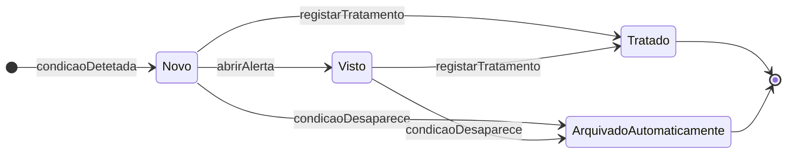
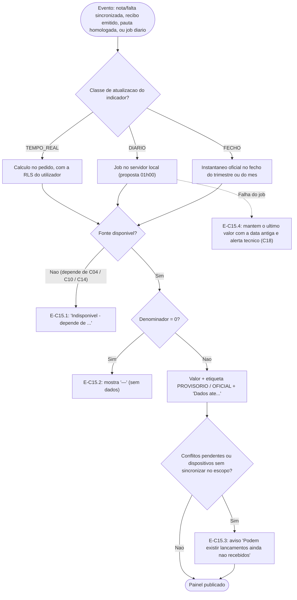
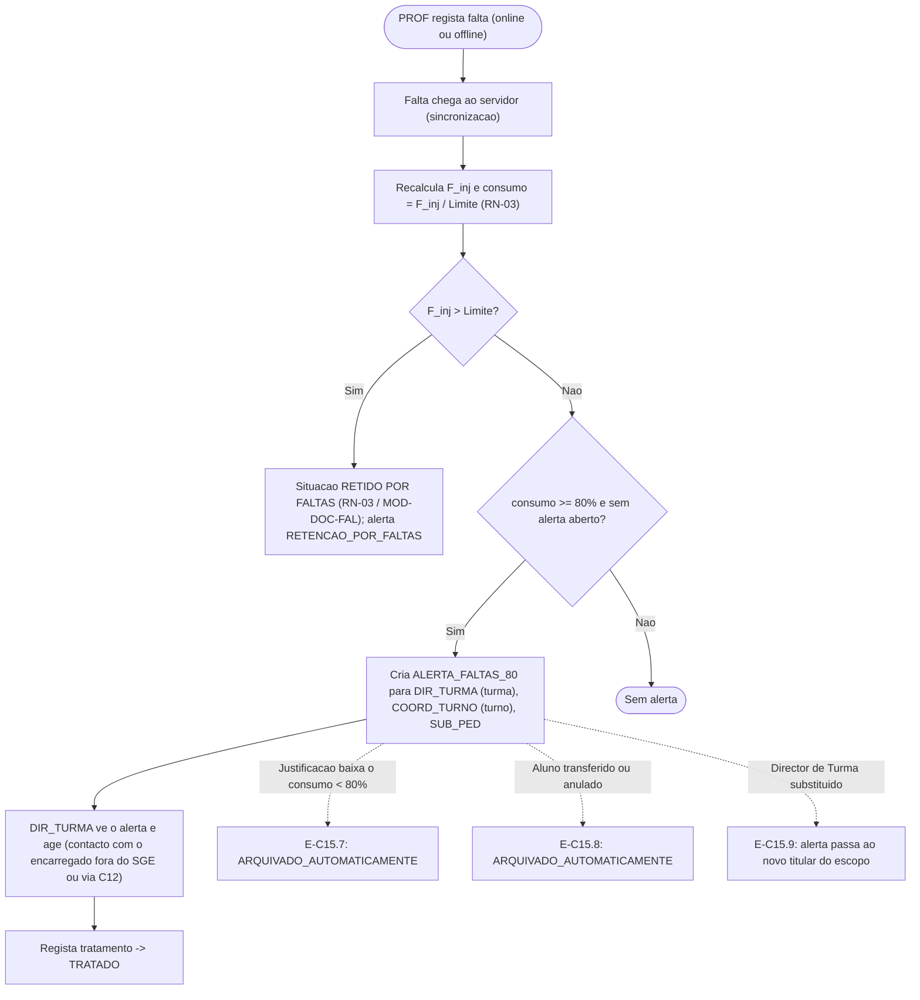

# C15 — Painéis de Gestão da Direção

> [!abstract] Navegação
> - **Painel Principal:** [[Inicio|Início do Vault]] | **Índice do Projeto:** [[00 - MOC SGE IPCAG 12008 BGO|MOC]] | **Plano:** [[00.1 - Plano de Engenharia de Requisitos|PLN-00]] (§2.1 `C15`, §6 Entrega E3, §8 *Definition of Ready*)
> - **Especificação base:** [[01 - Dominio e Regras]] (§2.2 RBAC, `RN-01` a `RN-03`, `RN-08`) → [[02 - Fluxos de Trabalho]] (Fluxos 03 e 04) → [[03 - User Stories]] (`US-DOC-05`) → [[04 - Telas e Documentos]] (`MOD-GOV-05`, `MOD-DOC-FAL`, `DOF-12`) → [[05 - Modelagem de Dados]] (§3, §5)
> - **Capacidades relacionadas:** [[C10 - Cobranca, Relatorios Financeiros e Conciliacao]] (definições de receita e dívida) | [[C14 - Gestao de Contas e Acesso]] (escopos, dispositivos, contas, títulos dos cargos) | [[C04 - Horarios e Distribuicao de Servico Docente]] (registo de aulas, grelha horária, cumprimento)
> - **Notas transversais:** [[06 - Visao e Ambito]] (objetivo `O-07`) | [[08 - Requisitos Nao Funcionais]] | [[11 - Protecao de Dados (APD)]] | [[12 - Registo de Decisoes e Questoes em Aberto]] (`Q-025`, `Q-026`, `Q-031`, `Q-033`) | [[Achados dos Documentos Reais - Lote 1]] (`A1`, `A2`, `A7`, `A9`, `A10`)

> [!important] Estado desta nota
> Rascunho `0.2`. O `C15` está 🟡 no PLN-00 §2.1: os mapas GEPE (`US-DOC-05`, `DOF-12`) já existem; **faltam os painéis de gestão**. Esta nota define **cada indicador uma única vez** (definição, fórmula, fonte, frequência e restrições RLS) e os painéis de cada cargo. Regras provisórias `RN-P-C15-nn`. Valores marcados como **proposta** não são factos.
>
> **Versão 0.2 (2026-11-02):** acrescenta as **estatísticas impressas** que a escola já usa na Mini-Pauta e na Pauta Geral (achado **A10**: matriculados, avaliados, aprovados, reprovados, não avaliados; positivas e negativas por disciplina; transitam, transitam com deficiência, desistentes, não transitam; por género) como indicadores `IND-28` e `IND-29`; liga a assiduidade e a ocupação por tempo letivo às tabelas do `C04` (`aulas_registadas`, `aulas_horario`) e acrescenta o cumprimento de aulas (`IND-27`); e assinala que os indicadores de notas dependem das **fórmulas reais** da escola (achado **A1**: Prova Global e Classificação Anual), ainda por validar.

---

## 1. Objetivo e Âmbito

### 1.1 Objetivo
Dar a cada cargo de gestão uma visão **exata, atualizada e limitada ao seu escopo** do que precisa de decidir: onde o aproveitamento está a cair, que alunos estão perto de ficar retidos por faltas ou por notas, se as pautas vão estar prontas para o Conselho, se há lançamentos *offline* por resolver, se as salas chegam, quanto se recebeu e quanto se deve — **sem que nenhum painel mostre a um cargo dados que a matriz RBAC/RLS lhe proíbe**.

### 1.2 Dentro do âmbito
- Catálogo de indicadores `IND-nn` com definição, fórmula, fontes, frequência de atualização e acesso por cargo.
- Painéis de `DIR_GERAL`, `SUB_PED`, `SUB_ADM`, `COORD_CURSO`, `COORD_DISC`, `COORD_TURNO` e `DIR_TURMA`.
- Alerta precoce de retenção por faltas (`RN-03`) e projeção de risco de retenção por notas (`RN-02`).
- Caixa de alertas de gestão (também usada pelas pendências do [[C10 - Cobranca, Relatorios Financeiros e Conciliacao|C10]] e do [[C14 - Gestao de Contas e Acesso|C14]]).
- Instantâneos para tendências e exportação.

### 1.3 Fora do âmbito
| Tema | Onde |
| :--- | :--- |
| Mapas estatísticos oficiais GEPE/MED | Já especificados (`US-DOC-05`, `MOD-GOV-05`, `DOF-12`); esta nota **reutiliza** as suas definições (`IND-15`). |
| Relatórios financeiros detalhados (PDF/CSV) | [[C10 - Cobranca, Relatorios Financeiros e Conciliacao]] (`REL-FIN-*`). Os painéis mostram os mesmos números, com as mesmas definições. |
| Avisar encarregados de alunos em risco | Capacidade `C12` (comunicação) e `DEC-003`. |
| Painel do professor e do operador | Fora desta nota (o professor já vê a sua Mini-Pauta; o operador já vê o seu caixa). |
| Monitorização técnica do servidor | `C18`. |

### 1.4 Dependências de outras capacidades
| Indicador | Depende de | Situação até lá |
| :--- | :--- | :--- |
| `IND-05` Taxa de assiduidade (denominador) e `IND-27` Cumprimento de aulas | [[C04 - Horarios e Distribuicao de Servico Docente\|C04]]: `aulas_registadas` (livro de sumários: cada aula concreta, estados `PREVISTA`, `LECIONADA`, `NAO_LECIONADA`, `REPOSTA`, `CANCELADA`) e a ligação obrigatória de cada falta a uma aula | O DOC-05 atual mistura o sumário com a falta de cada aluno (sem registo da aula quando ninguém falta). O `C04` (rascunho) já define o registo de aulas; os indicadores ficam **disponíveis quando o `C04` for integrado** no DOC-05. |
| `IND-16` (c) Ocupação de espaços por tempo letivo | `C04`: `aulas_horario` (dia, tempos, espaço) e `tempos_letivos_turno` | Até à integração do `C04`, só a ocupação por turno e a lotação estão disponíveis. |
| `IND-01` a `IND-04`, `IND-09`, `IND-28`, `IND-29` (tudo o que usa notas) | **Validação das fórmulas reais** (achados A1, A2, A7; `Q-025`, `Q-026`, `Q-031` do REG-12) e reescrita do `RN-01`/`RN-02` | Os documentos reais usam `MTP`/`PP`/`PT`, uma **Prova Global** (`PG`) e uma **Classificação Anual** `CA = MT3 × 0,6 + PG × 0,4`, que o DOC-01 não conhece; e a Língua Portuguesa só existe na 10ª e 11ª. As fórmulas abaixo usam "nota do período" e "classificação final" **por referência** ao que o `RN-01`/`RN-02` validados definirem: hoje `MT_t` e `CFD`; depois da validação, as colunas reais (`M1`, `M2`, `M3/CF`, `CA`). A estrutura dos indicadores não muda; muda a coluna lida. |
| `IND-12`, `IND-14`, `IND-25` | [[C14 - Gestao de Contas e Acesso\|C14]] (`atribuicoes_cargo`, `dispositivos_autorizados`) | Indisponíveis sem o `C14`. |
| `IND-18` a `IND-24` | [[C10 - Cobranca, Relatorios Financeiros e Conciliacao\|C10]] (definições e tabelas de cobrança e conciliação) | `IND-20` e `IND-22` funcionam só com o DOC-05 atual; os restantes precisam do `C10`. |

---

## 2. Regras de Negócio Provisórias (`RN-P-C15-nn`)

### RN-P-C15-01 — Cada indicador é definido uma só vez
1. Todos os indicadores vivem no catálogo `indicadores_catalogo` com ID estável (`IND-nn`), definição, fórmula, fontes, frequência, cargos e versão.
2. Painéis, exportações e alertas usam **a mesma definição**. Mudar uma fórmula cria uma **versão nova**; os instantâneos antigos guardam a versão com que foram calculados.
3. Os números que já têm definição oficial **não são redefinidos**: efetivos e resultados anuais usam as regras do `DOF-12` (`IND-15`); receita, dívida e custo das bolsas usam as regras do [[C10 - Cobranca, Relatorios Financeiros e Conciliacao|C10]].

### RN-P-C15-02 — O painel herda a RLS de quem o abre
1. Cada indicador é calculado **com as políticas RLS do utilizador** (DOC-05 §5): um agregado só soma linhas que o utilizador poderia ler. Não existe cálculo com privilégios de serviço que contorne a RLS para mostrar agregados de fora do escopo.
2. O detalhe (*drill-down*) até ao nível do aluno só existe dentro do escopo e só para cargos que já podem ler esses dados nominalmente.
3. **Comparações com a escola** (ex.: "média da turma vs. média da escola") só para `DIR_GERAL` e `SUB_PED` nesta versão (`Q-C15-05`).
4. Quem tem várias atribuições ([[C14 - Gestao de Contas e Acesso|RN-P-C14-03]]) vê um painel por atribuição (ex.: "Como Director de Turma da `IG10A-M`" e "Como Professor"), nunca uma mistura que alargue o escopo.

### RN-P-C15-03 — Separação estrita entre pedagógico e financeiro
1. `SUB_PED`, `CHEFE_SEC_PED`, `OP_PED`, `COORD_CURSO`, `COORD_DISC`, `COORD_TURNO`, `DIR_TURMA` e `PROF` **não veem nenhum indicador financeiro** (`IND-18` a `IND-24`), nem agregado nem nominal — coerente com o DOC-01 §2.2 (linhas 20 a 23: `—`) e com o DOC-05 §5 (linha 7).
2. `SUB_ADM`, `CHEFE_SEC_GER` e `OP_TES` **não veem notas nem faltas** por aluno, turma ou disciplina (`IND-01` a `IND-14`) — DOC-01 §2.2, linhas 10 a 13: `—`. O `SUB_ADM` vê apenas os agregados oficiais do `IND-15`, que já lê nos mapas GEPE (DOC-01 linha 25).
3. O `DIR_GERAL` é o único cargo com visão conjunta pedagógica e financeira.

### RN-P-C15-04 — Provisório e oficial
1. Indicadores pedagógicos calculados sobre Mini-Pautas ainda não `Fechado / Homologado` mostram a etiqueta **`PROVISÓRIO`** e a percentagem de células preenchidas.
2. Passam a **`OFICIAL`** quando a Mini-Pauta (trimestre) ou a Pauta Geral (anual) é homologada; nesse momento grava-se o instantâneo oficial (`RN-P-C15-10`).
3. Uma reabertura com despacho (`MOD-GOV-04`) volta a pôr o indicador em `PROVISÓRIO` até novo fecho, e o instantâneo novo não apaga o anterior.
4. Indicadores financeiros de meses fechados são definitivos por construção (`RN-P-C10-11`: os estornos contam no mês em que acontecem).

### RN-P-C15-05 — Frescura dos dados e trabalho *offline*
1. Cada painel mostra **"Dados até DD/MM/AAAA HH:MM"** (última sincronização recebida ou último cálculo).
2. Se houver conflitos de sincronização pendentes (`IND-13`) ou dispositivos sem sincronizar há mais de 3 dias (`IND-14`) no escopo, o painel mostra o aviso *"Podem existir lançamentos ainda não recebidos"*.
3. O servidor não conhece operações que ainda não chegaram; o painel nunca as estima.

### RN-P-C15-06 — Médias de painel não são notas
1. Médias de turma, disciplina ou curso são apresentadas com **uma casa decimal** e **sem `round_med`**, porque não são classificações oficiais e nunca são gravadas como nota.
2. A exceção é a projeção de risco (`RN-P-C15-09`), que usa `round_med` para reproduzir a forma como a `MFD` será calculada (`RN-01`).

### RN-P-C15-07 — Denominadores e ausência de dados
1. Nos indicadores de notas e faltas, **não entram no denominador**: disciplinas com `DISP` homologada para o aluno (`RN-01.1`); linhas de alunos `TRANSFERIDO`, `TRANSFERIDO INTERNO` ou `ANULADO` (mantidas na pauta pelo `RN-05`, mas com células bloqueadas) a partir da data de inativação.
2. Agregados de várias Mini-Pautas somam **pares aluno–disciplina** (soma dos numeradores ÷ soma dos denominadores); nunca se faz a média de percentagens.
3. Denominador zero → o indicador mostra **`—` (sem dados)**, nunca `0` nem `0%`.

### RN-P-C15-08 — Alerta precoce de retenção por faltas (`RN-03`)
1. Para cada par (aluno, disciplina): $\text{consumo} = 100 \times F_{\text{inj}} / \text{Limite\_Faltas}_d$, com $\text{Limite\_Faltas}_d = F_{\text{mult}} \times T_{\text{sem}}$ (`RN-03`, `matriz_disciplinas`).
2. **Níveis:** `ALERTA` quando $\text{consumo} \ge 80\%$ (limiar já usado no `MOD-DOC-FAL` do DOC-04) e o aluno ainda não está retido; `RETIDO_POR_FALTAS` quando $F_{\text{inj}} > \text{Limite}$ (`RN-03` §3). Um nível `ATENCAO` (proposta: 50%) só existe se a escola o quiser (`Q-C15-02`).
3. O alerta é criado **no momento** em que a falta que faz cruzar o limiar chega ao servidor, em `alertas_gestao`, para: o `DIR_TURMA` da turma, o `COORD_TURNO` do turno e o `SUB_PED`.
4. Se uma justificação fizer o consumo descer abaixo do limiar, o alerta é **arquivado automaticamente** com esse motivo.

### RN-P-C15-09 — Projeção de risco de retenção por notas (`RN-02`)
1. **Média provisória por disciplina:** $MP_d = \text{round\_med}\left(\sum MT_t / n_t\right)$, com os trimestres já com $MT_t$ preenchida ($n_t \ge 1$). Disciplinas `Retido por Faltas` contam como reprovadas; disciplinas com `DISP` ficam de fora.
2. **10ª e 11ª Classes:**
   - **`RISCO_ELEVADO`** se: alguma $MP_d < 7$; **ou** $\#(MP_d < 10) >$ `max_deficiencias_transicao` da matriz; **ou** Língua Portuguesa com $MP < 10$ **e** alguma disciplina nuclear com $MP < 10$ (veto do `RN-02` Caso 3).
   - **`RISCO_MODERADO`** se $1 \le \#(MP_d < 10) \le$ `max_deficiencias_transicao`, todas com $MP_d \ge 7$ e sem veto (provável transição com deficiência).
3. **12ª Classe:** `RISCO_ELEVADO` se alguma $MP_d < 10$ (não há transição com cadeiras em atraso — `RN-02` Caso 2) **ou** se o aluno tiver cadeiras em atraso por eliminar (bloqueio da 13ª — `RN-02` §6).
4. É uma **projeção**, não uma deliberação: não considera o Exame de Recurso e muda a cada trimestre. O ecrã diz-o expressamente.
5. Calcula-se uma vez por dia e no fecho de cada trimestre; gera alertas `RISCO_NOTAS_ELEVADO` para o `DIR_TURMA` e o `SUB_PED` (e o `COORD_CURSO`, só em leitura no painel).

### RN-P-C15-10 — Frequência de atualização e instantâneos
| Classe | Significado | Uso |
| :--- | :--- | :--- |
| `TEMPO_REAL` | Calculado no momento do pedido sobre os dados transacionais | Contagens e estados (pautas, conflitos, pendências, ocupação) |
| `DIARIO` | Calculado uma vez por dia fora do horário letivo (proposta: `01h00`), no servidor local | Agregados pesados (antiguidade da dívida, risco por notas) |
| `FECHO` | Instantâneo oficial no fecho do trimestre (pedagógico) ou do mês (financeiro) | Tendências e comparações entre períodos |

Os instantâneos (`instantaneos_indicadores`) são *append-only*: um recálculo cria uma linha nova com nova data de cálculo, nunca altera a anterior.

### RN-P-C15-11 — Exportação e dados pessoais
1. Indicadores agregados exportam-se em PDF/CSV com parâmetros, autor, data/hora e *hash* (como o `US-DOC-05`).
2. Listas nominais (alunos em alerta de faltas, alunos em risco, devedores) exigem reautenticação ([[C14 - Gestao de Contas e Acesso|RN-P-C14-14]]) e gravam `EXPORTACAO_DADOS_PESSOAIS` em `audit_logs`.
3. Nenhuma exportação inclui dados de fora do escopo do utilizador.

### RN-P-C15-12 — Alertas de gestão
1. Todos os alertas e pendências automáticas do SGE (os deste documento, as pendências de desativação de contas do `C14` e os alertas de cobrança, conciliação e caixa do `C10`) vão para **uma só caixa**: `alertas_gestao`.
2. Cada alerta tem destinatário por **cargo + escopo** (ex.: `DIR_TURMA` da `IG10A-M`), e não por pessoa: se o Director de Turma mudar, o novo herda os alertas abertos.
3. Estados: `NOVO` → `VISTO` → `TRATADO` (com nota obrigatória); `ARQUIVADO_AUTOMATICAMENTE` quando a condição desaparece.
4. O alerta guarda apenas referências (tabela + ID), nunca cópias de notas ou valores.

### RN-P-C15-13 — Indicadores indisponíveis por dependência
Um indicador cujo dado de origem ainda não existe (ver §1.4) aparece como **"Indisponível — depende de [capacidade]"**, nunca com um valor aproximado.

### RN-P-C15-14 — Estatísticas impressas nos documentos oficiais (achado A10)
1. As estatísticas que a escola já imprime na **Mini-Pauta** (`DOF-04`) e na **Pauta Geral** (`DOF-05`) passam a ser indicadores do catálogo (`IND-28` e `IND-29`), calculados **uma só vez**: o mesmo cálculo alimenta o documento impresso, os painéis e a secção 3 do `DOF-12` (GEPE) — `RN-P-C15-01`.
2. **Etiquetas impressas vs. nomes no sistema:** nos documentos usam-se as siglas da escola (`MT`, `AV`, `AP`, `RP`, `NV`). No sistema, o indicador chama-se **"Matriculados"** e nunca `MT`, porque `MT` é também a sigla da Média Trimestral (`RN-01`) — regra de sinónimos aceites só nos documentos impressos (DESC-L1 A9; `Q-033` do REG-12). O mesmo vale para "Período" (impresso) = "Turno" (sistema).
3. Cada contagem mostra-se por **género** (`M`, `F`, `MF`), como na Pauta Geral real e no `DOF-12`.
4. **Identidades de controlo** (verificadas antes de imprimir): `Avaliados = Aprovados + Reprovados` e `Matriculados = Avaliados + Não avaliados`; na Pauta Geral, a soma das situações finais é igual ao número de linhas da pauta. Uma falha bloqueia a impressão e gera um alerta técnico.
5. As definições de "matriculado" e "não avaliado" (transferidos a meio, dispensados `DISP`) são **propostas** a confirmar (`Q-C15-12`).

---

## 3. Catálogo de Indicadores

**Notação:** `MT_t` = Média Trimestral (`RN-01`) — hoje; depois da validação do achado A1, a nota do período que o `RN-01` revisto definir (`M1`, `M2`, `M3`); `CFD` = Classificação Final da Disciplina — hoje; depois da validação, a Classificação Anual `CA` se assim for confirmado; `F_inj` = tempos de falta injustificada; "avaliáveis" = pares aluno–disciplina que contam no denominador (`RN-P-C15-07`).
**Acesso:** `Todos` = todo o escopo da escola; `*` = só o próprio escopo (curso, disciplina, turno ou turma).

### 3.1 Aproveitamento e avaliação

| ID | Indicador | Definição e fórmula | Fontes | Atualização | Quem vê |
| :---: | :--- | :--- | :--- | :--- | :--- |
| `IND-01` | **Taxa de aproveitamento trimestral** | % de pares avaliáveis com `MT_t >= 10` no trimestre `t`. Fórmula: `100 × N(MT_t >= 10) ÷ N(MT_t preenchida)`. Por turma × disciplina; agregável por turma, disciplina, classe, curso, turno. | `avaliacoes_trimestrais`, `turma_disciplinas`, `matriculas_anuais`, `dispensas_medicas` | `TEMPO_REAL` (`PROVISÓRIO`); `FECHO` do trimestre (`OFICIAL`) | `DIR_GERAL`, `SUB_PED`: Todos · `COORD_CURSO`*, `COORD_DISC`*, `DIR_TURMA`* |
| `IND-02` | **Média trimestral** | `Σ MT_t ÷ N(MT_t preenchida)`, uma casa decimal, sem `round_med` (`RN-P-C15-06`). | Iguais ao `IND-01` | Igual ao `IND-01` | Igual ao `IND-01` |
| `IND-03` | **Distribuição de `MT_t` por faixa legal** | N.º e % de pares em `[0–6]`, `[7–9]`, `[10–20]` — faixas tiradas do `RN-02` (7 = mínimo para cadeira em atraso; 10 = aprovação). | Iguais ao `IND-01` | Igual ao `IND-01` | Igual ao `IND-01` |
| `IND-04` | **Taxa de aproveitamento anual por disciplina** | `100 × N(CFD >= 10 e não RF) ÷ N(situação final apurada, sem DISP)`. | `resultados_anuais_disciplina`, `matriculas_anuais` | `FECHO` (após homologação do Conselho do III Trimestre e do recurso) | Igual ao `IND-01` |
| `IND-09` | **Alunos em risco de retenção por notas** | N.º e lista de alunos em `RISCO_ELEVADO` e `RISCO_MODERADO` segundo o `RN-P-C15-09`. | `avaliacoes_trimestrais`, `matriz_disciplinas` (`is_nuclear`, `is_lingua_portuguesa`), `matrizes_curriculares` (`max_deficiencias_transicao`), `sumarios_e_faltas_alunos` (RF), `cadeiras_em_atraso` | `DIARIO` e `FECHO` | `DIR_GERAL`, `SUB_PED`: Todos · `COORD_CURSO`*, `DIR_TURMA`* |
| `IND-10` | **Cadeiras em atraso por eliminar** | N.º de linhas de `cadeiras_em_atraso` com estado ≠ `DEFICIENCIA_ELIMINADA`, por classe de origem, disciplina e curso; e n.º de alunos da 12ª com ≥ 1 pendente (bloqueados para a 13ª — `RN-02` §6). | `cadeiras_em_atraso`, `matriculas_anuais` | `TEMPO_REAL` | `DIR_GERAL`, `SUB_PED`: Todos · `COORD_CURSO`*, `COORD_DISC`* *(sua disciplina)*, `DIR_TURMA`* |
| `IND-15` | **Efetivos e resultados anuais (GEPE)** | Exatamente as secções 1 e 3 do `DOF-12` (efetivos por curso, classe, turno e género; aprovados, transitados com deficiência, retidos por notas e por faltas, diplomados). Não é recalculado de outra forma. | Igual ao `DOF-12` / `MOD-GOV-05` | `TEMPO_REAL` (efetivos); `FECHO` (resultados) | Como a linha 25 do DOC-01: `DIR_GERAL`, `SUB_PED`, `SUB_ADM`, `CHEFE_SEC_PED`, `CHEFE_SEC_GER`: Todos (agregado) · `COORD_CURSO`* |
| `IND-26` | **Processos da 13ª Classe por estado** | N.º de processos em cada estado (`BLOQUEADO_CADEIRAS_EM_ATRASO`, `APTO_PARA_13_CLASSE`, `EM_ESTAGIO_E_ELABORACAO_PAP`, `APTO_PARA_DEFESA_PAP`, `DEFENDIDO_E_HOMOLOGADO`, `REPROVADO_EM_PAP`, `DIPLOMA_CERTIFICADO_EMITIDO`), por curso. | `processos_13_classe` | `TEMPO_REAL` | `DIR_GERAL`, `SUB_PED`: Todos · `COORD_CURSO`* |

### 3.2 Assiduidade dos alunos

| ID | Indicador | Definição e fórmula | Fontes | Atualização | Quem vê |
| :---: | :--- | :--- | :--- | :--- | :--- |
| `IND-05` | **Taxa de assiduidade** | Por turma × disciplina × período: `100 × (1 − tempos de falta ÷ tempos esperados)`, com `tempos esperados = Σ (n.º de tempos da aula × alunos com matrícula ATIVA na turma na data da aula)` sobre as aulas `LECIONADA` do período, e `tempos de falta = Σ` tempos em falta (justificados e injustificados) ligados a essas aulas. Disponível com a integração do `C04` (§1.4). | `aulas_registadas` (`C04`), `sumarios_e_faltas_alunos`, `matriculas_anuais` | `DIARIO` | `DIR_GERAL`, `SUB_PED`: Todos · `COORD_CURSO`*, `COORD_TURNO`*, `DIR_TURMA`* |
| `IND-06` | **Consumo do limite de faltas** | Por par (aluno, disciplina): `100 × F_inj ÷ Limite_Faltas_d` no Ano Letivo (`RN-03`). | `sumarios_e_faltas_alunos` (`Falta Justificada = Não`), `matriz_disciplinas` (limite), `turma_disciplinas` | `TEMPO_REAL` | `DIR_GERAL`, `SUB_PED`: Todos · `COORD_CURSO`*, `COORD_TURNO`*, `DIR_TURMA`* |
| `IND-07` | **Alunos em alerta precoce e retidos por faltas** | N.º de pares em `ALERTA` (`consumo >= 80%` e não retido) e em `RETIDO_POR_FALTAS` (`F_inj > Limite`), com lista (`RN-P-C15-08`). | Iguais ao `IND-06` | `TEMPO_REAL` | Igual ao `IND-06` |
| `IND-08` | **Faltas injustificadas recentes** | N.º de faltas `Falta Justificada = Não` registadas nos últimos `P` dias, em que `P` é o prazo regulamentar de justificação (desconhecido — `Q-C15-03`). Serve ao Director de Turma para justificar a tempo. | `sumarios_e_faltas_alunos` | `TEMPO_REAL` | `SUB_PED`: Todos · `COORD_TURNO`*, `DIR_TURMA`* |

### 3.3 Funcionamento pedagógico e sincronização

| ID | Indicador | Definição e fórmula | Fontes | Atualização | Quem vê |
| :---: | :--- | :--- | :--- | :--- | :--- |
| `IND-11` | **Estado de lançamento das Mini-Pautas** | (a) % de `turma_disciplinas` em cada estado do trimestre (`Aberta para Docente`, `Submetida ao DT`, `Fechada / Homologada`, `Reaberta`); (b) **preenchimento:** `100 × células MAC/NPP/NPT preenchidas ÷ (3 × alunos avaliáveis)`. | `turma_disciplinas`, `avaliacoes_trimestrais` | `TEMPO_REAL` | `DIR_GERAL`, `SUB_PED`: Todos · `COORD_CURSO`*, `COORD_DISC`*, `DIR_TURMA`* |
| `IND-12` | **Mini-Pautas sem titular ativo** | N.º de `turma_disciplinas` sem alocação `Titular Ativo = Sim`, ou cujo titular não tem conta `ATIVA` ([[C14 - Gestao de Contas e Acesso\|RN-P-C14-08]]). | `alocacoes_docentes`, `usuarios_sistema`, `atribuicoes_cargo` | `TEMPO_REAL` | `DIR_GERAL`, `SUB_PED`: Todos · `COORD_CURSO`*, `DIR_TURMA`* |
| `IND-13` | **Conflitos de sincronização pendentes** | N.º de `conflitos_sincronizacao` com estado `PENDENTE`, por motivo, turma e idade em dias. **Destaque** quando o trimestre está em `Época de Conselhos`. | `conflitos_sincronizacao`, `trimestres_letivos` | `TEMPO_REAL` | `DIR_GERAL`, `SUB_PED`: Todos · `DIR_TURMA`* (como na linha 9 da RLS do DOC-05) |
| `IND-14` | **Dispositivos sem sincronizar** | N.º de dispositivos `AUTORIZADO` cuja última sincronização tem mais de **3 dias** (proposta, abaixo do prazo *offline* de 7 dias do [[C14 - Gestao de Contas e Acesso\|RN-P-C14-15]]), por docente. | `dispositivos_autorizados` | `TEMPO_REAL` | `DIR_GERAL`, `SUB_PED`: Todos |

### 3.4 Estrutura e pessoal

| ID | Indicador | Definição e fórmula | Fontes | Atualização | Quem vê |
| :---: | :--- | :--- | :--- | :--- | :--- |
| `IND-16` | **Ocupação das salas** | (a) **Por turno:** `100 × salas com turma no turno ÷ salas e laboratórios ativos`; (b) **Lotação:** por turma, `100 × alunos com matrícula ATIVA ÷ lotação máxima da sala`, destacando `> 100%`. (c) **Por tempo letivo** (com o `C04`): por espaço, turno e semana, `100 × tempos com aula no horário publicado ÷ tempos letivos da grelha do turno` — mostra os espaços livres para reposições e laboratórios. | `turmas`, `salas_fisicas`, `matriculas_anuais`; (c) `aulas_horario`, `horarios_turma`, `tempos_letivos_turno` (`C04`) | `TEMPO_REAL` | `DIR_GERAL`, `SUB_PED`, `SUB_ADM`, `CHEFE_SEC_PED`: Todos · `COORD_TURNO`* |
| `IND-17` | **Assiduidade do pessoal** | Por turno e mês: `100 × registos (Presente + Atraso) ÷ registos` e `100 × Atraso ÷ registos`. | `assiduidade_funcionarios`, `funcionarios_docentes` | `DIARIO` | `DIR_GERAL`, `SUB_ADM`, `CHEFE_SEC_GER`: Todos · `SUB_PED`: só docentes (DOC-01 linha 24) · `COORD_TURNO`* |

### 3.5 Financeiros (nunca visíveis a cargos pedagógicos — `RN-P-C15-03`)

| ID | Indicador | Definição e fórmula | Fontes | Atualização | Quem vê |
| :---: | :--- | :--- | :--- | :--- | :--- |
| `IND-18` | **Dívida exigível e reescalonada por antiguidade** | Como no `RN-P-C10-01` e `RN-P-C10-02`: valor e n.º de alunos por escalão (`1–30`, `31–60`, `61–90`, `> 90` dias), curso, classe, turno escolar, ano letivo de origem e situação da matrícula. | `conta_corrente_propinas`, `acordos_pagamento`, `parcelas_acordo`, `matriculas_anuais` | `DIARIO`; `FECHO` mensal | `DIR_GERAL`, `SUB_ADM`, `CHEFE_SEC_GER`: Todos |
| `IND-19` | **Taxa de inadimplência** | `100 × N(alunos com matrícula ATIVA e ≥ 1 prestação Em Atraso) ÷ N(alunos com matrícula ATIVA e ≥ 1 prestação não isenta)`. Alunos `Em Acordo de Pagamento` contam à parte. | `conta_corrente_propinas`, `matriculas_anuais` | `DIARIO`; `FECHO` mensal | Igual ao `IND-18` |
| `IND-20` | **Receita do mês** | Como no `RN-P-C10-11`: recibos − estornos do período, por canal (pela alocação dos borderôs), curso, classe, turno escolar, turno de atendimento e rubrica. | `recibos_oficiais`, `notas_estorno`, `itens_recibo`, `alocacoes_saldo_bordero`, `borderos_bancarios`, `sessoes_fecho_caixa` | `TEMPO_REAL` (mês corrente); `FECHO` mensal | Igual ao `IND-18` |
| `IND-21` | **Taxa de cobrança do mês** | Para o mês de vencimento `M`, medida na data `D`: `100 × principal liquidado (itens não estornados, sem multa) das prestações com vencimento em M ÷ valor líquido das prestações com vencimento em M não canceladas`. | `conta_corrente_propinas`, `itens_recibo` | `DIARIO` | Igual ao `IND-18` |
| `IND-22` | **Custo das bolsas e descontos** | Como no `RN-P-C10-12`: soma dos descontos por tipo de benefício, n.º de beneficiários e multas perdoadas. | `conta_corrente_propinas`, `beneficios_bolsas_matricula`, `ajustes_conta_corrente` | `DIARIO`; `FECHO` mensal | `DIR_GERAL`, `SUB_ADM`, `CHEFE_SEC_GER`: Todos |
| `IND-23` | **Pendências da Tesouraria** | N.º e idade de: sessões de caixa `Fechado pelo Operador` por homologar; sessões bloqueadas à espera de fecho administrativo (`RN-P-C10-18`); borderôs `NAO_ENCONTRADO` ou `DIVERGENTE` (`RN-P-C10-16`); períodos de conciliação por homologar há mais de 30 dias após o fim do mês (proposta). | `sessoes_fecho_caixa`, `borderos_bancarios`, `periodos_conciliacao` | `TEMPO_REAL` | `DIR_GERAL`, `SUB_ADM`, `CHEFE_SEC_GER`: Todos |
| `IND-24` | **Acordos de pagamento** | N.º e valor dos acordos `ATIVO`; n.º de incumprimentos no mês; taxa de cumprimento `100 × CUMPRIDO ÷ (CUMPRIDO + INCUMPRIDO)` no Ano Letivo. | `acordos_pagamento` | `DIARIO` | `DIR_GERAL`, `SUB_ADM`, `CHEFE_SEC_GER`: Todos |

### 3.6 Contas e acessos

| ID | Indicador | Definição e fórmula | Fontes | Atualização | Quem vê |
| :---: | :--- | :--- | :--- | :--- | :--- |
| `IND-25` | **Higiene de contas** | N.º de: atribuições privilegiadas à espera de registo de MFA; contas sem acesso há mais de 90 dias; suspensões de emergência por confirmar; atribuições por rever na revisão de acessos ([[C14 - Gestao de Contas e Acesso\|RN-P-C14-12, -10, -19]]). | `atribuicoes_cargo`, `usuarios_sistema`, `fatores_autenticacao` | `TEMPO_REAL` | `DIR_GERAL`, `SUB_ADM` |

### 3.7 Cumprimento de aulas (com o `C04`)

| ID | Indicador | Definição e fórmula | Fontes | Atualização | Quem vê |
| :---: | :--- | :--- | :--- | :--- | :--- |
| `IND-27` | **Taxa de cumprimento de aulas** | **Definição única no [[C04 - Horarios e Distribuicao de Servico Docente\|C04]] (`RN-P-C04-16`)**, que a indica como fonte destes painéis: aulas dadas (incluindo reposições) sobre aulas previstas não canceladas, por turma × disciplina, professor, turma, curso e trimestre. Esta nota não a redefine; o tratamento das reposições segue o `C04`. Informativo (sem limiar legal conhecido). | `aulas_registadas` (`C04`) | `DIARIO` | `DIR_GERAL`, `SUB_PED`: Todos · `COORD_CURSO`*, `COORD_DISC`*, `COORD_TURNO`*, `DIR_TURMA`* · `SUB_ADM`: por professor, sem dados de alunos (efetividade — DOC-01 linha 24) |

### 3.8 Estatísticas impressas na Mini-Pauta e na Pauta Geral (achado A10 — `RN-P-C15-14`)

| ID | Indicador | Definição e fórmula | Fontes | Atualização | Quem vê |
| :---: | :--- | :--- | :--- | :--- | :--- |
| `IND-28` | **Estatística da Mini-Pauta** (por trimestre, turma × disciplina, por género `M`/`F`/`MF`) | **Matriculados** (impresso `MT`): alunos com linha na Mini-Pauta e matrícula na turma em algum dia do trimestre — **proposta**: entram os que saíram durante o trimestre; ficam de fora os que saíram antes do início do trimestre (a linha continua na pauta pelo `RN-05`, mas já não contam). **Avaliados** (`AV`): matriculados com nota do período preenchida. **Aprovados** (`AP`): avaliados com nota do período `>=` nota mínima de aprovação (hoje `10` pelo `RN-01`; a confirmar com o achado A1). **Reprovados** (`RP`): avaliados abaixo do mínimo. **Não avaliados** (`NV`): `Matriculados − Avaliados` (**proposta**: inclui os `DISP` e quem saiu durante o trimestre sem nota). Controlo: `AV = AP + RP`; `MT = AV + NV`. O painel mostra também `100 × AP ÷ AV`. | `avaliacoes_trimestrais`, `turma_disciplinas`, `matriculas_anuais`, `alunos` (género), `dispensas_medicas` | `TEMPO_REAL` (`PROVISÓRIO`); `FECHO` do trimestre (`OFICIAL`, impresso no `DOF-04`) | Como o `IND-01`, mais `CHEFE_SEC_PED` e `OP_PED` (impressão do `DOF-04` — DOC-01 linha 10) e `PROF`* (a sua Mini-Pauta) |
| `IND-29` | **Estatística da Pauta Geral** (anual, por turma, por género `M`/`F`/`MF`) | **Por disciplina:** **Positivas** = avaliados com classificação final `>= 10` (hoje `CFD`; a `CA` se o achado A1 o confirmar) e `% Positivas = 100 × Positivas ÷ avaliados na disciplina`; **Negativas** e `% Negativas` analogamente (**proposta**: `Retido por Faltas` conta como negativa). **Por turma** (deliberação final — lista 11 do DOC-05 §1.3): **Transitam** = `TRANSITA_APROVADO` + `APTO_PARA_13_CLASSE`; **Transitam com deficiência** = `TRANSITA_COM_DEFICIENCIA`; **Não transitam** = `NAO_TRANSITA_RETIDO_NOTAS` + `NAO_TRANSITA_VETO_LP_NUCLEAR` + `NAO_TRANSITA_RETIDO_FALTAS`; **Desistentes** = `ANULADO_DESISTENTE`; **Transferidos** (`TRANSFERIDO`) numa linha própria, para que a soma feche com o n.º de linhas da pauta (não aparece na lista impressa recebida — `Q-C15-12`). Internamente mantém-se a separação retidos por notas / por faltas, que o `DOF-12` (secção 3) exige. | `resultados_anuais_disciplina`, `matriculas_anuais` (deliberação), `alunos` (género) | `FECHO` (homologação do Conselho de Notas e da Pauta Geral); antes disso `PROVISÓRIO` | Como o `IND-04`, mais `CHEFE_SEC_PED` e `OP_PED` (impressão do `DOF-05` — DOC-01 linha 13). Os totais da escola chegam ao `SUB_ADM` só pelo `IND-15` / `DOF-12` |

---

## 4. Painéis por Cargo

| Painel | Indicadores | O que **não** mostra |
| :--- | :--- | :--- |
| **`DIR_GERAL` — Visão da Escola** | Síntese de `IND-01`, `IND-07`, `IND-09`, `IND-10`, `IND-11`, `IND-13`, `IND-15`, `IND-16`, `IND-17`, `IND-18` a `IND-24`, `IND-25` a `IND-29`, com detalhe até ao aluno | — (único cargo com visão conjunta) |
| **`SUB_PED` — Pedagógico** | `IND-01` a `IND-17` (`IND-17` só docentes), `IND-26` a `IND-29` | Nenhum indicador financeiro (`IND-18` a `IND-24`); nem saldos, nem dívida, nem receita |
| **`SUB_ADM` — Administrativo e Financeiro** | `IND-15` (agregado), `IND-16`, `IND-17`, `IND-18` a `IND-25`, `IND-27` (por professor) | Notas, faltas, risco por aluno, estado das Mini-Pautas, estatísticas por turma (`IND-01` a `IND-14`, `IND-28`, `IND-29`) |
| **`COORD_CURSO` — Curso** | `IND-01` a `IND-07`, `IND-09` a `IND-12`, `IND-15`, `IND-26` a `IND-29` — só do seu curso | Outros cursos; finanças; conflitos de sincronização |
| **`COORD_DISC` — Disciplina** | `IND-01` a `IND-04`, `IND-10`, `IND-11`, `IND-27`, e as colunas da sua disciplina no `IND-28` e no `IND-29` — em todas as turmas | Faltas (DOC-01 linha 11: `—`); finanças; outras disciplinas |
| **`COORD_TURNO` — Turno** | `IND-05`, `IND-06`, `IND-07`, `IND-08`, `IND-16`, `IND-17`, `IND-27` — do seu turno | Notas e estatísticas de notas (DOC-01 linha 10: `—`); finanças |
| **`DIR_TURMA` — Turma** | `IND-01` a `IND-13` (exceto `IND-14`), `IND-27` a `IND-29` — só da sua turma | Outras turmas; finanças e Semáforo Financeiro (DOC-05 §5, linha 7: sem acesso) |

> `IND-05`, `IND-16` (c) e `IND-27` só ficam visíveis depois da integração do `C04` (`RN-P-C15-13`).

**Componentes comuns de cada painel:** cartões com valor, variação face ao período anterior (a partir dos instantâneos), etiqueta `PROVISÓRIO`/`OFICIAL`, "Dados até…"; tabela de detalhe dentro do escopo; caixa de alertas do cargo; exportação.

---

## 5. Máquina de Estado — Alerta de Gestão

| Estado Origem | Evento | Estado Destino | Quem Dispara | Condições de Guarda |
| :--- | :--- | :--- | :--- | :--- |
| `[novo]` | `condicaoDetetada` | `NOVO` | Sistema | Não existe alerta aberto do mesmo tipo para a mesma entidade e destinatário. |
| `NOVO` | `abrirAlerta` | `VISTO` | Qualquer titular do cargo + escopo destinatário | Regista quem e quando. |
| `NOVO` / `VISTO` | `registarTratamento` | `TRATADO` | Titular do cargo destinatário (ou superior: `SUB_PED` nos pedagógicos, `SUB_ADM` nos financeiros, `DIR_GERAL` em todos) | Nota de tratamento obrigatória (ex.: "Encarregado contactado em 12/11/2026"). |
| `NOVO` / `VISTO` | `condicaoDesaparece` | `ARQUIVADO_AUTOMATICAMENTE` | Sistema | Ex.: falta justificada baixa o consumo; aluno transferido; conflito decidido; borderô conciliado. |

---

## 6. Fluxos (Mermaid) com Exceções

### 6.1 Fluxo C15-A — Cálculo e publicação dos indicadores

**Exceções:**
- **E-C15.1 — Fonte inexistente:** `RN-P-C15-13`.
- **E-C15.2 — Denominador zero:** `RN-P-C15-07` §3.
- **E-C15.3 — Dados *offline* por chegar:** `RN-P-C15-05`.
- **E-C15.4 — Falha do cálculo diário:** o painel mostra o último valor com a data em que foi calculado, nunca um valor sem data.
- **E-C15.5 — Reabertura de pauta:** o indicador volta a `PROVISÓRIO` (`RN-P-C15-04` §3).
- **E-C15.6 — Pedido fora do escopo** (ex.: `COORD_CURSO` de TIG abre TCG): `HTTP 403`, sem revelar se há dados.

### 6.2 Fluxo C15-B — Alerta precoce de retenção por faltas

---

## 7. User Stories (BDD)

> [!note] Sobre os exemplos
> Turmas, alunos e contagens são **fictícios**. Os parâmetros usados — fator de faltas `3`, `max_deficiencias_transicao = 2`, propina de `15.000,00 Kz` — são os exemplos e valores por omissão que a própria especificação já indica (DOC-01 `RN-03`, DOC-05 `matrizes_curriculares`, `US-TES-01`); os reais vêm das matrizes oficiais e da tabela em vigor (PLN-00 §5.2).

### `US-PNL-01`: Painel do Director Geral
- **História:** *Como* **Director Geral (`DIR_GERAL`)**, *quero* **ver numa só página o estado pedagógico, financeiro e operacional da escola**, *para* **preparar as reuniões de Direção sem pedir relatórios a cada área**.
- **Rastreabilidade:** `RN-P-C15-01` a `-05`, `-10` | §3, §4.
- **Prioridade (proposta):** `Must` | **Entrega:** `E3`.
- **Critérios de Aceitação:**
  - **Cenário 1 (Sucesso — Provisório e oficial):**
    - **Dado** que o I Trimestre de `2026/2027` está homologado e o II Trimestre está aberto,
    - **Quando** o `DIR_GERAL` abre o painel,
    - **Então** vê o aproveitamento do I Trimestre com a etiqueta `OFICIAL`, o do II Trimestre com `PROVISÓRIO` e a percentagem de preenchimento, a receita do mês corrente, a dívida por antiguidade, as pendências da Tesouraria e "Dados até DD/MM/AAAA HH:MM".
  - **Cenário 2 (Exceção — Lançamentos por chegar):**
    - **Dado** 2 conflitos de sincronização pendentes e 1 dispositivo sem sincronizar há 4 dias,
    - **Quando** o painel abre,
    - **Então** os indicadores pedagógicos mostram o aviso *"Podem existir lançamentos ainda não recebidos"*.
  - **Cenário 3 (Exceção — Falha do cálculo diário):**
    - **Dado** que o cálculo das 01h00 falhou,
    - **Quando** o `DIR_GERAL` abre o painel às 08h00,
    - **Então** os indicadores diários mostram o valor do dia anterior com a sua data e um aviso de cálculo em atraso.

### `US-PNL-02`: Painel do Subdirector Pedagógico sem dados financeiros
- **História:** *Como* **Subdirector Pedagógico (`SUB_PED`)**, *quero* **acompanhar o aproveitamento, a assiduidade, o risco de retenção, o estado das pautas e os conflitos de sincronização de toda a escola**, *para* **intervir antes dos Conselhos de Notas**.
- **Rastreabilidade:** `RN-P-C15-03`, `-08`, `-09` | §4.
- **Prioridade (proposta):** `Must` | **Entrega:** `E3`.
- **Critérios de Aceitação:**
  - **Cenário 1 (Sucesso):**
    - **Dado** o II Trimestre aberto,
    - **Quando** o `SUB_PED` abre o painel,
    - **Então** vê `IND-01` a `IND-17` e `IND-26` para todas as turmas, com detalhe até ao aluno.
  - **Cenário 2 (Bloqueio — Indicador financeiro):**
    - **Dado** o `SUB_PED` autenticado,
    - **Quando** pede o `IND-18` (dívida) por URL direta ou pela API,
    - **Então** recebe `HTTP 403` e a RLS não devolve linhas de `conta_corrente_propinas`.

### `US-PNL-03`: Painel do Subdirector Administrativo sem notas
- **História:** *Como* **Subdirector Administrativo (`SUB_ADM`)**, *quero* **ver receita, dívida, bolsas, pendências de caixa e conciliação, ocupação das salas e assiduidade do pessoal**, *para* **gerir a sustentabilidade e o funcionamento da escola**.
- **Rastreabilidade:** `RN-P-C15-03` | `RN-P-C10-01`, `-11`, `-12` | §4.
- **Prioridade (proposta):** `Must` | **Entrega:** `E3`.
- **Critérios de Aceitação:**
  - **Cenário 1 (Sucesso — Receita e pendências):**
    - **Dado** que em Outubro foram emitidos recibos no valor de `1.200.000,00 Kz` e estornos de `15.000,00 Kz` (valores fictícios), e há 1 sessão de caixa por homologar desde ontem,
    - **Quando** o `SUB_ADM` abre o painel,
    - **Então** o `IND-20` mostra `1.185.000,00 Kz` em Outubro, repartidos por canal, e o `IND-23` mostra 1 sessão por homologar com 1 dia.
  - **Cenário 2 (Bloqueio — Aproveitamento por turma):**
    - **Dado** o `SUB_ADM` autenticado,
    - **Quando** pede o `IND-01` da `IG10A-M`,
    - **Então** recebe `HTTP 403`; pode ver apenas os agregados oficiais do `IND-15` (como nos mapas GEPE).

### `US-PNL-04`: Painel do Coordenador de Curso
- **História:** *Como* **Coordenador de Curso (`COORD_CURSO`)**, *quero* **ver o aproveitamento, as faltas, o risco e os processos da 13ª Classe do meu curso**, *para* **apoiar professores e alunos do curso**.
- **Rastreabilidade:** `RN-P-C15-02` | §4.
- **Prioridade (proposta):** `Should` | **Entrega:** `E3`.
- **Critérios de Aceitação:**
  - **Cenário 1 (Sucesso):**
    - **Dado** o Coordenador do curso de Informática de Gestão (`TIG`),
    - **Quando** abre o painel,
    - **Então** vê os indicadores das turmas `IG10*`, `IG11*`, `IG12*` e os processos da 13ª Classe de TIG por estado.
  - **Cenário 2 (Bloqueio — Outro curso):**
    - **Dado** o mesmo coordenador,
    - **Quando** pede o `IND-01` de uma turma de Contabilidade e Gestão,
    - **Então** recebe `HTTP 403`.

### `US-PNL-05`: Painel do Coordenador de Disciplina
- **História:** *Como* **Coordenador de Disciplina (`COORD_DISC`)**, *quero* **comparar o aproveitamento da minha disciplina entre turmas e ver o estado de lançamento das Mini-Pautas**, *para* **ajustar a dosificação e a Prova Trimestral Unificada**.
- **Rastreabilidade:** `RN-P-C15-02`, `-03` | `MOD-DOC-DOS`.
- **Prioridade (proposta):** `Should` | **Entrega:** `E3`.
- **Critérios de Aceitação:**
  - **Cenário 1 (Sucesso):**
    - **Dado** 6 turmas da 10ª Classe com Matemática,
    - **Quando** o Coordenador de Matemática abre o painel no I Trimestre,
    - **Então** vê, por turma, `IND-01` a `IND-03` e `IND-11` (estado e preenchimento).
  - **Cenário 2 (Bloqueio — Faltas):**
    - **Dado** o mesmo coordenador,
    - **Quando** pede o `IND-06` (faltas),
    - **Então** recebe `HTTP 403` (DOC-01 linha 11: `COORD_DISC` sem acesso a faltas).

### `US-PNL-06`: Painel do Coordenador de Turno
- **História:** *Como* **Coordenador de Turno (`COORD_TURNO`)**, *quero* **ver as faltas e alertas dos alunos do meu turno, a ocupação das salas e a pontualidade do pessoal**, *para* **agir no dia a dia do turno**.
- **Rastreabilidade:** `RN-P-C15-03`, `-08`, `-13` | `IND-16`, `IND-17`, `IND-27` | `RN-P-C04-16`.
- **Prioridade (proposta):** `Should` | **Entrega:** `E3`.
- **Critérios de Aceitação:**
  - **Cenário 1 (Sucesso — Ocupação e lotação):**
    - **Dado** que no Turno da Manhã 11 das 12 salas têm turma e a `IG10A-M` tem 47 alunos ativos numa sala com lotação 45,
    - **Quando** o Coordenador do Turno da Manhã abre o painel,
    - **Então** vê ocupação de `91,7%` e a `IG10A-M` destacada com lotação de `104,4%`.
  - **Cenário 2 (Bloqueio — Notas):**
    - **Dado** o mesmo coordenador,
    - **Quando** pede o `IND-01` ou o `IND-28`,
    - **Então** recebe `HTTP 403` (DOC-01 linha 10: `COORD_TURNO` sem acesso a notas).
  - **Cenário 3 (Sucesso — Cumprimento de aulas, com o `C04` integrado):**
    - **Dado** que na semana anterior a `IG10A-M` tinha 30 aulas previstas, 2 canceladas por feriado, 26 lecionadas e 2 não lecionadas sem reposição (contagens fictícias),
    - **Quando** o coordenador abre o `IND-27`,
    - **Então** vê o valor calculado pela fórmula do `RN-P-C04-16` (`26 ÷ 28 = 92,9%`) e a lista das 2 aulas não lecionadas.
  - **Cenário 4 (Exceção — `C04` ainda não integrado):**
    - **Dado** que as tabelas de aulas do `C04` ainda não existem,
    - **Quando** o coordenador abre o painel,
    - **Então** o `IND-05` e o `IND-27` aparecem como *"Indisponível — depende de C04"*, sem valor aproximado.

### `US-PNL-07`: Painel do Director de Turma
- **História:** *Como* **Director de Turma (`DIR_TURMA`)**, *quero* **ver o aproveitamento por disciplina, as faltas, os alunos em risco, o estado das Mini-Pautas e os conflitos de sincronização da minha turma**, *para* **preparar o Conselho de Notas e falar com os encarregados a tempo**.
- **Rastreabilidade:** `RN-P-C15-02`, `-03`, `-07` | §4.
- **Prioridade (proposta):** `Must` | **Entrega:** `E3`.
- **Critérios de Aceitação:**
  - **Cenário 1 (Sucesso — Denominador correto):**
    - **Dado** que a Mini-Pauta de Matemática da `IG10A-M` tem 40 linhas, das quais 1 é de um aluno `TRANSFERIDO` em Outubro, e 27 dos 39 restantes têm `MT1 >= 10` com soma de `MT1 = 429`,
    - **Quando** o Director de Turma abre o painel,
    - **Então** vê aproveitamento de `69,2%` (27 ÷ 39) e média `11,0` (429 ÷ 39, uma casa decimal, sem `round_med`).
  - **Cenário 2 (Bloqueio — Outra turma e finanças):**
    - **Dado** o Director de Turma da `IG10A-M`,
    - **Quando** pede indicadores da `IG10B-M` ou o estado financeiro de um aluno da sua turma,
    - **Então** recebe `HTTP 403` em ambos os casos.

### `US-PNL-08`: Receber o alerta precoce de retenção por faltas
- **História:** *Como* **Director de Turma (`DIR_TURMA`)**, *quero* **ser alertado quando um aluno da minha turma atinge 80% do limite de faltas injustificadas numa disciplina**, *para* **contactar o encarregado antes de o aluno ficar retido**.
- **Rastreabilidade:** `RN-P-C15-08`, `-12` | `RN-03` | `MOD-DOC-FAL` | Fluxo C15-B.
- **Prioridade (proposta):** `Must` | **Entrega:** `E2` (o alerta é útil desde o primeiro trimestre) / painel na `E3`.
- **Critérios de Aceitação:**
  - **Cenário 1 (Sucesso — Cruzar os 80%):**
    - **Dado** Matemática com `4` tempos semanais e fator `3` → limite de `12` tempos (`RN-03`), e um aluno com `9` tempos de falta injustificada (`75%`),
    - **Quando** chega ao servidor uma nova falta de `1` tempo (total `10` → `83,3%`),
    - **Então** cria-se `ALERTA_FALTAS_80` para o `DIR_TURMA` da turma, o `COORD_TURNO` do turno e o `SUB_PED`.
  - **Cenário 2 (Exceção — Justificação):**
    - **Dado** o alerta acima aberto,
    - **Quando** o Director de Turma justifica `2` tempos (injustificadas passam a `8` → `66,7%`),
    - **Então** o alerta passa a `ARQUIVADO_AUTOMATICAMENTE` com o motivo *"Consumo abaixo do limiar após justificação"*.
  - **Cenário 3 (Sucesso — Retenção):**
    - **Dado** o mesmo aluno com `12` tempos injustificados,
    - **Quando** chega mais `1` tempo (`13 > 12`),
    - **Então** a situação na disciplina passa a `Retido por Faltas` (`RN-03`) e cria-se o alerta `RETENCAO_POR_FALTAS`.

### `US-PNL-09`: Ver os alunos em risco de retenção por notas
- **História:** *Como* **Subdirector Pedagógico (`SUB_PED`)**, *quero* **ver a lista de alunos com risco elevado ou moderado de retenção calculado pelas regras de transição**, *para* **organizar apoio pedagógico antes do fim do ano**.
- **Rastreabilidade:** `RN-P-C15-09` | `RN-01`, `RN-02`.
- **Prioridade (proposta):** `Should` | **Entrega:** `E3`.
- **Critérios de Aceitação:**
  - **Cenário 1 (Sucesso — Veto LP + nuclear):**
    - **Dado** um aluno da 10ª com `max_deficiencias_transicao = 2`, Língua Portuguesa com `MT1 = 9` e Contabilidade Geral (nuclear) com `MT1 = 8`, e as restantes disciplinas com `MT1 >= 10`,
    - **Quando** o cálculo diário corre,
    - **Então** o aluno aparece em `RISCO_ELEVADO` com o motivo *"Veto Língua Portuguesa + disciplina nuclear (RN-02 Caso 3)"*.
  - **Cenário 2 (Sucesso — Risco moderado):**
    - **Dado** um aluno da 11ª com 2 disciplinas não nucleares com `MP = 8` e `MP = 9`, e Língua Portuguesa com `MP = 12`,
    - **Quando** o cálculo corre,
    - **Então** o aluno aparece em `RISCO_MODERADO` (*"Provável transição com deficiência"*).
  - **Cenário 3 (Exceção — Disciplina com `DISP`):**
    - **Dado** um aluno com `DISP` anual em Educação Física e sem outras negativas,
    - **Quando** o cálculo corre,
    - **Então** Educação Física não é considerada e o aluno não aparece na lista.

### `US-PNL-10`: Acompanhar conflitos de sincronização e dispositivos sem sincronizar
- **História:** *Como* **Subdirector Pedagógico (`SUB_PED`)**, *quero* **ver os conflitos de sincronização pendentes e os professores cujos dispositivos não sincronizam há vários dias**, *para* **resolver tudo antes de homologar os Conselhos de Notas**.
- **Rastreabilidade:** `RN-P-C15-05`, `-12` | DOC-05 §1.2, `conflitos_sincronizacao` | [[C14 - Gestao de Contas e Acesso|RN-P-C14-15]].
- **Prioridade (proposta):** `Must` | **Entrega:** `E3`.
- **Critérios de Aceitação:**
  - **Cenário 1 (Sucesso — Destaque em época de conselhos):**
    - **Dado** o I Trimestre em `Época de Conselhos` e 3 conflitos `PENDENTE` (2 `MINI_PAUTA_FECHADA`, 1 `VERSAO_DIVERGENTE`) com 2 dias,
    - **Quando** o `SUB_PED` abre o painel,
    - **Então** o `IND-13` aparece destacado com os 3 conflitos por turma e motivo, e cada um liga à decisão em `conflitos_sincronizacao`.
  - **Cenário 2 (Exceção — Conflito decidido):**
    - **Dado** um dos conflitos decidido como `DESCARTADO`,
    - **Quando** o painel é atualizado,
    - **Então** o `IND-13` passa a 2 e o alerta correspondente fica `ARQUIVADO_AUTOMATICAMENTE`.
  - **Cenário 3 (Sucesso — Dispositivo parado):**
    - **Dado** um professor cuja última sincronização foi há 4 dias,
    - **Quando** o `SUB_PED` consulta o `IND-14`,
    - **Então** vê o nome do professor e a data da última sincronização (sem ver o conteúdo do dispositivo).

### `US-PNL-11`: Ver tendências e exportar indicadores
- **História:** *Como* **Director Geral (`DIR_GERAL`)**, *quero* **comparar indicadores entre trimestres e meses e exportá-los**, *para* **prestar contas à Diocese de Caxito e ao Gabinete Provincial**.
- **Rastreabilidade:** `RN-P-C15-10`, `-11`.
- **Prioridade (proposta):** `Could` | **Entrega:** `E4`.
- **Critérios de Aceitação:**
  - **Cenário 1 (Sucesso — Instantâneos):**
    - **Dado** os instantâneos oficiais do I e do II Trimestre,
    - **Quando** o `DIR_GERAL` pede a evolução do `IND-01` por curso,
    - **Então** vê os dois valores com a versão da definição usada em cada um.
  - **Cenário 2 (Exceção — Exportação nominal):**
    - **Dado** a lista de alunos em `RISCO_ELEVADO`,
    - **Quando** o `DIR_GERAL` a exporta em CSV,
    - **Então** o sistema exige reautenticação e grava `EXPORTACAO_DADOS_PESSOAIS` em `audit_logs`.

### `US-PNL-12`: Calcular e imprimir as estatísticas da Mini-Pauta e da Pauta Geral
- **História:** *Como* **Chefe da Secretaria Pedagógica (`CHEFE_SEC_PED`)**, *quero* **que a Mini-Pauta e a Pauta Geral saiam com as mesmas estatísticas que a escola já imprime (matriculados, avaliados, aprovados, reprovados, não avaliados; positivas e negativas; transitam, transitam com deficiência, desistentes, não transitam; por género)**, *para* **deixar de as contar à mão e garantir que coincidem com os painéis e com o mapa GEPE**.
- **Rastreabilidade:** `RN-P-C15-01`, `-07`, `-14` | `IND-28`, `IND-29` | DESC-L1 A10, A16 | `DOF-04`, `DOF-05`, `DOF-12`.
- **Prioridade (proposta):** `Must` | **Entrega:** `E3` (Mini-Pauta e Pauta Geral do I Trimestre) / `E4` (Pauta Geral anual).
- **Pré-condições:** Mini-Pauta submetida (ou Pauta Geral homologada, para a versão oficial); fórmulas do `RN-01` validadas (achado A1).
- **Critérios de Aceitação:**
  - **Cenário 1 (Sucesso — Estatística da Mini-Pauta por género):**
    - **Dado** a Mini-Pauta de Matemática da `IG10A-M` no I Trimestre com 40 alunos matriculados no trimestre (22 F, 18 M), dos quais 2 saíram por transferência durante o trimestre sem nota (1 F, 1 M), 26 têm nota `>= 10` (15 F, 11 M) e 12 têm nota `< 10` (6 F, 6 M) (contagens fictícias; 40 é o total da Mini-Pauta real recebida — A16),
    - **Quando** a `CHEFE_SEC_PED` imprime o `DOF-04`,
    - **Então** o rodapé estatístico mostra `MT 40 (F 22 · M 18)`, `AV 38 (F 21 · M 17)`, `AP 26 (F 15 · M 11)`, `RP 12 (F 6 · M 6)`, `NV 2 (F 1 · M 1)`, e o painel do Director de Turma mostra o mesmo, com o nome **"Matriculados"** em vez de `MT`.
  - **Cenário 2 (Sucesso — Estatística da Pauta Geral):**
    - **Dado** a Pauta Geral anual da 10ª A com 37 linhas, com deliberações: 24 transitam, 6 transitam com deficiência, 4 não transitam, 2 desistentes e 1 transferido; e em Contabilidade Geral 34 avaliados, 28 com classificação final `>= 10` e 6 abaixo,
    - **Quando** a Pauta Geral é homologada e impressa (`DOF-05`),
    - **Então** o quadro mostra para Contabilidade Geral `Positivas 28 (82,4%)` e `Negativas 6 (17,6%)`, e o quadro da turma mostra `Transitam 24`, `Transitam com deficiência 6`, `Não transitam 4`, `Desistentes 2`, `Transferidos 1`, todos por género, com soma `37`.
  - **Cenário 3 (Bloqueio — Identidade de controlo falhada):**
    - **Dado** um aluno da mesma Pauta Geral sem deliberação final registada (a soma dá `36` para `37` linhas),
    - **Quando** se tenta imprimir o `DOF-05`,
    - **Então** a impressão é recusada com a mensagem *"A estatística não fecha: 1 aluno sem situação final"* e é criado um alerta para a `CHEFE_SEC_PED`.
  - **Cenário 4 (Exceção — Sem avaliados):**
    - **Dado** uma disciplina sem nenhum aluno avaliado no trimestre,
    - **Quando** a estatística é calculada,
    - **Então** as percentagens aparecem como `—` e nunca como `0%` (`RN-P-C15-07`).
- **Pós-condições:** os mesmos valores ficam disponíveis no `IND-28`/`IND-29` e alimentam a secção 3 do `DOF-12`; instantâneo oficial gravado no fecho (`RN-P-C15-10`).

---

## 8. Ecrãs e Módulos (formato DOC-04)

### `MOD-GOV-07`: Painel da Direção Executiva (`US-PNL-01` a `03`, `09` a `11`)
- **Perfis:** `DIR_GERAL`, `SUB_PED`, `SUB_ADM` (cada um vê a sua composição — §4).
- **Filtros:** Ano Letivo, trimestre ou mês, curso, classe, turno, turma.
- **Regras:** `RN-P-C15-01` a `-07`, `-10`, `-11`; detalhe até ao aluno dentro da RLS.
- **Comandos:** `AbrirPainel`, `DetalharIndicador`, `CompararPeriodos`, `ExportarIndicador`.
- **Saídas:** painel; exportações PDF/CSV com *hash*.

### `MOD-DOC-PNL`: Painel de Coordenação e Direção de Turma (`US-PNL-04` a `08`)
- **Perfis:** `COORD_CURSO`, `COORD_DISC`, `COORD_TURNO`, `DIR_TURMA` (escopo próprio).
- **Regras:** igual ao `MOD-GOV-07`; um painel por atribuição (`RN-P-C15-02` §4); funciona com os dados já sincronizados (sem modo *offline* próprio).

### Blocos estatísticos dos documentos (`US-PNL-12`)
- **Onde:** na geração do `DOF-04` (`MOD-DOC-PAU`, comando de impressão da Mini-Pauta) e do `DOF-05` (`MOD-DOC-CON`, homologação e impressão da Pauta Geral) — não é um módulo novo.
- **Regras:** `RN-P-C15-14` (cálculo único, siglas impressas, identidades de controlo, por género); usa o `IND-28` e o `IND-29` do catálogo.
- **Perfis:** os que já imprimem esses documentos (DOC-01 linhas 10 e 13: `CHEFE_SEC_PED`, `OP_PED`, `PROF` na sua Mini-Pauta, `DIR_TURMA` na Pauta Geral da sua turma, `SUB_PED`, `DIR_GERAL`).

### `MOD-GOV-08`: Catálogo de Indicadores e Limiares
- **Perfis:** `SUB_PED` (indicadores pedagógicos), `SUB_ADM` (financeiros e estrutura), `DIR_GERAL` (homologa versões e limiares); leitura para todos os cargos internos.
- **Dados de entrada:** limiar de alerta de faltas (`80%`), nível de atenção (opcional), dias sem sincronizar (`3`), escalões de antiguidade (vêm de `parametros_cobranca` do [[C10 - Cobranca, Relatorios Financeiros e Conciliacao|C10]]), hora do cálculo diário.
- **Regras:** cada alteração cria versão nova (`RN-P-C15-01`) e é auditada.

### `MOD-ALR`: Caixa de Alertas de Gestão (`US-PNL-08`, `10`)
- **Perfis:** todos os cargos internos (só os alertas do seu cargo e escopo).
- **Funções:** ver, abrir, registar tratamento com nota, filtrar por tipo e gravidade; ligação direta ao ecrã onde se resolve (Mini-Pauta, conflito, caixa, conta).

---

## 9. Modelo de Dados — Tabelas Novas (Grupo 6)

| Tabela | Papel | Atributos principais | Chaves e regras |
| :--- | :--- | :--- | :--- |
| **`indicadores_catalogo`** | Definição única e versionada de cada indicador (`RN-P-C15-01`). | ID (`IND-nn`); Versão; Nome; Domínio (`PEDAGOGICO`, `ASSIDUIDADE`, `FUNCIONAMENTO`, `ESTRUTURA`, `FINANCEIRO`, `CONTAS`); Definição; Fórmula (texto); Fontes; Classe de atualização (`TEMPO_REAL`, `DIARIO`, `FECHO`); Cargos e escopos autorizados; Parâmetros/limiares; Vigente desde; Aprovado por | `UNIQUE(ID + Versão)`; uma só versão vigente por indicador. |
| **`instantaneos_indicadores`** | Valores calculados para tendências (`RN-P-C15-10`). | ID; Indicador + Versão; Data de referência; Tipo (`DIARIO`, `FECHO_TRIMESTRE`, `FECHO_MES`); Tipo e ID do escopo (`ESCOLA`, `CURSO`, `CLASSE`, `TURNO`, `TURMA`, `DISCIPLINA`, `TURMA_DISCIPLINA`); Numerador; Denominador; Valor; Estado (`PROVISORIO`, `OFICIAL`); Calculado em | *Append-Only*. A leitura segue a RLS do escopo. Não guarda dados nominais. |
| **`alertas_gestao`** | Caixa única de alertas e pendências (`RN-P-C15-12`). | ID; Tipo (`ALERTA_FALTAS_80`, `RETENCAO_POR_FALTAS`, `RISCO_NOTAS_ELEVADO`, `CONFLITO_SINC_PENDENTE`, `MINI_PAUTA_SEM_TITULAR`, `DISPOSITIVO_SEM_SINCRONIZAR`, `TURMA_SEM_DIRECTOR`, `CAIXA_POR_HOMOLOGAR`, `CAIXA_SEM_OPERADOR`, `BORDERO_NAO_ENCONTRADO`, `ACORDO_INCUMPRIDO`, `SUSPENSAO_EMERGENCIA_POR_CONFIRMAR`); Gravidade; Regra de origem; Entidade afetada (tabela + ID); Destinatário (cargo + tipo e ID do escopo); Estado (`NOVO`, `VISTO`, `TRATADO`, `ARQUIVADO_AUTOMATICAMENTE`); Criado em; Visto por/em; Tratado por/em + Nota; Arquivado em + Motivo | Sem duplicado aberto para `(Tipo + Entidade + Destinatário)`. Só referências, nunca cópias de valores. |

**Atributos novos em tabelas existentes:** nenhum obrigatório. Dependências registadas: o `IND-05`, o `IND-16` (c) e o `IND-27` usam as tabelas do [[C04 - Horarios e Distribuicao de Servico Docente|C04]] (`aulas_registadas`, `aulas_horario`, `horarios_turma`, `tempos_letivos_turno`); o `IND-28` e o `IND-29` leem as colunas de notas que o `RN-01`/`RN-02` validados definirem (achado A1); o `IND-12`, o `IND-14` e o `IND-25` usam as tabelas novas do [[C14 - Gestao de Contas e Acesso|C14]]; o `IND-18`, o `IND-19`, o `IND-23` e o `IND-24` usam as do [[C10 - Cobranca, Relatorios Financeiros e Conciliacao|C10]].

**RLS das tabelas novas:** `indicadores_catalogo` — leitura por todos os cargos internos, escrita por `SUB_PED`/`SUB_ADM`, homologação pelo `DIR_GERAL`; `instantaneos_indicadores` — mesma regra de acesso do indicador e do escopo (§3); `alertas_gestao` — o destinatário (cargo + escopo) e os superiores do domínio (`SUB_PED` pedagógico, `SUB_ADM` financeiro, `DIR_GERAL` todos); `ADMIN_TEC` sem acesso, exceto aos alertas técnicos do `C18`.

---

## 10. Permissões por Cargo (linhas novas para a matriz do DOC-01 §2.2)

Os códigos das colunas são **papéis no sistema**; os títulos impressos (ex.: *Coordenador para a Área Pedagógica*) são configuráveis ([[C14 - Gestao de Contas e Acesso|RN-P-C14-20]]).

| Recurso / Ação | `DIR_GERAL` | `SUB_PED` | `SUB_ADM` | `CHEFE_SEC_PED` | `OP_PED` | `CHEFE_SEC_GER` | `OP_TES` | `COORD_CURSO` | `COORD_DISC` | `COORD_TURNO` | `DIR_TURMA` | `PROF` |
| :--- | :---: | :---: | :---: | :---: | :---: | :---: | :---: | :---: | :---: | :---: | :---: | :---: |
| **C15-a. Indicadores pedagógicos e de assiduidade (`IND-01` a `14`, `26`)** | `R, P` | `R, P` | `—` | `—` | `—` | `—` | `—` | `R*, P*` | `R*` *(sem faltas)* | `R*` *(só faltas)* | `R*, P*` | `—` |
| **C15-b. Efetivos e resultados GEPE (`IND-15`)** | `R, P` | `R, P` | `R, P` | `R, P` | `—` | `R, P` | `—` | `R*` | `—` | `—` | `—` | `—` |
| **C15-c. Estrutura e pessoal (`IND-16`, `17`)** | `R, P` | `R` *(docentes)* | `R, P` | `R` *(salas)* | `—` | `R, P` *(pessoal)* | `—` | `—` | `—` | `R*` | `—` | `—` |
| **C15-d. Indicadores financeiros (`IND-18` a `24`)** | `R, P` | `—` | `R, P` | `—` | `—` | `R, P` | `—` | `—` | `—` | `—` | `—` | `—` |
| **C15-e. Higiene de contas (`IND-25`)** | `R` | `—` | `R` | `—` | `—` | `—` | `—` | `—` | `—` | `—` | `—` | `—` |
| **C15-f. Catálogo de indicadores e limiares** | `H` | `C, U` *(pedagógicos)* | `C, U` *(financeiros)* | `R` | `R` | `R` | `R` | `R` | `R` | `R` | `R` | `R` |
| **C15-g. Alertas de gestão** | `R, U` *(todos)* | `R, U` *(pedagógicos)* | `R, U` *(financeiros)* | `R*, U*` | `—` | `R*, U*` | `—` | `R*` | `—` | `R*, U*` | `R*, U*` | `—` |
| **C15-h. Cumprimento de aulas (`IND-27`, com o `C04`)** | `R, P` | `R, P` | `R` *(por professor)* | `—` | `—` | `—` | `—` | `R*` | `R*` | `R*` | `R*` | `—` |
| **C15-i. Estatísticas impressas da Mini-Pauta e da Pauta Geral (`IND-28`, `29`)** | `R, P` | `R, P` | `—` *(só via `IND-15`)* | `R, P` | `R, P` | `—` | `—` | `R*, P*` | `R*` *(sua disciplina)* | `—` | `R*, P*` | `R*, P*` *(sua Mini-Pauta)* |

`ADMIN_TEC` ([[C14 - Gestao de Contas e Acesso|C14]]): `—` em todas as linhas.

---

## 11. Requisitos Não Funcionais Aplicáveis
| Categoria | Aplicação |
| :--- | :--- |
| Desempenho | Painel de um cargo em ≤ 3 s no PC da Direção e ≤ 5 s num Android básico (proposta), com 1.500 alunos ativos (meta do PLN-00). As estatísticas impressas não podem atrasar a geração do `DOF-04`/`DOF-05` para além da meta `RNF-DES-07` da nota 08 (< 10 s por turma). |
| Disponibilidade | Os painéis funcionam no servidor local sem internet; o cálculo diário corre fora do horário letivo. |
| Proteção de dados | RLS herdada; exportações nominais com reautenticação; instantâneos sem dados nominais. |
| Auditabilidade | Versões do catálogo, alterações de limiares e exportações nominais em `audit_logs`. |
| Usabilidade | Cada indicador tem uma explicação em linguagem simples (a definição do catálogo) acessível no próprio cartão; os documentos impressos usam as siglas e termos da escola (`MT`, `AV`, `AP`, `RP`, `NV`, "Período"). |
| Formatos | Percentagens com uma casa decimal; `AOA` com separador de milhares; datas `DD/MM/AAAA`. |

---

## 12. Questões para a Escola

| ID | Questão | Porque importa | Quem responde |
| :---: | :--- | :--- | :--- |
| `Q-C15-01` | Que indicadores a direção usa hoje, em que reuniões e com que periodicidade? Pode entregar exemplos de relatórios atuais? | Confirma o catálogo e a composição de cada painel. | Direção da escola |
| `Q-C15-02` | O limiar de alerta de faltas de 80% (já previsto no DOC-04) é adequado? Quer um nível de "atenção" mais cedo (ex.: 50%)? | Parâmetros do `RN-P-C15-08`. | `SUB_PED` (Coordenador para a Área Pedagógica) |
| `Q-C15-03` | Qual é o prazo regulamentar para justificar faltas (regulamento interno)? | Necessário para o `IND-08`. O formulário real de justificação existe (DESC-L1 A8), mas não indica o prazo. | `SUB_PED` (regulamento interno — PLN-00 §5.2) |
| `Q-C15-04` | O Director de Turma deve saber que um aluno da sua turma tem pendência financeira? (Hoje a RLS proíbe.) | Mantém ou altera a separação do `RN-P-C15-03`. | Direção da escola |
| `Q-C15-05` | Coordenadores e Directores de Turma podem ver a média da escola para comparação? | `RN-P-C15-02` §3. | `SUB_PED` |
| `Q-C15-06` | Quem deve receber os alertas de risco por notas e o que se espera que faça? O professor da disciplina também deve receber o alerta de faltas? | Destinatários dos alertas. | `SUB_PED` |
| `Q-C15-07` | A Diocese de Caxito ou o Gabinete Provincial pedem indicadores regulares além do mapa GEPE? | Possíveis indicadores ou exportações adicionais. | Direção da escola |
| `Q-C15-08` | Qual é a lotação máxima real de cada sala e laboratório? | `salas_fisicas` e `IND-16`. | `COORD_TURNO`, `SUB_ADM` |
| `Q-C15-09` | O Coordenador de Turno acompanha também a pontualidade do pessoal não docente? | Escopo do `IND-17`. | `SUB_ADM` |
| `Q-C15-10` | Em que equipamento a direção vai consultar os painéis (PC, telemóvel)? | Metas de desempenho e desenho. | Direção da escola |
| `Q-C15-11` | Os painéis devem mostrar valores provisórios do trimestre em curso, ou só depois do fecho? | `RN-P-C15-04`. | `SUB_PED` |
| `Q-C15-12` | **Estatísticas impressas (achado A10):** (a) na Mini-Pauta, `MT` significa "matriculados"? (b) Um aluno transferido ou desistente durante o trimestre conta como matriculado e não avaliado, ou não conta? E os que saíram antes do trimestre? (c) Um aluno com `DISP` conta como "não avaliado"? (d) Na Pauta Geral, `Retido por Faltas` conta como negativa? (e) Os transferidos aparecem no quadro da turma? (f) Que significam as linhas destacadas a cor? | Fixa as definições propostas do `IND-28` e do `IND-29` e as identidades de controlo. | `CHEFE_SEC_PED` |
| `Q-C15-13` | Os painéis e ecrãs devem usar "Período" (como nos documentos) ou "Turno" (como na especificação)? *(Igual à `Q-033` do REG-12.)* | Rótulos dos painéis (`RN-P-C15-14` §2). | `SUB_PED` |

**Dependências:** fórmulas reais de avaliação (`Q-025`, `Q-026`, `Q-031` do REG-12 — achados A1, A2, A7), que afetam todos os indicadores de notas; [[C04 - Horarios e Distribuicao de Servico Docente|C04]] (registo de aulas e grelha horária); [[C10 - Cobranca, Relatorios Financeiros e Conciliacao|C10]]; [[C14 - Gestao de Contas e Acesso|C14]].

---

## 13. Verificação da *Definition of Ready* (PLN-00 §8)

| Critério | Estado | Evidência / O que falta |
| :--- | :---: | :--- |
| Ligado a um objetivo do `06` e a uma capacidade | ✅ | Capacidade `C15`; objetivo [[06 - Visao e Ambito\|VIS-06]] **`O-07`** (estatística oficial e indicadores de gestão sem recontagem: mapas `DOF-12` gerados pelo SGE; painéis da Direção a partir da E3). O `IND-28`/`IND-29` servem diretamente o "sem recontagem manual". |
| Prioridade MoSCoW e entrega | ✅ *(proposta)* | Em cada `US-PNL` (E3 como na VIS-06; o alerta de faltas antecipado para a E2; Pauta Geral anual e tendências na E4). |
| Regras no DOC-01 e validadas na Fase D | 🟡 | 14 regras `RN-P-C15` escritas; integração no §14; validação na Fase D (excluída deste critério de conclusão). Os indicadores de notas dependem da reescrita do `RN-01`/`RN-02` depois da validação do achado A1. |
| BDD com exceção e números reais | ✅ | Todas as histórias têm cenário de exceção ou bloqueio, com cálculos completos; os totais de linhas da Mini-Pauta (40) e da Pauta Geral (37) vêm dos documentos reais (DESC-L1 A16); as restantes contagens são fictícias e os parâmetros são os por omissão da especificação. |
| Ecrã desenhado e tabelas no DOC-05 | 🟡 | Módulos (§8) e tabelas (§9) especificados; falta integrar nos DOC-04/05 e desenhar no Figma; o `DOF-04` e o `DOF-05` precisam do bloco estatístico (§14). |
| RNF aplicáveis identificados | ✅ | §11. |
| Sem questões em aberto | 🟡 | Só restam as questões de validação com a escola (§12, incluindo a `Q-C15-12` sobre as estatísticas impressas) e as dependências externas: fórmulas reais (A1) e integração do `C04` (`IND-05`, `IND-16` c, `IND-27`). |
| Aprovado pelo cargo responsável | ⏳ | Direção da escola (papel `DIR_GERAL` — Comissão de Gestão), Coordenador para a Área Pedagógica (papel `SUB_PED`), responsável administrativo-financeiro (papel `SUB_ADM`) — validação com a escola. |

---

## 14. Alterações a Integrar na Especificação

| Documento | Alteração |
| :--- | :--- |
| [[01 - Dominio e Regras\|DOC-01]] | §1: siglas impressas `MT`/`AV`/`AP`/`RP`/`NV` como sinónimos aceites só nos documentos (com "Matriculados" no sistema) e "Período" = "Turno" nos documentos (`RN-P-C15-14`). §2.2: linhas `C15-a` a `C15-i`. §3: máquina de estado do Alerta de Gestão. §4: promover `RN-P-C15-01` a `-14` (provável `RN-13 — Indicadores de Gestão e Alertas`); em `RN-03`, acrescentar o alerta precoce de 80% (hoje só no `MOD-DOC-FAL`) como regra. |
| [[02 - Fluxos de Trabalho\|DOC-02]] | Fluxo 03: o alerta precoce (Fluxo C15-B) como passo explícito; Fluxo 04: verificação do `IND-13` (conflitos pendentes) antes de homologar o Conselho e cálculo do `IND-29` na homologação da Pauta Geral. |
| [[03 - User Stories\|DOC-03]] | Novo épico `EP-PNL` com `US-PNL-01` a `US-PNL-12`. |
| [[04 - Telas e Documentos\|DOC-04]] | `MOD-GOV-07`, `MOD-GOV-08` (Workspace 01), `MOD-DOC-PNL` (Workspace 03), `MOD-ALR` (transversal). Em `MOD-DOC-FAL`, referir o `RN-P-C15-08` como origem do alerta de 80%. **Parte 2:** `DOF-04` ganha o rodapé estatístico por trimestre (`IND-28`: `MT`, `AV`, `AP`, `RP`, `NV`, por género); `DOF-05` ganha o quadro de positivas/negativas por disciplina e o quadro de situação final da turma por género (`IND-29`); `DOF-12` secção 3 passa a referir o mesmo cálculo. |
| [[05 - Modelagem de Dados\|DOC-05]] | §2 e §3.6: 3 tabelas novas (§9). §5: RLS das tabelas novas. As fontes do `IND-05`, `IND-16` (c) e `IND-27` são as tabelas do `C04`, a integrar por essa capacidade. |
| [[00.1 - Plano de Engenharia de Requisitos\|PLN-00]] | §2.1: `C15` passa a ✅ depois da integração (o `IND-05`, o `IND-16` c e o `IND-27` dependem da integração do `C04`; os indicadores de notas dependem da validação do achado A1). |
