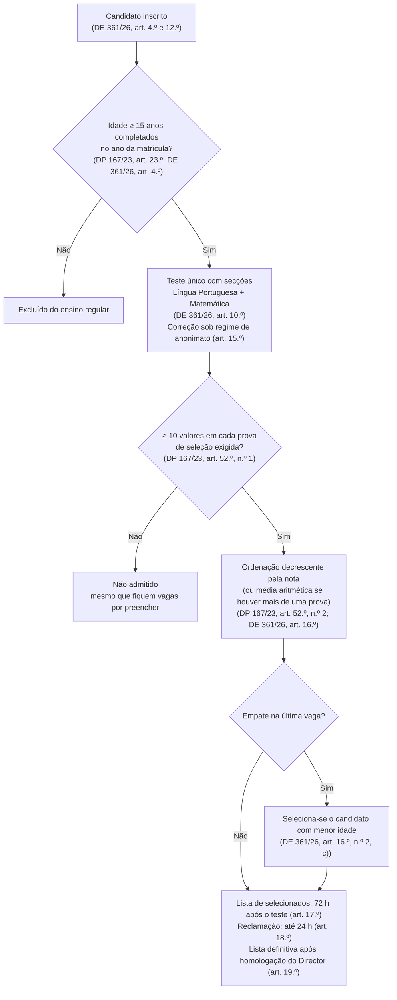
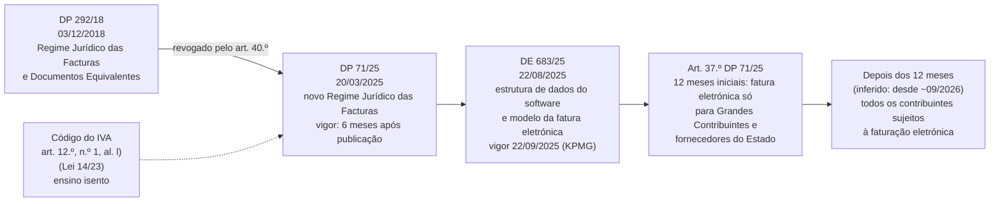
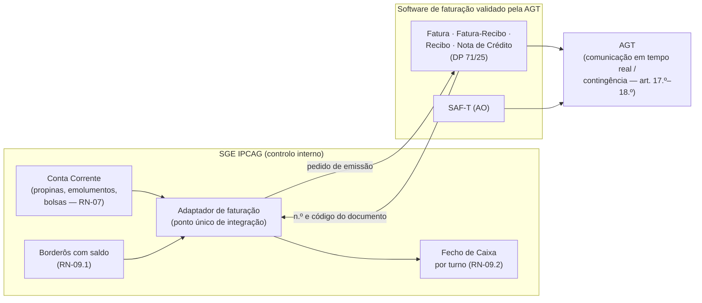

# Verificação das Referências Legais e da Faturação AGT — SGE IPCAG N.º 12008 / BGO

> [!abstract] Navegação
> - **Painel Principal:** [[Inicio|Início do Vault]] | **Índice do Projeto:** [[00 - MOC SGE IPCAG 12008 BGO|MOC]] | **Plano:** [[00.1 - Plano de Engenharia de Requisitos]] (lacunas **L3** e **L7**, decisão **D2**)
> - **Notas verificadas:** [[01 - Dominio e Regras]] · [[02 - Fluxos de Trabalho]] · [[03 - User Stories]] · [[04 - Telas e Documentos]] · [[05 - Modelagem de Dados]] · [[Quadro Legal MED AGT e APD Angola]]
> - **Decisões e questões:** [[12 - Registo de Decisoes e Questoes em Aberto]] (`DEC-002`, `Q-001` a `Q-005`, `Q-018`)
> - **Documentos reais da escola:** [[Achados dos Documentos Reais - Lote 1]] (`DESC-L1`), confrontados com a lei na §3.12

> [!important] O que esta nota é (e o que não é)
> - Confronta **cada diploma e cada regra legal** citados na especificação v1.2 com o texto publicado, e regista o resultado com fonte.
> - **Não altera** o DOC-01 nem nenhuma outra nota: as correções ficam propostas na §5 para a sessão que tem esses ficheiros.
> - **Não é parecer jurídico.** O que não foi possível confirmar fica como pergunta na §6, para a Direção do IPCAG, a Direção Provincial da Educação do Bengo, o contabilista do IPCAG ou a AGT.

---

## 0. Resumo

### 0.1 Principais conclusões

1. **O DP n.º 292/18 (faturas) já não está em vigor.** Foi revogado pelo **DP n.º 71/25, de 20 de Março** (art. 40.º), que é hoje o Regime Jurídico das Facturas. A RN-09 e o `DOF-11` citam um diploma revogado.
2. **A lei obriga a emitir fatura (ou fatura-recibo), não apenas recibo**, mesmo a entidades sem fins lucrativos, e a corrigir por **nota de crédito**. A "Nota de Estorno" do DOC-01 não é um tipo de documento previsto na lei.
3. **O ensino está isento de IVA** (art. 12.º, n.º 1, alínea l) do Código do IVA). Mesmo isento, o documento tem de indicar o motivo da não liquidação e a norma.
4. **Os DE n.º 361/26 e n.º 136/24 existem, mas tratam só da admissão.** Nenhum dos dois é "Normas de Avaliação" nem "Calendário Escolar", como o vault diz.
5. **A admissão à 10ª Classe, tal como está no RN-01.2, contraria o DP n.º 167/23:** a lei exige **pelo menos 10 valores em cada prova** e proíbe admitir abaixo disso **"mesmo que fiquem vagas por preencher"** (art. 52.º). A "redução homologada do limiar" para 9 ou 8 valores é ilegal. O critério de desempate legal é **a menor idade** (DE n.º 361/26), não "maior nota em LP → média da 9ª → mais jovem".
6. **Não foi encontrado nenhum regulamento de avaliação publicado para o Ensino Secundário Técnico-Profissional.** As fórmulas `MT` e `MFD`, o exame de recurso 40/60, o limite de faltas, a nota mínima 7, o veto LP + nuclear e a fórmula da `MFC` **não têm fonte**. O regulamento homólogo do Ensino Geral (DE n.º 106/26) tem regras **diferentes** das do DOC-01 (ver §3).
7. **O Diploma de fim de curso é emitido e assinado pelo Ministro da Educação**, não pelo `DIR_GERAL` (DP n.º 167/23, art. 55.º; DP n.º 227/25, art. 4.º). A escola emite o **Certificado**.
8. **Há regras legais em vigor que a especificação não tem:** confirmação de matrícula **automática** (DP n.º 167/23, art. 50.º, n.º 4); perda do direito à matrícula por reprovação por faltas injustificadas (art. 50.º, n.º 2); anulação da matrícula incompleta 60 dias após o início do ano letivo (art. 50.º, n.º 8); registo dos títulos na **Plataforma Nacional de Certificação** com QR Code dessa plataforma (DP n.º 227/25).
9. **O DP n.º 93/21 aplica-se a "Instituições Públicas"** e não menciona escolas comparticipadas. Usa "Coordenador de Turma", não "Director de Turma". Não define as competências das chefias nem impõe a segregação de funções que o DOC-01 lhe atribui.
10. **Documentos reais (Lote 1, §3.12):**
    - **Fórmulas da escola:** a Prova Global (`PG`), a Classificação Anual `CA = MT3 × 0,6 + PG × 0,4`, as siglas `MTP`/`PP`/`PT` e a ausência de `PT` no III Trimestre **não têm fonte publicada para o ESTP**. A estrutura e os pesos **coincidem**, porém, com a regra das classes de exame do RAA do Ensino Geral, publicada no *Diário da República* e entretanto revogada:
      - `MT3 = (MT1 + MT2 + MACT3) / 3`, sem prova trimestral;
      - `MFED = 0,6 × MT3 + 0,4 × EN` (DE n.º 424/25, Anexo III).

      O DOC-01 inverte os pesos: o seu recurso dá 60% ao exame.
    - **13ª Classe:** o Projecto Tecnológico + Estágio (20 tempos) dos planos curriculares **está confirmado** pelo DP n.º 167/23. A PAP existe na lei, mas **não é uma disciplina**: é a defesa do relatório de estágio no fim do curso.
    - **Língua Portuguesa** só na 10ª e 11ª Classes é compatível com a lei, que deixa a distribuição por classes ao plano curricular de cada curso.

### 0.2 Estado de cada diploma citado no vault

| Diploma citado | Estado | Nota curta |
| :--- | :---: | :--- |
| Lei n.º 17/16 | `Confirmado` | Lei de Bases; 10ª–13ª Classes, 4 anos |
| Lei n.º 32/20 | `Confirmado` / conteúdo `Divergente` | Altera e republica a Lei n.º 17/16; não foi encontrada a escala 0–20 que o vault lhe atribui |
| DP n.º 167/23 | `Confirmado` / conteúdo parcialmente `Divergente` | Não define fórmulas de avaliação, disciplinas nucleares nem a `MFC` |
| DP n.º 93/21 | `Divergente` | Título e âmbito citados de forma errada |
| DE n.º 361/26 | `Confirmado` / objeto `Divergente` | Só regulamento do teste de seleção |
| DE n.º 136/24 | `Confirmado` / objeto `Divergente` | Só regulamento das provas de seleção (antecessor) |
| DP n.º 292/18 | `Divergente` (revogado) | Substituído pelo DP n.º 71/25 |
| Lei n.º 22/11 | `Confirmado` (só existência) | Tratada por outra sessão (L8) |
| Normas GEPE | `Não encontrado` | Sem normativo publicado sobre os mapas |

---

## 1. Método e Fontes

- **Pesquisa no vault:** procura de todos os diplomas citados em DOC-01 a DOC-05 e em [[Quadro Legal MED AGT e APD Angola]] (inventário na §2).
- **Fontes consultadas a 2026-11-02:**
  - **lex.ao**: compilação que reproduz o texto dos diplomas com a referência do *Diário da República* (I Série, número e página).
  - **Angolex**: compilação com a tabela de decretos executivos (data e número do *Diário da República*) e o texto de diplomas recentes que o lex.ao ainda não indexa. O índice de 2026 do lex.ao não tem diplomas do Ministério da Educação.
  - **Fontes secundárias**, só para a faturação eletrónica, onde o texto oficial do DE n.º 683/25 não estava acessível: KPMG Angola, VATupdate, Expansão, Cegid.
- **Limitações:**
  - O portal oficial do *Diário da República* / Imprensa Nacional **não foi consultado diretamente**. Todas as referências "DR I Série n.º …" vêm das compilações acima, e o texto a usar na Fase D deve ser o do *Diário da República*.
  - Nalguns diplomas longos a página foi lida por partes. Quando um artigo não foi lido, isso fica escrito.
- **Convenção nesta nota:**
  - **"Confirmado na fonte"**: o texto foi lido e há citação curta entre aspas.
  - **"Paráfrase"**: o artigo foi lido, mas resumido.
  - **"Inferido"**: conclusão minha, sem texto que a afirme. Fica sempre marcada assim.

---

## 2. Inventário e Estado dos Diplomas

### 2.1 Diplomas citados no vault

| # | Como está citado no vault | Onde | Estado | Identificação oficial (número, data, título, publicação) | Fonte | O que diz de relevante para o SGE |
| :---: | :--- | :--- | :---: | :--- | :--- | :--- |
| 1 | "Lei n.º 17/16" (alterada pela Lei n.º 32/20) | DOC-01 cabeçalho; Quadro Legal §1 | `Confirmado` | **Lei n.º 17/16, de 7 de Outubro** — Lei de Bases do Sistema de Educação e Ensino. DR I Série n.º 170, de 07/10/2016, p. 3993. Revoga a Lei n.º 13/01. | [lex.ao](https://lex.ao/docs/assembleia-nacional/2016/lei-n-o-17-16-de-07-de-outubro/) | Art. 41.º, n.º 1: o Ensino Secundário Técnico-Profissional "realiza-se após a conclusão da 9.ª classe, com a duração de quatro anos". Art. 57.º: as escolas são públicas, privadas ou público-privadas (paráfrase). Art. 98.º, n.º 4: o Estado pode comparticipar instituições de iniciativa privada (paráfrase). Art. 99.º, n.º 2: propinas e emolumentos nas instituições privadas e público-privadas (paráfrase). **Não tem** escala de avaliação nem regras de arredondamento no texto lido. |
| 2 | "Lei n.º 32/20, de 12 de Agosto: Lei de Bases… (altera a Lei n.º 17/16)"; "define… a escala nacional de avaliação de `0` a `20` valores" | DOC-01 cabeçalho e §1.1; Quadro Legal §1 | `Confirmado` (número, data, objeto) · `Divergente` (escala 0–20) | **Lei n.º 32/20, de 12 de Agosto** — altera a Lei n.º 17/16, adita os art. 124.º-A a 124.º-C e republica a Lei de Bases. DR I Série n.º 123, de 12/08/2020, p. 4423. | [lex.ao](https://lex.ao/docs/assembleia-nacional/2020/lei-n-o-32-20-de-12-de-agosto/) · [Angolex](https://angolex.com/paginas/leis/lei-que-altera-a-lei-de-base-de-do-sistema-de-educacao-e-ensino-32a-20a.html) | Art. 41.º alterado: a formação média técnica "corresponde ao II Ciclo do Ensino Secundário Técnico", com "uma duração de 4 anos". **Não foi encontrada** referência a "0 a 20" nem a arredondamento na parte lida (a página é longa e foi lida em parte). A escala 0–20 está confirmada **noutros diplomas** (§3.1), não nesta lei. |
| 3 | "Decreto Presidencial n.º 167/23: Regime Jurídico do Subsistema de ESTP"; "regula… as disciplinas nucleares, o Estágio Curricular, a PAP e a Média Final de Curso (`MFC`)"; limites etários de admissão | DOC-01 §1.1, §1.4, RN-01.2, RN-06; Quadro Legal §1 | `Confirmado` (número, data, título) · `Divergente` (parte do conteúdo atribuído) | **Decreto Presidencial n.º 167/23, de 8 de Agosto** — aprova o "Regime Jurídico do Subsistema de Ensino Secundário Técnico-Profissional". DR I Série n.º 147, de 08/08/2023, p. 3710. Revoga o DP n.º 254/19. Em vigor na data da publicação. | [lex.ao](https://lex.ao/docs/presidente-da-republica/2023/decreto-presidencial-n-o-167-23-de-08-de-agosto/) · [Angolex](https://angolex.com/paginas/decreto-presidencial/regime-juridico-do-subsistema-de-ensino-secundario-tecnico-profissional-167a-23a.html) | Ver §3. Em resumo: estrutura 10ª–13ª (art. 9.º); 28 a 32 tempos letivos semanais (art. 9.º, n.º 4); componentes curriculares (art. 25.º e 27.º); idade mínima de 15 anos (art. 23.º); **remete as normas de avaliação para o Ministro** (art. 30.º, n.º 4); estágio, projeto tecnológico e PAP (art. 27.º, 32.º, 33.º); admissão (art. 49.º e 52.º); matrículas e faltas (art. 50.º); certificado e diploma (art. 54.º e 55.º). **Não menciona** "disciplinas nucleares" nem a fórmula da `MFC`. |
| 4 | "Decreto Presidencial n.º 93/21: Regulamento sobre os Cargos de Direção e Chefia das Instituições Públicas **e Comparticipadas** de Ensino"; "em cumprimento estrito… nenhum operador acumule funções incompatíveis" | DOC-01 §0, §2; DOC-02; DOC-03; DOC-04; DOC-05; Quadro Legal §1 | `Divergente` (título e âmbito) | **Decreto Presidencial n.º 93/21, de 16 de Abril** — "Regime Jurídico do Exercício de Cargo de Direcção e Chefia em Instituições de Educação Pré-Escolar, Ensino Primário e Secundário". DR I Série n.º 67, de 16/04/2021, p. 2536. Revoga o Decreto n.º 37/03. | [lex.ao](https://lex.ao/docs/presidente-da-republica/2021/decreto-presidencial-n-o-93-21-de-16-de-abril/) | Art. 2.º: "aplica-se às Instituições Públicas de Educação Pré-Escolar, do Ensino Primário e Ensino Secundário". **Não menciona** escolas comparticipadas nem público-privadas. Ver §3.9. |
| 5 | "Decreto Executivo n.º 361/26 … Normas de Avaliação, Exames de Admissão/Seleção à 10ª Classe e Calendário Escolar Nacional"; "exige correção cega por Código de Anonimato" | DOC-01 cabeçalho, §1.2, §3.2, RN-01.2; DOC-02 Fluxo 01; DOC-03; DOC-04; DOC-05; Quadro Legal §1–2 | `Confirmado` (existência) · `Divergente` (objeto) | **Decreto Executivo n.º 361/26, de 22 de Julho** — "Regulamento do Teste de Selecção para a Admissão aos Institutos Técnicos e Politécnicos Públicos, Público-Privados e Privados de Ensino". DR I Série n.º 137, de 22/07/2026 (segundo a tabela da Angolex). | [Angolex (texto)](https://www.angolex.com/paginas/decreto-executivo/regulamento-teste-seleccao-admissao-institutos-tecnicos-politecnicos-ensino-361a-26a.html) · [Angolex (tabela)](https://www.angolex.com/paginas/tabelas-legislacoes/decretos-executivos.html) | Trata **apenas** do teste de seleção: requisitos, disciplinas, classificação, desempate, anonimato, vagas, listas e reclamações (ver §3.8). **Não trata** de avaliação das aprendizagens nem de calendário escolar. Não diz que revoga o DE n.º 684/25 nem o n.º 136/24: tem apenas a revogação genérica das disposições contrárias. |
| 6 | "Decreto Executivo n.º 136/24" (mesma descrição do n.º 361/26) | Idem | `Confirmado` (existência) · `Divergente` (objeto) | **Decreto Executivo n.º 136/24, de 24 de Junho** — "Regulamento das Provas de Selecção para Admissão aos Cursos do Ensino Secundário Técnico-Profissional das Instituições Públicas, Público-privadas e Privadas". DR I Série n.º 118, de 24/06/2024, p. 5767. | [lex.ao](https://lex.ao/docs/ministerio-da-educacao/2024/decreto-executivo-n-o-136-24-de-24-de-junho/) | Regulamento anterior das provas de seleção: anonimato (art. 10.º), escala 0–20 (art. 11.º, n.º 1), desempate pela menor idade e, persistindo, nova prova (art. 11.º, n.º 2, c) e d)). **Inferido:** foi substituído na prática pelo DE n.º 684/25 e depois pelo DE n.º 361/26 (mesmo objeto), mas **não foi encontrada revogação expressa**. |
| 7 | "Decreto Presidencial n.º 292/18 (RJFDE / RJF / AGT): … Proíbe a eliminação… obriga à numeração sequencial… e ao uso exclusivo de Nota de Estorno (`NE`)" | DOC-01 cabeçalho, §1.5, RN-09; DOC-02 Fluxo 07; DOC-03 `US-TES-04`; DOC-04 `DOF-11`; DOC-05; Quadro Legal §1–2 | `Divergente` (**revogado**) | **Decreto Presidencial n.º 292/18, de 3 de Dezembro** — Regime Jurídico das Facturas e Documentos Equivalentes. DR I Série n.º 182, p. 5420. **Revogado** pelo DP n.º 71/25, art. 40.º, n.º 1: "É revogado o Decreto Presidencial n.º 292/18, de 3 de Dezembro". | [lex.ao (292/18)](https://lex.ao/docs/presidente-da-republica/2018/decreto-presidencial-n-o-292-18-de-03-de-dezembro) · [lex.ao (71/25)](https://lex.ao/docs/presidente-da-republica/2025/decreto-presidencial-n-o-71-25-de-20-de-marco/) | Mesmo antes de revogado, o DP n.º 292/18 **não previa** "Nota de Estorno": a correção fazia-se por **nota de crédito** com menção de "anulação ou rectificação" (art. 9.º, n.º 5, paráfrase). Ver §4. |
| 8 | "Lei n.º 22/11, de 17 de Junho (APD)" | DOC-01; DOC-03; DOC-04; DOC-05; Quadro Legal | `Confirmado` (só existência) | **Lei n.º 22/11, de 17 de Junho** — Lei da Protecção de Dados Pessoais. DR I Série n.º 114, de 17/06/2011, p. 3185. | [lex.ao](https://lex.ao/docs/assembleia-nacional/2011/lei-n-o-22-11-de-17-de-junho/) | **Fora do âmbito desta nota**: tratada pela sessão da lacuna L8. |
| 9 | "Normas Estatísticas do GEPE / MED: … por Curso, Classe, Turma, Turno, Género e Faixa Etária" | DOC-01; DOC-03; DOC-04 `DOF-12`; Quadro Legal §1 | `Não encontrado` | Não foi encontrado **nenhum normativo publicado** que fixe o formato dos mapas estatísticos. Encontrado apenas: o DE n.º 266/22, de 28 de Julho, que segundo o índice do lex.ao regula o funcionamento do GEPE (texto não lido); e o questionário de recolha do SIGE, anexo ao Anuário Estatístico da Educação de 2019 publicado pelo INE (não lido). | [lex.ao (DE 266/22)](https://lex.ao/docs/ministerio-da-educacao/2022/decreto-executivo-n-o-266-22-de-28-de-julho/) · [INE — Anuário 2019](https://www.ine.gov.ao/Arquivos/arquivosCarregados/Carregados/Publicacao_638121499449003596.pdf) · [UNICEF Angola](https://www.unicef.org/angola/historias/educa%C3%A7%C3%A3o-de-qualidade-come%C3%A7a-com-dados-confi%C3%A1veis) | O formato real do `DOF-12` tem de vir do **último mapa enviado** (artefacto do PLN-00 §5.2) e da Direção Provincial (`Q-LEG-15`). |

### 2.2 Diplomas em vigor que o vault não cita e que afetam o SGE

| Diploma | Publicação | Estado | Fonte | Porque importa |
| :--- | :--- | :---: | :--- | :--- |
| **DP n.º 71/25, de 20 de Março** — Regime Jurídico das Facturas (substitui o DP n.º 292/18) | DR I Série n.º 52, de 20/03/2025, p. 11902. Art. 42.º: "entra em vigor 6 (seis) meses após a sua publicação". **Inferido:** a partir de cerca de 20/09/2025. | `Confirmado` | [lex.ao](https://lex.ao/docs/presidente-da-republica/2025/decreto-presidencial-n-o-71-25-de-20-de-marco/) | Base legal atual da RN-09 e do `DOF-11` (§4) |
| **DE n.º 683/25, de 22 de Agosto** — estrutura de dados do software e modelo da faturação eletrónica | Em vigor a 22/09/2025, segundo a KPMG | `Confirmado` (fonte secundária) | [KPMG Angola](https://kpmg.com/ao/pt/insights/tax-news/estrutura-dados-software.html) · [Expansão](https://expansao.co.ao/gestao/detalhe/o-regime-de-facturacao-electronica-em-angola-67551.html) | Requisitos técnicos do software de faturação (§4.5). **Texto oficial não lido** (`Q-LEG-20`). |
| **Código do IVA**, art. 12.º, n.º 1, alínea l), na redação republicada pela **Lei n.º 14/23, de 28 de Dezembro** | DR I Série n.º 246, de 28/12/2023, p. 8519 | `Confirmado` | [lex.ao](https://lex.ao/docs/assembleia-nacional/2023/lei-n-o-14-23-de-28-de-dezembro/) | Isenção de IVA do ensino (§4.4). Alterações posteriores (Leis do OGE 2025 e 2026) **não verificadas**. |
| **DP n.º 227/25, de 14 de Novembro** — Regulamento sobre a Atribuição e Emissão de Títulos Escolares | DR I Série n.º 216, de 14/11/2025, p. 22013 | `Confirmado` | [lex.ao](https://lex.ao/docs/presidente-da-republica/2025/decreto-presidencial-n-o-227-25-de-14-de-novembro/) | Declarações, certificados e diplomas: quem emite e assina, registo, numeração, QR Code da Plataforma Nacional de Certificação, prazos (§3.7, §3.10) |
| **DE n.º 684/25, de 26 de Agosto** — Regulamento do Teste de Selecção (antecessor do n.º 361/26) | DR I Série n.º 161, de 26/08/2025, p. 19959 | `Confirmado` | [lex.ao](https://lex.ao/docs/ministerio-da-educacao/2025/decreto-executivo-n-o-684-25-de-26-de-agosto/) | Mesmo conteúdo essencial do n.º 361/26 |
| **DE n.º 686/25, de 26 de Agosto** — Calendário Escolar Nacional 2025/2026 | DR I Série n.º 161, de 26/08/2025 | `Confirmado` | [lex.ao](https://lex.ao/docs/ministerio-da-educacao/2025/decreto-executivo-n-o-686-25-de-26-de-agosto/) · [Ver Angola](https://www.verangola.net/va/pt/082025/Educacao/45495/Calendário-escolar-do-ano-lectivo-2526-já-é-conhecido-aulas-começam-a-2-de-Setembro-e-terminam-a-31-de-Julho.htm) | O calendário é **um decreto executivo por ano letivo**. O de 2026/2027 **não foi encontrado** (`Q-005`). |
| **DE n.º 106/26, de 27 de Abril** — Regulamento da Avaliação das Aprendizagens (RAA) da Educação Pré-Escolar, do **Ensino Geral** e da Educação de Adultos | DR I Série n.º 76, de 27/04/2026 (tabela da Angolex) | `Confirmado` (fonte: Angolex) | [Angolex](https://angolex.com/paginas/decreto-executivo/regulamento-da-avaliacao-das-aprendizagens-dos-subsistemas-da-educacao-pre-escolar-ensino-geral-e-educacao-de-adultos-raa-106a-26a.html) | **Não se aplica ao ESTP** (o art. 1.º não o inclui). Serve apenas de **termo de comparação** (§3). O anterior DE n.º 424/25 está marcado como **revogado** na Angolex. |
| **DP n.º 158/25, de 12 de Agosto** — cursos de dupla certificação | lex.ao | `Confirmado` (só existência e objeto) | [lex.ao](https://lex.ao/docs/presidente-da-republica/2025/decreto-presidencial-n-o-158-25-de-12-de-agosto/) | Só se aplica se o IPCAG tiver cursos de dupla certificação (`Q-LEG-08`) |
| **DP n.º 143/25, de 29 de Julho** — certificação de entidades formadoras e instituições de ensino técnico-profissional | lex.ao (índice) | `Confirmado` (só existência; texto não lido) | [índice lex.ao 2025](https://lex.ao/llms/2025.txt) | Pode impor requisitos à instituição. Por analisar. |
| **Decreto Executivo Conjunto n.º 40/21, de 24 de Fevereiro** — "Taxas e Emolumentos a Cobrar Pelos Serviços Prestados Pelas Instituições Públicas do Ensino Secundário" | DR I Série n.º 34, de 24/02/2021 (tabela da Angolex) | `Confirmado` (só existência; texto não lido) | [Angolex — tabela de decretos executivos conjuntos](https://www.angolex.com/paginas/tabelas-legislacoes/decretos-executivos-conjuntos.html) | Pode fixar emolumentos e a forma de pagamento (RUPE?) de declarações e certificados nas escolas **públicas**. Relevante para o achado A11/A15 do Lote 1 e para a `Q-LEG-14`. |

---

## 3. Verificação das Regras Concretas do DOC-01

### 3.0 Quadro-resumo

| # | Regra (DOC-01) | Resultado | Fonte / termo de comparação |
| :---: | :--- | :---: | :--- |
| R1 | Escala `0–20` (RN-01.1) | `Confirmada pela fonte` para as provas de seleção e para o Ensino Geral · **para as pautas do ESTP: sem fonte direta** | DP n.º 167/23, art. 52.º; DE n.º 361/26, art. 16.º; DE n.º 106/26, art. 14.º |
| R2 | Arredondamento `round_med` (*half-up*, `≥ 0,5` sobe) (RN-01.2) | `Confirmada pela fonte` para o teste de seleção · **para as pautas do ESTP: sem fonte** | DE n.º 361/26, art. 16.º, n.º 2, b) |
| R3 | `MT = round_med((MAC + NPP + NPT)/3)` e `MFD = round_med((MT1+MT2+MT3)/3)` com `MT` já arredondadas (RN-01.3–4) | `Sem fonte encontrada — validar com a escola ou a Direção Provincial` | DP n.º 167/23, art. 30.º, n.º 4 remete para normas do Ministro, não encontradas |
| R4 | Exame de recurso: `CF = 40% MFD + 60% Exame` (RN-01.5) | `Sem fonte encontrada — validar…` | O RAA do Ensino Geral **não** tem esta ponderação para o recurso |
| R5 | Limite de faltas `3 × tempos semanais` (anual, por disciplina) (RN-03) | `Sem fonte encontrada — validar…` · o termo de comparação **diverge** | RAA do Ensino Geral: por trimestre, 3/4/5 faltas conforme 1, 2 ou mais tempos |
| R6 | Nota mínima `7`; máximo de `2` (ou 3) disciplinas em atraso (RN-02.3, RN-02.5) | `Sem fonte encontrada — validar…` · o termo de comparação **diverge** | RAA do Ensino Geral: até **três** disciplinas de 7 a 9 |
| R7 | Veto **LP + 1 disciplina nuclear** (RN-02.4) | `Sem fonte encontrada — validar…` · o termo de comparação **diverge** | RAA do Ensino Geral: LP **+ duas** disciplinas específicas da área de formação; o termo "nuclear" não aparece |
| R8 | 13ª Classe: estágio, PAP (mín. 10), júri ≥ 3, fórmula da `MFC` (DOC-01 §1.4, RN-06) | Parcialmente `Divergente`; **fórmula da `MFC` sem fonte** | DP n.º 167/23, art. 27.º, 32.º, 33.º, 54.º, 55.º; DP n.º 227/25 |
| R9 | Admissão à 10ª: `MFA = (LP + Mat)/2`, mínimo 10 sobre a média, mínimo por prova 0, desempate LP → 9ª → idade, redução do limiar, repescagem na 2ª opção, limites etários, Código de Anonimato (RN-01.2) | **`Divergente`** em vários pontos | DP n.º 167/23, art. 23.º, 49.º, 52.º; DE n.º 361/26 |
| R10 | Cargos e competências "do DP n.º 93/21" (DOC-01 §2) | Cargos de direção `Confirmados`; chefias `Confirmadas` com 1 divergência de nome; **competências quase todas sem fonte**; âmbito `Divergente` | DP n.º 93/21, art. 2.º, 4.º, 5.º, 16.º–18.º |

> [!warning] Ponto crítico para a Fase D
> R3 a R7 são o núcleo das pautas e **nenhuma tem fonte publicada encontrada**. Antes de qualquer desenvolvimento do motor de cálculo é obrigatório: (1) obter da Direção Provincial o **regulamento de avaliação em vigor para o ESTP** (`Q-LEG-01`); (2) aplicar a técnica do PLN-00 §4: **recalcular mini-pautas e pautas gerais reais do ano anterior**.

### 3.1 Escala 0–20 (R1)

- **Confirmado na fonte, para a admissão:** DP n.º 167/23, art. 52.º, n.º 1: "pelo menos 10 valores, numa escala de 0 a 20"; DE n.º 361/26, art. 16.º, n.º 1: "A classificação é feita na escala de 0 a 20 valores".
- **Confirmado na fonte, para o Ensino Geral** (termo de comparação): DE n.º 106/26, art. 14.º, n.º 5: "a escala de classificação quantitativa, para o Ensino Secundário, é de 0 a 20 valores".
- **Para as pautas do ESTP:** não foi encontrado o texto que o diga. **Inferido** que se usa 0–20, porque é a escala de todo o Ensino Secundário e da admissão ao ESTP. A confirmação vem das pautas reais.
- **Divergência de atribuição:** o vault atribui a escala à Lei n.º 32/20. Na parte lida da lei, a escala não aparece.

### 3.2 Arredondamento (R2)

- **Confirmado na fonte, para o teste de seleção:** DE n.º 361/26, art. 16.º, n.º 2, b): arredondamento às unidades, considerando-se unidade a fração "não inferior a cinco décimas". Equivale ao `round_med` (*half-up*) do RN-01.2.
- **Ensino Geral** (termo de comparação): DE n.º 106/26, art. 14.º, n.º 2: classificações "arredondadas as unidades mais próximas" (redação da página). Não explicita o caso de exatamente 0,5.
- **Para as pautas do ESTP: sem fonte.** Também fica por confirmar a regra do RN-01.3 de que a `MFD` usa as `MT` **já arredondadas** (`Q-LEG-02`). É a diferença que mais facilmente desvia uma pauta num valor.

### 3.3 Fórmulas `MT` e `MFD` (R3)

- **Sem fonte encontrada — validar com a escola ou a Direção Provincial.**
- O DP n.º 167/23 limita-se a definir a natureza da avaliação (diagnóstica, formativa, sumativa — art. 30.º, paráfrase). O n.º 4 do mesmo artigo entrega as normas ao Ministro da Educação, em articulação com o ministro da Administração Pública, Trabalho e Segurança Social (paráfrase).
- **Não foi encontrado** nenhum regulamento de avaliação **publicado** para o ESTP. Existe na internet uma *"Proposta de Regulamento da Avaliação das Aprendizagens para o Subsistema do ESTP-2025"* ([Scribd](https://www.scribd.com/document/859921425/Proposta-de-Regulamento-da-Avaliac-a-o-das-Aprendizagens-para-o-Subsistema-do-ESTP-2025)). É uma **proposta**, não se sabe se foi aprovada, e o texto não estava legível. **Não deve ser usada como fonte.**
- **Termo de comparação — RAA do Ensino Geral, DE n.º 424/25** (revogado; Anexo III lido nas páginas digitalizadas do *Diário da República*, I Série n.º 112, de 18/06/2025, p. 13921–13923):
  - nas classes de transição, a média de cada trimestre é `(MACT + NPT) / 2`, com **duas** componentes (Tabela 1), não três;
  - a média final é `MFD = (MT1 + MT2 + MT3) / 3` (n.º 3).

  O Anexo III do DE n.º 106/26, que o substituiu, **não foi lido**. Ver também a §3.12.

### 3.4 Exame de recurso 40% / 60% (R4)

- **Sem fonte encontrada — validar…**
- No RAA do Ensino Geral (termo de comparação), a proporção 40/60 só aparece para o **ensino à distância** (art. 30.º). O recurso aplica-se à 12ª Classe, a quem tenha "até três médias finais negativas, de 6 a 9 valores", com exclusões que combinam Língua Portuguesa, Matemática e disciplinas da área de formação (art. 33.º, n.º 8, paráfrase).
- **Inferido:** no Ensino Geral o modelo de recurso é diferente do do DOC-01 (acesso limitado e só na classe terminal). Se o ESTP seguir um modelo análogo, o RN-01.5 e o Fluxo 05 mudam.

### 3.5 Limite de faltas `3 × tempos letivos semanais` (R5)

- **Sem fonte encontrada — validar…**
- RAA do Ensino Geral (termo de comparação), art. 23.º, n.º 15 (paráfrase): retenção por faltas injustificadas **num trimestre**: **3** faltas nas disciplinas com 1 tempo semanal, **4** com 2 tempos, **5** com mais de 2 tempos. É uma regra **por trimestre e por escalões**, não "3 × tempos" por ano.
- **Confirmado na fonte, para o ESTP, uma consequência que o DOC-01 não tem.** DP n.º 167/23, art. 50.º, n.º 2: "O aluno do II Ciclo do Ensino Secundário Técnico-Profissional que tenha reprovado por faltas injustificadas perde o direito à matrícula ou a sua confirmação no ano lectivo seguinte."
  - O n.º 3 obriga a escola a confirmar a matrícula "nos cinco dias úteis subsequentes" quando há justificação.
  - O n.º 1 (escrito para o I Ciclo) prevê a justificação "até a segunda semana do início do ano lectivo corrente".
  - Não está claro se este prazo também vale para o II Ciclo (`Q-LEG-04`).

### 3.6 Nota mínima 7 e transição com deficiências (R6)

- **Sem fonte encontrada — validar…**
- RAA do Ensino Geral (termo de comparação):
  - Art. 23.º, n.º 10: na 10ª e 11ª pode transitar-se com "até três disciplinas" abaixo de 10, com notas "de 7 a 9". O DOC-01 tem como padrão **2**.
  - Art. 23.º, n.º 11 e 12: as disciplinas em atraso eliminam-se em exame **até ao I Trimestre do ano seguinte**, com matrícula condicional. O DOC-01 permite até ao fim da 12ª.
  - Art. 23.º, n.º 13: não pode inscrever-se na 12ª quem tenha disciplina da 11ª por aprovar.
  - Art. 23.º, n.º 14: na 12ª, aprova quem tenha 10 valores em todas as disciplinas. Coincide com o RN-02.3.
- **Inferido:** o valor `7` é plausível (é o limite inferior também no Ensino Geral). Mas o **número máximo de disciplinas** e o **prazo para eliminar as deficiências** divergem do único regulamento publicado comparável.

### 3.7 Veto Língua Portuguesa + disciplina nuclear (R7)

- **Sem fonte encontrada — validar…**
- O conceito de **"disciplina nuclear"** não aparece no DP n.º 167/23 nem no RAA do Ensino Geral.
- No Ensino Geral (art. 23.º, n.º 10), a transição fica excluída quando as negativas incluem "simultaneamente à Língua Portuguesa e duas disciplinas específicas da área de formação". O DOC-01 exige **uma** nuclear; o Ensino Geral exige **duas** específicas.
- **Inferido:** o `is_nuclear` do DOC-01 pode corresponder às "disciplinas específicas da área de formação" ou às da componente técnica. A definição e o número exato têm de vir do regulamento do ESTP.

### 3.8 13ª Classe — estágio, PAP e `MFC` (R8)

| Elemento | DOC-01 | Texto legal | Resultado |
| :--- | :--- | :--- | :---: |
| Duração e classes | 4 anos, 10ª–13ª | DP n.º 167/23, art. 9.º, n.º 2: os cursos médio-técnicos cobrem a 10.ª, 11.ª, 12.ª e 13.ª Classes (paráfrase); Lei n.º 17/16, art. 41.º | `Confirmada` |
| 13ª Classe "dedicada ao Estágio e à PAP" | Classe terminal só com estágio e PAP | Art. 27.º, n.º 2 (paráfrase): a componente técnica (cerca de 60%) inclui **20 tempos letivos semanais** de estágio supervisionado na 13ª Classe. A carga semanal regular é de 28 a 32 tempos (art. 9.º, n.º 4). | Parcialmente `Divergente`. **Inferido:** a 13ª pode ter outras disciplinas além do estágio. Confirmar na matriz curricular (`Q-LEG-07`). |
| Componentes curriculares | "Socio-Cultural", "Científica", "Técnica, Tecnológica e Prática" | Art. 25.º, n.º 1 (paráfrase): **Sócio-Ambiental-Cultural**, Científica e Técnica, Tecnológica e Prática; pesos aproximados de 15% / 25% / 60% (art. 27.º) | `Divergente` (nome da 1ª componente) |
| **Projeto tecnológico** | Não existe no DOC-01 | Art. 32.º: o projeto tecnológico é avaliado com critérios prévios (paráfrase). Art. 33.º, n.º 1: para o diploma é preciso aprovação "em todas as disciplinas do plano curricular", **incluindo o projeto tecnológico**, e na PAP. | `Divergente` (lacuna) |
| Natureza da PAP | "Projeto técnico-científico final de curso" defendido perante banca | Art. 33.º (paráfrase): a PAP consiste na **apresentação e defesa do relatório de estágio** perante um júri | `Divergente` |
| Júri da PAP | ≥ 3 membros: Presidente, Arguente, Orientador | Art. 33.º, n.º 2: o júri "é integrado por professores" **e por representantes dos trabalhadores e dos empregadores** do setor (paráfrase da segunda parte) | `Divergente` |
| Nota da PAP | Separada da nota do estágio; mínimo 10 | Art. 33.º, n.º 3: a classificação considera também "a qualidade do desempenho profissional atingido pelo estagiário". Não há valor mínimo no texto lido. | Parcialmente `Divergente`. **Inferido:** a PAP já integra o desempenho no estágio, e a fórmula do RN-06 (com `NE` e `NPAP` separados) pode contar o estágio duas vezes. Mínimo 10 sem fonte. |
| Fórmula da `MFC` | `(MPC·P1 + NE·P2 + NPAP·P3)/ΣP`, ex. `(2·MPC + NE + NPAP)/4` | Não há fórmula no DP n.º 167/23 nem no DP n.º 227/25 (partes lidas) | `Sem fonte encontrada — validar…` |
| Certificado | Emitido pela escola; assinam `CHEFE_SEC_PED`, `SUB_PED`, `DIR_GERAL` (`DOF-10`) | DP n.º 167/23, art. 54.º, n.º 1 (paráfrase): certificado emitido pela instituição, assinado pelo **Director e pelo Subdirector Pedagógico**. DP n.º 227/25, art. 8.º, n.º 1, q): "Assinatura do(s) Director(es) e carimbo ou selo branco". | `Confirmada` (com ajuste de assinaturas) |
| **Diploma** | "Diploma de Técnico Médio" emitido e assinado na escola pelo `DIR_GERAL` (`DOF-10`) | DP n.º 167/23, art. 55.º, n.º 1: diploma "emitido pelo Titular do Departamento Ministerial responsável pela Educação". DP n.º 227/25, art. 4.º, h): "assinado pelo Titular do Departamento Ministerial responsável pelo Sector da Educação". Art. 55.º, n.º 2: deve indicar o **nível do Quadro Nacional de Qualificações**. | **`Divergente`** |
| Título "Técnico Médio" | `TÉCNICO MÉDIO DE [CURSO]` | Não aparece no DP n.º 167/23. O DP n.º 227/25 (art. 12.º, paráfrase) refere os graus de Técnico Básico e **Técnico Médio**. | `Confirmada` (pelo DP n.º 227/25) |

### 3.9 Admissão à 10ª Classe (R9)

| Elemento do RN-01.2 / Fluxo 01 | Texto legal | Resultado |
| :--- | :--- | :---: |
| Provas: LP + "Matemática/Específica" | DE n.º 361/26, art. 10.º: um **único teste com secções**. "Em todos os cursos" há Língua Portuguesa e Matemática. Os Institutos Industriais têm Física; os de Saúde, Agrários e de Pescas têm Biologia e Química. Administração e Gestão não é mencionada. | Parcialmente `Divergente`. **Inferido:** no IPCAG, só LP + Matemática. |
| `MFA = round_med((LP + Mat)/2)` | DP n.º 167/23, art. 52.º, n.º 2: ordenação pelo "valor obtido na prova, ou na média aritmética dos valores obtidos nas provas de selecção, se forem mais do que uma". O DE n.º 361/26 fala em "média aritmética positiva dos testes realizados", mas prevê um único teste. | **Indeterminado**: não se sabe se as secções contam como provas separadas (`Q-LEG-10`) |
| `nota_minima_admissao` = 10 sobre a `MFA` | Art. 52.º, n.º 1: "pelo menos 10 valores, numa escala de 0 a 20, **em cada uma das provas** de selecção" | `Divergente`: o mínimo de 10 aplica-se a **cada prova**, não à média |
| `nota_minima_por_prova` = **0** por padrão | Idem | **`Divergente`**: o padrão legal é **10** |
| Redução homologada do limiar para 9 ou 8 com vagas sobrantes (estado `DespachoLimiar`) | Art. 52.º, n.º 1: "mesmo que fiquem vagas por preencher" | **`Divergente` — contraria a lei.** Nota: o DE n.º 136/24 (art. 11.º, n.º 3, paráfrase) admitia "excepcionalmente" candidatos com média negativa dentro das vagas. Essa disposição **não aparece** nos DE n.º 684/25 e n.º 361/26 (partes lidas) e é contrária ao DP n.º 167/23. |
| Desempate: 1.º maior nota LP/nuclear → 2.º média da 9ª → 3.º mais jovem | DE n.º 361/26, art. 16.º, n.º 2, c): com empate e falta de vagas, "são seleccionados os candidatos com menor idade". O DE n.º 136/24 acrescentava nova prova se persistisse o empate. O DP n.º 167/23, art. 49.º, n.º 4, quando há mais candidatos que vagas, manda selecionar "com base na idade e na média de conclusão do Ensino Primário ou do I Ciclo do Ensino Secundário Geral". | **`Divergente`**: o 1.º critério do DOC-01 não tem fonte. A relação entre o art. 49.º, n.º 4 e o art. 52.º fica por esclarecer (`Q-LEG-11`). |
| Repescagem automática na 2ª opção de curso/turno | Não aparece no DP n.º 167/23 nem nos DE n.º 136/24, 684/25 e 361/26 | `Sem fonte encontrada`: é **prática interna** (validar com a escola) |
| Limites etários `idade_minima_ingresso` / `idade_maxima_ingresso_regular` "segundo o DP n.º 167/23" | Art. 23.º, n.º 1, b): "15 anos completados no ano da matrícula"; art. 23.º, n.º 2: 17 anos para o ensino de adultos (paráfrase). **Idade máxima: não aparece.** | Mínimo `Confirmado`; máximo `Sem fonte` |
| Habilitação de acesso: conclusão da 9ª Classe | DP n.º 167/23, art. 22.º, n.º 1, b): conclusão do I Ciclo do Ensino Secundário (paráfrase); Lei n.º 17/16, art. 41.º, n.º 1 | `Confirmada` |
| **Código de Anonimato** criptográfico | DE n.º 361/26, art. 15.º: correção "sob regime de anonimato". Não prevê código; segundo o art. 14.º, n.º 5, o candidato escreve o nome e o número de ordem na folha. | Princípio `Confirmado`. O código é **escolha de implementação** compatível (ex.: cabeçalho destacável). |
| Vagas por curso/turno | DE n.º 361/26, art. 7.º: as vagas dependem da "existência comprovada de condições de garantia da qualidade da formação" (salas, equipamentos, professores, locais de estágio…) | `Confirmada` (o número é decisão interna) |
| Listas, reclamações, homologação | Art. 13.º (afixação dos aptos), art. 17.º (seleccionados "72 horas após a realização do teste de selecção"), art. 18.º (reclamação "até 24 horas após a publicação das listas"; decisão em 24 h), art. 19.º (lista definitiva após homologação do **Director**) | **Lacuna** no DOC-01/DOC-02: os prazos de 72 h e 24 h e o fluxo de reclamação não estão especificados |
| Taxa e custos | DE n.º 361/26, art. 12.º: comprovativo de pagamento da taxa de inscrição; art. 9.º, n.º 2: encargos a cargo da instituição (paráfrase) | `Confirmada` (valor da taxa não fixado) |
| Inscrição por portal | Art. 5.º, n.º 1: candidatura presencial ou "através do portal electrónico criado para o efeito" (paráfrase) | Novo requisito possível (`Q-LEG-12`) |
| Integração no Regulamento Interno | Art. 21.º (paráfrase): o regulamento integra o Regulamento Interno da instituição, homologado pelo Gabinete/Secretaria Provincial da Educação | Contribui para a `Q-018` |

### 3.10 Cargos e competências do DP n.º 93/21 (R10)

**Âmbito:** o art. 2.º aplica-se às "Instituições Públicas". O IPCAG é descrito como **comparticipado**. A Lei n.º 17/16 fala em escolas públicas, privadas e **público-privadas** (art. 57.º, paráfrase) e não usa o termo "comparticipada". Fica por saber se o DP n.º 93/21 se aplica ao IPCAG por obrigação, por convénio com o Estado ou só por analogia (`Q-LEG-13`).

| Perfil DOC-01 | Cargo no DP n.º 93/21 | Competências no decreto | Resultado |
| :--- | :--- | :--- | :---: |
| `DIR_GERAL` "Director Geral" | **Director** — art. 4.º, n.º 6: "Os Institutos Técnicos, Politécnicos e os Magistérios são dirigidos por 1 (um) Director", coadjuvado por dois subdirectores | Art. 16.º (paráfrase): órgão de gestão nas áreas pedagógica, científica, cultural, financeira e administrativa; dirigir e representar a escola; poder disciplinar; avaliação de desempenho. **Não há** alíneas sobre homologar pautas, assinar diplomas ou aprovar bolsas. | Cargo `Confirmado` (o nome legal é "Director"); competências do DOC-01 `Sem fonte` (práticas internas ou outros diplomas) |
| `SUB_PED` | **Subdirector Pedagógico** — art. 4.º, n.º 6; art. 17.º | a) "Orientar e controlar a formação das turmas, e a elaboração e distribuição dos horários"; d) "Supervisionar as aulas dos Professores…"; e) "Orientar o processo de elaboração das avaliações, nos termos das normas vigentes". Não há alíneas sobre pautas, faltas ou matrículas. | Cargo `Confirmado`. **A formação de turmas e os horários são competência legal do `SUB_PED`** (relevante para C04 e para a `Q-011`). Abrir/fechar trimestres, DISP e reabrir pautas: `Sem fonte`. |
| `SUB_ADM` | **Subdirector Administrativo** — art. 4.º, n.º 6; art. 18.º | a) inventário do património; b) "Velar pela assiduidade, pontualidade, desempenho e disciplina dos trabalhadores"; d) projeto de orçamento; e) gerir instalações e equipamentos | Cargo `Confirmado`; ponto/assiduidade `Confirmada`. Propinas, estornos e fecho de caixa: `Sem fonte` (controlo interno). **Património (C20) é competência legal do `SUB_ADM`** (relevante para a `Q-019`). |
| `CHEFE_SEC_PED` / `CHEFE_SEC_GER` | **Chefe de Secretaria** — art. 5.º, n.º 1, j); n.º 3: os Magistérios "funcionam com 2 (dois) Chefes de Secretaria, sendo 1 (um) Geral e 1 (um) Pedagógico", e o mesmo se aplica ao ESTP | **Competências não definidas** no decreto | Cargos `Confirmados`; competências `Sem fonte` |
| `COORD_CURSO` | Coordenador de Curso — art. 5.º, n.º 1, b) | Não definidas | `Confirmado` (cargo) |
| `COORD_DISC` | Coordenador de Disciplina — art. 5.º, n.º 1, c) | Não definidas | `Confirmado` (cargo) |
| `COORD_TURNO` | Coordenador de Turno — art. 5.º, n.º 1, f) | Não definidas | `Confirmado` (cargo) |
| `DIR_TURMA` "Director de Turma" | **"Coordenador de Turma"** — art. 5.º, n.º 1, e). Art. 12.º, n.º 6 (paráfrase): indicado pelo Director, sem remuneração, com redução de 2 tempos letivos. | Não definidas. A justificação de faltas como exclusivo do `DIR_TURMA` não tem fonte. | `Divergente` (nome) |
| — (não modelado) | Coordenador de Educação Física, Círculos de Interesse e Desporto Escolar — art. 5.º, n.º 1, g) | Não definidas | Lacuna (ver se existe no IPCAG) |
| — (não modelado) | **Coordenador para a Inserção na Vida Activa (GIVA)** — art. 5.º, n.º 1, h) | Não definidas | Lacuna. **Inferido:** relevante para os estágios da 13ª (C08). |
| "Segregação de funções em cumprimento estrito do DP n.º 93/21" | — | O decreto **não** trata de segregação de funções nem de sistemas informáticos | `Divergente` (atribuição): é uma **decisão de controlo interno** do SGE, válida, mas não é imposta por este decreto |

**Outros dados úteis do decreto** (para C14, mandatos e substituições):
- Comissão de serviço de 5 anos, renovável uma vez (art. 11.º, 12.º e 6.º, n.º 5, paráfrase).
- As chefias dos Institutos são nomeadas pelo Director (art. 12.º, paráfrase).
- Na ausência do Director, substitui-o o subdirector que ele designar (art. 24.º, paráfrase).

### 3.11 Regras legais em vigor que a especificação não tem

| Regra | Fonte (confirmada) | Impacto |
| :--- | :--- | :--- |
| **Confirmação de matrícula automática** | DP n.º 167/23, art. 50.º, n.º 4: "A confirmação de matrícula em todas as classes do Ensino Secundário Técnico-Profissional é automática e da responsabilidade da respectiva Escola", dispensando a deslocação dos encarregados | Fluxo 02 e `EP-MAT`: hoje a confirmação é um ato anual ao balcão. Conflito possível com o **semáforo financeiro (RN-08)** se este bloquear a confirmação por dívidas (`Q-LEG-05`). |
| Matrícula incompleta anulada | Art. 50.º, n.º 8: "Todo o aluno deve completar o seu processo de matrícula até 60 dias após o início do ano lectivo, sem o qual a matrícula será imediatamente anulada." | C03: prazo e alerta para o processo individual incompleto |
| Transição do I para o II Ciclo | Art. 50.º, n.º 6–7: no II Ciclo a matrícula é feita na 10ª Classe; na passagem do I para o II Ciclo a confirmação "não é feita de forma automática" | Confirma a matrícula inicial na 10ª (RN-05 e Fluxo 02) |
| Reprovação por faltas → perda do direito à matrícula | Art. 50.º, n.º 2–3 (§3.5) | RN-03 e Fluxo 02 |
| Títulos escolares | DP n.º 227/25: declarações num prazo máximo de "5 (cinco) dias úteis" (art. 9.º, n.º 6); **QR Code "disponibilizado por uma Plataforma Nacional de Certificação"** (art. 8.º, n.º 3); número sequencial e código alfanumérico (art. 8.º, n.º 3); "um livro de registo e/ou uma base de dados" (art. 13.º, n.º 1); registo na Plataforma Nacional de Certificação até 30 dias após o fim do ano letivo (art. 13.º, n.º 2, paráfrase); 2ª via em 5 dias úteis quando o erro é da escola (art. 9.º, n.º 8, paráfrase); **pagamento por referência RUPE** antes de o pedido se considerar formalizado (art. 10.º, n.º 4, paráfrase) | RN-10.2 (Livro/**Folha/Termo**: "termo" e "folha" **não aparecem** no decreto); RN-10.3 (QR próprio vs. QR da plataforma nacional); C09; C18 (nova integração); RN-08 e Fluxo 07 (emolumentos de títulos pagos por RUPE ao Estado?, `Q-LEG-14`) |

### 3.12 Confronto com os documentos reais da escola (Lote 1)

Fonte dos factos da escola: [[Achados dos Documentos Reais - Lote 1]] (`DESC-L1`), achados A1, A2, A6 e A7. Para cada prática real procurou-se a base legal nos diplomas da §2. Os textos do DP n.º 167/23 e do DE n.º 424/25 foram relidos na íntegra, a partir da versão em texto do lex.ao.

| Achado | Prática real (documentos da escola) | Base legal encontrada | Resultado |
| :---: | :--- | :--- | :---: |
| A1 | Componentes trimestrais `MTP` (Média de Trabalho Prático), `PP` (Prova do Professor) e `PT` (Prova Trimestral); médias `M1`, `M2` e `M3/CF` | **Nenhuma** para o ESTP. O RAA do Ensino Geral (DE n.º 424/25, Anexo III; revogado) usa outras siglas: `MT` "Média do trimestre", `MACT` "Média das avaliações contínuas do trimestre" e `NPT` "Nota da prova trimestral". Usa também **duas** componentes, `MT = (MACT + NPT) / 2` (Tabela 1), e **não tem prova do professor**. | `Sem fonte publicada encontrada — validar com a escola ou a Direção Provincial`. A fórmula de `M1`/`M2` com três componentes continua desconhecida. |
| A1 | **Sem `PT` no III Trimestre**; no seu lugar há uma **Prova Global (`PG`)** | **Nenhuma** para o ESTP; o termo "Prova Global" não aparece no DP n.º 167/23 nem nos DE n.º 424/25, 686/25 e 81/26. **Paralelo exato no Ensino Geral** (DE n.º 424/25, revogado, Anexo III, n.º 5 e Tabela 4, DR p. 13922–13923): nas **classes de exame**, o III Trimestre calcula-se **sem a prova trimestral** e é cumulativo, `MT3 = (MT1 + MT2 + MACT3) / 3`. O calendário 2025/2026 (DE n.º 686/25) reserva "10 (dez) dias úteis para as provas trimestrais (I, II e III Trimestres)", sem nomear o ESTP. | `Sem fonte` para o ESTP. A estrutura **coincide** com a regra das classes de exame do Ensino Geral. **Inferido:** `M3/CF` é este `MT3` cumulativo e a Prova Global ocupa o lugar do exame. |
| A1 | **`CA = MT3 × 0,6 + PG × 0,4`** | **Nenhuma** para o ESTP. **Fórmula idêntica no Ensino Geral** (DE n.º 424/25, revogado, Anexo III, n.º 6, DR p. 13923): na 6ª e 9ª Classes, "`MFED = 0,6 × MT3 + 0,4 × EN`", em que `MFED` é a "Média final de exame por disciplina" e `EN` o "Exame nacional". Na 12ª Classe do Ensino Geral os pesos são outros: "`MFED = 0,5 × MT3 + 0,5 × EN`" (n.º 7). Ainda no mesmo anexo, com exames combinados: `MFD = 0,6 × MAC(A) + 0,4 × MEC` (n.º 4, a)). | `Sem fonte` para o ESTP. Os **pesos 0,6 / 0,4 sobre `MT3` estão confirmados no *Diário da República*** para o Ensino Geral. **Inferido:** o modelo da escola aplica ao ESTP a regra das classes de exame do Ensino Geral, com a Prova Global no lugar do Exame Nacional. Falta saber se esta regra ainda vale depois da revogação pelo DE n.º 106/26 (Anexo III não lido). |
| A2 | Duas nomenclaturas: `MTP`/`PP`/`PT` (modelo do Gabinete Provincial, código `DEE-PEEP-001-ACE`) e `MAC`/`NPP`/`NPT` (modelo da escola) | Nenhuma para o ESTP. A única nomenclatura publicada encontrada é a do Ensino Geral (`MACT`, `NPT`, `MT`, `MFD`). | `Sem fonte`: adotar a do **modelo oficial do Gabinete Provincial** até haver norma (`Q-LEG-21`) |
| A6 | 13ª Classe = **Projecto Tecnológico** (8 h/semana) + **Estágio Curricular Supervisionado** (20 h/semana); Projecto Tecnológico já na 12ª (2 h) | DP n.º 167/23, art. 27.º, n.º 2, c): 60% para a componente técnica, "sendo dedicadas ao estágio profissional supervisionado vinte tempos lectivos semanais, na 13.ª Classe". Art. 4.º, u): o Projecto Tecnológico é uma "actividade curricular de natureza inter e transdisciplinar" que produz "um produto técnico concreto". Art. 32.º, n.º 1: é "objecto de avaliação e de classificação final". | `Confirmada pela fonte` (20 tempos de estágio e Projecto Tecnológico avaliado). As 8 h do Projecto Tecnológico vêm do plano curricular (**inferido**: 8 + 20 = 28 tempos, dentro dos 28–32 do art. 9.º, n.º 4). |
| A6 | Os planos **não têm "PAP"** | DP n.º 167/23, art. 4.º, w): a PAP é a "apresentação e defesa perante um júri, de um relatório reflexivo sobre o estágio curricular supervisionado", feita "no final do Curso de Formação Média-Técnica". Art. 33.º, n.º 1: o diploma exige aprovação "em todas as disciplinas do plano curricular, incluindo no projecto tecnológico", **e** aprovação na PAP. Art. 33.º, n.º 4: a PAP "é objecto de regulamentação própria" (não encontrada). | `Confirmada pela fonte`: a PAP **existe**, mas é uma **prova final**, não uma disciplina do plano. Por isso não aparece nos planos. |
| A6 | "A PAP é a defesa do Projecto Tecnológico?" | **Não, no curso médio-técnico.** A defesa do Projecto Tecnológico chama-se **Prova de Aptidão Técnica** e só existe na Formação Profissional **Básica** (I Ciclo): art. 4.º, v) e art. 31.º, n.º 1. No médio-técnico, a PAP é a defesa do **relatório de estágio** (art. 4.º, w); art. 33.º, n.º 1). | `Confirmada pela fonte`. O DOC-01 (§1.4: PAP = "projeto técnico-científico") mistura as duas provas (`COR-LEG-16`). |
| A7 | **Língua Portuguesa** (e toda a componente sócio-cultural) só na **10ª e 11ª Classes** | DP n.º 167/23, art. 14.º, n.º 1 e 3: cada curso é criado por "Decreto Executivo do Titular do Departamento Ministerial responsável pela Educação", que regulamenta "o plano curricular e o programas das disciplinas". Art. 28.º: o plano curricular indica as disciplinas "a ministrar em cada ano lectivo". Art. 25.º, n.º 2: a componente Sócio-Ambiental-Cultural é "comum a todos os Cursos de Formação Média-Técnica". Art. 27.º, n.º 2, a): 15% da carga total. Nenhum artigo exige Língua Portuguesa em todas as classes. | **Compatível com a lei** (**inferido**). A base direta é o **decreto executivo de criação de cada curso**, que aprova o plano. Esses decretos **não foram encontrados** (`Q-LEG-22`). |

**Consequências para as regras** (a juntar às correções da §5):
- **RN-01 / RN-02 (A1):**
  - O modelo real tem uma classificação anual com Prova Global. Os pesos 60/40 incidem sobre `MT3` e `PG`.
  - O DOC-01 tem um exame de recurso com 40% `MFD` + 60% exame. **Inferido:** o DOC-01 inverteu ou confundiu a ponderação.
  - Nem o modelo real nem o DOC-01 têm fonte publicada **para o ESTP**. O modelo real tem um precedente publicado no Ensino Geral (classes de exame do DE n.º 424/25). O DOC-01 não tem nenhum.
  - A regra a implementar é a do **modelo oficial em uso**, confirmada por escrito pela Subdirecção Pedagógica e pelo Gabinete Provincial e testada com pautas reais do ano anterior.
- **RN-02.4 (A7):** o veto de Língua Portuguesa já se aplica no DOC-01 só à 10ª e 11ª, por isso **não há conflito**. Falta saber quais são as "nucleares" no plano real.
- **RN-06, Fluxo 06 e `DOF-08B` (A6):** o modelo passa a ter três elementos distintos, todos previstos na lei:
  - a disciplina **Projecto Tecnológico** (12ª e 13ª), com classificação final (art. 32.º);
  - o **Estágio Curricular Supervisionado** (13ª, 20 tempos);
  - a **PAP** (defesa do relatório de estágio perante um júri com professores e representantes de trabalhadores e de empregadores; art. 33.º).

  A fórmula da `MFC` continua sem fonte.

---

## 4. Faturação AGT (Lacuna L7)

### 4.1 Quadro legal em vigor

**Confirmado na fonte (DP n.º 71/25, lex.ao):**
- **Objeto (art. 1.º):** regras de "emissão, rectificação, anulação" e arquivo de faturas e documentos fiscalmente relevantes.
- **Obrigação de faturar (art. 4.º):** "É obrigatória a emissão de factura em todas as transmissões de bens, prestações de serviços" (n.º 1), incluindo "Em todas as actividades económicas realizadas por entidades sem fins lucrativos" (n.º 2, b)).
- **Recibos (art. 6.º):** "É obrigatória a emissão de recibos sempre que haja pagamento total ou parcial de um bem ou serviço facturado". A fatura-recibo dispensa o recibo separado (paráfrase).
- **Meios de emissão (art. 7.º):** os contribuintes dos regimes Geral e Simplificado do IVA "devem emitir facturas através de softwares de facturação validados pela Administração Geral Tributária". Os do Regime de Exclusão podem usar blocos impressos ou o Portal do Contribuinte.
- **Limite do Portal do Contribuinte (art. 9.º):** "300 facturas e documentos fiscalmente relevante por ano".
- **Prazo de emissão (art. 8.º, n.º 1–3, paráfrase):** até ao 5.º dia útil seguinte à operação; admite fatura mensal global.
- **Correção (art. 8.º, n.º 4–5, paráfrase):** a anulação ou retificação faz-se por **nota de crédito** com o motivo, com a menção "anulação" ou "rectificação" e com a identificação do documento original. Os n.º 8–9 admitem anular no software validado, sem nota de crédito, em certos casos (ex.: fatura não entregue ao adquirente).
- **Requisitos da fatura (art. 10.º):**
  - NIF do fornecedor;
  - "Numeração sequencial e cronológica por tipo de documento" (n.º 1, b)), com uma ou mais séries de numeração identificadas;
  - o "Motivo justificativo da não liquidação do imposto", com a norma legal (n.º 1, f), paráfrase).
- **Faturação eletrónica:**
  - "Estão obrigados à facturação electrónica os contribuintes enquadrados no Regime Geral" (art. 16.º, n.º 1); os do Regime de Exclusão podem aderir (n.º 2).
  - "O contribuinte deve utilizar software de facturação validado ou disponibilizado pela Administração Geral Tributária" (art. 17.º), com transmissão em tempo real. Se a comunicação falhar mais de 60 dias, o sistema tem de bloquear a emissão (paráfrase).
- **Contingência (art. 18.º, paráfrase):** quando a faturação eletrónica não está disponível emitem-se faturas em contingência, marcadas como pendentes de autorização e submetidas depois à AGT.
- **SAF-T:**
  - Os contribuintes dos regimes Simplificado e Geral enviam faturas, recibos e outros documentos "em formato de Ficheiro Normativo de Inspecção Tributária (SAF-T)" (art. 25.º).
  - O SAF-T da contabilidade do ano anterior entrega-se "até ao dia 10 de Abril de cada ano" (art. 24.º, n.º 1, e)).
- **Transição (art. 37.º):**
  - n.º 1: "Nos primeiros 12 meses após a entrada em vigor do Decreto Executivo previsto no artigo anterior, a obrigatoriedade de emissão de factura electrónica aplica-se apenas aos contribuintes cadastrados na Repartição Fiscal dos Grandes Contribuintes e aos fornecedores do Estado".
  - n.º 2: depois disso, aplica-se "a todos os contribuintes sujeitos à facturação electrónica".
  - n.º 3: os demais emitem "em formato electrónico, conforme software em utilização certificado pela Administração Geral Tributária".
- **Reporte especial (art. 38.º):** operações de 25.000.000,00 Kz ou mais documentadas por fatura eletrónica ou no Portal do Contribuinte (paráfrase).
- **Coimas (art. 35.º, paráfrase):**
  - fatura não emitida: 7% do valor (15% em reincidência);
  - falta de elementos obrigatórios: 5% ou 1%;
  - omissão de documentos no SAF-T e falta de entrega durante mais de três períodos seguidos também são punidas.

**De fontes secundárias (a confirmar no texto oficial — `Q-LEG-20`):**
- Comunicação por API com validação pela AGT e código único por fatura ([VATupdate](https://www.vatupdate.com/2026/01/02/briefing-document-e-invoicing-in-angola)).
- Faturas em contingência com limite de 45 dias para a submissão (VATupdate).
- Ficheiro SAF-T de inventário até 15 de Fevereiro (VATupdate).
- Coima de 600.000 Kz ao produtor de software por período afetado, quando o ficheiro é rejeitado por falha do software (VATupdate).
- Pedido de certificação no Portal da AGT, área "Produtores de Software", através do **Modelo 8** ([Reclame Aqui — fonte de baixa autoridade](https://reclameaqui.ao/blog/software-facturacao-certificado-agt)).
- A AGT suspendeu softwares certificados por irregularidades (ex.: setembro de 2025, [VATupdate](https://www.vatupdate.com/2025/08/30/agt-suspends-fastfactura-and-quianni-software-due-to-irregularities-effective-september-2025)). A certificação pode ser retirada.

### 4.2 Tipos de documento: o que muda na RN-09 e no `DOF-11`

| DOC-01 / DOF-11 hoje | Tipo legal (DP n.º 71/25, art. 3.º) | Observação |
| :--- | :--- | :--- |
| Recibo Oficial Sequencial (`RC`) **sem fatura** | **Fatura** (alínea f)), **Fatura-Recibo** (alínea k)) e **Recibo** (alínea o)) | A lei obriga à **fatura** em cada prestação de serviços (art. 4.º). O recibo só prova o pagamento de algo **faturado** (art. 6.º). Um recibo isolado não chega. |
| Nota de Estorno (`NE`) | **Nota de Crédito** (alínea l)) | "Nota de Estorno" não é um tipo legal. A sigla `NE` também **colide** com `NE` = Nota do Estágio no RN-06. |
| — | **Nota de Débito** (alínea m)) | Talvez útil para multas de mora (`Q-LEG-17`) |
| Mapa de Fecho de Caixa (`DOF-11C`) | Não é documento fiscal | Fica como documento interno de controlo; sem alteração |

**Inferido (modelo de documentos a validar com o contabilista — `Q-LEG-16`):**
- **Propinas:** como a fatura tem de ser emitida até ao 5.º dia útil após a operação (art. 8.º), uma propina paga com atraso não pode esperar pelo pagamento para ser faturada. O modelo compatível seria **uma Fatura mensal por aluno** (≈ 1.120 por mês) e um **Recibo** a cada pagamento.
- **Emolumentos pagos no ato** (declarações, inscrições): **Fatura-Recibo**.
- **Fraude bancária** (talão falso): o serviço continua prestado e faturado; o que cai é o **pagamento**. O instrumento adequado seria a **anulação do recibo** no software validado, não uma nota de crédito sobre a fatura. A dívida reabre naturalmente (a fatura fica por pagar), o que coincide com o que a RN-09 já pretende. Confirmar com a AGT ou o contabilista.
- **Bolsa de 100%:** saber se se emite fatura a zero ou não se emite nenhuma (`Q-LEG-18`).

### 4.3 Séries de numeração

- **Confirmado na fonte:** "Numeração sequencial e cronológica por tipo de documento" (art. 10.º, n.º 1, b)), com séries identificadas. Segundo o resumo do texto, a numeração é **por ano fiscal**. O DP n.º 292/18 dizia "por tipo de documento e anos económicos" (art. 11.º, n.º 1, b), paráfrase).
- **Inferido:**
  - A série reinicia por **ano fiscal**, não por **Ano Letivo** (Setembro–Julho). Uma série `RC IPCAG2026/…` é coerente se `2026` for o ano civil.
  - Cada tipo (FT, FR, RC, NC) tem a sua sequência.
  - Se a `DEC-002` for (b), a numeração é a do software certificado. Isto responde em parte à `Q-004`.

### 4.4 IVA: isenção do ensino e documentos

- **Confirmado na fonte:** Código do IVA, art. 12.º, n.º 1, alínea l), na redação republicada pela Lei n.º 14/23: isenta "A prestação de serviços de ensino, efectuada por estabelecimentos enquadrados na Lei de Base do Sistema de Educação e Ensino".
- **Não confirmado:**
  - se as alterações posteriores ao Código (Leis do OGE de 2025 e 2026) mexeram nesta alínea;
  - se a isenção cobre também **emolumentos** (declarações, certificados, cartão de estudante), **multas de mora** e vendas (uniformes, material). A alínea só fala de "serviços de ensino" (`Q-LEG-17`).
- **Consequência confirmada:** mesmo isenta, a fatura indica o **motivo da não liquidação** e a **norma legal** (DP n.º 71/25, art. 10.º, n.º 1, f)). No `DOF-11A` falta este campo e o **NIF do IPCAG**.
- **Também confirmado:** a isenção de IVA **não dispensa** a obrigação de faturar (art. 4.º, n.º 2, b): entidades sem fins lucrativos).
- **O que decide a obrigação de software validado e de fatura eletrónica** é o **regime de IVA** em que o IPCAG está registado (Geral, Simplificado ou Exclusão), que não é conhecido (`Q-LEG-19`).

### 4.5 Software de faturação, faturação eletrónica e SAF-T (AO)

| Requisito | Fonte | Consequência para o SGE |
| :--- | :--- | :--- |
| Software **validado/certificado pela AGT** (regimes Geral e Simplificado) | DP n.º 71/25, art. 7.º, 17.º, 37.º, n.º 3 | O SGE só pode emitir faturas, faturas-recibo, recibos e notas de crédito com valor fiscal se for validado pela AGT — **ou** se esses documentos forem emitidos por outro software validado |
| Estrutura de dados e modelo de fatura eletrónica | DE n.º 683/25 (texto oficial não lido) | Implementar a especificação técnica da AGT |
| **Comunicação em tempo real** e bloqueio após 60 dias sem comunicar | Art. 17.º | Choca com o *Offline-First* da RN-10.4 na Tesouraria: o servidor local tem de transmitir à AGT e respeitar o limite de 60 dias |
| **Modo de contingência** | Art. 18.º | O balcão pode continuar *offline*, mas os documentos ficam marcados e submetidos depois |
| **SAF-T (AO)**: faturação e contabilidade anual até 10 de Abril | Art. 24.º e 25.º | Exportação SAF-T obrigatória para o software emissor; a contabilidade (SAF-T anual) é normalmente outro sistema (**inferido**) |
| Limite do Portal do Contribuinte (300 documentos/ano) | Art. 9.º | **Inferido:** o Portal não serve ao IPCAG. Só as propinas dão ≈ 11.200 documentos por ano (1.120 alunos × 10 prestações). |

### 4.6 Implicações para a decisão D2 (`DEC-002`)

**O que a lei mudou na análise da `DEC-002`:**
1. A base legal citada no contexto da `DEC-002` (DP n.º 292/18) está **revogada**. A base é o **DP n.º 71/25** + **DE n.º 683/25** + **Código do IVA**.
2. A obrigação **não é só "recibos imutáveis"**. Se o IPCAG estiver no Regime Geral, é **fatura eletrónica comunicada em tempo real à AGT**. **Inferido:** isto vale pelo menos desde o fim dos 12 meses de transição (cerca de setembro de 2026); antes disso, só para Grandes Contribuintes e fornecedores do Estado. Isto aumenta muito o custo da opção (a).
3. A opção (a) obriga a:
   - certificação junto da AGT, com um produtor de software registado;
   - implementar o modelo do DE n.º 683/25, a comunicação em tempo real, a contingência e o SAF-T;
   - acompanhar cada alteração regulamentar;
   - responder por coimas ligadas ao software (fonte secundária).
   Para **uma só escola** (`DEC-001` = (a)), o esforço é desproporcionado (**inferido**). Só se justifica se a `DEC-001` for (b), um produto para várias escolas.
4. A opção (b) com adaptador **mantém-se a recomendada**, agora com fundamento legal:
   - **O SGE fica com:** Conta Corrente, borderôs (RN-09.1), semáforo (RN-08), fecho de caixa (RN-09.2) e controlo interno das anulações (autorização do `SUB_ADM`).
   - **O software certificado fica com:** emissão de **Fatura / Fatura-Recibo / Recibo / Nota de Crédito**, comunicação à AGT e SAF-T.
   - **O SGE guarda:** o **número e o código AGT** do documento fiscal devolvido pelo adaptador.
   - **Os comprovativos que o próprio SGE imprimir não podem parecer fatura.** A lei distingue os documentos que não são fatura (ex.: pró-forma — DP n.º 71/25, art. 4.º, n.º 9, paráfrase).
5. **Condições para fechar a `DEC-002`:** `Q-001` (agora parcialmente respondida: a obrigação de faturar existe, mesmo isenta de IVA), `Q-002`, `Q-003`, `Q-LEG-16` a `Q-LEG-19`.

---

## 5. Correções Propostas (não aplicadas)

> [!note] Para quem tem os ficheiros
> As correções abaixo **não foram aplicadas**. A sessão que tem o DOC-01 a DOC-05 e o [[Quadro Legal MED AGT e APD Angola]] decide como e quando. As que dependem de uma `Q-LEG` só se aplicam depois da resposta.

| ID | Regra / fluxo afetado | Situação atual | Correção proposta | Fonte | Depende de |
| :---: | :--- | :--- | :--- | :--- | :---: |
| COR-LEG-01 | DOC-01 cabeçalho, §1.5, RN-09; DOC-03 `US-TES-04`; DOC-04 `DOF-11`; Quadro Legal §1–2 | Base legal: DP n.º 292/18 | Substituir por **DP n.º 71/25, de 20 de Março** (Regime Jurídico das Facturas), **DE n.º 683/25** e **Código do IVA, art. 12.º, n.º 1, l)**; anotar que o DP n.º 292/18 foi revogado (art. 40.º do DP n.º 71/25) | DP n.º 71/25 | — |
| COR-LEG-02 | RN-09.1, `DOF-11A`, `recibos_oficiais` (DOC-05), Fluxo 07 | Só "Recibo Oficial" | Modelar os tipos legais **Fatura, Fatura-Recibo, Recibo, Nota de Crédito** (e talvez Nota de Débito). O modelo de emissão (fatura mensal + recibo, ou fatura-recibo) fica sujeito à `Q-LEG-16`. | DP n.º 71/25, art. 3.º, 4.º, 6.º, 8.º | Q-LEG-16, DEC-002 |
| COR-LEG-03 | RN-09.1, `DOF-11B`, `US-TES-04`, glossário §1.5 | "Nota de Estorno (`NE`)" | Renomear para **Nota de Crédito** (sigla `NC`), com a menção "anulação" ou "rectificação" e a referência ao documento original. Isto também elimina a colisão com `NE` = Nota do Estágio (RN-06). Para o talão falso, prever a **anulação do recibo** (a confirmar). | Art. 3.º, l); art. 8.º, n.º 4–5 | Q-LEG-16 |
| COR-LEG-04 | RN-09.1 (numeração), `DOF-11A/B`, `Q-004` | "série anual" sem dizer qual ano | Numeração **sequencial e cronológica por tipo de documento e por ano fiscal**; ou, se a `DEC-002` for (b), a do software certificado | Art. 10.º, n.º 1, b) | DEC-002 |
| COR-LEG-05 | `DOF-11A` | Sem NIF do IPCAG nem menção de isenção | Acrescentar o **NIF do IPCAG** e a **menção do motivo de isenção** com a norma (CIVA, art. 12.º, n.º 1, l)); validar quem é o adquirente (`Q-003`) | Art. 10.º, n.º 1, a) e f); CIVA | Q-003, Q-LEG-17 |
| COR-LEG-06 | RN-10.4 (*Offline-First* da Tesouraria); `08 - Requisitos Nao Funcionais` | *Offline* sem limite | Acrescentar: **comunicação à AGT**, **modo de contingência** (documentos marcados e submetidos depois) e **bloqueio após 60 dias** sem comunicar (se o SGE for emissor) | Art. 17.º–18.º | DEC-002 |
| COR-LEG-07 | DOC-01 cabeçalho; §1.2; §3.2; DOC-02 Fluxo 01; DOC-04 `DOF-01/02`; Quadro Legal §1–2 | DE n.º 361/26 e n.º 136/24 descritos como "Normas de Avaliação… e Calendário Escolar Nacional" | Descrever como **regulamentos do teste de seleção para admissão** (DE n.º 361/26, de 22/07/2026, em vigor; DE n.º 136/24 e n.º 684/25, antecessores). Citar o calendário pelo **decreto executivo anual** (2025/2026: DE n.º 686/25). Retirar "Normas de Avaliação". | §2.1 | — |
| COR-LEG-08 | **RN-01.2**, `quadros_vagas_admissao` (DOC-05), Fluxo 01, estado `DespachoLimiar` (DOC-01 §3.2) | `nota_minima_por_prova` = 0; mínimo 10 só sobre a `MFA`; redução do limiar para 9 ou 8 por despacho | Padrão legal: **≥ 10 em cada prova de seleção**; **retirar a redução do limiar** e o estado `DespachoLimiar`. Com vagas sobrantes não se admite abaixo de 10. Manter o parâmetro só se a Direção Provincial confirmar exceções por escrito. | DP n.º 167/23, art. 52.º, n.º 1 | Q-LEG-10 |
| COR-LEG-09 | RN-01.2 (desempate) | LP/nuclear → média da 9ª → idade | **Menor idade.** Os outros critérios só ficam se a Direção Provincial os validar (art. 49.º, n.º 4). | DE n.º 361/26, art. 16.º, n.º 2, c) | Q-LEG-11 |
| COR-LEG-10 | RN-01.2 (repescagem na 2ª opção); §1.2 `CANDIDATO` | Apresentada como regra | Marcar como **prática interna**, sujeita a validação; não tem base nos diplomas lidos | — | Q-LEG-12 |
| COR-LEG-11 | RN-01.2; §1.2 `QUADRO_VAGAS` | `idade_maxima_ingresso_regular` "segundo o DP n.º 167/23" | Idade mínima **15 anos completados no ano da matrícula** (confirmado); **retirar a referência legal da idade máxima** (sem fonte) ou obter a norma | DP n.º 167/23, art. 23.º; DE n.º 361/26, art. 4.º | Q-LEG-09 |
| COR-LEG-12 | DOC-02 Fluxo 01; `EP-ADM` | Sem prazos de listas e reclamações | Acrescentar: lista de selecionados **72 h** após o teste; reclamação **até 24 h** após a publicação; decisão em **24 h**; lista definitiva após **homologação do Director** | DE n.º 361/26, art. 17.º–19.º | — |
| COR-LEG-13 | RN-01.3–5, RN-02, RN-03 (motor de pautas) | Valores apresentados como legais (`3 ×`, `7`, `2`, 40/60, LP + 1 nuclear) | Marcar cada um como **"parâmetro por validar — sem fonte publicada"** até chegar o regulamento de avaliação do ESTP. Manter tudo **parametrizável** por Ano Letivo: número máximo de deficiências (2 ou 3), regra de faltas (por trimestre ou anual; por escalões ou multiplicador), composição do veto (LP + *n* disciplinas de um conjunto), prazo para eliminar deficiências, acesso e pesos do recurso. | §3.3–3.7 | Q-LEG-01 a 03, 06 |
| COR-LEG-14 | RN-03; Fluxo 02 (confirmação) | Sem consequência na matrícula | Acrescentar: reprovação por faltas injustificadas no II Ciclo → **perda do direito à confirmação de matrícula** no ano seguinte, salvo justificação; confirmação **em 5 dias úteis** após a justificação | DP n.º 167/23, art. 50.º, n.º 2–3 | Q-LEG-04 |
| COR-LEG-15 | Fluxo 02; `EP-MAT`; glossário `CONF_MATRICULA`; RN-08 | Confirmação como ato anual ao balcão | A confirmação é **automática e da responsabilidade da escola**. Rever se o semáforo financeiro pode bloqueá-la. Acrescentar a **anulação da matrícula incompleta 60 dias após o início do ano letivo**. | Art. 50.º, n.º 4 e 8 | Q-LEG-05 |
| COR-LEG-16 | §1.4; RN-06; Fluxo 06; `DOF-08B` | PAP = projeto técnico-científico; júri de 3 docentes; sem projeto tecnológico | PAP = **apresentação e defesa do relatório de estágio**; júri com **professores e representantes dos trabalhadores e dos empregadores**; acrescentar a disciplina **Projeto Tecnológico** como condição do diploma; rever a fórmula da `MFC` (possível dupla contagem do estágio) | DP n.º 167/23, art. 32.º–33.º | Q-LEG-07 |
| COR-LEG-17 | RN-06.2 (fórmula da `MFC`) | Fórmula "canónica" com exemplos | Marcar como **sem fonte**; obter a fórmula oficial | — | Q-LEG-06 |
| COR-LEG-18 | `DOF-10`; RN-10.2; Fluxo 08; §2.1 (`DIR_GERAL` "assina Diplomas") | Diploma emitido e assinado na escola | Separar **Certificado** (emitido pela escola, assinado pelo Director e pelo Subdirector Pedagógico, carimbo ou selo branco) e **Diploma** (emitido e assinado pelo **Ministro da Educação**, com o **nível do QNQ**). O SGE prepara os dados e o pedido do diploma; não o emite. | DP n.º 167/23, art. 54.º–55.º; DP n.º 227/25, art. 4.º, h), 8.º | Q-LEG-14 |
| COR-LEG-19 | RN-10.2 (Livro/Folha/Termo), RN-10.3 (QR HMAC); C09; C18 | Livro/Folha/Termo "exigida pelo MED"; QR próprio | A lei exige "livro de registo e/ou uma base de dados", número sequencial, código alfanumérico, **QR Code da Plataforma Nacional de Certificação** e registo nessa plataforma até 30 dias após o fim do ano letivo. Folha e termo ficam como **prática a confirmar**. O QR próprio fica para os documentos sem QR nacional. Nova integração em C18. | DP n.º 227/25, art. 8.º, 13.º | Q-LEG-14 |
| COR-LEG-20 | C09; `08 - Requisitos Nao Funcionais` | Sem prazos legais | Declarações em **≤ 5 dias úteis**; 2ª via por erro da escola em ≤ 5 dias úteis | DP n.º 227/25, art. 9.º | — |
| COR-LEG-21 | DOC-01 §0 e §2 (texto introdutório); Quadro Legal §1 | "DP n.º 93/21… Instituições Públicas **e Comparticipadas**"; segregação "em cumprimento estrito" | Título correto: "Regime Jurídico para o Exercício de Cargos de Direcção e Chefia das Instituições Públicas de Educação Pré-Escolar, Ensino Primário e Secundário". Âmbito: **instituições públicas**. A segregação de funções passa a ser apresentada como **decisão de controlo interno**. | DP n.º 93/21, art. 1.º–2.º | Q-LEG-13 |
| COR-LEG-22 | DOC-01 §2.1 (`DIR_TURMA`, `SUB_PED`, `SUB_ADM`); C04; C20 | "Director de Turma"; formação de turmas e horários sem dono claro; GIVA ausente | Indicar que o cargo legal é **"Coordenador de Turma"** (manter "Director de Turma" se for a designação usada no IPCAG); atribuir **formação de turmas e horários** ao `SUB_PED` (art. 17.º, a)) e **património** ao `SUB_ADM` (art. 18.º, a)); avaliar o **Coordenador GIVA** para os estágios | DP n.º 93/21, art. 5.º, 17.º, 18.º | Q-LEG-13 |
| COR-LEG-23 | DOC-01 §1.1 (`COMP_CURR`) | "Componente Socio-Cultural" | "Componente **Sócio-Ambiental-Cultural**" | DP n.º 167/23, art. 25.º | — |
| COR-LEG-24 | Quadro Legal §1; DOC-01 §1.1 | Lei n.º 32/20 "define a escala 0–20" | Retirar a atribuição; citar a escala pelas fontes da §3.1 | §3.1 | — |
| COR-LEG-25 | `DOF-12`; Quadro Legal §1 | "Normas Estatísticas do GEPE" como diploma | Indicar que **não há normativo publicado encontrado**; o modelo vem do último mapa enviado e da Direção Provincial | §2.1 | Q-LEG-15 |
| COR-LEG-26 | RN-01.3–5; máquina de estado 3.4; Fluxos 03–05; `DOF-04`/`DOF-05`/`DOF-06`; `avaliacoes_trimestrais`, `resultados_anuais_disciplina` | `MT = (MAC+NPP+NPT)/3` nos 3 trimestres; `MFD`; recurso 40/60 | Substituir pelo **modelo real** depois de confirmado por escrito (`Q-LEG-21`): componentes `MTP`/`PP`/`PT`; III Trimestre sem `PT`; `M3/CF`; **Prova Global**; **`CA = MT3 × 0,6 + PG × 0,4`**. Registar como fonte o **modelo oficial e o instrumento que o aprova**, não o DP n.º 167/23. Manter os pesos parametrizáveis. | §3.12 (sem fonte publicada) | Q-LEG-21 |
| COR-LEG-27 | Glossário DOC-01 §1.3 | Só `MAC`/`NPP`/`NPT` | Acrescentar `MTP`, `PP`, `PT`, `PG`, `CF` e `CA` e indicar a nomenclatura oficial escolhida (A2). As outras ficam como sinónimos aceites. | §3.12 | Q-LEG-21 |
| COR-LEG-28 | §1.4; RN-06; Fluxo 06; `DOF-08B`; DOC-05 | PAP como projeto; sem Projecto Tecnológico | Modelar **Projecto Tecnológico** como disciplina avaliada (12ª e 13ª), **Estágio** (13ª, 20 tempos) e **PAP** como prova final de defesa do relatório de estágio; reservar o termo **Prova de Aptidão Técnica** para a Formação Profissional Básica (fora do âmbito do IPCAG) | DP n.º 167/23, art. 4.º, u)–w); art. 27.º, 31.º–33.º | Q-LEG-07, Q-LEG-23 |
| COR-LEG-29 | C01 (matrizes curriculares); Quadro Legal §1 | A matriz é descrita como "grelha legal aprovada pelo MED" sem referência | Citar como fonte de cada matriz o **decreto executivo de criação do curso** (art. 14.º do DP n.º 167/23) e o plano curricular oficial recebido | §3.12 | Q-LEG-22 |

---

## 6. Perguntas para Validar

> [!tip] Numeração
> Prefixo `Q-LEG-` para não colidir com as `Q-nnn` do [[12 - Registo de Decisoes e Questoes em Aberto|REG-12]]. A sessão principal pode transferi-las para o REG-12. Também ajudam a responder às `Q-001`, `Q-003`, `Q-004`, `Q-005` e `Q-018` existentes.

### 6.1 Para a Direção Provincial da Educação do Bengo (e o `SUB_PED`)

| ID | Pergunta | Regras afetadas |
| :---: | :--- | :--- |
| Q-LEG-01 | Qual é o **regulamento de avaliação das aprendizagens em vigor para o Ensino Secundário Técnico-Profissional** (número, data, *Diário da República*)? Pode fornecer cópia? Se não houver regulamento próprio, o ESTP aplica o RAA do Ensino Geral (DE n.º 106/26) ou um instrutivo/circular? | RN-01, RN-02, RN-03 |
| Q-LEG-02 | Fórmulas oficiais da `MT` e da `MFD` no ESTP. A `MFD` calcula-se com as `MT` **já arredondadas** ou com valores decimais? Como se arredonda exatamente 0,5? | RN-01.2–4 |
| Q-LEG-03 | Regras do **exame de recurso** no ESTP: quem tem acesso (classe, número máximo de negativas, nota mínima), pesos (40/60?) e nota de aprovação | RN-01.5; Fluxo 05 |
| Q-LEG-04 | **Limite de faltas** no ESTP: por trimestre ou por ano? Por escalões (3/4/5) ou multiplicador dos tempos semanais? O prazo de justificação "até à segunda semana" do art. 50.º, n.º 1 do DP n.º 167/23 aplica-se também ao II Ciclo? | RN-03 |
| Q-LEG-05 | Sendo a confirmação de matrícula **automática** (art. 50.º, n.º 4), a escola pode condicioná-la à regularização de propinas em atraso? | RN-08; Fluxo 02 |
| Q-LEG-06 | **Transição na 10ª e 11ª:** número máximo de disciplinas com 7–9; existe o veto de Língua Portuguesa e com que disciplinas (uma "nuclear" ou duas "específicas da área de formação")? Prazo para eliminar disciplinas em atraso (I Trimestre do ano seguinte ou até ao fim da 12ª)? Pode entrar-se na 12ª com disciplinas da 11ª em atraso? | RN-02 |
| Q-LEG-07 | **13ª Classe:** fórmula oficial da `MFC`; nota mínima da PAP; composição do júri (representantes de trabalhadores e empregadores); há outras disciplinas na 13ª além do estágio (20 tempos semanais)? Como se avalia o Projeto Tecnológico? | RN-06; Fluxo 06 |
| Q-LEG-08 | Algum curso do IPCAG é de **dupla certificação** (DP n.º 158/25)? | Matriz curricular |
| Q-LEG-09 | Existe **idade máxima** de ingresso na 10ª Classe do ensino regular? Com que base legal? | RN-01.2 |
| Q-LEG-10 | No teste único com secções (DE n.º 361/26), o mínimo de 10 do art. 52.º do DP n.º 167/23 aplica-se a **cada secção** (LP e Matemática) ou só à nota do teste? Como se calcula a nota final do teste? | RN-01.2 |
| Q-LEG-11 | Para além da menor idade, há outros critérios de desempate ou de seleção (média de conclusão da 9ª Classe, art. 49.º, n.º 4)? | RN-01.2 |
| Q-LEG-12 | A **repescagem na 2ª opção** de curso/turno é permitida? Existe **portal de candidatura** provincial ou nacional a que a escola tenha de ligar-se (art. 5.º do DE n.º 361/26)? | RN-01.2; C02 |
| Q-LEG-13 | O **DP n.º 93/21** aplica-se ao IPCAG (escola comparticipada / público-privada)? Qual é o enquadramento jurídico exato do IPCAG (convénio com o Estado, professores do quadro)? | DOC-01 §2; C14 |
| Q-LEG-14 | A **Plataforma Nacional de Certificação** (DP n.º 227/25) já está em funcionamento? Há instruções para as escolas (registo dos títulos, QR, API ou formulário)? Os emolumentos de certificados e declarações pagam-se por **RUPE** ao Estado ou à escola? Como se pede o **diploma** ao Ministério? | RN-08; RN-10; `DOF-09`/`DOF-10`; C18 |
| Q-LEG-15 | Que **modelo de mapa estatístico** o GEPE / Gabinete Provincial exige, em que datas e por que canal? Qual é a designação oficial do órgão provincial (ver `Q-018`; o DP n.º 93/21 usa "Gabinete Provincial da Educação")? | `DOF-12`; C15 |
| Q-LEG-21 | **Que instrumento normativo aprova a Mini Pauta e a fórmula `CA = MT3 × 0,6 + PG × 0,4`** (decreto executivo, regulamento de avaliação do ESTP, instrutivo ou circular da Direção Nacional do ESTP ou do Gabinete Provincial; o que significa o código `DEE-PEEP-001-ACE`)? Pode fornecer cópia? O ESTP aplica por analogia a regra das classes de exame do RAA do Ensino Geral (DE n.º 424/25, Anexo III, n.º 5–6) e, se sim, essa regra mantém-se no DE n.º 106/26? Pedir também: • a fórmula de `M1`–`M3` (com `MTP`, `PP`, `PT`) e o arredondamento; • o que é `MT3` na `CA` (`M3` ou `CF`); • a que disciplinas e classes se aplica a Prova Global; • porque não há `PT` no III Trimestre, quando o calendário nacional (DE n.º 686/25) prevê provas trimestrais no III Trimestre; • a nomenclatura oficial (`MTP`/`PP`/`PT` ou `MAC`/`NPP`/`NPT`). | RN-01; RN-02; `DOF-04`–`DOF-06` |
| Q-LEG-22 | Número e data dos **decretos executivos de criação** dos cursos de Contabilidade e Gestão, Gestão de Recursos Humanos, Gestão Empresarial e Estatística e Planeamento, que aprovam os planos curriculares (DP n.º 167/23, art. 14.º). Que disciplinas são as "específicas da área de formação" ou "nucleares" em cada plano? | C01; RN-02.4 |
| Q-LEG-23 | Existe a **regulamentação própria da PAP** (art. 33.º, n.º 4) e do Projecto Tecnológico (art. 32.º, n.º 3)? Como se compõe o júri, como se classificam a PAP e o Projecto Tecnológico, e como entram na média final do curso? | RN-06; Fluxo 06 |

### 6.2 Para a Direção do IPCAG, o contabilista e, se preciso, a AGT

| ID | Pergunta | Regras afetadas |
| :---: | :--- | :--- |
| Q-LEG-16 | Que documentos fiscais emite hoje a Tesouraria (fatura, fatura-recibo, recibo, nota de crédito)? Para as propinas mensais: **fatura mensal + recibo** ou **fatura-recibo** no pagamento? Como se trata hoje um talão bancário falso: nota de crédito ou anulação do recibo? | RN-09; `DOF-11` |
| Q-LEG-17 | Que operações o contabilista considera **isentas de IVA** (art. 12.º, n.º 1, l)): só propinas, ou também emolumentos, cartão de estudante, multas, uniformes e material? Que menção de isenção se imprime? | `DOF-11A`; Q-003 |
| Q-LEG-18 | Como se documenta uma propina com **bolsa de 100%** (fatura a zero, fatura com desconto, nenhum documento)? | RN-07; RN-09 |
| Q-LEG-19 | Qual é o **NIF** do IPCAG (ou da Diocese, se for ela a faturar) e em que **regime de IVA** está registado (Geral, Simplificado, Exclusão)? Está cadastrado na Repartição dos Grandes Contribuintes? Já está obrigado à **fatura eletrónica**? | DEC-002 |
| Q-LEG-20 | Pedir ao contabilista ou à AGT o texto oficial do **DE n.º 683/25** e as regras de **validação/certificação de software** (processo, prazos, custos, obrigações do produtor), caso a `DEC-001` venha a ser "produto multi-escola" | DEC-001; DEC-002 |

---

## 7. Fontes

**Diplomas (compilações que reproduzem o *Diário da República*):**
- Lei n.º 17/16 — <https://lex.ao/docs/assembleia-nacional/2016/lei-n-o-17-16-de-07-de-outubro/>
- Lei n.º 32/20 — <https://lex.ao/docs/assembleia-nacional/2020/lei-n-o-32-20-de-12-de-agosto/> · <https://angolex.com/paginas/leis/lei-que-altera-a-lei-de-base-de-do-sistema-de-educacao-e-ensino-32a-20a.html>
- DP n.º 167/23 — <https://lex.ao/docs/presidente-da-republica/2023/decreto-presidencial-n-o-167-23-de-08-de-agosto/>
- DP n.º 93/21 — <https://lex.ao/docs/presidente-da-republica/2021/decreto-presidencial-n-o-93-21-de-16-de-abril/>
- DE n.º 361/26 — <https://www.angolex.com/paginas/decreto-executivo/regulamento-teste-seleccao-admissao-institutos-tecnicos-politecnicos-ensino-361a-26a.html>
- Tabela de decretos executivos (datas e números do DR) — <https://www.angolex.com/paginas/tabelas-legislacoes/decretos-executivos.html>
- DE n.º 136/24 — <https://lex.ao/docs/ministerio-da-educacao/2024/decreto-executivo-n-o-136-24-de-24-de-junho/>
- DE n.º 684/25 — <https://lex.ao/docs/ministerio-da-educacao/2025/decreto-executivo-n-o-684-25-de-26-de-agosto/>
- DE n.º 686/25 — <https://lex.ao/docs/ministerio-da-educacao/2025/decreto-executivo-n-o-686-25-de-26-de-agosto/>
- DE n.º 106/26 (RAA) — <https://angolex.com/paginas/decreto-executivo/regulamento-da-avaliacao-das-aprendizagens-dos-subsistemas-da-educacao-pre-escolar-ensino-geral-e-educacao-de-adultos-raa-106a-26a.html>
- DP n.º 227/25 — <https://lex.ao/docs/presidente-da-republica/2025/decreto-presidencial-n-o-227-25-de-14-de-novembro/>
- DP n.º 292/18 — <https://lex.ao/docs/presidente-da-republica/2018/decreto-presidencial-n-o-292-18-de-03-de-dezembro>
- DP n.º 71/25 — <https://lex.ao/docs/presidente-da-republica/2025/decreto-presidencial-n-o-71-25-de-20-de-marco/>
- Lei n.º 14/23 (Código do IVA republicado) — <https://lex.ao/docs/assembleia-nacional/2023/lei-n-o-14-23-de-28-de-dezembro/>
- Lei n.º 22/11 — <https://lex.ao/docs/assembleia-nacional/2011/lei-n-o-22-11-de-17-de-junho/>
- DE n.º 266/22 (GEPE) — <https://lex.ao/docs/ministerio-da-educacao/2022/decreto-executivo-n-o-266-22-de-28-de-julho/>
- Índices anuais do lex.ao — <https://lex.ao/llms/2025.txt> · <https://lex.ao/llms/2026.txt>
- DE n.º 424/25 (RAA do Ensino Geral, revogado; Anexo III) — <https://lex.ao/docs/ministerio-da-educacao/2025/decreto-executivo-n-o-424-25-de-18-de-junho/> · PDF digitalizado do DR (fórmulas nas p. 13921–13923) — <https://files.lex.ao/ministerio-da-educacao/2025/decreto-executivo-n-o-424-25-de-18-de-junho/download/decreto-executivo-n-o-424-25-de-18-de-junho_ministerio-da-educacao_lex-ao.pdf>
- DE n.º 81/26 (Exames Nacionais 2025/2026, só Ensino Geral) — <https://angolex.com/paginas/decreto-executivo/regulamento-dos-exames-nacionais-para-o-ano-lectivo-2025a-2026a-81a-26a.html>
- Tabela de decretos executivos conjuntos (DE Conjunto n.º 40/21) — <https://www.angolex.com/paginas/tabelas-legislacoes/decretos-executivos-conjuntos.html>

**Fontes secundárias (faturação eletrónica):**
- KPMG Angola — <https://kpmg.com/ao/pt/insights/tax-news/estrutura-dados-software.html>
- VATupdate (jan. 2026) — <https://www.vatupdate.com/2026/01/02/briefing-document-e-invoicing-in-angola>
- VATupdate (suspensão de software) — <https://www.vatupdate.com/2025/08/30/agt-suspends-fastfactura-and-quianni-software-due-to-irregularities-effective-september-2025>
- Expansão — <https://expansao.co.ao/gestao/detalhe/o-regime-de-facturacao-electronica-em-angola-67551.html>
- Reclame Aqui (baixa autoridade) — <https://reclameaqui.ao/blog/software-facturacao-certificado-agt>

**Contexto:**
- Ver Angola (calendário 2025/2026) — <https://www.verangola.net/va/pt/082025/Educacao/45495/Calendário-escolar-do-ano-lectivo-2526-já-é-conhecido-aulas-começam-a-2-de-Setembro-e-terminam-a-31-de-Julho.htm>
- INE, Anuário Estatístico da Educação 2019 — <https://www.ine.gov.ao/Arquivos/arquivosCarregados/Carregados/Publicacao_638121499449003596.pdf>
- UNICEF Angola (GEPE e recolha de dados) — <https://www.unicef.org/angola/historias/educa%C3%A7%C3%A3o-de-qualidade-come%C3%A7a-com-dados-confi%C3%A1veis>
- Proposta de regulamento de avaliação do ESTP 2025 (**não usada como fonte**) — <https://www.scribd.com/document/859921425/Proposta-de-Regulamento-da-Avaliac-a-o-das-Aprendizagens-para-o-Subsistema-do-ESTP-2025>
