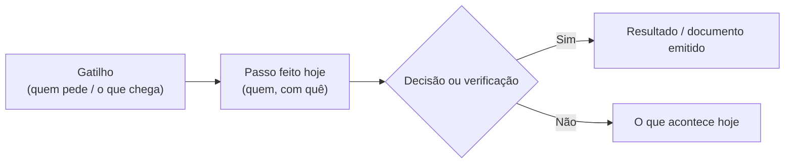

# `ENT-XX`: Entrevista [Cargo] — [AAAA-MM-DD]

> [!abstract] Rastreabilidade da Entrevista
> - **Projeto:** [[00 - MOC SGE IPCAG 12008 BGO]] | **Plano:** [[00.1 - Plano de Engenharia de Requisitos]] (Fase B)
> - **Guião usado:** [[Guiao de Entrevistas por Cargo]] (`G-XX`) | **Artefactos:** [[Pedido de Artefactos a Escola]] | **Números:** [[Questionario de Volumetria e Infraestrutura]]
> - **Questões e decisões:** [[12 - Registo de Decisoes e Questoes em Aberto]]

> [!warning] Como usar este modelo (apagar este aviso na nota final)
> 1. Copiar para `00 - Inbox/` com o nome `ENT-nn - <CARGO> - AAAA-MM-DD` (ex.: `ENT-03 - SUB_ADM - 2026-11-10`).
> 2. Substituir `ENT-XX`, `[CARGO_RBAC]`, `G-XX` e a data no frontmatter e no título; **remover as tags `modelo` e `template`**.
> 3. Escrever a nota **no próprio dia ou no seguinte**. Registar o **cargo**, não o nome, salvo autorização expressa.
> 4. Em cada número indicar a fonte: **C** contado · **E** estimado · **?** desconhecido.

---

## 1. Ficha da Entrevista

| Campo | Registo |
| :--- | :--- |
| **Guião** | `G-XX` |
| **Cargo RBAC** | `[CARGO_RBAC]` |
| **Entrevistado(s)** | [Cargo; nome só com autorização] |
| **Tipo** | ☐ Individual ☐ Grupo focal (n.º de participantes: __) ☐ Observação no posto de trabalho |
| **Data e local** | [AAAA-MM-DD], [sala / serviço] |
| **Duração** | [h:mm] |
| **Entrevistador / escriba** | [nomes da equipa] |
| **Autorizações** | ☐ Tomar notas ☐ Gravar áudio ☐ Citar frases (sem nome) |

---

## 2. Resumo

> [!todo] Completar
> Cinco linhas no máximo: o que o cargo faz, as três dores principais, a divergência mais importante encontrada e o que fica pendente.

---

## 3. Processo Atual (AS-IS)

### 3.1 Passos como são feitos hoje

1. [Passo, quem o faz, com que documento ou ferramenta]
2. [Passo]
3. [Passo]

### 3.2 Diagrama (opcional)

### 3.3 Documentos, livros e ficheiros usados

| Documento / registo | Suporte (papel, Excel, programa) | Quem preenche | Quem consulta | `ART-xx` |
| :--- | :--- | :--- | :--- | :---: |
| | | | | |

---

## 4. Dores e Problemas

| # | Dor | Frequência | Impacto | Exemplo real ou citação (sem nome) | Capacidade |
| :---: | :--- | :--- | :--- | :--- | :---: |
| 1 | | ☐ diária ☐ semanal ☐ mensal ☐ anual | ☐ alto ☐ médio ☐ baixo | | `Cxx` |
| 2 | | | | | |
| 3 | | | | | |

---

## 5. Números Recolhidos

| Indicador | Valor | Unidade | Fonte (C / E / ?) | Período de referência | Destino no questionário |
| :--- | :---: | :--- | :---: | :--- | :---: |
| | | | | | §A.x / §B.x |
| | | | | | |

---

## 6. Validação de Regras, Fluxos e User Stories

Preencher **depois** de ouvir a prática (parte C do guião). Resultado: ✅ confirma · ⚠️ diverge · ❓ não sabe / não se aplica.

| Referência | O que a especificação assume | O que se faz na prática | Resultado | Ação |
| :--- | :--- | :--- | :---: | :--- |
| `RN-xx` / Fluxo `nn` / `US-xxx-nn` | | | ✅ ⚠️ ❓ | [nenhuma / alteração proposta / questão no registo / responde a `Q-LEG-nn`] |
| | | | | |
| | | | | |

---

## 7. O Que Falta na Especificação

Temas do [[Guiao de Entrevistas por Cargo]] §3: horários, disciplina, comunicação com encarregados, cobrança de dívidas, passagem de ano, dados a migrar, contas, operação, proteção de dados, painéis, recursos humanos.

| Tema | Capacidade | O que foi dito | Requisito emergente (rascunho) | Importância para o entrevistado |
| :--- | :---: | :--- | :--- | :---: |
| | `Cxx` | | "O sistema deve…" | ☐ alta ☐ média ☐ baixa |
| | | | | |

---

## 8. Artefactos Mostrados ou Prometidos

| `ART-xx` | Descrição | Situação | Prazo combinado | Responsável na escola (cargo) |
| :---: | :--- | :--- | :---: | :--- |
| | | ☐ mostrado ☐ prometido ☐ não existe | | |

---

## 9. Questões em Aberto e Decisões a Levar

| # | Questão | Quem deve responder (cargo) | Decisão relacionada (`D1`–`D8`) | Passada ao registo |
| :---: | :--- | :--- | :---: | :---: |
| 1 | | | | ☐ |
| 2 | | | | ☐ |

---

## 10. Próximos Passos

- [ ] [Ação] — [responsável] — [prazo]
- [ ] [Ação] — [responsável] — [prazo]

---

## 11. Triagem

- [ ] Nota escrita até 24 h depois da entrevista
- [ ] Questões passadas ao [[12 - Registo de Decisoes e Questoes em Aberto]]
- [ ] Tabela de acompanhamento do [[Pedido de Artefactos a Escola]] atualizada
- [ ] Registo de cobertura do [[Guiao de Entrevistas por Cargo]] (§6) atualizado
- [ ] Números copiados para o [[Questionario de Volumetria e Infraestrutura]]
- [ ] Nota movida de `00 - Inbox/` para `Descoberta e Validacao/` ([[00 - Guia de Triagem Inbox]])
