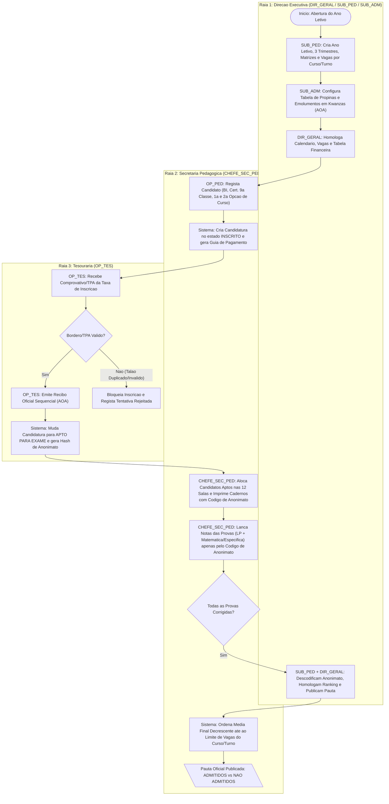
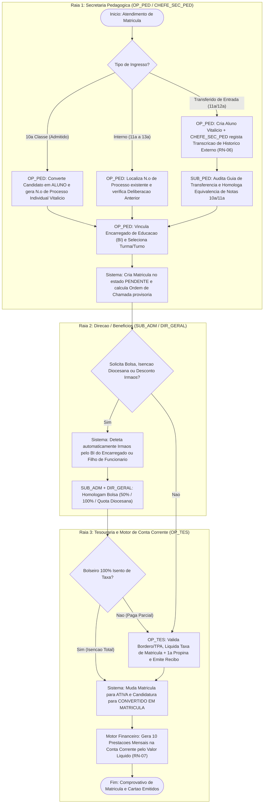
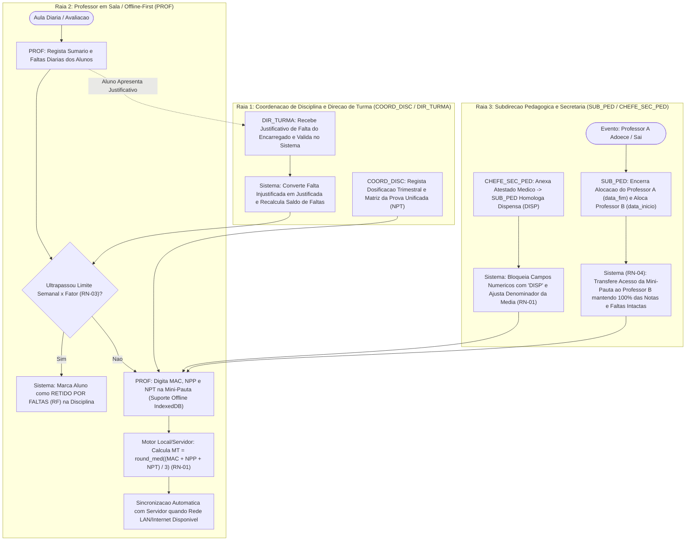
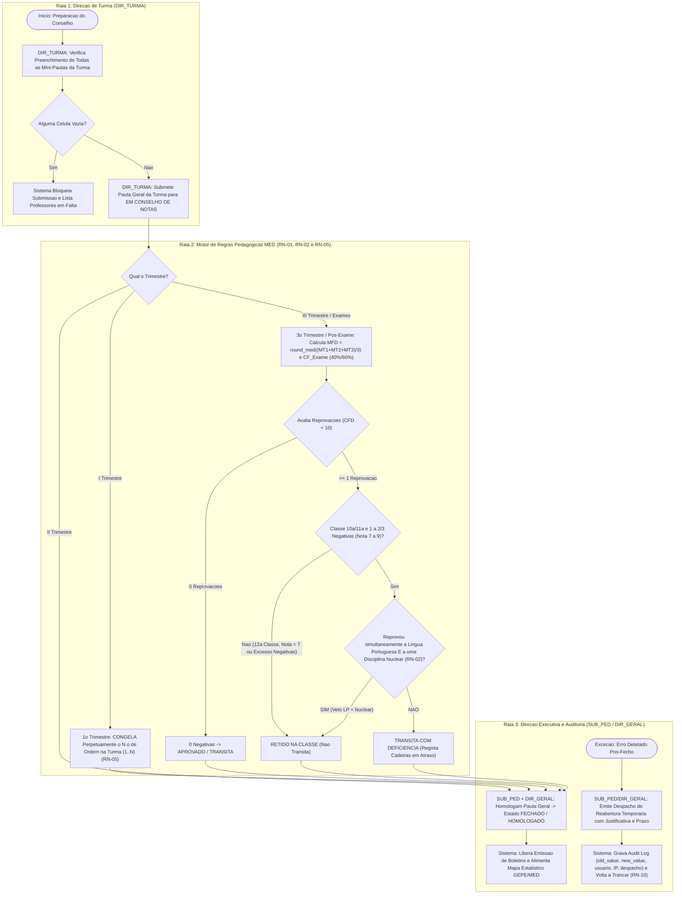
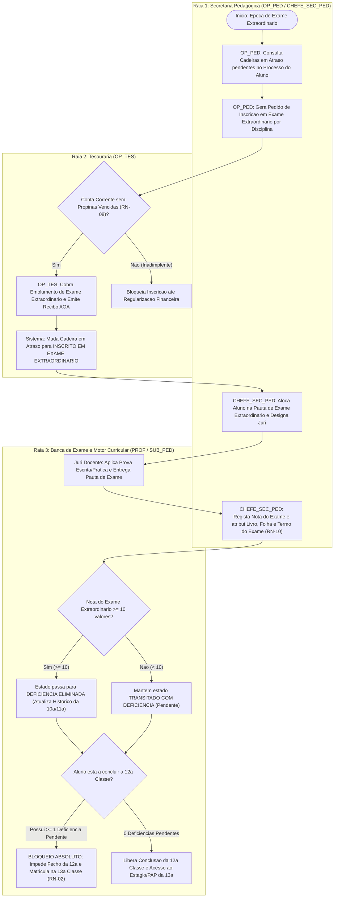
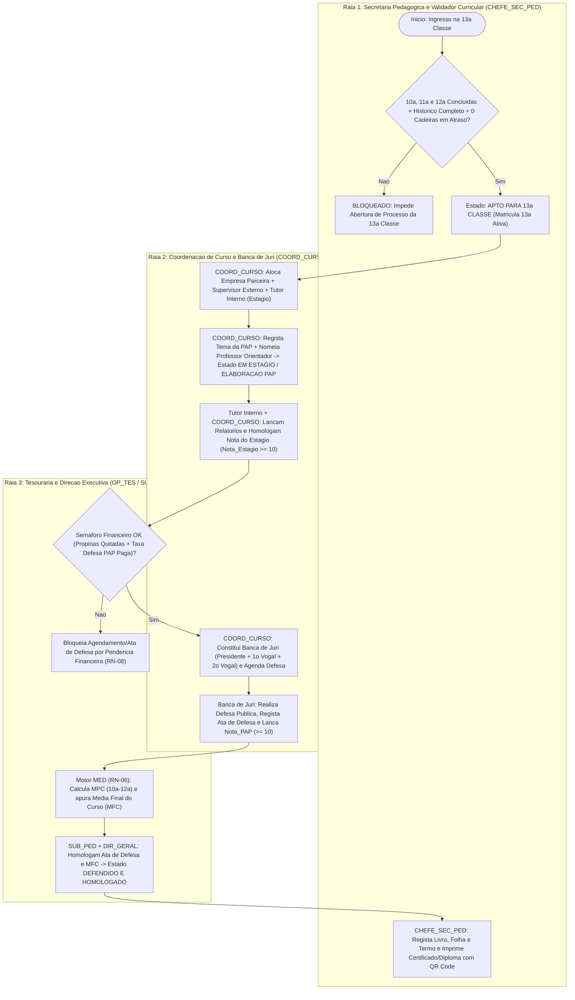
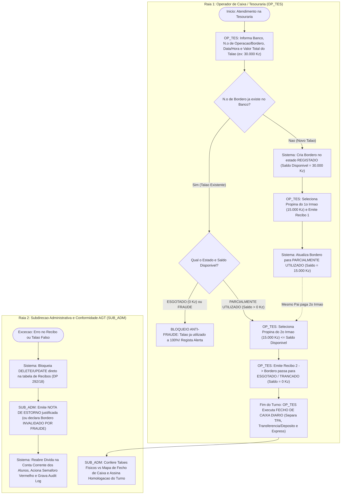
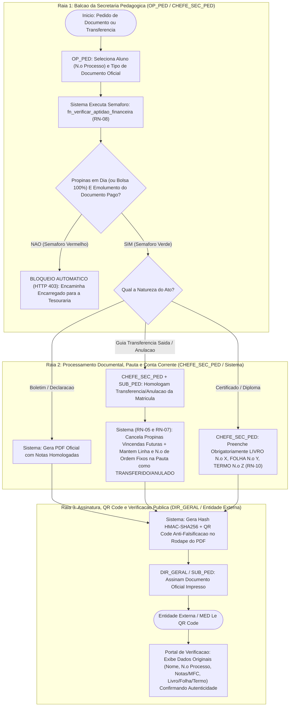

# Documento 02: Mapeamento de Fluxos de Trabalho Ponta a Ponta (Swimlanes, Caminhos de Exceção e Auditoria)

**Projeto:** Sistema de Gestão Escolar (SGE) — Ensino Secundário Técnico-Profissional (II Ciclo)  
**Instituição Alvo:** Instituto Politécnico Católico de Administração e Gestão (IPCAG) N.º 12008 / BGO – *"Nossa Senhora do Rosário"*  
**Referência Normativa Base:** [01-dominio-e-regras.md](file:///c:/Users/aqp/Desktop/sge/docs/01-dominio-e-regras.md) (`RN-01` a `RN-10`, 12 Perfis RBAC — DP n.º 93/21 e 7 Máquinas de Estado)

---

## Índice de Fluxos Operacionais Mapeados

1. **[Fluxo 01](#fluxo-01-configuração-do-ano-letivo-e-concurso-de-admissão-à-10ª-classe-de-nº-36126):** Configuração do Ano Letivo e Concurso de Admissão à 10ª Classe (DE n.º 361/26 e DE n.º 136/24)
2. **[Fluxo 02](#fluxo-02-matrícula-inicial-confirmação-transcrição-de-histórico-externo-e-motor-de-bolsas):** Matrícula Inicial, Confirmação, Transcrição de Histórico Externo e Motor de Bolsas
3. **[Fluxo 03](#fluxo-03-rotina-pedagógica-trimestral-faltas-dispensas-disp-e-substituição-docente-offline-first):** Rotina Pedagógica Trimestral, Faltas, Dispensas (`DISP`) e Substituição Docente (*Offline-First*)
4. **[Fluxo 04](#fluxo-04-conselho-de-notas-congelamento-da-chamada-deliberação-anual-e-reabertura-auditada):** Conselho de Notas, Congelamento da Chamada, Deliberação Anual e Reabertura Auditada
5. **[Fluxo 05](#fluxo-05-gestão-de-cadeiras-em-atraso-deficiências-e-exame-extraordinário):** Gestão de Cadeiras em Atraso (Deficiências) e Exame Extraordinário
6. **[Fluxo 06](#fluxo-06-regime-especial-da-13ª-classe--estágio-curricular-defesa-de-pap-e-emissão-de-diploma-dp-nº-16723):** Regime Especial da 13ª Classe — Estágio Curricular, Defesa de PAP e Emissão de Diploma (DP n.º 167/23)
7. **[Fluxo 07](#fluxo-07-tesouraria-anti-fraude-borderô-por-saldo-nota-de-estorno-agt-e-fecho-de-caixa-por-turno):** Tesouraria Anti-Fraude (Borderô por Saldo), Nota de Estorno AGT e Fecho de Caixa por Turno
8. **[Fluxo 08](#fluxo-08-balcão-de-emissão-documental-semáforo-financeiro-transferênciaanulação-e-verificação-qr-code):** Balcão de Emissão Documental, Semáforo Financeiro, Transferência/Anulação e Verificação QR Code

---

## Fluxo 01: Configuração do Ano Letivo e Concurso de Admissão à 10ª Classe (DE n.º 361/26)

### 1.1 Atores Envolvidos (RBAC) e Contextos (DDD)
- **Atores RBAC:** `DIR_GERAL` (Director Geral), `SUB_PED` (Subdirector Pedagógico), `SUB_ADM` (Subdirector Administrativo), `CHEFE_SEC_PED` (Chefe da Secretaria Pedagógica), `OP_PED` (Operador Pedagógico), `OP_TES` (Operador de Tesouraria), `CANDIDATO` / `ENCARREGADO`.
- **Contextos DDD:** *Governação & Direção Executiva* $\rightarrow$ *Tesouraria & Fiscalidade (AGT)* $\rightarrow$ *Secretaria Pedagógica*.

### 1.2 Pré-condições e Gatilho de Início
- **Pré-condições:** Publicação do Calendário Escolar Nacional pelo MED e definição do quadro de vagas da 10ª classe por Curso Técnico e Turno (Manhã/Tarde) nas 12 salas de aula do IPCAG N.º 12008 / BGO.
- **Gatilho de Início:** Despacho de abertura do novo Ano Letivo e da época de inscrições para o Teste de Seleção da 10ª classe.

### 1.3 Diagrama Visual em Raias (Swimlane Flowchart)

### 1.4 Passo a Passo Detalhado do Caminho Feliz (*Happy Path*)
1. **Parametrização Académica (`SUB_PED`):** O Subdirector Pedagógico cria o registo do `Ano Letivo` (estado `Planeado`), define as datas de abertura/fecho do **I, II e III Trimestres**, associa as **Matrizes Curriculares** aprovadas pelo MED para os cursos técnicos (identificando as disciplinas com `is_nuclear = TRUE` e `tempos_letivos_semanais`) e fixa o número de vagas da 10ª classe por Curso e Turno.
2. **Parametrização Financeira (`SUB_ADM`):** O Subdirector Administrativo configura a tabela anual de valores em Kwanzas (`AOA`): valor da Comparticipação/Propina mensal, taxa de inscrição no Teste de Seleção, taxa de matrícula/confirmação, taxas de exames extraordinários, defesa de PAP e emissão de documentos.
3. **Homologação Institucional (`DIR_GERAL`):** O Director Geral valida e homologa as configurações, abrindo oficialmente o período de inscrições para o Teste de Admissão à 10ª classe.
4. **Inscrição do Candidato (`OP_PED`):** O Operador da Secretaria Pedagógica recolhe os dados do candidato (Bilhete de Identidade/Cédula, dados do Encarregado de Educação, média do I Ciclo/9ª classe e opção de Curso Técnico/Turno). O sistema cria o registo na tabela `candidaturas` com o estado **`Inscrito`**.
5. **Liquidação do Emolumento de Exame (`OP_TES`):** O Encarregado de Educação dirige-se à Tesouraria. O `OP_TES` valida o pagamento (TPA, Multicaixa Express ou Borderô Bancário) e emite o `Recibo Oficial`.
6. **Geração de Anonimato e Alocação em Sala (Sistema):** Ao emitir o recibo, o sistema transita automaticamente a candidatura para **`Apto para Exame (Taxa Paga)`**, aloca o candidato numa das 12 salas de exame respeitando a lotação máxima e gera um **Código de Anonimato** único (ex.: `ANON-2026-8F3A`), ocultando a ligação direta ao nome do candidato nos mapas de correção.
7. **Impressão de Listas e Aplicação das Provas (`CHEFE_SEC_PED`):** A Secretaria Pedagógica imprime: (a) a **Lista de Presença por Sala** (para assinatura no dia da prova) e (b) as **Folhas de Cabeçalho destacáveis com Código de Anonimato**.
8. **Lançamento Cego de Notas (`CHEFE_SEC_PED` / `SUB_PED`):** Após a correção pelos júris, as notas das provas de admissão (ex.: Língua Portuguesa e Matemática) são digitadas no sistema pesquisando **exclusivamente pelo `Código de Anonimato`**. O estado passa para **`Avaliado (Código Anonimato)`**.
9. **Descodificação, Classificação e Homologação (`SUB_PED` + `DIR_GERAL`):** Concluído o lançamento de 100% dos códigos presentes, o `SUB_PED` e o `DIR_GERAL` acionam o comando de **Descodificação e Apuramento**. O sistema cruza os códigos com as identidades reais, calcula a média de admissão arredondada (`round_med`) e classifica os candidatos por ordem decrescente até preencher o limite exato de vagas de cada Curso Técnico/Turno:
   - Candidatos dentro das vagas $\rightarrow$ estado **`Admitido`**.
   - Candidatos fora das vagas ou com nota inferior ao mínimo regulamentar $\rightarrow$ estado **`Não Admitido`**.
10. **Publicação Oficial:** A Pauta de Resultados do Teste de Seleção é impressa com QR Code de autenticidade e afixada no vitral do IPCAG.

### 1.5 Caminhos de Exceção, Erros e Travas de Segurança (*Edge Cases & Rollbacks*)
- **Exceção E1.1 — Candidato sem Taxa Paga no Fecho das Inscrições:** Candidaturas que permaneçam no estado `Inscrito` após o fecho do prazo de pagamento transitam automaticamente para `Cancelado por Falta de Pagamento` e **não** entram nas listas de sala nem recebem Código de Anonimato.
- **Exceção E1.2 — Tentativa de Dupla Inscrição (Mesmo BI):** A constraint `UNIQUE(ano_letivo_id, numero_bi)` impede que o mesmo candidato seja inscrito duas vezes no mesmo concurso.
- **Exceção E1.3 — Falta ao Exame de Admissão:** Se o candidato `Apto para Exame` faltar no dia da prova, o `CHEFE_SEC_PED` marca `Faltou ao Exame`, atribuindo nota `0` / estado `Falta ao Exame`, sem direito a reembolso do emolumento.
- **Exceção E1.4 — Empate na Última Vaga do Curso:** Em caso de empate exato na média de admissão na última vaga disponível da turma, o sistema aplica os critérios legais de desempate (1.º Maior nota na prova de Língua Portuguesa / Nuclear; 2.º Maior média de conclusão da 9ª classe; 3.º Menor idade, dando prioridade ao candidato mais jovem conforme diretriz do MED).
- **Exceção E1.5 — Tentativa de Alterar Nota de Admissão Após Descodificação:** Estritamente bloqueada para `CHEFE_SEC_PED`. Qualquer retificação pós-descodificação (por reclamação procedente de revisão de prova) exige ação conjunta do `SUB_PED` + `DIR_GERAL` com justificativa obrigatória gravada em `audit_logs`.

### 1.6 Pós-condições e Registos Gerados
- Registos de `Ano Letivo`, `Trimestres`, `Matrizes Curriculares` e `Tabelas de Emolumentos` ativos e trancados.
- Pauta de Admissão homologada; candidatos `Admitidos` habilitados para o botão **"Converter em Matrícula da 10ª Classe"**.
- Registos em `audit_logs` para a abertura do ano letivo e para o ato de descodificação do anonimato.

---

## Fluxo 02: Matrícula Inicial, Confirmação, Transcrição de Histórico Externo e Motor de Bolsas

### 2.1 Atores Envolvidos (RBAC) e Contextos (DDD)
- **Atores RBAC:** `OP_PED`, `CHEFE_SEC_PED`, `SUB_PED`, `SUB_ADM`, `DIR_GERAL`, `OP_TES`, `ENCARREGADO`.
- **Contextos DDD:** *Secretaria Pedagógica* $\leftrightarrow$ *Tesouraria & Fiscalidade (AGT)* $\leftrightarrow$ *Direção Executiva*.

### 2.2 Pré-condições e Gatilho de Início
- **Pré-condições:** Para 10ª classe: candidato com estado `Admitido` no Fluxo 01. Para 11ª, 12ª e 13ª classes (internos): Pauta Geral do ano letivo anterior homologada com deliberação `Aprovado`, `Transita com Deficiência` (apenas 10ª/11ª) ou `Retido` (para repetência). Para Transferidos de Entrada: vaga disponível na classe/curso e posse de Guia de Transferência Oficial.
- **Gatilho de Início:** Comparecimento do Encarregado de Educação na Secretaria Pedagógica para efetivar a Matrícula Inicial ou Confirmação de Matrícula.

### 2.3 Diagrama Visual em Raias (Swimlane Flowchart)

### 2.4 Passo a Passo Detalhado do Caminho Feliz (*Happy Path*)
1. **Identificação do Cenário de Matrícula (`OP_PED`):**
   - **Cenário A — Ingresso Inicial na 10ª Classe:** O operador seleciona o candidato `Admitido` e clica em *"Converter em Matrícula"*. O sistema cria o registo vitalício na tabela `alunos`, gera o **`N.º de Processo Individual`** único (ex.: `PROC-2026-00412` — `RN-05`) e migra os documentos da candidatura para o Processo Individual.
   - **Cenário B — Confirmação Anual de Aluno Interno (11ª, 12ª ou 13ª Classe):** O operador pesquisa o aluno pelo `N.º de Processo Individual`. O sistema preserva o mesmo número de processo e verifica automaticamente na Pauta Geral do ano anterior qual a classe de destino (e se traz **Cadeiras em Atraso** da 10ª/11ª).
   - **Cenário C — Aluno Transferido de Entrada (11ª ou 12ª Classe — `RN-06`):** O `OP_PED` cria o registo vitalício do aluno e o `CHEFE_SEC_PED` preenche obrigatoriamente o quadro de **Transcrição de Histórico Externo**, lançando as médias anuais (`MFD`) de todas as disciplinas das classes anteriores constantes na Guia de Transferência/Certificado da escola de origem e fazendo upload do PDF assinado. O `SUB_PED` homologa a transcrição.
2. **Alocação em Turma e Vinculação Familiar (`OP_PED`):** O operador seleciona a `Turma` (dentro do Curso, Classe e Turno) respeitando o limite físico da sala de aula, e vincula o `Encarregado de Educação` através do número de BI. A matrícula nasce no estado **`Pendente (Aguardando Pagamento Inicial)`**.
3. **Aplicação de Bolsas, Isenções e Descontos Familiares (`RN-07`):**
   - Se o `encarregado_educacao_id` já possuir outro educando com matrícula ativa no mesmo Ano Letivo, o sistema sugere automaticamente o **Desconto Familiar de Irmãos**.
   - Caso o aluno seja beneficiário de Bolsa de Estudo (`50%` ou `100%` da Diocese de Caxito / acordo social) ou filho de funcionário do IPCAG, o `SUB_ADM` e o `DIR_GERAL` homologam o benefício vinculado à matrícula.
4. **Liquidação Inicial na Tesouraria (`OP_TES`):** O Encarregado de Educação apresenta o comprovativo bancário ou paga via TPA a Taxa de Matrícula/Confirmação e a 1ª prestação (Setembro). O `OP_TES` emite o Recibo Oficial (salvo se o aluno tiver isenção de 100% homologada).
5. **Ativação da Matrícula e Geração do Plano de Conta Corrente (Sistema):**
   - A matrícula transita imediatamente para **`Ativa`**.
   - Se a entrada ocorreu **antes** do congelamento da lista no I Trimestre, o aluno entra na ordenação alfabética da turma (`1..N`). Se ocorreu **após** o congelamento do I Trimestre (transferência tardia), o sistema atribui automaticamente `num_ordem_turma = max(num_ordem_turma) + 1` (`RN-05`).
   - O Motor Financeiro gera as prestações mensais de propina (Outubro a Junho) na Conta Corrente do aluno já com o `valor_liquido = valor_bruto - desconto_bolsa` (`A Vencer` ou `Isenta`).

### 2.5 Caminhos de Exceção, Erros e Travas de Segurança (*Edge Cases & Rollbacks*)
- **Exceção E2.1 — Tentativa de Confirmar Matrícula com Propinas Vencidas do Ano Anterior:** A função `fn_verificar_aptidao_financeira` (`RN-08`) bloqueia a Confirmação de Matrícula caso a Conta Corrente do ano letivo anterior apresente saldo devedor vencido.
- **Exceção E2.2 — Tentativa de Matricular na 13ª Classe com Cadeira em Atraso ou 12ª Incompleta:** O sistema verifica se o aluno possui qualquer disciplina da 10ª, 11ª ou 12ª classe não aprovada ou em estado `Transitado com Deficiência`. Se existir, bloqueia a criação da matrícula na 13ª classe (`RN-02`).
- **Exceção E2.3 — Aluno Transferido de Entrada sem Transcrição de Histórico Externo:** Se um aluno ingressar na 11ª ou 12ª classe por transferência externa, a matrícula fica marcada com pendência documental crítica até que o histórico da 10ª/11ª classe seja transcrito e homologado pelo `SUB_PED`, impedindo que chegue à 13ª classe sem base para o cálculo da `MFC` (`RN-06`).
- **Exceção E2.4 — Lotação de Sala Esgotada:** Cada uma das 12 salas possui `capacidade_maxima`. Ao atingir 100% da capacidade da turma no turno, o sistema impede novas alocações nessa turma e redireciona para outra turma do mesmo curso/turno.
- **Exceção E2.5 — Transferência de Entrada Tardia (II ou III Trimestre) com Notas Parciais (`RN-06.1`):** Quando o aluno se transfere de outra escola a meio do ano letivo, o `CHEFE_SEC_PED` transcreve as Médias Trimestrais já vencidas (`MT1` e/ou `MT2`) constantes na Guia de Transferência para o ano corrente (com `origem_nota = 'GUIA_TRANSFERENCIA_EXTERNA'`), e o aluno recebe `num_ordem_turma = max + 1` na turma de destino (`RN-05`).
- **Exceção E2.6 — Reativação de Matrícula Anulada ou Mudança Interna de Turma/Turno (`RN-05.1`):** Se um aluno desistente/anulado obtiver despacho para regressar à mesma turma no mesmo ano letivo, o sistema restaura o seu **`N.º de Ordem` original congelado** e reativa as propinas vincendas. Se mudar internamente da Turma A para a Turma B após o I Trimestre, mantém o seu `N.º de Ordem` congelado na Turma A (`TRANSFERIDO INTERNO`) e entra na Turma B como `max + 1` herdando as notas do I Trimestre.

### 2.6 Pós-condições e Registos Gerados
- Aluno com `N.º de Processo Individual` único e Matrícula `Ativa` vinculada à Turma e às Mini-Pautas de todas as disciplinas da Matriz Curricular da classe.
- Conta Corrente anual abastecida com as prestações mensais líquidas.
- Histórico externo (se aplicável) integrado na vista curricular unificada (`vw_curriculo_consolidado_aluno`).

---

## Fluxo 03: Rotina Pedagógica Trimestral, Faltas, Dispensas (`DISP`) e Substituição Docente (Offline-First)

### 3.1 Atores Envolvidos (RBAC) e Contextos (DDD)
- **Atores RBAC:** `COORD_DISC`, `PROF`, `DIR_TURMA`, `COORD_TURNO`, `CHEFE_SEC_PED`, `SUB_PED`.
- **Contextos DDD:** *Coordenação & Docência* $\leftrightarrow$ *Secretaria Pedagógica* $\leftrightarrow$ *Auditoria APD*.

### 3.2 Pré-condições e Gatilho de Início
- **Pré-condições:** Trimestre Letivo (I, II ou III) no estado `Aberto / Em Curso`, turmas com matrículas ativas e docentes alocados às disciplinas da turma (`alocacoes_docentes`).
- **Gatilho de Início:** Início das aulas trimestrais, registo de assiduidade diária, pedido de dispensa médica ou necessidade de substituição de um professor.

### 3.3 Diagrama Visual em Raias (Swimlane Flowchart)

### 3.4 Passo a Passo Detalhado do Caminho Feliz (*Happy Path*)
1. **Dosificação e Prova Unificada (`COORD_DISC`):** O Coordenador de Disciplina regista o plano de dosificação do trimestre e disponibiliza a estrutura da **Prova Trimestral (`NPT`)** unificada para todas as turmas daquela classe/disciplina.
2. **Chamada Diária e Controlo de Faltas (`PROF` + `DIR_TURMA` — `RN-03`):**
   - Em cada aula, o `PROF` regista o sumário e marca as ausências pela lista ordenada por `N.º de Ordem na Turma`.
   - Caso o Encarregado de Educação entregue um justificativo válido dentro do prazo regulamentar, o **Director de Turma (`DIR_TURMA`)** acede ao módulo da sua turma e converte a falta em `Falta Justificada`.
   - O sistema monitoriza continuamente: se `Total_Faltas_Injustificadas > Fator * Tempos_Letivos_Semanais`, o estado do aluno na disciplina muda automaticamente para **`Retido por Faltas (RF)`**.
3. **Homologação de Dispensa Médica (`DISP` — `RN-01`):**
   - Para alunos com incapacidade física comprovada por Atestado Médico / Junta Médica em disciplinas como **Educação Física**, o `CHEFE_SEC_PED` carrega o documento e o `SUB_PED` homologa o estado **`Dispensado (DISP)`**.
   - Na Mini-Pauta e na Pauta Geral, a linha do aluno nessa disciplina exibe `DISP`, isentando-o de notas numéricas sem qualquer penalização.
4. **Lançamento de Notas na Mini-Pauta com Resiliência *Offline-First* (`PROF` — `RN-01` e `RN-10`):**
   - O `PROF` abre a Mini-Pauta da sua `Turma + Disciplina` no trimestre ativo.
   - Mesmo que a internet caia no Panguila, a aplicação guarda localmente (`IndexedDB` cifrado) as notas digitadas (`MAC`, `NPP`, `NPT` de `0` a `20`) e calcula instantaneamente no ecrã a Média Trimestral usando o arredondamento oficial do MED:
     $$MT_t = \text{round\_med}\left(\frac{MAC_t + NPP_t + NPT_t}{3}\right)$$
   - Assim que a conectividade à rede local (LAN) ou internet é restabelecida, a fila sincroniza os lançamentos com o servidor registando `lancado_por_usuario_id`.
5. **Substituição Docente a Meio do Ano Letivo (`SUB_PED` — `RN-04`):**
   - Se o `Professor A` precisar de ser substituído no meio do II Trimestre pelo `Professor B`, o `SUB_PED` acede à gestão de horários/alocações, define `data_fim = hoje` para o `Professor A` e cria o vínculo ativo para o `Professor B` na mesma `turma_disciplina_id`.
   - Como as notas pertencem estruturalmente a `(matricula_id, turma_disciplina_id, trimestre)`, o `Professor B` abre a Mini-Pauta e encontra todas as notas do I Trimestre e as notas parciais já lançadas no II Trimestre perfeitamente preservadas, assumindo o preenchimento a partir dali.

### 3.5 Caminhos de Exceção, Erros e Travas de Segurança (*Edge Cases & Rollbacks*)
- **Exceção E3.1 — Nota Fora da Escala Legal (`< 0` ou `> 20`):** Rejeitada imediatamente na interface e na constraint `CHECK (nota >= 0 AND nota <= 20)` do banco de dados.
- **Exceção E3.2 — Professor Tenta Justificar Faltas Diretamente:** Bloqueado por RBAC. O `PROF` apenas regista a presença/ausência em sala; a justificação de faltas é competência exclusiva do `DIR_TURMA` ou da `SUB_PED`/`CHEFE_SEC_PED`.
- **Exceção E3.3 — Conflito de Sincronização Offline:** Se uma pauta foi trancada pelo `SUB_PED` enquanto o professor estava offline e tentou sincronizar mais tarde, o servidor rejeita a mutação com aviso de `Trimestre Fechado` e preserva o payload num registo de conflito para análise da Subdireção Pedagógica.

### 3.6 Pós-condições e Registos Gerados
- Mini-Pauta preenchida com `MAC`, `NPP`, `NPT`, `MT` arredondada e totalizador de faltas justificadas/injustificadas por trimestre.
- Histórico de autoria docente preservado em metadados (`lancado_por_usuario_id`) mesmo após substituição de professores.

---

## Fluxo 04: Conselho de Notas, Congelamento da Chamada, Deliberação Anual e Reabertura Auditada

### 4.1 Atores Envolvidos (RBAC) e Contextos (DDD)
- **Atores RBAC:** `DIR_TURMA`, `COORD_CURSO`, `CHEFE_SEC_PED`, `SUB_PED`, `DIR_GERAL`.
- **Contextos DDD:** *Coordenação & Docência* $\rightarrow$ *Secretaria Pedagógica* $\rightarrow$ *Direção Executiva* $\rightarrow$ *Auditoria APD & Estatística GEPE*.

### 4.2 Pré-condições e Gatilho de Início
- **Pré-condições:** Prazo de lançamento de notas das Mini-Pautas do trimestre encerrado; 100% das disciplinas da turma com notas completas (ou `DISP` / `RF` / `Transferido` / `Anulado`).
- **Gatilho de Início:** Convocatória do Conselho de Notas Trimestral ou Anual pela Subdireção Pedagógica.

### 4.3 Diagrama Visual em Raias (Swimlane Flowchart)

### 4.4 Passo a Passo Detalhado do Caminho Feliz (*Happy Path*)
1. **Validação Pré-Conselho (`DIR_TURMA`):** O Director de Turma executa o validador de integridade da sua turma. O sistema confirma que todas as disciplinas da Matriz Curricular possuem notas lançadas para todos os alunos ativos. O `DIR_TURMA` fecha a revisão e o trimestre da turma passa para **`Em Conselho de Notas`** (bloqueando imediatamente qualquer edição pelos professores).
2. **Reunião do Conselho de Notas e Homologação (`SUB_PED` + `DIR_GERAL`):**
   - **No Fecho do I Trimestre (`RN-05`):** Ao homologar a Pauta Geral do I Trimestre, o sistema ativa a flag `lista_chamada_congelada = TRUE` na turma. A partir deste exato segundo, o `N.º de Ordem na Turma` (`1..N`) nunca mais muda: se o aluno n.º 14 desistir ou pedir transferência no II Trimestre, a linha 14 permanece fixa na pauta com o rótulo `TRANSFERIDO` / `ANULADO`; se um novo aluno ingressar por transferência no II Trimestre, recebe obrigatoriamente o número `N + 1` no final da lista.
   - **No Fecho do III Trimestre e Época de Exame de Recurso (`RN-01` e `RN-02`):**
     1. O motor calcula a Média Final da Disciplina: $MFD = \text{round\_med}((MT_1 + MT_2 + MT_3) / 3)$.
     2. Alunos com $MFD < 10$ (e não retidos por faltas) realizam o **Exame de Recurso**, apurando-se $CF_{\text{Exame}} = \text{round\_med}((MFD \times 0,40) + (\text{Exame} \times 0,60))$.
     3. O motor de deliberação avalia as reprovações finais ($CFD < 10$) de cada aluno:
        - **$0$ reprovações:** `Transita (Aprovado)` (ou `Apto para 13ª Classe` se estiver na 12ª classe e tiver `0` cadeiras em atraso anteriores).
        - **$1$ a $2$ (ou $3$) reprovações na 10ª ou 11ª classe com nota entre `7` e `9` valores:** O sistema verifica a trava de ouro (`RN-02`): **Reprovou simultaneamente a Língua Portuguesa E a pelo menos uma Disciplina Nuclear (`is_nuclear = TRUE`)?**
          - Se **SIM**: aplica o veto legal e delibera **`Não Transita (Retido por LP + Nuclear)`**.
          - Se **NÃO**: delibera **`Transita com Deficiência`** e inscreve automaticamente as disciplinas reprovadas no registo de `cadeiras_em_atraso` do aluno.
        - **Reprovação com nota `< 7` valores, excesso de disciplinas reprovadas ou reprovação na 12ª classe:** delibera **`Não Transita (Retido)`**.
3. **Trancamento Oficial e Mapas do GEPE:** O `SUB_PED` e o `DIR_GERAL` assinam digitalmente a homologação. A pauta passa para **`Fechado / Homologado`**, gerando os dados para os Boletins de Notas e para o **Mapa Estatístico do GEPE/MED** (discriminado por Curso, Classe, Turma, Género M/F, Faixa Etária, Aprovados, Reprovados, Transferidos e Desistentes).

### 4.5 Caminhos de Exceção, Erros e Travas de Segurança (*Edge Cases & Rollbacks*)
- **Exceção E4.1 — Reabertura Excecional de Pauta Pós-Fechamento (`RN-10`):**
  - Se for detetado um erro material de lançamento após a pauta estar `Fechada / Homologada`, nenhum professor, diretor de turma ou funcionário da secretaria consegue editá-la.
  - Apenas o **`SUB_PED`** ou o **`DIR_GERAL`** pode acionar o fluxo **"Reabrir Pauta por Ordem da Direção"** cirurgicamente na `Turma + Disciplina` afetada (sem reabrir o trimestre global para as restantes turmas da escola), preenchendo obrigatoriamente: (a) Número do Despacho Interno, (b) Justificativa detalhada, (c) Disciplina/Aluno afetado e (d) Janela temporal de abertura (`1h` a `48h`).
  - Quando a nota é retificada, um *trigger* na base de dados grava em `audit_logs` o `old_value`, o `new_value`, o utilizador autorizador, o utilizador executor, a data/hora UTC e o texto do despacho, recalculando `MT`, `MFD` e a deliberação final e voltando a trancar a pauta numa nova versão (`versao_pauta + 1`).
- **Exceção E4.2 — Avocação Excecional de Mini-Pauta quando o Professor Já Saiu da Escola (`RN-04.1`):**
  - Caso o professor titular já não faça parte do quadro na data do Conselho de Notas ou da Reabertura Excecional e não exista substituto ativo, o **`SUB_PED`** pode avocar a Mini-Pauta e lançar/corrigir as notas diretamente com base nas provas físicas arquivadas, gravando `AVOCACAO_LANCAMENTO_SUB_PED` em `audit_logs`.

### 4.6 Pós-condições e Registos Gerados
- Pauta Geral imutável no estado `Fechado / Homologado` com QR Code e hash de integridade.
- Lista de chamada da turma congelada (após I Trimestre).
- Registos de `cadeiras_em_atraso` gerados automaticamente para alunos transitados com deficiência.

---

## Fluxo 05: Gestão de Cadeiras em Atraso (Deficiências) e Exame Extraordinário

### 5.1 Atores Envolvidos (RBAC) e Contextos (DDD)
- **Atores RBAC:** `SUB_PED`, `CHEFE_SEC_PED`, `OP_PED`, `OP_TES`, `PROF` (Júri de Exame), `DIR_GERAL`, `ALUNO` / `ENCARREGADO`.
- **Contextos DDD:** *Secretaria Pedagógica* $\leftrightarrow$ *Tesouraria & Fiscalidade (AGT)* $\leftrightarrow$ *Coordenação & Docência*.

### 5.2 Pré-condições e Gatilho de Início
- **Pré-condições:** Aluno matriculado na 11ª ou 12ª classe possuindo 1 a 3 disciplinas de classes anteriores (10ª ou 11ª) no estado `Transitado com Deficiência (Cadeira em Atraso)`.
- **Gatilho de Início:** Abertura do Calendário de **Exames Extraordinários** pelo Subdirector Pedagógico.

### 5.3 Diagrama Visual em Raias (Swimlane Flowchart)

### 5.4 Passo a Passo Detalhado do Caminho Feliz (*Happy Path*)
1. **Identificação de Pendências (`OP_PED`):** Ao abrir o Processo Individual de um aluno da 11ª ou 12ª classe, o painel destaca um alerta visual com todas as disciplinas no estado **`Transitado com Deficiência`**.
2. **Pré-Inscrição e Validação Financeira (`OP_PED` $\rightarrow$ `OP_TES` — `RN-08`):** O `OP_PED` seleciona as disciplinas em atraso que o aluno pretende realizar na época de Exame Extraordinário. O sistema verifica se o aluno não tem propinas em atraso e gera a guia do **Emolumento de Exame Extraordinário** (cobrado por disciplina).
3. **Confirmação pela Tesouraria (`OP_TES`):** Após o pagamento do emolumento e emissão do recibo na Tesouraria, o estado da cadeira em atraso transita automaticamente para **`Inscrito em Exame Extraordinário`**.
4. **Realização da Prova e Lançamento com Livro/Folha/Termo (`CHEFE_SEC_PED` + `SUB_PED`):**
   - O aluno realiza o exame perante o júri designado.
   - O `CHEFE_SEC_PED` lança a nota obtida (`0` a `20` valores) e preenche obrigatoriamente a coordenada física do Termo de Exame (`Livro n.º X, Folha n.º Y, Termo n.º Z` — `RN-10`). O `SUB_PED` homologa a pauta de exame extraordinário.
5. **Extinção da Deficiência (`RN-02`):**
   - Se `Nota_Exame_Extra >= 10` valores: o estado da pendência muda definitivamente para **`Deficiência Eliminada`**, e a nota passa a compor a média anual da classe a que a disciplina pertence (10ª ou 11ª) para efeitos de cálculo futuro da `MFC`.

### 5.5 Caminhos de Exceção, Erros e Travas de Segurança (*Edge Cases & Rollbacks*)
- **Exceção E5.1 — Reprovação no Exame Extraordinário (`Nota < 10`):** A disciplina retorna ao estado `Transitado com Deficiência`, obrigando o aluno a inscrever-se numa próxima época de Exame Extraordinário.
- **Exceção E5.2 — Aluno Conclui as Disciplinas da 12ª Classe mas Mantém Cadeira em Atraso da 10ª ou 11ª (`RN-02`):** Mesmo que o aluno aprove a todas as disciplinas do plano curricular da 12ª classe, o sistema mantém o aluno no estado **`Bloqueado (Possui Cadeiras em Atraso da 10ª-12ª)`**, impedindo a emissão de certificado da 12ª classe e **bloqueando totalmente a matrícula na 13ª classe (Estágio e PAP)** até que elimine a deficiência.

### 5.6 Pós-condições e Registos Gerados
- Registo de `cadeiras_em_atraso` atualizado para `Deficiência Eliminada` vinculado ao `Termo de Exame (Livro/Folha/Termo)`.
- Média anual da 10ª ou 11ª classe recalculada com a nota de aprovação do exame extraordinário.

---

## Fluxo 06: Regime Especial da 13ª Classe — Estágio Curricular, Defesa de PAP e Emissão de Diploma (DP n.º 167/23)

### 6.1 Atores Envolvidos (RBAC) e Contextos (DDD)
- **Atores RBAC:** `COORD_CURSO`, `PROF` (Tutor de Estágio / Orientador de PAP / Membros da Banca de Júri), `CHEFE_SEC_PED`, `OP_TES`, `SUB_PED`, `DIR_GERAL`.
- **Contextos DDD:** *Coordenação & Docência* $\leftrightarrow$ *Secretaria Pedagógica* $\leftrightarrow$ *Tesouraria & Fiscalidade (AGT)* $\leftrightarrow$ *Direção Executiva*.

### 6.2 Pré-condições e Gatilho de Início
- **Pré-condições:** Aluno com 100% das disciplinas da 10ª, 11ª e 12ª classes aprovadas (internamente ou via `Transcrição de Histórico Externo` homologada — `RN-06`) e **`0` Cadeiras em Atraso pendentes** (`RN-02`).
- **Gatilho de Início:** Confirmação de matrícula do aluno na **13ª Classe** do seu Curso Técnico.

### 6.3 Diagrama Visual em Raias (Swimlane Flowchart)

### 6.4 Passo a Passo Detalhado do Caminho Feliz (*Happy Path*)
1. **Verificação Automática de Elegibilidade (`RN-02` e `RN-06`):** O sistema valida que todas as disciplinas da Matriz Curricular da 10ª, 11ª e 12ª classes possuem classificação final $\ge 10$ valores (ou `DISP`), incluindo eventuais notas vindas de `Transcrição de Histórico Externo`, e que não existe nenhuma `Cadeira em Atraso` por eliminar. O processo nasce no estado **`Apto para 13ª Classe`**.
2. **Alocação de Estágio Supervisionado e Orientação de PAP (`COORD_CURSO`):**
   - O Coordenador de Curso vincula o aluno a uma **Empresa/Instituição Parceira**, registando o nome do **Supervisor de Empresa** e designando o **Tutor Interno** (docente do IPCAG), emitindo a **Carta de Apresentação de Estágio**.
   - Simultaneamente, regista o **Tema Oficial da PAP** e nomeia o **Professor Orientador**. O processo transita para **`Em Estágio / Elaboração de PAP`**.
3. **Conclusão e Avaliação do Estágio Curricular (`COORD_CURSO` + `SUB_PED`):** Concluídas as horas regulamentares de estágio e entregue o relatório avaliado pelo Supervisor da Empresa e pelo Tutor Interno, é lançada e homologada a **`Nota_Estagio`** (`0` a `20` valores, exigindo $\ge 10$ para aprovação).
4. **Verificação do Semáforo Financeiro e Constituição da Banca de Júri (`OP_TES` + `COORD_CURSO` — `RN-08`):**
   - O aluno liquida eventuais propinas pendentes e paga o **Emolumento de Defesa de PAP** na Tesouraria.
   - Com o semáforo financeiro verde, o `COORD_CURSO` constitui a **Banca de Júri da PAP** (Presidente da Banca, 1.º Vogal Arguente e 2.º Vogal Orientador), definindo data, hora e sala/auditório. O estado passa para **`Apto para Defesa`**.
5. **Defesa Pública, Ata da PAP e Cálculo Automático da `MFC` (`COORD_CURSO` + `SUB_PED` + `DIR_GERAL` — `RN-06`):**
   - Realizada a defesa pública, é registada a **`Nota_PAP`** ($\ge 10$ valores) e gerada a **Ata Oficial de Defesa da PAP** assinada pelos 3 membros do júri.
   - O motor académico calcula instantaneamente:
     1. As médias anuais $MA_{10}$, $MA_{11}$ e $MA_{12}$ (excluindo disciplinas `DISP` do denominador);
     2. A Média do Plano Curricular $MPC = \text{round\_med}((MA_{10} + MA_{11} + MA_{12}) / 3)$;
     3. A **Média Final do Curso (`MFC`)** combinando `MPC`, `Nota_Estagio` e `Nota_PAP` com arredondamento oficial `round_med`.
   - O `SUB_PED` e o `DIR_GERAL` homologam o processo, transitando para **`Defendido e Homologado`**.
6. **Emissão do Certificado e Diploma de Técnico Médio (`CHEFE_SEC_PED`):** Mediante pagamento do emolumento de Certificado/Diploma e registo obrigatório de `Livro n.º X, Folha n.º Y, Termo n.º Z`, o documento é impresso com QR Code criptográfico, transitando para **`Diploma/Certificado Emitido`**.

### 6.5 Caminhos de Exceção, Erros e Travas de Segurança (*Edge Cases & Rollbacks*)
- **Exceção E6.1 — Aluno Transferido na 11ª/12ª com Histórico Externo Incompleto:** Se faltar a nota de qualquer disciplina da 10ª ou 11ª classe na transcrição externa, o motor de cálculo da `MFC` lança uma exceção de domínio (`MissingHistoricalGradeException`) e impede a passagem para `Defendido e Homologado` até que a Secretaria Pedagógica complete a transcrição.
- **Exceção E6.2 — Reprovação na Defesa da PAP (`Nota_PAP < 10`):** O estado transita para `Reprovado em PAP`, exigindo reformulação do projeto e nova inscrição/pagamento de taxa em época de repetição de defesa.
- **Exceção E6.3 — Conflito de Impedimento na Banca de Júri:** O sistema impede que o mesmo professor seja selecionado em dois papéis distintos na mesma banca (ex.: Presidente e 1.º Vogal simultaneamente).

### 6.6 Pós-condições e Registos Gerados
- Ata de Defesa da PAP gerada e arquivada digitalmente.
- Média Final do Curso (`MFC`) consolidada e trancada no histórico vitalício do aluno.
- Certificado e Diploma de Técnico Médio registados com `Livro, Folha e Termo` e hash de verificação pública.

---

## Fluxo 07: Tesouraria Anti-Fraude (Borderô por Saldo), Nota de Estorno AGT e Fecho de Caixa por Turno

### 7.1 Atores Envolvidos (RBAC) e Contextos (DDD)
- **Atores RBAC:** `OP_TES` (Operador de Tesouraria), `CHEFE_SEC_GER`, `SUB_ADM` (Subdirector Administrativo), `DIR_GERAL`, `ENCARREGADO`.
- **Contextos DDD:** *Tesouraria & Fiscalidade (AGT)* $\leftrightarrow$ *Direção Executiva* $\leftrightarrow$ *Auditoria APD*.

### 7.2 Pré-condições e Gatilho de Início
- **Pré-condições:** Caixa do turno (`Manhã` ou `Tarde`) aberto pelo `OP_TES`; aluno com prestações de propina (`A Vencer` ou `Em Atraso com Multa`) ou guia de emolumento na sua Conta Corrente.
- **Gatilho de Início:** Apresentação de um comprovativo de pagamento (Talão de Depósito/Transferência Bancária, TPA ou Multicaixa Express) pelo Encarregado de Educação no guiché da Tesouraria.

### 7.3 Diagrama Visual em Raias (Swimlane Flowchart)

### 7.4 Passo a Passo Detalhado do Caminho Feliz (*Happy Path* — Caso Real de Irmãos / Pagamento Múltiplo)
1. **Abertura de Turno de Caixa (`OP_TES`):** No início do turno (Manhã ou Tarde), o operador inicia a sua sessão de caixa.
2. **Registo e Validação do Borderô Bancário (`OP_TES` — `RN-09`):**
   - *Exemplo Prático:* Um Encarregado de Educação tem **2 filhos (Irmão 1 e Irmão 2)** no IPCAG. A propina líquida de cada filho é `15.000,00 Kz`. O pai fez um único depósito bancário de **`30.000,00 Kz`** num único talão (Borderô n.º `BFA-998877`).
   - **Passo 2A (Pagamento do Irmão 1):** O `OP_TES` digita `Banco = BFA`, `N.º Operação = BFA-998877`, `Data/Hora` e `valor_total_talao = 30.000,00 Kz`. O sistema valida que o código ainda não existe, cria o registo na tabela `borderos_bancarios` no estado **`Registado`** (`saldo_disponivel = 30.000,00 Kz`) e seleciona a propina de `15.000,00 Kz` do **Irmão 1**.
   - O sistema emite o **Recibo Sequencial `RC 2026/00105`** (`15.000,00 Kz`), quita a propina do Irmão 1 e atualiza o borderô `BFA-998877` para:
     - `saldo_utilizado = 15.000,00 Kz`
     - `saldo_disponivel = 15.000,00 Kz`
     - Estado = **`Parcialmente Utilizado`**.
   - **Passo 2B (Pagamento do Irmão 2 com o Mesmo Talão):** Em seguida, o `OP_TES` abre a Conta Corrente do **Irmão 2** e informa o mesmo borderô `BFA-998877`. Em vez de dar erro cego de duplicidade, o sistema consulta o borderô com bloqueio transacional (`SELECT ... FOR UPDATE`), exibe que pertence ao mesmo Encarregado e que possui **`saldo_disponivel = 15.000,00 Kz`**.
   - O `OP_TES` seleciona a propina de `15.000,00 Kz` do Irmão 2 e emite o **Recibo Sequencial `RC 2026/00106`**.
   - O borderô `BFA-998877` atinge `saldo_utilizado = 30.000,00 Kz` e `saldo_disponivel = 0,00 Kz`, transitando imediatamente para o estado **`Esgotado / Trancado`**.
3. **Fecho de Caixa Diário por Turno (`OP_TES` + `SUB_ADM` — `RN-09`):**
   - Ao encerrar o expediente do turno da Manhã (ou Tarde), o `OP_TES` clica em **"Emitir Fecho de Caixa do Turno"**.
   - O sistema gera o **Mapa Diário de Fecho de Caixa**, agrupando todos os recibos emitidos e eventuais notas de estorno em três colunas financeiras distintas:
     1. **Total TPA (Multicaixa Presencial)**
     2. **Total Transferência / Depósito Bancário (Borderôs Físicos)**
     3. **Total Multicaixa Express / Referência**
   - O `OP_TES` entrega o mapa impresso acompanhado dos talões físicos ao **Subdirector Administrativo (`SUB_ADM`)**, que confere os valores e homologa o fecho do turno no sistema.

### 7.5 Caminhos de Exceção, Erros e Travas de Segurança (*Edge Cases & Rollbacks*)
- **Exceção E7.1 — Tentativa de Fraude (Reutilização de Talão Esgotado por um 3º Aluno):** Se outro aluno apresentar uma cópia do talão `BFA-998877` (que já está `Esgotado / Trancado` com `saldo_disponivel = 0,00 Kz`), o sistema bloqueia instantaneamente a operação, exibe no ecrã do operador os números dos recibos (`RC 2026/00105` e `RC 2026/00106`), os nomes dos alunos onde o talão já foi consumido e grava um alerta de segurança em `audit_logs`.
- **Exceção E7.2 — Valor das Propinas Selecionadas Superior ao Saldo Disponível do Talão:** Se o talão tem `saldo_disponivel = 10.000,00 Kz` e o operador tenta quitar uma propina de `15.000,00 Kz` sem adicionar um segundo meio de pagamento complementar, a transação é abortada (`InsufficientBorderoBalanceException`).
- **Exceção E7.3 — Erro de Lançamento em Recibo Emitido (Proibição de `DELETE`/`UPDATE` — Padrão AGT DP n.º 292/18):**
  - O `OP_TES` não consegue editar nem eliminar um recibo emitido.
  - Solicita anulação ao `SUB_ADM`, que emite uma **Nota de Estorno (`NE`)** com motivo formal. A Nota de Estorno anula contabilisticamente o recibo, devolve o débito à Conta Corrente do aluno (`A Vencer` ou `Em Atraso`) e restaura o saldo correspondente no borderô (ou, se o motivo for **Talão Falso/Adulterado**, transita o borderô para **`Invalidado por Fraude`**, estornando em cascata todos os recibos que o utilizaram).
- **Exceção E7.4 — Sobra de Saldo em Talão Bancário ou Pagamento Combinado de 2+ Borderôs (`RN-09.1`):**
  - Se o depósito no talão (`20.000,00 Kz`) for superior à propina liquidada (`15.000,00 Kz`), os `5.000,00 Kz` excedentes permanecem como `saldo_disponivel_kz` no Borderô (`Parcialmente Utilizado`) para abater no mês seguinte. Inversamente, um único recibo de `15.000,00 Kz` pode somar o saldo disponível de 2 ou mais borderôs através de `alocacoes_saldo_bordero`.
- **Exceção E7.5 — Estorno de Recibo cujo Fecho de Caixa já foi Homologado ou de Ano Letivo Anterior (`RN-09.2`):**
  - O mapa de Fecho de Caixa passado **nunca é reaberto**. A Nota de Estorno entra na **sessão de caixa aberta na data do estorno**, e a dívida reabre na Conta Corrente do aluno acionando imediatamente o Semáforo Financeiro Vermelho.

### 7.6 Pós-condições e Registos Gerados
- Recibos imutáveis emitidos em `AOA` com QR Code; Conta Corrente dos alunos atualizada (Semáforo Financeiro Verde).
- Borderô bancário controlado ao cêntimo até `saldo_disponivel = 0,00 Kz`.
- Mapa de Fecho de Caixa Diário por Turno trancado e homologado pelo `SUB_ADM`.

---

## Fluxo 08: Balcão de Emissão Documental, Semáforo Financeiro, Transferência/Anulação e Verificação QR Code

### 8.1 Atores Envolvidos (RBAC) e Contextos (DDD)
- **Atores RBAC:** `OP_PED`, `CHEFE_SEC_PED`, `SUB_PED`, `DIR_GERAL`, `OP_TES`, `ENCARREGADO`, `ENTIDADE_EXTERNA` (Validador Público QR Code).
- **Contextos DDD:** *Secretaria Pedagógica* $\leftrightarrow$ *Tesouraria & Fiscalidade (AGT)* $\leftrightarrow$ *Auditoria APD*.

### 8.2 Pré-condições e Gatilho de Início
- **Pré-condições:** Aluno registado no sistema com `N.º de Processo Individual`.
- **Gatilho de Início:** Pedido de emissão de documento oficial (Boletim de Notas, Declaração de Matrícula/Frequência, Declaração com Notas, Guia de Transferência de Saída, Anulação de Matrícula, Certificado de Habilitações ou Diploma).

### 8.3 Diagrama Visual em Raias (Swimlane Flowchart)

### 8.4 Passo a Passo Detalhado do Caminho Feliz (*Happy Path*)
1. **Solicitação no Balcão (`OP_PED`):** O Encarregado de Educação solicita um documento oficial na Secretaria Pedagógica. O operador seleciona o aluno pelo `N.º de Processo Individual` e escolhe o tipo de documento.
2. **Validação Automática pelo Semáforo Financeiro (`RN-08`):**
   - O sistema invoca `fn_verificar_aptidao_financeira(aluno_id, tipo_servico)`:
     - Confirma se existem propinas no estado `Em Atraso (com Multa)` (respeitando a isenção automática de alunos com `BOLSA_100`).
     - Confirma se existe um item de recibo pago e ativo correspondente ao emolumento daquele documento específico.
   - Com ambas as condições satisfeitas (**Semáforo Verde**), o sistema libera a geração do documento.
3. **Execução Conforme a Natureza do Documento:**
   - **Caso A — Boletim Trimestral ou Declaração de Frequência/Notas:** O sistema extrai os dados unicamente das pautas no estado `Fechado / Homologado`.
   - **Caso B — Guia de Transferência de Saída ou Anulação de Matrícula (`RN-05`):**
     1. O `CHEFE_SEC_PED` e o `SUB_PED` homologam o pedido.
     2. O estado da matrícula muda para `Transferida (Externa)` ou `Anulada / Desistente`.
     3. Na Conta Corrente do aluno, todas as prestações de propina dos **meses futuros (ainda a vencer)** transitam automaticamente para o estado **`Cancelada`**, encerrando a cobrança futura.
     4. Na Mini-Pauta e na Pauta Geral da turma, se a chamada já estiver congelada (pós-I Trimestre), a linha do aluno **permanece intocada no seu `N.º de Ordem` original**, exibindo `TRANSFERIDO` ou `ANULADO` nas colunas dos trimestres subsequentes para que nenhum colega seguinte mude de número.
   - **Caso C — Certificado de Habilitações ou Diploma de Técnico Médio (`RN-10`):**
     1. O sistema exige o preenchimento obrigatório e único dos campos **`Livro n.º`**, **`Folha n.º`** e **`Termo n.º`**.
     2. Compila todas as médias anuais (10ª à 12ª, incluindo eventuais transcrições externas e exames extraordinários) e, no caso do Diploma/Certificado da 13ª classe, a nota do Estágio, a nota da PAP e a `MFC`.
4. **Geração de Hash Criptográfico, QR Code e Verificação Externa (`RN-10`):**
   - O sistema calcula o hash `HMAC-SHA256` sobre os atributos imutáveis do documento, grava o registo na tabela `documentos_emitidos` e estampa o **QR Code** e o código alfanumérico de validação no rodapé do PDF oficial.
   - Qualquer instituição externa (MED, Governo Provincial do Bengo, universidades ou empresas) que aponte a câmara para o QR Code acede ao endpoint público de verificação, que apresenta os metadados oficiais originais (`N.º de Processo`, `Nome`, `Curso`, `Média/MFC`, `Livro/Folha/Termo` e `Estado = VÁLIDO`), impedindo qualquer falsificação documental.

### 8.5 Caminhos de Exceção, Erros e Travas de Segurança (*Edge Cases & Rollbacks*)
- **Exceção E8.1 — Bloqueio por Inadimplência ou Falta de Emolumento (`HTTP 403`):** Se o aluno tiver 1 ou mais propinas vencidas ou não tiver pago a taxa do documento, o botão *"Emitir / Imprimir Documento"* fica bloqueado na Secretaria Pedagógica (nem mesmo o `CHEFE_SEC_PED` pode contornar sem quitação na Tesouraria ou isenção formal do `DIR_GERAL`/`SUB_ADM`).
- **Exceção E8.2 — Tentativa de Emitir Certificado/Diploma sem `Livro, Folha e Termo`:** A validação de domínio e a constraint `NOT NULL` + `UNIQUE(tipo_livro, livro_num, folha_num, termo_num)` impedem a geração do PDF final caso a coordenada física de registo esteja vazia ou duplicada.
- **Exceção E8.3 — Tentativa de Emitir Declaração com Notas de Trimestre Ainda Não Homologado:** O sistema só imprime notas de trimestres cujo estado seja `Fechado / Homologado`, evitando que notas provisórias ainda não aprovadas em Conselho de Notas saiam em documentos timbrados do IPCAG.

### 8.6 Pós-condições e Registos Gerados
- Documento oficial emitido e registado em `documentos_emitidos` com `codigo_verificacao_hash`, `livro_num`, `folha_num`, `termo_num` e vínculo ao `recibo_item_id` do emolumento consumido (impedindo que o mesmo recibo de taxa de declaração seja usado para imprimir 2 documentos diferentes).
- Em caso de transferência/anulação: matrícula inativada, propinas futuras canceladas e numeração da chamada da turma preservada.
