# Documento 04: Arquitetura da Informação dos Módulos Funcionais (Sem UI) e Especificação Estrutural dos Documentos Oficiais (MED / AGT / GEPE)

**Projeto:** Sistema de Gestão Escolar (SGE) — Ensino Secundário Técnico-Profissional (II Ciclo)  
**Instituição Alvo:** Instituto Politécnico Católico de Administração e Gestão (IPCAG) N.º 12008 / BGO – *"Nossa Senhora do Rosário"*  
**Referências Base:** [01-dominio-e-regras.md](file:///c:/Users/aqp/Desktop/sge/docs/01-dominio-e-regras.md), [02-fluxos-de-trabalho.md](file:///c:/Users/aqp/Desktop/sge/docs/02-fluxos-de-trabalho.md) e [03-user-stories.md](file:///c:/Users/aqp/Desktop/sge/docs/03-user-stories.md)

> [!IMPORTANT]
> Este documento especifica estritamente a **Arquitetura da Informação (Entradas, Máscaras, Validações de Domínio, Estado Local/Offline, Ações RBAC e Saídas)** e o **Contrato Estrutural dos 12 Documentos Oficiais Impressos (PDF/A4)** exigidos pelo Ministério da Educação de Angola (MED), Administração Geral Tributária (AGT) e Gabinete de Estudos, Planeamento e Estatística (GEPE), sem acoplamento prematuro a estilos visuais de interface (UI).

---

# PARTE 1: Arquitetura da Informação por Workspace e Módulo Funcional

O sistema divide-se em **4 Workspaces Operacionais Internos** (segregados segundo o Decreto Presidencial n.º 93/21) e **1 Portal Público Externo de Verificação Criptográfica**.

```mermaid
flowchart TD
    Root["SGE — IPCAG N.o 12008 / BGO (Arquitetura da Informacao)"]
    
    Root --> WS1["Workspace 01: Governacao, Direcao Executiva e Auditoria"]
    Root --> WS2["Workspace 02: Secretaria Pedagogica"]
    Root --> WS3["Workspace 03: Coordenacao Intermedia e Docencia (Offline-First)"]
    Root --> WS4["Workspace 04: Tesouraria Anti-Fraude, Fiscalidade AGT e RH"]
    Root --> WSP["Portal Publico Externo: Verificacao QR Code / HMAC-SHA256"]

    WS1 --> M1_1["MOD-GOV-01: Ano Letivo e Calendario Trimestral (US-GOV-01)"]
    WS1 --> M1_2["MOD-GOV-02: Cursos e Matrizes Curriculares MED (US-GOV-02)"]
    WS1 --> M1_3["MOD-GOV-03: Gestao de Turmas e 12 Salas (US-GOV-03)"]
    WS1 --> M1_4["MOD-GOV-04: Reabertura Auditada de Pautas (US-GOV-04)"]
    WS1 --> M1_5["MOD-GOV-05: Mapas GEPE/MED e Consola audit_logs (US-DOC-05)"]

    WS2 --> M2_1["MOD-PED-ADM: Concurso de Admissao 10a e Anonimato (US-ADM-01 a 04)"]
    WS2 --> M2_2["MOD-PED-MAT: Matriculas, Confirmacoes e Chamada Congelada (US-MAT-01, 02, 04)"]
    WS2 --> M2_3["MOD-PED-HIST: Transcricao de Historico Externo (US-MAT-03)"]
    WS2 --> M2_4["MOD-PED-DEF: Cadeiras em Atraso e Exame Extraordinario (US-DEF-01, 02)"]
    WS2 --> M2_5["MOD-PED-DOC: Balcao de Emissao Documental e Livro/Folha/Termo (US-DOC-01, 02)"]

    WS3 --> M3_1["MOD-DOC-DOS: Dosificacao e Matriz NPT (US-PED-01)"]
    WS3 --> M3_2["MOD-DOC-FAL: Assiduidade Diaria, Justificacao e Dispensas DISP (US-PED-02, 03)"]
    WS3 --> M3_3["MOD-DOC-PAU: Mini-Pauta Offline-First e Substituicao Docente (US-PED-04, 05)"]
    WS3 --> M3_4["MOD-DOC-CON: Conselho de Notas, Recurso 40/60 e Deliberacao (US-PED-06)"]
    WS3 --> M3_5["MOD-DOC-13C: 13a Classe — Estagio, Banca PAP e Calculo MFC (US-13C-01, 02)"]

    WS4 --> M4_1["MOD-TES-TAB: Tabelas AOA e Motor de Bolsas/Descontos (US-TES-01, 02)"]
    WS4 --> M4_2["MOD-TES-CXA: Caixa e Validador de Bordero por Saldo (US-TES-03)"]
    WS4 --> M4_3["MOD-TES-EST: Notas de Estorno AGT e Fecho de Caixa por Turno (US-TES-04, 05)"]
    WS4 --> M4_4["MOD-GER-RH: Cadastro e Ponto de Docentes e Funcionarios (US-DOC-04)"]

    WSP --> MP_1["MOD-PUB-QR: Validador Publico de Certificados, Declaracoes e Recibos (US-DOC-03)"]
```



---

## 1. Workspace 01 — Governação, Direção Executiva e Auditoria

### `MOD-GOV-01`: Configuração de Ano Letivo e Calendário Trimestral (`US-GOV-01`)
- **Perfis RBAC Autorizados:**
  - **Escrita (`C, U`):** `SUB_PED`
  - **Homologação / Trancamento (`H`):** `DIR_GERAL`, `SUB_PED`
  - **Leitura (`R`):** Todos os perfis internos autenticados.
- **Dados de Entrada (Inputs):**
  | Campo | Tipo de Dado | Obrigatório | Formato / Máscara / Restrição Angolana |
  | :--- | :---: | :---: | :--- |
  | `codigo_ano_letivo` | `VARCHAR(9)` | Sim | Formato `YYYY/YYYY` (ex.: `2026/2027`, onde `ano_fim = ano_inicio + 1`). |
  | `data_inicio_letivo` / `data_fim_letivo` | `DATE` | Sim | `DD/MM/YYYY` (`data_fim > data_inicio`). |
  | `trimestres[1..3].designacao` | `ENUM` | Sim | Fixo: `'I_TRIMESTRE'`, `'II_TRIMESTRE'`, `'III_TRIMESTRE'`. |
  | `trimestres[1..3].data_abertura_notas` | `TIMESTAMP` | Sim | Data/hora de abertura da janela de lançamento na Mini-Pauta. |
  | `trimestres[1..3].data_fecho_notas` | `TIMESTAMP` | Sim | Data/hora limite antes da transição para `Em Conselho de Notas`. |
  | `epoca_recurso_inicio` / `fim` | `DATE` | Sim | Período oficial de Exames de Recurso (pós-III Trimestre). |
  | `epoca_extraordinaria_inicio` / `fim` | `DATE` | Sim | Período oficial de Exames Extraordinários (Cadeiras em Atraso). |
- **Regras de Validação Sistémica:**
  1. Impede sobreposição cronológica entre o I, II e III Trimestres.
  2. Bloqueia a transição de estado do `II Trimestre` (ou `III Trimestre`) para `Aberto / Em Curso` enquanto o trimestre imediatamente anterior não estiver no estado `Fechado / Homologado`.
  3. Ao homologar o fecho do `I Trimestre`, dispara o comando global de **Congelamento da Lista de Chamada (`RN-05`)** em todas as turmas ativas.
- **Ações Disparo e Dados de Saída (Outputs):**
  - **Comandos:** `CriarAnoLetivo`, `HomologarCalendario`, `AbrirTrimestre`, `EncerrarLancamentosTrimestre`.
  - **Outputs:** Estado atual do Ano Letivo e de cada Trimestre; evento `ANO_LETIVO_HOMOLOGADO` em `audit_logs`.

---

### `MOD-GOV-02`: Gestão de Cursos Técnicos e Matrizes Curriculares do MED (`US-GOV-02`)
- **Perfis RBAC Autorizados:**
  - **Escrita (`C, U`):** `SUB_PED`, `COORD_CURSO` *(proposta no seu curso)*
  - **Homologação (`H`):** `SUB_PED`, `DIR_GERAL`
  - **Leitura (`R`):** `CHEFE_SEC_PED`, `OP_PED`, `COORD_DISC`, `DIR_TURMA`, `PROF`.
- **Dados de Entrada (Inputs):**
  | Campo | Tipo de Dado | Obrigatório | Formato / Máscara / Restrição Angolana |
  | :--- | :---: | :---: | :--- |
  | `curso_codigo` / `nome_oficial` | `VARCHAR` | Sim | Ex.: `TIG` — *Técnico de Informática de Gestão* (DP n.º 167/23). |
  | `classe` | `SMALLINT` | Sim | Valores permitidos: `10`, `11`, `12` ou `13`. |
  | `disciplinas[].nome_disciplina` | `VARCHAR(120)` | Sim | Nome oficial conforme plano curricular do MED. |
  | `disciplinas[].componente` | `ENUM` | Sim | `'SOCIO_CULTURAL'`, `'CIENTIFICA'`, `'TECNICA_TECNOLOGICA_PRATICA'`. |
  | `disciplinas[].is_nuclear` | `BOOLEAN` | Sim | `TRUE` se for Disciplina Nuclear/Específica do curso (`RN-02`). |
  | `disciplinas[].is_lingua_portuguesa` | `BOOLEAN` | Sim | `TRUE` exclusivamente para *Língua Portuguesa* (gatilho do veto `LP + Nuclear`). |
  | `disciplinas[].permite_dispensa_medica` | `BOOLEAN` | Sim | `TRUE` apenas para disciplinas elegíveis (ex.: *Educação Física* — `RN-01`). |
  | `disciplinas[].tempos_letivos_semanais` | `SMALLINT` | Sim | Inteiro de `1` a `10` tempos/semana (`RN-03`). |
  | `fator_multiplicador_faltas` | `SMALLINT` | Sim | Fator regulamentar anual (ex.: `3` ou `4` $\rightarrow \text{Limite} = \text{Fator} \times \text{Tempos}$). |
  | `max_cadeiras_atraso_transicao` | `SMALLINT` | Sim | `2` (ou `3` conforme regime aplicável à 10ª/11ª classe; `0` obrigatório na 12ª). |
  | `pesos_mfc_13_classe` | `JSONB` | Sim *(na 13ª)* | Pesos oficiais: `{ "peso_mpc": 2, "peso_estagio": 1, "peso_pap": 1 }`. |
- **Regras de Validação Sistémica:**
  1. Calcula automaticamente `limite_max_faltas_injustificadas = fator_multiplicador_faltas * tempos_letivos_semanais`.
  2. Na `13ª Classe`, proíbe o cadastro de disciplinas trimestrais comuns, habilitando apenas `Estágio Curricular Supervisionado` e `PAP`.
  3. Impede edição destrutiva de matrizes que já possuam notas lançadas no ano corrente (exige clonagem para nova versão).
- **Ações Disparo e Dados de Saída (Outputs):**
  - **Comandos:** `GuardarMatrizCurricular`, `HomologarMatrizMED`, `ClonarMatrizNovaVersao`.
  - **Outputs:** Grelha curricular estruturada por componente com destaque visual das Disciplinas Nucleares e limites de faltas.

---

### `MOD-GOV-03`: Gestão de Turmas, Turnos, 12 Salas Físicas e Alocação de Director de Turma (`US-GOV-03`)
- **Perfis RBAC Autorizados:**
  - **Escrita (`C, U`):** `CHEFE_SEC_PED`, `SUB_PED`, `COORD_TURNO` *(gestão de salas)*
  - **Homologação (`H`):** `SUB_PED`, `DIR_GERAL`
- **Dados de Entrada (Inputs):**
  | Campo | Tipo de Dado | Obrigatório | Formato / Máscara / Restrição Angolana |
  | :--- | :---: | :---: | :--- |
  | `ano_letivo_id` / `curso_id` / `classe` | `UUID` / `INT` | Sim | Hierarquia obrigatória `Ano Letivo -> Curso -> Classe`. |
  | `turno` | `ENUM` | Sim | `'MANHA'` (07h30–12h35) ou `'TARDE'` (13h00–18h05). |
  | `codigo_turma` | `VARCHAR(20)` | Sim | Padrão IPCAG: `[SIGLA_CURSO][CLASSE][LETRA]-[M/T]` (ex.: `IG10A-M`). |
  | `sala_fisica_id` | `SMALLINT` | Sim | Sala `01` a `12` (ou Laboratório Técnico). |
  | `capacidade_maxima_alunos` | `SMALLINT` | Sim | Lotação física da sala (ex.: `45` alunos). |
  | `director_turma_docente_id` | `UUID` | Sim | Docente ativo nomeado como `DIR_TURMA` (DP n.º 93/21). |
- **Regras de Validação Sistémica:**
  1. Constraint de exclusividade física: `UNIQUE(ano_letivo_id, turno, sala_fisica_id)` — impede que duas turmas do mesmo turno ocupem a mesma sala entre as 12 disponíveis.
  2. Cria automaticamente os registos de `turma_disciplinas` (Mini-Pautas vazias) a partir da Matriz Curricular ativa.
- **Ações Disparo e Dados de Saída (Outputs):**
  - **Comandos:** `CriarTurma`, `NomearDirectorTurma`, `AlocarProfessorDisciplina`.
  - **Outputs:** Mapa de ocupação das 12 salas por turno e lista de Mini-Pautas criadas para a turma.

---

### `MOD-GOV-04`: Consola de Reabertura Excecional de Pautas por Ordem da Direção (`US-GOV-04`)
- **Perfis RBAC Autorizados:**
  - **Execução Exclusiva (`H`):** `SUB_PED` e `DIR_GERAL` *(Bloqueado a todos os restantes perfis)*.
- **Dados de Entrada (Inputs):**
  | Campo | Tipo de Dado | Obrigatório | Formato / Máscara / Restrição Angolana |
  | :--- | :---: | :---: | :--- |
  | `turma_disciplina_id` / `trimestre` | `UUID` / `ENUM` | Sim | Identificação exata da Mini-Pauta ou Pauta Geral fechada. |
  | `matricula_id` *(opcional)* | `UUID` | Não | Se preenchido, desbloqueia apenas a linha do aluno específico. |
  | `numero_despacho_direcao` | `VARCHAR(40)` | Sim | Ex.: `DESP-DG-IPCAG-008/2026`. |
  | `motivo_justificativa` | `TEXT` | Sim | Mínimo de `30` caracteres explicando a razão legal da retificação. |
  | `prazo_expiracao_horas` | `SMALLINT` | Sim | Inteiro entre `1` e `48` horas (fecho automático por *job* se excedido). |
- **Regras de Validação Sistémica:**
  1. Exige reautenticação (confirmar palavra-passe/PIN do `SUB_PED` ou `DIR_GERAL`) e opera cirurgicamente sobre a `Turma + Disciplina` (`turma_disciplina_id`) sem abrir o trimestre das restantes turmas da escola.
  2. **Avocação Excecional (`RN-04.1`):** Se o professor titular já tiver saído da escola na altura da reabertura, habilita o próprio `SUB_PED` a lançar/retificar a nota com registo de `AVOCACAO_LANCAMENTO_SUB_PED`.
  3. Toda alteração de nota realizada durante a janela `Reaberto Temporariamente` captura via *trigger* o estado anterior (`valor_antigo_jsonb`) e o novo estado (`valor_novo_jsonb`), gravando de imediato em `audit_logs` (`RN-10`).
- **Ações Disparo e Dados de Saída (Outputs):**
  - **Comandos:** `ReabrirPautaComDespacho`, `TrancarPautaRetificada`.
  - **Outputs:** Nova versão da pauta (`versao_pauta + 1`) e comprovativo de auditoria da retificação.

---

### `MOD-GOV-05`: Exportação de Mapas Estatísticos GEPE/MED e Consola `audit_logs` (`US-DOC-05`)
- **Perfis RBAC Autorizados:**
  - **Mapas GEPE:** `DIR_GERAL`, `SUB_PED`, `SUB_ADM`, `CHEFE_SEC_PED`.
  - **Consola `audit_logs` (APD Lei n.º 22/11):** `DIR_GERAL`, `SUB_PED` *(escopo pedagógico)*, `SUB_ADM` *(escopo financeiro)*.
- **Dados de Entrada (Inputs / Filtros):**
  - **Filtro GEPE:** `ano_letivo_id`, `trimestre` (I, II, III ou Anual Pós-Exame), `curso_id` (Todos ou específico), `classe` (`10ª–13ª`), `turno` (`Manhã`/`Tarde`).
  - **Filtro Auditoria:** Intervalo `data_hora_inicio` a `data_hora_fim`, `usuario_id`, `cargo_rbac`, `tipo_evento` (`REABERTURA_PAUTA`, `ALTERACAO_NOTA_POS_FECHO`, `ESTORNO_RECIBO`, `TENTATIVA_FRAUDE_BORDERO`, `CONCESSAO_BOLSA`).
- **Regras de Validação Sistémica:**
  1. Os dados do GEPE são agregados em tempo real a partir das matrículas e pautas homologadas, separando obrigatoriamente todas as métricas por **Género (`M` / `F`)** e **Faixa Etária** (`< 15`, `15–17`, `18–20`, `> 20 anos`).
  2. A consola `audit_logs` é 100% *read-only* (nenhum botão ou endpoint de eliminação existe).
- **Ações Disparo e Dados de Saída (Outputs):**
  - **Outputs:** Exportação do **`DOC-12` (Mapa Estatístico Oficial do GEPE/MED)** em PDF/A4 e Excel/CSV; visualização de diffs JSON (`old_value` vs. `new_value`).

---

## 2. Workspace 02 — Secretaria Pedagógica

### `MOD-PED-ADM`: Concurso de Admissão à 10ª Classe e Gestão de Anonimato (`US-ADM-01` a `US-ADM-04`)
- **Perfis RBAC Autorizados:**
  - **Inscrição (`C, U`):** `OP_PED`, `CHEFE_SEC_PED`.
  - **Alocação e Lançamento Cego (`U`):** `CHEFE_SEC_PED`, `SUB_PED`.
  - **Descodificação e Homologação (`H`):** `SUB_PED` + `DIR_GERAL`.
- **Dados de Entrada (Inputs):**
  | Sub-Módulo / Etapa | Campo | Tipo | Obrigatório | Formato / Regra de Validação |
  | :--- | :--- | :---: | :---: | :--- |
  | **1. Ficha do Candidato** | `nome_completo` | `VARCHAR(150)` | Sim | Nome civil conforme Bilhete de Identidade. |
  | | `numero_bi_cedula` | `VARCHAR(20)` | Sim | Máscara BI Angolano (ex.: `001234567BO042`) — `UNIQUE` no ano letivo. |
  | | `data_nascimento` / `genero` | `DATE` / `CHAR(1)` | Sim | Usado para cálculo de idade e critério de desempate do MED (`'M'` / `'F'`). |
  | | `media_9a_classe` | `NUMERIC(4,2)` | Sim | Escala `10,00` a `20,00` valores (critério de desempate). |
  | | `curso_1a_opcao_id` / `turno` | `UUID` / `ENUM` | Sim | Curso técnico e turno pretendido. |
  | **2. Lançamento Cego** | `codigo_anonimato` | `VARCHAR(20)` | Sim | Pesquisável na grelha cega (oculta nome e BI do candidato). |
  | | `nota_lingua_portuguesa` | `NUMERIC(4,2)` | Sim | `0,00` a `20,00` valores (ou flag `faltou_exame = TRUE`). |
  | | `nota_matematica_especifica`| `NUMERIC(4,2)` | Sim | `0,00` a `20,00` valores. |
- **Regras de Validação Sistémica:**
  1. O `codigo_anonimato` e a sala (`1..12`) só são gerados quando o recibo do emolumento de inscrição consta como `Pago` na Tesouraria (`RN-08`).
  2. Na vista de lançamento de notas (`US-ADM-03`), a API não serializa os campos `nome_completo` nem `numero_bi_cedula` no payload JSON, garantindo anonimato técnico real.
  3. No apuramento (`US-ADM-04`), aplica `round_med` na média do exame e desempata na última vaga por: `1.º Maior nota LP/Nuclear -> 2.º Maior média 9ª classe -> 3.º Candidato mais jovem`.
- **Ações Disparo e Dados de Saída (Outputs):**
  - **Outputs:** Emissão do **`DOC-01`** (Ficha de Inscrição + Etiqueta de Anonimato) e do **`DOC-02`** (Pauta Oficial de Admitidos e Não Admitidos).

---

### `MOD-PED-MAT`: Matrículas, Confirmações Anuais e Gestão da Chamada Congelada (`US-MAT-01`, `US-MAT-02`, `US-MAT-04`)
- **Perfis RBAC Autorizados:** `OP_PED`, `CHEFE_SEC_PED`, `SUB_PED` *(homologação/exceções)*.
- **Dados de Entrada (Inputs):**
  | Campo | Tipo de Dado | Obrigatório | Formato / Máscara / Restrição Angolana |
  | :--- | :---: | :---: | :--- |
  | `num_processo` | `VARCHAR(20)` | Auto / Sim | Gerado na 1ª matrícula (`PROC-YYYY-NNNNN`), vitalício e imutável (`RN-05`). |
  | `tipo_ingresso` | `ENUM` | Sim | `'MATRICULA_INICIAL_10A'`, `'CONFIRMACAO_INTERNA'`, `'TRANSFERENCIA_ENTRADA'`. |
  | `turma_destino_id` | `UUID` | Sim | Deve ter `vagas_ocupadas < capacidade_maxima_alunos`. |
  | `encarregado_bi` / `telefone` | `VARCHAR` | Sim | BI angolano + Telemóvel (`+244 9XX XXX XXX`) — chave para Desconto de Irmãos. |
  | `documentos_entregues_checklist`| `JSONB` | Sim | BI/Cédula, Certificado 9ª Classe / Guia Transferência, Atestado Médico, Fotos. |
- **Regras de Validação Sistémica:**
  1. **Verificação de Dívida e Deficiências (`US-MAT-02`):** Bloqueia a confirmação de matrícula se houver propina vencida do ano anterior (`RN-08`). Se a classe de destino for a `13ª Classe`, verifica se existem `0` Cadeiras em Atraso pendentes (`RN-02`).
  2. **Algoritmo do `N.º de Ordem na Turma` (`RN-05` e `RN-05.1`):**
     - Se `turma.lista_chamada_congelada == FALSE`: recalcula `num_ordem_turma` de `1` a `N` por ordem alfabética (`ORDER BY nome_completo ASC`).
     - Se `turma.lista_chamada_congelada == TRUE` (pós-I Trimestre): atribui ao novo aluno `num_ordem_turma = COALESCE(MAX(num_ordem_turma), 0) + 1`, proibindo alterar os números `1..N` já congelados.
     - Em caso de **Reativação de Matrícula Anulada** na mesma turma (`RN-05.1`), restaura o `num_ordem_turma` original congelado. Em caso de **Transferência Interna de Turma/Turno** pós-I Trimestre, preserva a linha congelada na turma de origem (`TRANSFERIDO INTERNO`) e aloca na turma de destino como `MAX + 1` migrando as notas do I Trimestre.
- **Ações Disparo e Dados de Saída (Outputs):**
  - **Comandos:** `ConverterCandidatoEmAluno`, `ConfirmarMatriculaAnual`, `CongelarListaChamadaTurma`, `ReativarMatriculaAnulada`.
  - **Outputs:** Emissão do **`DOC-03`** (Comprovativo Oficial de Matrícula/Confirmação e Plano Financeiro).

---

### `MOD-PED-HIST`: Transcrição de Histórico Externo para Transferidos de Entrada (`US-MAT-03`)
- **Perfis RBAC Autorizados:**
  - **Registo (`C, U`):** `CHEFE_SEC_PED`, `OP_PED`.
  - **Homologação Obrigatória (`H`):** `SUB_PED`.
- **Dados de Entrada (Inputs):**
  | Campo | Tipo de Dado | Obrigatório | Formato / Máscara / Restrição Angolana |
  | :--- | :---: | :---: | :--- |
  | `aluno_id` (`num_processo`) | `UUID` | Sim | Aluno matriculado por `TRANSFERENCIA_ENTRADA` na 10ª (tardia), 11ª, 12ª ou 13ª classe. |
  | `escola_origem_nome` / `provincia`| `VARCHAR` | Sim | Nome e província da escola técnica de origem. |
  | `num_guia_transferencia` | `VARCHAR(50)` | Sim | Número oficial da Guia de Transferência / Certificado Parcial. |
  | `anexo_pdf_guia_certificado` | `FILE (PDF)` | Sim | Upload digitalizado obrigatório do documento físico autenticado. |
  | `notas_transcritas[classe][disc]`| `SMALLINT` | Sim | Nota final anual (`MFD` inteira de `10` a `20` valores, ou `'DISP'`) de cada disciplina da 10ª e/ou 11ª classe, **ou Médias Trimestrais parciais (`MT1`/`MT2`)** para transferências de entrada ocorridas no II ou III Trimestre (`RN-06.1`). |
- **Regras de Validação Sistémica:**
  1. Valida que todas as disciplinas equivalentes da Matriz Curricular das classes anteriores à classe de ingresso estão preenchidas (`RN-06`).
  2. Caso o aluno transferido traga alguma disciplina em atraso (deficiência de `7` a `9` valores da 10ª/11ª classe permitida por lei), o módulo cria automaticamente o registo correspondente em `cadeiras_em_atraso` para que seja eliminada via Exame Extraordinário.
- **Ações Disparo e Dados de Saída (Outputs):**
  - **Comandos:** `SubmeterTranscricaoExterna`, `HomologarEquivalenciaHistorico`.
  - **Outputs:** Integração imediata na vista canónica `vw_curriculo_consolidado_aluno` para cálculo futuro da `MFC`.

---

### `MOD-PED-DEF`: Gestão de Cadeiras em Atraso e Exames Extraordinários (`US-DEF-01`, `US-DEF-02`)
- **Perfis RBAC Autorizados:**
  - **Inscrição (`C`):** `OP_PED`, `CHEFE_SEC_PED`.
  - **Lançamento de Nota e Livro/Folha/Termo (`U, H`):** `CHEFE_SEC_PED` + `SUB_PED`.
- **Dados de Entrada (Inputs):**
  | Campo | Tipo de Dado | Obrigatório | Formato / Máscara / Restrição Angolana |
  | :--- | :---: | :---: | :--- |
  | `cadeira_atraso_id` | `UUID` | Sim | Disciplina em estado `Transitado com Deficiência` (10ª ou 11ª classe). |
  | `recibo_item_taxa_exame_id` | `UUID` | Sim | Item de recibo pago referente ao Emolumento de Exame Extraordinário (`RN-08`). |
  | `nota_exame_extraordinario` | `SMALLINT` | Sim *(pós-prova)*| Nota inteira de `0` a `20` valores (`>= 10` elimina a deficiência). |
  | `livro_numero` / `folha_numero` / `termo_numero` | `VARCHAR(20)` | Sim *(pós-prova)*| Coordenada física obrigatória do Termo de Exame (`RN-10`). |
- **Regras de Validação Sistémica:**
  1. Invoca `fn_verificar_aptidao_financeira`: impede a inscrição se o aluno tiver propinas vencidas ou não tiver pago a taxa do exame extraordinário.
  2. Ao homologar `nota_exame_extraordinario >= 10`, muda o estado para `Deficiência Eliminada` e atualiza a média anual da classe correspondente. Se `< 10`, mantém `Transitado com Deficiência` e **continua a bloquear a conclusão da 12ª classe e a entrada na 13ª classe (`RN-02`)**.
- **Ações Disparo e Dados de Saída (Outputs):**
  - **Outputs:** Emissão do **`DOC-07`** (Pauta e Termo Oficial de Exame Extraordinário com `Livro, Folha e Termo`).

---

### `MOD-PED-DOC`: Balcão de Emissão Documental, Transferências e Registo de Livro/Folha/Termo (`US-DOC-01`, `US-DOC-02`)
- **Perfis RBAC Autorizados:** `OP_PED` *(Declarações/Boletins)*, `CHEFE_SEC_PED` *(Certificados/Diplomas/Transferências)*, `SUB_PED` e `DIR_GERAL` *(Homologação/Assinatura)*.
- **Dados de Entrada (Inputs):**
  | Campo | Tipo de Dado | Obrigatório | Formato / Máscara / Restrição Angolana |
  | :--- | :---: | :---: | :--- |
  | `aluno_id` (`num_processo`) | `UUID` | Sim | Identificação do estudante. |
  | `tipo_documento` | `ENUM` | Sim | `'BOLETIM'`, `'DECLARACAO_SIMPLES'`, `'DECLARACAO_COM_NOTAS'`, `'GUIA_TRANSFERENCIA_SAIDA'`, `'CERTIFICADO_HABILITACOES'`, `'DIPLOMA_TECNICO_MEDIO'`. |
  | `efeito_declaracao` | `VARCHAR(120)` | Condicional | Finalidade da declaração (ex.: *Efeitos de Passaporte / Bolsa / Emprego*). |
  | `recibo_item_emolumento_id` | `UUID` | Condicional | Obrigatório para todos os documentos sujeitos a emolumento (`RN-08`). |
  | `livro_numero` / `folha_numero` / `termo_numero` | `VARCHAR(20)` | Condicional | **Estritamente obrigatório** para `CERTIFICADO_HABILITACOES` e `DIPLOMA_TECNICO_MEDIO` (`RN-10`). |
- **Regras de Validação Sistémica:**
  1. **Semáforo Financeiro em Tempo Real (`RN-08`):** Mostra um indicador visual imediato (`VERDE: Apto para Emissão` ou `VERMELHO: Bloqueado — Propina em Atraso / Falta Emolumento`). Se estiver vermelho, a API bloqueia a geração do PDF com `HTTP 403 Forbidden`.
  2. **Consumo Único de Emolumento:** Cada `recibo_item_emolumento_id` só pode ser vinculado a `1` único registo em `documentos_emitidos` (`UNIQUE`).
  3. **Efeito Automático de Transferência de Saída / Anulação (`RN-05`):** Ao homologar uma `GUIA_TRANSFERENCIA_SAIDA` (ou Anulação), o sistema cancela todas as propinas vincendas dos meses seguintes na Conta Corrente e mantém a linha do aluno congelada na pauta (`TRANSFERIDO` / `ANULADO`).
- **Ações Disparo e Dados de Saída (Outputs):**
  - **Outputs:** Geração dos PDFs oficiais **`DOC-06`**, **`DOC-09`** e **`DOC-10`** assinados com `HMAC-SHA256` e **QR Code**.

---

## 3. Workspace 03 — Coordenação Intermédia e Docência (*Offline-First*)

### `MOD-DOC-DOS`: Dosificação Trimestral e Matriz da Prova Trimestral Unificada (`NPT`) (`US-PED-01`)
- **Perfis RBAC Autorizados:** `COORD_DISC` *(Escrita)*, `SUB_PED` *(Homologação)*, `PROF` *(Leitura)*.
- **Dados de Entrada:** `ano_letivo_id`, `classe`, `disciplina_codigo`, `trimestre`, `semanas_letivas[].tema_conteudos`, `matriz_npt_pdf`, `data_aplicacao_npt`.
- **Regras de Validação:** Garante que a Prova Trimestral (`NPT`) segue uma matriz única por disciplina/classe em todo o instituto (DP n.º 93/21).
- **Outputs:** Plano de dosificação visível no ecrã de cada professor da disciplina.

---

### `MOD-DOC-FAL`: Chamada Diária, Justificação de Faltas pelo Director de Turma e Dispensa Médica `DISP` (`US-PED-02`, `US-PED-03`)
- **Perfis RBAC Autorizados:**
  - **Registo de Falta Presencial em Aula (`C`):** `PROF`, `COORD_TURNO`.
  - **Justificação de Faltas (`U, H`):** **Exclusivo `DIR_TURMA`** (da respetiva turma) e `SUB_PED`/`CHEFE_SEC_PED`.
  - **Homologação de Dispensa Médica `DISP` (`H`):** **Exclusivo `SUB_PED`** (sob instrução de `CHEFE_SEC_PED`).
- **Dados de Entrada (Inputs):**
  | Operação | Campo | Tipo | Obrigatório | Regra de Validação |
  | :--- | :--- | :---: | :---: | :--- |
  | **Chamada Diária** | `data_aula` / `tempos_aula` | `DATE` / `INT` | Sim | Número de tempos letivos da sessão (ex.: `2` tempos). |
  | | `sumario_aula` | `VARCHAR(300)` | Sim | Resumo da matéria lecionada. |
  | | `alunos_ausentes_ids[]` | `UUID[]` | Sim | Selecionados na lista ordenada por `num_ordem_turma`. |
  | **Justificação (`DIR_TURMA`)**| `falta_ids[]` + `motivo` + `anexo`| `UUID[]` / `TEXT` | Sim | Converte `Injustificada -> Justificada` dentro do prazo legal. |
  | **Dispensa (`DISP`)** | `matricula_id` + `disciplina_id` + `atestado_pdf` | `UUID` / `FILE` | Sim | Apenas se `disciplina.permite_dispensa_medica == TRUE`. |
- **Regras de Validação Sistémica:**
  1. Ao gravar uma nova falta injustificada, recalcula instantaneamente: se `total_faltas_injustificadas > limite_max_faltas_injustificadas`, transita a situação do aluno na disciplina para **`Retido por Faltas (RF)`** (`RN-03`).
  2. Ao homologar `DISP`, bloqueia os campos numéricos da disciplina com `'DISP'` e decrementa `-1` no denominador de disciplinas válidas do aluno (`RN-01`).
- **Outputs:** Mapa de assiduidade atualizado; alertas preventivos quando o aluno atinge `80%` do limite de faltas.

---

### `MOD-DOC-PAU`: Grelha da Mini-Pauta *Offline-First* (`IndexedDB`) e Substituição Docente (`US-PED-04`, `US-PED-05`)
- **Perfis RBAC Autorizados:**
  - **Lançamento de Notas (`C, U`):** `PROF` *(estritamente nas `turma_disciplinas` onde possui alocação ativa em `alocacoes_docentes`)*.
  - **Substituição Docente (`U, H`):** `SUB_PED`.
- **Dados de Entrada (Inputs):**
  | Campo na Grelha da Mini-Pauta | Tipo de Dado | Obrigatório | Formato / Máscara / Regra MED (`RN-01`) |
  | :--- | :---: | :---: | :--- |
  | `num_ordem_turma` *(Read-only)*| `SMALLINT` | — | Ordem `1..N` (congelada após o I Trimestre — `RN-05`). |
  | `num_processo` / `nome_completo` *(Read-only)* | `VARCHAR` | — | Identificação vitalícia do aluno + Género (`M`/`F`). |
  | `mac` (Média Aval. Contínuas) | `NUMERIC(4,2)` | Condicional | Escala `0,00` a `20,00` (bloqueado se aluno `DISP`, `TRANSFERIDO` ou `ANULADO`). |
  | `npp` (Nota Prova Professor) | `NUMERIC(4,2)` | Condicional | Escala `0,00` a `20,00`. |
  | `npt` (Nota Prova Trimestral) | `NUMERIC(4,2)` | Condicional | Escala `0,00` a `20,00`. |
  | `mt` (Média Trimestral) *(Auto)*| `SMALLINT` | Auto | Calculado em tempo real: `round_med((MAC + NPP + NPT) / 3)` (inteiro `0..20`). |
- **Regras de Validação Sistémica e Arquitetura *Offline-First*:**
  1. **Motor Local *Offline-First* (`RN-10`):** A grelha da Mini-Pauta carrega os alunos da turma para uma *store* encriptada no `IndexedDB` do navegador/dispositivo do professor. Cada nota digitada é validada localmente (`0 <= nota <= 20`), calcula a `MT` usando `Math.floor(media + 0.5)` (`round_med`) e enfileira uma mutação assinada (`idempotency_key`, `matricula_id`, `turma_disciplina_id`, `trimestre`, `mac`, `npp`, `npt`, `timestamp_local`).
  2. **Sincronização Resiliente:** Quando há ligação à LAN do IPCAG ou Internet, o *Service Worker* despacha o lote (`BATCH UPSERT`) para o servidor.
  3. **Desacoplamento Docente (`RN-04`):** Na substituição docente (`US-PED-05`), o `SUB_PED` encerra a vigência do `Professor A` e inicia a do `Professor B`. Como os registos pertencem a `(matricula_id, turma_disciplina_id, trimestre)`, a grelha abre para o `Professor B` com todos os valores anteriores intactos.
- **Ações Disparo e Dados de Saída (Outputs):**
  - **Comandos:** `GuardarRascunhoMiniPautaOffline`, `SincronizarMiniPauta`, `SubmeterMiniPautaAoDirectorTurma`, `SubstituirDocenteAlocado`.
  - **Outputs:** Impressão/Exportação do **`DOC-04` (Mini-Pauta Oficial do MED por Disciplina)**.

---

### `MOD-DOC-CON`: Consolidação do Conselho de Notas, Exame de Recurso (40%/60%) e Deliberação Anual (`US-PED-06`)
- **Perfis RBAC Autorizados:**
  - **Revisão e Submissão da Turma (`U`):** `DIR_TURMA`.
  - **Homologação do Conselho de Notas (`H`):** `SUB_PED` + `DIR_GERAL`.
- **Dados de Entrada (Inputs):**
  - Notas de `Exame de Recurso` (`0` a `20` valores) para os alunos elegíveis cuja `MFD < 10` valores no final do III Trimestre.
  - Parecer/Observações da Ata do Conselho de Notas da Turma.
- **Regras de Validação Sistémica (`RN-01` e `RN-02`):**
  1. Impede o fecho do Conselho de Notas se qualquer disciplina da Matriz Curricular tiver células de `MAC`, `NPP` ou `NPT` por preencher em alunos ativos.
  2. Calcula automaticamente para cada disciplina (`RN-01` e `RN-01.1`):
     - $MFD = \text{round\_med}((MT_1 + MT_2 + MT_3) / 3)$ (ou dividindo por `2` caso o aluno tenha `DISP` médica homologada num único trimestre e notas nos outros 2 trimestres).
     - Em caso de Exame de Recurso: $CF_{\text{Exame}} = \text{round\_med}((MFD \times 0,40) + (\text{Nota\_Exame} \times 0,60))$
  3. Executa o **Motor Determinístico de Deliberação Anual (`RN-02` e `RN-02.1`)**:
     - Se `0` disciplinas reprovadas $\rightarrow$ **`Transita (Aprovado)`** (ou **`Apto para 13ª Classe`** na 12ª classe sem deficiências anteriores).
     - Se na 10ª ou 11ª classe tiver `1` a `2` (ou `3`) disciplinas reprovadas com nota entre `7` e `9` valores:
       - Verifica se **reprovou simultaneamente a Língua Portuguesa E a pelo menos uma Disciplina Nuclear (`is_nuclear = TRUE`)**.
       - Se `SIM` $\rightarrow$ **`Não Transita (Retido por LP + Nuclear)`**.
       - Se `NÃO` $\rightarrow$ **`Transita com Deficiência`** (cria automaticamente os registos em `cadeiras_em_atraso`).
     - Nos demais casos (nota `< 7`, excesso de negativas ou reprovação na 12ª classe) $\rightarrow$ **`Não Transita (Retido)`** (repetindo a classe no ano seguinte sem perder o histórico das classes anteriores já concluídas).
- **Ações Disparo e Dados de Saída (Outputs):**
  - **Outputs:** Emissão do **`DOC-05` (Pauta Geral da Turma / Mapa do Conselho de Notas)** e liberação do **`DOC-06` (Boletim Individual de Notas)**.

---

### `MOD-DOC-13C`: Gestão do Regime Especial da 13ª Classe — Estágio, Defesa de PAP e Cálculo da `MFC` (`US-13C-01`, `US-13C-02`)
- **Perfis RBAC Autorizados:**
  - **Gestão e Alocação (`C, U`):** `COORD_CURSO`, `CHEFE_SEC_PED`.
  - **Avaliação de Orientação/Júri (`U`):** `PROF` *(Tutor/Orientador/Membro de Banca)*.
  - **Homologação Final (`H`):** `SUB_PED` + `DIR_GERAL`.
- **Dados de Entrada (Inputs):**
  | Sub-Processo 13ª Classe | Campo | Tipo | Obrigatório | Formato / Regra de Validação |
  | :--- | :--- | :---: | :---: | :--- |
  | **1. Estágio Supervisionado**| `empresa_parceira_id` / `nif` | `UUID` / `VARCHAR`| Sim | Entidade acolhedora do estagiário. |
  | | `supervisor_empresa_nome` / `cargo`| `VARCHAR` | Sim | Responsável externo na empresa. |
  | | `tutor_interno_docente_id` | `UUID` | Sim | Professor do IPCAG responsável pelo acompanhamento. |
  | | `periodo_estagio_inicio` / `fim` | `DATE` | Sim | Datas de realização e carga horária cumprida. |
  | | `nota_estagio` (`NE`) | `SMALLINT` | Sim *(final)*| Inteiro de `0` a `20` valores (`>= 10` para aprovação). |
  | **2. Projeto e Defesa PAP** | `tema_pap` | `VARCHAR(250)` | Sim | Título oficial do projeto técnico-profissional. |
  | | `orientador_docente_id` | `UUID` | Sim | Docente orientador da PAP. |
  | | `banca_presidente_id` / `vogal1_id` / `vogal2_id` | `UUID` | Sim *(defesa)*| 3 docentes distintos (impede duplicidade de membros na mesma banca). |
  | | `data_hora_defesa` / `sala_auditorio`| `TIMESTAMP` | Sim *(defesa)*| Só permite agendar se Semáforo Financeiro estiver `VERDE` (`RN-08`). |
  | | `nota_pap` (`NPAP`) | `SMALLINT` | Sim *(ata)* | Inteiro de `0` a `20` valores (`>= 10` para aprovação). |
- **Regras de Validação Sistémica (`RN-02` e `RN-06`):**
  1. **Trava de Entrada na 13ª Classe:** Só habilita o módulo se o aluno tiver `0` disciplinas pendentes da 10ª à 12ª classe (incluindo `0` Cadeiras em Atraso e `Transcrição de Histórico Externo` 100% completa se for aluno transferido).
  2. **Cálculo Automático Auditado da `MFC`:**
     - Apura $MA_{10}$, $MA_{11}$ e $MA_{12}$ ajustando o denominador caso existam disciplinas com `DISP`.
     - Calcula $MPC = \text{round\_med}((MA_{10} + MA_{11} + MA_{12}) / 3)$.
     - Calcula a **Média Final do Curso (`MFC`)** aplicando `round_med` sobre a ponderação oficial entre `MPC`, `Nota_Estagio` e `Nota_PAP`.
- **Ações Disparo e Dados de Saída (Outputs):**
  - **Outputs:** Emissão do **`DOC-08` (Carta de Apresentação de Estágio + Ata Oficial de Defesa Pública da PAP)** e habilitação do aluno para emissão do **`DOC-10` (Certificado e Diploma de Técnico Médio)**.

---

## 4. Workspace 04 — Tesouraria Anti-Fraude, Fiscalidade AGT e Secretaria Geral / RH

### `MOD-TES-TAB`: Tabelas Financeiras em Kwanzas (`AOA`) e Motor de Bolsas/Descontos (`US-TES-01`, `US-TES-02`)
- **Perfis RBAC Autorizados:** `SUB_ADM` *(Configuração)*, `DIR_GERAL` *(Homologação de Tabelas e Bolsas)*, `OP_TES` *(Leitura)*.
- **Dados de Entrada (Inputs):**
  - **Tabela Anual (`AOA`):** `valor_propina_mensal_kz` (ex.: `15.000,00 Kz`), `numero_prestacoes` (`10` meses: Setembro a Junho), `dia_vencimento_mensal` (ex.: dia `10`), `percentagem_ou_valor_multa_mora`, e preçário de cada `tipo_emolumento`.
  - **Concessão de Benefício (`RN-07`):** `matricula_id`, `tipo_beneficio` (`'BOLSA_100'`, `'BOLSA_50'`, `'ISENCAO_DIOCESE_CAXITO'`, `'DESCONTO_IRMAOS'`, `'FILHO_FUNCIONARIO'`), `percentagem_desconto` (`0%` a `100%`), `despacho_autorizacao`, `comprovativo_pdf`.
- **Regras de Validação Sistémica:**
  1. Deteta automaticamente irmãos cruzando `encarregado_educacao_id` entre matrículas ativas do mesmo Ano Letivo.
  2. Ao homologar uma bolsa, recalcula o `valor_liquido_a_pagar` de todas as prestações vincendas na Conta Corrente (ou marca como `Isenta` se `100%`).
- **Outputs:** Tabela oficial de emolumentos ativa e listagem de bolseiros/descontos homologados para a Diocese e Direção.

---

### `MOD-TES-CXA`: Terminal de Caixa e Validador Anti-Fraude de Borderô por Saldo (`US-TES-03`)
- **Perfis RBAC Autorizados:** `OP_TES` *(Operação de Caixa no seu Turno)*, `CHEFE_SEC_GER` e `SUB_ADM` *(Supervisão)*.
- **Dados de Entrada (Inputs):**
  | Bloco do Terminal de Caixa | Campo | Tipo | Obrigatório | Formato / Regra Anti-Fraude (`RN-09`) |
  | :--- | :--- | :---: | :---: | :--- |
  | **1. Registo / Consulta de Borderô** | `meio_pagamento` | `ENUM` | Sim | `'DEPOSITO_TRANSFERENCIA_BANCARIA'`, `'TPA_MULTICAIXA'`, `'MULTICAIXA_EXPRESS'`. |
  | | `banco_id` | `UUID` | Sim | Banco angolano (ex.: `BAI`, `BFA`, `BIC`, `SOL`, `ATLANTICO`, `KEVE`). |
  | | `numero_operacao_bordero`| `VARCHAR(60)` | Sim | **Constraint `UNIQUE(banco_id, numero_operacao_bordero)`**. |
  | | `data_hora_operacao_banco`| `TIMESTAMP` | Sim | Data e hora impressas no talão bancário / TPA / Express. |
  | | `valor_total_talao_kz` | `NUMERIC(14,2)`| Sim | Valor total depositado no comprovativo em Kwanzas (`AOA`). |
  | **2. Alocação ao(s) Aluno(s)** | `aluno_id` (`num_processo`)| `UUID` | Sim | Aluno (ou lista de irmãos do mesmo Encarregado) a liquidar. |
  | | `itens_conta_corrente_ids[]`| `UUID[]` | Sim | Prestações de propina (`A Vencer`/`Em Atraso`) ou Emolumentos selecionados. |
  | | `valor_alocado_neste_recibo_kz`| `NUMERIC(14,2)`| Sim | Deve respeitar estritamente `valor_alocado <= bordero.saldo_disponivel_kz`. |
- **Regras de Validação Sistémica e Controlo de Saldo (`RN-09` e `RN-09.1`):**
  1. **Pesquisa Inteligente de Borderô:** Ao digitar `(banco_id, numero_operacao_bordero)`:
     - Se **não existir**: cria o borderô no estado `Registado` com `saldo_utilizado = 0,00 Kz` e `saldo_disponivel = valor_total_talao_kz`.
     - Se **já existir e estiver `Parcialmente Utilizado` (`saldo_disponivel > 0`)**: exibe um painel informativo mostrando quanto já foi gasto (ex.: *"`15.000,00 Kz` utilizados no Recibo `RC 2026/00105` do Irmão 1"*) e quanto resta disponível (*"Saldo Disponível para alocação: `15.000,00 Kz`"*), permitindo quitar a propina do **Irmão 2** (ou mês seguinte).
     - Se o valor do talão for superior à propina liquidada (ex.: talão ATM de `20.000,00 Kz` para propina de `15.000,00 Kz`), a sobra (`5.000,00 Kz`) fica preservada em `saldo_disponivel_kz` no Borderô para uso futuro. Suporta igualmente **Pagamento Combinado (`N Borderôs -> 1 Recibo`)** somando saldos em `alocacoes_saldo_bordero`.
     - Se **já existir e estiver `Esgotado / Trancado` (`saldo_disponivel == 0,00 Kz`) ou `Invalidado por Fraude`**: bloqueia imediatamente o ecrã com alerta vermelho `HTTP 409 — TENTATIVA DE REUTILIZAÇÃO DE TALÃO ESGOTADO`, exibindo os recibos onde o talão foi consumido e gravando o evento em `audit_logs`.
  2. Assim que `saldo_utilizado == valor_total_talao_kz`, transita atomicamente o borderô para **`Esgotado / Trancado`**.
  3. Atualiza em tempo real o **Semáforo Financeiro (`RN-08`)** do aluno, desbloqueando de imediato a Secretaria Pedagógica.
- **Ações Disparo e Dados de Saída (Outputs):**
  - **Comandos:** `ValidarBorderoBancario`, `EmitirReciboOficialSequencial`.
  - **Outputs:** Impressão do **`DOC-11A` (Recibo Oficial Sequencial em Kwanzas `AOA` com QR Code)**.

---

### `MOD-TES-EST`: Notas de Estorno Contabilístico (Padrão AGT) e Fecho de Caixa por Turno (`US-TES-04`, `US-TES-05`)
- **Perfis RBAC Autorizados:**
  - **Emissão de Nota de Estorno / Declaração de Fraude (`A, H`):** **Exclusivo `SUB_ADM` e `DIR_GERAL`**.
  - **Emissão de Fecho de Caixa do Turno (`C, P`):** `OP_TES` *(emite no fim do seu turno)* + `SUB_ADM` *(conferência e homologação)*.
- **Dados de Entrada (Inputs):**
  - **Estorno (`US-TES-04`):** `recibo_original_id`, `tipo_ocorrencia` (`'ERRO_LANCAMENTO_OPERACIONAL'` vs. `'COMPROVATIVO_BANCARIO_FALSO_FRAUDE'`), `justificativa_fiscal_agt` (texto obrigatório).
  - **Fecho de Caixa (`US-TES-05`):** `sessao_caixa_id`, `data_movimento`, `turno_caixa` (`'MANHA'` / `'TARDE'`), `operador_tesouraria_id`, `observacoes_conferencia`.
- **Regras de Validação Sistémica (`RN-09` e `RN-09.2` — DP n.º 292/18 AGT):**
  1. Nenhum recibo emitido pode sofrer `DELETE` ou `UPDATE`. A **Nota de Estorno (`NE`)** gera um documento retificativo sequencial próprio, reabre a dívida na Conta Corrente do aluno e, se for fraude bancária, marca o borderô como `Invalidado por Fraude` estornando todos os recibos ligados a ele.
  2. O **Fecho de Caixa por Turno** soma separadamente os 3 canais (`Total_TPA`, `Total_Transferencia_Deposito_Bordero`, `Total_Multicaixa_Express`), abate os estornos do turno e tranca a sessão contra lançamentos retroativos. Se um recibo de um caixa já homologado (ou de ano anterior) for estornado posteriormente, a Nota de Estorno entra na **sessão de caixa aberta na data do estorno** sem reabrir o caixa passado (`RN-09.2`).
- **Outputs:** Emissão do **`DOC-11B` (Nota de Estorno Oficial AGT)** e do **`DOC-11C` (Mapa Diário de Fecho de Caixa por Turno)**.

---

### `MOD-GER-RH`: Cadastro de Pessoal e Controlo de Assiduidade/Ponto Laboral (`US-DOC-04`)
- **Perfis RBAC Autorizados:** `CHEFE_SEC_GER`, `COORD_TURNO` *(ponto do turno)*, `SUB_ADM` *(homologação)*.
- **Dados de Entrada:** Dados civis/académicos de professores e funcionários, vínculo contratual (Estatal MED vs. Comparticipado Diocese de Caxito), registo diário de presença, atrasos e faltas justificadas/injustificadas por turno.
- **Outputs:** Mapa Mensal de Efetividade e Assiduidade do Pessoal Docente e Administrativo.

---

## 5. Portal Público Externo — Verificação de Autenticidade Documental (`MOD-PUB-QR` — `US-DOC-03`)

- **Acesso:** Público (sem necessidade de login interno, protegido por *Rate Limiting* anti-brute-force).
- **Dados de Entrada (Inputs):**
  - Leitura direta do **QR Code** (URL assinada `/verificar/{codigo_verificacao_hash}`) ou digitação manual do código alfanumérico de verificação impresso no rodapé do documento.
- **Dados de Saída (Outputs):**
  - Se autêntico e ativo: Bandeira verde **`DOCUMENTO OFICIAL AUTÊNTICO — IPCAG N.º 12008 / BGO`**, exibindo: Tipo de Documento, Número Sequencial, Nome do Titular, `N.º de Processo Individual`, Curso Técnico/Classe, Classificação Final / `MFC` (se aplicável), Coordenada Física (`Livro, Folha, Termo`), Data/Hora de Emissão e Nome dos Signatários Oficiais.
  - Se inválido ou estornado: Alerta vermelho **`DOCUMENTO INVÁLIDO, ESTORNADO OU FALSIFICADO`**.

---
---

# PARTE 2: Especificação Estrutural e Legal dos 12 Documentos Oficiais (MED / AGT / GEPE)

Todos os 12 documentos oficiais são renderizados em PDF de alta precisão (A4 Retrato ou A4 Paisagem conforme o mapa) com tipografia institucional limpa, **Cabeçalho Oficial Padronizado** e **Rodapé Criptográfico Anti-Falsificação**.

### Padrão de Cabeçalho Institucional Obrigatório (Aplicável a todos os Documentos)
```text
====================================================================================================
                                 [INSÍGNIA DA REPÚBLICA DE ANGOLA]
                                       REPÚBLICA DE ANGOLA
                                     MINISTÉRIO DA EDUCAÇÃO
                   GOVERNO PROVINCIAL DO BENGO / GABINETE PROVINCIAL DA EDUCAÇÃO
                                       DIOCESE DE CAXITO
        INSTITUTO POLITÉCNICO CATÓLICO DE ADMINISTRAÇÃO E GESTÃO N.º 12008 / BGO
                                  "NOSSA SENHORA DO ROSÁRIO"
                     Bairro Modular do Panguila — Município do Dande — Bengo
====================================================================================================
```

### Padrão de Rodapé de Segurança e Rastreabilidade (`RN-10`)
```text
----------------------------------------------------------------------------------------------------
[QR CODE]  Código de Verificação Pública (HMAC-SHA256): VRF-IPCAG-2026-9A8F-44C1-B70E
           Registo Físico (quando aplicável): Livro n.º [___] | Folha n.º [___] | Termo n.º [___]
           Emitido pelo SGE-IPCAG 12008/BGO em DD/MM/YYYY às HH:MM por [Operador] | Versão: [v1]
----------------------------------------------------------------------------------------------------
```

---

## `DOC-01`: Ficha de Inscrição no Teste de Admissão (10ª Classe) + Talão com Código de Anonimato (DE n.º 361/26)
- **Formato:** A4 Retrato (dividido em 3 secções destacáveis por linha tracejada de corte).
- **Secção Superior (Arquivo da Secretaria Pedagógica — Identificada):**
  - Nº de Inscrição, Ano Letivo, Nome Completo do Candidato, Género (`M`/`F`), Data de Nascimento, Idade, Nº do BI/Cédula, Escola de Proveniência (9ª Classe), Média da 9ª Classe, Curso Técnico (1ª e 2ª Opção), Turno, Sala de Exame Atribuída (`Sala 01 a 12`), Nº do Recibo da Taxa de Inscrição e **Código de Anonimato**.
- **Secção Intermédia (Cabeçalho Destacável da Prova — Ligação Confidencial):**
  - Contém a identificação do candidato e o **Código de Anonimato** repetido na aba inferior da folha de prova para destacamento antes da entrega ao júri corretor.
- **Secção Inferior (Comprovativo do Candidato / Encarregado de Educação):**
  - Recibo de inscrição com Sala, Data/Hora do Exame, documentos obrigatórios a apresentar no dia da prova e QR Code.

---

## `DOC-02`: Pauta Oficial de Resultados do Exame de Admissão (`Admitidos` e `Não Admitidos`)
- **Formato:** A4 Retrato ou Paisagem | Agrupado por `Ano Letivo -> Curso Técnico -> Turno (Manhã/Tarde)`.
- **Colunas Obrigatórias da Tabela:**
  1. `N.º de Classificação` (`1..N` por ordem decrescente da Média Final)
  2. `N.º de Inscrição`
  3. `Código de Anonimato` *(exibido após descodificação para transparência e auditoria)*
  4. `Nome Completo do Candidato`
  5. `Género (M/F)` | `Idade`
  6. `Média 9ª Classe`
  7. `Nota Língua Portuguesa (0–20)`
  8. `Nota Matemática / Específica (0–20)`
  9. `Média Final de Admissão` *(arredondada via `round_med`)*
  10. `Resultado Final` (**`ADMITIDO`** até ao limite de vagas; **`NÃO ADMITIDO`** ou **`FALTOU`**)
- **Assinaturas Oficiais:** O Subdirector Pedagógico (`SUB_PED`) e Visto de Homologação do Director Geral (`DIR_GERAL`).

---

## `DOC-03`: Ficha e Comprovativo Oficial de Matrícula / Confirmação Anual
- **Formato:** A4 Retrato (2 vias: Processo Individual Físico + Via do Encarregado de Educação).
- **Conteúdo Estrutural:**
  - **Dados Académicos e Vitalícios:** **`N.º de Processo Individual`** (em destaque no topo direito), Ano Letivo, Tipo de Vínculo (`Matrícula Inicial` vs. `Confirmação Anual` vs. `Transferência de Entrada`), Curso Técnico, Classe (`10ª–13ª`), Turma, Turno, Sala Física e `N.º de Ordem na Turma` (provisório ou congelado).
  - **Quadro de Cadeiras em Atraso (se aplicável na 11ª/12ª):** Lista explícita das disciplinas trazidas em estado `Transitado com Deficiência` que o aluno terá de eliminar em Exame Extraordinário.
  - **Quadro Financeiro e de Benefícios (`RN-07`):** Identificação do Encarregado de Educação, Tipo de Benefício/Bolsa homologado (`Sem Bolsa`, `Bolsa 50%`, `Bolsa 100%`, `Desconto Irmãos`, `Quota Diocese de Caxito`), Valor Bruto da Propina, Valor do Abatimento, **Valor Líquido Mensal em `AOA`** e calendário das 10 prestações.
- **Assinaturas:** Assinatura do Encarregado de Educação, Operador da Secretaria Pedagógica (`OP_PED`) e Chefe da Secretaria Pedagógica (`CHEFE_SEC_PED`).

---

## `DOC-04`: Mini-Pauta Oficial do MED por Disciplina (`10ª à 12ª Classe`)
- **Formato:** A4 Paisagem | Documento oficial de cátedra de uma única disciplina numa única turma.
- **Metadados de Cabeçalho:** Ano Letivo, Curso Técnico, Classe, Turma, Turno, Sala, Nome da Disciplina, Componente Curricular (`Socio-Cultural` / `Científica` / `Técnica, Tecnológica e Prática`), Indicação se é **Disciplina Nuclear (`SIM/NÃO`)**, Carga Horária (`Tempos Semanais`) e Nome do Docente Atual (desacoplado das notas — `RN-04`).
- **Estrutura Exata de Colunas da Grelha Oficial do MED:**
  | Dados Fixos do Aluno | I Trimestre | II Trimestre | III Trimestre | Resumo Anual de Frequência |
  | :--- | :---: | :---: | :---: | :---: |
  | `N.º Ordem` (`1..N` Congelado)<br>`N.º Processo`<br>`Nome Completo`<br>`Género (M/F)` | `Faltas (J / I)`<br>`MAC` \| `NPP` \| `NPT`<br>**`MT1`** | `Faltas (J / I)`<br>`MAC` \| `NPP` \| `NPT`<br>**`MT2`** | `Faltas (J / I)`<br>`MAC` \| `NPP` \| `NPT`<br>**`MT3`** | `Total Faltas Injust.`<br>**`MFD`** `= round((MT1+MT2+MT3)/3)`<br>`Observação (Aprovado / Recurso / DISP / RF / Transf. / Anulado)` |
- **Regras Especiais de Impressão (`RN-01`, `RN-03`, `RN-05`):**
  - Notas negativas (`< 10` valores) são impressas em **Vermelho / Negrito Sublinhado** conforme tradição pautal angolana; notas positivas (`>= 10`) em Preto/Azul.
  - Alunos com Dispensa Médica exibem **`DISP`** nas colunas de avaliação.
  - Alunos que excederam o limite de faltas injustificadas exibem **`RF` (Retido por Faltas)** na coluna `MFD`/Observação.
  - Alunos saídos após o congelamento do I Trimestre mantêm a sua linha e `N.º de Ordem` intactos com uma faixa horizontal indicando **`TRANSFERIDO (Data)`** ou **`MATRÍCULA ANULADA (Data)`**.
- **Bloco de Resumo Estatístico da Disciplina (Rodapé da Mini-Pauta):**
  - Matriculados (`M / F / Total`), Avaliados (`M / F / Total`), Aprovados (`>= 10` e `%`), Reprovados/Em Recurso (`< 10` e `%`), Retidos por Faltas (`RF`), Dispensados (`DISP`) e Desistentes/Transferidos.
- **Assinaturas:** O Professor da Disciplina (`PROF`), O Director de Turma (`DIR_TURMA`) e O Subdirector Pedagógico (`SUB_PED`).

---

## `DOC-05`: Pauta Geral da Turma (Mapa do Conselho de Notas e Exames de Recurso)
- **Formato:** A3 Paisagem ou A4 Paisagem Multi-bloco | Documento soberano de deliberação anual da turma.
- **Estrutura Exata das Colunas:**
  1. **Identificação:** `N.º de Ordem (Congelado)`, `N.º de Processo Individual`, `Nome Completo do Aluno`, `Género (M/F)`, `Idade`.
  2. **Bloco Repetitivo para CADA Disciplina da Matriz Curricular (agrupadas por Componente Socio-Cultural, Científica e Técnica, com asterisco `*` nas Disciplinas Nucleares):**
     - Na pauta trimestral: exibe `MT1`, `MT2`, `MT3` e `Faltas`.
     - Na pauta final anual: exibe **`MFD` (40%)** | **`Exame Recurso` (60%)** | **`CFD` (Classificação Final da Disciplina)**.
  3. **Colunas Finais de Consolidação do Conselho de Notas:**
     - `Total de Faltas (J / I)`
     - `Média Anual da Classe` *(arredondada via `round_med`, excluindo `DISP` do denominador)*
     - `N.º de Disciplinas Reprovadas`
     - `Disciplinas em Atraso (Deficiências Contraídas)` *(lista as siglas das cadeiras entre 7 e 9 valores)*
     - **`DELIBERAÇÃO FINAL DO CONSELHO DE NOTAS`:**
       - `TRANSITA (APROVADO)`
       - `TRANSITA COM DEFICIÊNCIA` *(exclusivo 10ª e 11ª classes, respeitando o veto `LP + Nuclear` — `RN-02`)*
       - `NÃO TRANSITA (RETIDO POR NOTAS)` ou `NÃO TRANSITA (RETIDO POR LP + NUCLEAR)`
       - `NÃO TRANSITA (RETIDO POR FALTAS)`
       - `APTO PARA A 13ª CLASSE` *(exclusivo 12ª classe com 0 cadeiras em atraso)*
       - `TRANSFERIDO` / `ANULADO / DESISTENTE`
- **Bloco de Assinaturas Solenes (DP n.º 93/21):** O Director de Turma (`DIR_TURMA`), O Coordenador de Curso (`COORD_CURSO`), O Chefe da Secretaria Pedagógica (`CHEFE_SEC_PED`), O Subdirector Pedagógico (`SUB_PED`) e **Homologação do Director Geral (`DIR_GERAL`)** com carimbo a óleo e QR Code.

---

## `DOC-06`: Boletim Individual de Notas e Faltas (Trimestral e Anual)
- **Formato:** A5 ou A4 (2 boletins por página) | Entregue ao Encarregado de Educação (sujeito ao Semáforo Financeiro `RN-08`).
- **Conteúdo Estrutural:**
  - Dados do Aluno (`N.º de Processo`, `N.º de Ordem`, `Nome`, `Curso`, `Classe`, `Turma`, `Turno`).
  - Tabela com todas as disciplinas da Matriz Curricular: colunas para **I Trimestre (`MAC`, `NPP`, `NPT`, `MT1`, `Faltas`)**, **II Trimestre (`MAC`, `NPP`, `NPT`, `MT2`, `Faltas`)**, **III Trimestre (`MAC`, `NPP`, `NPT`, `MT3`, `Faltas`)**, **`MFD`**, **`Exame`** e **`Classificação Final`**.
  - Secção de **Disciplinas em Atraso de Classes Anteriores** (alertando o Encarregado sobre cadeiras pendentes de Exame Extraordinário).
  - Deliberação Anual, Parecer do Director de Turma, Assinatura do `DIR_TURMA` / `CHEFE_SEC_PED` e QR Code.

---

## `DOC-07`: Pauta e Termo Oficial de Exame Extraordinário (Eliminação de Cadeiras em Atraso)
- **Formato:** A4 Retrato | Emitido em época especial para regularização de deficiências da 10ª e 11ª classes (`RN-02`).
- **Conteúdo Estrutural:**
  - **Pauta Coletiva por Disciplina/Classe:** Lista os alunos inscritos (com recibo de emolumento validado), `N.º de Processo`, `Classe Atual (11ª/12ª)`, `Classe da Disciplina em Atraso (10ª/11ª)`, `Nota da Prova Escrita/Prática (0–20)`, `Nota por Extenso` e `Resultado` (**`APROVADO — DEFICIÊNCIA ELIMINADA`** se `>= 10` ou **`REPROVADO — MANTÉM DEFICIÊNCIA`** se `< 10`).
  - **Termo Individual de Exame (Para o Processo Individual e Arquivo MED — `RN-10`):**
    - Exibe obrigatoriamente no topo: **`Registado no Livro de Termos de Exame n.º [___], Folha n.º [___], Termo n.º [___]`**.
    - Assinaturas da Banca Examinadora (Presidente e Vogais), do `CHEFE_SEC_PED` e do `SUB_PED`.

---

## `DOC-08`: Carta de Apresentação de Estágio Curricular + Ata Oficial de Defesa Pública da PAP (13ª Classe — DP n.º 167/23)
- **Formato:** A4 Retrato (2 documentos oficiais do ciclo terminal da 13ª classe).
- **Sub-documento `DOC-08A` — Carta Oficial de Apresentação de Estágio Supervisionado:**
  - Dirigida à Direção de Recursos Humanos da Empresa Parceira, apresentando o aluno finalista (`Nome`, `BI`, `N.º de Processo`, `Curso Técnico`), o período regulamentar de estágio, o **Tutor Interno do IPCAG** e anexando a grelha oficial de avaliação do **Supervisor de Empresa**.
- **Sub-documento `DOC-08B` — Ata Oficial de Defesa Pública da Prova de Aptidão Profissional (PAP):**
  - Texto narrativo solene padrão MED: *"Aos [Dia] dias do mês de [Mês] do ano de [Ano], nas instalações do Instituto Politécnico Católico de Administração e Gestão N.º 12008 / BGO – 'Nossa Senhora do Rosário', reuniu o Júri de Avaliação da Prova de Aptidão Profissional..."*
  - Identificação completa do Aluno Finalista (`Nome`, `N.º de Processo`, `BI`, `Curso Técnico`).
  - **Título Oficial do Tema da PAP** e Nome do **Professor Orientador**.
  - **Quadro de Avaliação da Banca de Júri:** Qualidade Técnica do Trabalho Escrito, Apresentação Oral, Domínio Científico na Arguição, **`Nota Final da PAP` (`0–20` valores em algarismos e por extenso)**.
  - **Quadro de Apuramento da Média Final do Curso (`MFC` — `RN-06`):**
    - Média da 10ª Classe ($MA_{10}$): `[__]` valores
    - Média da 11ª Classe ($MA_{11}$): `[__]` valores
    - Média da 12ª Classe ($MA_{12}$): `[__]` valores
    - **Média do Plano Curricular (`MPC`):** `[__]` valores
    - **Nota do Estágio Curricular Supervisionado (`NE`):** `[__]` valores
    - **Nota da Prova de Aptidão Profissional (`NPAP`):** `[__]` valores
    - **`MÉDIA FINAL DO CURSO (MFC)`:** **`[__]` valores (`[Por Extenso]`)** — Resultado: **`APROVADO / APTO PARA DIPLOMA`**.
  - **Assinaturas Obrigatórias:** Presidente da Banca de Júri, 1.º Vogal (Arguente), 2.º Vogal (Orientador), Coordenador de Curso (`COORD_CURSO`), Subdirector Pedagógico (`SUB_PED`), Director Geral (`DIR_GERAL`) e o Aluno. Registo `Livro, Folha e Termo` + QR Code.

---

## `DOC-09`: Declaração de Estudos (Simples / Com Notas) + Guia Oficial de Transferência Externa
- **Formato:** A4 Retrato | Papel timbrado com marca de água da Insígnia da República e do IPCAG 12008 BGO.
- **Sub-documento `DOC-09A` — Declaração de Matrícula / Frequência (Simples):**
  - Atesta que o aluno (`Nome`, filiação, `BI`, naturalidade, data de nascimento, `N.º de Processo Individual`) se encontra regularmente matriculado e a frequentar a `[Classe]` do curso `[Curso Técnico]` no Ano Letivo `[Ano]`, sob o `N.º de Ordem [__]` na Turma `[__]`, Turno `[__]`, emitida para efeitos de `[Finalidade]`.
- **Sub-documento `DOC-09B` — Declaração Com Notas Discriminadas:**
  - Inclui a tabela completa das disciplinas das classes concluídas (`10ª`, `11ª`, `12ª`), indicando a nota final em algarismos e por extenso, a origem da aprovação (Frequência Interna, Exame de Recurso, Exame Extraordinário ou Equivalência por Transcrição Externa) e o estado de eventuais disciplinas com `DISP`.
- **Sub-documento `DOC-09C` — Guia Oficial de Transferência Externa de Saída:**
  - Documento oficial para transferência do aluno para outra instituição do país, contendo o extrato de notas e faltas dos trimestres já concluídos no ano corrente, o estado de Cadeiras em Atraso (se existirem) e a confirmação de inexistência de dívidas no IPCAG.

---

## `DOC-10`: Certificado de Habilitações e Diploma de Técnico Médio (10ª à 13ª Classe)
- **Formato:** A4 Retrato Especial (Certificado) e A4 Paisagem Solene (Diploma de Técnico Médio).
- **Elementos Obrigatórios e Invioláveis (`RN-06` e `RN-10`):**
  1. **Coordenada Física de Arquivo no Topo:** **`Livro de Registo de Certificados/Diplomas n.º [___] | Folha n.º [___] | Termo n.º [___]`** (empossado de constraint `NOT NULL` e `UNIQUE`).
  2. **Identificação Civil Completa do Diplomado:** Nome completo, filiação (pai e mãe), naturalidade (Município/Província), nacionalidade, data de nascimento, número do Bilhete de Identidade e **`N.º de Processo Individual`**.
  3. **Grelha Curricular Trienal Completa (10ª, 11ª e 12ª Classes):**
     - Todas as disciplinas organizadas pelas 3 Componentes (`Socio-Cultural`, `Científica` e `Técnica, Tecnológica e Prática`), exibindo a classificação final de cada classe em algarismos (`10` a `20` ou `DISP`) e por extenso.
     - Nota: Se o aluno veio transferido na 11ª ou 12ª classe, o certificado reflete sem lacunas as notas registadas no módulo de **Transcrição de Histórico Externo (`RN-06`)**.
  4. **Quadro da 13ª Classe e Classificação Final do Curso (DP n.º 167/23):**
     - Média do Plano Curricular (`MPC` 10ª–12ª): `[__]` valores
     - Classificação do Estágio Curricular Supervisionado: `[__]` valores
     - Classificação da Prova de Aptidão Profissional (`PAP` — Tema: *"[Título]"*): `[__]` valores
     - **MÉDIA FINAL DO CURSO (`MFC`):** **`[__]` valores (`[Por Extenso]`)**, conferindo o título profissional de **`TÉCNICO MÉDIO DE [NOME DO CURSO]`** (Nível II Ciclo do Ensino Secundário Técnico-Profissional).
  5. **Assinaturas e Autenticação:** O Chefe da Secretaria Pedagógica (`CHEFE_SEC_PED`), O Subdirector Pedagógico (`SUB_PED`), **O Director Geral (`DIR_GERAL`)**, selo branco / carimbo a óleo e **QR Code criptográfico `HMAC-SHA256`**.

---

## `DOC-11`: Recibo Oficial Sequencial (`AOA`), Nota de Estorno (Padrão AGT — DP n.º 292/18) e Mapa Diário de Fecho de Caixa por Turno
- **Sub-documento `DOC-11A` — Recibo Oficial Sequencial em Kwanzas (`AOA`):**
  - **Série e Numeração Sequencial Imutável:** `RECIBO ORIGINAL N.º RC IPCAG2026/000105` (Moeda: `AOA - Kwanza`).
  - **Dados do Aluno e Encarregado:** `N.º de Processo`, Nome do Aluno, Curso/Classe/Turma, Nome e BI/NIF do Encarregado de Educação.
  - **Tabela de Itens Liquidados:** Descrição da Propina (Mês/Ano) ou Emolumento, Valor Bruto (`Kz`), Desconto de Bolsa/Irmão (`Kz`), Multa de Mora (`Kz`) e **Valor Líquido Pago (`Kz`)**.
  - **Bloco de Rastreabilidade Bancária Anti-Fraude (`RN-09`):**
    - Canal de Pagamento (`Depósito/Transferência`, `TPA` ou `Multicaixa Express`), Banco, **N.º da Operação/Borderô**, Data/Hora da Operação Bancária, `Valor Total do Talão (Kz)`, `Valor Alocado neste Recibo (Kz)` e `Saldo Remanescente do Talão após este Recibo (Kz)`.
  - **Assinatura e QR Code:** Operador de Tesouraria (`OP_TES`), Turno (`Manhã`/`Tarde`) e QR Code de validação.
- **Sub-documento `DOC-11B` — Nota de Estorno / Anulação Contabilística (`NE` — Padrão AGT):**
  - **Numeração Sequencial:** `NOTA DE ESTORNO N.º NE IPCAG2026/000012`.
  - Referência obrigatória ao `Recibo Original Anulado (RC IPCAG2026/000105)`, Motivo Legal / Despacho de Anulação, Valor Estornado em `AOA`, Efeito no Borderô (`Saldo Devolvido` vs. `Borderô Invalidado por Fraude`), Assinatura do Operador e **Homologação Obrigatória do Subdirector Administrativo (`SUB_ADM`)**.
- **Sub-documento `DOC-11C` — Mapa Diário de Fecho de Caixa por Turno (`RN-09`):**
  - **Identificação do Turno:** Data do Movimento, Turno (`Manhã` ou `Tarde`), Operador de Caixa (`OP_TES`), Hora de Abertura e Hora de Fecho.
  - **Listagem Cronológica deTodos os Recibos e Notas de Estorno do Turno:** `N.º Recibo/NE`, `N.º Processo Aluno`, `Rubrica (Propina/Emolumento)`, `Banco / N.º Borderô`, `Canal (TPA / Banco / Express)` e `Valor (Kz)`.
  - **Quadro Resumo de Conferência por Canal (Obrigatório):**
    | Canal de Recebimento | Qtd. Operações | Total Bruto (`AOA`) | Total Estornos (`AOA`) | Total Líquido Apurado (`AOA`) |
    | :--- | :---: | :---: | :---: | :---: |
    | **1. TPA (Multicaixa Presencial)** | `[__]` | `[_______,00 Kz]` | `[_______,00 Kz]` | **`[_______,00 Kz]`** |
    | **2. Transferência / Depósito Bancário (Borderô)**| `[__]` | `[_______,00 Kz]` | `[_______,00 Kz]` | **`[_______,00 Kz]`** |
    | **3. Multicaixa Express / Referência** | `[__]` | `[_______,00 Kz]` | `[_______,00 Kz]` | **`[_______,00 Kz]`** |
    | **TOTAL GERAL DO TURNO** | **`[__]`** | **`[_______,00 Kz]`** | **`[_______,00 Kz]`** | **`[_______,00 Kz]`** |
  - **Assinaturas de Conferência Física:** O Operador de Caixa (`OP_TES`), O Chefe da Secretaria Geral (`CHEFE_SEC_GER`) e **Conferido e Homologado pelo Subdirector Administrativo (`SUB_ADM`)**.

---

## `DOC-12`: Mapa Estatístico Oficial do GEPE / MED (Demografia e Aproveitamento Escolar)
- **Formato:** A4 Paisagem | Exportável em PDF Oficial e Excel/CSV para reporte ao Gabinete Provincial da Educação do Bengo e ao GEPE/MED.
- **Secção 1 — Quadro de Efetivos Escolares por Curso, Classe, Turno e Género:**
  - Colunas: `Curso Técnico`, `Classe (10ª, 11ª, 12ª, 13ª)`, `Turno (Manhã/Tarde)`, `N.º de Turmas`, `Matrícula Inicial (M | F | MF)`, `Transferidos de Entrada (M | F | MF)`, `Transferidos de Saída (M | F | MF)`, `Desistentes / Anulados (M | F | MF)` e `Efetivo Existente no Fim do Período (M | F | MF)`.
- **Secção 2 — Quadro de Distribuição Etária por Classe e Género:**
  - Faixas etárias oficiais do GEPE (`< 15 anos`, `15 anos`, `16 anos`, `17 anos`, `18 anos`, `19 anos`, `20 anos`, `> 20 anos`), sempre subdivididas em `Masculino (M)`, `Feminino (F)` e `Total (MF)`.
- **Secção 3 — Quadro de Aproveitamento e Transição (I, II, III Trimestres e Final Anual):**
  - Colunas: `Avaliados (M | F | MF)`, `Aprovados Sem Deficiência (M | F | MF | %)`, `Transitados Com Deficiência / Cadeiras em Atraso (M | F | MF | %)`, `Retidos por Notas (M | F | MF | %)`, `Retidos por Excesso de Faltas (M | F | MF | %)` e `Finalistas Diplomados na 13ª Classe (M | F | MF | %)`.
- **Assinaturas Oficiais:** O Chefe da Secretaria Pedagógica (`CHEFE_SEC_PED`), O Subdirector Pedagógico (`SUB_PED`) e O Director Geral (`DIR_GERAL`).
