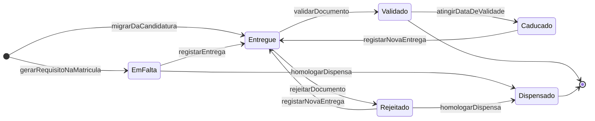
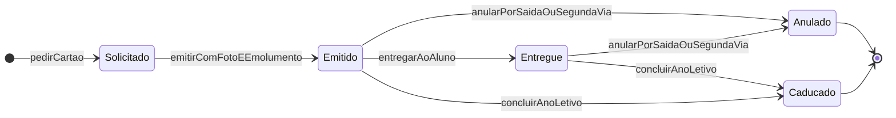
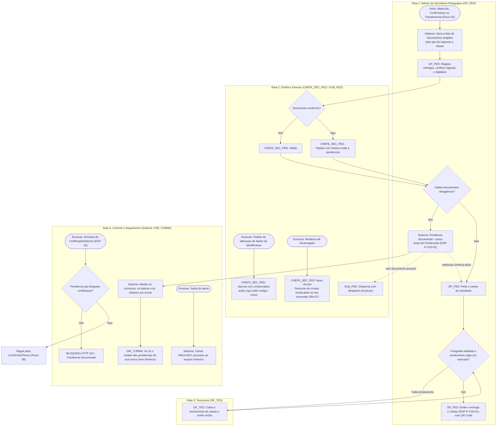

> [!warning] Nota arquivada — fonte já integrada na especificação v2.0
> Esta nota foi a **fonte de trabalho** da capacidade C03. O conteúdo foi integrado na especificação e **já não é a fonte de verdade**. Não editar: as correções fazem-se nos DOC.
> - Regras `RN-P-C03-nn` → família **`RN-11`** em [[01 - Dominio e Regras]] (a sub-regra mantém o número)
> - User stories → épico **EP-PIN (US-PIN-01–09)** em [[03 - User Stories]]
> - Fluxos → [[02 - Fluxos de Trabalho]] · Ecrãs e documentos → [[04 - Telas e Documentos]] (DOF-13, DOF-14)
> - Tabelas → [[05 - Modelagem de Dados]] (Grupos 3 e 6) · Requisitos → [[07 - Catalogo de Requisitos Funcionais]]
> - Questões `Q-C03-nn` → vão ser consolidadas no [[12 - Registo de Decisoes e Questoes em Aberto]] (Fase 3 da [[00.3 - Proposta de Organizacao Documental|ORG-00]])
>
> Tabela de correspondência completa: [[00.2 - Mapa de Integracao v2.0]] §2. Arquivada a 2026-11-05.

# C03 — Processo Individual do Aluno

> [!abstract] Navegação
> - **Painel Principal:** [[Inicio|Início do Vault]] | **Índice do Projeto:** [[00 - MOC SGE IPCAG 12008 BGO|MOC]] | **Plano:** [[00.1 - Plano de Engenharia de Requisitos]] (§2.1 — `C03`, cobertura 🟡)
> - **Especificação base (v1.2):** [[01 - Dominio e Regras]] → [[02 - Fluxos de Trabalho]] → [[03 - User Stories]] → [[04 - Telas e Documentos]] → [[05 - Modelagem de Dados]]
> - **Capacidades novas relacionadas:** [[C16 - Passagem de Ano Letivo]] | [[C04 - Horarios e Distribuicao de Servico Docente]]
> - **Decisões e questões:** [[12 - Registo de Decisoes e Questoes em Aberto]] (`Q-027`, `Q-028`, `Q-033`, `Q-034`, `Q-035`) | **Proteção de dados:** [[11 - Protecao de Dados (APD)]] (`C19`) | **Visão e âmbito:** [[06 - Visao e Ambito]] (`O-04`, `O-05`)
> - **Dados reais da escola:** [[Achados dos Documentos Reais - Lote 1]] (`DESC-L1` — A3, A4, A9, A11, A12, A13, A14) | **Migração:** [[10 - Migracao de Dados e Implantacao]] (`MIG-D10`, `AJ-16`) | **RNF:** [[08 - Requisitos Nao Funcionais]]

> [!warning] Estado deste documento
> Rascunho `0.2` para integração posterior. **Não altera** DOC-01 a DOC-05. Regras (`RN-P-C03-nn`), user stories (`US-PIN-nn`), módulos (`MOD-PIN-nn`), documentos (`DOF-P-C03-nn`) e questões (`Q-C03-nn`) têm **identificadores provisórios**. A lista de alterações a fazer em cada DOC está no §13.

> [!important] A lista de documentos obrigatórios não está confirmada
> A lista do §3 (`RN-P-C03-02`) é uma **proposta inicial**, construída só a partir do que a especificação já menciona (checklist do `MOD-PED-MAT`, Fluxo 01, Fluxo 02, `RN-06`). O boletim de matrícula real já foi recebido (DESC-L1 A12), mas **a lista de documentos a entregar continua em falta** (DESC-L1 §6). Por isso o sistema trata-a como **catálogo parametrizável** e não como regra fixa.

> [!example] O que os documentos reais e a APD-11 mudam nesta capacidade
> - **A12 — Boletins reais de Matrícula e de Confirmação:** nome completo; filiação (pai e mãe); data de nascimento; naturalidade; sexo; n.º do bilhete **e data de emissão**; **dois telefones do encarregado**; ocupação ou local de trabalho do pai; residência e município; escola, classe, ano letivo e resultado final anteriores (matrícula) ou classe, turma, sala e curso do ano anterior e **até duas cadeiras em atraso** (confirmação); **problema de saúde**; classe, curso e **período** pretendidos. Assinam **o candidato (aluno)** e o funcionário. O boletim **não pede o nome nem o BI do encarregado** (`Q-C03-17`). Mapeamento campo a campo no `RN-P-C03-08`.
> - **A13 — Numeração anual:** `Boletim de Matrícula N.º __/2026-2027` e `Boletim de Confirmação de Matrícula N.º __/2026-2027`, cada um com **comprovativo destacável** a conservar "para efeito de reclamação" (`RN-P-C03-14`).
> - **A3, A4, A9, A14 — Identidade impressa:** o número da instituição (12008 ou 8009 — `Q-027`), os títulos de quem assina (Comissão de Gestão — `Q-028`), "Período" em vez de "Turno" (`Q-033`) e o cabeçalho real (`Q-035`) são **parâmetros** do cartão e dos avisos, não texto fixo.
> - **APD-11:** o "problema de saúde" vai para o **compartimento de saúde** (facultativo, com consentimento CON-07, válido só para o ano — RF-P-APD-29, PC-30); o atestado médico da lista de documentos é só um **indicador "entregue / não entregue"**, sem ficheiro (RF-P-APD-07); a ocupação do pai só existe se houver finalidade confirmada (RF-P-APD-32); o encarregado indica se é **representante legal** (RF-P-APD-03, ALT-05-01); as fotografias guardam a finalidade (RF-P-APD-28); o portal QR mostra o mínimo (§7.3, RF-P-APD-16). Esta nota segue essas regras sem as repetir.

---

## 1. Objetivo e Âmbito

### 1.1 Objetivo
Completar a capacidade `C03` (matrícula e processo do aluno), já coberta no essencial pelo Fluxo 02 e pelo épico `EP-MAT`, com o que o plano §2.1 indica como em falta: a **lista de documentos obrigatórios do Processo Individual**, a **digitalização e os anexos**, os **alertas de documentos em falta**, a **atualização dos dados pessoais e do encarregado** e o **cartão de estudante**.

O DOC-01 define o `N.º de Processo Individual` como o identificador que "acompanha toda a pasta física e digital do estudante até à emissão do Diploma da 13ª classe". Esta capacidade especifica o conteúdo dessa pasta.

**Objetivos da [[06 - Visao e Ambito|VIS-06]]:** **`O-04`** (documentos emitidos só com a situação financeira verificada) e **`O-05`** (atendimento rápido ao balcão). A VIS-06 §5.2 coloca a `C03` **dentro do âmbito**, entrega **E1**, com os campos reais dos boletins, a numeração anual, a lista de documentos obrigatórios e o cartão de estudante.

### 1.2 Dentro do âmbito
1. **Composição do Processo Individual** (vista única do aluno).
2. **Catálogo de documentos** do processo, por tipo de ingresso e classe, com obrigatoriedade, validade e efeito da falta.
3. **Registo de entrega, conferência do original e digitalização**, com versões de ficheiros.
4. **Alertas e relatórios de documentos em falta, rejeitados ou caducados.**
5. **Atualização de dados pessoais do aluno** (identificação civil e contactos) e **do encarregado de educação**, incluindo a mudança de encarregado.
6. **Cartão de estudante:** emissão, 2ª via, validade e anulação.
7. **Boletins de matrícula e de confirmação** com os campos reais e numeração anual (DESC-L1 A12, A13).

### 1.3 Fora do âmbito
- Matrícula, confirmação, transferências e transcrição de histórico externo — já especificados (Fluxo 02, `US-MAT-01` a `US-MAT-04`); aqui só se acrescenta a parte documental.
- Prazos de conservação, consentimentos, avisos de privacidade e direitos dos titulares (`C19`, [[11 - Protecao de Dados (APD)|APD-11]]), incluindo o tratamento do "problema de saúde" declarado na matrícula (ALT-05-22, `informacao_saude_matricula`): esta capacidade aplica as regras dessa nota, sem as redefinir.
- Importação dos processos físicos existentes (`C17`; `MIG-D10` e `AJ-16` da nota [[10 - Migracao de Dados e Implantacao|10]]).
- Fusão de registos duplicados de alunos (tema da `C17`); aqui só se deteta e bloqueia o duplicado.
- Participações disciplinares no processo (`C13`).

### 1.4 Rastreabilidade
| Elemento | Ligação |
| :--- | :--- |
| Capacidade | `C03` (plano §2.1) |
| Entrega proposta | **E1 — Arrancar o ano** (plano §6) |
| Regras existentes usadas | `RN-05` (`N.º de Processo` vitalício), `RN-06` (histórico externo e PDF anexado), `RN-07` (encarregado e desconto de irmãos), `RN-08` (emolumento do cartão), `RN-10` (auditoria, QR Code) |
| Fluxos existentes tocados | Fluxo 01 (documentos da candidatura), Fluxo 02 (Cenário A "migra os documentos da candidatura para o Processo Individual"; F5 "Comprovativo de Matrícula e Cartão Emitidos"), Fluxo 08 (emissão documental) |
| User stories existentes tocadas | `US-MAT-01` ("documentos originais conferidos"), `US-MAT-02`, `US-MAT-03`, `US-PED-03` (atestado para `DISP`), `US-DOC-01`, `US-DOC-02` |
| Módulos existentes tocados | `MOD-PED-MAT` (`documentos_entregues_checklist`), `MOD-PED-HIST`, `MOD-PED-DOC` |
| Tabelas existentes tocadas | `alunos`, `encarregados_educacao`, `matriculas_anuais`, `historico_externo_transcricoes`, `dispensas_medicas`, `beneficios_bolsas_matricula`, `tabelas_precos_emolumentos`, `documentos_oficiais_emitidos` |
| Documentos oficiais tocados | `DOF-03` (via do Processo Individual Físico), `DOF-09`, `DOF-10` (identificação civil completa) |
| Objetivos | `O-04`, `O-05` (VIS-06 §3) |
| Dados reais | `DESC-L1` A3, A4, A9, A11, A12, A13, A14 |
| Requisitos da APD-11 aplicados | RF-P-APD-03, 04, 05, 07, 10, 11, 16, 20, 28, 29, 32; ALT-05-01, 02, 21, 22, 23; ALT-04-04, 17 |
| Migração | `MIG-D10` (lista de documentos entregues); `AJ-16` (onde guardar a lista — resolvido aqui: `documentos_processo_aluno`) |

---

## 2. Termos Novos Propostos para o Glossário (DOC-01 §1.2)

| Termo proposto | Código | Definição proposta |
| :--- | :---: | :--- |
| **Processo Individual do Aluno** | `PROCESSO_INDIVIDUAL` | Conjunto vitalício, físico e digital, de dados, documentos entregues e documentos emitidos de um aluno, identificado pelo `N.º de Processo Individual`. Tem uma vista digital única no SGE e uma pasta física com localização registada. |
| **Documento do Processo** | `DOC_PROCESSO` | Documento que o aluno ou o encarregado entrega à escola (ex.: BI, certificado da 9ª Classe), com estado próprio (em falta, entregue, validado, rejeitado, caducado, dispensado). Não confundir com os **documentos oficiais** emitidos pela escola (`DOF-xx`). |
| **Pendência Documental** | `PENDENCIA_DOC` | Documento obrigatório que não está validado nem dispensado, ou que caducou. Pode gerar apenas um alerta ou bloquear um ato (ex.: certificação), conforme o catálogo. Distingue-se da **Pendência Financeira** do `RN-08`. |
| **Cartão de Estudante** | `CARTAO_ESTUDANTE` | Documento de identificação escolar do aluno com matrícula ativa, sujeito ao emolumento já previsto no glossário do DOC-01 §1.5, com validade e verificação por QR Code. |
| **Boletim de Matrícula / Boletim de Confirmação de Matrícula** | `BOLETIM_MAT` | Formulário numerado por Ano Letivo (`N.º nnn/AAAA-AAAA`), preenchido na matrícula ou na confirmação, com comprovativo destacável a conservar "para efeito de reclamação" (DESC-L1 A12, A13). Corresponde ao `DOF-03`. |

---

## 3. Regras de Negócio Provisórias (`RN-P-C03-nn`)

### RN-P-C03-01: Composição do Processo Individual
1. Existe **um único processo por aluno**, vitalício e identificado pelo `N.º de Processo Individual` (`RN-05.1`), da 10ª Classe ao Diploma (inclusive em repetência, reingresso e regresso por transferência — [[C16 - Passagem de Ano Letivo]], `RN-P-C16-14`).
2. A **vista digital do processo** agrega, sem duplicar dados:
   - identificação civil e fotografia (`alunos`);
   - encarregado atual e histórico de encarregados (`RN-P-C03-09`);
   - matrículas anuais, deliberações e situação académica (`matriculas_anuais`, `alunos.situacao_academica` da `C16`);
   - documentos do processo e ficheiros digitalizados (`RN-P-C03-03`, `RN-P-C03-05`);
   - histórico externo (`historico_externo_transcricoes`), dispensas médicas (`dispensas_medicas`), cadeiras em atraso (`cadeiras_em_atraso`), benefícios (`beneficios_bolsas_matricula`);
   - documentos oficiais emitidos (`documentos_oficiais_emitidos`) e cartões de estudante;
   - situação financeira resumida (semáforo do `RN-08`, sem valores, para quem não pertence à Tesouraria).
3. **Pasta física:** o processo regista a localização física da pasta (arquivo corrente ou arquivo histórico) e quando mudou de lugar. A pasta passa ao arquivo histórico quando a situação académica é `Transferido (Saída)`, `Desistente / Anulado` ou `Concluiu o Curso` (`RN-P-C16-15.2`).

### RN-P-C03-02: Catálogo Parametrizável de Documentos do Processo
1. O `CHEFE_SEC_PED` mantém o catálogo de tipos de documento (`tipos_documento_processo`) e os requisitos por **tipo de ingresso** (`MATRICULA_INICIAL_10A`, `CONFIRMACAO_INTERNA`, `TRANSFERENCIA_ENTRADA` — DOC-05 §1.3, lista 8) e por classe (`requisitos_documentais`). A `SUB_PED` homologa.
2. Cada requisito define: **obrigatório?**, **exige conferência do original?**, **exige digitalização?**, **tem validade?** (e qual), **prazo de entrega** depois da matrícula, **efeito da falta** (`ALERTA` ou `BLOQUEIA_CERTIFICACAO` — `RN-P-C03-07`) e **categoria de dados** (`IDENTIFICACAO`, `ACADEMICO`, `SAUDE`, `FOTOGRAFIA`, `OUTRO`) para o controlo de acesso (`RN-P-C03-12`).
3. **Proposta inicial a validar** (só documentos já referidos na especificação; quantidades e validades em branco por não serem conhecidas):

| Documento | Matrícula Inicial 10ª | Confirmação Interna | Transferência de Entrada | Fonte na especificação | Por confirmar |
| :--- | :---: | :---: | :---: | :--- | :--- |
| **Bilhete de Identidade ou Cédula Pessoal** do aluno | Proposto obrigatório | Só se caducou ou mudou (cédula → BI) | Proposto obrigatório | Checklist `MOD-PED-MAT`; Fluxo 01 (S1); o boletim real pede o n.º e a data de emissão (A12) | `Q-C03-12` |
| **Certificado da 9ª Classe** (ou documento equivalente com notas) | Proposto obrigatório | — | A confirmar | Checklist `MOD-PED-MAT`; Fluxo 01 (S1); `media_9a_classe` no `MOD-PED-ADM` | `Q-C03-04` |
| **Atestado Médico** | Indicador "entregue / não entregue", **sem ficheiro** (RF-P-APD-07) | A confirmar | A confirmar | Checklist `MOD-PED-MAT`; APD-11 | `Q-C03-03`, `Q-APD-05` |
| **Fotografias** | Proposto obrigatório | A confirmar (renovação para o cartão) | Proposto obrigatório | Checklist `MOD-PED-MAT` ("Fotos"); finalidade de identificação (RF-P-APD-28) | `Q-C03-02` (quantidade, formato) |
| **Guia de Transferência Oficial** | — | — | Obrigatório | `RN-06.1`; `US-MAT-03` | — |
| **Certificado de Habilitações Parcial** da escola de origem | — | — | Obrigatório | `RN-06.1`; DOC-01 `HIST_EXTERNO` | — |
| **Documento de identificação do encarregado** e, se não for pai nem mãe, **documento de representação** | A confirmar | A confirmar | A confirmar | O n.º do BI é obrigatório no `MOD-PED-MAT`, mas o boletim real não o pede (A12); representante legal na ALT-05-01 | `Q-C03-05`, `Q-C03-17`, `Q-APD-13` |
| **Boletim de Matrícula ou de Confirmação (`DOF-03`) assinado** | Gerado pelo sistema | Gerado pelo sistema | Gerado pelo sistema | `DOF-03` (2 vias); boletim real com comprovativo destacável (A12, A13) | Arquivar o boletim assinado digitalizado? (`Q-C03-13`) |
| Outros (ex.: comprovativos de bolsa ou de isenção diocesana) | — | — | — | Já guardados em `beneficios_bolsas_matricula` | `Q-C03-01` |

4. Documentos de outros processos que já têm lugar próprio na especificação (atestado para dispensa `DISP`, comprovativo de bolsa, PDF da guia de transferência) **continuam nas suas tabelas** e aparecem na vista do processo; o catálogo não os duplica (ver `RN-P-C03-05.5`).
5. Alterar o catálogo a meio do ano só afeta as matrículas futuras; as exigências já geradas mantêm-se, salvo dispensa (`RN-P-C03-03.5`).

### RN-P-C03-03: Estado de Cada Documento do Processo
1. Ao criar uma matrícula (inicial, confirmação ou transferência), o sistema gera, para cada requisito aplicável, uma linha em `documentos_processo_aluno` no estado `EM_FALTA`. Na conversão de candidato em aluno (Fluxo 02, Cenário A), os documentos já entregues na candidatura entram logo como `ENTREGUE`.
2. O `OP_PED` regista a **entrega** (`ENTREGUE`), indicando se viu o original (`conferido_original_por` / `em`) e anexando a digitalização se o requisito a exigir.
3. O `CHEFE_SEC_PED` **valida** (`VALIDADO`) ou **rejeita** (`REJEITADO`, com motivo: ilegível, incompleto, dados divergentes, caducado, outro). Um documento rejeitado volta a contar como pendência.
4. Documentos com validade passam a `CADUCADO` na data de fim; o alerta aparece antes, a uma antecedência parametrizada.
5. A `SUB_PED` pode **dispensar** um documento obrigatório (`DISPENSADO`) com despacho e motivo, sob proposta do `CHEFE_SEC_PED` (padrão igual ao da `DISP` no `RN-01`).
6. Cada mudança de estado grava utilizador, data e hora; validações, rejeições e dispensas vão também para `audit_logs`.
7. Documentos de **saúde** (atestados) **não** usam `ficheiros_digitalizados`: o atestado da matrícula é só um indicador (RF-P-APD-07); se a `Q-APD-05` vier a admitir o ficheiro, ele vai para `documentos_saude`, no compartimento de saúde da APD-11 (ALT-05-09).

### RN-P-C03-04: Conferência do Original
1. Quando o requisito exige o original, a entrega só fica completa com a marca `original conferido`, o utilizador que conferiu e a data.
2. Se o original fica retido na escola ou é devolvido (ex.: certificado da 9ª Classe) é a `Q-C03-04`; o processo regista **onde está o original** (`ARQUIVO_ESCOLA` ou `DEVOLVIDO_AO_ENCARREGADO`).

### RN-P-C03-05: Digitalização e Ficheiros
1. Formatos aceites: PDF, JPEG e PNG. O tamanho máximo por ficheiro é um parâmetro; o [[08 - Requisitos Nao Funcionais|08]] usa a hipótese **H5** ("5 ficheiros de até 500 KB" por processo), a substituir pela lista real de documentos.
2. Ao carregar, o sistema calcula o **resumo criptográfico (SHA-256)** do ficheiro, guarda o tipo, o tamanho, quem carregou e quando, e liga o ficheiro ao aluno e ao documento do processo (`ficheiros_digitalizados`).
3. **Imutabilidade:** um ficheiro carregado não é editado nem apagado pelos utilizadores. Uma digitalização nova cria **nova versão** (ligação `substitui_ficheiro`), e a anterior fica guardada até a política de conservação da `C19` dizer o contrário.
4. A digitalização na Secretaria funciona sobre o servidor local da escola (`RN-10.4`, atendimento na LAN), sem depender da internet.
5. **Recomendação de integração:** os atributos "PDF anexado" já existentes (`historico_externo_transcricoes`, `dispensas_medicas`, `beneficios_bolsas_matricula`, `habilitacoes_docentes` da [[C04 - Horarios e Distribuicao de Servico Docente]]) passam a referir a mesma tabela `ficheiros_digitalizados`, para que todos os anexos tenham o mesmo controlo de acesso, resumo e versões.

### RN-P-C03-06: Alertas de Documentos em Falta
1. **Pendências de um aluno** = requisitos obrigatórios aplicáveis cujo documento não está `VALIDADO` nem `DISPENSADO`, mais os documentos `CADUCADO`.
2. Os alertas aparecem:
   - (a) ao abrir o processo (faixa com a lista de pendências e o prazo de entrega);
   - (b) no balcão de matrícula e de confirmação, substituindo o atual `documentos_entregues_checklist` (`JSONB` do `MOD-PED-MAT`) por registos estruturados;
   - (c) no **relatório de pendências por turma**, para o `OP_PED`/`CHEFE_SEC_PED` (com acesso aos ficheiros) e para o `DIR_TURMA` (só o nome do documento e o estado, **sem acesso aos ficheiros**, para lembrar as famílias);
   - (d) no `DOF-P-C16-02` (Aviso de Confirmação de Matrícula) e no `DOF-P-C03-02` (Aviso de Pendências Documentais).
3. Passado o prazo de entrega, a pendência sobe de nível (destaque no relatório); o efeito real depende do `RN-P-C03-07`.

### RN-P-C03-07: Efeitos de uma Pendência Documental (Proposta a Validar)
1. **Princípio proposto:** uma pendência documental **não bloqueia a ativação da matrícula** (o aluno não deixa de estudar por falta de papel), seguindo o mesmo critério do Fluxo 02, E2.3, para a transcrição externa em falta.
2. Os requisitos marcados `BLOQUEIA_CERTIFICACAO` impedem a emissão do **Certificado de Habilitações e do Diploma (`DOF-10`)** enquanto estiverem em pendência. Proposta inicial: Bilhete de Identidade/Cédula e Certificado da 9ª Classe (`Q-C03-07`).
3. A verificação junta-se às que o balcão já faz antes de emitir (`RN-08` financeiro, `RN-10` Livro/Folha/Termo), com resposta distinta: `HTTP 422 — Pendência Documental`, com a lista dos documentos em falta.

### RN-P-C03-08: Campos Reais da Matrícula e Atualização dos Dados Pessoais

**Campos dos boletins reais (DESC-L1 A12) e onde ficam no SGE:**

| Campo do boletim | Onde fica | Observação |
| :--- | :--- | :--- |
| Nome completo; filiação (pai e mãe); data de nascimento; naturalidade; sexo | `alunos` (atributos existentes) | Identificação civil (ponto 1). |
| N.º do bilhete; **emitido aos** | `alunos`: n.º (existente) e **data de emissão** (novo) | Data de emissão só com finalidade registada (ALT-05-21). |
| N.º de telefone do encarregado (dois) | `encarregados_educacao`: telefone principal e alternativo (existentes) | O boletim não identifica o encarregado por nome nem BI (`Q-C03-17`). |
| Ocupação ou local de trabalho do pai | Só se a Direção confirmar a finalidade (RF-P-APD-32, ALT-05-23, `Q-APD-29`); nunca impresso | Sem finalidade, o campo não existe no SGE. |
| Residência e município | `alunos` (novos) | Com finalidade registada (ALT-05-21). |
| Escola, classe, ano letivo e resultado final anteriores (matrícula inicial) | `matriculas_anuais` (novos, só em `MATRICULA_INICIAL_10A`); na 10ª podem vir de `candidaturas_10a` (escola de origem e média da 9ª) | Com finalidade registada (ALT-05-21). |
| Classe, turma, sala e curso do ano anterior (confirmação) | Derivados da matrícula anterior — **não se digitam** | Pré-preenchidos pela passagem ([[C16 - Passagem de Ano Letivo]], `RN-P-C16-06.3`). |
| Cadeira(s) em atraso, até duas (confirmação) | Derivadas de `cadeiras_em_atraso` — **não se digitam** | `RN-P-C16-09.5`. |
| Possui algum problema de saúde (qual?) | `informacao_saude_matricula`, no compartimento de saúde (ALT-05-22) | Facultativo, com CON-07, válido só para o ano (RF-P-APD-29, PC-30); nunca no comprovativo destacável. |
| Classe, curso e período pretendidos | `matriculas_anuais` (classe, curso e turno — "período" no impresso) | — |
| Assinaturas do candidato (aluno) e do funcionário | Boletim assinado arquivado (`RN-P-C03-02`) | A APD-11 pede a assinatura do **representante legal** (ALT-04-04). |

1. **Dados de identificação civil** (nome completo, data de nascimento, género, filiação, naturalidade, nacionalidade, tipo e número do documento de identificação): a alteração faz-se por **pedido de alteração** (`pedidos_alteracao_dados`) com **comprovativo digitalizado** (ex.: novo BI). O `OP_PED` regista o pedido; o `CHEFE_SEC_PED` aprova ou rejeita. A aprovação grava `valor_antigo` e `valor_novo` em `audit_logs` (`RN-10.1`).
2. **Documentos já emitidos não mudam:** `documentos_oficiais_emitidos` guarda um "resumo congelado dos dados impressos". Ao aprovar a alteração, o sistema lista os documentos emitidos com o dado antigo, para eventual reemissão (RF-P-APD-10); a reemissão passa o anterior a `SUBSTITUIDO` (RF-P-APD-11). Uma 2ª via usa os dados novos (`Q-C03-11`).
3. **Unicidade do documento de identificação:** se o novo número de BI já pertencer a outro aluno, o sistema bloqueia a alteração e cria um alerta de **possível registo duplicado** para a `SUB_PED` (a fusão é tratada na `C17`).
4. **Passagem da cédula pessoal ao BI:** o aluno que obtém BI regista o novo número; o número da cédula fica no histórico de identificação (os dois identificam a mesma pessoa).
5. **Dados de contacto** (telefone do aluno, morada, contacto de emergência — `Q-C03-15`): o `OP_PED` atualiza diretamente, com registo em `audit_logs`. É também a forma de exercer o direito de retificação da Lei n.º 22/11 (pormenor na `C19`).
6. **Nacionalidade:** o `DOF-10` imprime a nacionalidade do diplomado, mas `alunos` (DOC-05) não tem esse atributo. Esta capacidade propõe acrescentá-lo; o boletim real também não a pede (A12 — `Q-C03-20`).

### RN-P-C03-09: Encarregado de Educação
1. Cada aluno tem **um encarregado atual** (`alunos.encarregado_educacao_id`, já existente) e um **histórico de vínculos** com datas (`vinculos_encarregado_aluno`). O encarregado pode não ser o **representante legal** do aluno (ex.: um tio); o registo indica se é representante legal e com que título (ALT-05-01, RF-P-APD-03, `Q-APD-13`). O boletim real só recolhe **dois telefones** do encarregado, sem nome nem BI (`Q-C03-17`).
2. **Mudança de encarregado:** o `CHEFE_SEC_PED` regista o novo encarregado (pesquisado pelo BI, único em `encarregados_educacao`: reutiliza-se o registo se já existir), a data de início, o motivo e o comprovativo (documento a definir — `Q-C03-05`). O vínculo anterior recebe a data de fim. Evento `MUDANCA_ENCARREGADO` em `audit_logs`.
3. **Efeitos financeiros:** o desconto de irmãos (`RN-07.1`) é recalculado **só para as prestações vincendas**; os recibos já emitidos mantêm o encarregado da altura (imutabilidade `RN-09.1`). Antes de gravar, o `OP_PED` vê o efeito previsto no desconto.
4. **Encarregado partilhado por irmãos:** alterar o contacto do encarregado altera-o para todos os educandos; o ecrã mostra a lista dos educandos afetados antes de gravar.
5. **Maioridade:** a APD-11 prevê a lista diária dos alunos que fazem 18 anos, para reconfirmar os consentimentos (RF-P-APD-04). Se o aluno maior pode ser o próprio responsável perante a escola e a Tesouraria é a `Q-C03-10`; até lá, o encarregado é sempre obrigatório.

### RN-P-C03-10: Cartão de Estudante
1. **Quem tem direito:** aluno com matrícula `Ativa` no Ano Letivo corrente.
2. **Requisitos para emitir:** fotografia `VALIDADO` (`RN-P-C03-11`) e, se o cartão não estiver incluído na taxa de matrícula (`Q-C03-08`), o **emolumento "Cartão de Estudante"** pago e não consumido (`RN-08`, Condição 2). Bolseiros com isenção integral de emolumentos ficam dispensados do pagamento.
3. **Numeração e registo:** o cartão tem número sequencial por Ano Letivo (série própria — `RN-P-C03-14`) e é registado em `documentos_oficiais_emitidos` com o tipo `DOF-P-C03-01` e o código de verificação do `RN-10.3`; o `item_recibo` do emolumento fica `Consumido`.
4. **Validade:** proposta inicial, o Ano Letivo da matrícula (`Q-C03-08`). No encerramento do ano ([[C16 - Passagem de Ano Letivo]]), os cartões passam a `CADUCADO`.
5. **Anulação automática:** quando a matrícula passa a `Transferida (Externa)` ou `Anulada / Desistente`, o cartão passa a `ANULADO` e a verificação por QR Code passa a mostrar "inválido".
6. **2ª via:** em caso de perda, roubo ou dano, o cartão anterior é anulado antes de emitir o novo; a 2ª via fica sujeita ao emolumento próprio, se existir (`Q-C03-08`). Evento `CARTAO_ANULADO` e `CARTAO_EMITIDO` em `audit_logs`.
7. **Verificação pública:** o portal `MOD-PUB-QR` aplica ao cartão a regra da APD-11 (§7.3, RF-P-APD-16): tipo, número, data de emissão e estado (`VÁLIDO`, `ANULADO`…), mais nome do titular, curso, classe e Ano Letivo, como nos boletins e declarações; **nunca** fotografia, n.º de processo, BI, contactos ou dados de saúde (`Q-C03-09`, `Q-APD-18`).
8. **Identidade impressa:** nome e número da instituição (12008 ou 8009 — `Q-027`), cabeçalho (`Q-035`), título de quem assina (`Q-028`) e rótulo "Período" (`Q-033`) são parâmetros da instituição, não texto fixo do modelo.

### RN-P-C03-11: Fotografia do Aluno
1. O aluno tem **uma fotografia atual** (ficheiro da categoria `FOTOGRAFIA`), com versões; a fotografia nova substitui a anterior no cartão seguinte, não no cartão já emitido. Cada fotografia guarda a **finalidade** (identificação ou divulgação): a do cartão é de identificação, e exportá-la para divulgação exige o consentimento CON-03 (RF-P-APD-28).
2. A fotografia pode ser digitalizada da fotografia entregue ou captada no balcão (câmara). Os requisitos (fundo, enquadramento) são a `Q-C03-02`.
3. Uma fotografia ilegível ou fora dos requisitos é `REJEITADO` pelo `CHEFE_SEC_PED`.

### RN-P-C03-12: Acesso a Dados Sensíveis do Processo
1. Os **ficheiros** da categoria `IDENTIFICACAO` (cópias de BI/cédula) só podem ser vistos por `OP_PED`, `CHEFE_SEC_PED`, `SUB_PED` e `DIR_GERAL` (proposta — `Q-C03-16`).
2. A **informação de saúde** (atestados e "problema de saúde") segue a RF-P-APD-05 da APD-11: o detalhe só é visível ao `CHEFE_SEC_PED` e à `SUB_PED`; o `OP_PED` regista e carrega, mas não reabre; os restantes cargos, incluindo o `DIR_GERAL`, veem só o estado. Com consentimento, o **alerta de emergência** resumido aparece ao `DIR_TURMA` e ao `COORD_TURNO` (RF-P-APD-29).
3. `DIR_TURMA`, `COORD_CURSO` e `COORD_TURNO` veem **só o estado** das pendências (nome do documento e estado), nunca os ficheiros. `PROF`, `OP_TES`, `CHEFE_SEC_GER` e `SUB_ADM` não veem documentos do processo.
4. **Registo das consultas:** cada consulta ao processo individual fica em `audit_logs` (**RNF-PRV-02** do 08: 100% das consultas a processo individual, atestados e conta corrente). A visualização ou descarga de um ficheiro `IDENTIFICACAO` grava ainda o evento `ACESSO_ANEXO_SENSIVEL`, e a leitura de dados de saúde o `ACESSO_DADOS_SAUDE` da APD-11 (RF-P-APD-20, ALT-04-09).
5. O atestado médico usado na justificação de faltas pelo `DIR_TURMA` (`MOD-DOC-FAL`) segue as regras desse módulo e da APD-11 (RF-P-APD-06); esta regra aplica-se aos documentos do processo.

### RN-P-C03-13: Saída do Aluno e Devolução de Documentos
1. Na transferência de saída (`DOF-09C`) ou na anulação, o processo regista os documentos originais devolvidos ao encarregado, se for prática da escola (`Q-C03-14`), com a data e quem entregou.
2. O processo digital mantém-se completo e passa ao arquivo histórico (`RN-P-C03-01.3`).

### RN-P-C03-14: Numeração Anual dos Boletins de Matrícula e de Confirmação (DESC-L1 A12, A13)
1. Cada **Boletim de Matrícula** e cada **Boletim de Confirmação de Matrícula** recebe um número de uma **série anual própria** desse tipo de boletim, no formato real `N.º nnn/AAAA-AAAA` (ex.: `N.º 0137/2026-2027`, numeração ilustrativa). A série reinicia em cada Ano Letivo (a confirmar na `Q-C03-18`).
2. O número é atribuído **pelo sistema** quando a matrícula é criada (estado `Pendente`), nunca é reutilizado nem alterado; uma matrícula anulada mantém o seu número.
3. O **comprovativo destacável** (via do aluno do `DOF-03`) leva o mesmo número, o nome, o curso, o período e a data, e a menção de que deve ser conservado "para efeito de reclamação"; **nunca** leva dados de saúde (RF-P-APD-29, ALT-04-17).
4. **Mecanismo comum:** o DESC-L1 A13 mostra que quase todos os documentos da escola usam séries anuais por tipo (`N.º ___/IPCAG N.º <n.º> BGO/<ano>`). Esta capacidade propõe a tabela `series_numeracao_documental` (§8.1), que os boletins e o cartão de estudante usam desde já e que a emissão documental (`C09`) pode reutilizar.
5. No arranque, o último número usado de cada série no ano corrente é carregado como ponto de partida (migração — nota [[10 - Migracao de Dados e Implantacao|10]]; a `MIG-Q03` trata a numeração do processo).

---

## 4. Máquinas de Estado

### 4.1 Documento do Processo (`DOC_PROCESSO`)

| Estado Origem | Evento | Estado Destino | Quem Dispara | Condições de Guarda |
| :--- | :--- | :--- | :--- | :--- |
| `[Matrícula]` | `gerarRequisitoNaMatricula` | `Em Falta` | Sistema | Requisito aplicável ao tipo de ingresso e à classe (`RN-P-C03-02`). |
| `Em Falta` / `Rejeitado` / `Caducado` | `registarEntrega` | `Entregue` | `OP_PED`, `CHEFE_SEC_PED` | Se exigido: original conferido e digitalização anexada (`RN-P-C03-04`, `RN-P-C03-05`). |
| `Entregue` | `validarDocumento` | `Validado` | `CHEFE_SEC_PED` | Dados do documento coerentes com o registo do aluno (ex.: n.º do BI igual ao de `alunos`). |
| `Entregue` | `rejeitarDocumento` | `Rejeitado` | `CHEFE_SEC_PED` | Motivo obrigatório. |
| `Validado` | `atingirDataDeValidade` | `Caducado` | Tarefa diária | Só para documentos com validade. |
| `Em Falta` / `Rejeitado` | `homologarDispensa` | `Dispensado` | `SUB_PED` (proposta `CHEFE_SEC_PED`) | Despacho e motivo; `audit_logs`. |

### 4.2 Cartão de Estudante (`CARTAO_ESTUDANTE`)

| Estado Origem | Evento | Estado Destino | Quem Dispara | Condições de Guarda |
| :--- | :--- | :--- | :--- | :--- |
| `Solicitado` | `emitirComFotoEEmolumento` | `Emitido` | `OP_PED` | Matrícula `Ativa`; fotografia `Validado`; emolumento pago e não consumido ou isenção (`RN-P-C03-10.2`). Regista em `documentos_oficiais_emitidos`. |
| `Emitido` | `entregarAoAluno` | `Entregue` | `OP_PED` | Data de entrega e quem recebeu. |
| `Emitido` / `Entregue` | `anularPorSaidaOuSegundaVia` | `Anulado` | Sistema (saída do aluno) ou `CHEFE_SEC_PED` (2ª via) | Motivo (`TRANSFERENCIA`, `ANULACAO_MATRICULA`, `PERDA`, `ROUBO`, `DANO`, `ERRO`). QR Code passa a "inválido". |
| `Emitido` / `Entregue` | `concluirAnoLetivo` | `Caducado` | Sistema ([[C16 - Passagem de Ano Letivo]]) | Ano Letivo `Encerrado` (se a validade for anual — `Q-C03-08`). |

---

## 5. Fluxo Ponta a Ponta (Caminho Feliz e Exceções)

### 5.1 Atores e Contextos
- **Atores RBAC:** `OP_PED`, `CHEFE_SEC_PED`, `SUB_PED`, `OP_TES`, `DIR_TURMA`, `ENCARREGADO`.
- **Contextos DDD:** *Secretaria Pedagógica* ↔ *Tesouraria & Fiscalidade (AGT)* ↔ *Auditoria (APD)*.

### 5.2 Pré-condições e Gatilho
- **Pré-condições:** catálogo de documentos homologado para o Ano Letivo; tabela de emolumentos com a rubrica do cartão (se aplicável).
- **Gatilho:** criação de uma matrícula (Fluxo 02) ou pedido do encarregado (atualização de dados, cartão, 2ª via).

### 5.3 Diagrama em Raias

### 5.4 Passo a Passo do Caminho Feliz
1. **Boletim e lista de documentos:** ao criar a matrícula, o sistema atribui o número anual do boletim (`RN-P-C03-14`), pré-preenche os campos já conhecidos (`RN-P-C03-08`) e gera os documentos exigidos para o tipo de ingresso e a classe (`RN-P-C03-02`, `RN-P-C03-03.1`).
2. **Entrega e digitalização (`OP_PED`):** regista cada documento, marca a conferência do original e anexa a digitalização (`US-PIN-02`).
3. **Validação (`CHEFE_SEC_PED`):** valida ou rejeita (`US-PIN-03`).
4. **Pendências:** os documentos em falta ficam com prazo e aparecem nos alertas e no relatório por turma (`US-PIN-04`); a matrícula continua a seguir o seu fluxo normal.
5. **Cartão (`OP_PED` + `OP_TES`):** com fotografia validada e emolumento pago, o cartão é emitido, registado com código de verificação e entregue (`US-PIN-08`).

### 5.5 Caminhos de Exceção
- **E-C03.1 — Documento ilegível ou com dados divergentes:** `Rejeitado` com motivo; o encarregado é avisado (`DOF-P-C03-02`).
- **E-C03.2 — Documento impossível de obter** (ex.: perda do certificado da 9ª): dispensa pela `SUB_PED` com despacho (`RN-P-C03-03.5`).
- **E-C03.3 — Documento caducado** (ex.: BI): passa a `Caducado` e volta a ser pendência.
- **E-C03.4 — Tentativa de emitir o `DOF-10` com pendência bloqueante:** `HTTP 422 — Pendência Documental` (`RN-P-C03-07.2`).
- **E-C03.5 — Novo BI já usado por outro aluno:** bloqueio e alerta de possível duplicado (`RN-P-C03-08.3`).
- **E-C03.6 — Mudança de encarregado a meio do ano:** novo vínculo; desconto de irmãos recalculado só nas vincendas (`RN-P-C03-09.3`).
- **E-C03.7 — Perda do cartão:** anulação e 2ª via (`RN-P-C03-10.6`).
- **E-C03.8 — Transferência ou anulação da matrícula:** cartão anulado automaticamente; processo ao arquivo histórico (`RN-P-C03-10.5`, `RN-P-C03-13`).
- **E-C03.9 — Acesso de um `DIR_TURMA` a uma cópia de BI:** `HTTP 403` e registo da tentativa (`RN-P-C03-12`).

### 5.6 Pós-condições
- Cada aluno com a lista estruturada de documentos e os seus estados; ficheiros com resumo SHA-256 e versões.
- Dados pessoais e encarregado atualizados com rasto em `audit_logs`.
- Cartão emitido e registado em `documentos_oficiais_emitidos`, com o emolumento consumido.

---

## 6. User Stories (`US-PIN-nn`) com Critérios BDD

> [!note] Números dos exemplos
> Os campos dos boletins e o formato da numeração são **reais** (DESC-L1 A12, A13). Os restantes valores são ilustrativos e coerentes com DOC-01 a DOC-05 (`PROC-2026-00412`, turma `CG10A-T`, números de boletim). A lista de documentos, os prazos e o valor do emolumento do cartão vêm da Fase B.

### `US-PIN-01`: Parametrizar o Catálogo de Documentos do Processo Individual
- **História:** *Como* **Chefe da Secretaria Pedagógica (`CHEFE_SEC_PED`)**, *quero* **definir que documentos são exigidos a cada tipo de ingresso e classe, com prazo, validade e efeito da falta**, *para* **que o sistema gere sozinho a lista de cada aluno sem depender da memória do balcão**.
- **Rastreabilidade:** `RN-P-C03-02` | `MOD-PIN-03`.
- **Pré-condições:** Ano Letivo em `Planeado` ou `Em Curso`.
- **Critérios de Aceitação (BDD):**
  - **Cenário 1 (Sucesso — Requisito por tipo de ingresso):**
    - **Dado** que o `CHEFE_SEC_PED` define, para `TRANSFERENCIA_ENTRADA`, a Guia de Transferência Oficial como obrigatória, com digitalização, efeito `BLOQUEIA_CERTIFICACAO` e prazo de entrega de `0` dias (no ato), e a `SUB_PED` homologa,
    - **Quando** se cria uma matrícula por transferência de entrada,
    - **Então** o sistema gera a linha *"Guia de Transferência Oficial — Em Falta"* no processo do aluno.
  - **Cenário 2 (Sucesso — Alteração sem efeito retroativo):**
    - **Dado** que já existem 300 matrículas iniciais da 10ª com o requisito "Atestado Médico",
    - **Quando** o catálogo deixa de exigir o atestado a meio do ano,
    - **Então** as 300 exigências já geradas mantêm-se e só as matrículas novas deixam de o exigir.
  - **Cenário 3 (Segurança RBAC):**
    - **Dado** um `OP_PED`,
    - **Quando** tenta alterar o catálogo,
    - **Então** a API rejeita com `HTTP 403`.
- **Pós-condições:** `tipos_documento_processo` e `requisitos_documentais` homologados; evento `CATALOGO_DOCUMENTOS_HOMOLOGADO`.

### `US-PIN-02`: Registar a Entrega, a Conferência do Original e a Digitalização dos Documentos
- **História:** *Como* **Operador da Secretaria Pedagógica (`OP_PED`)**, *quero* **marcar no balcão os documentos entregues, confirmar que vi o original e anexar a digitalização**, *para* **que o processo digital corresponda à pasta física e fique pesquisável**.
- **Rastreabilidade:** `RN-P-C03-03`, `RN-P-C03-04`, `RN-P-C03-05` | `US-MAT-01`, `MOD-PIN-02`.
- **Pré-condições:** matrícula criada; documentos gerados em `Em Falta`.
- **Critérios de Aceitação (BDD):**
  - **Cenário 1 (Sucesso — Entrega com digitalização):**
    - **Dado** que o aluno `PROC-2026-00412` (10ª, `CG10A-T`) entrega o BI e o certificado da 9ª Classe,
    - **Quando** o `OP_PED` marca *"original conferido"*, digitaliza os dois em PDF de `1,2 MB` e grava,
    - **Então** os dois documentos passam a `Entregue`, cada ficheiro fica com o seu resumo SHA-256, o utilizador e a data, e o processo mostra *"2 de 4 documentos entregues"*.
  - **Cenário 2 (Bloqueio — Ficheiro não aceite):**
    - **Dado** um ficheiro `.docx` ou acima do tamanho máximo parametrizado,
    - **Quando** o `OP_PED` o tenta anexar,
    - **Então** o sistema rejeita com `HTTP 422`: *"Formato ou tamanho não aceite (PDF, JPEG ou PNG até ao limite definido)"*.
  - **Cenário 3 (Sucesso — Matrícula ativa com pendência):**
    - **Dado** que o atestado médico e as fotografias ficaram por entregar,
    - **Quando** a Tesouraria confirma o pagamento inicial,
    - **Então** a matrícula passa a `Ativa` normalmente (`RN-P-C03-07.1`) e o processo mostra *"2 pendências — prazo de entrega: 30/09/2026"* (prazo de exemplo).
  - **Cenário 4 (Sucesso — Documentos da candidatura):**
    - **Dado** que o candidato entregou o certificado da 9ª Classe na inscrição ao Teste de Admissão,
    - **Quando** é convertido em aluno (Fluxo 02, Cenário A),
    - **Então** esse documento entra no processo já como `Entregue`, com a mesma digitalização.
- **Pós-condições:** `documentos_processo_aluno` e `ficheiros_digitalizados` gravados.

### `US-PIN-03`: Validar, Rejeitar ou Dispensar Documentos do Processo
- **História:** *Como* **Chefe da Secretaria Pedagógica (`CHEFE_SEC_PED`)** e **Subdirector Pedagógico (`SUB_PED`)**, *queremos* **validar ou rejeitar os documentos entregues e, em casos excecionais, dispensar um documento obrigatório com despacho**, *para* **garantir que só documentos conformes sustentam a certificação**.
- **Rastreabilidade:** `RN-P-C03-03` | `MOD-PIN-02`.
- **Pré-condições:** documento `Entregue` (validação/rejeição) ou `Em Falta`/`Rejeitado` (dispensa).
- **Critérios de Aceitação (BDD):**
  - **Cenário 1 (Sucesso — Rejeição por divergência):**
    - **Dado** que o BI digitalizado de `PROC-2026-00412` tem uma data de nascimento diferente da registada,
    - **Quando** o `CHEFE_SEC_PED` rejeita com o motivo `DADOS_DIVERGENTES`,
    - **Então** o documento passa a `Rejeitado`, volta a contar como pendência e o sistema sugere abrir um pedido de alteração de dados (`US-PIN-06`).
  - **Cenário 2 (Sucesso — Dispensa com despacho):**
    - **Dado** que o certificado da 9ª Classe de um aluno se perdeu e a escola de origem fechou,
    - **Quando** o `CHEFE_SEC_PED` propõe a dispensa e a `SUB_PED` a homologa com o despacho `DESP-PED-031/2026`,
    - **Então** o documento passa a `Dispensado` e grava-se `DOCUMENTO_PROCESSO_DISPENSADO` em `audit_logs`.
  - **Cenário 3 (Bloqueio — Dispensa por quem não pode):**
    - **Dado** um `CHEFE_SEC_PED`,
    - **Quando** tenta dispensar diretamente, sem homologação da `SUB_PED`,
    - **Então** o sistema guarda apenas a proposta; o estado não muda.
- **Pós-condições:** estados atualizados; eventos em `audit_logs`.

### `US-PIN-04`: Consultar o Processo Individual e os Alertas de Documentos em Falta
- **História:** *Como* **Operador da Secretaria Pedagógica (`OP_PED`)** ou **Director de Turma (`DIR_TURMA`)**, *quero* **ver num só ecrã o processo do aluno ou a lista de pendências da turma**, *para* **pedir às famílias exatamente o que falta, antes de os prazos expirarem**.
- **Rastreabilidade:** `RN-P-C03-01`, `RN-P-C03-06`, `RN-P-C03-12` | `MOD-PIN-01`.
- **Pré-condições:** aluno com processo.
- **Critérios de Aceitação (BDD):**
  - **Cenário 1 (Sucesso — Vista do processo):**
    - **Dado** o aluno `PROC-2026-00412`,
    - **Quando** o `OP_PED` abre o processo,
    - **Então** vê a identificação e a fotografia, o encarregado atual, a matrícula `2026/2027` (`CG10A-T`, `N.º de Ordem 17`, Boletim de Matrícula `N.º 0137/2026-2027`), o semáforo financeiro (sem valores), os documentos com estado, as cadeiras em atraso, os documentos emitidos e uma faixa *"Pendências: Atestado Médico, Fotografias — prazo 30/09/2026"*.
  - **Cenário 2 (Sucesso — Relatório da turma para o Director de Turma):**
    - **Dado** que `CG10A-T` tem 6 alunos com pendências,
    - **Quando** o `DIR_TURMA` abre o relatório da sua turma,
    - **Então** vê os 6 alunos, o nome de cada documento em falta e o prazo, **sem** acesso aos ficheiros.
  - **Cenário 3 (Bloqueio — Ficheiro sensível):**
    - **Dado** o `DIR_TURMA` de `CG10A-T`,
    - **Quando** tenta abrir a digitalização do BI de um aluno,
    - **Então** a API rejeita com `HTTP 403` e regista a tentativa.
  - **Cenário 4 (Sucesso — Caducidade):**
    - **Dado** que o BI de um aluno, validado, caduca a `15/03/2027`,
    - **Quando** se atinge a antecedência de aviso parametrizada,
    - **Então** o processo mostra *"BI caduca a 15/03/2027"*; nessa data o documento passa a `Caducado`.
- **Pós-condições:** nenhuma alteração; acessos a ficheiros sensíveis em `audit_logs`.

### `US-PIN-05`: Impedir a Certificação com Pendência Documental Bloqueante
- **História:** *Como* **Chefe da Secretaria Pedagógica (`CHEFE_SEC_PED`)**, *quero* **que o sistema me impeça de emitir o Certificado ou o Diploma a um aluno com documentos essenciais em falta**, *para* **não certificar um percurso escolar sem prova da habilitação de acesso e da identidade**.
- **Rastreabilidade:** `RN-P-C03-07` | `US-DOC-02`, Fluxo 08, `MOD-PED-DOC`.
- **Pré-condições:** aluno apto para o `DOF-10` em termos académicos e financeiros.
- **Critérios de Aceitação (BDD):**
  - **Cenário 1 (Bloqueio — Certificado da 9ª em falta):**
    - **Dado** que o aluno `PROC-2023-00031` concluiu o curso, tem o semáforo financeiro verde e o emolumento pago, mas o certificado da 9ª Classe está `Em Falta` com efeito `BLOQUEIA_CERTIFICACAO`,
    - **Quando** o `CHEFE_SEC_PED` tenta emitir o `DOF-10`,
    - **Então** o sistema rejeita com `HTTP 422 — Pendência Documental: Certificado da 9ª Classe` e não atribui Livro/Folha/Termo.
  - **Cenário 2 (Sucesso — Pendência só de alerta):**
    - **Dado** que só as fotografias estão em falta (efeito `ALERTA`),
    - **Quando** o `CHEFE_SEC_PED` emite o `DOF-10`,
    - **Então** a emissão prossegue e o processo mantém o alerta.
- **Pós-condições:** nenhuma emissão no Cenário 1; tentativa registada.

### `US-PIN-06`: Atualizar os Dados Pessoais do Aluno com Comprovativo e Auditoria
- **História:** *Como* **Operador da Secretaria Pedagógica (`OP_PED`)** com aprovação do **Chefe da Secretaria Pedagógica (`CHEFE_SEC_PED`)**, *quero* **corrigir os dados pessoais do aluno com o comprovativo adequado**, *para* **que os documentos oficiais saiam com dados corretos e cada alteração fique provada (Lei n.º 22/11)**.
- **Rastreabilidade:** `RN-P-C03-08` | `MOD-PIN-04`.
- **Pré-condições:** aluno registado.
- **Critérios de Aceitação (BDD):**
  - **Cenário 1 (Sucesso — Contacto):**
    - **Dado** que o encarregado informa um novo telefone de emergência,
    - **Quando** o `OP_PED` grava,
    - **Então** o contacto é atualizado de imediato com registo em `audit_logs`.
  - **Cenário 2 (Sucesso — Passagem da cédula ao BI):**
    - **Dado** que o aluno tinha cédula pessoal e apresenta agora BI,
    - **Quando** o `OP_PED` cria o pedido com a digitalização do BI e o `CHEFE_SEC_PED` aprova,
    - **Então** o número do BI passa a ser o documento de identificação atual, o número da cédula fica no histórico e grava-se `ALTERACAO_DADOS_IDENTIFICACAO` com valor antigo e novo.
  - **Cenário 3 (Bloqueio — Alteração do nome sem comprovativo):**
    - **Dado** um pedido de correção do nome completo sem documento anexado,
    - **Quando** o `CHEFE_SEC_PED` o tenta aprovar,
    - **Então** o sistema rejeita com `HTTP 422`: *"Alteração de identificação civil exige comprovativo"*.
  - **Cenário 4 (Bloqueio — BI de outro aluno):**
    - **Dado** que o número de BI indicado já pertence a `PROC-2025-00215`,
    - **Quando** se tenta aprovar a alteração,
    - **Então** o sistema bloqueia com `HTTP 409` e cria um alerta de possível registo duplicado para a `SUB_PED`.
- **Pós-condições:** `pedidos_alteracao_dados` decidido; `alunos` atualizado; documentos já emitidos inalterados.

### `US-PIN-07`: Mudar ou Atualizar o Encarregado de Educação
- **História:** *Como* **Chefe da Secretaria Pedagógica (`CHEFE_SEC_PED`)**, *quero* **registar um novo encarregado de educação para um aluno, guardando o histórico**, *para* **saber em cada momento quem responde pelo aluno, sem estragar o histórico financeiro nem os descontos de irmãos**.
- **Rastreabilidade:** `RN-P-C03-09`, `RN-07`, `RN-09` | `MOD-PIN-04`.
- **Pré-condições:** aluno com encarregado atual.
- **Critérios de Aceitação (BDD):**
  - **Cenário 1 (Sucesso — Novo encarregado com efeito no desconto de irmãos):**
    - **Dado** que `PROC-2026-00412` tinha como encarregado a pessoa X, com outro educando ativo e `DESCONTO_IRMAOS`, e a partir de `01/02/2027` passa a ter como encarregado a pessoa Y, sem outros educandos,
    - **Quando** o `CHEFE_SEC_PED` regista o novo vínculo com comprovativo,
    - **Então** o vínculo com X termina a `31/01/2027`, o de Y começa a `01/02/2027`, o desconto de irmãos deixa de se aplicar às prestações de *Fevereiro* a *Junho* (`A Vencer`), os recibos anteriores ficam inalterados e grava-se `MUDANCA_ENCARREGADO`.
  - **Cenário 2 (Sucesso — Encarregado já registado):**
    - **Dado** que o BI de Y já existe em `encarregados_educacao` (é encarregado de outro aluno),
    - **Quando** o `CHEFE_SEC_PED` pesquisa pelo BI,
    - **Então** o sistema reutiliza o registo existente (sem duplicar) e passa a sugerir o desconto de irmãos, se aplicável.
  - **Cenário 3 (Aviso — Alteração de contacto partilhado):**
    - **Dado** que o encarregado X tem 2 educandos,
    - **Quando** o `OP_PED` altera o telefone de X,
    - **Então** o sistema mostra *"Esta alteração aplica-se a 2 alunos: PROC-…, PROC-…"* antes de gravar.
- **Pós-condições:** `vinculos_encarregado_aluno` e `alunos.encarregado_educacao_id` atualizados.

### `US-PIN-08`: Emitir, Anular e Reemitir o Cartão de Estudante
- **História:** *Como* **Operador da Secretaria Pedagógica (`OP_PED`)**, *quero* **emitir o cartão de estudante dos alunos com matrícula ativa, com fotografia e QR Code, e substituí-lo em caso de perda**, *para* **identificar o aluno dentro e fora da escola sem cartões falsificados ou de alunos que já saíram**.
- **Rastreabilidade:** `RN-P-C03-10`, `RN-P-C03-11`, `RN-08`, `RN-10` | Fluxo 02 (F5), `MOD-PIN-05`, `DOF-P-C03-01`.
- **Pré-condições:** matrícula `Ativa`.
- **Critérios de Aceitação (BDD):**
  - **Cenário 1 (Sucesso — 1ª via):**
    - **Dado** que `PROC-2026-00412` tem a matrícula `Ativa` em `CG10A-T`, a fotografia `Validado` e o emolumento do cartão pago,
    - **Quando** o `OP_PED` emite o cartão,
    - **Então** o sistema gera o cartão `N.º 2026/00412` (exemplo de numeração), regista-o em `documentos_oficiais_emitidos` com o código de verificação, marca o `item_recibo` como `Consumido` e o cartão passa a `Emitido`.
  - **Cenário 2 (Bloqueio — Sem fotografia ou sem emolumento):**
    - **Dado** que a fotografia está `Em Falta` ou o emolumento não está pago (e não há isenção),
    - **Quando** o `OP_PED` tenta emitir,
    - **Então** o sistema rejeita com `HTTP 422` (*"Fotografia por validar"*) ou `HTTP 403` (*"Pendência Financeira — emolumento do cartão"*).
  - **Cenário 3 (Sucesso — 2ª via por perda):**
    - **Dado** que o aluno declara a perda do cartão,
    - **Quando** o `CHEFE_SEC_PED` anula o cartão com o motivo `PERDA` e o `OP_PED` emite a 2ª via (com o emolumento próprio, se existir),
    - **Então** o cartão antigo passa a `Anulado` e o seu QR Code mostra *"inválido"*; o novo fica `Emitido` com a indicação *"2ª via"*.
  - **Cenário 4 (Sucesso — Anulação por transferência):**
    - **Dado** que a matrícula de `PROC-2026-00412` passa a `Transferida (Externa)`,
    - **Quando** a transferência é homologada,
    - **Então** o cartão passa a `Anulado` automaticamente com o motivo `TRANSFERENCIA`.
- **Pós-condições:** `cartoes_estudante` atualizado; eventos `CARTAO_EMITIDO` / `CARTAO_ANULADO` em `audit_logs`.

### `US-PIN-09`: Registar o Boletim de Matrícula ou de Confirmação com os Campos Reais e Numeração Anual
- **História:** *Como* **Operador da Secretaria Pedagógica (`OP_PED`)**, *quero* **preencher no SGE o boletim de matrícula ou de confirmação com os mesmos campos do modelo da escola, recebendo o número anual e o comprovativo destacável**, *para* **substituir o boletim em papel sem perder nenhum campo nem a numeração que a escola já usa**.
- **Rastreabilidade:** `RN-P-C03-08`, `RN-P-C03-14` | DESC-L1 A12, A13 | `US-MAT-01`, `US-MAT-02`, `DOF-03`.
- **Pré-condições:** Ano Letivo `2026/2027` com as séries de boletins configuradas.
- **Critérios de Aceitação (BDD):**
  - **Cenário 1 (Sucesso — Matrícula inicial):**
    - **Dado** que o último Boletim de Matrícula de `2026/2027` tem o `N.º 0136` *(ilustrativo)*,
    - **Quando** o `OP_PED` cria a matrícula de um candidato admitido à 10ª de Contabilidade e Gestão, período da Tarde, preenchendo os campos reais (identificação, n.º e data de emissão do BI, dois telefones do encarregado, residência e município, escola, classe, ano e resultado anteriores),
    - **Então** o sistema atribui o `Boletim de Matrícula N.º 0137/2026-2027`, imprime o boletim e o comprovativo destacável com o mesmo número e a menção "para efeito de reclamação", e o comprovativo não mostra o campo de saúde.
  - **Cenário 2 (Sucesso — Confirmação pré-preenchida):**
    - **Dado** que `PROC-2025-00108` frequentou a 10ª em `CG10A-T`, Sala 04, em `2025/2026` e tem 2 cadeiras em atraso,
    - **Quando** o `OP_PED` abre a confirmação para `2026/2027`,
    - **Então** a classe, turma, sala e curso anteriores e as 2 cadeiras em atraso aparecem preenchidos e só de leitura, e o boletim recebe o número seguinte da série **de confirmação** (se as séries forem separadas — `Q-C03-18`).
  - **Cenário 3 (Sucesso — Campo de saúde facultativo):**
    - **Dado** que o encarregado não quer declarar problemas de saúde,
    - **Quando** o `OP_PED` deixa o campo vazio,
    - **Então** a matrícula prossegue normalmente; se o campo for preenchido, só é gravado com o consentimento CON-07 e no compartimento de saúde (RF-P-APD-29).
  - **Cenário 4 (Bloqueio — Alterar ou reutilizar o número):**
    - **Dado** um boletim já numerado,
    - **Quando** um utilizador tenta alterar o número ou reutilizar o número de uma matrícula anulada,
    - **Então** o sistema rejeita com `HTTP 409` e regista `TENTATIVA_ALTERACAO_NUMERO_BOLETIM` em `audit_logs`.
- **Pós-condições:** `matriculas_anuais` com o número do boletim; `series_numeracao_documental` atualizada; `DOF-03` com 2 vias.

---

## 7. Ecrãs, Módulos e Documentos Propostos

### `MOD-PIN-01`: Ficha do Processo Individual (Vista Única do Aluno) (`US-PIN-04`) — Workspace 02
- **Perfis:** `OP_PED`, `CHEFE_SEC_PED`, `SUB_PED`, `DIR_GERAL` (completo); `DIR_TURMA`, `COORD_CURSO`, `COORD_TURNO` (`R*`, sem ficheiros, conforme o §9).
- **Entradas:** pesquisa por `num_processo`, nome ou n.º do documento de identificação.
- **Saídas:** secções do `RN-P-C03-01.2`; faixa de pendências; localização da pasta física; relatório de pendências por turma.

### `MOD-PIN-02`: Checklist, Entrega e Digitalização de Documentos (`US-PIN-02`, `US-PIN-03`) — Workspace 02
> Substitui o campo `documentos_entregues_checklist` (`JSONB`) do `MOD-PED-MAT`.
- **Perfis:** `OP_PED` (entrega e digitalização), `CHEFE_SEC_PED` (validação, rejeição, proposta de dispensa), `SUB_PED` (dispensa).
- **Entradas:**
  | Campo | Tipo | Obrigatório | Regra |
  | :--- | :---: | :---: | :--- |
  | `documento_processo_id` | `UUID` | Sim | Linha gerada pela matrícula. |
  | `original_conferido` | `BOOLEAN` | Condicional | Obrigatório se o requisito exigir original. |
  | `localizacao_original` | `ENUM` | Condicional | `ARQUIVO_ESCOLA` / `DEVOLVIDO_AO_ENCARREGADO` (`RN-P-C03-04.2`). |
  | `ficheiro` | `FILE` | Condicional | PDF, JPEG ou PNG; tamanho máximo parametrizado (`RN-P-C03-05`). |
  | `data_validade` | `DATE` | Condicional | Para documentos com validade. |
  | `motivo_rejeicao` / `despacho_dispensa` | `ENUM` / `VARCHAR(40)` | Condicional | Rejeição ou dispensa. |
- **Comandos:** `RegistarEntregaDocumento`, `AnexarDigitalizacao`, `ValidarDocumento`, `RejeitarDocumento`, `ProporDispensa`, `HomologarDispensa`.
- **Saídas:** estado de cada documento; `DOF-P-C03-02`.

### `MOD-PIN-03`: Catálogo de Documentos do Processo (`US-PIN-01`) — Workspace 02
- **Perfis:** `CHEFE_SEC_PED` (escrita), `SUB_PED` (homologação).
- **Entradas:** `tipo_documento` (nome, categoria de dados), `requisitos[]` (`tipo_ingresso`, `classe`, `obrigatorio`, `exige_original`, `exige_digitalizacao`, `validade`, `prazo_entrega_dias`, `efeito_falta`).

### `MOD-PIN-04`: Atualização de Dados Pessoais e do Encarregado (`US-PIN-06`, `US-PIN-07`) — Workspace 02
- **Perfis:** `OP_PED` (contactos; pedidos de alteração), `CHEFE_SEC_PED` (aprova identificação civil; muda encarregado).
- **Entradas:** campo a alterar, valor novo, comprovativo; para o encarregado: BI do novo encarregado, data de início, motivo, comprovativo.
- **Validações:** `RN-P-C03-08`, `RN-P-C03-09`.
- **Saídas:** pré-visualização do efeito no desconto de irmãos; lista de educandos afetados.

### `MOD-PIN-05`: Emissão do Cartão de Estudante (`US-PIN-08`) — Workspace 02
- **Perfis:** `OP_PED` (pedido, emissão, entrega), `CHEFE_SEC_PED` (anulação, 2ª via).
- **Entradas:** `matricula_id`, `fotografia` (captada ou digitalizada), `item_recibo_id` (ou isenção), `motivo_anulacao`.
- **Saídas:** `DOF-P-C03-01` para impressão; lista de cartões por emitir por turma (emissão em lote no início do ano).

### Documentos propostos (códigos provisórios)
| Código | Documento | Formato | Conteúdo mínimo | Assinaturas |
| :--- | :--- | :--- | :--- | :--- |
| `DOF-P-C03-01` | **Cartão de Estudante** | Proposta: formato ID-1 da norma ISO/IEC 7810 (85,60 × 53,98 mm) ou papel A4 com vários cartões para recorte e plastificação (`Q-C03-08`) | Frente: nome e número da instituição (parâmetros — `Q-027`, `Q-035`), fotografia, nome completo, `N.º de Processo`, curso, classe, turma, **período** (`Q-033`), Ano Letivo, validade. Verso: N.º e via do cartão, QR Code (`RN-10.3`) e indicação para devolução em caso de perda. | Assinatura digitalizada (cargo e título impresso a confirmar — `Q-C03-08`, `Q-028`) |
| `DOF-P-C03-02` | **Aviso de Pendências Documentais** | A5 ou A4 | Aluno, `N.º de Processo`, turma, lista de documentos em falta, rejeitados ou caducados, motivo, prazo de entrega. Sem dados de terceiros. | `OP_PED` ou `CHEFE_SEC_PED` |

---

## 8. Modelo de Dados — Tabelas Novas e Atributos Novos

> [!note] Verificação contra o DOC-05
> Nenhuma das 44 tabelas guarda documentos entregues pelo aluno, ficheiros digitalizados com versões, histórico de encarregados, pedidos de alteração de dados ou cartões de estudante. O checklist atual é um campo `JSONB` no `MOD-PED-MAT` (DOC-04), não uma tabela. **Reutiliza-se** `documentos_oficiais_emitidos` para o registo do cartão e `tabelas_precos_emolumentos` para o emolumento.

### 8.1 Tabelas novas (Grupo 3 — Alunos e Matrículas; Grupo 6 — Documentos)
| Tabela proposta | Grupo | Papel | Atributos principais | Chaves e regras |
| :--- | :---: | :--- | :--- | :--- |
| **`tipos_documento_processo`** | 3 | Catálogo dos documentos que o aluno pode ter de entregar. | ID; Código; Nome; Categoria de Dados (`IDENTIFICACAO`/`ACADEMICO`/`SAUDE`/`FOTOGRAFIA`/`OUTRO`); Tem Validade?; Ativo? | `UNIQUE(Código)`. |
| **`requisitos_documentais`** | 3 | Que documentos se exigem a cada tipo de ingresso e classe. | ID; Ano Letivo (início de vigência); Tipo de Documento; Tipo de Ingresso; Classe (vazio = todas); Obrigatório?; Exige Original?; Exige Digitalização?; Prazo de Entrega (dias); Efeito da Falta (`ALERTA`/`BLOQUEIA_CERTIFICACAO`); Homologado por (`SUB_PED`) | `UNIQUE(Ano Letivo + Tipo de Documento + Tipo de Ingresso + Classe)`. |
| **`documentos_processo_aluno`** | 3 | Estado de cada documento exigido a cada aluno. | ID; Aluno; Tipo de Documento; Matrícula que gerou a exigência; Estado (§4.1); Data Limite de Entrega; Original Conferido por/em; Localização do Original; Data de Validade; Validado/Rejeitado por/em; Motivo de Rejeição; Despacho de Dispensa + Homologado por; Ficheiro Atual (ligação) | `UNIQUE(Aluno + Tipo de Documento + Matrícula)`. |
| **`ficheiros_digitalizados`** | 6 | Ficheiros carregados no SGE, com resumo e versões. | ID; Aluno (opcional); Entidade e Registo de Origem; Nome; Tipo (MIME); Tamanho; **Resumo SHA-256**; Localização de Armazenamento; Categoria de Dados (nunca saúde: essa vai para `documentos_saude` da APD-11); Versão; Substitui o Ficheiro (ligação); Carregado por/em | Sem `UPDATE` do conteúdo nem `DELETE` pelos utilizadores (`RN-P-C03-05.3`); eliminação só pela política da `C19`. |
| **`vinculos_encarregado_aluno`** | 3 | Histórico de quem foi o encarregado de cada aluno. | ID; Aluno; Encarregado; Data de Início; Data de Fim; Motivo; Comprovativo (ficheiro); Registado por (`CHEFE_SEC_PED`) | No máximo 1 vínculo sem data de fim por aluno; coerente com `alunos.encarregado_educacao_id`. |
| **`pedidos_alteracao_dados`** | 3 | Pedidos de retificação de dados de identificação civil (aluno ou encarregado). | ID; Titular (Aluno ou Encarregado); Campo; Valor Atual; Valor Proposto; Comprovativo (ficheiro); Estado (`PENDENTE`/`APROVADO`/`REJEITADO`); Pedido por (`OP_PED`)/em; Decidido por (`CHEFE_SEC_PED`)/em; Motivo da Decisão | A aprovação aplica a alteração e grava `audit_logs` (`RN-P-C03-08.1`). |
| **`cartoes_estudante`** | 6 | Cartões emitidos a cada aluno. | ID; Aluno; Matrícula; Ano Letivo; N.º do Cartão; Via (1ª, 2ª…); Estado (§4.2); Fotografia usada (ficheiro); Item de Recibo do Emolumento (opcional — isenção); Documento Emitido (ligação a `documentos_oficiais_emitidos`); Data de Emissão; Validade; Data de Entrega; Motivo de Anulação | `UNIQUE(Ano Letivo + N.º do Cartão)`; no máximo 1 cartão `EMITIDO`/`ENTREGUE` por aluno e ano. |
| **`series_numeracao_documental`** | 6 | Séries de numeração anual por tipo de documento (DESC-L1 A13). | ID; Tipo de Documento (ex.: `BOLETIM_MATRICULA`, `BOLETIM_CONFIRMACAO`, `CARTAO_ESTUDANTE`); Ano Letivo; Formato (ex.: `N.º {n}/{ano_letivo}`); Último Número Usado; Número Inicial (migração) | `UNIQUE(Tipo de Documento + Ano Letivo)`; atribuição atómica do número seguinte; nunca reutiliza números (`RN-P-C03-14`). |

### 8.2 Atributos novos em tabelas existentes
| Tabela existente | Atributo novo | Motivo |
| :--- | :--- | :--- |
| `alunos` | **Tipo de Documento de Identificação** (`BI`/`CEDULA_PESSOAL`/`OUTRO`); **Data de Emissão do Documento** (boletim real — A12; ALT-05-21) e **Data de Validade** (opcional); **Histórico de Identificação** (números anteriores); **Nacionalidade**; **Residência** e **Município** (A12; ALT-05-21); **Fotografia Atual**, com finalidade (ALT-05-02); **Telefone do Aluno** e **Contacto de Emergência** (opcionais — `Q-C03-15`); **Localização da Pasta Física** + **Arquivo** (`CORRENTE`/`HISTORICO`) | `RN-P-C03-01.3`, `RN-P-C03-08`, `RN-P-C03-11`; a nacionalidade é exigida pelo `DOF-10` e não existe no DOC-05. A **Situação Académica** vem da [[C16 - Passagem de Ano Letivo]]. |
| `encarregados_educacao` | **Data de Validade do BI** (opcional). Os atributos de representação legal são os da ALT-05-01 da APD-11 (não se duplicam aqui). | Coerência com `RN-P-C03-03.4`, se a cópia do BI do encarregado for exigida (`Q-C03-05`). |
| `matriculas_anuais` | **N.º do Boletim** e **Série** (ligação a `series_numeracao_documental`); na matrícula inicial, **Escola, Classe, Ano Letivo e Resultado Final Anteriores** (A12; ALT-05-21) | `RN-P-C03-14`, `RN-P-C03-08`. |
| `tabelas_precos_emolumentos` | Rubricas novas `TAXA_CARTAO_ESTUDANTE` e `TAXA_CARTAO_ESTUDANTE_2A_VIA` (a confirmar) | O "Cartão de Estudante" já é emolumento no glossário do DOC-01 §1.5, mas não está na lista de rubricas do DOC-05. |
| `documentos_oficiais_emitidos` | **Tipo de Documento** aceita `DOF-P-C03-01` | Registo e verificação do cartão. |
| `historico_externo_transcricoes`, `dispensas_medicas`, `beneficios_bolsas_matricula` | O "PDF/ficheiro anexado" passa a ser uma ligação a `ficheiros_digitalizados` (recomendado) | `RN-P-C03-05.5`. |

### 8.3 Listas fechadas novas (DOC-05 §1.3)
| Lista proposta | Valores |
| :--- | :--- |
| Categoria de Dados do Documento | `IDENTIFICACAO`, `ACADEMICO`, `SAUDE`, `FOTOGRAFIA`, `OUTRO` |
| Estados do Documento do Processo | `EM_FALTA`, `ENTREGUE`, `VALIDADO`, `REJEITADO`, `CADUCADO`, `DISPENSADO` |
| Motivos de Rejeição | `ILEGIVEL`, `INCOMPLETO`, `DADOS_DIVERGENTES`, `CADUCADO`, `OUTRO` |
| Efeito da Falta | `ALERTA`, `BLOQUEIA_CERTIFICACAO` |
| Localização do Original | `ARQUIVO_ESCOLA`, `DEVOLVIDO_AO_ENCARREGADO` |
| Estados do Pedido de Alteração | `PENDENTE`, `APROVADO`, `REJEITADO` |
| Estados do Cartão de Estudante | `SOLICITADO`, `EMITIDO`, `ENTREGUE`, `ANULADO`, `CADUCADO` |
| Motivos de Anulação do Cartão | `TRANSFERENCIA`, `ANULACAO_MATRICULA`, `PERDA`, `ROUBO`, `DANO`, `ERRO` |
| Tipo de Documento de Identificação | `BI`, `CEDULA_PESSOAL`, `OUTRO` |
| Tipos de Série Documental | `BOLETIM_MATRICULA`, `BOLETIM_CONFIRMACAO`, `CARTAO_ESTUDANTE` (extensível) |

### 8.4 Eventos novos em `audit_logs`
`CATALOGO_DOCUMENTOS_HOMOLOGADO`, `DOCUMENTO_PROCESSO_VALIDADO`, `DOCUMENTO_PROCESSO_REJEITADO`, `DOCUMENTO_PROCESSO_DISPENSADO`, `ACESSO_ANEXO_SENSIVEL`, `ALTERACAO_DADOS_IDENTIFICACAO`, `ALTERACAO_CONTACTOS`, `MUDANCA_ENCARREGADO`, `POSSIVEL_REGISTO_DUPLICADO`, `CARTAO_EMITIDO`, `CARTAO_ANULADO`, `TENTATIVA_ALTERACAO_NUMERO_BOLETIM`.

---

## 9. Permissões por Cargo RBAC (Linhas Novas para a Matriz do DOC-01 §2.2)

> Desdobram a linha 5 do DOC-01 ("Matrícula, Confirmação e Processo Individual do Aluno"), mantendo os mesmos perfis com acesso.

| Recurso / Ação | `DIR_GERAL` | `SUB_PED` | `SUB_ADM` | `CHEFE_SEC_PED` | `OP_PED` | `CHEFE_SEC_GER` | `OP_TES` | `COORD_CURSO` | `COORD_DISC` | `COORD_TURNO` | `DIR_TURMA` | `PROF` |
| :--- | :---: | :---: | :---: | :---: | :---: | :---: | :---: | :---: | :---: | :---: | :---: | :---: |
| **D1. Catálogo de documentos do processo** | `R` | `R, H` | `—` | `C, R, U` | `R` | `—` | `—` | `—` | `—` | `—` | `—` | `—` |
| **D2. Registo de entrega e digitalização** | `R` | `R` | `—` | `C, R, U` | `C, R, U` | `—` | `—` | `—` | `—` | `—` | `—` | `—` |
| **D3. Validação, rejeição e dispensa** | `R` | `R, H` *(dispensa)* | `—` | `R, H` *(valida/rejeita; propõe dispensa)* | `R` | `—` | `—` | `—` | `—` | `—` | `—` | `—` |
| **D4. Cópias de documentos de identificação (BI/cédula)** | `R` | `R` | `—` | `R` | `R` | `—` | `—` | `—` | `—` | `—` | `—` | `—` |
| **D4a. Informação de saúde (atestados, "problema de saúde") — RF-P-APD-05** | *só estado* | `R` | `—` | `R` | `C` *(carrega, não reabre)* | `—` | `—` | *só estado* | *só estado* | *só estado* + alerta de emergência | *só estado* + alerta de emergência | *só estado* |
| **D5. Estado das pendências (sem ficheiros)** | `R, P` | `R, P` | `—` | `R, P` | `R, P` | `—` | `—` | `R*` | `—` | `R*` | `R*, P*` | `—` |
| **D6. Dados de contacto do aluno e do encarregado** | `R` | `R` | `R` *(benefícios)* | `C, R, U` | `C, R, U` | `—` | `R` *(básico)* | `R*` | `—` | `R*` | `R*` | `—` |
| **D7. Dados de identificação civil (pedidos de alteração)** | `R` | `R` | `—` | `R, U, H` | `C, R` | `—` | `—` | `—` | `—` | `—` | `—` | `—` |
| **D8. Mudança de encarregado** | `R` | `R` | `R` | `C, R, U, H` | `C` *(pedido)*, `R` | `—` | `R` | `—` | `—` | `—` | `R*` | `—` |
| **D9. Cartão de estudante** | `R` | `R` | `—` | `C, R, A, P` | `C, R, P` | `—` | `R` *(emolumento)* | `—` | `—` | `R*` | `R*` | `—` |
| **D10. Boletim de matrícula/confirmação e numeração anual** | `R` | `R` | `—` | `C, R, U, A, P` | `C, R, P` | `—` | `R` *(n.º do boletim)* | `—` | `—` | `—` | `R*` | `—` |

**Isolamento na base de dados (DOC-05 §5):** `ficheiros_digitalizados` da categoria `IDENTIFICACAO` só é legível pelos perfis da linha D4; a informação de saúde fica no compartimento separado da APD-11 (RNF-P-APD-03, linha D4a); o `DIR_TURMA` lê `documentos_processo_aluno` só dos alunos com matrícula ativa na sua turma e sem a ligação ao ficheiro; o `PROF` continua só com a lista de chamada (DOC-01, linha 5: `R*` *Chamada*).

---

## 10. Requisitos Não Funcionais Aplicáveis (a quantificar no `08 - Requisitos Nao Funcionais`)

| Categoria | Requisito | Meta inicial proposta (a validar) |
| :--- | :--- | :--- |
| Desempenho | Pesquisar e abrir o processo de um aluno no balcão. | **RNF-DES-06** (pesquisa < 1 s com 15 anos de histórico); proposta nova: abrir o processo em < 3 s. |
| Armazenamento | Tamanho máximo por ficheiro e espaço total para digitalizações de 15 anos de histórico. | Hipótese **H5** do [[08 - Requisitos Nao Funcionais\|08]] (5 ficheiros de até 500 KB por processo) e **RNF-CAP-04** (15 anos consultáveis); a dimensionar com a `Q-C03-13`. |
| Segurança | Ficheiros cifrados em repouso; acesso por perfil (§9); auditoria das consultas. | **RNF-PRV-02** (100% das consultas a processo individual registadas), **RNF-PRV-03** e **RNF-P-APD-03** (compartimento de saúde separado). |
| Integridade | Resumo SHA-256 verificado em cada leitura de ficheiro. | 100%. |
| Disponibilidade | Digitalização e emissão do cartão no servidor local, sem internet (`RN-10.4`). | Igual à meta da rede local do plano §5.3. |
| Usabilidade | Emissão em lote dos cartões de uma turma no início do ano. | Proposta: 1 turma de 45 alunos em < 10 min (com fotografias já validadas). |
| Usabilidade | Matrícula e confirmação no balcão. | **RNF-USA-02**: não mais lento do que o boletim em papel (medido na Fase D). |
| Proteção de dados | Base legal, consentimento do encarregado e prazos de conservação das cópias de documentos. | APD-11: CON-07 (saúde), RF-P-APD-01/02 (avisos e consentimentos), categorias PC-nn (conservação). |

---

## 11. Questões para a Escola (`Q-C03-nn`)

| ID | Questão | A quem | Bloqueia |
| :---: | :--- | :--- | :--- |
| `Q-C03-01` | Qual é a lista atual de documentos exigidos na matrícula inicial, na confirmação e na transferência de entrada? (a ficha de matrícula já foi recebida — DESC-L1 A12; **a lista de documentos continua em falta** — DESC-L1 §6) | `CHEFE_SEC_PED` | `RN-P-C03-02` |
| `Q-C03-02` | Quantas fotografias se pedem, com que formato? A fotografia pode ser tirada na Secretaria? | `CHEFE_SEC_PED` | `RN-P-C03-11` |
| `Q-C03-03` | O atestado médico é obrigatório? Só na entrada ou todos os anos? Que validade tem e que entidade o pode emitir? Basta o indicador "entregue / não entregue" (RF-P-APD-07) ou é preciso guardar o ficheiro (**`Q-APD-05`**)? | `CHEFE_SEC_PED`, `SUB_PED` | `RN-P-C03-02`, `RN-P-C03-03.4` |
| `Q-C03-04` | O certificado da 9ª Classe fica retido na escola (original) ou só a cópia? É exigido também ao aluno transferido de entrada na 11ª ou 12ª? | `CHEFE_SEC_PED` | `RN-P-C03-04.2` |
| `Q-C03-05` | Que documentos do encarregado são exigidos (cópia do BI, prova de tutela quando não é pai nem mãe)? Que comprovativo se exige para mudar de encarregado? (Liga à **`Q-APD-13`**: encarregado ≠ representante legal.) | `CHEFE_SEC_PED`, `SUB_ADM` | `RN-P-C03-09.2` |
| `Q-C03-06` | Que prazo tem o encarregado para entregar documentos em falta? O que acontece se não entregar? | `CHEFE_SEC_PED` | `RN-P-C03-06.3` |
| `Q-C03-07` | Que documentos em falta devem bloquear o quê (certificado/diploma, guia de transferência, cartão)? A falta de documentos impede a matrícula? | `CHEFE_SEC_PED`, `SUB_PED` | `RN-P-C03-07` |
| `Q-C03-08` | O cartão de estudante existe hoje? Em PVC ou papel plastificado? Há impressora de cartões? A validade é anual ou por ciclo? Está incluído na taxa de matrícula ou é emolumento à parte? Há valor para a 2ª via? Quem assina? Como se paga (a escola usa a RUPE noutros pedidos — liga à **`Q-034`**)? | `CHEFE_SEC_PED`, `SUB_ADM` | `RN-P-C03-10`, `DOF-P-C03-01` |
| `Q-C03-09` | Que dados do aluno podem aparecer na verificação pública do QR Code do cartão, tratando-se de menores? (Proposta já alinhada com a APD-11 §7.3; **= `Q-APD-18`**.) | `DIR_GERAL` (com a nota `11`) | `RN-P-C03-10.7` |
| `Q-C03-10` | O aluno maior de idade pode ser o seu próprio responsável perante a escola e a Tesouraria? (Liga à RF-P-APD-04 e à `Q-APD-13`.) | `DIR_GERAL`, `SUB_ADM` | `RN-P-C03-09.5` |
| `Q-C03-11` | Que comprovativo se exige para corrigir nome ou data de nascimento? Um documento já emitido com dados errados é reemitido? Com que custo? | `CHEFE_SEC_PED` | `RN-P-C03-08.2` |
| `Q-C03-12` | Os alunos entram com cédula pessoal ou com BI? É obrigatório atualizar quando passam a ter BI? | `CHEFE_SEC_PED` | `RN-P-C03-08.4` |
| `Q-C03-13` | A escola tem digitalizador? Pretende digitalizar todos os documentos ou só alguns? Digitaliza a via do processo da ficha de matrícula assinada? E os processos antigos (liga à `C17`)? | `CHEFE_SEC_PED`, `CHEFE_SEC_GER` | `RN-P-C03-05`, RNF de armazenamento |
| `Q-C03-14` | Na transferência de saída devolvem-se originais ao encarregado? Quais? | `CHEFE_SEC_PED` | `RN-P-C03-13` |
| `Q-C03-15` | São precisos contactos além do encarregado (pai, mãe, contacto de emergência, telefone do aluno)? (liga à `C12`) | `CHEFE_SEC_PED`, `DIR_TURMA` | `RN-P-C03-08.5` |
| `Q-C03-16` | Quem pode ver as cópias de BI? (Para os atestados, a APD-11 já responde — RF-P-APD-05; o registo das consultas está na RNF-PRV-02.) | `DIR_GERAL` | `RN-P-C03-12` |
| `Q-C03-17` | Os boletins reais só pedem **dois telefones** do encarregado (DESC-L1 A12). Como se identifica hoje o encarregado (nome, BI)? O SGE precisa do BI do encarregado para o desconto de irmãos (`RN-07`) e para o borderô (`RN-09`). | `CHEFE_SEC_PED`, `SUB_ADM` | `RN-P-C03-09`; `MOD-PED-MAT` |
| `Q-C03-18` | A numeração dos boletins é uma série por tipo (matrícula e confirmação separadas) ou uma só? Reinicia em cada Ano Letivo? Quem atribui hoje o número? Que número usar no arranque? (liga à `MIG-Q03`) | `CHEFE_SEC_PED` | `RN-P-C03-14` |
| `Q-C03-19` | Que número de instituição (12008 ou 8009) e que cabeçalho aparecem no cartão e nos boletins? **= `Q-027` e `Q-035`.** | Comissão de Gestão | `DOF-P-C03-01`, `RN-P-C03-10.8` |
| `Q-C03-20` | O `DOF-10` imprime a **nacionalidade**, mas o boletim real não a pede (DESC-L1 A12). Acrescenta-se ao boletim ou recolhe-se só na certificação? | `CHEFE_SEC_PED` | `RN-P-C03-08.6` |

---

## 12. *Definition of Ready* (Plano §8) — Estado desta Capacidade

| Critério do plano §8 | Estado | Observação |
| :--- | :---: | :--- |
| Ligado a um objetivo do `06 - Visao e Ambito` e a uma capacidade | ✅ | Capacidade `C03`; objetivos `O-04` e `O-05` da VIS-06; âmbito "dentro", entrega E1. |
| Prioridade MoSCoW e entrega atribuídas | ✅ *(proposta)* | Tabela abaixo; confirmação na Fase E. |
| Regras existem no DOC-01 e foram validadas na Fase D | ⏳ *Escola* | Regras em §3; integração em §13. |
| Critérios BDD com pelo menos uma exceção e exemplos numéricos | ✅ | Cada `US-PIN` tem cenário de bloqueio e números concretos; campos e numeração dos boletins reais (DESC-L1 A12, A13). |
| Ecrã/documento desenhado e tabelas no DOC-05 | 🟡 | Arquitetura da informação em §7; Figma por fazer; tabelas em §8, a integrar. |
| RNF aplicáveis identificados | ✅ | §10. |
| Sem questões em aberto no `12` | ⏳ *Escola* | 20 questões (§11), além das da APD-11 de que depende (`Q-APD-05`, `Q-APD-13`, `Q-APD-18`, `Q-APD-29`). |
| Aprovado pelo cargo responsável | ⏳ *Escola* | Responsável: `CHEFE_SEC_PED` (com `SUB_PED` para dispensas). |

**Prioridade e entrega propostas:**
| User story | MoSCoW | Entrega |
| :--- | :---: | :---: |
| `US-PIN-01`, `US-PIN-02`, `US-PIN-04`, `US-PIN-06` | Must | E1 |
| `US-PIN-03`, `US-PIN-07` | Must | E1 |
| `US-PIN-08` | Should | E1 |
| `US-PIN-05` | Must | E4 (só é preciso na certificação) |
| `US-PIN-09` | Must | E1 |

---

## 13. Alterações a Integrar na Especificação (DOC-01 a DOC-05)

**DOC-01 — Domínio e Regras**
1. §1.2 Glossário: acrescentar Processo Individual do Aluno, Documento do Processo, Pendência Documental e Cartão de Estudante (§2).
2. §2.2 Matriz RBAC: desdobrar a linha 5 nas linhas D1–D9 do §9.
3. §3: acrescentar as máquinas de estado do Documento do Processo e do Cartão de Estudante (§4).
4. §4: acrescentar `RN-P-C03-01` a `RN-P-C03-14` com numeração definitiva (sugestão: nova `RN-13 — Processo Individual do Aluno`); no `RN-08`, referir a Pendência Documental como verificação distinta antes do `DOF-10`.

**DOC-02 — Fluxos de Trabalho**
1. Fluxo 02: acrescentar a geração da lista de documentos na criação da matrícula, a entrega e validação, e as exceções E-C03.1 a E-C03.3; no passo F5 ("Comprovativo de Matrícula e Cartão Emitidos"), ligar à emissão do cartão (`US-PIN-08`).
2. Fluxo 08: acrescentar a verificação de pendência documental antes do Livro/Folha/Termo (E-C03.4) e a anulação automática do cartão na transferência ou anulação (E-C03.8).

**DOC-03 — User Stories**
1. Épico `EP-MAT`: acrescentar `US-PIN-01` a `US-PIN-09` (ou novo épico `EP-PIN`).
2. `US-MAT-01`: o critério "documentos originais conferidos" passa a apontar para `US-PIN-02`.
3. `US-DOC-02`: acrescentar o cenário de bloqueio por pendência documental (`US-PIN-05`).

**DOC-04 — Telas e Documentos**
1. Parte 1: acrescentar `MOD-PIN-01` a `MOD-PIN-05` ao Workspace 02.
2. `MOD-PED-MAT`: retirar o campo `documentos_entregues_checklist` (`JSONB`) e ligar ao `MOD-PIN-02`. Alinhar as entradas com os campos reais dos boletins (DESC-L1 A12; `RN-P-C03-08`) e a numeração anual (`RN-P-C03-14`); o `DOF-03` passa a ter o comprovativo destacável sem dados de saúde (ALT-04-17 da APD-11).
3. Parte 2: decidir se `DOF-P-C03-01` (Cartão de Estudante) e `DOF-P-C03-02` (Aviso de Pendências) entram na numeração oficial (`DOF-13`…).
4. `MOD-PUB-QR`: acrescentar a resposta mínima para cartões (`RN-P-C03-10.7`).

**DOC-05 — Modelagem de Dados**
1. Acrescentar as 8 tabelas do §8.1 e as ligações no ERD.
2. Aplicar os atributos novos do §8.2 (em especial a **nacionalidade** em `alunos`, exigida pelo `DOF-10`) e as listas fechadas do §8.3.
3. Acrescentar as rubricas do cartão à lista de `tabelas_precos_emolumentos`.
4. §4: acrescentar a imutabilidade de `ficheiros_digitalizados`; §5 (RLS): acrescentar as regras de isolamento do §9.

---

## 14. Histórico de Versões

| Versão | Data | Alterações |
| :---: | :--- | :--- |
| 0.1 | 2026-11-02 | Primeira versão: catálogo de documentos, digitalização, alertas, dados pessoais, encarregado, cartão de estudante; `US-PIN-01` a `US-PIN-08`. |
| 0.2 | 2026-11-02 | Dados reais do [[Achados dos Documentos Reais - Lote 1\|DESC-L1]]: campos dos boletins de matrícula e de confirmação (A12, mapeados no `RN-P-C03-08`), numeração anual e comprovativo destacável (A13 — novo `RN-P-C03-14`, `US-PIN-09` e tabela `series_numeracao_documental`), identidade impressa parametrizada (A3, A4, A9, A14). Alinhamento com a APD-11 (compartimento de saúde, atestado só como indicador, representante legal, finalidade das fotografias, portal QR mínimo, retificação) e com o `08` (H5, RNF-DES-06, RNF-PRV-02). Ligação aos objetivos `O-04` e `O-05`; `AJ-16` da migração resolvido. |
