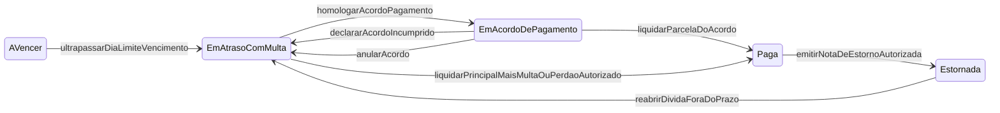
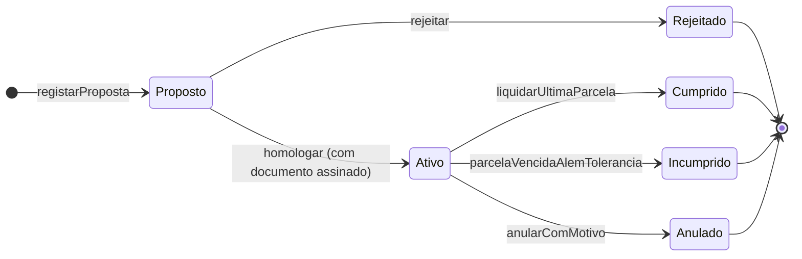
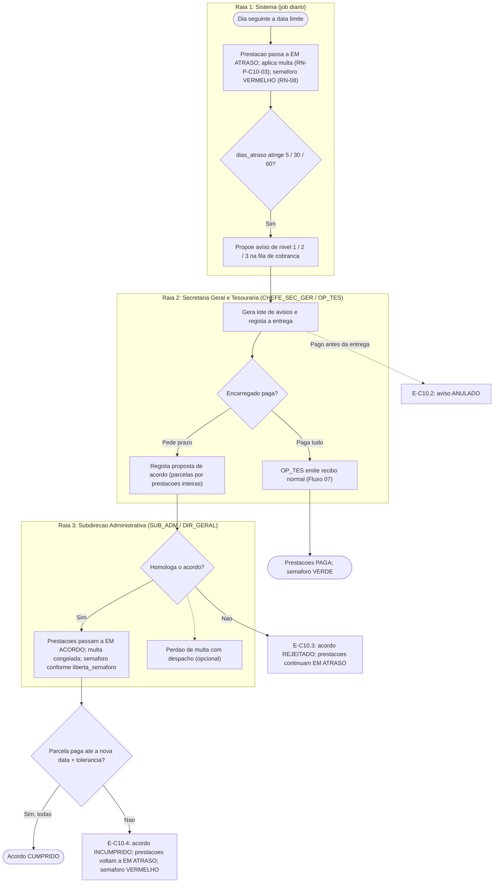
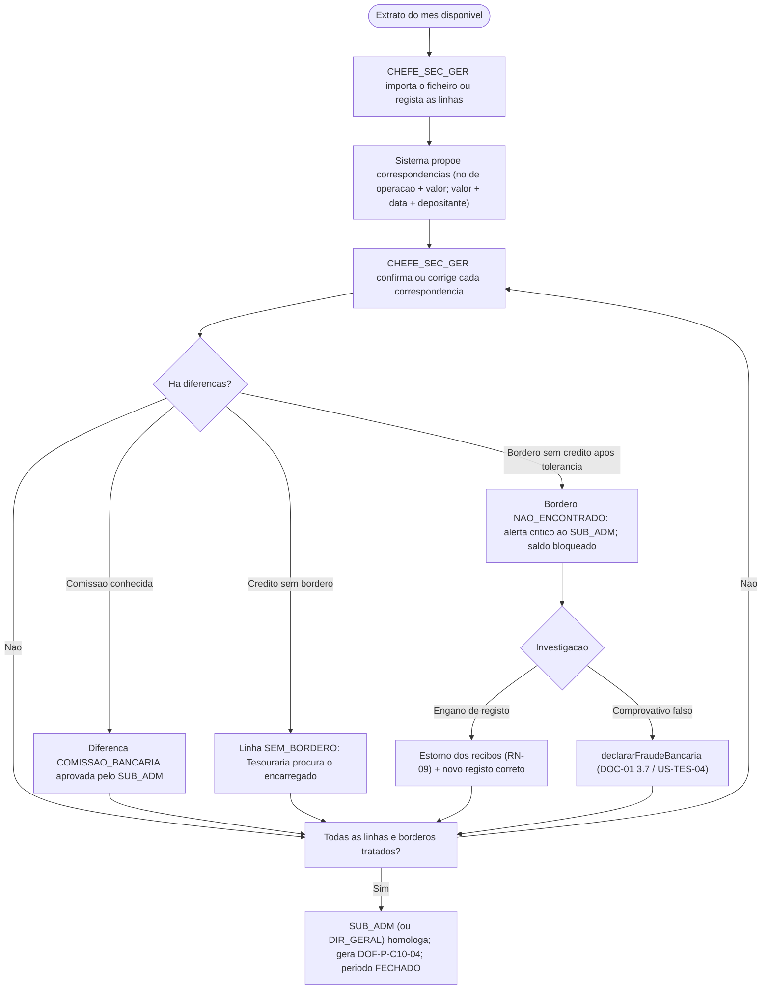
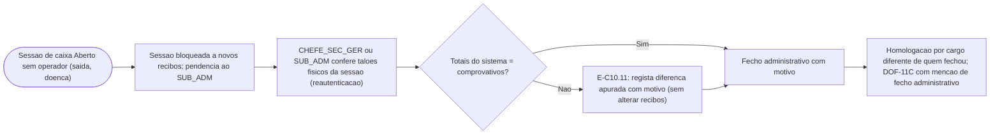

> [!warning] Nota arquivada — fonte já integrada na especificação v2.0
> Esta nota foi a **fonte de trabalho** da capacidade C10. O conteúdo foi integrado na especificação e **já não é a fonte de verdade**. Não editar: as correções fazem-se nos DOC.
> - Regras `RN-P-C10-nn` → família **`RN-13`** em [[01 - Dominio e Regras]] (a sub-regra mantém o número)
> - User stories → épico **EP-COB (US-COB-01–15)** em [[03 - User Stories]]
> - Fluxos → [[02 - Fluxos de Trabalho]] · Ecrãs e documentos → [[04 - Telas e Documentos]] (DOF-17 a DOF-20)
> - Tabelas → [[05 - Modelagem de Dados]] (Grupo 5) · Requisitos → [[07 - Catalogo de Requisitos Funcionais]]
> - Questões `Q-C10-nn` → vão ser consolidadas no [[12 - Registo de Decisoes e Questoes em Aberto]] (Fase 3 da [[00.3 - Proposta de Organizacao Documental|ORG-00]])
>
> Tabela de correspondência completa: [[00.2 - Mapa de Integracao v2.0]] §2. Arquivada a 2026-11-05.

# C10 — Cobrança de Dívidas, Relatórios Financeiros e Conciliação Bancária

> [!abstract] Navegação
> - **Painel Principal:** [[Inicio|Início do Vault]] | **Índice do Projeto:** [[00 - MOC SGE IPCAG 12008 BGO|MOC]] | **Plano:** [[00.1 - Plano de Engenharia de Requisitos|PLN-00]] (§2.1 `C10`, §8 *Definition of Ready*)
> - **Especificação base:** [[01 - Dominio e Regras]] (§1.5, §3.6, §3.7, `RN-07`, `RN-08`, `RN-09`) → [[02 - Fluxos de Trabalho]] (Fluxo 07) → [[03 - User Stories]] (`EP-TES`) → [[04 - Telas e Documentos]] (`MOD-TES-*`, `DOF-11`) → [[05 - Modelagem de Dados]] (§3.5)
> - **Capacidades relacionadas:** [[C14 - Gestao de Contas e Acesso]] (saída de operador com caixa aberto, reautenticação) | [[C15 - Paineis de Gestao da Direcao]] (indicadores financeiros)
> - **Notas transversais:** [[06 - Visao e Ambito]] (objetivos `O-03`, `O-04`, `O-05`, `O-08`) | [[09 - Integracoes, Infraestrutura e Operacao]] (bancos, Multicaixa, SMS) | [[11 - Protecao de Dados (APD)]] | [[12 - Registo de Decisoes e Questoes em Aberto]] (`DEC-002`, `DEC-003`, `DEC-005`, `Q-004`, `Q-007`, `Q-034`) | [[Verificacao das Referencias Legais]] (base legal fiscal) | [[Achados dos Documentos Reais - Lote 1]] (`A11`, `A13`, `A15`) | [[10 - Migracao de Dados e Implantacao]] (dívidas migradas) | [[C16 - Passagem de Ano Letivo]] (`RN-P-C16-10`)

> [!important] Estado desta nota
> Rascunho `0.2`. Especifica **apenas as partes em falta** da capacidade `C10` (🟡 no PLN-00 §2.1): gestão de dívidas e avisos de cobrança, relatórios financeiros de gestão e conciliação bancária. O que já está especificado (tabelas de preços, bolsas, borderô por saldo, recibos, estornos e fecho de caixa — `US-TES-01` a `05`) **não é repetido**. A decisão AGT/SAF-T (lacuna L7) pertence a `DEC-002` e não é tratada aqui. Os valores marcados como **proposta** ou **fictício** não são factos.
>
> **Versão 0.2 (2026-11-02):** alinhada com o REG-12 (`DEC-005` decidida: borderô manual na E1 e conciliação por extrato nesta capacidade; referências/*gateway* fora das E1–E5; `DEC-002` ainda **aguarda a Direção**); com a LEG-VER (base legal fiscal e tipos de documento); com os documentos reais (numeração anual por tipo — A13; pagamentos por **RUPE** — A15; pedido de declaração sem campo de emolumento — A11); com a nota de migração (dívidas e pagamentos anteriores ao SGE) e com a C16 (as dívidas não passam para a conta corrente do ano seguinte).

> [!warning] Terminologia fiscal em revisão
> Esta nota usa **Recibo Oficial** e **Nota de Estorno** porque são os termos atuais do DOC-01 (`RN-09`). Segundo a [[Verificacao das Referencias Legais|LEG-VER]], o DP n.º 292/18 citado na `RN-09` foi revogado pelo DP n.º 71/25; a lei atual exige **fatura / fatura-recibo** e corrige por **nota de crédito**, e a sigla `NE` colide com a Nota do Estágio. A troca de termos acontece quando as correções `COR-LEG` forem integradas e a `DEC-002` for decidida; as regras desta nota não dependem do nome do documento, só de **nunca editar nem apagar um documento fiscal emitido**.

---

## 1. Objetivo e Âmbito

### 1.1 Objetivo
Dar à Tesouraria e à Direção os meios para **saber quanto se deve, desde quando e por quem**, **cobrar de forma escalonada e justa** (incluindo acordos de pagamento), **medir a receita e o custo das bolsas** sem folhas de cálculo paralelas, e **confirmar no extrato bancário que cada borderô registado corresponde a dinheiro real** — sem nunca editar um recibo emitido.

### 1.2 Dentro do âmbito
- **Gestão de dívidas:** antiguidade, avisos de cobrança escalonados, acordos de pagamento (reescalonamento), perdão de multa por mora, extrato de conta corrente, interação com o Semáforo Financeiro (`RN-08`) e com a multa por mora.
- **Relatórios de gestão:** receita por mês, canal, curso e turno; dívida acumulada; custo das bolsas e descontos (`RN-07`); emolumentos.
- **Conciliação bancária:** importação de extratos, correspondência com borderôs (`RN-09`), diferenças, borderôs não encontrados, fecho mensal homologado.
- **Lacuna adjacente encontrada:** fecho administrativo de caixa quando o operador não o pode fazer (necessário para o [[C14 - Gestao de Contas e Acesso|C14]]).

### 1.3 Fora do âmbito ou condicionado
| Tema | Situação |
| :--- | :--- |
| Certificação AGT / exportação SAF-T AO | **`DEC-002` aguarda a Direção** (proposta do REG-12: integrar com software certificado, atrás de um adaptador). Esta nota assume o pressuposto de trabalho do REG-12: **um único ponto de emissão do documento fiscal**, compatível com as duas opções. Os relatórios desta nota **não são documentos fiscais** e não substituem o SAF-T. O REG-12 indica que a `DEC-002` bloqueia a E1 da C10. |
| Integração automática com referências Multicaixa / *gateway* | **`DEC-005` decidida: fora das entregas E1–E5** (reavaliada depois da E5, como pedido de alteração). Fica apenas o ponto de extensão (`RN-P-C10-21`). |
| Pagamentos ao Estado por **RUPE** (Referência Única de Pagamento ao Estado) | Os documentos reais mostram a RUPE nos pedidos do pessoal (A15) e a LEG-VER refere-a, sem confirmação, para emolumentos de títulos escolares (DP n.º 227/25). **Questão em aberto** (`Q-C10-17`, `Q-034` do REG-12): se algum emolumento dos alunos for pago por RUPE, esse valor não é receita do IPCAG nem passa por borderô e recibo da escola. |
| Envio de avisos por SMS ou portal | **`DEC-003` decidida: portal na E5**; o SMS é decidido na especificação da `C12` ([[09 - Integracoes, Infraestrutura e Operacao]]). Até lá, os avisos são impressos. |
| Transporte de dívidas para o ano letivo seguinte | Capacidade `C16`: as dívidas **não** passam para a conta corrente de `N+1`; ficam na matrícula de `N` e continuam liquidáveis ([[C16 - Passagem de Ano Letivo\|RN-P-C16-10]]). Esta nota trata a sua cobrança. |
| Contabilidade geral, despesas, salários | Fora do SGE (`C11` / `DEC-008`). |

### 1.4 O que já existe e o que falta
| Elemento atual | Onde | Lacuna que esta nota fecha |
| :--- | :--- | :--- |
| Transição `A Vencer → Em Atraso (com Multa)` por *job* diário; multa "parametrizada" | DOC-01 §3.6; DOC-05 `tabelas_precos_emolumentos` ("Regra de Multa / Dia de Vencimento") | A regra de cálculo da multa não está definida (fixa? percentagem? sobre que base?). |
| Evento `liquidarPrincipalMaisMultaOuPerdaoAutorizado` | DOC-01 §3.6 | O **perdão** não tem dono, regra nem registo. |
| Semáforo binário (`Em Atraso` → vermelho) | `RN-08` | Não há acordos de pagamento nem forma de regularizar dívidas em prestações. |
| "Caso a reconciliação bancária detete comprovativo adulterado…" | DOC-01 §3.7 | A **conciliação bancária não está especificada**: não há extratos, correspondências nem prazos. |
| Mapa de Fecho de Caixa por turno | `DOF-11C`, `RN-09.2` | Não há relatórios mensais de gestão nem visão de dívida. |
| Fecho de caixa só pelo `OP_TES` | `US-TES-05` | Não há caminho quando o operador sai sem fechar o caixa. |

---

## 2. Termos Novos para o Glossário (DOC-01 §1.5)

| Termo (Linguagem Ubíqua) | Código | Definição proposta |
| :--- | :---: | :--- |
| **Dívida Exigível** | `DIVIDA_EXIGIVEL` | Soma do valor líquido e da multa (menos a multa perdoada) das prestações no estado `Em Atraso (com Multa)`, à data de referência. |
| **Dívida Reescalonada** | `DIVIDA_REESCALONADA` | Prestações vencidas abrangidas por um Acordo de Pagamento ativo (estado novo `Em Acordo de Pagamento`). |
| **Antiguidade da Dívida** | `ANTIGUIDADE` | Número de dias decorridos desde a `Data Limite de Vencimento` de uma prestação até à data de referência, agrupado em escalões. |
| **Aviso de Cobrança** | `AVISO_COBRANCA` | Comunicação formal e registada ao Encarregado de Educação sobre prestações em atraso, emitida em 3 níveis. |
| **Acordo de Pagamento** | `ACORDO_PAGAMENTO` | Compromisso escrito entre o Encarregado de Educação e o IPCAG, homologado pela Subdireção Administrativa, que fixa **novas datas** para liquidar prestações vencidas, agrupadas em parcelas. |
| **Parcela do Acordo** | `PARCELA_ACORDO` | Conjunto de uma ou mais **prestações inteiras** vencidas que o acordo manda liquidar até uma nova data. |
| **Perdão de Multa** | `PERDAO_MULTA` | Dispensa total ou parcial da multa por mora de uma prestação ainda não paga, autorizada por despacho. Nunca abrange o valor da propina. |
| **Extrato Bancário** | `EXTRATO` | Lista de movimentos de uma conta bancária do IPCAG num período, emitida pelo banco e importada ou registada no SGE. |
| **Conciliação Bancária** | `CONCILIACAO` | Confronto entre as linhas de crédito do extrato bancário e os borderôs registados na Tesouraria, para confirmar que cada borderô corresponde a dinheiro efetivamente recebido. |
| **Receita Reconhecida** | `RECEITA` | Valor dos recibos emitidos num período menos o valor das notas de estorno emitidas no mesmo período (critério de caixa, coerente com `RN-09.2`). |

---

## 3. Regras de Negócio Provisórias (`RN-P-C10-nn`)

### Bloco A — Dívida, multa e cobrança

#### RN-P-C10-01 — Dívida exigível, reescalonada e vincenda
1. **Dívida exigível** de uma matrícula à data `D`: $\sum (\text{valor\_liquido} + \text{multa} - \text{multa\_perdoada})$ das prestações em `Em Atraso (com Multa)`.
2. **Dívida reescalonada:** o mesmo somatório para as prestações em `Em Acordo de Pagamento` (estado novo — `RN-P-C10-08`).
3. **Dívida vincenda:** valor líquido das prestações `A Vencer` (não é dívida; é faturação futura).
4. **Nunca é dívida:** prestações `Paga`, `Isenta (Bolseiro 100%)` e `Cancelada (por Anulação/Transferência)`. Uma prestação `Estornada` volta sempre a `A Vencer` ou `Em Atraso` (DOC-01 §3.6) e é contada no estado para onde voltou.
5. A dívida de um **Encarregado de Educação** é a soma das dívidas das matrículas dos seus educandos (o devedor é o encarregado — glossário, `PROPINA`).
6. Os emolumentos **não geram dívida**: são pagos antes do ato (`RN-08` Condição 2).

#### RN-P-C10-02 — Antiguidade da dívida
1. $\text{dias\_atraso} = D - \text{data\_limite\_vencimento}$ (apenas quando positivo). Nas prestações em acordo, a antiguidade conta-se a partir da data da **parcela** vencida, e não da data original.
2. **Escalões propostos:** `1–30`, `31–60`, `61–90` e `> 90` dias. Os escalões são parâmetros (`parametros_cobranca`) e não alteram nenhuma regra legal.
3. A antiguidade é sempre calculada **por prestação**; o escalão de um aluno é o da sua prestação mais antiga.

#### RN-P-C10-03 — Multa por mora: parametrização explícita
1. A regra atual "Regra de Multa / Dia de Vencimento" passa a ter campos explícitos por Ano Letivo: `tipo_regra_multa` (`VALOR_FIXO`, `PERCENTAGEM_UNICA`, `PERCENTAGEM_POR_MES_DE_ATRASO`), `valor_ou_percentagem`, `base_calculo` (`VALOR_LIQUIDO` ou `VALOR_BRUTO`), `dias_tolerancia` e `teto_multa` (opcional).
2. **A regra real é desconhecida** e tem de vir da tabela em vigor na escola (`Q-C10-01`). Nenhum valor por omissão é assumido.
3. A multa só se aplica a prestações de propina; prestações `Isenta (Bolseiro 100%)` nunca entram em atraso.
4. O valor da multa de cada prestação é **congelado no `item_recibo`** no momento do pagamento (já previsto no DOC-05) e deixa de crescer enquanto a prestação estiver `Em Acordo de Pagamento`.

#### RN-P-C10-04 — Perdão de multa por mora
1. Só o `SUB_ADM` ou o `DIR_GERAL` autoriza, com **despacho e justificação escrita** (mínimo 30 caracteres, igual ao `MOD-GOV-04`), após reautenticação ([[C14 - Gestao de Contas e Acesso|RN-P-C14-14]]).
2. Abrange **só a multa**, total ou parcialmente, e **só de prestações ainda não pagas**. Perdoar multa já paga exigiria estornar o recibo (`RN-09`) — proibido como atalho.
3. Regista-se como linha nova em `ajustes_conta_corrente` (*append-only*) e atualiza `conta_corrente_propinas.valor_multa_perdoada`; o valor da multa calculada nunca é apagado.
4. Grava `PERDAO_MULTA` em `audit_logs` (categoria `FINANCEIRO`).

#### RN-P-C10-05 — Avisos de cobrança escalonados
1. **Níveis (dias de atraso propostos, parametrizáveis):**

| Nível | Quando | Conteúdo | Quem emite |
| :---: | :--- | :--- | :--- |
| **1 — Lembrete** | Prestação com `dias_atraso >= 5` | Prestações em atraso, valores, multa, como pagar | `CHEFE_SEC_GER` (lote) ou `OP_TES` (balcão) |
| **2 — Aviso** | `dias_atraso >= 30` | Igual ao nível 1 + referência ao bloqueio de documentos (`RN-08`) + convite a acordo | `CHEFE_SEC_GER` |
| **3 — Convocatória** | `dias_atraso >= 60` | Convocatória do encarregado à Subdireção Administrativa, com data | `CHEFE_SEC_GER`, assinado pelo `SUB_ADM` |

2. Não se gera aviso para prestações em acordo em dia, nem um nível já emitido para a mesma prestação.
3. Os modelos de texto são aprovados pelo `SUB_ADM`.
4. **Canais:** entrega presencial ao encarregado; envelope fechado (via aluno — só se a escola aceitar, `Q-C10-05`); portal só a partir da E5 (`DEC-003` decidida) e SMS só se a `C12` o adotar e houver a integração SMS.
5. Cada aviso fica registado em `avisos_cobranca` (nível, data, canal, valor em dívida nessa data, estado de entrega). Um aviso por entregar é anulado automaticamente se a dívida for paga antes.

#### RN-P-C10-06 — Proteção da informação de dívida
1. A informação de dívida é dado pessoal da família ([[11 - Protecao de Dados (APD)]]): **nunca** é mostrada a professores, Directores de Turma ou coordenadores (coerente com a RLS do DOC-05 §5, linha 7).
2. O SGE **não gera listas públicas de devedores** (para afixar ou ler em sala).
3. A Secretaria Pedagógica continua a ver apenas o Semáforo (`Verde`/`Vermelho`) e o código da pendência (`RN-08`).

#### RN-P-C10-07 — Acordo de pagamento: conteúdo e homologação
1. **Quem:** o `OP_TES` ou o `CHEFE_SEC_GER` registam a proposta com o encarregado; o `SUB_ADM` homologa; acima dos limites parametrizados (número de parcelas ou montante — `Q-C10-02`) homologa o `DIR_GERAL`.
2. **Devedor:** o acordo é feito com o **Encarregado de Educação** e pode abranger prestações vencidas de vários educandos.
3. **Abrange:** apenas prestações em `Em Atraso (com Multa)`. Prestações `A Vencer` continuam com as suas datas normais e não entram no acordo.
4. **Parcelas por prestações inteiras (proposta v1):** cada parcela agrupa uma ou mais **prestações inteiras** com uma nova data limite. Assim cada recibo continua a liquidar prestações completas, como hoje (`US-TES-03`), sem pagamentos parciais de uma prestação (a necessidade de dividir uma prestação em partes fica em `Q-C10-16`).
5. **Multa:** a multa já acumulada fica congelada na homologação; o acordo pode incluir perdão (`RN-P-C10-04`) no mesmo ato.
6. **Semáforo:** o acordo indica se `liberta_semaforo` (`RN-P-C10-08`).
7. **Documento:** gera o `DOF-P-C10-02` (Acordo de Pagamento), assinado pelo encarregado e pelo homologador; a versão assinada digitalizada é anexada antes de o acordo ficar ativo.
8. **Limite temporal (proposta):** a última parcela não pode ultrapassar o fim do **Ano Letivo em curso na data da homologação**, salvo despacho do `DIR_GERAL` (`Q-C10-02`). Assim, uma dívida de um ano já encerrado (que a C16 mantém na matrícula de origem e liquidável — `RN-P-C16-10`) também pode ser reescalonada (responde em parte à `Q-C16-12`).
9. Um encarregado só pode ter **um acordo ativo** de cada vez.

#### RN-P-C10-08 — Estado `Em Acordo de Pagamento` e Semáforo Financeiro
1. Na homologação, as prestações abrangidas passam de `Em Atraso (com Multa)` para o estado novo **`Em Acordo de Pagamento`**; deixam de receber multa.
2. `RN-08` Condição 1 passa a ler-se: *"o aluno não tem prestações em `Em Atraso (com Multa)`, nem prestações em `Em Acordo de Pagamento` abrangidas por acordo com `liberta_semaforo = Não`"*.
3. **Exceções (independentes de `liberta_semaforo`):** a **Guia de Transferência** (`DOF-09C`, que confirma a "inexistência de dívidas no IPCAG") exige dívida reescalonada **igual a zero**. Para o **Certificado** (`DOF-10`) — e para o pedido do Diploma, se este for emitido pelo Ministério, como indica a LEG-VER (`Q-021` do REG-12) — propõe-se a mesma exigência (`Q-C10-03`).
4. Quando uma parcela é liquidada (recibo normal com as prestações da parcela), essas prestações passam a `Paga`. Quando todas as parcelas estão pagas, o acordo passa a `CUMPRIDO`.

#### RN-P-C10-09 — Incumprimento do acordo
1. Uma parcela não paga `dias_tolerancia_acordo` dias após a sua data (proposta: 5 dias — `Q-C10-15`) torna o acordo `INCUMPRIDO` (*job* diário).
2. Efeitos: todas as prestações ainda `Em Acordo de Pagamento` voltam a `Em Atraso (com Multa)`; o Semáforo fica vermelho; o encarregado não pode celebrar novo acordo durante o mesmo Ano Letivo sem despacho do `DIR_GERAL` (proposta).
3. **Multa após incumprimento (proposta):** a contagem recomeça na data do incumprimento, sem cobrar o período em que o acordo esteve cumprido (`Q-C10-02`).

#### RN-P-C10-10 — Dívidas de ex-alunos e de anos anteriores
1. Quando a matrícula passa a `Transferida (Externa)` ou `Anulada / Desistente`, só as prestações **futuras** são canceladas (DOC-01 §3.6); as já vencidas e não pagas **continuam a ser dívida** do encarregado.
2. Os relatórios separam a dívida por **Ano Letivo de origem** e por situação da matrícula (`Ativa`, `Transferida`, `Anulada`, `Concluída`).
3. A anulação de dívida de ex-aluno só existe pelo caminho já previsto `homologarDesistenciaRetroativaDirecao` (DOC-01 §3.6). Não se cria nesta versão um caminho de "dívida incobrável" (`Q-C10-11`).
4. **Passagem de ano (C16):** as prestações de anos encerrados continuam na matrícula de origem e liquidáveis (`RN-P-C16-10`); entram na dívida exigível com o seu Ano Letivo de origem e podem ser reescalonadas (`RN-P-C10-07` §8). Se a multa continua a crescer depois do fim do ano é a mesma pergunta da `Q-C10-01` e da `Q-C16-12`.
5. **Dívidas migradas (MIG-10):** as prestações carregadas na migração com origem `MIGRADO` contam como dívida igual às outras, mas os relatórios permitem filtrá-las pela origem, porque a sua fiabilidade depende da qualidade da fonte (risco `MIG-R02` do [[10 - Migracao de Dados e Implantacao|MIG-10]]).

### Bloco B — Relatórios financeiros de gestão

#### RN-P-C10-11 — Receita reconhecida e dimensões de análise
1. **Receita do período** $[t_1, t_2]$: $\sum$ valor dos recibos com `data_emissao` no período $-\ \sum$ valor das notas de estorno com data no período. É o mesmo critério do `RN-09.2`: **um mês fechado nunca muda** por causa de um estorno posterior.
2. **Controlo obrigatório:** a receita de um dia é igual à soma dos totais líquidos das sessões de caixa desse dia (`sessoes_fecho_caixa`). Qualquer diferença aparece no relatório como erro de integridade.
3. **Por canal:** usa-se o canal de cada borderô na proporção do `valor_alocado` em `alocacoes_saldo_bordero` (um recibo pago com 2 borderôs de canais diferentes reparte-se pelos 2). O estorno reparte-se pelos mesmos canais do recibo original.
4. **Por curso, classe e turno escolar:** propinas → da matrícula a que pertence a prestação; emolumentos de alunos → da matrícula ativa na data do recibo; taxa de inscrição no teste de admissão → curso e turno da **1ª Opção** da candidatura, na categoria `Candidaturas`.
5. **Turno de atendimento** (Manhã/Tarde da sessão de caixa) é uma dimensão **diferente** do turno escolar do aluno; os relatórios mostram as duas sem as confundir.
6. **Por rubrica:** `PROPINA_MENSAL` (principal), multas cobradas (separadas) e cada emolumento.
7. **Saldo de borderôs por alocar:** $\sum$ `saldo_disponivel` dos borderôs que não estão `Invalidado por Fraude`. Não é receita (não há recibo); é crédito das famílias e entra na conciliação.
8. **Pagamentos anteriores ao SGE:** prestações migradas no estado `Paga` **sem recibo** do SGE (previstas no MIG-10) **não** contam como receita de nenhum período do SGE; o relatório começa no primeiro dia de funcionamento (`DEC-007`: início de 2027/2028).
9. **Valores cobrados para o Estado:** se algum emolumento for pago por RUPE (`Q-C10-17`), não é receita do IPCAG e fica fora deste relatório, salvo indicação em contrário da Direção.

#### RN-P-C10-12 — Custo das bolsas, descontos e multas perdoadas
1. **Custo dos benefícios num período:** $\sum$ `valor_desconto` das prestações (não canceladas) com mês de referência no período, por tipo de benefício (`BOLSA_100`, `BOLSA_50`, `BOLSA_PARCIAL_OUTRA`, `ISENCAO_DIOCESE_CAXITO`, `DESCONTO_IRMAOS`, `FILHO_FUNCIONARIO`), curso, classe e turno. Nas prestações `Isenta (Bolseiro 100%)`, o desconto é igual ao valor bruto.
2. Mostra também o **número de beneficiários** (matrículas distintas) por tipo.
3. **Multas perdoadas** aparecem numa linha separada ($\sum$ `ajustes_conta_corrente` do tipo perdão no período).
4. Os valores vêm dos três campos já guardados em cada prestação (`RN-07`: bruto, desconto, líquido) — nada é recalculado a partir da tabela de preços atual.

#### RN-P-C10-13 — Emolumentos pagos, consumidos e por consumir
1. Por rubrica e mês: quantidade e valor de `itens_recibo` de natureza `Emolumento Escolar` não estornados.
2. **Por consumir:** itens pagos com `Emolumento Já Consumido = Não` (documentos pagos ainda não emitidos — serviço que a escola deve). Mostra a antiguidade em dias desde o pagamento.
3. **Por confirmar com os documentos reais:** o requerimento de declaração e a declaração de estudante recebidos **não têm campo de pagamento de emolumento** (DESC-L1 A11), e há indícios de pagamentos por RUPE (A15). Até à resposta à `Q-C10-17`, este relatório só cobre os emolumentos pagos ao IPCAG por borderô e recibo, como definido no `RN-08` Condição 2.

#### RN-P-C10-17 — Relatórios reprodutíveis e proteção de dados nas exportações
1. Os relatórios são **só de leitura**. Cada exportação (PDF/CSV) grava os parâmetros, a data/hora, o autor e um *hash* de integridade (como os mapas GEPE — `US-DOC-05`).
2. Gerar o mesmo relatório de um período fechado devolve **os mesmos números**.
3. Relatórios **agregados** (sem nomes) podem ser exportados pelos cargos com acesso. Relatórios **nominais** (lista de devedores, lista de bolseiros) exigem reautenticação e gravam `EXPORTACAO_DADOS_PESSOAIS` em `audit_logs`.

### Bloco C — Conciliação bancária

#### RN-P-C10-14 — Objetos, estados e segregação da conciliação
1. A conciliação faz-se **por conta bancária do IPCAG e por mês**. Hoje cada banco tem uma conta (`bancos_angola.IBAN da Conta do IPCAG`); se houver mais de uma conta no mesmo banco, cria-se tabela própria (`Q-C10-07`).
2. **Extrato:** importado de ficheiro (formato por banco — `Q-C10-08`) ou registado à mão a partir do papel; guarda-se o ficheiro original com *hash*.
3. **Estado de conciliação do borderô** (dimensão nova, **separada** dos estados de saldo do DOC-01 §3.7): `POR_CONCILIAR`, `CONCILIADO`, `DIVERGENTE`, `NAO_ENCONTRADO`.
4. **Estado da linha do extrato:** `POR_CONCILIAR`, `CONCILIADA`, `SEM_BORDERO` (crédito sem borderô registado), `FORA_DO_AMBITO` (débitos, comissões e movimentos que não são pagamentos de alunos).
5. **Segregação:** quem registou o borderô (`OP_TES`) **não o concilia**. Confirma as correspondências o `CHEFE_SEC_GER` (ou o `SUB_ADM`); homologa o período um cargo diferente de quem confirmou (`SUB_ADM`, ou `DIR_GERAL` se foi o `SUB_ADM` a confirmar).
6. **Início da conciliação:** o primeiro período conciliado é o mês de arranque do SGE. Os borderôs migrados com saldo já utilizado antes do SGE (`saldo_utilizado_inicial_migrado` do MIG-10) não são conciliados retroativamente; o seu saldo remanescente pode ser usado e só as alocações feitas no SGE entram na conciliação.

#### RN-P-C10-15 — Correspondência e diferenças
1. **Sugestão automática, decisão humana:** o sistema propõe correspondências por esta ordem: (a) mesmo banco + mesmo número de operação + mesmo valor; (b) mesmo valor + data do extrato até `N` dias depois da data do talão (proposta: 3 dias úteis) + nome do depositante na descrição; (c) sem sugestão. Só uma pessoa confirma.
2. **Cardinalidades:** `1 linha ↔ 1 borderô` (normal); `1 linha ↔ N borderôs` (ex.: crédito agregado de operações TPA ou Multicaixa Express — `Q-C10-09`); `N linhas ↔ 1 borderô` (raro, ex.: transferência em duas partes).
3. **Diferença justificada:** quando o banco credita menos do que a soma dos borderôs por motivo conhecido (ex.: comissão de TPA descontada na liquidação), a diferença é registada com tipo `COMISSAO_BANCARIA` e aprovada pelo `SUB_ADM`. Nenhum recibo é alterado.
4. **Valor no banco inferior ao valor do talão sem motivo conhecido:** o borderô fica `DIVERGENTE` e segue o `RN-P-C10-16`.
5. Uma correspondência confirmada só pode ser desfeita antes da homologação do período, por quem a confirmou ou pelo `SUB_ADM`, com motivo; nunca se apaga — regista-se a anulação.

#### RN-P-C10-16 — Borderô não encontrado ou divergente
1. Um borderô continua `POR_CONCILIAR` até ser importado o extrato que cobre a sua data. Se, depois disso e de mais `N` dias de tolerância (proposta: 5 dias úteis), não tiver correspondência, passa a **`NAO_ENCONTRADO`** e gera um **alerta crítico** para o `SUB_ADM` (`BORDERO_NAO_ENCONTRADO` em `audit_logs`).
2. O `SUB_ADM` investiga (contacto com o banco e com o encarregado) e decide:
   - **Engano de registo** (ex.: banco errado, número trocado): o borderô original não é editado; o `SUB_ADM` emite Notas de Estorno dos recibos afetados (`RN-09`) e o `OP_TES` regista o borderô correto e reemite os recibos. Tudo fica auditado.
   - **Comprovativo falso ou adulterado:** aciona o caminho já existente `declararFraudeBancaria` (DOC-01 §3.7, `US-TES-04` Cenário 3).
3. Enquanto um borderô está `NAO_ENCONTRADO` ou `DIVERGENTE`, o seu `saldo_disponivel` **não pode ser alocado** a novos recibos.

#### RN-P-C10-19 — Fecho mensal da conciliação
1. Estados do período: `ABERTO` → `EM_CONCILIACAO` → `FECHADO_HOMOLOGADO`.
2. Só se homologa quando: todas as linhas de crédito do extrato estão `CONCILIADA`, `SEM_BORDERO` (com nota) ou `FORA_DO_AMBITO`; e todos os borderôs do mês estão `CONCILIADO` ou têm alerta aberto registado.
3. Gera o `DOF-P-C10-04` (Mapa de Conciliação Bancária): saldo inicial e final do extrato, créditos conciliados, créditos sem borderô, borderôs não encontrados, diferenças justificadas e saldo de borderôs por alocar.
4. Um período homologado **nunca é reaberto** (mesma lógica do `RN-09.2`): uma linha de extrato descoberta mais tarde entra no período aberto seguinte, com referência à data original.

### Bloco D — Regras transversais

#### RN-P-C10-18 — Fecho administrativo de caixa
1. Quando o `OP_TES` não pode fechar a sua sessão de caixa (saída da escola — [[C14 - Gestao de Contas e Acesso|RN-P-C14-08]] —, doença ou ausência prolongada), a sessão fica bloqueada a novos recibos e o `SUB_ADM` recebe uma pendência bloqueante.
2. O fecho administrativo é executado pelo `CHEFE_SEC_GER` ou pelo `SUB_ADM`, com conferência física dos talões e comprovativos da sessão e justificação escrita, após reautenticação.
3. Os totais são calculados pelo sistema a partir dos recibos e estornos da sessão (como no fecho normal); qualquer diferença face aos comprovativos físicos é registada como **diferença apurada** com motivo, sem alterar recibos.
4. A homologação é feita por um cargo **diferente** de quem executou o fecho administrativo (`SUB_ADM` ou `DIR_GERAL`).
5. O `DOF-11C` mostra a menção *"Fecho administrativo — executado por [nome/cargo] em DD/MM/AAAA — motivo: [...]"*.

#### RN-P-C10-20 — Imutabilidade AGT em todas as funções desta nota
1. Nenhuma função desta nota altera ou apaga `recibos_oficiais`, `itens_recibo` ou `notas_estorno` (`RN-09`, DOC-05 §4.5).
2. Acordos, perdões e avisos atuam **apenas** sobre prestações ainda não pagas da conta corrente, com histórico *append-only*.
3. A conciliação **só acrescenta** registos de correspondência; as correções de pagamentos fazem-se sempre por Nota de Estorno.

#### RN-P-C10-21 — Integração automática de pagamentos (**fora das E1–E5 — `DEC-005` decidida**)
> A `DEC-005` decidiu a opção (a): borderô manual na E1 e conciliação por extrato nesta capacidade; a opção (b) só é reavaliada depois da E5. Os pontos abaixo ficam como **ponto de extensão** para não fechar o desenho, e não entram em nenhuma entrega planeada.

1. **Hoje (E1–E5):** aplica-se só a conciliação por extrato (`RN-P-C10-14` a `-19`).
2. **Se a opção (b) for aprovada depois da E5** (referências Multicaixa / *gateway*): as notificações do fornecedor criam a correspondência automaticamente e o borderô nasce já `CONCILIADO`; o documento fiscal continua a sair do ponto único de emissão (`DEC-002`) com as mesmas regras.
3. Mesmo nesse caso, a conciliação por extrato mantém-se para depósitos e transferências e para conferir as liquidações do próprio fornecedor.
4. A RUPE (`Q-C10-17`) não é este ponto de extensão: se existir, é um pagamento ao Estado, não ao IPCAG.

---

## 4. Máquinas de Estado

### 4.1 Propina mensal — alteração à máquina do DOC-01 §3.6
Acrescenta-se o estado `EmAcordoDePagamento` (as restantes transições mantêm-se):

| Estado Origem | Evento | Estado Destino | Quem Dispara | Condições de Guarda |
| :--- | :--- | :--- | :--- | :--- |
| `Em Atraso (com Multa)` | `homologarAcordoPagamento` | `Em Acordo de Pagamento` | `SUB_ADM` / `DIR_GERAL` | Acordo homologado com documento assinado anexado; a multa fica congelada (`RN-P-C10-07`). |
| `Em Acordo de Pagamento` | `liquidarParcelaDoAcordo` | `Paga` | `OP_TES` (recibo normal) | O recibo liquida **todas** as prestações da parcela; borderô com saldo suficiente (`RN-09`). |
| `Em Acordo de Pagamento` | `declararAcordoIncumprido` | `Em Atraso (com Multa)` | *Job* diário | Parcela vencida há mais de `dias_tolerancia_acordo` (`RN-P-C10-09`). |
| `Em Acordo de Pagamento` | `anularAcordo` | `Em Atraso (com Multa)` | `SUB_ADM` / `DIR_GERAL` | Motivo escrito (ex.: acordo registado com erro); auditado. |
| `Em Atraso (com Multa)` | `perdoarMulta` *(sem mudança de estado)* | `Em Atraso (com Multa)` | `SUB_ADM` / `DIR_GERAL` | `RN-P-C10-04`; regista `ajustes_conta_corrente`. |

### 4.2 Acordo de pagamento

| Estado Origem | Evento | Estado Destino | Quem Dispara | Condições de Guarda |
| :--- | :--- | :--- | :--- | :--- |
| `[novo]` | `registarProposta` | `PROPOSTO` | `OP_TES`, `CHEFE_SEC_GER` | Encarregado sem outro acordo ativo; só prestações `Em Atraso`; parcelas por prestações inteiras. |
| `PROPOSTO` | `homologar` | `ATIVO` | `SUB_ADM` (ou `DIR_GERAL` acima dos limites) | Reautenticação; homologador ≠ quem registou; `DOF-P-C10-02` assinado e digitalizado. |
| `PROPOSTO` | `rejeitar` | `REJEITADO` | `SUB_ADM` / `DIR_GERAL` | Motivo obrigatório. |
| `ATIVO` | `liquidarUltimaParcela` | `CUMPRIDO` | Sistema | Todas as prestações do acordo `Paga`. |
| `ATIVO` | `parcelaVencidaAlemTolerancia` | `INCUMPRIDO` | *Job* diário | `RN-P-C10-09`. |
| `ATIVO` | `anularComMotivo` | `ANULADO` | `SUB_ADM` / `DIR_GERAL` | Motivo; prestações voltam a `Em Atraso`. |

### 4.3 Período de conciliação bancária
`ABERTO` → (`importarExtrato`) → `EM_CONCILIACAO` → (`homologarConciliacao`, `RN-P-C10-19`) → `FECHADO_HOMOLOGADO`. Sem transição de volta.

### 4.4 Aviso de cobrança
`GERADO` → `ENTREGUE` (registo de entrega: data, a quem, canal) | `NAO_ENTREGUE` (motivo) | `ANULADO` (dívida paga antes da entrega, ou gerado por erro).

---

## 5. Fluxos (Mermaid) com Exceções

### 5.1 Fluxo C10-A — Ciclo de cobrança de uma prestação

**Exceções:**
- **E-C10.1 — Prestação estornada depois de paga** (erro ou fraude): volta a `Em Atraso` se a data limite já passou (DOC-01 §3.6); entra no ciclo de cobrança com a antiguidade contada desde a data limite original.
- **E-C10.2 — Pagamento antes da entrega do aviso:** o aviso é anulado automaticamente.
- **E-C10.3 — Acordo rejeitado:** motivo obrigatório; nada muda na conta corrente.
- **E-C10.4 — Acordo incumprido:** `RN-P-C10-09`.
- **E-C10.5 — Transferência pedida com acordo ativo:** a Guia de Transferência fica bloqueada até a dívida reescalonada ser zero (`RN-P-C10-08` §3).
- **E-C10.6 — Encarregado já com acordo ativo:** a nova proposta é recusada (`HTTP 409 — ACORDO ATIVO EXISTENTE`).

### 5.2 Fluxo C10-B — Conciliação bancária mensal

**Exceções:**
- **E-C10.7 — Ficheiro de extrato em formato desconhecido:** registo manual das linhas a partir do PDF ou do papel, com o ficheiro anexado.
- **E-C10.8 — Extrato importado duas vezes:** o sistema recusa linhas com o mesmo *hash* de ficheiro ou a mesma combinação `(conta, data, referência, valor)` já importada.
- **E-C10.9 — Linha descoberta depois do fecho:** entra no período seguinte (`RN-P-C10-19` §4).
- **E-C10.10 — Tentativa de usar saldo de um borderô `NAO_ENCONTRADO`:** recusada com `HTTP 409 — BORDERÔ EM INVESTIGAÇÃO`.

### 5.3 Fluxo C10-C — Fecho administrativo de caixa

---

## 6. User Stories (BDD)

> [!note] Sobre os números dos exemplos
> A propina de `15.000,00 Kz`, o vencimento ao dia `10` e o talão de `30.000,00 Kz` são os valores de exemplo já usados na especificação (`US-TES-01`, `US-TES-03`). **A multa de `1.500,00 Kz` é fictícia**, usada só para mostrar o cálculo: a regra real vem da tabela em vigor (`Q-C10-01`). Todos estes valores serão substituídos pelos reais recolhidos na Fase B (PLN-00 §5.2).

### `US-COB-01`: Consultar a dívida e a sua antiguidade
- **História:** *Como* **Subdirector Administrativo (`SUB_ADM`)**, *quero* **ver a dívida exigível e reescalonada agrupada por antiguidade, curso, classe e turno**, *para* **decidir onde concentrar a cobrança**.
- **Rastreabilidade:** `RN-P-C10-01`, `-02`, `-10` | `RN-08`.
- **Prioridade (proposta):** `Must` | **Entrega:** `E2`.
- **Critérios de Aceitação:**
  - **Cenário 1 (Sucesso — Escalões por prestação):**
    - **Dado** um aluno com as propinas de Outubro (limite `10/10/2026`), Novembro (`10/11/2026`) e Dezembro (`10/12/2026`) por pagar, cada uma com `15.000,00 Kz` e multa fictícia de `1.500,00 Kz`,
    - **Quando** o `SUB_ADM` consulta a antiguidade com data de referência `15/12/2026`,
    - **Então** o sistema mostra Outubro no escalão `61–90` (66 dias), Novembro em `31–60` (35 dias), Dezembro em `1–30` (5 dias), dívida exigível de `49.500,00 Kz` e classifica o aluno no escalão `61–90`.
  - **Cenário 2 (Exceção — Prestação cancelada e bolseiro integral):**
    - **Dado** um aluno transferido em `05/01/2027` com a propina de Dezembro em atraso e um colega com `BOLSA_100`,
    - **Quando** o `SUB_ADM` consulta a dívida em `20/01/2027`,
    - **Então** a propina de Dezembro do transferido aparece como dívida de ex-aluno (situação `Transferida`), as de Janeiro a Junho não aparecem (canceladas), e o bolseiro integral não tem dívida.
  - **Cenário 3 (Bloqueio — Professor tenta consultar):**
    - **Dado** um `DIR_TURMA` autenticado,
    - **Quando** pede a dívida dos alunos da sua turma,
    - **Então** a API devolve `HTTP 403` (`RN-P-C10-06`).

### `US-COB-02`: Gerar e registar avisos de cobrança escalonados
- **História:** *Como* **Chefe da Secretaria Geral (`CHEFE_SEC_GER`)**, *quero* **gerar os avisos de cobrança devidos de cada nível e registar a sua entrega**, *para* **que cada encarregado seja avisado de forma uniforme e documentada**.
- **Rastreabilidade:** `RN-P-C10-05`, `-06`.
- **Prioridade (proposta):** `Should` | **Entrega:** `E2`.
- **Critérios de Aceitação:**
  - **Cenário 1 (Sucesso — Lote do nível 2):**
    - **Dado** 3 encarregados com prestações com 30 ou mais dias de atraso e sem aviso de nível 2 para essas prestações,
    - **Quando** o `CHEFE_SEC_GER` gera o lote do nível 2,
    - **Então** o sistema produz 3 `DOF-P-C10-01` (um por encarregado, com todos os educandos devedores), regista-os como `GERADO` em `avisos_cobranca` e, ao registar a entrega presencial, passa-os a `ENTREGUE` com data e nome de quem recebeu.
  - **Cenário 2 (Exceção — Pago antes da entrega):**
    - **Dado** um aviso `GERADO` às `09h00`,
    - **Quando** o encarregado paga às `10h30` antes de o aviso lhe ser entregue,
    - **Então** o aviso passa a `ANULADO` e não aparece na lista de entregas.
  - **Cenário 3 (Bloqueio — Aviso duplicado):**
    - **Dado** que já foi entregue o aviso de nível 1 da propina de Outubro,
    - **Quando** se gera outro lote do nível 1,
    - **Então** essa prestação não volta a entrar no lote.

### `US-COB-03`: Propor e homologar um acordo de pagamento
- **História:** *Como* **Operador de Tesouraria (`OP_TES`)** e **Subdirector Administrativo (`SUB_ADM`)**, *quero* **reescalonar prestações vencidas em parcelas com novas datas**, *para* **que a família regularize a dívida sem acumular mais multa e, se a Direção decidir, sem bloquear documentos de frequência**.
- **Rastreabilidade:** `RN-P-C10-07`, `-08` | `RN-08` | DOC-01 §3.6.
- **Prioridade (proposta):** `Should` | **Entrega:** `E2`.
- **Critérios de Aceitação:**
  - **Cenário 1 (Sucesso):**
    - **Dado** o aluno do `US-COB-01` com Outubro, Novembro e Dezembro em atraso (`49.500,00 Kz` com multa fictícia),
    - **Quando** o `OP_TES` regista um acordo com 3 parcelas (Outubro até `31/01/2027`, Novembro até `28/02/2027`, Dezembro até `31/03/2027`), `liberta_semaforo = Sim`, e o `SUB_ADM`, após reautenticação, o homologa com o `DOF-P-C10-02` assinado anexado,
    - **Então** as 3 prestações passam a `Em Acordo de Pagamento`, a multa deixa de crescer, o Semáforo do aluno fica verde para declarações e boletins, e grava-se `ACORDO_HOMOLOGADO` em `audit_logs`.
  - **Cenário 2 (Exceção — Guia de Transferência com acordo ativo):**
    - **Dado** o acordo acima ativo,
    - **Quando** a Secretaria Pedagógica tenta emitir a Guia de Transferência (`DOF-09C`),
    - **Então** a emissão é bloqueada com `HTTP 403 — Pendência Financeira: dívida reescalonada de 49.500,00 Kz`.
  - **Cenário 3 (Bloqueio — Homologação pelo próprio requerente):**
    - **Dado** um acordo registado pelo `CHEFE_SEC_GER`,
    - **Quando** o mesmo utilizador tenta homologá-lo,
    - **Então** o sistema recusa com `HTTP 403`.
  - **Cenário 4 (Bloqueio — Prestação a vencer no acordo):**
    - **Dado** a propina de Janeiro ainda `A Vencer`,
    - **Quando** o `OP_TES` a tenta incluir numa parcela,
    - **Então** o sistema recusa com `HTTP 422 — SÓ PRESTAÇÕES EM ATRASO PODEM SER REESCALONADAS`.

### `US-COB-04`: Declarar automaticamente o incumprimento de um acordo
- **História:** *Como* **Subdirector Administrativo (`SUB_ADM`)**, *quero* **que o sistema declare incumprido um acordo cuja parcela não foi paga dentro da tolerância**, *para* **que o semáforo e a multa voltem a funcionar sem intervenção manual**.
- **Rastreabilidade:** `RN-P-C10-09`.
- **Prioridade (proposta):** `Should` | **Entrega:** `E2`.
- **Critérios de Aceitação:**
  - **Cenário 1 (Sucesso — Incumprimento):**
    - **Dado** a parcela de Outubro com data `31/01/2027` por pagar e tolerância de 5 dias (proposta),
    - **Quando** o *job* corre em `06/02/2027`,
    - **Então** o acordo passa a `INCUMPRIDO`, as prestações ainda em acordo voltam a `Em Atraso (com Multa)`, o Semáforo fica vermelho e o `SUB_ADM` recebe um alerta.
  - **Cenário 2 (Exceção — Pagamento no último dia de tolerância):**
    - **Dado** a mesma parcela,
    - **Quando** o recibo é emitido em `05/02/2027`,
    - **Então** a parcela fica paga e o acordo continua `ATIVO`.

### `US-COB-05`: Perdoar a multa por mora com autorização
- **História:** *Como* **Subdirector Administrativo (`SUB_ADM`)**, *quero* **perdoar total ou parcialmente a multa de uma prestação ainda não paga, com despacho**, *para* **tratar casos sociais sem alterar o valor da propina nem os recibos**.
- **Rastreabilidade:** `RN-P-C10-04`, `-20` | DOC-01 §3.6 (`liquidarPrincipalMaisMultaOuPerdaoAutorizado`).
- **Prioridade (proposta):** `Should` | **Entrega:** `E1`.
- **Critérios de Aceitação:**
  - **Cenário 1 (Sucesso):**
    - **Dado** a propina de Outubro com `15.000,00 Kz` e multa fictícia de `1.500,00 Kz`,
    - **Quando** o `SUB_ADM` perdoa `1.500,00 Kz` com o despacho `DESP-SA-IPCAG-004/2026` e justificação,
    - **Então** o valor a pagar passa a `15.000,00 Kz`, a multa calculada continua registada, cria-se a linha em `ajustes_conta_corrente` e grava-se `PERDAO_MULTA`.
  - **Cenário 2 (Bloqueio — Prestação já paga):**
    - **Dado** uma prestação `Paga` com multa incluída no recibo,
    - **Quando** o `SUB_ADM` tenta perdoar a multa,
    - **Então** o sistema recusa com `HTTP 409 — MULTA JÁ LIQUIDADA: CORREÇÃO SÓ POR NOTA DE ESTORNO (RN-09)`.
  - **Cenário 3 (Bloqueio — Perdão do principal):**
    - **Dado** a mesma prestação de Outubro,
    - **Quando** alguém tenta perdoar `16.500,00 Kz`,
    - **Então** o sistema recusa: o perdão não pode exceder a multa (`1.500,00 Kz`).

### `US-COB-06`: Emitir o extrato de conta corrente para o encarregado
- **História:** *Como* **Operador de Tesouraria (`OP_TES`)**, *quero* **imprimir o extrato da conta corrente de todos os educandos de um encarregado**, *para* **que a família veja o que pagou, o que deve e o que vence**.
- **Rastreabilidade:** `RN-P-C10-01`, `-06`.
- **Prioridade (proposta):** `Could` | **Entrega:** `E2`.
- **Critérios de Aceitação:**
  - **Cenário 1 (Sucesso — Dois irmãos):**
    - **Dado** um encarregado com 2 educandos que pagaram Setembro e Outubro com o talão `BFA-998877` (`30.000,00 Kz`),
    - **Quando** o `OP_TES` emite o `DOF-P-C10-03`,
    - **Então** o extrato mostra, por educando, cada prestação com bruto, desconto, multa, perdão, valor pago, n.º do recibo e estado, e os totais pago, em dívida e a vencer.
  - **Cenário 2 (Exceção — Recibo estornado):**
    - **Dado** um recibo anulado por Nota de Estorno,
    - **Quando** o extrato é emitido,
    - **Então** o recibo aparece com a referência da Nota de Estorno e a prestação no estado para onde voltou.

### `US-COB-07`: Relatório de receita mensal por canal, curso e turno
- **História:** *Como* **Director Geral (`DIR_GERAL`)**, *quero* **ver a receita de cada mês repartida por canal de pagamento, curso, classe, turno escolar e rubrica**, *para* **acompanhar a sustentabilidade da escola sem folhas de cálculo paralelas**.
- **Rastreabilidade:** `RN-P-C10-11`, `-17` | `RN-09.2`.
- **Prioridade (proposta):** `Must` | **Entrega:** `E2`.
- **Critérios de Aceitação:**
  - **Cenário 1 (Sucesso — Estorno no mês seguinte não altera o mês fechado):**
    - **Dado** o recibo `RC IPCAG2026/000105` de `15.000,00 Kz` emitido em `20/10/2026` (canal TPA) e estornado em `05/11/2026`,
    - **Quando** o `DIR_GERAL` gera a receita de Outubro e de Novembro,
    - **Então** Outubro inclui `+15.000,00 Kz` em TPA, Novembro inclui `−15.000,00 Kz` em TPA, e o relatório de Outubro gerado antes e depois do estorno mostra os mesmos totais.
  - **Cenário 2 (Sucesso — Pagamento combinado de 2 canais):**
    - **Dado** um recibo de `15.000,00 Kz` pago com `5.000,00 Kz` de um borderô de depósito e `10.000,00 Kz` de um borderô Multicaixa Express,
    - **Quando** o relatório é gerado,
    - **Então** o canal `Transferência / Depósito` recebe `5.000,00 Kz` e o canal `Multicaixa Express` recebe `10.000,00 Kz`.
  - **Cenário 3 (Exceção — Diferença face ao fecho de caixa):**
    - **Dado** um dia cuja soma de recibos menos estornos não coincide com a soma das sessões de caixa homologadas,
    - **Quando** o relatório é gerado,
    - **Então** o dia aparece assinalado como **erro de integridade** com o valor da diferença.

### `US-COB-08`: Relatório de dívida acumulada e taxa de inadimplência
- **História:** *Como* **Subdirector Administrativo (`SUB_ADM`)**, *quero* **ver a dívida exigível e reescalonada por ano letivo de origem, situação da matrícula e antiguidade, e a taxa de inadimplência**, *para* **planear a cobrança e informar a Direção**.
- **Rastreabilidade:** `RN-P-C10-01`, `-02`, `-10` | [[C15 - Paineis de Gestao da Direcao|IND-18, IND-19]].
- **Prioridade (proposta):** `Must` | **Entrega:** `E2`.
- **Critérios de Aceitação:**
  - **Cenário 1 (Sucesso):**
    - **Dado** 4 alunos com matrícula `Ativa` e prestações não isentas, dos quais 1 tem uma prestação `Em Atraso` e 1 tem prestações `Em Acordo de Pagamento`,
    - **Quando** o `SUB_ADM` gera o relatório,
    - **Então** a taxa de inadimplência é `25%` (1 em 4), os alunos em acordo aparecem numa linha própria e não contam como inadimplentes.
  - **Cenário 2 (Exceção — Sem alunos elegíveis):**
    - **Dado** um curso sem matrículas ativas com prestações não isentas,
    - **Quando** o relatório é gerado,
    - **Então** a taxa aparece como `—` (sem dados), nunca como `0%`.

### `US-COB-09`: Relatório do custo das bolsas, descontos e multas perdoadas
- **História:** *Como* **Director Geral (`DIR_GERAL`)**, *quero* **saber quanto a escola deixa de receber com bolsas, isenções diocesanas, descontos de irmãos e filhos de funcionários, e com multas perdoadas**, *para* **prestar contas à Diocese de Caxito e decidir a política de benefícios**.
- **Rastreabilidade:** `RN-P-C10-12` | `RN-07`.
- **Prioridade (proposta):** `Should` | **Entrega:** `E2`.
- **Critérios de Aceitação:**
  - **Cenário 1 (Sucesso):**
    - **Dado** um aluno com `BOLSA_50` sobre a propina de `15.000,00 Kz` e um aluno com `BOLSA_100`, ambos com 10 prestações não canceladas,
    - **Quando** o `DIR_GERAL` gera o relatório do Ano Letivo,
    - **Então** o custo é `75.000,00 Kz` na linha `BOLSA_50` e `150.000,00 Kz` na linha `BOLSA_100`, com 1 beneficiário em cada.
  - **Cenário 2 (Exceção — Bolsa revogada a meio do ano):**
    - **Dado** uma `BOLSA_50` revogada a partir de Fevereiro (`RN-07`),
    - **Quando** o relatório é gerado,
    - **Então** só contam os descontos de Setembro a Janeiro (`5 × 7.500,00 = 37.500,00 Kz`), porque as prestações seguintes já foram geradas sem desconto.

### `US-COB-10`: Relatório de emolumentos pagos, consumidos e por consumir
- **História:** *Como* **Chefe da Secretaria Geral (`CHEFE_SEC_GER`)**, *quero* **ver os emolumentos pagos por rubrica e quantos ainda não deram origem ao documento**, *para* **que nenhum serviço pago fique por prestar**.
- **Rastreabilidade:** `RN-P-C10-13` | `RN-08` Condição 2.
- **Prioridade (proposta):** `Could` | **Entrega:** `E2`.
- **Critérios de Aceitação:**
  - **Cenário 1 (Sucesso):**
    - **Dado** 10 recibos de *Declaração com Notas* em Outubro, dos quais 8 já consumidos pela Secretaria Pedagógica,
    - **Quando** o relatório é gerado em `31/10/2026`,
    - **Então** mostra 10 pagos, 8 consumidos e 2 por consumir com os dias desde o pagamento.
  - **Cenário 2 (Exceção — Emolumento estornado):**
    - **Dado** um dos 10 recibos estornado,
    - **Quando** o relatório é regenerado,
    - **Então** os pagos passam a 9 no mês do estorno, sem alterar o total de Outubro já apresentado.

### `US-COB-11`: Importar o extrato bancário e conciliar com os borderôs
- **História:** *Como* **Chefe da Secretaria Geral (`CHEFE_SEC_GER`)**, *quero* **importar o extrato do mês e confirmar as correspondências propostas com os borderôs**, *para* **provar que cada talão registado entrou de facto na conta do IPCAG**.
- **Rastreabilidade:** `RN-P-C10-14`, `-15` | `RN-09`.
- **Prioridade (proposta):** `Must` | **Entrega:** `E2`.
- **Critérios de Aceitação:**
  - **Cenário 1 (Sucesso — Correspondência exata):**
    - **Dado** o borderô `BFA-998877` de `30.000,00 Kz` registado em `05/10/2026`,
    - **Quando** o extrato do BFA de Outubro tem uma linha de crédito `998877` de `30.000,00 Kz` em `05/10/2026` e o `CHEFE_SEC_GER` confirma a sugestão,
    - **Então** o borderô passa a `CONCILIADO` e a linha a `CONCILIADA`.
  - **Cenário 2 (Exceção — Crédito agregado com comissão):**
    - **Dado** 3 borderôs TPA do mesmo dia num total de `45.000,00 Kz`,
    - **Quando** o extrato mostra uma só linha de `44.550,00 Kz` (valores fictícios),
    - **Então** o `CHEFE_SEC_GER` liga a linha aos 3 borderôs, regista a diferença de `450,00 Kz` como `COMISSAO_BANCARIA` e a correspondência só fica confirmada depois da aprovação do `SUB_ADM`.
  - **Cenário 3 (Bloqueio — Segregação):**
    - **Dado** o `OP_TES` que registou o borderô `BFA-998877`,
    - **Quando** tenta abrir a conciliação,
    - **Então** a API devolve `HTTP 403`.
  - **Cenário 4 (Bloqueio — Extrato duplicado):**
    - **Dado** o ficheiro do extrato de Outubro já importado,
    - **Quando** é importado de novo,
    - **Então** o sistema recusa com `HTTP 409 — EXTRATO JÁ IMPORTADO`.

### `US-COB-12`: Tratar um borderô não encontrado no extrato
- **História:** *Como* **Subdirector Administrativo (`SUB_ADM`)**, *quero* **ser alertado quando um borderô não aparece no extrato e decidir entre engano de registo e fraude**, *para* **detetar talões falsos dentro do mês e não meses depois**.
- **Rastreabilidade:** `RN-P-C10-16` | DOC-01 §3.7 | `US-TES-04`.
- **Prioridade (proposta):** `Must` | **Entrega:** `E2`.
- **Critérios de Aceitação:**
  - **Cenário 1 (Sucesso — Alerta e fraude):**
    - **Dado** o borderô `OP-2026-778899` (BAI, `30.000,00 Kz`, `12/10/2026`) usado nos recibos `RC 2026/00105` e `RC 2026/00106`, e o extrato do BAI de Outubro importado sem correspondência,
    - **Quando** passam 5 dias úteis de tolerância (proposta),
    - **Então** o borderô passa a `NAO_ENCONTRADO`, o `SUB_ADM` recebe um alerta crítico e, ao confirmar a fraude, o sistema executa `declararFraudeBancaria` (estornos em cascata e semáforo vermelho dos 2 alunos).
  - **Cenário 2 (Exceção — Engano de banco):**
    - **Dado** que a investigação mostra que o depósito foi feito no BFA e não no BAI,
    - **Quando** o `SUB_ADM` regista a decisão "engano de registo",
    - **Então** emite Notas de Estorno dos 2 recibos, o `OP_TES` regista o borderô correto no BFA e reemite os recibos, e o borderô original fica com o histórico completo, sem ter sido editado.
  - **Cenário 3 (Bloqueio — Usar saldo em investigação):**
    - **Dado** um borderô `NAO_ENCONTRADO` com `saldo_disponivel = 5.000,00 Kz`,
    - **Quando** o `OP_TES` o tenta usar num recibo,
    - **Então** o sistema recusa com `HTTP 409 — BORDERÔ EM INVESTIGAÇÃO`.

### `US-COB-13`: Homologar o fecho mensal da conciliação
- **História:** *Como* **Subdirector Administrativo (`SUB_ADM`)**, *quero* **homologar a conciliação do mês e imprimir o Mapa de Conciliação Bancária**, *para* **trancar o mês e prestar contas à Direção**.
- **Rastreabilidade:** `RN-P-C10-19`.
- **Prioridade (proposta):** `Should` | **Entrega:** `E2`.
- **Critérios de Aceitação:**
  - **Cenário 1 (Sucesso):**
    - **Dado** que todas as linhas de crédito de Outubro do BFA estão tratadas e todos os borderôs do mês estão `CONCILIADO` ou com alerta registado,
    - **Quando** o `SUB_ADM` homologa após reautenticação,
    - **Então** o período fica `FECHADO_HOMOLOGADO` e é emitido o `DOF-P-C10-04`.
  - **Cenário 2 (Bloqueio — Linhas por tratar):**
    - **Dado** 2 linhas de crédito ainda `POR_CONCILIAR`,
    - **Quando** o `SUB_ADM` tenta homologar,
    - **Então** o sistema recusa e lista as 2 linhas.
  - **Cenário 3 (Bloqueio — Autoconferência):**
    - **Dado** que foi o `SUB_ADM` quem confirmou as correspondências,
    - **Quando** tenta homologar,
    - **Então** o sistema exige a homologação do `DIR_GERAL`.

### `US-COB-14`: Fecho administrativo de caixa por ausência do operador
- **História:** *Como* **Subdirector Administrativo (`SUB_ADM`)**, *quero* **fechar a sessão de caixa de um operador que saiu sem a fechar**, *para* **que o turno fique conferido e homologado como os restantes**.
- **Rastreabilidade:** `RN-P-C10-18` | `RN-09.2` | [[C14 - Gestao de Contas e Acesso|RN-P-C14-08]].
- **Prioridade (proposta):** `Must` | **Entrega:** `E1`.
- **Critérios de Aceitação:**
  - **Cenário 1 (Sucesso):**
    - **Dado** a sessão do Turno da Manhã de `14/01/2027` `Aberto`, com 12 recibos, cujo operador saiu às `11h00`,
    - **Quando** o `CHEFE_SEC_GER` confere os talões, executa o fecho administrativo com o motivo *"Saída do operador"* e o `SUB_ADM` homologa,
    - **Então** o `DOF-11C` é emitido com a menção de fecho administrativo e a sessão fica `Homologado pela Administração`.
  - **Cenário 2 (Exceção — Talão em falta):**
    - **Dado** que só aparecem 11 dos 12 comprovativos físicos,
    - **Quando** o fecho administrativo é feito,
    - **Então** fica registada a diferença apurada com o recibo cujo comprovativo falta, sem alterar nenhum recibo, e o borderô desse recibo fica marcado para verificação prioritária na conciliação.
  - **Cenário 3 (Bloqueio — Mesma pessoa fecha e homologa):**
    - **Dado** que o fecho administrativo foi executado pelo `SUB_ADM`,
    - **Quando** o `SUB_ADM` tenta homologar,
    - **Então** o sistema exige a homologação do `DIR_GERAL`.

### `US-COB-15` *(fora das E1–E5 — `DEC-005` decidida)*: Conciliar automaticamente pagamentos por referência
- **Estado:** a `DEC-005` deixou as referências Multicaixa / *gateway* **fora das entregas E1–E5**. A história fica registada como referência para um futuro pedido de alteração; **não entra no catálogo da E1 a E5**.
- **Prioridade (proposta):** `Won't` (nesta linha de base).
- **Critério de referência:** **Dado** um pagamento por referência confirmado pelo fornecedor, **Quando** a notificação chega ao SGE, **Então** o borderô nasce `CONCILIADO` e o recibo é emitido pelas regras normais do `RN-09`.

---

## 7. Ecrãs e Módulos (formato DOC-04, Workspace 04)

### `MOD-TES-COB`: Gestão de Dívidas, Avisos e Acordos de Pagamento (`US-COB-01` a `06`)
- **Perfis:** `OP_TES` *(consulta por aluno, aviso individual, proposta de acordo, extrato)*; `CHEFE_SEC_GER` *(lotes de avisos, propostas)*; `SUB_ADM` / `DIR_GERAL` *(homologação, perdão, modelos de aviso, parâmetros)*.
- **Dados de entrada:**

| Operação | Campo | Tipo | Obrigatório | Regra |
| :--- | :--- | :---: | :---: | :--- |
| Antiguidade | `data_referencia`, filtros (curso, classe, turno, ano letivo de origem, situação da matrícula) | `DATE` / `ENUM` | Sim / Não | `RN-P-C10-02`. |
| Avisos | `nivel` (`1`, `2`, `3`), `canal` | `ENUM` | Sim | Canais SMS/portal só se ativos (`DEC-003`). |
| Acordo | `encarregado_id`, `parcelas[].prestacao_ids[]`, `parcelas[].data_limite`, `liberta_semaforo`, `perdao_multa` (opcional), `documento_assinado_pdf` | `UUID` / `DATE` / `BOOLEAN` / `FILE` | Sim | Só prestações `Em Atraso`; prestações inteiras; datas crescentes; documento obrigatório para homologar. |
| Perdão | `prestacao_id`, `valor_perdao_kz`, `numero_despacho`, `justificacao` | `UUID` / `NUMERIC(14,2)` / `VARCHAR(40)` / `TEXT` | Sim | `0 < valor <= multa por perdoar`; justificação ≥ 30 caracteres. |

- **Comandos:** `ConsultarAntiguidade`, `GerarLoteAvisos`, `RegistarEntregaAviso`, `RegistarPropostaAcordo`, `HomologarAcordo`, `RejeitarAcordo`, `AnularAcordo`, `PerdoarMulta`, `EmitirExtratoContaCorrente`.
- **Saídas:** `DOF-P-C10-01`, `DOF-P-C10-02`, `DOF-P-C10-03`; mapa de antiguidade (interno).

### `MOD-TES-REL`: Relatórios Financeiros de Gestão (`US-COB-07` a `10`)
- **Perfis:** `DIR_GERAL`, `SUB_ADM` *(todos)*; `CHEFE_SEC_GER` *(todos os agregados)*; `OP_TES` *(apenas o próprio caixa — já existente)*.
- **Filtros:** período (mês ou intervalo), Ano Letivo, curso, classe, turno escolar, turno de atendimento, canal, rubrica, tipo de benefício.
- **Relatórios internos:** `REL-FIN-01` Receita; `REL-FIN-02` Dívida e Antiguidade; `REL-FIN-03` Custo de Bolsas, Descontos e Multas Perdoadas; `REL-FIN-04` Emolumentos; `REL-FIN-05` Acordos de Pagamento (ativos, cumpridos, incumpridos).
- **Regras:** `RN-P-C10-11` a `-13` e `-17`; exportação PDF/CSV com *hash*.

### `MOD-TES-CON`: Conciliação Bancária (`US-COB-11` a `13`)
- **Perfis:** `CHEFE_SEC_GER` *(importar, confirmar)*; `SUB_ADM` *(confirmar, aprovar diferenças, decidir borderôs não encontrados, homologar)*; `DIR_GERAL` *(homologar quando o `SUB_ADM` confirmou; ler)*.
- **Dados de entrada:**

| Campo | Tipo | Obrigatório | Regra |
| :--- | :---: | :---: | :--- |
| `banco_id`, `periodo` (mês/ano) | `UUID` / `CHAR(7)` | Sim | Um período por conta e mês. |
| `ficheiro_extrato` | `FILE` | Sim (ou registo manual) | Formatos a definir por banco (`Q-C10-08`); *hash* guardado. |
| `linhas[].data_movimento`, `data_valor`, `descricao`, `referencia`, `valor`, `tipo` (crédito/débito) | `DATE` / `TEXT` / `NUMERIC(14,2)` / `ENUM` | Sim | Linhas duplicadas recusadas. |
| `saldo_inicial`, `saldo_final` | `NUMERIC(14,2)` | Sim | O somatório das linhas tem de fechar com os saldos. |

- **Comandos:** `ImportarExtrato`, `RegistarLinhaManual`, `ConfirmarCorrespondencia`, `AnularCorrespondencia`, `RegistarDiferencaJustificada`, `DecidirBorderoNaoEncontrado`, `HomologarConciliacao`.
- **Saídas:** `DOF-P-C10-04` (Mapa de Conciliação Bancária).

### Alteração a `MOD-TES-EST` (`US-COB-14`)
- Novo comando `FecharCaixaAdministrativamente` (`CHEFE_SEC_GER`, `SUB_ADM`), com `motivo`, `comprovativos_conferidos` e `diferencas_apuradas[]`; homologação por cargo diferente.

### Documentos novos propostos (numeração definitiva a atribuir na Parte 2 do DOC-04)
| Código provisório | Documento | Assinaturas | Notas |
| :--- | :--- | :--- | :--- |
| `DOF-P-C10-01` | Aviso de Regularização de Propinas (níveis 1, 2 e 3) | `CHEFE_SEC_GER`; nível 3 também `SUB_ADM` | Cabeçalho institucional e rodapé com código de verificação (`RN-10`); só dados financeiros mínimos. |
| `DOF-P-C10-02` | Acordo de Pagamento | Encarregado de Educação + `SUB_ADM` (ou `DIR_GERAL`) | Lista de prestações, parcelas, datas, multa congelada/perdoada, cláusula de incumprimento. |
| `DOF-P-C10-03` | Extrato de Conta Corrente | `OP_TES` | Informativo; **não é documento fiscal**. Emolumento? (`Q-C10-13`). |
| `DOF-P-C10-04` | Mapa de Conciliação Bancária (interno) | `CHEFE_SEC_GER` + `SUB_ADM` (ou `DIR_GERAL`) | Por conta e mês. |

---

## 8. Modelo de Dados — Tabelas e Atributos Novos (Grupo 5)

### 8.1 Tabelas novas

| Tabela | Papel | Atributos principais | Chaves e regras |
| :--- | :--- | :--- | :--- |
| **`parametros_cobranca`** | Parâmetros anuais de cobrança e multa. | ID; Ano Letivo; `tipo_regra_multa`; `valor_ou_percentagem_multa`; `base_calculo_multa`; `dias_tolerancia_multa`; `teto_multa`; dias dos avisos 1/2/3; escalões de antiguidade; `dias_tolerancia_acordo`; limites para homologação pelo `DIR_GERAL` (n.º de parcelas, montante); tolerâncias da conciliação; Homologado por (`DIR_GERAL`) | `UNIQUE(Ano Letivo)`. Imutável depois de homologado; alterações criam versão nova auditada. |
| **`acordos_pagamento`** | Acordo com o encarregado (`RN-P-C10-07`). | ID; N.º sequencial numa **série anual própria** do tipo de documento, no padrão já usado pela escola `N.º ___/IPCAG N.º <n.º> BGO/<ano>` (DESC-L1 A13; o número da instituição é um parâmetro — `Q-027` do REG-12); Encarregado; Estado (`PROPOSTO`, `ATIVO`, `REJEITADO`, `CUMPRIDO`, `INCUMPRIDO`, `ANULADO`); Valor total reescalonado; `liberta_semaforo`; Registado por; Homologado por + Data; Documento assinado (PDF + *hash*); Motivo de rejeição/anulação; Data do incumprimento | No máximo 1 acordo `ATIVO` por encarregado. |
| **`parcelas_acordo`** | Parcelas com nova data limite. | ID; Acordo; N.º da parcela; Data limite; Valor; Estado (`A_VENCER`, `PAGA`, `VENCIDA`) | `UNIQUE(Acordo + N.º)`. |
| **`parcelas_acordo_prestacoes`** | Que prestações inteiras compõem cada parcela. | ID; Parcela; Prestação (`conta_corrente_propinas`); Valor líquido e multa congelados na homologação | Uma prestação só pode estar numa parcela de um acordo `ATIVO`. |
| **`avisos_cobranca`** | Avisos emitidos (`RN-P-C10-05`). | ID; Encarregado; Nível; Prestações abrangidas (lista); Valor em dívida na data; Data de geração; Canal; Estado (`GERADO`, `ENTREGUE`, `NAO_ENTREGUE`, `ANULADO`); Entregue a / por / em; Código de verificação do documento | Sem duplicado de nível para a mesma prestação. |
| **`ajustes_conta_corrente`** | Perdões de multa e outros ajustes autorizados (`RN-P-C10-04`). | ID; Prestação; Tipo (`PERDAO_MULTA_TOTAL`, `PERDAO_MULTA_PARCIAL`); Valor; N.º do despacho; Justificação; Autorizado por + Data; Acordo de origem (opcional) | *Append-Only*. |
| **`extratos_bancarios`** | Extrato importado ou registado. | ID; Banco (conta do IPCAG); Período; Data inicial e final; Saldo inicial e final; Ficheiro original + *hash*; Formato; Importado por + Data | `UNIQUE(hash do ficheiro)`. |
| **`linhas_extrato_bancario`** | Movimentos do extrato. | ID; Extrato; Data do movimento; Data valor; Descrição; Referência; Valor; Tipo (crédito/débito); Estado (`POR_CONCILIAR`, `CONCILIADA`, `SEM_BORDERO`, `FORA_DO_AMBITO`); Nota | `UNIQUE(Banco + Data + Referência + Valor + N.º de ordem no extrato)`. |
| **`correspondencias_conciliacao`** | Ligação `N:M` entre linhas de extrato e borderôs. | ID; Linha do extrato; Borderô; Valor conciliado; Diferença; Tipo de diferença (`NENHUMA`, `COMISSAO_BANCARIA`, `OUTRA_JUSTIFICADA`); Origem (`SUGESTAO_AUTOMATICA`, `MANUAL`, `FORNECEDOR_PAGAMENTOS`); Confirmada por + Data; Diferença aprovada por; Anulada? + por + motivo | Nunca apagada; anulação regista quem e porquê. |
| **`periodos_conciliacao`** | Fecho mensal por conta. | ID; Banco; Mês/Ano; Estado (`ABERTO`, `EM_CONCILIACAO`, `FECHADO_HOMOLOGADO`); Totais (créditos conciliados, sem borderô, borderôs não encontrados, diferenças, saldo por alocar); Homologado por + Data | `UNIQUE(Banco + Mês/Ano)`; nunca reaberto. |

### 8.2 Atributos novos ou alterados em tabelas existentes

| Tabela (DOC-05) | Alteração proposta |
| :--- | :--- |
| `conta_corrente_propinas` | Estado: acrescentar `Em Acordo de Pagamento`. Acrescentar `valor_multa_perdoada` (o **Valor Líquido Final a Pagar** passa a ser `líquido + multa − multa perdoada`). |
| `tabelas_precos_emolumentos` | "Regra de Multa / Dia de Vencimento" passa a referência a `parametros_cobranca` (os campos da multa saem desta tabela). |
| `borderos_bancarios` | Acrescentar `estado_conciliacao` (`POR_CONCILIAR`, `CONCILIADO`, `DIVERGENTE`, `NAO_ENCONTRADO`) e `data_conciliacao` — dimensão separada do estado de saldo. Regra nova: saldo de borderô `NAO_ENCONTRADO`/`DIVERGENTE` não pode ser alocado. |
| `sessoes_fecho_caixa` | Estado: acrescentar `Fechado Administrativamente`. Acrescentar `fechado_por`, `motivo_fecho_administrativo`, `diferencas_apuradas`. |
| `audit_logs` | Tipos de ação novos: `ACORDO_HOMOLOGADO`, `ACORDO_REJEITADO`, `ACORDO_ANULADO`, `ACORDO_INCUMPRIDO`, `PERDAO_MULTA`, `CONCILIACAO_HOMOLOGADA`, `CORRESPONDENCIA_ANULADA`, `BORDERO_NAO_ENCONTRADO`, `FECHO_ADMINISTRATIVO_CAIXA`, `EXPORTACAO_DADOS_PESSOAIS`. |

### 8.3 Listas fechadas novas ou alteradas (DOC-05 §1.3)
- **15. Estados da Propina Mensal:** acrescentar `EM_ACORDO_PAGAMENTO`.
- **Estados do Acordo de Pagamento:** `PROPOSTO`, `ATIVO`, `REJEITADO`, `CUMPRIDO`, `INCUMPRIDO`, `ANULADO`.
- **Estados da Parcela:** `A_VENCER`, `PAGA`, `VENCIDA`.
- **Níveis e Estados do Aviso:** `NIVEL_1_LEMBRETE`, `NIVEL_2_AVISO`, `NIVEL_3_CONVOCATORIA`; `GERADO`, `ENTREGUE`, `NAO_ENTREGUE`, `ANULADO`.
- **Tipos de Regra de Multa:** `VALOR_FIXO`, `PERCENTAGEM_UNICA`, `PERCENTAGEM_POR_MES_DE_ATRASO`.
- **Estados de Conciliação do Borderô:** `POR_CONCILIAR`, `CONCILIADO`, `DIVERGENTE`, `NAO_ENCONTRADO`.
- **Estados da Linha de Extrato:** `POR_CONCILIAR`, `CONCILIADA`, `SEM_BORDERO`, `FORA_DO_AMBITO`.
- **Estados do Período de Conciliação:** `ABERTO`, `EM_CONCILIACAO`, `FECHADO_HOMOLOGADO`.

### 8.4 Isolamento RLS das tabelas novas

| Tabela | `OP_TES` | `CHEFE_SEC_GER` | `SUB_ADM` | `DIR_GERAL` | `SUB_PED` e restantes |
| :--- | :---: | :---: | :---: | :---: | :---: |
| `acordos_pagamento`, `parcelas_*` | Cria propostas; lê dos alunos que atende | Cria propostas; lê todos | Homologa, rejeita, anula; lê todos | Homologa acima dos limites; lê todos | Sem acesso |
| `avisos_cobranca` | Cria individuais; lê | Cria lotes; lê | Aprova modelos; lê | Lê | Sem acesso |
| `ajustes_conta_corrente` | Lê o efeito | Lê | Cria | Cria; lê | Sem acesso |
| `extratos_bancarios`, `linhas_*`, `correspondencias_*` | **Sem acesso** (segregação) | Cria e confirma | Confirma, aprova diferenças | Lê | Sem acesso |
| `periodos_conciliacao` | Sem acesso | Lê | Homologa | Homologa (quando o `SUB_ADM` confirmou) | Sem acesso |
| `parametros_cobranca` | Lê | Lê | Cria, edita | Homologa | Sem acesso |

---

## 9. Permissões por Cargo (linhas novas para a matriz do DOC-01 §2.2)

| Recurso / Ação | `DIR_GERAL` | `SUB_PED` | `SUB_ADM` | `CHEFE_SEC_PED` | `OP_PED` | `CHEFE_SEC_GER` | `OP_TES` | `COORD_*` | `DIR_TURMA` | `PROF` |
| :--- | :---: | :---: | :---: | :---: | :---: | :---: | :---: | :---: | :---: | :---: |
| **C10-a. Dívida e antiguidade (nominal)** | `R, P` | `—` | `R, P` | `—` *(só semáforo)* | `—` *(só semáforo)* | `R, P` | `R*` *(aluno atendido)* | `—` | `—` | `—` |
| **C10-b. Avisos de cobrança** | `R` | `—` | `R, H` *(modelos)* | `—` | `—` | `C, R, P` | `C*, R, P` *(individual)* | `—` | `—` | `—` |
| **C10-c. Acordo de pagamento** | `R, H, A` | `—` | `R, H, A, P` | `—` | `—` | `C, R, P` | `C, R, P` | `—` | `—` | `—` |
| **C10-d. Perdão de multa** | `C, H` | `—` | `C, H` | `—` | `—` | `R` | `R` | `—` | `—` | `—` |
| **C10-e. Extrato de conta corrente** | `R, P` | `—` | `R, P` | `—` | `—` | `R, P` | `C, P` | `—` | `—` | `—` |
| **C10-f. Relatórios financeiros agregados** | `R, P` | `—` | `R, P` | `—` | `—` | `R, P` | `R*` *(próprio caixa)* | `—` | `—` | `—` |
| **C10-g. Conciliação bancária** | `R, H*` | `—` | `R, U, H` | `—` | `—` | `C, R, U` | `—` | `—` | `—` | `—` |
| **C10-h. Borderô não encontrado → decisão** | `H, A` | `—` | `H, A` | `—` | `—` | `R` | `—` | `—` | `—` | `—` |
| **C10-i. Fecho administrativo de caixa** | `H` | `—` | `C, H` | `—` | `—` | `C, P` | `—` | `—` | `—` | `—` |
| **C10-j. Parâmetros de cobrança** | `H` | `—` | `C, R, U` | `—` | `—` | `R` | `R` | `—` | `—` | `—` |

`ADMIN_TEC` ([[C14 - Gestao de Contas e Acesso|C14]]): `—` em todas as linhas.

---

## 10. Requisitos Não Funcionais Aplicáveis
| Categoria | Aplicação |
| :--- | :--- |
| Desempenho | Relatório mensal (1.500 alunos ativos — meta do PLN-00) em ≤ 10 s; antiguidade de um aluno no balcão em < 3 s (proposta). |
| Disponibilidade | Cobrança, extrato e relatórios funcionam no servidor local sem internet; a importação do extrato só precisa do ficheiro. |
| Auditabilidade | 100% de acordos, perdões, decisões de conciliação, fechos administrativos e exportações nominais em `audit_logs`. |
| Proteção de dados | Dívida invisível a docentes; exportações nominais com reautenticação (`RN-P-C10-17`); conservação de avisos e extratos definida no [[11 - Protecao de Dados (APD)]]. |
| Formatos | Moeda `AOA` com separador de milhares e vírgula decimal; datas `DD/MM/AAAA` (PLN-00 §5.3). |
| Integridade | Controlo diário receita = soma dos fechos de caixa (`RN-P-C10-11` §2). |

---

## 11. Questões para a Escola

As questões que já existem no [[12 - Registo de Decisoes e Questoes em Aberto|REG-12]] ou noutras notas estão indicadas para não serem perguntadas duas vezes.

| ID | Questão | Porque importa | Quem responde |
| :---: | :--- | :--- | :--- |
| `Q-C10-01` | Qual é a regra real da multa por mora: valor fixo ou percentagem? Uma vez ou por cada mês de atraso? Sobre o valor bruto ou o líquido (depois da bolsa)? Há tolerância e teto? Qual é o dia de vencimento? A multa continua a crescer depois do fim do ano letivo? *(Esta última parte é a `Q-C16-12`.)* | Sem isto não se calcula nenhuma dívida. | `SUB_ADM` |
| `Q-C10-02` | A escola faz hoje acordos de pagamento? Por escrito? Quem autoriza? Há limites (n.º de parcelas, prazo, montante)? Podem passar o fim do ano letivo? Fazem-se para dívidas de anos anteriores (`Q-C16-12`)? O que acontece à multa se o acordo falhar? | Define `RN-P-C10-07` e `-09`. | `SUB_ADM`, direção da escola |
| `Q-C10-03` | Com um acordo em dia, o aluno pode receber declarações e boletins? E o certificado (e o pedido do diploma)? | Define `liberta_semaforo` e as exceções do `RN-P-C10-08`. | Direção da escola |
| `Q-C10-04` | A escola perdoa multas? Quem decide e com que documento? | Confirma o `RN-P-C10-04`. | `SUB_ADM` |
| `Q-C10-05` | Como se avisa hoje um encarregado em dívida (carta, telefone, através do aluno, lista afixada)? É aceitável entregar o aviso em envelope fechado através do aluno? *(Liga à `Q-008` do REG-12 sobre os contactos dos encarregados.)* | Canais de aviso e proteção de dados (`RN-P-C10-06`). | `CHEFE_SEC_GER`, direção da escola |
| `Q-C10-06` | Com quantos dias de atraso deve sair cada nível de aviso (propostos 5, 30 e 60)? | Parâmetros dos avisos. | `SUB_ADM` |
| `Q-C10-07` | Em que bancos e contas recebe o IPCAG? Há mais de uma conta no mesmo banco? *(Detalhe da `Q-007` do REG-12.)* | Estrutura da conciliação. | `SUB_ADM` |
| `Q-C10-08` | Em que formato chegam os extratos (PDF, Excel, CSV, papel) e com que frequência? Há acesso a *internet banking*? *(Detalhe da `Q-007`.)* | Importação automática ou manual. | `CHEFE_SEC_GER` |
| `Q-C10-09` | Como aparecem no extrato as operações TPA e Multicaixa Express: uma a uma ou num crédito diário? Com a comissão descontada? *(Detalhe da `Q-007`.)* | Regras de correspondência `1:N` e diferenças. | `CHEFE_SEC_GER` (com o banco) |
| `Q-C10-10` | Quem faz hoje a conferência bancária e com que periodicidade? Já foram detetados talões falsos? Como? | Segregação e prazos de alerta. | `SUB_ADM` |
| `Q-C10-11` | A escola cobra dívidas de ex-alunos? Há um prazo depois do qual a dívida é considerada incobrável? Quem a anula? | Eventual caminho de anulação de dívida. | Direção da escola, `SUB_ADM` |
| `Q-C10-12` | Que relatórios financeiros pedem hoje a direção, a Diocese de Caxito e o Gabinete Provincial (formato e periodicidade)? Pode entregar exemplos? | Ajusta os `REL-FIN-*` aos modelos reais (PLN-00 §5.2; ainda em falta no DESC-L1 §6). | `SUB_ADM`, direção da escola |
| `Q-C10-13` | O extrato de conta corrente é gratuito ou tem emolumento? | Define se entra no `RN-08` Condição 2. | `SUB_ADM` |
| `Q-C10-14` | Os acordos devem ser por encarregado (vários educandos) ou por aluno? | Proposta atual: por encarregado. | `SUB_ADM` |
| `Q-C10-15` | Quantos dias de tolerância antes de declarar um acordo incumprido (proposta: 5)? | Parâmetro do *job*. | `SUB_ADM` |
| `Q-C10-16` | É necessário dividir uma prestação em partes (ex.: `15.000,00 Kz` em duas vezes)? | A proposta v1 só reescalona prestações inteiras; dividir exige pagamentos parciais em todo o motor de Tesouraria. | `SUB_ADM` |
| `Q-C10-17` | **RUPE (achados A11 e A15; `Q-034` do REG-12):** algum emolumento ou taxa dos alunos (declarações, certificados, exames, inscrição) é pago ao Estado por **RUPE** em vez de ao IPCAG? Se sim, quais, quem gera a referência, e que comprovativo a Secretaria aceita antes de emitir o documento? Os pedidos de declaração recebidos não têm campo de pagamento: há taxa? | Se houver pagamentos por RUPE: não são receita do IPCAG, não passam por borderô nem recibo da escola, o `RN-08` Condição 2 precisa de aceitar o comprovativo RUPE, e os relatórios de emolumentos e a conciliação têm de os separar. Também é relevante para reavaliar a `DEC-005`. | `CHEFE_SEC_PED`, `SUB_ADM` / Tesouraria |

**Decisões estratégicas:** `DEC-002` **aguarda a Direção** (proposta: software certificado atrás de um adaptador; segundo o REG-12 bloqueia a E1 da C10 — esta nota não depende do resultado porque assume um ponto único de emissão do documento fiscal); `DEC-003` decidida (portal na E5; até lá avisos impressos); `DEC-005` decidida (borderô manual na E1, conciliação por extrato nesta capacidade, referências/*gateway* fora das E1–E5). Ver [[12 - Registo de Decisoes e Questoes em Aberto|REG-12]].

---

## 12. Verificação da *Definition of Ready* (PLN-00 §8)

| Critério | Estado | Evidência / O que falta |
| :--- | :---: | :--- |
| Ligado a um objetivo do `06` e a uma capacidade | ✅ | Capacidade `C10`; objetivos [[06 - Visao e Ambito\|VIS-06]] **`O-03`** (cobrança controlada e protegida contra fraude — conciliação, borderô), **`O-04`** (documentos só com a situação financeira verificada — semáforo e acordos), **`O-05`** (atendimento rápido ao balcão) e **`O-08`** (funcionar sem internet). |
| Prioridade MoSCoW e entrega | ✅ *(proposta)* | Em cada `US-COB`; a VIS-06 coloca a C10 na E1 com a conciliação por extrato e a gestão de dívidas dentro do âmbito; propõe-se o perdão e o fecho administrativo na E1 e o resto na E2 (antes do fim do primeiro mês de cobrança); `US-COB-15` `Won't` (`DEC-005`). |
| Regras no DOC-01 e validadas na Fase D | 🟡 | 21 regras `RN-P-C10` escritas; integração listada no §13; validação na Fase D (excluída deste critério de conclusão). |
| BDD com exceção e números reais | 🟡 | Todas as histórias têm cenário de exceção ou bloqueio. Os números são os exemplos da especificação; **a multa é fictícia** até à resposta a `Q-C10-01`; recibos, borderôs, mapas de caixa e tabela de propinas reais ainda não foram recebidos (DESC-L1 §6). |
| Ecrã desenhado e tabelas no DOC-05 | 🟡 | Módulos no formato do DOC-04 (§7) e tabelas no formato do DOC-05 (§8); falta integrar e desenhar no Figma. |
| RNF aplicáveis identificados | ✅ | §10. |
| Sem questões em aberto | 🟡 | Só restam as questões de validação com a escola (§11, incluindo a RUPE) e a `DEC-002`, que aguarda a Direção mas não altera as regras desta nota. |
| Aprovado pelo cargo responsável | ⏳ | Responsável administrativo-financeiro (papel `SUB_ADM` — ver `Q-C14-14` sobre quem o exerce na Comissão de Gestão) e direção da escola (validação com a escola). |

---

## 13. Alterações a Integrar na Especificação

| Documento | Alteração |
| :--- | :--- |
| [[01 - Dominio e Regras\|DOC-01]] | §1.5: termos da §2 (e, quando as `COR-LEG` forem integradas, os nomes legais dos documentos fiscais — fatura/fatura-recibo e nota de crédito). §2.2: linhas `C10-a` a `C10-j`. §3.6: estado `Em Acordo de Pagamento` e transições do §4.1; definir quem autoriza o "perdão" do evento `liquidarPrincipalMaisMultaOuPerdaoAutorizado`. §3: máquina de estado do Acordo de Pagamento. §3.7: referir a conciliação (`RN-P-C10-16`) como origem de `declararFraudeBancaria`. §4: `RN-08` Condição 1 reescrita (`RN-P-C10-08` §2) e exceção da Guia de Transferência; `RN-08` Condição 2 a rever se houver pagamentos por RUPE (`Q-C10-17`); `RN-09`: acrescentar fecho administrativo (`RN-P-C10-18`); promover `RN-P-C10-01` a `-21` (provável `RN-12 — Cobrança, Relatórios e Conciliação`). |
| [[02 - Fluxos de Trabalho\|DOC-02]] | Fluxo 07: exceções novas (acordo, incumprimento, borderô não encontrado, fecho administrativo); novo fluxo "Cobrança e Conciliação Bancária" com os fluxos C10-A, C10-B e C10-C. |
| [[03 - User Stories\|DOC-03]] | Épico `EP-TES`: acrescentar `US-COB-01` a `US-COB-14` (ou novo épico `EP-COB`); `US-COB-15` fica fora da linha de base (`DEC-005`). |
| [[04 - Telas e Documentos\|DOC-04]] | Workspace 04: `MOD-TES-COB`, `MOD-TES-REL`, `MOD-TES-CON`; `MOD-TES-EST` com `FecharCaixaAdministrativamente`; `MOD-TES-TAB`: a multa passa a usar `parametros_cobranca`. Parte 2: numerar `DOF-P-C10-01` a `-04` como documentos novos (`DOF-13` em diante), com numeração anual por tipo (A13) e blocos de assinatura com os títulos configurados ([[C14 - Gestao de Contas e Acesso\|RN-P-C14-20]]); `DOF-11C` com a menção de fecho administrativo. |
| [[05 - Modelagem de Dados\|DOC-05]] | §1.3: listas da §8.3. §2 ERD e §3.5: 10 tabelas novas (§8.1) e alterações da §8.2. §5: linhas RLS da §8.4. Compatibilizar com os ajustes do MIG-10 (prestação `PAGA` sem recibo; `saldo_utilizado_inicial_migrado`; origem `MIGRADO`). |
| [[00.1 - Plano de Engenharia de Requisitos\|PLN-00]] | §2.1: `C10` passa a ✅ quanto a dívidas, relatórios e conciliação; L7 continua dependente de `DEC-002`. |
