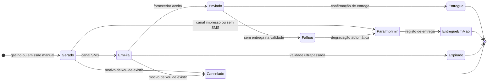
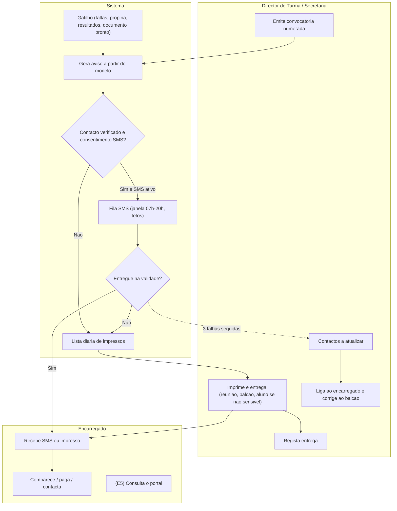

> [!warning] Nota arquivada — fonte já integrada na especificação v2.0
> Esta nota foi a **fonte de trabalho** da capacidade C12. O conteúdo foi integrado na especificação e **já não é a fonte de verdade**. Não editar: as correções fazem-se nos DOC.
> - Regras `RN-P-C12-nn` → família **`RN-14`** em [[01 - Dominio e Regras]] (a sub-regra mantém o número)
> - User stories → épico **EP-COM (US-COM-01–08)** em [[03 - User Stories]]
> - Fluxos → [[02 - Fluxos de Trabalho]] · Ecrãs e documentos → [[04 - Telas e Documentos]] (DOF-21, DOF-22)
> - Tabelas → [[05 - Modelagem de Dados]] (Grupo 7) · Requisitos → [[07 - Catalogo de Requisitos Funcionais]]
> - Questões `Q-C12-nn` → vão ser consolidadas no [[12 - Registo de Decisoes e Questoes em Aberto]] (Fase 3 da [[00.3 - Proposta de Organizacao Documental|ORG-00]])
>
> Tabela de correspondência completa: [[00.2 - Mapa de Integracao v2.0]] §2. Arquivada a 2026-11-05.

# C12 — Comunicação com Encarregados e Alunos

> [!abstract] Navegação
> - **Painel Principal:** [[Inicio|Início do Vault]] | **Índice do Projeto:** [[00 - MOC SGE IPCAG 12008 BGO|MOC]] | **Plano:** [[00.1 - Plano de Engenharia de Requisitos]] (§2.1 — `C12`, lacuna `L6`)
> - **Especificação base (v1.2):** [[01 - Dominio e Regras]] → [[02 - Fluxos de Trabalho]] → [[03 - User Stories]] → [[04 - Telas e Documentos]] → [[05 - Modelagem de Dados]]
> - **Decisões e questões:** [[12 - Registo de Decisoes e Questoes em Aberto]] (`DEC-003`, `DEC-006`; `Q-008`, `Q-013`, `Q-016`) | **Visão e âmbito:** [[06 - Visao e Ambito]] (`O-11`; C12 na E5)
> - **Capacidades relacionadas:** [[C10 - Cobranca, Relatorios Financeiros e Conciliacao|C10]] (avisos de cobrança) | [[C13 - Disciplina e Comportamento|C13]] (convocatórias disciplinares) | [[C14 - Gestao de Contas e Acesso|C14]] (contas do portal) | [[C04 - Horarios e Distribuicao de Servico Docente|C04]] (alterações de horário) | [[C03 - Processo Individual do Aluno|C03]] (contactos)
> - **Notas transversais:** [[11 - Protecao de Dados (APD)|11 - APD]] (§7.4 conteúdo admitido em SMS) | [[09 - Integracoes, Infraestrutura e Operacao|09]] (`INT-04` SMS, `INT-05` email) | [[08 - Requisitos Nao Funcionais|08]] (`RNF-PRV-10`)
> - **Prática real:** [[Sintese das Respostas da Fase B]] (R26, R27; G-11 A5, G-13 A1–A4, G-14 A1–A3)

> [!warning] Estado deste documento
> Rascunho `0.1` para integração posterior. **Não altera** DOC-01 a DOC-05. Regras (`RN-P-C12-nn`), user stories (`US-COM-nn`), módulos (`MOD-COM-nn`) e questões (`Q-C12-nn`) têm **identificadores provisórios**. A lista de alterações a fazer em cada DOC está no §13.

> [!example] O que a escola nos disse
> - Muitos encarregados vivem fora do Panguila (Caxito, Cacuaco, Luanda) e gastam táxi e uma manhã de trabalho só para entregar um talão ou saber notas (G-13 A1).
> - Só conhecem as notas e faltas no fim do trimestre; muitos descobrem a retenção por faltas quando já é tarde (G-13 A3, G-14 A2).
> - As convocatórias vão por bilhete entregue ao próprio aluno, que muitas vezes o esconde (G-13 A4).
> - O Director de Turma telefona com o próprio saldo ou usa grupos de WhatsApp; **20% a 30% dos telefones registados estão errados** ou pertencem ao aluno (G-11 A5).
> - Preferem receber por **SMS / WhatsApp** os avisos críticos: faltas acumuladas, propina vencida, notas do trimestre e convocatórias (G-13; dossiê §3).

---

## 1. Objetivo e Âmbito

### 1.1 Objetivo
Fazer chegar aos encarregados (e, quando aplicável, aos alunos) a informação de que precisam **a tempo de agir**, sem deslocações desnecessárias à escola, e com prova de que a escola avisou. Ao mesmo tempo, não expor dados de menores mais do que o necessário (Lei n.º 22/11).

### 1.2 Dentro do âmbito
1. **Central de avisos**: modelos de mensagem aprovados, gatilhos automáticos, fila de envio, registo de entrega.
2. **Canais**: aviso **impresso** (sempre disponível), **SMS** (se aprovado — `Q-C12-01`), **portal** (E5, `DEC-003`).
3. **Contactos verificados** dos encarregados: confirmação, marcação de telefones inválidos, atualização anual.
4. **Convocatórias** numeradas, com registo de comparência.
5. **Consentimento e preferências** de comunicação.
6. **Portal do encarregado e do aluno** (E5): consulta de notas, faltas, situação de pagamentos, horário, convocatórias e descarga de boletim e recibo com QR.

### 1.3 Fora do âmbito
- Conversa livre (chat) entre encarregados e professores.
- Gestão de grupos de WhatsApp ou envio para grupos (expõe dados de vários alunos).
- Envio de notas, faltas por disciplina, valores em dívida, motivos disciplinares ou dados de saúde por SMS (APD-11 §7.4).
- Aplicação nativa de telemóvel (o portal é uma página web adaptada ao telemóvel).
- Comunicação institucional em massa (publicidade, campanhas).

### 1.4 Rastreabilidade
| Origem | Ligação |
| :--- | :--- |
| Objetivo | `O-11` (encarregados informados sem se deslocarem) — [[06 - Visao e Ambito]] |
| Decisões | `DEC-003` (portal na E5), `DEC-006` (alojamento: o portal e o SMS precisam de internet) |
| Regras existentes | RN-03 (limite de faltas), RN-08 (semáforo financeiro), RN-10 (auditoria, QR) |
| Entrevistas | R26, R27 de [[Sintese das Respostas da Fase B]] |

---

## 2. Termos Novos Propostos para o Glossário (DOC-01 §1)

| Termo | Código | Definição |
| :--- | :--- | :--- |
| **Aviso** | `AVISO` | Mensagem curta enviada ao encarregado a partir de um modelo aprovado, por um canal, com estado de entrega. |
| **Gatilho** | `GATILHO` | Acontecimento do sistema que gera um aviso automaticamente (ex.: aluno atinge 80% do limite de faltas). |
| **Convocatória** | `CONVOCATORIA` | Chamada formal e numerada do encarregado à escola, com data, hora, local e quem convoca; o motivo detalhado fica só no sistema. |
| **Contacto Verificado** | `CONTACTO_VERIFICADO` | Telefone do encarregado confirmado nos últimos 12 meses (presencialmente ou por código SMS). |
| **Modelo de Mensagem** | `MODELO_MSG` | Texto aprovado pela Direção, com campos substituíveis da lista permitida (APD-11 §7.4). |
| **Portal do Encarregado** | `PORTAL_ENC` | Área autenticada da internet onde o encarregado consulta a informação dos seus educandos (E5). |

---

## 3. Regras de Negócio Provisórias (`RN-P-C12-nn`)

### RN-P-C12-01: Canais e Degradação
1. Canais suportados: `IMPRESSO`, `SMS`, `PORTAL`. O `EMAIL` só serve para funcionários (fora desta capacidade).
2. **O impresso está sempre disponível**: qualquer aviso pode ser impresso como carta ou bilhete, entregue em reunião, pelo aluno (só avisos não sensíveis) ou ao balcão.
3. O SMS só existe se a Direção o aprovar e houver contrato com um fornecedor (`Q-C12-01`, `Q-013`). Sem SMS, os gatilhos geram avisos impressos numa lista diária para o Director de Turma ou a Secretaria.
4. O portal só a partir da E5 (`DEC-003`).
5. Se um envio por SMS falhar (telefone inválido, sem rede durante a validade), o aviso passa automaticamente para a lista de impressos.

### RN-P-C12-02: Destinatário
1. O destinatário é o **Encarregado de Educação** registado na matrícula do ano (`encarregados_educacao`). Irmãos partilham o encarregado: os avisos do mesmo tipo e no mesmo dia são **agrupados numa só mensagem** (ex.: "propinas de setembro de Ana e João").
2. O aluno **maior de 18 anos** pode ser o seu próprio destinatário se o indicar por escrito (`Q-C12-04`).
3. Nunca se envia para o telefone marcado como "do próprio aluno" quando o aluno é menor, exceto avisos de horário (portal, E5).

### RN-P-C12-03: Contactos Verificados
1. Na matrícula e na confirmação, a Secretaria confirma até dois telefones do encarregado e indica de quem é cada um (`PAI`, `MAE`, `ENCARREGADO`, `ALUNO`, `OUTRO`).
2. Com SMS ativo, cada telefone novo recebe um código de 4 dígitos que o encarregado repete ao balcão; sem SMS, a verificação é a confirmação presencial.
3. Um telefone com 3 falhas de entrega seguidas passa a `INVALIDO` e entra na lista de "contactos a atualizar" do Director de Turma.
4. Contactos não verificados há mais de 12 meses são reconfirmados na confirmação de matrícula seguinte.
5. Todas as alterações de contacto ficam em `audit_logs`.

### RN-P-C12-04: Conteúdo Mínimo (APD)
1. Só se enviam mensagens a partir de **modelos aprovados** pela Direção. Não há texto livre por SMS.
2. Os campos substituíveis permitidos são os da APD-11 §7.4: primeiro nome do aluno, mês de referência, data/hora/local, limiar atingido. **Proibido**: notas, disciplina, valor em dívida, multas, bolsas, motivo disciplinar, saúde.
3. Cada mensagem identifica a escola e termina com o contacto da Secretaria.
4. Nenhum SMS excede 160 caracteres (uma mensagem), para controlar o custo.

### RN-P-C12-05: Gatilhos Automáticos
| Gatilho | Quando | Modelo | Liga a |
| :--- | :--- | :--- | :--- |
| `FALTAS_50` | O aluno atinge 50% do limite de faltas injustificadas numa disciplina | "O seu educando [nome] tem faltas acumuladas. Contacte o Director de Turma." | RN-03, C05 |
| `FALTAS_80` | Atinge 80% do limite | Igual, com indicação de risco de retenção | RN-03, C05 |
| `PROPINA_VENCIDA` | Dia seguinte ao vencimento sem pagamento | Nível 1 do aviso de cobrança | C10 `RN-P-C10-05` |
| `RESULTADOS_TRIMESTRE` | Homologação da Pauta Geral do trimestre | "Os resultados do [I] Trimestre estão disponíveis. Reunião em [data]." (sem notas) | Fluxo 04 |
| `CONVOCATORIA` | Emitida manualmente | Data, hora, local | RN-P-C12-07 |
| `HORARIO_ALTERADO` | Alteração do horário da turma durante o trimestre | Só pelo portal e afixação (E5) | C04 |
| `DOCUMENTO_PRONTO` | Declaração ou certificado assinado e pronto a levantar | "O documento pedido está pronto na Secretaria." | C09, R16 |

1. Os limiares (50%, 80%) e os gatilhos ativos são parâmetros da Direção.
2. Um gatilho não se repete para o mesmo aluno, disciplina e limiar no mesmo ano letivo.
3. A justificação posterior de faltas não "desenvia" o aviso, mas impede o próximo se o total descer abaixo do limiar.

### RN-P-C12-06: Janelas, Limites e Custos
1. Os SMS só saem entre as 07h00 e as 20h00; fora desse horário ficam em fila.
2. Máximo de 4 SMS automáticos por encarregado por semana (as convocatórias não contam).
3. Orçamento mensal de SMS com teto definido pela Direção; aos 80% do teto, alerta ao `SUB_ADM`; no teto, os avisos não urgentes passam a impressos.

### RN-P-C12-07: Convocatórias
1. Emitidas pelo Director de Turma, Coordenador de Turno, Coordenador Pedagógico ou Direção, com numeração anual `N.º ___/IPCAG/ano`.
2. Contêm data, hora, local e quem convoca. O **motivo** (pedagógico, disciplinar, financeiro, outro) fica só no sistema.
3. A comparência ou falta do encarregado é registada; duas faltas seguidas geram alerta à Direção.
4. Convocatórias de origem disciplinar ligam-se à ocorrência da [[C13 - Disciplina e Comportamento|C13]].

### RN-P-C12-08: Fila, Estados e Prova de Entrega
1. Cada aviso tem estado (§4) e fica registado com canal, telefone, data/hora de envio e confirmação de entrega do fornecedor.
2. Sem internet, os avisos ficam em fila no servidor local; cada aviso tem **validade** (ex.: convocatória expira na data marcada; aviso de propina expira se for pago).
3. O registo de envio é a prova de que a escola avisou (importante nos casos de retenção por faltas).

### RN-P-C12-09: Consentimento e Preferências
1. A ficha de matrícula inclui o consentimento para receber avisos por SMS e, na E5, para o acesso ao portal (APD-11).
2. O encarregado pode recusar os avisos **não essenciais** (resultados, documento pronto). As convocatórias e os avisos de faltas `FALTAS_80` seguem sempre, pelo impresso se recusar o SMS.
3. A recusa e a sua data ficam registadas.

### RN-P-C12-10: Portal do Encarregado e do Aluno (E5)
1. **Ativação presencial**: a Secretaria valida o BI do encarregado e entrega um código de ativação de uso único. Não há autorregisto pela internet.
2. Um encarregado vê **todos os seus educandos** ativos.
3. O portal mostra: notas parcelares e médias homologadas, faltas por disciplina e o seu limite, justificações aceites, situação de pagamentos (prestações pagas e em atraso, sem pormenor de bolsas), horário da turma, convocatórias e avisos recebidos.
4. Descarga em PDF com QR do boletim (`DOF-06`) e dos recibos — **sujeita ao semáforo da RN-08** como no balcão (`Q-C12-03`).
5. Nunca mostra: dados de saúde, ocorrências disciplinares em pormenor (só a nota de comportamento), dados de outros alunos.
6. O aluno com conta própria (E5) vê só os seus dados escolares (notas, faltas, horário), sem a parte financeira (`Q-C12-04`).
7. As contas do portal seguem a [[C14 - Gestao de Contas e Acesso|C14]] §11 "Contas de Encarregados e Alunos" (perfil `ENCARREGADO`, `ALUNO`, sem acesso aos workspaces internos).

---

## 4. Máquina de Estado — Aviso (`AVISO`)

| Origem | Evento | Destino | Quem | Guarda |
| :--- | :--- | :--- | :--- | :--- |
| `Gerado` | encaminhar | `EmFila` / `ParaImprimir` | Sistema | Contacto verificado e consentimento para SMS; senão impresso |
| `EmFila` | enviar | `Enviado` | Sistema | Janela 07h–20h; teto semanal e mensal |
| `Enviado` | confirmar | `Entregue` / `Falhou` | Fornecedor SMS | — |
| `Falhou` | degradar | `ParaImprimir` | Sistema | Incrementa falhas do telefone (RN-P-C12-03.3) |
| `ParaImprimir` | registar entrega | `EntregueEmMao` | `DIR_TURMA`, `OP_PED` | Indica a quem foi entregue |
| qualquer não final | cancelar | `Cancelado` | Sistema / emissor | Ex.: propina paga antes do envio |

---

## 5. Fluxo Ponta a Ponta

**Exceções:**
- **Sem internet:** os avisos ficam em fila; os que expiram passam a impresso se ainda fizerem sentido.
- **Telefone pertence ao aluno menor:** não se envia SMS; impresso para entrega em reunião ou ao balcão.
- **Teto de SMS atingido:** só seguem convocatórias e `FALTAS_80`; o resto passa a impresso.
- **Encarregado contesta que não foi avisado:** o registo de envio e entrega (`audit_logs`) é a prova.

---

## 6. User Stories (`US-COM-nn`) com Critérios BDD

### `US-COM-01`: Aprovar Modelos de Mensagem
**Como** `SUB_PED` / `SUB_ADM`, **quero** aprovar os textos dos avisos **para que** nenhuma mensagem saia com dados não permitidos.
- **Dado** um modelo com o campo `valor_divida`, **Quando** tento aprová-lo, **Então** o sistema recusa, indicando que o campo não está na lista permitida (APD-11 §7.4).
- **Dado** um modelo com 175 caracteres depois de substituir os campos no pior caso, **Quando** o grava, **Então** o sistema avisa que excede uma mensagem SMS.

### `US-COM-02`: Receber Aviso Automático de Faltas
**Como** encarregado, **quero** ser avisado quando o meu educando acumula faltas **para que** possa agir antes da retenção.
- **Dado** um limite de 12 faltas injustificadas em Matemática e o aluno com 5, **Quando** o professor regista a 6.ª falta, **Então** gera-se um aviso `FALTAS_50` para o encarregado.
- **Dado** que o aviso `FALTAS_50` de Matemática já foi gerado, **Quando** o aluno chega à 7.ª falta, **Então** não se gera novo aviso `FALTAS_50`.
- **Dado** o telefone do encarregado marcado `INVALIDO`, **Quando** o aviso é gerado, **Então** vai para a lista de impressos do Director de Turma.

### `US-COM-03`: Emitir Convocatória
**Como** Director de Turma, **quero** convocar um encarregado **para que** compareça na escola com prova da convocatória.
- **Dado** uma convocatória para 15/03 às 14h00, **Quando** a emito, **Então** recebe o número seguinte da série anual e o SMS sai sem o motivo.
- **Dado** que o encarregado não compareceu a duas convocatórias seguidas, **Quando** registo a segunda falta, **Então** a Direção recebe um alerta.

### `US-COM-04`: Verificar e Atualizar Contactos
**Como** `OP_PED`, **quero** confirmar os telefones na matrícula **para que** os avisos cheguem a quem deve.
- **Dado** um telefone novo e SMS ativo, **Quando** o registo, **Então** sai um código de 4 dígitos e o contacto só fica `VERIFICADO` depois de o encarregado o repetir.
- **Dado** um contacto com 3 falhas seguidas, **Quando** abro a lista "contactos a atualizar", **Então** o aluno aparece com a turma e o Director de Turma.

### `US-COM-05`: Acompanhar Entregas e Custos
**Como** `SUB_ADM`, **quero** ver quantos avisos foram enviados, entregues e falharam, e o custo do mês **para que** controle o orçamento.
- **Dado** o teto mensal de 1.000 SMS e 800 já enviados, **Quando** sai o 800.º, **Então** recebo um alerta.

### `US-COM-06`: Registar Consentimento e Recusa
**Como** `OP_PED`, **quero** registar se o encarregado aceita avisos por SMS **para que** se respeite a sua escolha.
- **Dado** um encarregado que recusou avisos não essenciais, **Quando** a Pauta Geral é homologada, **Então** não lhe sai o aviso `RESULTADOS_TRIMESTRE`, mas continuam a sair as convocatórias.

### `US-COM-07` (E5): Ativar e Usar o Portal do Encarregado
**Como** encarregado, **quero** consultar as notas, faltas e pagamentos dos meus educandos **para que** não tenha de ir à escola.
- **Dado** um código de ativação entregue ao balcão, **Quando** ativo a conta, **Então** vejo os dois educandos ligados ao meu BI.
- **Dado** um educando com propinas em atraso, **Quando** peço o boletim em PDF, **Então** o sistema aplica a mesma regra do balcão (RN-08) (`Q-C12-03`).
- **Dado** que o educando tem uma ocorrência disciplinar, **Quando** consulto o portal, **Então** vejo só a nota de comportamento do trimestre.

### `US-COM-08` (E5): Consultar o Portal como Aluno
**Como** aluno, **quero** ver as minhas faltas e o meu horário **para que** não seja apanhado de surpresa.
- **Dado** que justifiquei faltas e a justificação foi aprovada, **Quando** consulto as faltas, **Então** vejo-as como justificadas em todas as disciplinas afetadas.

---

## 7. Ecrãs e Módulos Propostos

| Módulo | Workspace | Conteúdo | US |
| :--- | :--- | :--- | :--- |
| `MOD-COM-01` Central de Avisos | 01 (Direção) | Modelos, gatilhos ativos e limiares, tetos, relatório de envios e custos | US-COM-01, 05 |
| `MOD-COM-02` Avisos da Turma | 03 (Docência) | Lista diária de impressos, contactos a atualizar, convocatórias e comparências | US-COM-02, 03 |
| `MOD-COM-03` Contactos e Consentimentos | 02 (Secretaria) | Verificação de telefones, consentimentos, ativação do portal | US-COM-04, 06, 07 |
| `MOD-COM-04` Portal do Encarregado e do Aluno | Externo (E5) | Consulta e descargas com QR | US-COM-07, 08 |

**Documentos (códigos provisórios):** `DOF-P-C12-01` Convocatória numerada; `DOF-P-C12-02` Aviso impresso (carta ou bilhete destacável com recibo de entrega).

---

## 8. Modelo de Dados — Tabelas Novas e Atributos Novos

### 8.1 Tabelas novas
| Tabela | Papel | Atributos principais |
| :--- | :--- | :--- |
| `modelos_mensagem` | Textos aprovados | ID; código do gatilho; texto com campos; canal; aprovado por; data; ativo |
| `avisos` | Cada aviso gerado | ID; modelo; aluno(s); encarregado; canal; telefone usado; estado (§4); validade; data de geração/envio/entrega; custo; ligação de origem (falta, prestação, convocatória, documento) |
| `convocatorias` | Convocatórias numeradas | ID; n.º anual; aluno; encarregado; emissor; motivo (categoria + texto interno); data/hora/local; comparência (`COMPARECEU`, `FALTOU`, `REMARCADA`); ligação a ocorrência C13 |
| `contactos_encarregado` | Telefones com verificação | ID; encarregado; telefone (+244); titular (`PAI`, `MAE`, `ENCARREGADO`, `ALUNO`, `OUTRO`); estado (`POR_VERIFICAR`, `VERIFICADO`, `INVALIDO`); data de verificação; falhas seguidas |
| `consentimentos_comunicacao` | Consentimentos e recusas | ID; encarregado; tipo (`SMS_ESSENCIAIS`, `SMS_NAO_ESSENCIAIS`, `PORTAL`); valor; data; registado por |

### 8.2 Atributos novos em tabelas existentes
- `encarregados_educacao`: o telefone principal/alternativo passa para `contactos_encarregado`.
- `alunos`: `destinatario_proprio` (maior de idade que recebe os avisos).

### 8.3 Listas fechadas novas
`GATILHO_AVISO`, `CANAL_AVISO`, `ESTADO_AVISO`, `TITULAR_CONTACTO`, `MOTIVO_CONVOCATORIA` (`PEDAGOGICO`, `DISCIPLINAR`, `FINANCEIRO`, `OUTRO`).

### 8.4 Eventos novos em `audit_logs`
`MODELO_APROVADO`, `CONTACTO_ALTERADO`, `CONSENTIMENTO_ALTERADO`, `CONVOCATORIA_EMITIDA`, `PORTAL_ATIVADO`.

---

## 9. Permissões por Cargo RBAC

| Ação | `DIR_GERAL` | `SUB_PED` | `SUB_ADM` | `CHEFE_SEC_PED` / `OP_PED` | `OP_TES` | `COORD_TURNO` | `DIR_TURMA` | `PROF` |
| :--- | :---: | :---: | :---: | :---: | :---: | :---: | :---: | :---: |
| Aprovar modelos e gatilhos | ✅ | ✅ (pedagógicos) | ✅ (financeiros) | — | — | — | — | — |
| Ver relatório de envios e custos | ✅ | ✅ | ✅ | — | — | — | — | — |
| Emitir convocatória | ✅ | ✅ | ✅ | — | — | ✅ | ✅ (sua turma) | — |
| Verificar contactos e consentimentos | — | — | — | ✅ | — | — | ✅ (sua turma, só leitura e correção sinalizada) | — |
| Ativar conta do portal (E5) | — | — | — | ✅ | — | — | — | — |
| Ver avisos de um aluno | ✅ | ✅ | ✅ (financeiros) | ✅ | ✅ (financeiros) | ✅ | ✅ (sua turma) | — |

---

## 10. Requisitos Não Funcionais Aplicáveis
- `RNF-PRV-10`: 0 mensagens com dados fora da lista aprovada.
- `RNF-DIS-02`: a central de avisos funciona sem internet (fila e impressos).
- Novo `RNF-P-C12-01`: 95% dos SMS entregues em menos de 10 minutos quando há internet.
- Novo `RNF-P-C12-02`: o portal (E5) responde em menos de 3 s num telemóvel Android básico com 3G.

---

## 11. Questões para a Escola (`Q-C12-nn`)

| ID | Questão | A quem | Bloqueia |
| :--- | :--- | :--- | :--- |
| `Q-C12-01` | A Direção aprova o SMS como canal, com que orçamento mensal? Pode entrar **antes da E5** (não abre dados à internet) — por exemplo na E3, com os avisos de faltas e propinas? | Comissão de Gestão, `SUB_ADM` | Entrega do SMS |
| `Q-C12-02` | WhatsApp: a escola aceita usá-lo só através de um fornecedor oficial (WhatsApp Business), e nunca em grupos de turma com dados de alunos? | Comissão de Gestão | Canal WhatsApp (fora do MVP até resposta) |
| `Q-C12-03` | Com dívida, o portal mostra as notas mas não deixa descarregar o boletim oficial (como a retenção do boletim em reunião — G-11 A4)? | Comissão de Gestão | `US-COM-07` |
| `Q-C12-04` | O aluno maior de 18 anos pode receber os seus próprios avisos? Os alunos têm conta no portal, a partir de que classe? | `SUB_PED` | RN-P-C12-02, 10 |
| `Q-C12-05` | Limiares de aviso de faltas: 50% e 80% (entrevistas) ou só 80% (APD-11)? | `SUB_PED` | RN-P-C12-05 |
| `Q-C12-06` | Quem paga os SMS: orçamento da escola ou contribuição dos encarregados? | `SUB_ADM` | `Q-013` |

---

## 12. *Definition of Ready* (Plano §8)

| Critério | Estado |
| :--- | :--- |
| Ligado a objetivo e capacidade | ✅ `O-11`, C12 |
| Prioridade e entrega | 🟡 Portal E5 (`DEC-003`); SMS e central de avisos dependem de `Q-C12-01` |
| Regras validadas | ❌ Fase D |
| BDD com exceções e números reais | ✅ |
| Ecrãs e tabelas | ✅ propostos |
| RNF identificados | ✅ |
| Sem questões em aberto | ❌ `Q-C12-01` a `06` |
| Aprovado pelo cargo responsável | ❌ |

---

## 13. Alterações a Integrar na Especificação

| DOC | Alteração |
| :--- | :--- |
| [[01 - Dominio e Regras]] | Termos do §2; regras `RN-P-C12-01` a `10` como nova regra de comunicação; linhas RBAC do §9 |
| [[02 - Fluxos de Trabalho]] | Novo fluxo "Avisos e convocatórias" (§5); ligação nos Fluxos 03 (faltas), 04 (resultados), 07 (cobrança), 08 (documento pronto) |
| [[03 - User Stories]] | Novo épico `EP-COM` com `US-COM-01` a `08` |
| [[04 - Telas e Documentos]] | `MOD-COM-01` a `04`; `DOF-P-C12-01/02`; consentimento na ficha de matrícula (`DOF-03`) |
| [[05 - Modelagem de Dados]] | Tabelas do §8.1; listas do §8.3; eventos do §8.4; matriz RLS (encarregado vê só os seus educandos) |
| [[C10 - Cobranca, Relatorios Financeiros e Conciliacao]] | Os avisos de cobrança passam a usar a central de avisos (canal e estado) |
| [[C14 - Gestao de Contas e Acesso]] | Perfis externos `ENCARREGADO` e `ALUNO` com ativação presencial (RN-P-C12-10) |

---

## 14. Histórico

| Versão | Data | Alteração |
| :---: | :---: | :--- |
| 0.1 | 2026-11-02 | Criação a partir de `DEC-003`, APD-11 §7.4 e das entrevistas da Fase B. |
