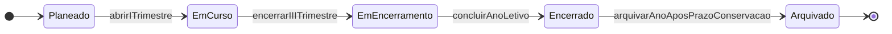
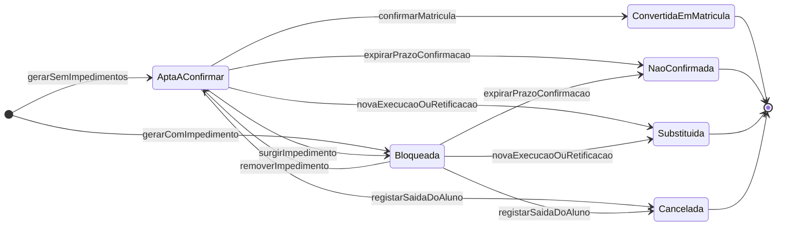
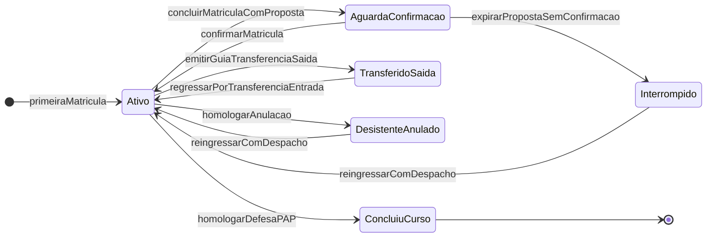
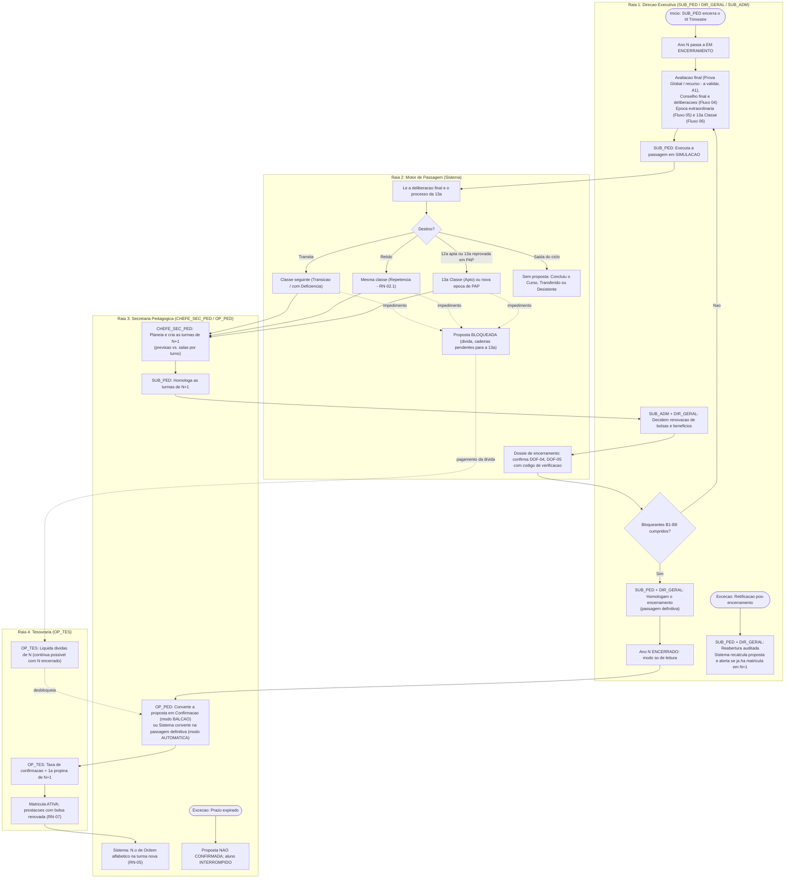

> [!warning] Nota arquivada — fonte já integrada na especificação v2.0
> Esta nota foi a **fonte de trabalho** da capacidade C16. O conteúdo foi integrado na especificação e **já não é a fonte de verdade**. Não editar: as correções fazem-se nos DOC.
> - Regras `RN-P-C16-nn` → família **`RN-18`** em [[01 - Dominio e Regras]] (a sub-regra mantém o número)
> - User stories → épico **EP-PAS (US-PAS-01–08)** em [[03 - User Stories]]
> - Fluxos → [[02 - Fluxos de Trabalho]] · Ecrãs e documentos → [[04 - Telas e Documentos]] (DOF-25, DOF-26)
> - Tabelas → [[05 - Modelagem de Dados]] (Grupos 1, 3 e 5) · Requisitos → [[07 - Catalogo de Requisitos Funcionais]]
> - Questões `Q-C16-nn` → vão ser consolidadas no [[12 - Registo de Decisoes e Questoes em Aberto]] (Fase 3 da [[00.3 - Proposta de Organizacao Documental|ORG-00]])
>
> Tabela de correspondência completa: [[00.2 - Mapa de Integracao v2.0]] §2. Arquivada a 2026-11-05.

# C16 — Passagem de Ano Letivo

> [!abstract] Navegação
> - **Painel Principal:** [[Inicio|Início do Vault]] | **Índice do Projeto:** [[00 - MOC SGE IPCAG 12008 BGO|MOC]] | **Plano:** [[00.1 - Plano de Engenharia de Requisitos]] (§2.1 — `C16`, lacuna `L6`)
> - **Especificação base (v1.2):** [[01 - Dominio e Regras]] → [[02 - Fluxos de Trabalho]] → [[03 - User Stories]] → [[04 - Telas e Documentos]] → [[05 - Modelagem de Dados]]
> - **Capacidades novas relacionadas:** [[C04 - Horarios e Distribuicao de Servico Docente]] | [[C03 - Processo Individual do Aluno]]
> - **Decisões e questões:** [[12 - Registo de Decisoes e Questoes em Aberto]] (`DEC-007`; `Q-005`, `Q-025`, `Q-030`, `Q-031`) | **Visão e âmbito:** [[06 - Visao e Ambito]] (`O-13`)
> - **Capacidades e notas relacionadas:** [[C10 - Cobranca, Relatorios Financeiros e Conciliacao|C10]] (dívida e acordos) | [[C14 - Gestao de Contas e Acesso|C14]] (cargos por ano) | [[10 - Migracao de Dados e Implantacao|10 - Migração]] | [[11 - Protecao de Dados (APD)|11 - APD]] | [[08 - Requisitos Nao Funcionais|08 - RNF]]
> - **Dados reais e legais:** [[Achados dos Documentos Reais - Lote 1]] (`DESC-L1` — A1, A6, A7, A10, A12, A16) | [[Verificacao das Referencias Legais]] (`COR-LEG-15`, `Q-LEG-05`)

> [!warning] Estado deste documento
> Rascunho `0.2` para integração posterior. **Não altera** DOC-01 a DOC-05. Regras (`RN-P-C16-nn`), user stories (`US-PAS-nn`), módulos (`MOD-PAS-nn`), documentos (`DOF-P-C16-nn`) e questões (`Q-C16-nn`) têm **identificadores provisórios**. A lista de alterações a fazer em cada DOC está no §13.

> [!example] O que os documentos reais e a verificação legal mudam nesta capacidade
> - **A10 — Resultados reais da Pauta Geral:** a Pauta de Aproveitamento Geral da escola conta os alunos que **transitam**, **transitam com deficiência**, **desistentes** e **não transitam** (com contagens por género). A passagem trabalha com estas quatro categorias; as deliberações mais finas da lista fechada 11 do DOC-05 ficam como subtipos **a validar** (`RN-P-C16-05`).
> - **A12 — Boletim real de Confirmação de Matrícula:** pede a classe, turma, sala e curso do ano anterior, **até duas cadeiras em atraso** e a classe pretendida, com numeração anual (`N.º __/2026-2027`) e comprovativo destacável. A proposta de confirmação pré-preenche estes campos (`RN-P-C16-06`, `RN-P-C16-09`).
> - **Confirmação automática (verificação legal):** segundo a [[Verificacao das Referencias Legais|LEG-VER]], o DP n.º 167/23, art. 50.º, n.º 4, diz que a confirmação de matrícula "é automática e da responsabilidade da respectiva Escola", e a `COR-LEG-15` acrescenta a anulação da matrícula incompleta 60 dias após o início do ano (art. 50.º, n.º 8). Isto choca com a prática real (boletim de confirmação ao balcão) e com o bloqueio por dívida (`Q-LEG-05`). A passagem suporta **os dois modos** como parâmetro (`RN-P-C16-06.4`).
> - **A1 e A7 — Fórmulas e regra de transição por confirmar:** a escola usa Prova Global e Classificação Anual (`Q-025`) e a Língua Portuguesa só existe na 10ª e na 11ª (`Q-031`). A passagem **não recalcula** nada: lê a deliberação homologada. Os limiares citados (nota `>= 10` para eliminar uma cadeira, máximo de cadeiras, veto `LP + Nuclear`) ficam **a validar**.
> - **A6 — 13ª Classe:** "Projecto Tecnológico" em vez de "PAP" (`Q-030`); esta nota mantém os nomes do DOC-01 até à resposta.
> - **A16 — Dimensão das turmas:** 37 a 45 alunos nos modelos reais (`Q-C16-05`).

---

## 1. Objetivo e Âmbito

### 1.1 Objetivo
Fechar o ciclo anual do SGE (plano §2, etapa "9. Passagem de Ano"): encerrar o Ano Letivo `N` de forma verificável, colocar cada aluno no destino certo do Ano Letivo `N+1` conforme a deliberação do Conselho de Notas (`RN-02`), criar as turmas do ano seguinte, levar para `N+1` o que tem de continuar (cadeiras em atraso, dívidas de propina, bolsas) e deixar o ano `N` **em modo só de leitura**, arquivado e consultável.

**Problema que resolve (plano §2.1):** hoje só existe o evento `concluirAnoLetivo` na máquina de estado do DOC-01 §3.1 e a pré-condição de `US-MAT-02` ("Pauta Geral do ano letivo anterior homologada"). Falta o fluxo completo: quem fecha o ano, com que verificações, como se geram as confirmações em massa, o que fica bloqueado e o que continua possível no ano encerrado.

**Objetivo da [[06 - Visao e Ambito|VIS-06]]:** **`O-13` — Ano seguinte preparado a partir dos dados do SGE**: 100% das matrículas de 2028/2029 geradas a partir da deliberação final do SGE, sem reintrodução de dados, e 100% das dívidas e cadeiras em atraso transportadas sem reintrodução manual (passagem de 2027/2028 para 2028/2029). A VIS-06 §5.2 coloca a `C16` **dentro do âmbito**, entrega **E4**.

### 1.2 Dentro do âmbito
1. **Encerramento do Ano Letivo:** estados do ano, lista de verificação (bloqueantes e avisos) e homologação.
2. **Promoção em massa:** cálculo do destino de cada aluno em `N+1` a partir da deliberação final (`RN-02`) e do processo da 13ª Classe (`RN-06`), sob a forma de **propostas de Confirmação de Matrícula**.
3. **Criação das turmas do ano seguinte** e regras do `N.º de Ordem` (`RN-05`).
4. **Continuidade de pendências:** cadeiras em atraso (`RN-02`), dívidas de propina (`RN-08`, `RN-09`), bolsas e benefícios (`RN-07`).
5. **Modo só de leitura** do ano encerrado e as exceções permitidas.
6. **Situação dos alunos que saem do ciclo:** retidos, transferidos, desistentes/anulados, não confirmados e concluintes do curso; arquivo digital e físico.

### 1.3 Fora do âmbito
- Concurso de admissão à 10ª Classe do ano `N+1` (`C02`, Fluxo 01). Só entra aqui o número de vagas, usado para planear as turmas.
- Migração do histórico de anos anteriores à implantação do SGE (`C17`, [[10 - Migracao de Dados e Implantacao|10]]); a primeira passagem usa as dívidas e as cadeiras em atraso migradas.
- Prazos de conservação e eliminação de dados pessoais (`C19`, [[11 - Protecao de Dados (APD)|APD-11]], motor de conservação RF-P-APD-13): esta capacidade só prevê o estado `ARQUIVADO` e depende dessa definição.
- Gestão de dívidas, avisos de cobrança e acordos de pagamento ([[C10 - Cobranca, Relatorios Financeiros e Conciliacao|C10]], que remete para esta nota o transporte de dívidas). Aqui garante-se apenas que a dívida continua visível e cobrável.

### 1.4 Rastreabilidade
| Elemento | Ligação |
| :--- | :--- |
| Capacidade | `C16` (plano §2.1), lacuna `L6` |
| Entrega proposta | **E4 — Fecho do ano** (plano §6) |
| Regras existentes usadas | `RN-02` (deliberação, cadeiras em atraso, repetência `RN-02.1`), `RN-05` (numeração), `RN-06` (13ª Classe e `MFC`), `RN-07` (bolsas), `RN-08` (semáforo financeiro), `RN-09` (recibos, borderôs e estornos), `RN-10` (auditoria e arquivo) |
| Máquinas de estado tocadas | DOC-01 §3.1 (`concluirAnoLetivo`), §3.3 (Matrícula), §3.5 (13ª Classe), §3.6 (Propina) |
| Fluxos existentes tocados | Fluxo 02 (Confirmação, Cenário B), Fluxo 04 (deliberação anual), Fluxo 05 (exame extraordinário), Fluxo 06 (13ª Classe) |
| User stories existentes tocadas | `US-GOV-01`, `US-GOV-03`, `US-MAT-02`, `US-PED-06`, `US-TES-02` |
| Tabelas existentes tocadas | `anos_letivos`, `turmas`, `matriculas_anuais`, `alunos`, `cadeiras_em_atraso`, `beneficios_bolsas_matricula`, `conta_corrente_propinas`, `processos_13_classe`, `documentos_oficiais_emitidos` |
| Objetivo | `O-13` (VIS-06 §3) |
| Decisões e questões do REG-12 | `DEC-007` (arranque em 2027/2028), `Q-005` (calendário), `Q-025` (fórmulas), `Q-030` (13ª Classe), `Q-031` (transição na 12ª) |
| Dados reais e legais | `DESC-L1` A1, A6, A7, A10, A12, A16; `COR-LEG-15` / `Q-LEG-05` (confirmação automática) |
| Capacidades vizinhas | `C10` (dívida; acordos com `liberta_semaforo`), `C14` (`atribuicoes_cargo` terminam em `concluirAnoLetivo`), `C17` (dados migrados), `C19` (conservação) |

---

## 2. Termos Novos Propostos para o Glossário (DOC-01 §1)

| Termo proposto | Código | Definição proposta |
| :--- | :---: | :--- |
| **Encerramento do Ano Letivo** | `ENCERRAMENTO_ANO` | Ato homologado pela `SUB_PED` e pelo `DIR_GERAL` que, cumprida a lista de verificação, passa o Ano Letivo a `Encerrado`, tornando os seus dados pedagógicos só de leitura. |
| **Passagem de Ano** | `PASSAGEM_ANO` | Cálculo, para cada aluno do ano `N`, do seu destino no ano `N+1` (classe, curso, turno sugerido), em conformidade com a deliberação final e o processo da 13ª Classe. |
| **Proposta de Confirmação de Matrícula** | `PROPOSTA_CONF` | Registo pré-preenchido, gerado pela Passagem de Ano, que a Secretaria Pedagógica (ou o sistema, no modo automático — `RN-P-C16-06.4`) converte em **Confirmação de Matrícula** (DOC-01 §1.2). **Não é uma matrícula**: não ocupa lugar na turma nem conta nos mapas do GEPE. |
| **Situação Académica do Aluno** | `SITUACAO_ACADEMICA` | Estado vitalício do aluno no IPCAG, independente do ano: `Ativo`, `Aguarda Confirmação`, `Interrompido`, `Transferido (Saída)`, `Desistente / Anulado`, `Concluiu o Curso`. |
| **Dossiê de Encerramento** | `DOSSIE_ENCERRAMENTO` | Conjunto dos documentos oficiais finais do ano (Mini-Pautas, Pautas Gerais e Mapa Estatístico), registados com código de verificação em `documentos_oficiais_emitidos` antes do encerramento. |

---

## 3. Regras de Negócio Provisórias (`RN-P-C16-nn`)

### RN-P-C16-01: Estados do Ano Letivo e Coexistência de Dois Anos
1. O atributo "Estado do Ano" de `anos_letivos` (que hoje não tem lista fechada no DOC-05 §1.3) passa a seguir a máquina de estado do §4.1: `PLANEADO` → `EM_CURSO` → `EM_ENCERRAMENTO` → `ENCERRADO` → `ARQUIVADO`.
2. Existe **no máximo 1 Ano Letivo `EM_CURSO`** (coerente com a regra do DOC-05: "só pode existir um ano letivo ativo como corrente para matrículas regulares").
3. O ano `N+1` pode estar `PLANEADO` (configuração, concurso de admissão, turmas, confirmações) enquanto o ano `N` está `EM_ENCERRAMENTO`.
4. **O I Trimestre do ano `N+1` só abre com o ano `N` `ENCERRADO`.** Esta guarda junta-se à do DOC-01 §3.1 (`abrirPeriodoLetivo`).
5. As épocas de exame pertencem ao Ano Letivo em que estão calendarizadas (`US-GOV-01`; `exames_extraordinarios` guarda o "Ano Letivo da Época de Exame"). Uma época extraordinária marcada depois do início do ano `N+1` fica registada em `N+1`, sem impedir o encerramento de `N` (`Q-C16-07`).

### RN-P-C16-02: Entrada em Encerramento
1. O ano passa a `EM_ENCERRAMENTO` quando a `SUB_PED` encerra oficialmente o III Trimestre (`trimestres_letivos` = `Encerrado Oficialmente`).
2. Em `EM_ENCERRAMENTO` decorrem: a avaliação final (Prova Global e Classificação Anual e/ou Exame de Recurso — a validar, DESC-L1 A1, `Q-025`), o Conselho de Notas final e as deliberações (`US-PED-06`), a época extraordinária calendarizada no ano, as defesas da 13ª Classe (PAP / Projecto Tecnológico — `Q-030`) e a preparação da passagem.
3. Não é possível criar matrículas novas no ano `N` em `EM_ENCERRAMENTO`. Continuam possíveis a transferência de saída e a anulação.

### RN-P-C16-03: Lista de Verificação do Encerramento
O encerramento só é homologável quando **todos os itens bloqueantes** estão cumpridos. A lista é recalculada sempre que se abre o painel.

| # | Verificação | Tipo |
| :---: | :--- | :---: |
| B1 | Todas as turmas da 10ª à 12ª Classe com a Pauta Geral anual (depois da Prova Global e/ou do recurso — `Q-025`) `Fechado / Homologado`. | Bloqueante |
| B2 | Todas as matrículas do ano num estado final: `Concluída`, `Transferida (Externa)` ou `Anulada / Desistente`. Nenhuma `Pendente`, `Ativa` ou `Transferida (Interna)` por resolver. | Bloqueante |
| B3 | Todas as deliberações `Transita com Deficiência` têm as respetivas linhas em `cadeiras_em_atraso` (consistência do `RN-02.5`). | Bloqueante |
| B4 | Nenhuma reabertura de pauta ativa em `reaberturas_pauta_direcao`. | Bloqueante |
| B5 | Nenhum conflito de sincronização `PENDENTE` em `conflitos_sincronizacao` de turmas do ano. | Bloqueante |
| B6 | Todas as épocas de exame calendarizadas no ano fechadas e homologadas. | Bloqueante |
| B7 | Cada matrícula da 13ª Classe tem o processo (`processos_13_classe`) num estado que permite concluir a matrícula (`RN-P-C16-05`, linha 13ª). | Bloqueante |
| B8 | Dossiê de Encerramento completo (`RN-P-C16-15`). | Bloqueante |
| A1 | Mapa Estatístico anual (`DOF-12`) gerado. | Aviso |
| A2 | Propinas em dívida no ano (total e n.º de alunos). | Aviso (informativo) |
| A3 | Benefícios ativos sem decisão de renovação (`RN-P-C16-11`). | Aviso |
| A4 | Processos individuais com documentos em falta ([[C03 - Processo Individual do Aluno]]). | Aviso |
| A5 | Propostas de confirmação ainda bloqueadas (dívida, cadeiras pendentes). | Aviso |

### RN-P-C16-04: Conclusão das Matrículas
1. As matrículas da 10ª à 12ª Classe passam a `Concluída` no ato de homologação da Pauta Geral anual (guarda já existente no DOC-01 §3.3). A Passagem de Ano **não** volta a deliberar: lê a deliberação gravada em `matriculas_anuais`.
2. **Lacuna da 13ª Classe:** a 13ª Classe não tem Pauta Geral, por isso a guarda atual de `encerrarAnoLetivoComDeliberacao` não se lhe aplica. Proposta: a matrícula da 13ª passa a `Concluída` quando o processo da 13ª atinge `Defendido e Homologado` (ou `Diploma/Certificado Emitido`), ou, no encerramento do ano, quando o aluno está em `Reprovado em PAP` ou sem estágio concluído (`Q-C16-08`).

### RN-P-C16-05: Cálculo do Destino (Promoção em Massa)
Para cada matrícula `Concluída`, `Transferida (Externa)` ou `Anulada / Desistente` do ano `N`, o motor de passagem aplica a tabela seguinte. **O curso mantém-se** e o turno sugerido é o atual (alterações dependem da `Q-C16-04`). A primeira coluna usa as **quatro categorias da Pauta Geral real** (DESC-L1 A10); a segunda, as deliberações da lista fechada 11 do DOC-05, que ficam **a validar** com as fórmulas reais (`Q-025`) e a regra de transição na 12ª (`Q-031`).

| Resultado na Pauta Geral real (A10) | Deliberação do DOC-05 *(a validar)* | Destino proposto em `N+1` | Tipo de proposta |
| :--- | :--- | :--- | :---: |
| **Transita** | `TRANSITA_APROVADO` (10ª ou 11ª) | Classe seguinte | `TRANSICAO` |
| **Transita** | `APTO_PARA_13_CLASSE` (12ª, 0 cadeiras em atraso) | 13ª Classe | `TRANSICAO` |
| **Transita com deficiência** | `TRANSITA_COM_DEFICIENCIA` (10ª ou 11ª) | Classe seguinte, com as cadeiras em atraso (até duas no boletim real — `RN-P-C16-09`) | `TRANSICAO_COM_DEFICIENCIA` |
| *(sem categoria — lacuna, ver abaixo)* | 12ª com todas as disciplinas da 12ª aprovadas **mas** com cadeiras em atraso da 10ª/11ª por eliminar | Bloqueada até à eliminação em Exame Extraordinário; depois, 13ª Classe | `CONDICIONADA_13A` |
| **Não transita** | `NAO_TRANSITA_RETIDO_NOTAS`, `NAO_TRANSITA_VETO_LP_NUCLEAR` (só 10ª e 11ª — A7), `NAO_TRANSITA_RETIDO_FALTAS` | Mesma classe (`RN-02.1`), mantendo as cadeiras em atraso de classes anteriores | `REPETENCIA` |
| **Desistente** | `ANULADO_DESISTENTE` | **Sem proposta automática**; situação `Desistente / Anulado`; o reingresso exige pedido e despacho (`RN-P-C16-14.3`) | — |
| *(não aparece na estatística real — `Q-C16-18`)* | `TRANSFERIDO` (saída) | **Sem proposta**; situação `Transferido (Saída)` | — |
| 13ª Classe *(sem Pauta Geral)* | Processo `Defendido e Homologado` ou `Diploma/Certificado Emitido` | **Sem proposta**; situação académica `Concluiu o Curso` | — |
| 13ª Classe *(sem Pauta Geral)* | Processo `Reprovado em PAP` ou estágio por concluir (`Q-030`) | 13ª Classe, nova época (nova linha em `processos_13_classe`, já admitida pela regra `UNIQUE(matricula_id)`) | `NOVA_EPOCA_13A` |

> [!bug] Lacuna encontrada no DOC-01 / DOC-05
> O `RN-02` (Caso 1) só define a deliberação da 12ª Classe quando o aluno tem **0** cadeiras em atraso (`APTO_PARA_13_CLASSE`). Para o aluno da 12ª que aprova todas as disciplinas da 12ª mas ainda tem cadeiras em atraso da 10ª/11ª, a lista fechada 11 do DOC-05 §1.3 **não tem nenhum valor**. Esta capacidade propõe o valor `CONCLUIU_12_COM_CADEIRAS_PENDENTES` (nome a validar) e a proposta do tipo `CONDICIONADA_13A`. O vínculo deste aluno no ano seguinte (só para exames?) é a `Q-C16-06`. A Pauta Geral real também não tem categoria para este caso (A10), e a regra de conclusão da 12ª está na `Q-031` do REG-12.

### RN-P-C16-06: A Proposta Não é Matrícula; Modo de Confirmação
1. As propostas ficam em `propostas_confirmacao_matricula`. **Não** criam linhas em `matriculas_anuais`, **não** ocupam lotação de turma e **não** entram no `DOF-12`.
2. A conversão é a **Confirmação de Matrícula** já especificada (`US-MAT-02`, Fluxo 02 Cenário B), agora pré-preenchida: a matrícula nasce `Pendente (Aguardando Pagamento Inicial)` e segue a máquina de estado do DOC-01 §3.3 sem alterações. Recebe o **número anual do Boletim de Confirmação** (`N.º nnn/AAAA-AAAA` — DESC-L1 A12, A13; [[C03 - Processo Individual do Aluno|C03]], `RN-P-C03-14`).
3. **Pré-preenchimento do boletim real (DESC-L1 A12):** classe, turma, sala e curso do ano anterior, cadeiras em atraso (até duas) e classe pretendida vêm da matrícula de `N` e de `cadeiras_em_atraso`; o operador não os digita. O campo "problema de saúde" **nunca** é copiado de `N`: é declarado de novo em cada confirmação, é facultativo e exige consentimento (RF-P-APD-29 e PC-30 da [[11 - Protecao de Dados (APD)|APD-11]]).
4. **Modo de confirmação (parâmetro do Ano Letivo; depende da `Q-LEG-05` / `COR-LEG-15`):**
   - **Modo `BALCAO` (prática atual — boletim de confirmação real):** a proposta `APTA_A_CONFIRMAR` é convertida pelo `OP_PED` no balcão (`US-PAS-06`).
   - **Modo `AUTOMATICA` (DP n.º 167/23, art. 50.º, n.º 4, segundo a LEG-VER):** na passagem definitiva, todas as propostas `APTA_A_CONFIRMAR` são convertidas pelo sistema em matrículas `Pendente`, sem deslocação do encarregado; o boletim fica disponível para o processo. Se a escola pode reter a confirmação por dívida é a própria `Q-LEG-05`: até à resposta, o **bloqueio por dívida** é parametrizável (ligado ou desligado). Desligado, a dívida continua no ano `N` e o semáforo continua a bloquear os documentos (`RN-08`).
5. **Prazo:** as propostas (modo `BALCAO`) e as matrículas `Pendente` (ambos os modos) têm um prazo, parâmetro do Ano Letivo `N+1` (`Q-C16-01`). A `COR-LEG-15` indica a anulação da matrícula incompleta **60 dias após o início do ano letivo** (art. 50.º, n.º 8, segundo a LEG-VER): é o valor proposto, **a validar**. Expirado o prazo, a proposta passa a `NAO_CONFIRMADA` (ou a matrícula `Pendente` passa a `Anulada / Desistente` pela transição `expirarPrazoConfirmacao`, que já existe) e o aluno fica `Interrompido` (`RN-P-C16-14`). A confirmação tardia continua possível, se houver vaga, com autorização do `CHEFE_SEC_PED`.

### RN-P-C16-07: Turmas do Ano Seguinte
1. O `CHEFE_SEC_PED` prepara as turmas de `N+1` (`US-GOV-03`) a partir de uma **previsão por `Curso + Classe + Turno`**:
   $$\text{Previsão} = \text{propostas por destino} + \text{vagas de admissão à 10ª (\texttt{quadros\_vagas\_admissao})} + \text{reserva para transferências (parâmetro)}$$
   $$\text{N.º de turmas sugerido} = \left\lceil \frac{\text{Previsão}}{\text{lotação da sala}} \right\rceil$$
2. **Restrição física:** como `turmas` tem `UNIQUE(Ano Letivo + Turno + Sala Física)`, o número de turmas por turno não pode exceder o número de salas disponíveis (12 salas de aula, mais os laboratórios que puderem servir de sala própria). O painel mostra o saldo de salas por turno.
3. **Coorte:** o sistema pode sugerir manter a letra da turma (ex.: `CG10A-M` → `CG11A-M`), guardando a ligação `turma_origem` (`Q-C16-03`). Os repetentes juntam-se às turmas da classe que repetem.
4. Cada turma nova recebe as Mini-Pautas da matriz curricular **ativa em `N+1`** (`US-GOV-03`, Cenário 1), que pode ser uma versão nova (`US-GOV-02`, Cenário 3).
5. A nomeação do `DIR_TURMA` e a distribuição de serviço de `N+1` seguem a [[C04 - Horarios e Distribuicao de Servico Docente]].

> [!question] Capacidade física
> 12 salas × 2 turnos = **24 turmas** com sala própria. Com a lotação de exemplo do DOC-03 (`45` alunos), dá **1.080** lugares, menos do que os **~1.120** alunos do DOC-01. Ou a lotação real é maior, ou há laboratórios a servir de sala, ou as turmas da 13ª Classe (em estágio) não ocupam sala — caso em que `turmas.sala_fisica_id` não pode ser obrigatório para a 13ª. É a `Q-C16-05`.

### RN-P-C16-08: Numeração na Passagem
1. O **`N.º de Processo Individual` nunca muda** (`RN-05.1`); a passagem reutiliza sempre o registo vitalício em `alunos`.
2. O **`N.º de Ordem na Turma` não transita**: cada turma de `N+1` começa com `lista_chamada_congelada = FALSE` e os números são recalculados por ordem alfabética a cada matrícula, até ao congelamento no fecho do I Trimestre (`RN-05`, `MOD-PED-MAT`).
3. A turma sugerida na proposta não reserva número; o número só existe quando a matrícula é criada.

### RN-P-C16-09: Cadeiras em Atraso
1. As cadeiras em atraso **não são copiadas**: já estão ligadas ao aluno (vitalícias) em `cadeiras_em_atraso`, com a disciplina da matriz de origem.
2. A passagem verifica a consistência (verificação B3), mostra-as em cada proposta e no `DOF-03` de `N+1` ("Quadro de Cadeiras em Atraso" — já previsto) e aplica a trava da 13ª Classe (`RN-02.6`).
3. Quando uma proposta `CONDICIONADA_13A` tem todas as cadeiras eliminadas (Exame Extraordinário com nota `>= 10`), passa automaticamente a `APTA_A_CONFIRMAR` com destino 13ª.
4. Se a disciplina de origem deixar de existir na matriz em vigor, o Exame Extraordinário continua a referir a matriz de origem. O júri e a eventual equivalência dependem da `Q-C16-10`.
5. **Limite de cadeiras:** o boletim real de confirmação tem **dois campos** para cadeiras em atraso (DESC-L1 A12), o que é coerente com o máximo de 2 do DOC-05 (`max_deficiencias_transicao`); o regime de "3 quando autorizado" do `RN-02` não caberia no boletim (`Q-C16-17`). Os limiares (nota `7`–`9` para contrair a deficiência, `>= 10` para a eliminar) ficam **a validar** (`Q-025`).

### RN-P-C16-10: Dívidas de Propina
1. **As dívidas não são transportadas para a conta corrente de `N+1`.** As prestações de `N` continuam ligadas à matrícula de `N` em `conta_corrente_propinas`.
2. **Exceção ao modo só de leitura:** as prestações de `N` continuam **liquidáveis** pela Tesouraria depois do encerramento, com recibo e borderô (`RN-09`); os estornos de recibos de `N` continuam possíveis e contam na sessão de caixa do dia do estorno (`RN-09.2`).
3. O semáforo financeiro (`RN-08`, Condição 1) já considera dívidas de anos anteriores; a confirmação de um aluno com dívida vencida fica bloqueada (Fluxo 02, E2.1), **se o bloqueio por dívida estiver ligado** (`RN-P-C16-06.4`, `Q-LEG-05`). A proposta passa a `BLOQUEADA` com o motivo `DIVIDA_VENCIDA` e desbloqueia sozinha quando `fn_verificar_aptidao_financeira` volta a verde: por liquidação ou por um **acordo de pagamento que liberta o semáforo** ([[C10 - Cobranca, Relatorios Financeiros e Conciliacao|C10]], atributo `liberta_semaforo`).
4. O saldo disponível de um borderô (`RN-09.1`, Caso 2) não depende do ano e continua utilizável em `N+1`.
5. Ficam em aberto (`Q-C16-12`, `Q-C16-16`): se a multa por mora continua a crescer depois do fim do ano (os acordos de pagamento já estão na C10) e em que numeração anual se emite o recibo de uma dívida antiga (liga à `Q-004` e à `DEC-002`, que aguarda a Direção).

### RN-P-C16-11: Bolsas e Benefícios
1. Os benefícios estão ligados à matrícula anual e homologados pela Direção (`RN-07`). Por isso **não se prolongam automaticamente**.
2. Para cada benefício ativo no fim de `N`, a passagem gera uma **proposta de renovação** (`propostas_renovacao_beneficio`), com a deliberação do aluno à vista. O `SUB_ADM` e o `DIR_GERAL` decidem: **renovar**, **alterar a percentagem** ou **não renovar**.
3. Uma renovação homologada **antes** da conversão faz nascer as prestações de `N+1` já com o valor líquido (`RN-07`). Se não houver decisão até à conversão, as prestações nascem pelo valor bruto e a concessão posterior só se aplica às prestações vincendas (`RN-07.2`); o `OP_PED` avisa o encarregado.
4. `DESCONTO_IRMAOS` não precisa de renovação: é recalculado em `N+1` a partir dos irmãos com matrícula ativa (`RN-07.1`). Se um irmão concluiu o curso ou saiu, o desconto desaparece e o sistema emite um aviso.
5. `FILHO_FUNCIONARIO` só é renovável se o funcionário continuar ativo em `funcionarios_docentes`.
6. Os critérios de renovação (ex.: aproveitamento exigido à bolsa de mérito, efeito de uma retenção, prazo da isenção diocesana) são a `Q-C16-11`. As regras escritas de bolsas, isenções e descontos ainda não foram recebidas (DESC-L1 §6).

### RN-P-C16-12: Modo Só de Leitura do Ano Encerrado
1. Com o ano `ENCERRADO`, a API e a base de dados rejeitam criação, alteração e anulação nos dados pedagógicos e académicos desse ano: `turmas`, `turma_disciplinas`, `matriculas_anuais`, `avaliacoes_trimestrais`, `resultados_anuais_disciplina`, `sumarios_e_faltas_alunos`, `dispensas_medicas`, `dosificacoes_trimestrais`, `alocacoes_docentes` e as tabelas da [[C04 - Horarios e Distribuicao de Servico Docente]].
2. **Exceções permitidas (lista fechada):**
   - (a) **emissão de documentos** a partir dos dados de `N` (declarações, certificados, 2ª vias — Fluxo 08), sujeita ao `RN-08`;
   - (b) **Tesouraria:** liquidação de prestações de `N`, estornos e invalidação de borderôs (`RN-P-C16-10`);
   - (c) **reabertura auditada** de uma pauta de `N` (`US-GOV-04`), que num ano encerrado exige a ação **conjunta** de `SUB_PED` **e** `DIR_GERAL` e passa pela análise de impacto do `RN-P-C16-13`;
   - (d) dados vitalícios fora do ano (dados pessoais em `alunos`, `cadeiras_em_atraso` eliminadas em épocas posteriores), que não pertencem ao ano encerrado.
3. A leitura (consultas, relatórios, `audit_logs`) não muda e cumpre a **RNF-CAP-04** do [[08 - Requisitos Nao Funcionais|08]] (15 anos letivos consultáveis na aplicação).
4. No encerramento, as **atribuições de cargo** com escopo de turmas do ano `N` (ex.: `DIR_TURMA`) terminam automaticamente no evento `concluirAnoLetivo` ([[C14 - Gestao de Contas e Acesso|C14]], `atribuicoes_cargo`).

### RN-P-C16-13: Retificação Depois do Encerramento
1. Se uma reabertura auditada altera uma deliberação de `N` (ex.: `NAO_TRANSITA_RETIDO_NOTAS` → `TRANSITA_COM_DEFICIENCIA`), o sistema recalcula a proposta do aluno.
2. Se o aluno já tem matrícula em `N+1` numa classe que deixou de estar certa, o sistema **não a move sozinho**: cria um **alerta crítico** para o `CHEFE_SEC_PED` e a `SUB_PED`, que executam a correção de classe (procedimento a confirmar na `Q-C16-13`).
3. Grava-se o evento `RETIFICACAO_POS_ENCERRAMENTO` em `audit_logs`, com a deliberação antiga, a nova e o efeito em `N+1`.

### RN-P-C16-14: Situação Académica Vitalícia do Aluno
1. `alunos` passa a ter a **Situação Académica** (§4.3), atualizada pelos eventos de matrícula, proposta e processo da 13ª Classe:
   - `Ativo` — matrícula `Pendente` ou `Ativa` no ano corrente;
   - `Aguarda Confirmação` — proposta para `N+1` ainda não convertida;
   - `Interrompido` — sem matrícula no ano corrente nem saída formal (ex.: proposta `NAO_CONFIRMADA`);
   - `Transferido (Saída)`, `Desistente / Anulado`, `Concluiu o Curso`.
2. **Concluiu o Curso:** quando o processo da 13ª atinge `Defendido e Homologado` (defesa da PAP / Projecto Tecnológico — `Q-030`). A emissão do diploma pode acontecer depois (e pode caber ao Ministério — `Q-021`) e não muda a situação.
3. **Reingresso:** `Interrompido` ou `Desistente / Anulado` → `Ativo` só por Confirmação de Matrícula com despacho da `SUB_PED` (`Q-C16-13`). Reutiliza o mesmo `N.º de Processo` (DOC-01 §1.2, `ALUNO`: "inclusive em caso de repetência ou reingresso").
4. **Regresso por transferência de entrada:** um antigo aluno `Transferido (Saída)` que regressa por transferência reutiliza o seu registo (o BI é único em `alunos`), nunca um novo `N.º de Processo`.
5. As situações `Transferido (Saída)`, `Desistente / Anulado` e `Concluiu o Curso` passam o processo individual ao **arquivo histórico** ([[C03 - Processo Individual do Aluno]]): continua consultável e continua a emitir documentos.
6. A Situação Académica **não** se confunde com o `estado_conservacao` proposto pela APD-11 (ALT-05-02: `ATIVO`, `BLOQUEADO`, `ANONIMIZADO`): a primeira descreve o percurso escolar; o segundo, o tratamento dos dados pessoais.

### RN-P-C16-15: Arquivo
1. **Dossiê de Encerramento (digital):** antes de encerrar, o sistema confirma que cada turma de `N` tem as versões finais do `DOF-04` (por disciplina) e do `DOF-05` (anual) registadas em `documentos_oficiais_emitidos`, com código de verificação (`RN-10.3`). Se faltar alguma, gera-a. O `DOF-12` anual é aviso (A1).
2. **Arquivo físico:** o sistema produz a lista dos processos a passar ao arquivo histórico (alunos que saíram ou concluíram) e regista a localização física da pasta ([[C03 - Processo Individual do Aluno]]).
3. **Estado `ARQUIVADO`:** marca o ano cujos lotes de conservação já foram aprovados e executados pelo **motor de conservação** da [[11 - Protecao de Dados (APD)|APD-11]] (RF-P-APD-13; `politicas_conservacao`, ALT-05-06), segundo as categorias PC-nn (ex.: PC-05, atestados eliminados 1 ano após a pauta; PC-30, "problema de saúde" válido só para o ano). Os registos académicos que sustentam certificados e diplomas **não são eliminados** (`Q-C16-14`).
4. Antes da homologação, é feita e verificada a **cópia anual de fecho** prevista na **RNF-BKP-08** do [[08 - Requisitos Nao Funcionais|08]] ("1 por ano letivo, no fecho do ano").

### RN-P-C16-16: Execução Repetível e Homologação
1. Em `EM_ENCERRAMENTO`, a `SUB_PED` pode correr a passagem em **simulação** as vezes que quiser. Cada execução fica numerada em `execucoes_passagem_ano` e substitui as propostas ainda não convertidas da execução anterior (estado `SUBSTITUIDA`).
2. **Uma proposta já convertida nunca é alterada** por uma nova execução.
3. A execução **definitiva** é feita com a homologação do encerramento (`SUB_PED` + `DIR_GERAL`, evento `concluirAnoLetivo`), que emite o `DOF-P-C16-01` e grava `ANO_LETIVO_ENCERRADO` em `audit_logs`. No modo `AUTOMATICA`, é também neste momento que as propostas aptas se convertem em matrículas (`RN-P-C16-06.4`). Depois disso, só o `RN-P-C16-13` altera propostas.

---

## 4. Máquinas de Estado

### 4.1 Ano Letivo (`ANO_LETIVO`)

| Estado Origem | Evento | Estado Destino | Quem Dispara | Condições de Guarda |
| :--- | :--- | :--- | :--- | :--- |
| `Planeado` | `abrirITrimestre` | `Em Curso` | `SUB_PED`, `DIR_GERAL` | Guardas do DOC-01 §3.1 (`abrirPeriodoLetivo`) **e** ano anterior `Encerrado` (`RN-P-C16-01.4`). |
| `Em Curso` | `encerrarIIITrimestre` | `Em Encerramento` | `SUB_PED` | III Trimestre `Encerrado Oficialmente`. |
| `Em Encerramento` | `concluirAnoLetivo` | `Encerrado` | `SUB_PED` + `DIR_GERAL` | Todos os bloqueantes B1–B8 cumpridos (`RN-P-C16-03`); passagem definitiva executada. Ativa o modo só de leitura e termina as atribuições de cargo do ano (C14). Evento `ANO_LETIVO_ENCERRADO`. |
| `Encerrado` | `arquivarAnoAposPrazoConservacao` | `Arquivado` | `DIR_GERAL` | Lotes de conservação do ano aprovados e executados (APD-11, RF-P-APD-13). **Depende da `C19`.** |

> [!note] Sem reabertura do ano
> Não existe transição `Encerrado` → `Em Encerramento`. As correções fazem-se cirurgicamente, pela reabertura auditada de uma pauta (`RN-P-C16-12.2c`, `RN-P-C16-13`).

### 4.2 Proposta de Confirmação de Matrícula (`PROPOSTA_CONF`)

| Estado Origem | Evento | Estado Destino | Quem Dispara | Condições de Guarda |
| :--- | :--- | :--- | :--- | :--- |
| `[Execução]` | `gerarComImpedimento` | `Bloqueada` | Motor de passagem | Motivos possíveis: `DIVIDA_VENCIDA` (`RN-08`), `CADEIRAS_PENDENTES_13A` (`RN-02.6`), `TRANSCRICAO_EXTERNA_PENDENTE` (Fluxo 02, E2.3), `AGUARDA_DESPACHO`. |
| `Bloqueada` | `removerImpedimento` | `Apta a Confirmar` | Sistema | Todos os motivos resolvidos (ex.: recibo da dívida emitido; deficiência eliminada). |
| `Apta a Confirmar` | `confirmarMatricula` | `Convertida em Matrícula` | `OP_PED`, `CHEFE_SEC_PED` (modo `BALCAO`) ou Sistema na passagem definitiva (modo `AUTOMATICA`) | Turma de destino com lotação disponível (Fluxo 02, E2.4); cria a matrícula `Pendente` (DOC-01 §3.3) com o número anual do Boletim de Confirmação. |
| `Apta a Confirmar` / `Bloqueada` | `expirarPrazoConfirmacao` | `Não Confirmada` | Tarefa diária | Data `>` prazo de confirmação (`Q-C16-01`). O aluno passa a `Interrompido`. |
| `Apta a Confirmar` / `Bloqueada` | `registarSaidaDoAluno` | `Cancelada` | `CHEFE_SEC_PED` | Pedido de transferência de saída ou desistência antes de confirmar. |

> [!note] Confirmação depois do prazo
> Uma proposta `Não Confirmada` pode ser reaberta pelo `CHEFE_SEC_PED` (gera nova proposta `Apta a Confirmar`) se houver vaga, com registo em `audit_logs`.

### 4.3 Situação Académica do Aluno (`SITUACAO_ACADEMICA` — vitalícia)

---

## 5. Fluxo Ponta a Ponta (Caminho Feliz e Exceções)

### 5.1 Atores e Contextos
- **Atores RBAC:** `SUB_PED`, `DIR_GERAL`, `SUB_ADM`, `CHEFE_SEC_PED`, `OP_PED`, `OP_TES`, `COORD_CURSO`, `DIR_TURMA`, `ENCARREGADO`.
- **Contextos DDD:** *Governação & Direção Executiva* → *Secretaria Pedagógica* ↔ *Tesouraria & Fiscalidade (AGT)* → *Auditoria & Estatística*.

### 5.2 Pré-condições e Gatilho
- **Pré-condições:** Ano `N` `Em Curso` com o III Trimestre por encerrar; Ano `N+1` criado em `Planeado` (`US-GOV-01`) com matrizes ativas e tabela de preços.
- **Gatilho:** encerramento oficial do III Trimestre pela `SUB_PED`.

### 5.3 Diagrama em Raias

### 5.4 Passo a Passo do Caminho Feliz
1. **Entrada em encerramento (`SUB_PED`):** o encerramento do III Trimestre passa o ano `N` a `Em Encerramento` (`US-PAS-01`).
2. **Deliberações:** Exames de Recurso, Conselhos de Notas finais e homologação das Pautas Gerais (Fluxo 04, `US-PED-06`); as matrículas da 10ª à 12ª passam a `Concluída`.
3. **Simulação (`SUB_PED`):** o motor calcula o destino de todos os alunos (`US-PAS-02`); o painel mostra os totais por curso, classe e turno e as propostas bloqueadas.
4. **Turmas de `N+1` (`CHEFE_SEC_PED` → `SUB_PED`):** a partir da previsão, criam-se as turmas e as Mini-Pautas da matriz de `N+1` (`US-PAS-03`).
5. **Benefícios (`SUB_ADM` + `DIR_GERAL`):** decidem as renovações (`US-PAS-04`).
6. **Encerramento (`SUB_PED` + `DIR_GERAL`):** com todos os bloqueantes cumpridos e o dossiê completo, homologam; o ano fica só de leitura e é emitido o `DOF-P-C16-01` (`US-PAS-05`).
7. **Confirmações (`OP_PED`, `OP_TES`):** o encarregado recebe o `DOF-P-C16-02`; no modo `BALCAO`, a proposta é convertida no balcão (`US-PAS-06`); no modo `AUTOMATICA`, já foi convertida na passagem definitiva. Paga a taxa e a 1ª propina, a matrícula fica `Ativa` e o aluno entra na ordem alfabética da turma nova.
8. **Saídas do ciclo (`CHEFE_SEC_PED`):** concluintes, transferidos e desistentes ficam com a situação académica final e os processos passam ao arquivo histórico (`US-PAS-07`).

### 5.5 Caminhos de Exceção
- **E-C16.1 — Bloqueantes por cumprir:** o painel lista cada pendência com ligação ao módulo que a resolve; a homologação é rejeitada (`HTTP 422`).
- **E-C16.2 — Dívida vencida:** proposta `Bloqueada` (`DIVIDA_VENCIDA`); a Tesouraria liquida a prestação de `N` mesmo com o ano encerrado e a proposta desbloqueia sozinha.
- **E-C16.3 — 12ª com cadeiras em atraso:** proposta `CONDICIONADA_13A` bloqueada até à eliminação em Exame Extraordinário (`RN-P-C16-09.3`).
- **E-C16.4 — Salas insuficientes no turno:** o plano de turmas mostra o défice; a `SUB_PED` decide (turmas maiores, outro turno, laboratório como sala própria).
- **E-C16.5 — Prazo de confirmação expirado:** proposta `Não Confirmada`, aluno `Interrompido`; confirmação tardia com autorização do `CHEFE_SEC_PED`.
- **E-C16.6 — Retificação de deliberação depois do encerramento:** `RN-P-C16-13` (`US-PAS-08`).
- **E-C16.7 — Tentativa de alterar dados de `N` encerrado:** rejeitada com `HTTP 409` (`RN-P-C16-12`).
- **E-C16.8 — Bolsa não decidida a tempo:** prestações de `N+1` nascem pelo valor bruto; uma concessão posterior só afeta as vincendas (`RN-P-C16-11.3`).
- **E-C16.9 — Irmão saiu da escola:** o desconto de irmãos de `N+1` é recalculado e o encarregado é avisado (`RN-P-C16-11.4`).

### 5.6 Pós-condições
- Ano `N` `Encerrado`, só de leitura, com dossiê de encerramento e evento em `audit_logs`.
- Uma proposta por aluno que continua no ciclo; turmas de `N+1` criadas com Mini-Pautas.
- Situação académica de todos os alunos atualizada; processos dos que saíram identificados para o arquivo histórico.

---

## 6. User Stories (`US-PAS-nn`) com Critérios BDD

> [!note] Números dos exemplos
> Ilustrativos e coerentes com DOC-01 a DOC-05. A substituir pelos números reais do último ano letivo (plano §5.2: "Números reais: alunos por classe e curso, turmas…").

### `US-PAS-01`: Acompanhar o Encerramento do Ano no Painel de Verificação
- **História:** *Como* **Subdirector Pedagógico (`SUB_PED`)**, *quero* **ver num único painel, para o ano em encerramento, quais as verificações cumpridas e quais as pendências**, *para* **fechar o ano sem esquecer nenhuma pauta, matrícula ou conflito por resolver**.
- **Rastreabilidade:** `RN-P-C16-01` a `RN-P-C16-03` | `MOD-PAS-01`.
- **Pré-condições:** Ano `2026/2027` `Em Curso` com o III Trimestre por encerrar.
- **Critérios de Aceitação (BDD):**
  - **Cenário 1 (Sucesso — Entrada em encerramento):**
    - **Dado** que o III Trimestre de `2026/2027` está `Encerrado Oficialmente`,
    - **Quando** o `SUB_PED` confirma a passagem do ano a `Em Encerramento`,
    - **Então** o painel apresenta B1–B8 e A1–A5 com contagens (ex.: *"B1: 22 de 24 turmas com Pauta Geral anual homologada"*) e o sistema bloqueia novas matrículas em `2026/2027`.
  - **Cenário 2 (Bloqueio — Pendências):**
    - **Dado** que `CG12A-T` ainda não tem a Pauta Geral anual homologada e existe 1 conflito de sincronização `PENDENTE` em `CG11B-M`,
    - **Quando** o `SUB_PED` pede a homologação do encerramento,
    - **Então** o sistema rejeita com `HTTP 422` e lista *"B1: CG12A-T sem Pauta Geral anual"* e *"B5: 1 conflito pendente em CG11B-M"*, cada um com ligação ao módulo que o resolve.
  - **Cenário 3 (Bloqueio — Abrir o novo ano antes de encerrar o anterior):**
    - **Dado** que `2026/2027` está `Em Encerramento`,
    - **Quando** o `SUB_PED` tenta abrir o I Trimestre de `2027/2028`,
    - **Então** o sistema rejeita com `HTTP 422`: *"O Ano Letivo 2026/2027 ainda não está Encerrado"*.
- **Pós-condições:** `anos_letivos` em `EM_ENCERRAMENTO`; evento `ANO_LETIVO_EM_ENCERRAMENTO` em `audit_logs`.

### `US-PAS-02`: Gerar em Massa as Propostas de Destino Conforme a Deliberação Final
- **História:** *Como* **Subdirector Pedagógico (`SUB_PED`)**, *quero* **calcular de uma só vez o destino de todos os alunos no ano seguinte, a partir das deliberações homologadas**, *para* **preparar as confirmações de matrícula e as turmas sem redigitação**.
- **Rastreabilidade:** `RN-P-C16-05`, `RN-P-C16-06`, `RN-P-C16-09`, `RN-P-C16-16`, `RN-02` | `MOD-PAS-02`.
- **Pré-condições:** ano `Em Encerramento`; Ano `N+1` `Planeado`.
- **Critérios de Aceitação (BDD):**
  - **Cenário 1 (Sucesso — Destinos por deliberação):**
    - **Dado** que `PROC-2025-00108` (10ª, **Transita com deficiência**, 2 cadeiras em atraso), `PROC-2025-00215` (11ª, **Não transita** — subtipo `NAO_TRANSITA_VETO_LP_NUCLEAR`, a validar) e `PROC-2023-00031` (13ª, `Defendido e Homologado`) têm as matrículas `Concluída`,
    - **Quando** o `SUB_PED` executa a passagem em simulação,
    - **Então** o sistema cria a proposta *11ª Classe, mesmo curso, com 2 cadeiras em atraso* para `PROC-2025-00108`, a proposta *11ª Classe (repetência)* para `PROC-2025-00215` e nenhuma proposta para `PROC-2023-00031`, cuja situação passa a `Concluiu o Curso`.
  - **Cenário 2 (Bloqueio — 12ª com cadeira em atraso):**
    - **Dado** que `PROC-2024-00077` aprovou todas as disciplinas da 12ª de Contabilidade e Gestão mas mantém *Introdução à Economia* (4 h na 10ª) em `Transitado com Deficiência`,
    - **Quando** a passagem é executada,
    - **Então** a proposta para a 13ª nasce `Bloqueada` com o motivo `CADEIRAS_PENDENTES_13A` e passa a `Apta a Confirmar` sozinha quando *Introdução à Economia* for eliminada em Exame Extraordinário (nota `>= 10`, limiar a validar — `Q-025`).
  - **Cenário 3 (Sucesso — Execução repetida):**
    - **Dado** que a execução 1 gerou 1.050 propostas e 30 já foram convertidas,
    - **Quando** o `SUB_PED` corre a execução 2 depois de uma retificação,
    - **Então** as 1.020 propostas não convertidas passam a `Substituída` e são recriadas; as 30 convertidas ficam intactas.
  - **Cenário 4 (Sucesso — Transferidos e desistentes):**
    - **Dado** que `PROC-2025-00340` tem a matrícula `Transferida (Externa)`,
    - **Quando** a passagem é executada,
    - **Então** não se cria proposta e a situação académica é `Transferido (Saída)`.
- **Pós-condições:** `execucoes_passagem_ano` e `propostas_confirmacao_matricula` gravadas; evento `PASSAGEM_SIMULADA`.

### `US-PAS-03`: Planear e Criar as Turmas do Ano Seguinte
- **História:** *Como* **Chefe da Secretaria Pedagógica (`CHEFE_SEC_PED`)**, *quero* **ver a previsão de alunos por curso, classe e turno e criar as turmas do ano seguinte dentro das salas disponíveis**, *para* **receber as confirmações e as novas matrículas sem sobrelotação nem choques de sala**.
- **Rastreabilidade:** `RN-P-C16-07`, `RN-P-C16-08` | `US-GOV-03`, `MOD-PAS-03`.
- **Pré-condições:** propostas geradas; vagas de admissão de `N+1` configuradas.
- **Critérios de Aceitação (BDD):**
  - **Cenário 1 (Sucesso — Previsão e criação):**
    - **Dado** que, para *Contabilidade e Gestão — 11ª — Manhã*, há `78` propostas de transição, `6` repetentes e uma reserva de `4` lugares para transferências, com lotação de `45` (máximo dos modelos reais — DESC-L1 A16),
    - **Quando** o `CHEFE_SEC_PED` abre o plano,
    - **Então** o sistema sugere $\lceil 88 / 45 \rceil = 2$ turmas (`CG11A-M`, `CG11B-M`, com ligação às turmas de origem `CG10A-M` e `CG10B-M`), cria-as com as Mini-Pautas da matriz real da 11ª de Contabilidade e Gestão (10 disciplinas, 32 h — DESC-L1 A5) ativa em `2027/2028` e `lista_chamada_congelada = FALSE`.
  - **Cenário 2 (Bloqueio — Salas esgotadas no turno):**
    - **Dado** que já existem 12 turmas no Turno da Manhã de `2027/2028`, uma por sala,
    - **Quando** o `CHEFE_SEC_PED` tenta criar a 13ª turma da Manhã,
    - **Então** o sistema rejeita com `HTTP 409` (*"Não há sala livre no Turno da Manhã"*, regra `UNIQUE(Ano Letivo + Turno + Sala Física)`) e mostra o saldo de salas no Turno da Tarde.
  - **Cenário 3 (Segurança RBAC):**
    - **Dado** um `OP_PED`,
    - **Quando** tenta criar turmas de `N+1`,
    - **Então** a API rejeita com `HTTP 403` (linha 3 da matriz RBAC do DOC-01).
- **Pós-condições:** turmas de `N+1` em `turmas`, com `turma_origem`; Mini-Pautas em `turma_disciplinas`.

### `US-PAS-04`: Decidir a Renovação de Bolsas e Benefícios para o Ano Seguinte
- **História:** *Como* **Subdirector Administrativo (`SUB_ADM`)** com homologação do **Director Geral (`DIR_GERAL`)**, *quero* **decidir para cada benefício ativo se é renovado, alterado ou terminado, vendo o resultado escolar do aluno**, *para* **que as propinas do ano seguinte nasçam com o valor líquido correto (`RN-07`)**.
- **Rastreabilidade:** `RN-P-C16-11`, `RN-07` | `US-TES-02`, `MOD-PAS-04`.
- **Pré-condições:** propostas de renovação geradas pela passagem.
- **Critérios de Aceitação (BDD):**
  - **Cenário 1 (Sucesso — Renovação antes da confirmação):**
    - **Dado** que `PROC-2025-00108` tem `BOLSA_50` em `2026/2027` e a propina de `2027/2028` é `15.000,00 Kz`,
    - **Quando** o `SUB_ADM` propõe a renovação e o `DIR_GERAL` homologa antes da confirmação,
    - **Então** ao confirmar a matrícula as prestações de `2027/2028` nascem com `Valor Líquido = 15.000,00 − 7.500,00 = 7.500,00 Kz`.
  - **Cenário 2 (Sucesso — Desconto de irmãos recalculado):**
    - **Dado** que dois irmãos tinham `DESCONTO_IRMAOS` e um deles concluiu o curso em `2026/2027`,
    - **Quando** o outro confirma a matrícula em `2027/2028`,
    - **Então** o desconto não é aplicado (já não há 2 irmãos ativos) e o `OP_PED` vê o aviso para informar o encarregado.
  - **Cenário 3 (Sucesso — Sem decisão a tempo):**
    - **Dado** que a renovação da bolsa de `PROC-2025-00215` não foi decidida,
    - **Quando** a matrícula é confirmada,
    - **Então** as prestações nascem pelo valor bruto e, se a bolsa for homologada mais tarde, só as prestações `A Vencer` são recalculadas (`RN-07.2`).
  - **Cenário 4 (Segurança RBAC):**
    - **Dado** um `OP_TES`,
    - **Quando** tenta renovar um benefício,
    - **Então** a API rejeita com `HTTP 403`.
- **Pós-condições:** `propostas_renovacao_beneficio` decididas; `beneficios_bolsas_matricula` de `N+1` criados na conversão, com `renovado_de_beneficio`; evento `BENEFICIO_RENOVADO`.

### `US-PAS-05`: Homologar o Encerramento do Ano e Ativar o Modo Só de Leitura
- **História:** *Como* **Subdirector Pedagógico (`SUB_PED`)** e **Director Geral (`DIR_GERAL`)**, *queremos* **homologar o encerramento do ano quando todas as verificações estão cumpridas**, *para* **proteger os dados do ano contra alterações e libertar a abertura do ano seguinte**.
- **Rastreabilidade:** `RN-P-C16-03`, `RN-P-C16-12`, `RN-P-C16-15`, `RN-P-C16-16` | `MOD-PAS-01`, `DOF-P-C16-01`.
- **Pré-condições:** ano `Em Encerramento`; bloqueantes B1–B8 cumpridos.
- **Critérios de Aceitação (BDD):**
  - **Cenário 1 (Sucesso — Encerramento):**
    - **Dado** que B1–B8 estão cumpridos para `2026/2027`,
    - **Quando** o `SUB_PED` submete e o `DIR_GERAL` homologa,
    - **Então** o ano passa a `Encerrado`, a execução da passagem fica definitiva, é emitido o `DOF-P-C16-01` e grava-se `ANO_LETIVO_ENCERRADO` em `audit_logs`.
  - **Cenário 2 (Bloqueio — Alteração de nota no ano encerrado):**
    - **Dado** que `2026/2027` está `Encerrado`,
    - **Quando** um `PROF` ou o `CHEFE_SEC_PED` tenta alterar uma falta ou uma nota desse ano,
    - **Então** o sistema rejeita com `HTTP 409`: *"Ano Letivo 2026/2027 encerrado (só leitura); use a reabertura auditada da Direção"*.
  - **Cenário 3 (Sucesso — Exceção da Tesouraria):**
    - **Dado** que `PROC-2025-00215` tem a propina de *Junho/2027* `Em Atraso (com Multa)` e o ano está `Encerrado`,
    - **Quando** o `OP_TES` regista o borderô e liquida essa prestação,
    - **Então** o recibo é emitido, a prestação passa a `Paga` e a proposta de confirmação do aluno desbloqueia.
  - **Cenário 4 (Sucesso — Exceção documental):**
    - **Dado** o ano `Encerrado`,
    - **Quando** o `OP_PED` emite uma Declaração com Notas (`DOF-09B`) com dados de `2026/2027` e o semáforo financeiro está verde,
    - **Então** o documento é emitido normalmente (Fluxo 08).
- **Pós-condições:** `encerramentos_ano_letivo` homologado; `anos_letivos` `ENCERRADO`.

### `US-PAS-06`: Converter a Proposta numa Confirmação de Matrícula
- **História:** *Como* **Operador da Secretaria Pedagógica (`OP_PED`)**, *quero* **abrir a proposta do aluno já preenchida (classe, curso, turno, turma sugerida, cadeiras em atraso, situação financeira e bolsa) e convertê-la em Confirmação de Matrícula**, *para* **atender cada encarregado em poucos minutos na época de matrículas**.
- **Rastreabilidade:** `RN-P-C16-06`, `RN-P-C16-08`, `RN-P-C16-10` | `US-MAT-02`, Fluxo 02 Cenário B, `MOD-PED-MAT`.
- **Pré-condições:** proposta `Apta a Confirmar`; Ano `N+1` `Planeado`.
- **Critérios de Aceitação (BDD):**
  - **Cenário 1 (Sucesso — Conversão):**
    - **Dado** a proposta de `PROC-2025-00108` para `CG11A-M` (`2027/2028`), com 2 cadeiras em atraso da 10ª,
    - **Quando** o `OP_PED` confirma,
    - **Então** é criada a matrícula `Pendente (Aguardando Pagamento Inicial)` com `num_processo = PROC-2025-00108`, `tipo_ingresso = CONFIRMACAO_INTERNA` e o N.º de Ordem provisório alfabético na turma; o Boletim de Confirmação recebe o `N.º 0137/2027-2028` *(ilustrativo)* e vem pré-preenchido com a classe, turma, sala e curso de `2026/2027` e as 2 cadeiras em atraso (DESC-L1 A12); a proposta passa a `Convertida em Matrícula`.
  - **Cenário 2 (Bloqueio — Dívida do ano anterior):**
    - **Dado** que `PROC-2025-00215` tem a propina de *Junho/2027* em atraso,
    - **Quando** o `OP_PED` tenta confirmar,
    - **Então** o sistema rejeita com `HTTP 403` (*"Pendência Financeira"* — `RN-08`) e mostra o código da pendência para a Tesouraria.
  - **Cenário 3 (Bloqueio — Turma cheia):**
    - **Dado** que `CG11A-M` já tem `45` matrículas,
    - **Quando** o `OP_PED` confirma para essa turma,
    - **Então** o sistema propõe `CG11B-M` (Fluxo 02, E2.4).
  - **Cenário 4 (Sucesso com autorização — Depois do prazo):**
    - **Dado** uma proposta `Não Confirmada` por prazo expirado e vaga disponível,
    - **Quando** o `CHEFE_SEC_PED` autoriza a confirmação tardia,
    - **Então** é criada nova proposta `Apta a Confirmar` e o ato fica registado em `audit_logs`.
  - **Cenário 5 (Sucesso — Modo `AUTOMATICA`):**
    - **Dado** que o Ano Letivo `2027/2028` está parametrizado com o modo de confirmação `AUTOMATICA` e o bloqueio por dívida desligado (`Q-LEG-05`),
    - **Quando** o `SUB_PED` e o `DIR_GERAL` homologam o encerramento de `2026/2027`,
    - **Então** cada proposta `Apta a Confirmar` dá origem a uma matrícula `Pendente` com o número anual do boletim, sem atendimento ao balcão; as matrículas `Pendente` por pagar no fim do prazo (proposta: 60 dias após o início do ano — `COR-LEG-15`, a validar) passam a `Anulada / Desistente`.
- **Pós-condições:** `matriculas_anuais` com `proposta_confirmacao` e `matricula_anterior`; situação académica `Ativo`.

### `US-PAS-07`: Tratar os Alunos que Saem do Ciclo e Arquivar os Processos
- **História:** *Como* **Chefe da Secretaria Pedagógica (`CHEFE_SEC_PED`)**, *quero* **ver a situação final de concluintes, transferidos, desistentes e alunos que não confirmaram, e passar os seus processos ao arquivo histórico**, *para* **manter o arquivo físico e digital em ordem sem perder a capacidade de emitir documentos a estes alunos**.
- **Rastreabilidade:** `RN-P-C16-14`, `RN-P-C16-15` | `MOD-PAS-05`, [[C03 - Processo Individual do Aluno]].
- **Pré-condições:** passagem executada.
- **Critérios de Aceitação (BDD):**
  - **Cenário 1 (Sucesso — Concluintes):**
    - **Dado** que `86` alunos da 13ª têm o processo `Defendido e Homologado`,
    - **Quando** o `CHEFE_SEC_PED` abre a lista de saídas do ciclo,
    - **Então** os `86` aparecem com a situação `Concluiu o Curso` e a localização física por preencher; ao registar a localização, o processo passa ao arquivo histórico e continua a permitir emitir o Certificado e o Diploma (`DOF-10`).
  - **Cenário 2 (Sucesso — Não confirmou):**
    - **Dado** que a proposta de `PROC-2025-00412` expirou sem confirmação,
    - **Quando** a tarefa diária corre,
    - **Então** a proposta passa a `Não Confirmada` e o aluno a `Interrompido`, visível na lista de saídas.
  - **Cenário 3 (Bloqueio — Reingresso sem despacho):**
    - **Dado** um aluno `Desistente / Anulado` no ano anterior,
    - **Quando** o `OP_PED` tenta confirmar-lhe matrícula sem despacho da `SUB_PED`,
    - **Então** o sistema rejeita com `HTTP 422`: *"Reingresso exige despacho da Subdireção Pedagógica"*.
- **Pós-condições:** `alunos.situacao_academica` atualizada; `DOF-P-C16-01` com as listas de saídas.

### `US-PAS-08`: Retificar uma Deliberação Depois do Encerramento com Análise de Impacto
- **História:** *Como* **Subdirector Pedagógico (`SUB_PED`)** com o **Director Geral (`DIR_GERAL`)**, *quero* **corrigir uma deliberação de um ano encerrado através da reabertura auditada, vendo o efeito no ano seguinte**, *para* **corrigir erros sem desfazer o encerramento nem mover alunos às escondidas**.
- **Rastreabilidade:** `RN-P-C16-12.2c`, `RN-P-C16-13` | `US-GOV-04`.
- **Pré-condições:** ano `Encerrado`; despacho da Direção.
- **Critérios de Aceitação (BDD):**
  - **Cenário 1 (Sucesso — Retificação com aluno já matriculado):**
    - **Dado** que `PROC-2025-00215` foi deliberado `NAO_TRANSITA_RETIDO_NOTAS` e já está matriculado na 11ª de `2027/2028`, e um erro de lançamento corrigido muda a deliberação para `TRANSITA_COM_DEFICIENCIA`,
    - **Quando** o `SUB_PED` e o `DIR_GERAL` trancam a pauta retificada,
    - **Então** a proposta é recalculada para a 12ª, a matrícula de `2027/2028` não é movida automaticamente, é criado um alerta crítico para o `CHEFE_SEC_PED` e grava-se `RETIFICACAO_POS_ENCERRAMENTO` com a deliberação antiga e a nova.
  - **Cenário 2 (Bloqueio — Ação isolada):**
    - **Dado** um ano `Encerrado`,
    - **Quando** só o `SUB_PED` (sem o `DIR_GERAL`) tenta reabrir uma pauta desse ano,
    - **Então** o sistema exige a segunda homologação e não abre a pauta.
- **Pós-condições:** nova versão da pauta (`versao_pauta + 1`); alerta em aberto; registo em `audit_logs`.

---

## 7. Ecrãs, Módulos e Documentos Propostos

### `MOD-PAS-01`: Painel de Encerramento do Ano Letivo (`US-PAS-01`, `US-PAS-05`) — Workspace 01
- **Perfis:** `SUB_PED` (submete), `DIR_GERAL` (homologa); leitura `SUB_ADM` (itens financeiros), `CHEFE_SEC_PED`.
- **Entradas:** `ano_letivo_id`; ação `EntrarEmEncerramento` / `SubmeterEncerramento` / `HomologarEncerramento`; observações.
- **Validações:** `RN-P-C16-01` a `RN-P-C16-03`.
- **Saídas:** lista B1–B8 / A1–A5 com contagens e ligações; `DOF-P-C16-01`.

### `MOD-PAS-02`: Motor de Passagem e Propostas de Confirmação (`US-PAS-02`, `US-PAS-06`) — Workspace 02
- **Perfis:** `SUB_PED` (executa); `CHEFE_SEC_PED` (ajusta turno ou turma sugerida, reabre proposta expirada); `OP_PED` (converte); `OP_TES` (só o estado de bloqueio financeiro).
- **Entradas:**
  | Campo | Tipo | Obrigatório | Regra |
  | :--- | :---: | :---: | :--- |
  | `ano_origem_id` / `ano_destino_id` | `UUID` | Sim | Origem `EM_ENCERRAMENTO`; destino `PLANEADO`. |
  | `modo` | `ENUM` | Sim | `SIMULACAO` ou `DEFINITIVA` (esta só com a homologação). |
  | `proposta.turno_sugerido` / `turma_sugerida_id` | `ENUM` / `UUID` | Não | Alteração pelo `CHEFE_SEC_PED`, sujeita à `Q-C16-04`. |
  | `prazo_confirmacao` | `DATE` | Sim | Parâmetro do Ano `N+1` (`Q-C16-01`); proposta: 60 dias após o início do ano (`COR-LEG-15`, a validar). |
  | `modo_confirmacao` / `bloqueio_por_divida` | `ENUM` / `BOOLEAN` | Sim | `BALCAO` ou `AUTOMATICA`; bloqueio ligado ou desligado (`Q-LEG-05`). |
- **Comandos:** `ExecutarPassagem`, `AjustarProposta`, `ConverterPropostaEmConfirmacao`, `ReabrirPropostaExpirada`.
- **Saídas:** totais por destino; lista de propostas bloqueadas por motivo; `DOF-P-C16-02` por aluno.

### `MOD-PAS-03`: Planeamento de Turmas do Ano Seguinte (`US-PAS-03`) — Workspace 01
- **Perfis:** `CHEFE_SEC_PED` (cria), `SUB_PED` (homologa), `COORD_TURNO` (espaços).
- **Saídas:** previsão por `Curso + Classe + Turno`, n.º de turmas sugerido, saldo de salas por turno, ligação turma de origem → destino.

### `MOD-PAS-04`: Renovação de Bolsas e Benefícios (`US-PAS-04`) — Workspace 04
- **Perfis:** `SUB_ADM` (propõe), `DIR_GERAL` (homologa); leitura `OP_TES`, `OP_PED`.
- **Entradas:** `proposta_renovacao_id`, `decisao` (`RENOVAR` / `ALTERAR` / `NAO_RENOVAR`), `nova_percentagem`, `despacho`.
- **Saídas:** benefícios por decidir; impacto previsto na receita de propinas de `N+1` (informativo, para a `C15`).

### `MOD-PAS-05`: Saídas do Ciclo, Situação Académica e Arquivo (`US-PAS-07`) — Workspace 02
- **Perfis:** `CHEFE_SEC_PED`; `OP_PED` (localização física); `SUB_PED` (despacho de reingresso).
- **Saídas:** listas de concluintes, transferidos, desistentes e interrompidos; processos a arquivar.

### Documentos propostos (códigos provisórios)
| Código | Documento | Formato | Conteúdo mínimo | Assinaturas |
| :--- | :--- | :--- | :--- | :--- |
| `DOF-P-C16-01` | **Mapa de Passagem e Encerramento do Ano Letivo** | A4 paisagem | Por curso, classe e período (turno), com M/F: matriculados, **transitam**, **transitam com deficiência**, **desistentes** e **não transitam** (as quatro categorias da Pauta Geral real — DESC-L1 A10), transferidos e concluintes do curso; propostas geradas e bloqueadas; resultado da lista de verificação; cabeçalho institucional parametrizado (A14, `Q-035`) e rodapé `RN-10`. | `CHEFE_SEC_PED`, `SUB_PED`, homologação `DIR_GERAL` (títulos impressos configuráveis — A4, `Q-028`) |
| `DOF-P-C16-02` | **Aviso de Confirmação de Matrícula** (individual, para o encarregado) | A5 ou A4 | Aluno, `N.º de Processo`, destino (classe, curso, **período**), cadeiras em atraso (até duas), situação financeira (sem valores de outros alunos), estado da bolsa, documentos em falta ([[C03 - Processo Individual do Aluno]]), prazo e modo de confirmação; **nunca** dados de saúde (RF-P-APD-29). | `CHEFE_SEC_PED` |

> [!question] Documento oficial?
> Não se sabe se a Direção Provincial exige uma ata ou mapa próprio de encerramento ou de passagem de ano (`Q-C16-15`). O `DOF-12` (GEPE) já cobre o aproveitamento; o `DOF-P-C16-01` é proposto como documento interno de homologação.

---

## 8. Modelo de Dados — Tabelas Novas e Atributos Novos

> [!note] Verificação contra o DOC-05
> Nenhuma das 44 tabelas cobre o encerramento, as execuções da passagem, as propostas de confirmação ou as propostas de renovação de benefícios. **Reutiliza-se** `matriculas_anuais` (a matrícula de `N+1` continua a nascer pela Confirmação), `cadeiras_em_atraso` (já vitalícia), `conta_corrente_propinas` (as dívidas ficam no ano de origem) e `turmas` (as turmas de `N+1` são turmas de um ano `PLANEADO`).

### 8.1 Tabelas novas
| Tabela proposta | Grupo | Papel | Atributos principais | Chaves e regras |
| :--- | :---: | :--- | :--- | :--- |
| **`encerramentos_ano_letivo`** | 1 | Registo do encerramento de cada ano. | ID; Ano Letivo; Fotografia da lista de verificação (B1–B8, A1–A5); Data de entrada em encerramento; Submetido por (`SUB_PED`)/em; Homologado por (`DIR_GERAL`)/em; Execução de passagem definitiva (ligação); Documento `DOF-P-C16-01` (ligação a `documentos_oficiais_emitidos`) | `UNIQUE(Ano Letivo)`; só homologável com B1–B8 cumpridos. |
| **`execucoes_passagem_ano`** | 3 | Cada execução (simulação ou definitiva) do motor de passagem. | ID; Ano de Origem; Ano de Destino; N.º da Execução; Modo (`SIMULACAO`/`DEFINITIVA`); Executado por/em; Totais por destino | `UNIQUE(Ano de Origem + N.º da Execução)`; no máximo 1 `DEFINITIVA` por ano de origem. *Append-only*. |
| **`propostas_confirmacao_matricula`** | 3 | Destino proposto de cada aluno no ano seguinte. | ID; Execução; Aluno; Matrícula de Origem; Ano de Destino; Curso; Classe de Destino; Turno Sugerido; Turma Sugerida (opcional); Tipo (§8.3); Estado (§4.2); Motivos de Bloqueio (lista); Prazo de Confirmação; Matrícula Criada (ligação); Ajustado por (`CHEFE_SEC_PED`) | `UNIQUE(Aluno + Ano de Destino)` entre propostas não `SUBSTITUIDA`. Nunca cria lotação (`RN-P-C16-06`). |
| **`propostas_renovacao_beneficio`** | 5 | Decisão sobre cada benefício ativo no fim do ano. | ID; Benefício de Origem (`beneficios_bolsas_matricula`); Proposta de Confirmação; Deliberação do aluno (fotografia); Decisão (`RENOVAR`/`ALTERAR`/`NAO_RENOVAR`); Nova Percentagem; Despacho; Proposto por (`SUB_ADM`); Homologado por (`DIR_GERAL`) | `UNIQUE(Benefício de Origem)`. A conversão cria o benefício de `N+1` (`RN-P-C16-11`). |

### 8.2 Atributos novos em tabelas existentes
| Tabela existente | Atributo novo | Motivo |
| :--- | :--- | :--- |
| `anos_letivos` | **Estado do Ano** com lista fechada (§8.3); **Ano Letivo Anterior** (ligação); **Prazo de Confirmação de Matrículas**; **Modo de Confirmação** (`BALCAO`/`AUTOMATICA`) e **Bloqueio por Dívida na Confirmação** (Sim/Não) — `Q-LEG-05`; **Reserva de Lugares para Transferências** (parâmetro) | `RN-P-C16-01`, `RN-P-C16-06`, `RN-P-C16-07`. |
| `alunos` | **Situação Académica** + **Data da Situação** | `RN-P-C16-14`; usada pela [[C03 - Processo Individual do Aluno]]. |
| `matriculas_anuais` | **Proposta de Confirmação de Origem** (ligação); **Matrícula Anterior** (ligação) | Rastreabilidade da passagem. |
| `turmas` | **Turma de Origem** (ligação — coorte); **Sala Física** opcional na 13ª Classe (depende da `Q-C16-05`) | `RN-P-C16-07`. |
| `beneficios_bolsas_matricula` | **Renovado do Benefício** (ligação) | `RN-P-C16-11`. |
| `processos_13_classe` | **N.º da Época** (1, 2…) | Clareza na repetição da PAP (`NOVA_EPOCA_13A`). |
| Lista fechada 11 (Deliberação Final) | Valor novo `CONCLUIU_12_COM_CADEIRAS_PENDENTES` (nome a validar); agrupamento dos valores nas quatro categorias da Pauta Geral real (A10) para mapas e estatísticas | Lacuna do `RN-02` (§3, `RN-P-C16-05`). |

### 8.3 Listas fechadas novas (DOC-05 §1.3)
| Lista proposta | Valores |
| :--- | :--- |
| Estados do Ano Letivo | `PLANEADO`, `EM_CURSO`, `EM_ENCERRAMENTO`, `ENCERRADO`, `ARQUIVADO` |
| Tipos de Proposta de Confirmação | `TRANSICAO`, `TRANSICAO_COM_DEFICIENCIA`, `REPETENCIA`, `CONDICIONADA_13A`, `NOVA_EPOCA_13A` |
| Estados da Proposta de Confirmação | `APTA_A_CONFIRMAR`, `BLOQUEADA`, `CONVERTIDA_EM_MATRICULA`, `NAO_CONFIRMADA`, `SUBSTITUIDA`, `CANCELADA` |
| Motivos de Bloqueio da Proposta | `DIVIDA_VENCIDA`, `CADEIRAS_PENDENTES_13A`, `TRANSCRICAO_EXTERNA_PENDENTE`, `AGUARDA_DESPACHO` |
| Situação Académica do Aluno | `ATIVO`, `AGUARDA_CONFIRMACAO`, `INTERROMPIDO`, `TRANSFERIDO_SAIDA`, `DESISTENTE_ANULADO`, `CONCLUIU_CURSO` |
| Decisão de Renovação de Benefício | `RENOVAR`, `ALTERAR`, `NAO_RENOVAR` |
| Modo de Confirmação de Matrícula | `BALCAO`, `AUTOMATICA` |
| Resultado na Pauta Geral (agrupamento — A10) | `TRANSITA`, `TRANSITA_COM_DEFICIENCIA`, `DESISTENTE`, `NAO_TRANSITA` |

### 8.4 Regras de integridade novas (DOC-05 §4)
1. **Trava de ano encerrado:** *trigger* que rejeita `INSERT`/`UPDATE`/`DELETE` nas tabelas do `RN-P-C16-12.1` quando o Ano Letivo da linha está `ENCERRADO` ou `ARQUIVADO`, exceto pelas operações da lista fechada do `RN-P-C16-12.2` (a reabertura usa o registo ativo em `reaberturas_pauta_direcao`).
2. **Trava de abertura:** `abrirPeriodoLetivo` do I Trimestre falha se o ano anterior não estiver `ENCERRADO`.

### 8.5 Eventos novos em `audit_logs`
`ANO_LETIVO_EM_ENCERRAMENTO`, `PASSAGEM_SIMULADA`, `PASSAGEM_DEFINITIVA`, `ANO_LETIVO_ENCERRADO`, `BENEFICIO_RENOVADO`, `BENEFICIO_NAO_RENOVADO`, `PROPOSTA_REABERTA`, `REINGRESSO_AUTORIZADO`, `RETIFICACAO_POS_ENCERRAMENTO`.

---

## 9. Permissões por Cargo RBAC (Linhas Novas para a Matriz do DOC-01 §2.2)

| Recurso / Ação | `DIR_GERAL` | `SUB_PED` | `SUB_ADM` | `CHEFE_SEC_PED` | `OP_PED` | `CHEFE_SEC_GER` | `OP_TES` | `COORD_CURSO` | `COORD_DISC` | `COORD_TURNO` | `DIR_TURMA` | `PROF` |
| :--- | :---: | :---: | :---: | :---: | :---: | :---: | :---: | :---: | :---: | :---: | :---: | :---: |
| **P1. Painel e lista de verificação do encerramento** | `R, H` | `C, R, H` | `R` *(itens financeiros)* | `R` | `R` | `—` | `—` | `R*` | `—` | `—` | `R*` *(sua turma)* | `—` |
| **P2. Motor de passagem (simulação e definitiva)** | `R, H` *(definitiva)* | `C, R, H` | `R` | `R, U` *(ajustes)*, `P` | `R, P` | `—` | `R` *(só bloqueio financeiro)* | `R*` | `—` | `—` | `R*` | `—` |
| **P3. Turmas do ano seguinte** | `R, H` | `C, R, U, H` | `R` | `C, R, U, P` | `R, P` | `R` | `—` | `R*, U*` | `R*` | `R*, U*` | `R*` | `R*` |
| **P4. Renovação de bolsas e benefícios** | `R, H` | `R` | `C, R, U, H` | `R` | `R` | `R` | `R` | `—` | `—` | `—` | `—` | `—` |
| **P5. Homologação do encerramento** | `H, P` | `H, P` | `R` | `R, P` | `—` | `—` | `—` | `—` | `—` | `—` | `—` | `—` |
| **P6. Conversão da proposta em Confirmação** | `R, P` | `R, H, P` | `R` | `C, R, U, H, A, P` | `C, R, U, P` | `R` | `R` *(básico)* | `R*` | `—` | `R*` | `R*` | `—` |
| **P7. Situação académica, saídas e arquivo** | `R, H` | `R, H` *(reingresso)* | `—` | `C, R, U, H, P` | `R, U` *(localização)*, `P` | `—` | `—` | `R*` | `—` | `—` | `R*` | `—` |
| **P8. Retificação depois do encerramento** | `H` *(conjunta)* | `H` *(conjunta)* | `—` | `R` | `—` | `—` | `—` | `—` | `—` | `—` | `—` | `—` |

**Isolamento na base de dados (DOC-05 §5):** o `OP_TES` só vê das propostas o estado e o motivo `DIVIDA_VENCIDA`; o `DIR_TURMA` só vê as propostas dos alunos da turma que dirigiu no ano `N`; nenhum perfil escreve nas tabelas pedagógicas de um ano `ENCERRADO` fora das exceções do `RN-P-C16-12.2`.

---

## 10. Requisitos Não Funcionais Aplicáveis (a quantificar no `08 - Requisitos Nao Funcionais`)

| Categoria | Requisito | Meta inicial proposta (a validar) |
| :--- | :--- | :--- |
| Desempenho | A execução da passagem para todos os alunos corre em segundo plano, sem bloquear o balcão. | **RNF-DES-08** do [[08 - Requisitos Nao Funcionais\|08]]: operação completa < 15 min, mantendo RNF-DES-01 e RNF-DES-02 no balcão. |
| Desempenho | Abrir e converter uma proposta no balcão. | **RNF-DES-06** (pesquisa do aluno < 1 s) e **RNF-USA-02** (atendimento não mais lento do que hoje em papel). |
| Integridade | A trava de ano encerrado é aplicada na base de dados, não só na API. | 100% das escritas rejeitadas fora das exceções. |
| Auditabilidade | Execuções, encerramento, renovações, reingressos e retificações em `audit_logs`. | 100%. |
| Backup | Cópia completa verificada antes da homologação do encerramento. | **RNF-BKP-08** ("1 por ano letivo, no fecho do ano") e **RNF-BKP-06** (teste por restauro). |
| Disponibilidade | A época de confirmações concentra atendimentos. | Liga à meta de "pagamentos por dia em época de matrícula" a recolher (plano §5.2). |

---

## 11. Questões para a Escola (`Q-C16-nn`)

| ID | Questão | A quem | Bloqueia |
| :---: | :--- | :--- | :--- |
| `Q-C16-01` | Qual é o prazo para confirmar a matrícula? O que acontece ao aluno que não confirma: perde a vaga, é considerado desistente? (Segundo a LEG-VER — `COR-LEG-15` —, o DP n.º 167/23, art. 50.º, n.º 8, prevê a anulação da matrícula incompleta 60 dias após o início do ano.) | `SUB_PED`, `CHEFE_SEC_PED` | `RN-P-C16-06.3` |
| `Q-C16-02` | A confirmação exige a presença do encarregado na Secretaria (boletim real — A12) ou é automática, como diz o DP n.º 167/23, art. 50.º, n.º 4, segundo a LEG-VER? A escola pode reter a confirmação por dívida? **= `Q-LEG-05`** (`COR-LEG-15`). | `CHEFE_SEC_PED`, `SUB_PED`, `SUB_ADM` | `RN-P-C16-06.4`, `RN-P-C16-10.3` |
| `Q-C16-03` | As turmas mantêm a coorte (letra) de um ano para o outro? Como se distribuem os repetentes? | `SUB_PED`, `CHEFE_SEC_PED` | `RN-P-C16-07.3` |
| `Q-C16-04` | Na passagem, o aluno pode mudar de turno ou de curso? Com que critérios? | `SUB_PED` | `RN-P-C16-05` |
| `Q-C16-05` | 12 salas × 2 turnos = 24 turmas; com 45 alunos dá 1.080 lugares para ~1.120 alunos. Qual é a lotação real? Os laboratórios servem de sala própria? As turmas da 13ª Classe ocupam sala? (Os modelos reais de pauta têm 37 a 45 linhas — DESC-L1 A16.) | `COORD_TURNO`, `CHEFE_SEC_PED` | `RN-P-C16-07.2`, `turmas.sala_fisica_id` |
| `Q-C16-06` | O aluno da 12ª que aprova todas as disciplinas da 12ª mas mantém cadeiras em atraso da 10ª/11ª: que deliberação consta na pauta? Que vínculo tem no ano seguinte (inscrição só para exames, sem turma)? Liga à **`Q-031`** do REG-12. | `SUB_PED`, `CHEFE_SEC_PED` | `RN-P-C16-05`, lista fechada 11 |
| `Q-C16-07` | Quando decorre a época de exames extraordinários (antes ou depois do início do ano seguinte)? Quantas épocas por ano? Liga à **`Q-005`** (calendário oficial). | `SUB_PED` | `RN-P-C16-01.5` |
| `Q-C16-08` | Na 13ª Classe, o aluno que reprova na PAP ou não conclui o estágio repete a 13ª com nova matrícula e novas propinas? Quando termina a matrícula da 13ª? Liga à **`Q-030`** (Projecto Tecnológico / PAP). | `COORD_CURSO`, `SUB_PED` | `RN-P-C16-04.2` |
| `Q-C16-09` | Existe limite de repetências ou idade máxima para frequentar o curso (DP n.º 167/23 ou regulamento interno)? | `SUB_PED` | `RN-P-C16-05` (linha Repetência) |
| `Q-C16-10` | Se a matriz curricular mudar entre anos, como se faz o Exame Extraordinário de uma cadeira em atraso cuja disciplina deixou de existir? | `SUB_PED` | `RN-P-C16-09.4` |
| `Q-C16-11` | As bolsas renovam-se automaticamente ou exigem novo pedido? Que critérios mantêm uma bolsa de mérito? A retenção faz perder a bolsa? A isenção da Diocese de Caxito tem prazo? | `SUB_ADM`, `DIR_GERAL` | `RN-P-C16-11.6` |
| `Q-C16-12` | Depois do fim do ano, a multa por mora continua a crescer? (Os acordos de pagamento já estão especificados na C10.) | `SUB_ADM` | `RN-P-C16-10.5` |
| `Q-C16-13` | O reingresso de um aluno desistente ou interrompido exige despacho? Em que classe entra? Como se corrige a classe de um aluno já matriculado depois de uma retificação? | `SUB_PED` | `RN-P-C16-13`, `RN-P-C16-14.3` |
| `Q-C16-14` | Onde e como se arquivam os processos dos alunos que saem? Quanto tempo se conservam? (liga à `C19` e às categorias PC-nn da APD-11) | `CHEFE_SEC_PED`, `DIR_GERAL` | `RN-P-C16-15.3` |
| `Q-C16-15` | A Direção Provincial exige uma ata ou mapa oficial de encerramento ou de passagem de ano? | `SUB_PED` | `DOF-P-C16-01` |
| `Q-C16-16` | O recibo de uma dívida de um ano anterior sai na numeração anual do ano da dívida ou do ano corrente? (liga à `Q-004` e à `DEC-002`) | `SUB_ADM` | `RN-P-C16-10.5` |
| `Q-C16-17` | O boletim de confirmação real tem lugar para **duas** cadeiras em atraso (DESC-L1 A12). O máximo é sempre 2, ou pode ser 3 "quando autorizado por normativo" (`RN-02`)? | `SUB_PED`, `CHEFE_SEC_PED` | `RN-P-C16-09.5` |
| `Q-C16-18` | A Pauta Geral real conta **transitam**, **transitam com deficiência**, **desistentes** e **não transitam** (DESC-L1 A10). Onde ficam os transferidos e os retidos por faltas? O que significam as linhas destacadas a cor? | `CHEFE_SEC_PED` | `RN-P-C16-05`; `DOF-P-C16-01` |

---

## 12. *Definition of Ready* (Plano §8) — Estado desta Capacidade

| Critério do plano §8 | Estado | Observação |
| :--- | :---: | :--- |
| Ligado a um objetivo do `06 - Visao e Ambito` e a uma capacidade | ✅ | Capacidade `C16`; objetivo `O-13` da VIS-06; âmbito "dentro", entrega E4. |
| Prioridade MoSCoW e entrega atribuídas | ✅ *(proposta)* | Tabela abaixo; confirmação na Fase E. |
| Regras existem no DOC-01 e foram validadas na Fase D | ⏳ *Escola* | Regras em §3; integração em §13. |
| Critérios BDD com pelo menos uma exceção e exemplos numéricos | ✅ | Cada `US-PAS` tem cenário de bloqueio e números concretos; disciplinas, cargas e categorias de resultado reais (DESC-L1 A5, A10); subtipos de deliberação e limiares a validar (A1). |
| Ecrã/documento desenhado e tabelas no DOC-05 | 🟡 | Arquitetura da informação em §7; Figma por fazer; tabelas em §8, a integrar. |
| RNF aplicáveis identificados | ✅ | §10. |
| Sem questões em aberto no `12` | ⏳ *Escola* | 18 questões (§11) e as do REG-12 e da LEG-VER de que depende (`Q-025`, `Q-030`, `Q-031`, `Q-LEG-05`). |
| Aprovado pelo cargo responsável | ⏳ *Escola* | Responsáveis: `SUB_PED` e `DIR_GERAL` (com `SUB_ADM` para os benefícios). |

**Prioridade e entrega propostas:**
| User story | MoSCoW | Entrega |
| :--- | :---: | :---: |
| `US-PAS-01`, `US-PAS-02`, `US-PAS-03`, `US-PAS-05`, `US-PAS-06` | Must | E4 |
| `US-PAS-04`, `US-PAS-07` | Should | E4 |
| `US-PAS-08` | Should | E4 |
| Estado `ARQUIVADO` (`RN-P-C16-15.3`) | Could *(depende da `C19`)* | A definir |

> [!warning] Dependência de calendário
> Com o arranque no início de 2027/2028 (`DEC-007`), a primeira passagem é a de **2027/2028 para 2028/2029** (meta do `O-13`). Os alunos que já estão na 11ª, 12ª e 13ª Classes no arranque dependem de a migração ([[10 - Migracao de Dados e Implantacao|10]]) ter carregado as deliberações, as cadeiras em atraso e as dívidas dos anos anteriores ("a primeira passagem de ano usa as dívidas e cadeiras em atraso migradas").

---

## 13. Alterações a Integrar na Especificação (DOC-01 a DOC-05)

**DOC-01 — Domínio e Regras**
1. §1.2 Glossário: acrescentar Encerramento do Ano Letivo, Passagem de Ano, Proposta de Confirmação de Matrícula, Situação Académica do Aluno e Dossiê de Encerramento (§2); rever `CONF_MATRICULA` conforme a `Q-LEG-05` (confirmação automática — `COR-LEG-15`).
2. §3: nova máquina de estado do Ano Letivo (§4.1); nova máquina da Proposta de Confirmação (§4.2); nova máquina da Situação Académica (§4.3). Na §3.1, o evento `concluirAnoLetivo` (já usado pela C14) passa a ter as guardas do §4.1, e a guarda de `abrirPeriodoLetivo` (I Trimestre) ganha "ano anterior `Encerrado`".
3. §3.3 (Matrícula): rever a guarda de `encerrarAnoLetivoComDeliberacao` para a 13ª Classe (`RN-P-C16-04.2`).
4. §4 `RN-02`: definir a deliberação da 12ª com cadeiras em atraso pendentes (`RN-P-C16-05`, `Q-C16-06`) e alinhar a lista de deliberações com as quatro categorias da Pauta Geral real (A10), depois das respostas à `Q-025` e à `Q-031`.
5. §4: acrescentar `RN-P-C16-01` a `RN-P-C16-16` com numeração definitiva (sugestão: nova `RN-12 — Passagem de Ano Letivo`); no `RN-07`, acrescentar a renovação de benefícios entre anos; no `RN-10`, acrescentar o dossiê de encerramento.
6. §2.2 Matriz RBAC: acrescentar as linhas P1–P8 do §9.

**DOC-02 — Fluxos de Trabalho**
1. Novo fluxo "Encerramento do Ano Letivo e Passagem de Ano" a partir do §5.
2. Fluxo 02, Cenário B: a confirmação parte de uma proposta pré-preenchida, no modo `BALCAO` ou `AUTOMATICA`; acrescentar as exceções E-C16.2, E-C16.5 e E-C16.8.

**DOC-03 — User Stories**
1. Novo épico (sugestão: `EP-PAS`) com `US-PAS-01` a `US-PAS-08`.
2. `US-MAT-02`: pré-condição "proposta `Apta a Confirmar`" e cenário de confirmação depois do prazo.
3. `US-GOV-01`: cenário de bloqueio da abertura do I Trimestre com o ano anterior por encerrar.

**DOC-04 — Telas e Documentos**
1. Parte 1: acrescentar `MOD-PAS-01` a `MOD-PAS-05` à árvore dos workspaces.
2. `MOD-PED-MAT`: novo comando `ConverterPropostaEmConfirmacao`.
3. `MOD-TES-TAB`: decisão de renovação de benefícios (ou ligação ao `MOD-PAS-04`).
4. Parte 2: decidir se `DOF-P-C16-01` e `DOF-P-C16-02` entram na numeração oficial (`Q-C16-15`).

**DOC-05 — Modelagem de Dados**
1. Acrescentar as 4 tabelas do §8.1 e as ligações no ERD.
2. Aplicar os atributos novos do §8.2 e as listas fechadas do §8.3 (incluindo a lista fechada que falta para o "Estado do Ano" de `anos_letivos`).
3. §4: acrescentar as travas do §8.4.
4. §5 (RLS): acrescentar as regras de isolamento do §9.

---

## 14. Histórico de Versões

| Versão | Data | Alterações |
| :---: | :--- | :--- |
| 0.1 | 2026-11-02 | Primeira versão: regras, máquinas de estado, fluxo, `US-PAS-01` a `US-PAS-08`, módulos, dados, RBAC e questões. |
| 0.2 | 2026-11-02 | Dados reais do [[Achados dos Documentos Reais - Lote 1\|DESC-L1]]: quatro categorias de resultado da Pauta Geral (A10), boletim de confirmação com até duas cadeiras em atraso e numeração anual (A12), fórmulas e regra da 12ª a validar (A1, A7), Projecto Tecnológico (A6), dimensão das turmas (A16). Modo de confirmação `BALCAO` / `AUTOMATICA` e prazo de 60 dias a validar (LEG-VER, `COR-LEG-15`, `Q-LEG-05`). Ligações ao `O-13`, à `DEC-007`, à C10 (acordos que libertam o semáforo), à C14 (`concluirAnoLetivo`), à APD-11 (saúde não transita; motor de conservação) e às metas do `08` (RNF-DES-08, RNF-BKP-08, RNF-CAP-04). |
