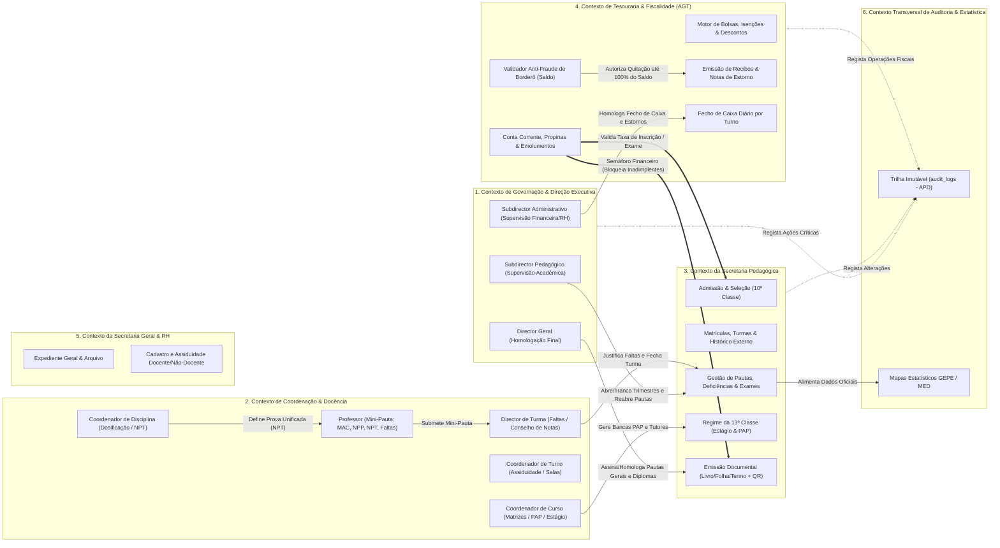
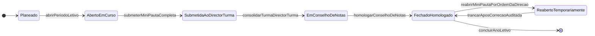
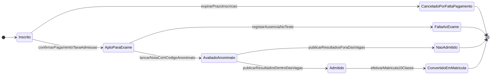
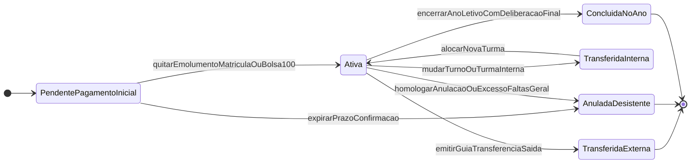
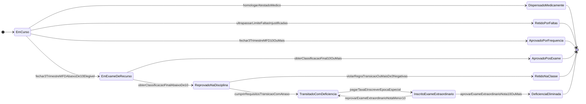
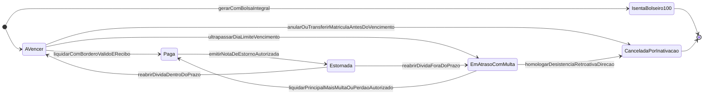
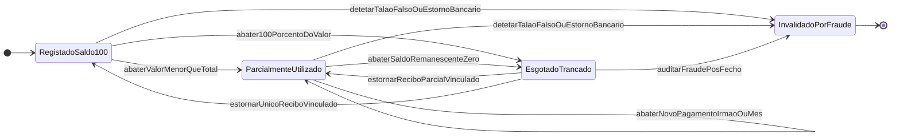

# Documento 01: Engenharia de Domínio (DDD), Estrutura Orgânica (RBAC), Máquinas de Estado e Regras de Negócio Invioláveis

**Projeto:** Sistema de Gestão Escolar (SGE) — Ensino Secundário Técnico-Profissional (II Ciclo)  
**Instituição Alvo:** Instituto Politécnico Católico de Administração e Gestão (IPCAG) N.º 12008 / BGO – *"Nossa Senhora do Rosário"*  
**Localização:** Bairro Modular do Panguila, Município do Dande, Província do Bengo, Angola  
**Tutela Dupla:** Ministério da Educação de Angola (MED) / Governo Provincial do Bengo & Diocese de Caxito (Escola Católica Comparticipada)  
**Enquadramento Legal Principal:**
- **Lei n.º 32/20, de 12 de Agosto:** Lei de Bases do Sistema de Educação e Ensino (altera a Lei n.º 17/16).
- **Decreto Presidencial n.º 167/23:** Regime Jurídico do Subsistema de Ensino Secundário Técnico-Profissional (ESTP).
- **Decreto Presidencial n.º 93/21:** Regulamento sobre os Cargos de Direção e Chefia das Instituições Públicas e Comparticipadas de Ensino.
- **Decreto Executivo n.º 361/26 e Decreto Executivo n.º 136/24:** Normas de Avaliação, Exames de Admissão/Seleção à 10ª Classe e Calendário Escolar Nacional.
- **Decreto Presidencial n.º 292/18 (RJF / AGT):** Regime Jurídico das Faturas e Documentos Equivalentes (Imutabilidade Documental).
- **Lei n.º 22/11, de 17 de Junho (APD):** Lei da Proteção de Dados Pessoais de Angola.

---

## 0. Arquitetura Estratégica de Domínio (DDD Context Mapping)

O domínio do **IPCAG N.º 12008 / BGO** é decomposto em **6 Contextos Delimitados (*Bounded Contexts*)** que refletem fielmente a segregação orgânica exigida pelo **Decreto Presidencial n.º 93/21** e os fluxos operacionais da escola:

### Relações entre Contextos (*Upstream / Downstream*)
1. **Tesouraria (`Upstream`) $\rightarrow$ Secretaria Pedagógica (`Downstream` — *Customer/Supplier com Semáforo de Conformidade*):** A Secretaria Pedagógica depende de um sinal de conformidade financeira emitido em tempo real pela Tesouraria antes de liberar matrículas, inscrições em exames extraordinários, defesas de PAP ou impressão de documentos oficiais (Declarações, Boletins, Certificados e Diplomas).
2. **Coordenação & Docência (`Upstream`) $\rightarrow$ Secretaria Pedagógica (`Downstream`):** Os professores lançam notas (`MAC`, `NPP`, `NPT`) e faltas nas Mini-Pautas; o Director de Turma consolida justificações de faltas e submete a turma ao Conselho de Notas; a Secretaria Pedagógica custodia a Pauta Geral homologada pelo Subdirector Pedagógico e Director Geral.
3. **Secretaria Geral & RH (`Upstream`) $\rightarrow$ Coordenação & Docência (`Downstream`):** Fornece o cadastro ativo de docentes habilitados para atribuição de carga horária nas turmas, mantendo total desacoplamento entre a identidade do professor e a persistência das notas do aluno.

---

## 1. Glossário de Linguagem Ubíqua Angolana (DDD & MED)

Todos os módulos, tabelas de base de dados, classes de código, APIs, relatórios e interfaces do SGE do **IPCAG N.º 12008 / BGO** devem utilizar estritamente os termos definidos neste glossário oficial, sendo proibido o uso de sinónimos estrangeiros ou de outros sistemas educativos (ex.: não usar *"Série"*, *"Bimestre"*, *"Boleto"*, *"Mensalidade Escolar"*, *"Recuperação Final"* ou *"TCC"*).

### 1.1 Estrutura Académica

| Termo Oficial (Linguagem Ubíqua)         | Sigla / Código | Definição Técnica e Regra de Existência no IPCAG N.º 12008 / BGO                                                                                                                                                                                                                                                                                                                                                                                                                                                       |
| :--------------------------------------- | :------------: | :--------------------------------------------------------------------------------------------------------------------------------------------------------------------------------------------------------------------------------------------------------------------------------------------------------------------------------------------------------------------------------------------------------------------------------------------------------------------------------------------------------------------- |
| **Ano Letivo**                           |  `ANO_LETIVO`  | Período temporal oficial definido pelo Calendário Escolar Nacional do MED (ex.: `2026/2027`, tipicamente de Setembro a Julho). É a entidade agregadora de topo da hierarquia operacional. Nenhuma turma, matrícula, pauta ou tabela de emolumentos existe fora de um Ano Letivo.                                                                                                                                                                                                                                       |
| **Trimestre Letivo**                     |  `TRIMESTRE`   | Subdivisão pedagógica obrigatória do Ano Letivo para as classes com letividade regular (10ª, 11ª e 12ª classes), composta estritamente por **I Trimestre**, **II Trimestre** e **III Trimestre**. Cada trimestre possui janelas independentes de abertura e fecho de lançamento de notas (`Mini-Pauta`).                                                                                                                                                                                                               |
| **Curso Técnico**                        |    `CURSO`     | Eixo de formação técnico-profissional de nível médio (II Ciclo do Ensino Secundário Técnico-Profissional — DP n.º 167/23) ministrado no IPCAG (ex.: *Técnico de Contabilidade e Gestão*, *Técnico de Informática de Gestão*, *Técnico de Finanças*, *Técnico de Gestão de Recursos Humanos*, *Técnico de Administração e Serviços*).                                                                                                                                                                                   |
| **Classe**                               |    `CLASSE`    | Grau académico anual dentro de um Curso Técnico. No Ensino Técnico-Profissional angolano compreende obrigatoriamente **4 anos de escolaridade**: **10ª Classe**, **11ª Classe**, **12ª Classe** (classes de regime trimestral letivo) e **13ª Classe** (classe terminal de regime especial dedicada ao Estágio Curricular e à PAP).                                                                                                                                                                                    |
| **Turno**                                |    `TURNO`     | Período diário de funcionamento das atividades letivas para otimização das 12 salas de aula e laboratórios do IPCAG. No instituto operam o **Turno da Manhã** (07h30–12h35) e o **Turno da Tarde** (13h00–18h05), suportando capacidade superior a 1.120 alunos.                                                                                                                                                                                                                                                       |
| **Turma**                                |    `TURMA`     | Agrupamento físico e pedagógico de alunos matriculados no mesmo `Ano Letivo + Curso Técnico + Classe + Turno`, associado a uma sala física fixa (1 a 12) e identificado por código padronizado (ex.: `IG10A-M` = Informática de Gestão, 10ª Classe, Turma A, Turno Manhã). Possui um único **Director de Turma** nomeado.                                                                                                                                                                                              |
| **Matriz Curricular (Plano de Estudos)** |    `MATRIZ`    | Grelha legal aprovada pelo MED para cada par `Curso Técnico + Classe`, definindo o elenco de disciplinas obrigatórias, a componente curricular a que pertencem, o caráter nuclear ou não-nuclear e a carga horária semanal/anual.                                                                                                                                                                                                                                                                                      |
| **Componente Curricular**                |  `COMP_CURR`   | Classificação legal das disciplinas da Matriz Curricular segundo a Lei n.º 32/20 e o DP n.º 167/23, dividida em 3 categorias:  1. **Componente Socio-Cultural** (ex.: Língua Portuguesa, Língua Estrangeira, Formação de Atitudes Integradas/Moral Cristã, Educação Física);  2. **Componente Científica** (ex.: Matemática, Física, Economia, Direito, Informática Aplicada);  3. **Componente Técnica, Tecnológica e Prática** (disciplinas profissionalizantes e laboratoriais específicas de cada curso). |
| **Disciplina Nuclear (Específica)**      | `DISC_NUCLEAR` | Flag booleana crítica (`is_nuclear = TRUE`) atribuída na Matriz Curricular às disciplinas estruturantes da especialidade técnica do curso. Possui poder de veto legal na transição de classe: o aluno **nunca pode transitar com deficiências** se reprovar simultaneamente a **Língua Portuguesa** e a pelo menos **uma Disciplina Nuclear**.                                                                                                                                                                         |
| **Tempos Letivos Semanais**              |  `TEMPOS_SEM`  | Número de aulas semanais (cada tempo letivo = 45 ou 50 minutos) atribuídas a uma disciplina na Matriz Curricular (ex.: 2, 3, 4 ou 6 tempos/semana). Determina diretamente o limite máximo de faltas injustificadas permitido antes da **Retenção por Excesso de Faltas**.                                                                                                                                                                                                                                              |

---

### 1.2 Registo e Vínculo do Estudante

| Termo Oficial (Linguagem Ubíqua) | Sigla / Código | Definição Técnica e Regra de Existência no IPCAG N.º 12008 / BGO |
| :--- | :---: | :--- |
| **Candidato** | `CANDIDATO` | Cidadão inscrito no **Teste de Seleção / Exame de Admissão à 10ª Classe** (regulado pelo DE n.º 361/26 e DE n.º 136/24). Possui registo temporário independente do cadastro definitivo de alunos, recebendo um **Código de Anonimato** para correção cega das provas de admissão. Só se torna `Aluno` se obtiver o estado `Admitido` e efetivar a matrícula. |
| **Aluno (Estudante)** | `ALUNO` | Entidade civil e académica vitalícia no sistema após a primeira matrícula (identificada por Bilhete de Identidade / Cédula Pessoal e **N.º de Processo Individual**). Mantém o mesmo registo único da 10ª à 13ª classe (inclusive em caso de repetência ou reingresso). |
| **Encarregado de Educação** | `ENCARREGADO` | Representante legal responsável pelo aluno perante a Direção do IPCAG e a Tesouraria. Um mesmo Encarregado de Educação (identificado pelo seu BI e telefone) pode ser vinculado a **múltiplos alunos (irmãos/educandos)**, viabilizando o **Desconto Familiar** e a liquidação conjunta de propinas através de um único **Borderô Bancário**. |
| **N.º de Processo Individual** | `NUM_PROCESSO` | Identificador numérico/alfanumérico **único, sequencial e vitalício** atribuído ao aluno no momento do seu primeiro ingresso no IPCAG N.º 12008 / BGO (ex.: `PROC-2026-00412`). Acompanha toda a pasta física e digital do estudante até à emissão do Diploma da 13ª classe e nunca é reutilizado. |
| **N.º de Ordem na Turma (N.º de Chamada)** | `NUM_ORDEM` | Número inteiro sequencial (`1` a `N`) atribuído ao aluno dentro de uma `Turma` específica num determinado `Ano Letivo`. É gerado inicialmente por **ordem alfabética estrita** do nome completo. **Congela obrigatoriamente após o fecho do I Trimestre:** alunos transferidos ou anulados mantêm a sua linha e o seu número fixo na pauta, enquanto matrículas tardias recebem o número `N + 1` no final da lista. |
| **Matrícula (Ingresso Inicial)** | `MATRICULA_INI` | Ato administrativo solene pelo qual um candidato `Admitido` na 10ª classe ou um aluno `Transferido de Entrada` estabelece pela primeira vez o vínculo formal com o IPCAG, gerando o seu `N.º de Processo Individual`. |
| **Confirmação de Matrícula** | `CONF_MATRICULA` | Ato administrativo anual pelo qual um aluno já pertencente ao IPCAG renova o seu vínculo para o novo Ano Letivo (para frequentar a classe seguinte por aprovação/transição com deficiência, para repetir a classe onde ficou retido ou para ingressar na 13ª classe). Preserva inalterado o `N.º de Processo Individual`. |
| **Transcrição de Histórico Externo** | `HIST_EXTERNO` | Registo formal e auditado das médias finais anuais (`MFD`) das disciplinas da 10ª, 11ª ou 12ª classe obtidas pelo aluno noutra instituição de ensino secundário técnico-profissional, comprovadas por **Guia de Transferência Oficial** e **Certificado de Habilitações Parcial**. É obrigatório para que o motor de cálculo consiga apurar a **Média Final do Curso (`MFC`)** na 13ª classe sem lacunas de dados. |

---

### 1.3 Avaliação e Pautas (10ª à 12ª Classe)

| Termo Oficial (Linguagem Ubíqua) | Sigla / Código | Definição Técnica e Regra de Existência no IPCAG N.º 12008 / BGO |
| :--- | :---: | :--- |
| **Média de Avaliações Contínuas** | `MAC` | Nota de `0` a `20` valores que sintetiza o desempenho contínuo do aluno ao longo do trimestre (participação, trabalhos práticos/laboratoriais, tarefas de casa e perguntas orais/escritas). Lançada pelo professor na Mini-Pauta. |
| **Nota da Prova do Professor** | `NPP` | Nota de `0` a `20` valores obtida pelo aluno na avaliação sumativa parcelar elaborada e aplicada pelo próprio docente da disciplina na turma durante o trimestre. |
| **Nota da Prova Trimestral** | `NPT` | Nota de `0` a `20` valores obtida pelo aluno na prova trimestral unificada (elaborada sob supervisão do **Coordenador de Disciplina** e validada pela Subdireção Pedagógica) no final de cada trimestre letivo. |
| **Média Trimestral** | `MT` (`MT1`, `MT2`, `MT3`) | Resultado aritmético do aproveitamento do aluno na disciplina num trimestre específico, calculado pela fórmula oficial `MT = (MAC + NPP + NPT) / 3` e **arredondado ao inteiro mais próximo** (regra *half-up*: parte decimal `>= 0.5` sobe para o inteiro superior). |
| **Média Final da Disciplina (Frequência Anual)** | `MFD` | Média anual de frequência da disciplina no final dos 3 trimestres letivos, calculada por `MFD = (MT1 + MT2 + MT3) / 3`, aplicando-se igualmente o arredondamento oficial do MED (`>= 0.5` arredonda para cima). Se `MFD >= 10` valores (e o aluno não estiver retido por faltas), o aluno está **Aprovado por Frequência**. |
| **Exame de Recurso (Época Normal/Recurso)** | `EXAME_REC` | Avaliação escrita/prática final a que são submetidos os alunos cuja `MFD` seja inferior a `10` valores (dentro dos parâmetros regulamentares de acesso a exame). A classificação final pós-exame pondera **40% da `MFD`** e **60% da Nota do Exame** (`CF = (MFD * 0.4) + (Exame * 0.6)`), arredondada ao inteiro (`>= 0.5`). |
| **Disciplina em Atraso (Deficiência / Cadeira em Atraso)** | `DEFICIENCIA` | Disciplina da 10ª ou 11ª classe na qual o aluno obteve classificação final reprobatória (entre `7` e `9` valores), mas em que a lei lhe permitiu transitar para a classe seguinte em regime de **Transição com Deficiências**. Fica registada como pendência ativa no histórico do aluno até ser aprovada (`>= 10` valores) em **Exame Extraordinário**. |
| **Exame Extraordinário** | `EXAME_EXTRA` | Prova oficial em época especial (autorizada pela Direção e organizada pela Secretaria Pedagógica mediante pagamento de emolumento próprio) destinada exclusivamente à eliminação de **Disciplinas em Atraso (Deficiências)** antes da conclusão da 12ª classe. A nota do Exame Extraordinário deve ser `>= 10` valores para extinguir a deficiência. |
| **Dispensa Médica** | `DISP` | Regime especial de isenção de avaliação prática/física concedido pelo Subdirector Pedagógico (mediante apresentação de Atestado Médico homologado ou Junta Médica arquivada na Secretaria Pedagógica) em disciplinas elegíveis (nomeadamente **Educação Física**). Na pauta exibe a sigla `DISP`, não entra no denominador da média geral, não gera reprovação e não contabiliza como deficiência. |
| **Mini-Pauta** | `MINI_PAUTA` | Mapa oficial de avaliação de **uma única disciplina numa única turma**, contendo a listagem congelada dos alunos (`N.º de Ordem`, `N.º de Processo`, `Nome`, `Género`), as notas dos 3 trimestres (`MAC`, `NPP`, `NPT`, `MT`), faltas justificadas/injustificadas e a `MFD`. Pertence ao vínculo `Turma + Disciplina + Ano Letivo` (e não ao professor). |
| **Pauta Geral (Mapa do Conselho de Notas)** | `PAUTA_GERAL` | Documento mestre consolidado de uma `Turma` que cruza todas as disciplinas da Matriz Curricular para todos os alunos da turma, exibindo as médias trimestrais/finais e deliberando a **Situação Final Anual** de cada aluno (*Aprovado/Transita*, *Transita com Deficiência*, *Retido por Notas*, *Retido por Faltas*, *Transferido*, *Desistente/Anulado*). |
| **Livro, Folha e Termo de Registo** | `LIVRO_FOLHA_TERMO` | Tripla coordenada física obrigatória exigida pelo MED (`Livro n.º X`, `Folha n.º Y`, `Termo n.º Z`) para rastreabilidade em arquivo morto de todos os **Certificados de Habilitações**, **Diplomas de Técnico Médio** e **Termos de Exame / Defesa de PAP** emitidos pela Secretaria Pedagógica. |

---

### 1.4 Regime Especial da 13ª Classe (DP n.º 167/23)

| Termo Oficial (Linguagem Ubíqua) | Sigla / Código | Definição Técnica e Regra de Existência no IPCAG N.º 12008 / BGO |
| :--- | :---: | :--- |
| **Estágio Curricular Supervisionado** | `ESTAGIO_13` | Componente prática obrigatória em contexto real de trabalho (empresa pública/privada, banco, gabinete de contabilidade ou repartição pública parceira do IPCAG) realizada pelo aluno na **13ª Classe**, com carga horária regulamentar e avaliação quantitativa de `0` a `20` valores (`Nota_Estagio`). |
| **Tutor Interno (Professor de Estágio)** | `TUTOR_ESTAGIO` | Docente do quadro do IPCAG designado pela Coordenação de Curso para acompanhar pedagogicamente o aluno estagiário e validar os relatórios periódicos de estágio. |
| **Supervisor de Empresa** | `SUPERVISOR_EXT` | Profissional designado pela instituição/empresa parceira onde decorre o estágio, responsável por atestar a assiduidade prática e emitir o parecer e nota de desempenho do estagiário no local de trabalho. |
| **Prova de Aptidão Profissional** | `PAP` | Projeto técnico-científico final de curso elaborado e defendido publicamente pelo aluno da **13ª Classe** perante uma Banca de Júri, demonstrando domínio das competências técnicas do curso. Avaliada na escala de `0` a `20` valores (`Nota_PAP`), exigindo nota mínima de `10` valores para aprovação. |
| **Professor Orientador (e Co-Orientador)** | `ORIENTADOR_PAP` | Docente especialista do IPCAG nomeado pela Coordenação de Curso para orientar metodológica e tecnicamente a elaboração do trabalho escrito e prático da `PAP`. |
| **Banca de Júri da PAP** | `BANCA_PAP` | Órgão colegial de avaliação da defesa pública da PAP, composto obrigatoriamente por no mínimo 3 membros: **Presidente da Banca**, **1.º Vogal (Arguente)** e **2.º Vogal (Orientador / Especialista)**, cuja avaliação gera a **Ata Oficial de Defesa da PAP**. |
| **Média Final do Curso** | `MFC` | Classificação final de conclusão do Ensino Secundário Técnico-Profissional (II Ciclo), expressa de `10` a `20` valores no Certificado e no Diploma de Técnico Médio, resultante da combinação regulamentar entre a **Média do Plano Curricular (10ª, 11ª e 12ª classes)**, a **Nota do Estágio Curricular Supervisionado** e a **Nota da PAP**. |

---

### 1.5 Financeiro, Tesouraria e Fiscalidade (AGT - DP n.º 292/18)

| Termo Oficial (Linguagem Ubíqua) | Sigla / Código | Definição Técnica e Regra de Existência no IPCAG N.º 12008 / BGO |
| :--- | :---: | :--- |
| **Comparticipação Mensal (Propina)** | `PROPINA` | Prestação financeira mensal em Kwanzas (`AOA`) devida pelo Encarregado de Educação pela frequência letiva do aluno (normalmente distribuída em 10 prestações mensais por Ano Letivo, de Setembro a Junho), sujeita a data limite de vencimento e multa regulamentar por mora. |
| **Emolumento Escolar** | `EMOLUMENTO` | Taxa administrativa tabelada cobrada pela prestação de um ato ou serviço académico específico (ex.: *Taxa de Inscrição no Teste de Admissão*, *Taxa de Matrícula/Confirmação*, *Cartão de Estudante*, *Declaração com/sem Notas*, *Boletim*, *Inscrição em Exame Extraordinário*, *Taxa de Defesa de PAP*, *Certificado/Diploma*). |
| **Bolsa de Estudo, Isenção Diocesana e Desconto Familiar** | `BENEFICIO_FIN` | Regra de abatimento percentual ou fixo (`50%`, `100%`, percentagem de protocolo da Diocese de Caxito, desconto de 2º/3º irmão matriculado ou filho de funcionário do IPCAG) vinculada formalmente à matrícula anual do aluno e autorizada pela Direção Executiva. Deduz automaticamente o valor base das propinas geradas na Conta Corrente. |
| **Conta Corrente do Aluno** | `CONTA_CORRENTE` | Livro-razão financeiro individualizado do aluno por Ano Letivo, onde são lançados todos os débitos (propinas mensais líquidas de bolsa, multas e emolumentos solicitados), créditos (pagamentos por recibo) e eventuais estornos, determinando em tempo real o estado de **Adimplente** ou **Inadimplente**. |
| **Borderô / Talão Bancário (Comprovativo de Operação)** | `BORDERO` | Registo único no sistema de um comprovativo físico ou digital de pagamento bancário (Talão de Depósito, Transferência Bancária IBAN, Comprovativo TPA ou Referência Multicaixa Express). Possui número de operação com restrição `UNIQUE` na base de dados, mais os campos de controlo de saldo **`valor_total_talao`**, **`saldo_utilizado`** e **`saldo_disponivel`**, permitindo quitar múltiplos meses ou propinas de irmãos até esgotar 100% do depósito real. |
| **Recibo Oficial Sequencial** | `RECIBO` | Documento fiscal imutável emitido pela Tesouraria em moeda nacional (`AOA`), com numeração sequencial anual ininterrupta por série (ex.: `RC 2026/00001`). Nunca pode sofrer `UPDATE` de valores nem `DELETE` físico na base de dados (padrão AGT - DP n.º 292/18). |
| **Nota de Estorno / Anulação (Nota de Crédito)** | `ESTORNO` | Único instrumento contabilístico e sistémico legalmente permitido para reverter total ou parcialmente um `Recibo` emitido com erro. Exige justificativa formal, autorização do Subdirector Administrativo, devolve a dívida à Conta Corrente do aluno e recompõe (ou invalida por fraude) o saldo do Borderô associado. |
| **Fecho de Caixa Diário por Turno** | `FECHO_CAIXA` | Operação formal de encerramento do movimento financeiro de um operador de Tesouraria no fim do seu turno (Manhã ou Tarde), gerando o **Mapa Diário de Fecho de Caixa** discriminado por canal de recebimento (**TPA**, **Transferência/Depósito Bancário** e **Multicaixa Express**) para conferência física dos talões e assinatura do Subdirector Administrativo. |

---

## 2. Estrutura Orgânica (DP n.º 93/21) e Matriz de Permissões (RBAC)

Em cumprimento estrito do **Decreto Presidencial n.º 93/21**, o SGE do IPCAG N.º 12008 / BGO implementa **Controlo de Acesso Baseado em Papéis e Escopo (`RBAC + ABAC`)**, garantindo que nenhum operador acumule funções incompatíveis (ex.: quem cobra propinas na Tesouraria não altera notas nem emite certificados; quem lança notas não valida borderôs bancários).

### 2.1 Perfis Oficiais de Utilizador (12 Cargos)

1. **Direção Executiva:**
   - `DIR_GERAL` — **Director Geral:** Autoridade máxima da instituição. Homologa Pautas Gerais finais, assina Diplomas/Certificados, aprova bolsas de estudo/isenções e supervisiona todos os indicadores (GEPE e Financeiros).
   - `SUB_PED` — **Subdirector Pedagógico:** Autoridade máxima pedagógica. Gere a abertura/fecho de trimestres letivos, homologa Matrizes Curriculares, autoriza dispensas médicas (`DISP`), preside ou homologa Conselhos de Notas e é o **único perfil** (junto ao Director Geral) capaz de autorizar a **reabertura temporária de uma pauta fechada** (com registo obrigatório em `audit_logs`).
   - `SUB_ADM` — **Subdirector Administrativo:** Autoridade máxima administrativa e financeira. Configura tabelas de propinas/emolumentos, aprova **Notas de Estorno/Anulação** de recibos, audita e assina os **Mapas de Fecho de Caixa Diário por Turno** e supervisiona o ponto/assiduidade de funcionários.
2. **Secretaria Pedagógica:**
   - `CHEFE_SEC_PED` — **Chefe da Secretaria Pedagógica:** Coordena os serviços académicos, valida transcrições de histórico externo (transferidos de entrada), gere épocas de Exames Extraordinários, controla a atribuição de `Livro, Folha e Termo` e valida a emissão de Certificados, Diplomas e Declarações.
   - `OP_PED` — **Operador da Secretaria Pedagógica:** Executa inscrições do Teste de Admissão, efetiva matrículas e confirmações de matrícula, organiza turmas, anexa documentos ao Processo Individual do aluno e imprime declarações/boletins (quando liberados pelo semáforo financeiro).
3. **Secretaria Geral e Tesouraria:**
   - `CHEFE_SEC_GER` — **Chefe da Secretaria Geral:** Gere o expediente geral, correspondência oficial, cadastro administrativo de professores/funcionários, controlo de assiduidade laboral (ponto) e supervisão operacional da tesouraria.
   - `OP_TES` — **Operador de Caixa / Tesouraria:** Regista e valida Borderôs/Talões Bancários, liquida propinas e emolumentos na Conta Corrente dos alunos, emite Recibos Oficiais e executa o Fecho de Caixa Diário do seu turno.
4. **Coordenações Intermédias e Docentes:**
   - `COORD_CURSO` — **Coordenador de Curso:** Supervisiona o funcionamento técnico de um curso específico (ex.: Informática de Gestão), propõe a distribuição docente, gere os processos da **13ª Classe** (vinculação de empresas de estágio, tutores, orientadores de PAP e composição de Bancas de Júri).
   - `COORD_DISC` — **Coordenador de Disciplina:** Coordena os professores de uma mesma disciplina transversal ou técnica, regista a dosificação trimestral e gere a matriz da **Prova Trimestral Unificada (`NPT`)**.
   - `COORD_TURNO` — **Coordenador de Turno (Manhã / Tarde):** Fiscaliza a pontualidade e assiduidade diária dos professores e alunos no seu turno, gere a ocupação das 12 salas e laboratórios e reporta ocorrências disciplinares.
   - `DIR_TURMA` — **Director de Turma:** Professor designado para liderar uma turma específica. É o único docente com permissão para **registar justificações de faltas** dos alunos da sua turma, consolidar as Mini-Pautas das várias disciplinas da turma e submeter a Pauta Geral ao Conselho de Notas.
   - `PROF` — **Professor (Docente):** Possui acesso restrito às disciplinas e turmas que lhe estão atribuídas no horário letivo atual para lançamento de avaliações (`MAC`, `NPP`, `NPT`) e faltas diárias nas respetivas **Mini-Pautas** enquanto o trimestre estiver aberto.

---

### 2.2 Matriz Completa de Permissões (RBAC)

**Legenda de Operações:**
- **`C`** = Criar / Registar (`Create`)
- **`R`** = Ler / Consultar (`Read` — `R*` indica leitura restrita ao próprio escopo: curso, turno, turma ou disciplina atribuída)
- **`U`** = Editar / Atualizar (`Update` — apenas enquanto o registo não estiver trancado/homologado)
- **`H`** = Homologar / Trancar / Reabrir / Aprovar Exceção (`Homologate / Lock / Unlock`)
- **`A`** = Anular / Estornar com Justificativa Auditada (`Annul / Reverse`)
- **`P`** = Imprimir Documento Oficial / Exportar Mapa (`Print / Export`)
- **`—`** = Sem Acesso (Bloqueado ao nível da API e de *Row-Level Security*)

| Módulo / Recurso / Ação do Sistema | `DIR_GERAL` | `SUB_PED` | `SUB_ADM` | `CHEFE_SEC_PED` | `OP_PED` | `CHEFE_SEC_GER` | `OP_TES` | `COORD_CURSO` | `COORD_DISC` | `COORD_TURNO` | `DIR_TURMA` | `PROF` |
| :--- | :---: | :---: | :---: | :---: | :---: | :---: | :---: | :---: | :---: | :---: | :---: | :---: |
| **1. Configuração de Ano Letivo e Calendário de Trimestres** | `R, H` | `C, R, U, H` | `R` | `R` | `R` | `R` | `R` | `R` | `R` | `R` | `R` | `R` |
| **2. Cursos Técnicos, Classes e Matrizes Curriculares (MED)** | `R, H` | `C, R, U, H` | `R` | `R, P` | `R` | `R` | `—` | `R*, U*` | `R*` | `R` | `R*` | `R*` |
| **3. Turmas, Turnos, Salas (1–12) e Atribuição Docente** | `R, H` | `C, R, U, H` | `R` | `C, R, U, P` | `R, P` | `R` | `—` | `R*, U*` | `R*` | `R*, U*` | `R*` | `R*` |
| **4. Teste de Admissão 10ª Classe (Candidatos e Anonimato)** | `R, H, P` | `R, U, H, P` | `R` | `C, R, U, H, P` | `C, R, U, P` | `R` | `R` *(Taxa)* | `R*` | `R*` | `R*` | `—` | `—` |
| **5. Matrícula, Confirmação e Processo Individual do Aluno** | `R, P` | `R, H, P` | `R` | `C, R, U, H, A, P` | `C, R, U, P` | `R` | `R` *( Básico)* | `R*` | `—` | `R*` | `R*` | `R*` *(Chamada)* |
| **6. Congelamento da Lista de Chamada (`N.º de Ordem`)** | `R, H` | `R, H` | `—` | `R, H, P` | `R, P` | `—` | `—` | `R*` | `—` | `R*` | `R*, P` | `R*, P` |
| **7. Transcrição de Histórico Externo (Guia de Transferência)** | `R, H` | `R, H` | `—` | `C, R, U, H, P` | `C, R` | `—` | `—` | `R*` | `—` | `—` | `R*` | `—` |
| **8. Dispensas Médicas (`DISP` - ex.: Educação Física)** | `R, H` | `R, H` | `—` | `C, R, U, P` | `C, R` | `—` | `—` | `R*` | `R*` | `R*` | `R*` | `R*` |
| **9. Dosificação Trimestral e Prova Unificada (`NPT`)** | `R` | `R, H` | `—` | `R` | `—` | `—` | `—` | `R*` | `C, R*, U*, H` | `—` | `R*` | `R*` |
| **10. Mini-Pauta: Lançamento de Notas (`MAC`, `NPP`, `NPT`)** | `R, P` | `R, H, P` | `—` | `R, P` | `R, P` | `—` | `—` | `R*` | `R*` | `—` | `R*` | `C*, R*, U*, P*` |
| **11. Registo Diário de Faltas de Alunos** | `R` | `R` | `—` | `R` | `R` | `—` | `—` | `R*` | `—` | `R*, U*` | `R*` | `C*, R*, U*` |
| **12. Justificação de Faltas de Alunos** | `R` | `R, H` | `—` | `R, U` | `R` | `—` | `—` | `R*` | `—` | `R*` | `C*, R*, U*, H*` | `R*` |
| **13. Pauta Geral e Fecho de Conselho de Notas** | `R, H, P` | `R, H, P` | `—` | `R, U, P` | `R, P` | `—` | `—` | `R*, P*` | `R*` | `R*` | `R*, U*, H*, P*` | `R*` |
| **14. Reabertura Excecional de Pauta Pós-Fechamento (`Audit`)** | `H` | `H` | `—` | `R` | `—` | `—` | `—` | `—` | `—` | `—` | `—` | `—` |
| **15. Cadeiras em Atraso (Deficiências) e Exame Extraordinário** | `R, H, P` | `R, H, P` | `—` | `C, R, U, H, P` | `C, R, P` | `—` | `R` *(Taxa)* | `R*` | `R*` | `—` | `R*` | `C*, R*` *(Júri)* |
| **16. 13ª Classe: Estágio Supervisionado e Defesa de PAP** | `R, H, P` | `R, H, P` | `—` | `C, R, U, H, P` | `C, R, U, P` | `—` | `R` *(Taxa)* | `C*, R*, U*, H*, P*` | `—` | `—` | `—` | `R*, U*` *(Orient./Júri)* |
| **17. Emissão de Declarações, Boletins, Certificados e Diplomas** | `R, H, P` | `R, H, P` | `—` | `C, R, U, H, A, P` | `C, R, P` | `—` | `—` | `R*` | `—` | `—` | `R*` *(Boletim)* | `—` |
| **18. Tabelas de Propinas, Emolumentos e Multas (`AOA`)** | `R, H` | `R` | `C, R, U, H` | `R` | `R` | `R` | `R` | `—` | `—` | `—` | `—` | `—` |
| **19. Bolsas de Estudo, Isenções Diocesanas e Descontos** | `C, R, U, H, A` | `R` | `C, R, U, H` | `R` | `R` | `R` | `R` | `—` | `—` | `—` | `—` | `—` |
| **20. Registo e Validação de Borderô/Talão Bancário (Saldo)** | `R` | `—` | `R, H, A` | `—` | `—` | `R, U` | `C, R, U` | `—` | `—` | `—` | `—` | `—` |
| **21. Liquidação de Propinas/Emolumentos e Emissão de Recibo** | `R, P` | `—` | `R, P` | `R` *(Status)* | `R` *(Status)* | `R, P` | `C, R, P` | `—` | `—` | `—` | `—` | `—` |
| **22. Nota de Estorno / Anulação de Recibo (Padrão AGT)** | `R, H, A` | `—` | `C, R, H, A, P` | `—` | `—` | `R, P` | `R, P` *(Solicita)* | `—` | `—` | `—` | `—` | `—` |
| **23. Fecho de Caixa Diário por Turno** | `R, P` | `—` | `R, H, P` | `—` | `—` | `R, H, P` | `C, R, P` | `—` | `—` | `—` | `—` | `—` |
| **24. Cadastro de Funcionários/Docentes e Controlo de Ponto** | `R, H` | `R` *(Docentes)* | `C, R, U, H, P` | `R` *(Docentes)* | `—` | `C, R, U, P` | `—` | `R*` | `R*` | `R*, U*` *(Ponto)* | `—` | `R*` *(Próprio)* |
| **25. Mapas Estatísticos Oficiais do GEPE / MED** | `R, H, P` | `R, H, P` | `R, P` | `C, R, P` | `R` | `R, P` | `—` | `R*` | `—` | `—` | `—` | `—` |
| **26. Logs de Auditoria (`audit_logs` - APD Lei n.º 22/11)** | `R, P` | `R` *(Pedag.)* | `R` *(Financ.)* | `—` | `—` | `—` | `—` | `—` | `—` | `—` | `—` | `—` |

---

## 3. Máquinas de Estado (Ciclo de Vida das Entidades)

Nenhuma entidade crítica do SGE pode mudar de estado de forma arbitrária. Toda transição de estado é governada por uma Máquina de Estados Finita (*Finite State Machine - FSM*) validada na camada de domínio e protegida por triggers no PostgreSQL.

---

### 3.1 Máquina de Estado: Hierarquia de 3 Níveis — Trimestre Global, Conselho da Turma e Mini-Pauta (`TRIMESTRE` / `TURMA` / `MINI_PAUTA`)

Para evitar que a reabertura de uma única disciplina afete toda a escola, o controlo de estado opera em **3 níveis desacoplados**:
1. **Nível 1 (Calendário Macro — `trimestres_letivos`):** `Planeado` $\rightarrow$ `Janela Letiva Aberta` $\rightarrow$ `Epoca de Conselhos` $\rightarrow$ `Encerrado Oficialmente`.
2. **Nível 2 (Conselho da Turma — `turmas`):** `Em Lancamento` $\rightarrow$ `Em Conselho de Notas` $\rightarrow$ `Pauta Geral Homologada`.
3. **Nível 3 (Mini-Pauta da Disciplina — `turma_disciplinas`):** `Aberta para Docente` $\rightarrow$ `Submetida ao Director de Turma` $\rightarrow$ `Fechada / Homologada` $\leftrightarrow$ `Reaberta Temporariamente (Despacho)`.

| Estado Origem | Evento / Gatilho | Estado Destino | Quem Dispara (RBAC) | Condições de Guarda (Bloqueios Obrigatórios) |
| :--- | :--- | :--- | :--- | :--- |
| `Planeado` | `abrirPeriodoLetivo` | `Aberto / Em Curso` | `SUB_PED`, `DIR_GERAL` | Matrizes curriculares ativas; turmas criadas; para abrir o II ou III Trimestre, o trimestre imediatamente anterior deve estar em `Encerrado Oficialmente`. |
| `Aberto / Em Curso` | `submeterMiniPautaCompleta` | `Submetida ao Director de Turma` | `PROF` (ou `SUB_PED` em avocação) | A Mini-Pauta daquela `Turma + Disciplina` deve ter 100% dos alunos ativos preenchidos com `MAC`, `NPP` e `NPT` (ou `DISP`), sem células nulas. Bloqueia edição pelo `PROF`. |
| `Submetida ao Director de Turma` | `consolidarTurma` | `Em Conselho de Notas` | `DIR_TURMA`, `SUB_PED` | Exige que **todas** as Mini-Pautas das disciplinas daquela turma estejam no estado `Submetida ao Director de Turma`. |
| `Em Conselho de Notas` | `homologarConselhoDeNotas` | `Fechado / Homologado` | `SUB_PED` + `DIR_GERAL` | Ata do Conselho de Notas validada pelo `DIR_TURMA`; no I Trimestre, dispara automaticamente o **Congelamento Definitivo do `N.º de Ordem na Turma` (`RN-05`)**. |
| `Fechado / Homologado` | `reabrirMiniPautaPorOrdemDaDirecao` | `Reaberto Temporariamente` | Exclusivo `SUB_PED` ou `DIR_GERAL` | Opera cirurgicamente sobre a `Turma + Disciplina` (e opcionalmente `Aluno`) sem abrir as restantes turmas da escola. Exige: (1) Número do Despacho, (2) Motivo detalhado, (3) Prazo de expiração (`1h–48h`). Grava em `audit_logs`. |
| `Reaberto Temporariamente` | `trancarAposCorrecaoAuditada` | `Fechado / Homologado` | `SUB_PED`, `DIR_GERAL` ou Job de Expiração | Regista em `audit_logs` o valor antigo (`old_value`) e o novo valor (`new_value`) de cada nota alterada, recalculando `MT`/`MFD` e incrementando a versão da Mini-Pauta e da Pauta Geral. |

---

### 3.2 Máquina de Estado: Candidatura à 10ª Classe (`CANDIDATURA`) — DE n.º 361/26

| Estado Origem | Evento / Gatilho | Estado Destino | Quem Dispara (RBAC) | Condições de Guarda (Bloqueios Obrigatórios) |
| :--- | :--- | :--- | :--- | :--- |
| `Inscrito` | `confirmarPagamentoTaxaAdmissao` | `Apto para Exame (Taxa Paga)` | `OP_TES` (via Recibo) | Emolumento de inscrição no Teste de Seleção pago e vinculado a recibo ativo. Gera alocação numa das 12 salas e o **Código de Anonimato** criptográfico da prova. |
| `Apto para Exame` | `lancarNotaComCodigoAnonimato` | `Avaliado (Código Anonimato)` | `CHEFE_SEC_PED`, `SUB_PED` | Lançamento das notas de Língua Portuguesa e Matemática/Específica através do Código de Anonimato (sem exibir o nome do candidato ao corretor). |
| `Avaliado (Código Anonimato)` | `publicarResultados` | `Admitido` ou `Não Admitido` | `SUB_PED` + `DIR_GERAL` | Descodificação oficial após trancamento das notas; ordenação decrescente de média até ao limite de vagas do Curso Técnico/Turno escolhido. |
| `Admitido` | `efetivarMatricula10Classe` | `Convertido em Matrícula` | `OP_PED`, `CHEFE_SEC_PED` | Cria automaticamente o registo vitalício de `Aluno`, gera o `N.º de Processo Individual` e abre a `Matrícula` na 10ª classe no estado `Pendente`. |

---

### 3.3 Máquina de Estado: Matrícula Anual (`MATRICULA`)

| Estado Origem | Evento / Gatilho | Estado Destino | Quem Dispara (RBAC) | Condições de Guarda (Bloqueios Obrigatórios) |
| :--- | :--- | :--- | :--- | :--- |
| `Pendente (Aguardando Pagamento Inicial)` | `quitarEmolumentoMatricula` | `Ativa` | Sistema (via `OP_TES`) ou `SUB_ADM` (Bolsa 100%) | Recibo emitido para Taxa de Matrícula/Confirmação + 1ª Propina (Setembro), **ou** Bolsa de 100% homologada. Aloca o aluno na `Turma` e gera as prestações mensais na Conta Corrente. |
| `Ativa` | `emitirGuiaTransferenciaSaida` | `Transferida (Externa)` | `CHEFE_SEC_PED` + `SUB_PED` | Conta Corrente sem dívidas vencidas; cancela automaticamente as propinas vincendas dos meses futuros; se ocorrer após o I Trimestre, **mantém a linha e o `N.º de Ordem` fixos na pauta** com a marcação `TRANSFERIDO`. |
| `Ativa` | `mudarTurnoOuTurmaInterna` | `Transferida (Interna)` $\rightarrow$ `Ativa` | `CHEFE_SEC_PED` + `SUB_PED` | Se ocorrer após o I Trimestre (`RN-05.1`), mantém a posição e o `N.º de Ordem` congelados na turma de origem (`TRANSFERIDO INTERNO`) e aloca na turma de destino com `num_ordem = max + 1`, migrando as notas do I Trimestre. |
| `Ativa` | `homologarAnulacaoOuDesistencia` | `Anulada / Desistente` | `CHEFE_SEC_PED` + `SUB_PED` | Requerimento do Encarregado de Educação ou abandono escolar formalizado; cancela propinas futuras; preserva a linha e o `N.º de Ordem` na pauta como `ANULADO/DESISTENTE`. |
| `Anulada / Desistente` | `reativarMatriculaMesmoAno` | `Ativa` | `SUB_PED` + `DIR_GERAL` | Reingresso excecional na mesma turma dentro do mesmo Ano Letivo (`RN-05.1`): restaura o **mesmo `N.º de Ordem` original congelado** e reativa as propinas vincendas na Conta Corrente. |
| `Ativa` | `encerrarAnoLetivoComDeliberacao` | `Concluída` | Sistema (Fecho da Pauta Geral) | Pauta Geral do III Trimestre/Exames homologada com deliberação final atribuída (`Aprovado`, `Transita com Deficiência` ou `Retido`). |

---

### 3.4 Máquina de Estado: Situação na Disciplina e Cadeiras em Atraso (`SITUACAO_DISCIPLINA`)

| Estado Origem | Evento / Gatilho | Estado Destino | Quem Dispara (RBAC) | Condições de Guarda (Bloqueios Obrigatórios) |
| :--- | :--- | :--- | :--- | :--- |
| `Em Curso` | `homologarAtestadoMedico` | `Dispensado (DISP)` | `SUB_PED` (sob registo de `CHEFE_SEC_PED`) | Apenas para disciplinas elegíveis (ex.: Educação Física) mediante upload/registo de Atestado Médico válido. Impede reprovação e retira a disciplina do divisor da média anual. |
| `Em Curso` | `ultrapassarLimiteFaltas` | `Retido por Faltas` | Sistema (ao gravar faltas) + `DIR_TURMA` | `Total_Faltas_Injustificadas > Limite_Max_Anual` da disciplina (proporcional aos Tempos Letivos Semanais). Bloqueia o cálculo de `MFD` e impede ida a Exame de Recurso. |
| `Em Curso` | `fechar3Trimestre` | `Aprovado (MFD >= 10)` ou `Em Recurso` | Sistema (Conselho de Notas) | Calcula `MFD = round_half_up((MT1 + MT2 + MT3) / 3)`. Se `MFD >= 10`, aprovado direto; se `MFD < 10` (dentro do mínimo legal), transita para `Em Recurso`. |
| `Reprovado na Disciplina` | `deliberarConselhoFinal` | `Transitado com Deficiência (Cadeira em Atraso)` | Motor de Regras do Conselho de Notas | Aplicável apenas na **10ª e 11ª classes**: (1) Nota final entre `7` e `9` valores; (2) Total de disciplinas reprovadas no ano `<= Limite_Transicao` (2, ou 3 conforme regime aplicável); (3) **NÃO reprovou simultaneamente a Língua Portuguesa E a uma Disciplina Nuclear (`is_nuclear = TRUE`)**. |
| `Transitado com Deficiência` | `pagarTaxaEInscreverExame` | `Inscrito em Exame Extraordinário` | `OP_PED` + Semáforo `OP_TES` | Época de Exame Extraordinário aberta pelo `SUB_PED` e emolumento de inscrição por cadeira em atraso pago na Tesouraria. |
| `Inscrito em Exame Extraordinário` | `lancarNotaExameExtra` | `Deficiência Eliminada` (se `>= 10`) ou retorna a `Transitado com Deficiência` (se `< 10`) | `CHEFE_SEC_PED` + `SUB_PED` | Exige registo do Termo de Exame (`Livro, Folha, Termo`). Enquanto não atingir `Deficiência Eliminada`, **bloqueia a conclusão da 12ª classe e a matrícula na 13ª classe**. |

---

### 3.5 Máquina de Estado: Processo da 13ª Classe — Estágio + PAP (`PROCESSO_13_CLASSE`)

```mermaid
stateDiagram-v2
    direction LR
    [*] --> BloqueadoCadeirasEmAtraso
    BloqueadoCadeirasEmAtraso --> AptoPara13Classe: validar10a12ConcluidasSemDeficiencias
    AptoPara13Classe --> EmEstagioEElaboracaoPAP: alocarEmpresaEstagioEOrientadorPAP
    EmEstagioEElaboracaoPAP --> AptoParaDefesaPAP: homologarNotaEstagioEPagarTaxaDefesa
    AptoParaDefesaPAP --> DefendidoEHomologado: registarAtaBancaJuriECalcularMFC
    AptoParaDefesaPAP --> ReprovadoEmPAP: obterNotaPAPAbaixoDe10
    ReprovadoEmPAP --> AptoParaDefesaPAP: reinscreverNovaEpocaDefesaPAP
    DefendidoEHomologado --> DiplomaCertificadoEmitido: atribuirLivroFolhaTermoEImprimirComQR
    DiplomaCertificadoEmitido --> [*]
```

| Estado Origem | Evento / Gatilho | Estado Destino | Quem Dispara (RBAC) | Condições de Guarda (Bloqueios Obrigatórios) |
| :--- | :--- | :--- | :--- | :--- |
| `Bloqueado (Possui Cadeiras em Atraso)` | `validar10a12Concluidas` | `Apto para 13ª Classe` | Sistema (Validador de Currículo) | 100% das disciplinas da Matriz Curricular da 10ª, 11ª e 12ª classes aprovadas (ou com `Transcrição de Histórico Externo` validada) e **ZERO (`0`) disciplinas em estado `Transitado com Deficiência`**. |
| `Apto para 13ª Classe` | `alocarEstagioEPAP` | `Em Estágio / Elaboração de PAP` | `COORD_CURSO` + `CHEFE_SEC_PED` | Matrícula na 13ª classe ativa; designação formal de: (1) Empresa Parceira + Supervisor Externo + Tutor Interno (Estágio) e (2) Tema da PAP + Professor Orientador. |
| `Em Estágio / Elaboração de PAP` | `prepararDefesaPublica` | `Apto para Defesa` | `COORD_CURSO` + Semáforo `OP_TES` | Exige cumulativamente: (1) `Nota_Estagio >= 10` lançada e homologada; (2) Parecer favorável do Orientador da PAP; (3) Banca de Júri constituída (Presidente + Vogais + Data/Sala); (4) Conta Corrente sem propinas em atraso e Emolumento de Defesa de PAP pago. |
| `Apto para Defesa` | `registarAtaDefesaPAP` | `Defendido e Homologado` | `COORD_CURSO` + `SUB_PED` + `DIR_GERAL` | Ata de Defesa da PAP assinada com `Nota_PAP >= 10` valores; dispara automaticamente o cálculo da **Média Final do Curso (`MFC`)**. |
| `Defendido e Homologado` | `emitirDiplomaECertificado` | `Diploma/Certificado Emitido` | `CHEFE_SEC_PED` + `DIR_GERAL` | Emolumento de Certificado/Diploma pago; preenchimento obrigatório de `Livro n.º X, Folha n.º Y, Termo n.º Z` e geração do hash/QR Code de verificação pública. |

---

### 3.6 Máquina de Estado: Propina / Mensalidade (`PROPINA_MENSAL`)

| Estado Origem | Evento / Gatilho | Estado Destino | Quem Dispara (RBAC) | Condições de Guarda (Bloqueios Obrigatórios) |
| :--- | :--- | :--- | :--- | :--- |
| `[Criação da Matrícula]` | `gerarPlanoPropinas` | `A Vencer` ou `Isenta (Bolseiro 100%)` | Motor Financeiro | Se o aluno possui Bolsa de 100%, a prestação já nasce `Isenta (0,00 Kz)`. Se possui Bolsa parcial (ex.: 50%) ou Desconto Familiar, nasce `A Vencer` pelo valor líquido já deduzido. |
| `A Vencer` | `ultrapassarDiaLimiteVencimento` | `Em Atraso (com Multa)` | Job Diário / Motor de Conta Corrente | Data atual `> Data_Limite_Vencimento` (ex.: dia 10 ou 15 do mês). Aciona automaticamente o **Semáforo Financeiro Vermelho** para o aluno e adiciona o encargo de mora parametrizado. |
| `A Vencer` / `Em Atraso` | `liquidarPropina` | `Paga` | `OP_TES` | Exige associação a pelo menos um `Borderô / Talão Bancário` com `saldo_disponivel >= valor_a_pagar`, gerando um `Recibo Oficial Sequencial` em `AOA`. |
| `Paga` | `emitirNotaDeEstorno` | `Estornada` | `SUB_ADM` / `DIR_GERAL` | Proibido apagar o recibo original. A emissão da **Nota de Estorno** marca a prestação como `Estornada` e recria/reabre a obrigação financeira na Conta Corrente (`A Vencer` ou `Em Atraso`). |
| `A Vencer` | `anularOuTransferirMatricula` | `Cancelada (por Anulação/Transferência)` | Sistema (ao inativar Matrícula) | Quando a matrícula do aluno muda para `Transferida (Externa)` ou `Anulada / Desistente`, todas as prestações dos meses **subsequentes** ainda não vencidas passam para `Cancelada`, evitando inflacionar falsamente a inadimplência da escola. |

---

### 3.7 Máquina de Estado: Borderô / Talão Bancário Anti-Fraude (`BORDERO_BANCARIO`)

| Estado Origem | Evento / Gatilho | Estado Destino | Quem Dispara (RBAC) | Condições de Guarda (Bloqueios Obrigatórios) |
| :--- | :--- | :--- | :--- | :--- |
| `[Novo Talão]` | `registarBorderoBancario` | `Registado (Saldo Disponível = 100%)` | `OP_TES` | Valida constraint `UNIQUE (banco_id, numero_operacao_bordero)` e integridade de `data_hora_operacao`. Define `valor_total_talao > 0`, `saldo_utilizado = 0` e `saldo_disponivel = valor_total_talao`. |
| `Registado (100%)` / `Parcialmente Utilizado` | `alocarSaldoEmRecibo` | `Parcialmente Utilizado` (se `saldo_disponivel > 0`) ou `Esgotado / Trancado` (se `saldo_disponivel == 0`) | Motor de Tesouraria (`OP_TES`) | Condição atómica (`SELECT ... FOR UPDATE`): `valor_alocado <= saldo_disponivel`. Permite que um único talão verdadeiro pague vários meses ou propinas de **2 ou mais irmãos**. Assim que `saldo_disponivel == 0,00 Kz`, o talão transita para `Esgotado / Trancado` e rejeita qualquer nova tentativa de uso. |
| `Registado` / `Parcialmente Utilizado` / `Esgotado` | `declararFraudeBancaria` | `Invalidado por Fraude` | `SUB_ADM`, `DIR_GERAL` | Caso a reconciliação bancária detete comprovativo adulterado/falso: bloqueia permanentemente o borderô, gera automaticamente **Notas de Estorno** para todos os recibos que usaram esse borderô, reabre as dívidas nas Contas Correntes dos alunos envolvidos e grava alerta crítico em `audit_logs`. |

---

## 4. Regras de Negócio Invioláveis (As Leis do Sistema)

As regras abaixo constituem invariantes de domínio do **SGE — IPCAG N.º 12008 / BGO**. Devem ser implementadas tanto na camada de domínio da aplicação (serviços/use cases) quanto ao nível de constraints, triggers e funções no banco de dados PostgreSQL.

---

### RN-01: Fórmulas Oficiais de Avaliação e Regra Estrita de Arredondamento MED (`10ª à 12ª Classe`)

1. **Escala de Avaliação:** Todas as notas parcelares (`MAC`, `NPP`, `NPT`), médias (`MT`, `MFD`), exames (`Exame_Recurso`, `Exame_Extraordinario`), estágio (`Nota_Estagio`) e `PAP` são expressas na escala numérica de **`0` a `20` valores**.
2. **Função Oficial de Arredondamento do MED (`round_med` — *Half-Up*):**
   - Qualquer média intermédia (`MT1`, `MT2`, `MT3`) ou final (`MFD`, `CF_Exame`, `MFC`) é arredondada para o número inteiro imediatamente superior sempre que a parte fracionária (decimal) seja **maior ou igual a `0,5`**, e para o inteiro inferior quando a parte fracionária seja **estritamente menor que `0,5`**.
   - Definição formal para $x \ge 0$:
     $$\text{round\_med}(x) = \lfloor x + 0,5 \rfloor$$
   - *Exemplos obrigatórios:* `9,49` $\rightarrow$ `9` valores; `9,50` $\rightarrow$ `10` valores; `13,666...` $\rightarrow$ `14` valores.
3. **Cálculo da Média Trimestral (`MT`):**
   - Para cada trimestre $t \in \{1, 2, 3\}$:
     $$MT_t = \text{round\_med}\left(\frac{MAC_t + NPP_t + NPT_t}{3}\right)$$
   - **Nota:** O cálculo da `MFD` utiliza obrigatoriamente os valores inteiros já arredondados de $MT_1$, $MT_2$ e $MT_3$ (tal como constam impressos nas colunas da Mini-Pauta oficial do MED).
4. **Cálculo da Média Final da Disciplina (`MFD` — Frequência Anual):**
   $$MFD = \text{round\_med}\left(\frac{MT_1 + MT_2 + MT_3}{3}\right)$$
   - Se $MFD \ge 10$ valores (e o aluno não estiver retido por faltas), o aluno está **Aprovado por Frequência** com classificação final da disciplina $CFD = MFD$.
5. **Cálculo da Classificação Final após Exame de Recurso (`CF_Exame`):**
   - Quando o aluno vai a Exame de Recurso ($MFD < 10$ e elegível), a ponderação legal é de **40% para a frequência (`MFD`)** e **60% para a prova de exame (`Nota_Exame`)**:
     $$CF_{\text{Exame}} = \text{round\_med}\left((MFD \times 0,40) + (\text{Nota\_Exame} \times 0,60)\right)$$
   - Se $CF_{\text{Exame}} \ge 10$ valores, o aluno fica **Aprovado em Exame** ($CFD = CF_{\text{Exame}}$). Caso contrário, fica **Reprovado na Disciplina** ($CFD = CF_{\text{Exame}}$).
6. **Tratamento Matemático de Dispensa Médica Anual e Parcial (`DISP` — `RN-01.1`):**
   - Se o aluno possui estado `DISP` homologado numa disciplina (ex.: Educação Física) durante os 3 trimestres (ou em 2 dos 3 trimestres por incapacidade prolongada), os campos `MAC`, `NPP`, `NPT`, `MT` e `MFD` assumem `NULL` numérico e apresentação textual `'DISP'`. Ao calcular a Média Anual da Classe (para compor a `MFC`), o denominador $D$ do somatório de disciplinas da classe é reduzido no número exato de disciplinas com `DISP` ($D_{\text{efetivo}} = D_{\text{total}} - D_{\text{DISP}}$), garantindo neutralidade matemática absoluta.
   - **Dispensa Médica Parcial de 1 Único Trimestre (`RN-01.1`):** Se o aluno foi regularmente avaliado em 2 trimestres (ex.: obteve $MT_1$ e $MT_3$) e obteve `DISP` homologada apenas num único trimestre (ex.: II Trimestre por fratura temporária), a `MFD` é apurada dividindo a soma dos trimestres efetivamente avaliados por **`2`**: $MFD = \text{round\_med}((MT_1 + MT_3) / 2)$.

---

### RN-02: Regra de Transição de Classe, Retenção e Cadeiras em Atraso (Deficiências)

No encerramento do Conselho de Notas do III Trimestre (pós-Exames de Recurso), o motor de deliberação executa o seguinte algoritmo determinístico para cada aluno da **10ª, 11ª e 12ª classes**:

1. **Contagem de Reprovações ($N_{\text{rep}}$):** Conta todas as disciplinas da Matriz Curricular da classe em que o aluno ficou com $CFD < 10$ valores ou `Retido por Faltas`.
2. **Caso 1 — Aprovação Limpa ($N_{\text{rep}} = 0$):**
   - Na 10ª e 11ª classes: deliberação = **`Transita (Aprovado)`**.
   - Na 12ª classe: se o aluno também tiver **`0` Cadeiras em Atraso pendentes** de anos anteriores (10ª/11ª), deliberação = **`Aprovado (Apto para a 13ª Classe)`**.
3. **Caso 2 — Retenção Automática na 12ª Classe ou por Nota Inferior a 7 Valores:**
   - Na **12ª Classe**, não existe transição com cadeiras em atraso para a 13ª classe: qualquer reprovação não sanada em exame retém o aluno na 12ª classe (ou em regime de repetição das disciplinas reprovadas).
   - Na **10ª e 11ª Classes**, se qualquer disciplina reprovada tiver nota final $CFD < 7$ valores (ou `Retido por Faltas` sem direito a deficiência), ou se $N_{\text{rep}}$ ultrapassar o teto legal parametrizado na matriz (padrão MED: máximo de `2` disciplinas reprovadas; ou `3` quando autorizado por normativo específico do ano letivo), a deliberação é **`Não Transita (Retido)`**.
4. **Caso 3 — Veto Absoluto de Língua Portuguesa + Disciplina Nuclear (Regra de Ouro MED):**
   - Mesmo que o aluno da 10ª ou 11ª classe tenha apenas $N_{\text{rep}} = 2$ disciplinas reprovadas com notas entre `7` e `9` valores, o sistema verifica:
     $$\text{Veto\_Nuclear} = (\text{Reprovou em Língua Portuguesa}) \land (\exists d \in \text{Reprovadas} : d.\text{is\_nuclear} = \text{TRUE})$$
   - Se $\text{Veto\_Nuclear} = \text{TRUE}$, a transição é **estritamente proibida** e o aluno recebe a deliberação **`Não Transita (Retido por LP + Nuclear)`**.
5. **Caso 4 — Transição com Deficiências (Cadeiras em Atraso):**
   - Se o aluno da 10ª ou 11ª classe tem $1 \le N_{\text{rep}} \le \text{Limite\_Max\_Deficiencias}$ (notas entre `7` e `9` valores) e $\text{Veto\_Nuclear} = \text{FALSE}$, a deliberação é **`Transita com Deficiência`**.
   - O sistema cria automaticamente registos na tabela de **Disciplinas em Atraso (`cadeiras_em_atraso`)** vinculados ao `N.º de Processo Individual` do aluno.
6. **Eliminação de Cadeiras em Atraso e Bloqueio da 13ª Classe:**
   - As Cadeiras em Atraso da 10ª e 11ª classes têm obrigatoriamente de ser eliminadas através de **Exame Extraordinário** (nota $\ge 10$ valores) até ao encerramento da 12ª classe.
   - **Trava Inviolável:** O sistema bloqueia de forma absoluta a transição do aluno para o estado `Apto para 13ª Classe` (Estágio e PAP) enquanto existir $\ge 1$ registo de Cadeira em Atraso com estado diferente de `Deficiência Eliminada`.
7. **Regime Curricular do Aluno Repetente (`RN-02.1`):**
   - Quando o aluno obtém a deliberação **`Não Transita (Retido)`** na 10ª, 11ª ou 12ª classe e confirma matrícula no Ano Letivo seguinte para repetir a classe, ele frequenta integralmente o plano curricular da classe repetida (nova matrícula anual), **preservando intactas** as médias finais das classes anteriores já concluídas com aproveitamento e mantendo ativas eventuais `cadeiras_em_atraso` de classes anteriores até à sua eliminação em Exame Extraordinário.

---

### RN-03: Regra de Retenção por Faltas Injustificadas

1. **Proporcionalidade à Carga Horária Semanal:** O limite máximo anual de faltas injustificadas numa disciplina ($\text{Limite\_Faltas}_d$) é diretamente proporcional ao número de **Tempos Letivos Semanais** ($T_{\text{sem}}$) dessa disciplina na Matriz Curricular:
   $$\text{Limite\_Faltas}_d = F_{\text{mult}} \times T_{\text{sem}}$$
   *(onde $F_{\text{mult}}$ é o fator regulamentar parametrizado na matriz do Ano Letivo, p. ex. $F_{\text{mult}} = 3$ ou $4$ vezes o número de tempos semanais).*
2. **Justificação de Faltas pelo Director de Turma:**
   - O professor da disciplina regista a ausência na aula (`Falta Presencial`).
   - Apenas o **Director de Turma (`DIR_TURMA`)** ou a **Secretaria Pedagógica / Subdireção Pedagógica** pode converter uma falta em `Falta Justificada` dentro do prazo regulamentar mediante apresentação de justificativo válido.
3. **Efeito Automático do Excesso de Faltas:**
   - Assim que $\text{Total\_Faltas\_Injustificadas}_d > \text{Limite\_Faltas}_d$, o estado do aluno nessa disciplina passa automaticamente para **`Retido por Faltas (RF)`**, anulando o direito à aprovação por frequência ou acesso ao Exame de Recurso nessa disciplina.

---

### RN-04: Desacoplamento Professor ↔ Notas (Continuidade em Substituição Docente e Avocação)

1. **Propriedade Estrutural das Avaliações:** Na arquitetura de dados, nenhum registo de nota (`MAC`, `NPP`, `NPT`) ou falta possui chave estrangeira estrutural de propriedade para a tabela de professores. A chave única de qualquer avaliação é estritamente:
   $$\text{UNIQUE}(\text{matricula\_id}, \text{turma\_disciplina\_id}, \text{trimestre})$$
2. **Rastreabilidade de Autoria por Metadados:** A tabela de avaliações armazena `lancado_por_usuario_id`, `atualizado_por_usuario_id` e `professor_titular_no_momento_id` apenas como atributos de auditoria.
3. **Substituição Docente Transparente:** Quando um professor adoece, é transferido ou substituído a meio do Ano Letivo, o Subdirector Pedagógico encerra a alocação do `Professor A` na tabela `alocacoes_docentes` (com `data_fim`) e cria uma nova alocação para o `Professor B` (com `data_inicio`) na mesma `turma_disciplina_id`. O `Professor B` passa imediatamente a visualizar e editar a **mesma Mini-Pauta** com todo o histórico do I e II Trimestres intacto.
4. **Avocação Excecional de Mini-Pauta pela Subdireção Pedagógica (`RN-04.1`):** Caso o professor titular tenha saído da instituição (abandono, transferência, doença grave ou falecimento) sem substituto ativo no momento do Conselho de Notas ou durante uma janela de `Reabertura Excecional de Pauta`, o **`SUB_PED`** pode avocar temporariamente a Mini-Pauta e executar o lançamento/correção diretamente a partir das provas físicas arquivadas, gravando obrigatoriamente o evento `AVOCACAO_LANCAMENTO_SUB_PED` e o número do despacho em `audit_logs`.

---

### RN-05: Dupla Numeração do Aluno e Congelamento da Lista de Chamada

1. **N.º de Processo Individual (`num_processo`):** Gerado uma única vez na vida académica do estudante no IPCAG N.º 12008 / BGO (`UNIQUE NOT NULL`). Nunca muda quando o aluno muda de turma, de turno ou de classe.
2. **N.º de Ordem na Turma (`num_ordem_turma`):**
   - Enquanto o I Trimestre está em fase de `Planeado` / início de aulas, a lista nominal da turma pode ser reordenada alfabeticamente (`A` a `Z`), atribuindo `1..N`.
   - **Gatilho de Congelamento (`lista_chamada_congelada = TRUE`):** No fecho do I Trimestre (ou por comando explícito da Secretaria Pedagógica após o encerramento das matrículas iniciais), o campo `num_ordem_turma` de todos os alunos daquela turma torna-se **imutável**.
   - **Regra para Alunos Transferidos ou Desistentes Pós-Congelamento:** O aluno **não é removido** da Mini-Pauta nem da Pauta Geral. A sua linha permanece exatamente na posição `k` original, com as células de notas dos trimestres seguintes bloqueadas e a indicação transversal `TRANSFERIDO` ou `ANULADO`, garantindo que o colega de número `k + 1` nunca mude de número a meio do ano.
   - **Regra para Matrículas Tardias / Transferidos de Entrada Pós-Congelamento:** Qualquer aluno admitido na turma após o congelamento da chamada recebe obrigatoriamente:
     $$\text{num\_ordem\_novo} = \max(\text{num\_ordem\_turma}) + 1$$
     sendo acrescentado no final da pauta, independentemente da letra inicial do seu nome.
   - **Transferência Interna de Turma/Turno e Reativação no Mesmo Ano Letivo (`RN-05.1`):**
     - *Mudança Interna de Turma/Turno Pós-Congelamento:* Se o aluno mudar da Turma A (Manhã) para a Turma B (Tarde) após o fecho do I Trimestre, a sua linha e `N.º de Ordem` na Turma A permanecem congelados com o estado `TRANSFERIDO INTERNO (PARA TURMA B)`, enquanto na Turma B o aluno recebe `num_ordem = max + 1` e herda automaticamente as notas do I Trimestre.
     - *Reativação de Matrícula Anulada na Mesma Turma:* Se um aluno cuja matrícula foi `Anulada / Desistente` obtiver despacho da Direção para reingressar na **mesma turma e no mesmo Ano Letivo**, o sistema restaura o seu **`N.º de Ordem` original congelado** (não duplicando linha no final da lista) e reativa as propinas correspondentes na Conta Corrente.

---

### RN-06: Transcrição de Histórico Externo e Cálculo da Média Final do Curso (`MFC` — 13ª Classe)

1. **Transcrição Obrigatória para Transferidos de Entrada (Classes Anteriores e Trimestres Parciais — `RN-06.1`):**
   - Quando um aluno ingressa no IPCAG na 11ª, 12ª ou 13ª classe vindo de outra escola técnica (com Guia de Transferência), a Secretaria Pedagógica é obrigada a preencher o módulo de **Transcrição de Histórico Externo**, registando as notas finais (`MFD`) de cada disciplina das classes anteriores (10ª e/ou 11ª) e anexando o PDF digitalizado do certificado/guia original.
   - **Transferência Tardia no Decurso do Ano Letivo (`RN-06.1`):** Se o aluno ingressar por transferência no início do II ou III Trimestre, o módulo permite igualmente transcrever as Médias Trimestrais (`MT1` e/ou `MT2`) trazidas na Guia de Transferência oficial para a `avaliacoes_trimestrais` do ano corrente (com `origem_nota = 'GUIA_TRANSFERENCIA_EXTERNA'`), viabilizando o cálculo normal da `MFD` no final do III Trimestre.
   - O sistema unifica, numa vista lógica contínua (`vw_curriculo_consolidado_aluno`), as notas obtidas internamente no IPCAG, as deficiências eliminadas em Exame Extraordinário e as notas transcritas externamente.
2. **Fórmula da Média Final do Curso (`MFC`) na 13ª Classe (DP n.º 167/23):**
   - Seja $MA_{10}$, $MA_{11}$ e $MA_{12}$ a média aritmética das classificações finais de todas as disciplinas válidas (excluindo `DISP`) da 10ª, 11ª e 12ª classes, respetivamente.
   - A **Média do Plano Curricular (`MPC`)** das três classes letivas é:
     $$MPC = \text{round\_med}\left(\frac{MA_{10} + MA_{11} + MA_{12}}{3}\right)$$
   - Após a homologação da **Nota do Estágio Curricular Supervisionado (`NE`)** e da **Nota da Prova de Aptidão Profissional (`NPAP`)**, a **Média Final do Curso (`MFC`)** é apurada segundo a ponderação legal parametrizada na Matriz do Curso (fórmula canónica do Ensino Técnico-Profissional):
     $$MFC = \text{round\_med}\left(\frac{(MPC \times P_{MPC}) + (NE \times P_{NE}) + (NPAP \times P_{NPAP})}{P_{MPC} + P_{NE} + P_{NPAP}}\right)$$
     *(suportando a configuração padrão do MED, ex.: média ponderada entre `MPC`, `NE` e `NPAP`, como $\frac{2 \cdot MPC + NE + NPAP}{4}$ ou $\frac{MPC + NE + NPAP}{3}$ conforme despacho curricular vigente no curso, sempre encerrada por `round_med`).*

---

### RN-07: Gestão de Bolsas de Estudo, Isenções Diocesanas e Descontos Familiares (Vigência Temporal `1:N`)

1. **Tipologia de Benefícios Suportados:**
   - `BOLSA_100`: Isenção integral (100%) de propinas (ex.: mérito académico, órfãos assistidos pela Diocese de Caxito).
   - `BOLSA_50` / `BOLSA_PARCIAL`: Abatimento percentual configurável (ex.: 50%, 25%).
   - `DESCONTO_IRMAOS`: Abatimento progressivo automático quando 2 ou mais alunos ativos partilham o mesmo `encarregado_educacao_id` no mesmo Ano Letivo.
   - `FILHO_FUNCIONARIO`: Isenção ou desconto regulamentar para dependentes diretos de docentes e funcionários ativos do IPCAG.
2. **Cálculo Transparente e Histórico de Vigência (`1:N` por Matrícula):**
   - Toda prestação mensal gerada na Conta Corrente armazena explicitamente três valores imutáveis para auditoria:
     $$\text{Valor\_Liquido\_A\_Pagar} = \text{Valor\_Bruto\_Tabela} - \text{Valor\_Desconto\_Bolsa}$$
   - Uma matrícula pode ter histórico de benefícios ao longo do ano (`1:N` em `beneficios_bolsas_matricula` com `mes_inicio_vigencia` e `mes_fim_vigencia`, sendo apenas `1` ativo por mês). Se um benefício for concedido, alterado ou revogado a meio do ano letivo por despacho da Direção, a alteração aplica-se apenas às prestações vincendas (`A Vencer`), preservando intactos os recibos dos meses passados.

---

### RN-08: Interligação Tesouraria ↔ Secretaria Pedagógica (Semáforo Financeiro Automático)

O SGE aplica uma função de verificação em tempo real `fn_verificar_aptidao_financeira(aluno_id, tipo_servico)` antes de qualquer ato da Secretaria Pedagógica:

1. **Condição 1 — Adimplência de Propinas:**
   - Verifica se o aluno possui alguma propina no estado `Em Atraso (com Multa)` na sua Conta Corrente (incluindo dívidas reabertas por estorno de anos letivos anteriores).
   - *Exceção Automática:* Alunos com `BOLSA_100` ativa têm as suas prestações no estado `Isenta`, retornando sempre `Adimplente = TRUE`.
2. **Condição 2 — Liquidação do Emolumento Específico:**
   - Para atos individuais sujeitos a taxa (emissão de Declaração, Boletim de 2ª via, Certificado, Diploma, Inscrição em Exame Extraordinário, Defesa de PAP), exige a referência de um `item_recibo` pago e não estornado correspondente àquele pedido (salvo se o documento for coletivo/isento por tabela ou se o aluno possuir isenção integral de emolumentos homologada).
3. **Efeito do Bloqueio:**
   - Se `Condição 1 = FALSE` ou `Condição 2 = FALSE`, o botão de emissão/impressão do documento oficial na Secretaria Pedagógica fica **fisicamente bloqueado ao nível de API (`HTTP 403 Forbidden - Pendência Financeira`)**, exibindo apenas o código da pendência para que o Encarregado de Educação se dirija à Tesouraria.

---

### RN-09: Imutabilidade Fiscal (AGT - DP n.º 292/18), Anti-Fraude de Borderô por Saldo e Fecho de Caixa

1. **Imutabilidade Absoluta de Recibos (`AOA`):**
   - A tabela `recibos_oficiais` possui uma *trigger* PostgreSQL (`trg_prevent_recibo_mutation`) que bloqueia qualquer instrução `DELETE` e qualquer `UPDATE` nos campos financeiros (`valor_total`, `aluno_id`, `data_emissao`, `numero_sequencial`).
   - A numeração dos recibos é sequencial e sem buracos dentro da série anual (ex.: `RC IPCAG2026/000001`).
   - Qualquer erro de lançamento só pode ser corrigido emitindo uma **Nota de Estorno (`NE IPCAG2026/000001`)** autorizada pelo `SUB_ADM`.
2. **Motor Anti-Fraude de Borderô / Talão Bancário com Controlo de Saldo (`1:N` e `N:M` — `RN-09.1`):**
   - A chave composta `(banco_id, numero_operacao_bordero)` possui constraint `UNIQUE` na base de dados.
   - Em vez de bloquear cegamente um talão após o 1º recibo (o que impediria um pai de pagar os 2 filhos num único depósito bancário), o sistema valida a invariante matemática:
     $$\sum_{i=1}^{k} \text{Valor\_Alocado\_Recibo}_i = \text{saldo\_utilizado} \le \text{valor\_total\_talao}$$
     $$\text{saldo\_disponivel} = \text{valor\_total\_talao} - \text{saldo\_utilizado}$$
   - **Caso 1 — Rateio para Múltiplos Irmãos ou Meses (`1 Borderô -> N Recibos`):** Se a propina mensal custa `15.000,00 Kz` e o Encarregado deposita `30.000,00 Kz` num único talão bancário para pagar os seus 2 filhos:
     - No **Recibo do Irmão 1**, o operador vincula o borderô e aloca `15.000,00 Kz` $\rightarrow$ o borderô fica `Parcialmente Utilizado` com `saldo_disponivel = 15.000,00 Kz`.
     - No **Recibo do Irmão 2**, o operador informa o mesmo número de borderô; o sistema aloca os restantes `15.000,00 Kz` $\rightarrow$ o borderô atinge `saldo_disponivel = 0,00 Kz` e muda imediatamente para **`Esgotado / Trancado`**.
   - **Caso 2 — Sobra / Crédito Residual em Borderô (`RN-09.1`):** Se o Encarregado depositar `20.000,00 Kz` num ATM para pagar uma propina de `15.000,00 Kz`, o recibo é emitido por `15.000,00 Kz` e os `5.000,00 Kz` excedentes permanecem guardados em `saldo_disponivel_kz` no Borderô para abater na propina do mês seguinte.
   - **Caso 3 — Pagamento Combinado (`N Borderôs -> 1 Recibo`):** Através da tabela associativa `alocacoes_saldo_bordero`, um único recibo também pode ser liquidado somando o saldo disponível de 2 ou mais comprovativos bancários distintos (ex.: sobra de `5.000,00 Kz` do Borderô A + `10.000,00 Kz` do Borderô B = Recibo de `15.000,00 Kz`).
   - Se qualquer operador tentar usar um borderô já `Esgotado / Trancado`, o sistema rejeita a operação com alerta de **Tentativa de Reutilização de Talão Esgotado (Anti-Fraude)**.
3. **Fecho de Caixa Diário por Turno e Estornos Posteriores (`RN-09.2`):**
   - Cada `OP_TES` opera vinculado a uma sessão de caixa do seu turno (`Manhã` ou `Tarde`).
   - No encerramento do turno, o sistema totaliza todos os recibos emitidos e estornos registados no período, agrupando obrigatoriamente em 3 subtotais:
     1. **TPA (Multicaixa Presencial)**
     2. **Transferência / Depósito Bancário (Borderô Físico)**
     3. **Multicaixa Express / Referência**
   - **Imutabilidade de Caixa Fechado perante Estornos Posteriores (`RN-09.2`):** Uma vez fechado o caixa pelo operador e homologado pelo `SUB_ADM`, nenhum recibo ou estorno pode alterar retroativamente aquele mapa. Se um recibo emitido na semana passada (ou em ano letivo anterior) for estornado hoje por fraude bancária ou erro comprovado, a **Nota de Estorno (`NE`)** é contabilizada na **sessão de caixa aberta na data do estorno**, e a dívida original reabre imediatamente na Conta Corrente do aluno.

---

### RN-10: Auditoria Imutável (APD - Lei n.º 22/11), Livro/Folha/Termo, QR Code e Resiliência Offline-First

1. **Trilha de Auditoria Imutável (`audit_logs`):**
   - A tabela `audit_logs` é *append-only* (proibido `UPDATE` e `DELETE`).
   - Qualquer ação crítica — reabertura de pauta, alteração de nota após fecho do trimestre, concessão/alteração de bolsa, estorno de recibo, invalidação de borderô ou emissão de 2ª via de certificado — grava obrigatoriamente: `id`, `timestamp_utc`, `usuario_id`, `cargo_rbac`, `ip_origem`, `entidade_afetada`, `registo_id`, `acao`, `valor_antigo_jsonb`, `valor_novo_jsonb` e `motivo_justificativa`.
2. **Registo Físico Obrigatório (`Livro, Folha e Termo`):**
   - Nenhum Certificado de Habilitações, Diploma da 13ª Classe ou Termo de Exame pode transitar para o estado `Emitido` sem o preenchimento validado e único da coordenada física de arquivo: `livro_numero`, `folha_numero` e `termo_numero`.
3. **Assinatura Criptográfica e QR Code Anti-Falsificação:**
   - Todo documento oficial impresso (Declaração, Boletim, Recibo, Certificado, Diploma, Pauta Geral) recebe um identificador único de verificação (`codigo_verificacao_hash` gerado via `HMAC-SHA256` sobre os dados críticos do documento: `num_processo + tipo_documento + media_final + livro_folha_termo + data_emissao`) e um **QR Code** impresso no rodapé.
   - A leitura do QR Code permite a qualquer entidade externa (MED, universidades, empresas empregadoras) consultar a autenticidade dos dados originais emitidos pelo IPCAG N.º 12008 / BGO, neutralizando fraudes ou adulterações em PDF/papel.
4. **Operação Resiliente (*Offline-First*):**
   - Para enfrentar oscilações de energia e quedas de conectividade à internet no Panguila (Bengo), os módulos críticos de **Lançamento de Mini-Pauta pelos Professores** (via `IndexedDB` / *Service Worker* com fila de sincronização idempotente) e **Atendimento na Tesouraria / Secretaria** (servidor local na rede interna LAN do instituto com replicação assíncrona segura para a nuvem) operam sem interrupção mesmo durante apagões de internet, sincronizando e resolvendo conflitos com base em *timestamps* assinados e versão de registo (`optimistic locking`).
