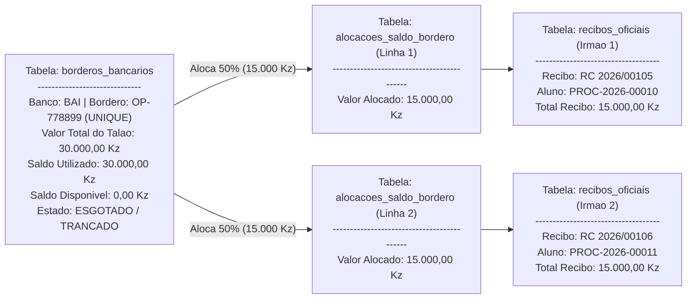
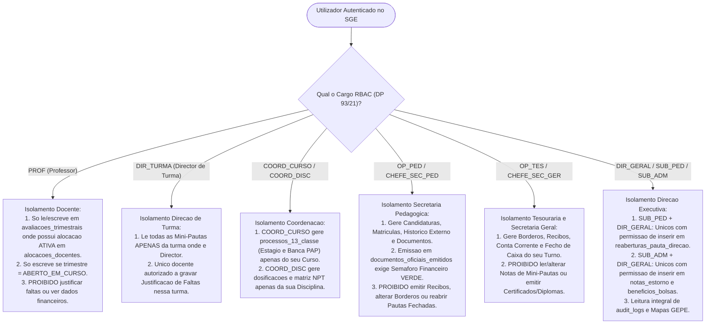

# Documento 05: Modelagem Conceptual e Organização Lógica da Base de Dados (ERD, Dicionário de Entidades, Integridade e Isolamento de Acesso)

**Projeto:** Sistema de Gestão Escolar (SGE) — Ensino Secundário Técnico-Profissional (II Ciclo)  
**Instituição Alvo:** Instituto Politécnico Católico de Administração e Gestão (IPCAG) N.º 12008 / BGO – *"Nossa Senhora do Rosário"*  
**Referências Base:** [01-dominio-e-regras.md](file:///c:/Users/aqp/Desktop/sge/docs/01-dominio-e-regras.md), [02-fluxos-de-trabalho.md](file:///c:/Users/aqp/Desktop/sge/docs/02-fluxos-de-trabalho.md), [03-user-stories.md](file:///c:/Users/aqp/Desktop/sge/docs/03-user-stories.md) e [04-telas-e-documentos.md](file:///c:/Users/aqp/Desktop/sge/docs/04-telas-e-documentos.md)

> [!NOTE]
> Este documento define a **arquitetura lógica e organizacional da base de dados** (sem código físico SQL), estabelecendo o mapa completo de entidades, atributos, ligações, controlo de saldos, sincronização *Offline-First* e isolamento de segurança por departamento.

---

## 1. Visão Geral da Organização dos Dados e Sincronização *Offline-First*

### 1.1 Divisão Lógica em 6 Domínios de Dados
Para manter a base de dados do **IPCAG N.º 12008 / BGO** organizada, auditável e alinhada com o **Decreto Presidencial n.º 93/21**, todas as tabelas estão agrupadas em **6 Domínios Lógicos**:

1. **Grupo 01 — Governação, Calendário e Estrutura Académica (`Academic Structure`):** Guarda a estrutura do Ano Letivo, os 3 Trimestres, os Cursos Técnicos, as 12 Salas/Laboratórios, as Disciplinas, as Matrizes Curriculares do MED e as Turmas.
2. **Grupo 02 — Utilizadores, Cargos (DP n.º 93/21), Alocação Docente e RH (`Identity & Staff`):** Guarda as contas de acesso, os 12 perfis oficiais RBAC, o cadastro de professores/funcionários, o histórico de alocação de professores às disciplinas (permitindo substituição docente sem afetar as notas), a dosificação trimestral e o livro de ponto.
3. **Grupo 03 — Concurso de Admissão (10ª Classe), Alunos, Matrículas e Histórico Externo (`Enrollment & Records`):** Guarda os Encarregados de Educação, os Candidatos ao Teste de Seleção (com **Código de Anonimato** separado), o registo vitalício do Aluno (**N.º de Processo Individual**), as Matrículas Anuais (**N.º de Ordem na Turma** congelável) e a **Transcrição de Histórico Externo** (notas trazidas de outras escolas).
4. **Grupo 04 — Vida Pedagógica, Mini-Pautas, Faltas, Cadeiras em Atraso e 13ª Classe (`Pedagogical & Assessment`):** Guarda as Dispensas Médicas (`DISP`), os Sumários e Faltas Diárias, as Avaliações Trimestrais (`MAC`, `NPP`, `NPT`, `MT`), os Exames de Recurso (`40%/60%`), os Despachos de Reabertura de Pauta, as **Cadeiras em Atraso**, os **Exames Extraordinários** e todo o processo especial da **13ª Classe** (Estágio Supervisionado, Banca de PAP e cálculo da `MFC`).
5. **Grupo 05 — Tesouraria Anti-Fraude, Bolsas, Recibos AGT e Fecho de Caixa (`Finance & Treasury`):** Guarda os Bancos, as Tabelas de Preços em Kwanzas (`AOA`), as Bolsas/Descontos Familiares, a Conta Corrente de Propinas, o **Controlo de Saldo de Borderôs/Talões Bancários**, os Recibos Oficiais imutáveis, as Notas de Estorno (Padrão AGT) e o Fecho de Caixa Diário por Turno.
6. **Grupo 06 — Emissão Documental (`Livro/Folha/Termo` + QR Code) e Auditoria (`Audit & Verification`):** Guarda os Documentos Oficiais Emitidos (vinculados ao emolumento pago, à coordenada física `Livro, Folha e Termo` e ao código criptográfico do QR Code) e a trilha imutável de auditoria (`audit_logs` — Lei n.º 22/11 APD).

---

### 1.2 Lógica de Sincronização *Offline-First* (Navegador Local $\leftrightarrow$ Servidor Central)
Para garantir que o lançamento de Mini-Pautas e o atendimento no Panguila (Bengo) não parem quando a internet oscila:

1. **Armazenamento Local Encriptado (`IndexedDB`):**
   - Quando um professor (`PROF`) abre a sua turma com ligação ativa, o sistema descarrega para a memória local do navegador a lista congelada de alunos daquela Mini-Pauta e a versão atual de cada linha (`versao_registo`).
   - Enquanto está sem internet, cada nota (`MAC`, `NPP`, `NPT`) ou falta digitada é guardada localmente numa **Fila de Sincronização Pendente**, acompanhada de uma **Chave Única de Operação (`Chave de Idempotência`)**, da data/hora local e do identificador do professor.
2. **Prevenção de Duplicações na Subida dos Dados:**
   - Assim que a ligação à rede local (LAN da escola) ou à internet regressa, os dados sobem em lote para o servidor central.
   - Se a internet cair a meio do envio e o telemóvel/computador reenviar o mesmo pacote, o servidor reconhece a `Chave de Idempotência` e ignora a repetição, garantindo que nenhum lançamento seja duplicado.
3. **Resolução Segura de Conflitos (Caso o Trimestre Seja Fechado Enquanto o Professor Estava Offline):**
   - O servidor central é sempre a autoridade final sobre o estado do trimestre (`Aberto` vs. `Fechado`).
   - Se o Subdirector Pedagógico (`SUB_PED`) trancou o trimestre às 16h00 e um professor que estava offline tentar sincronizar notas às 17h00, a base de dados central **não sobrescreve a pauta fechada**: ela guarda o envio do professor numa tabela de **Conflitos de Sincronização Pendentes** e avisa o professor e o `SUB_PED` para que decidam se reabrem formalmente a pauta ou descartam o envio tardio.

---

### 1.3 Conjuntos de Valores Fechados (Listas de Estados e Categorias Controladas)
Para evitar erros de digitação, a base de dados só aceita valores pertencentes às seguintes listas fechadas oficiais:

| Nome da Lista Controlada | Valores Oficiais Permitidos na Base de Dados |
| :--- | :--- |
| **1. Cargos Oficiais RBAC (DP n.º 93/21)** | `DIR_GERAL`, `SUB_PED`, `SUB_ADM`, `CHEFE_SEC_PED`, `OP_PED`, `CHEFE_SEC_GER`, `OP_TES`, `COORD_CURSO`, `COORD_DISC`, `COORD_TURNO`, `DIR_TURMA`, `PROF` |
| **2. Turnos Escolares** | `MANHA`, `TARDE` |
| **3. Classes do II Ciclo Técnico** | `10ª Classe`, `11ª Classe`, `12ª Classe`, `13ª Classe` |
| **4. Componentes Curriculares (MED)** | `SOCIO_CULTURAL`, `CIENTIFICA`, `TECNICA_TECNOLOGICA_PRATICA` |
| **5. Trimestres Letivos** | `I_TRIMESTRE`, `II_TRIMESTRE`, `III_TRIMESTRE` |
| **6. Estados do Período / Pauta** | `PLANEADO`, `ABERTO_EM_CURSO`, `EM_CONSELHO_DE_NOTAS`, `FECHADO_HOMOLOGADO`, `REABERTO_TEMPORARIAMENTE` |
| **7. Estados da Candidatura (10ª Classe)** | `INSCRITO`, `APTO_PARA_EXAME`, `AVALIADO_ANONIMATO`, `ADMITIDO`, `NAO_ADMITIDO`, `FALTOU_AO_EXAME`, `CANCELADO_POR_FALTA_PAGAMENTO`, `CONVERTIDO_EM_MATRICULA` |
| **8. Tipos de Ingresso na Matrícula** | `MATRICULA_INICIAL_10A`, `CONFIRMACAO_INTERNA`, `TRANSFERENCIA_ENTRADA` |
| **9. Estados da Matrícula Anual** | `PENDENTE_PAGAMENTO_INICIAL`, `ATIVA`, `TRANSFERIDA_INTERNA`, `TRANSFERIDA_EXTERNA`, `ANULADA_DESISTENTE`, `CONCLUIDA_NO_ANO` |
| **10. Situação do Aluno na Disciplina** | `EM_CURSO`, `DISPENSADO_DISP`, `RETIDO_POR_FALTAS_RF`, `APROVADO_FREQUENCIA`, `EM_EXAME_DE_RECURSO`, `APROVADO_POS_EXAME`, `REPROVADO_NA_DISCIPLINA` |
| **11. Deliberação Final do Conselho de Notas** | `TRANSITA_APROVADO`, `TRANSITA_COM_DEFICIENCIA`, `NAO_TRANSITA_RETIDO_NOTAS`, `NAO_TRANSITA_VETO_LP_NUCLEAR`, `NAO_TRANSITA_RETIDO_FALTAS`, `APTO_PARA_13_CLASSE`, `TRANSFERIDO`, `ANULADO_DESISTENTE` |
| **12. Estados da Cadeira em Atraso** | `TRANSITADO_COM_DEFICIENCIA`, `INSCRITO_EXAME_EXTRAORDINARIO`, `DEFICIENCIA_ELIMINADA` |
| **13. Estados do Processo da 13ª Classe** | `BLOQUEADO_CADEIRAS_EM_ATRASO`, `APTO_PARA_13_CLASSE`, `EM_ESTAGIO_E_ELABORACAO_PAP`, `APTO_PARA_DEFESA_PAP`, `DEFENDIDO_E_HOMOLOGADO`, `REPROVADO_EM_PAP`, `DIPLOMA_CERTIFICADO_EMITIDO` |
| **14. Tipos de Bolsa / Desconto (`RN-07`)** | `SEM_BENEFICIO`, `BOLSA_100`, `BOLSA_50`, `BOLSA_PARCIAL_OUTRA`, `ISENCAO_DIOCESE_CAXITO`, `DESCONTO_IRMAOS`, `FILHO_FUNCIONARIO` |
| **15. Estados da Propina Mensal** | `A_VENCER`, `PAGA`, `EM_ATRASO_COM_MULTA`, `ISENTA_BOLSEIRO_100`, `CANCELADA_POR_INATIVACAO`, `ESTORNADA` |
| **16. Canais de Pagamento (Fecho de Caixa)**| `TPA_MULTICAIXA`, `TRANSFERENCIA_DEPOSITO_BANCARIO`, `MULTICAIXA_EXPRESS` |
| **17. Estados do Borderô / Talão Bancário** | `REGISTADO_SALDO_100`, `PARCIALMENTE_UTILIZADO`, `ESGOTADO_TRANCADO`, `INVALIDADO_POR_FRAUDE` |

---

## 2. Diagrama Entidade-Relacionamento Global (ERD Visual em Mermaid)

O diagrama abaixo apresenta o mapa completo de ligações entre as tabelas dos 6 grupos do SGE:

```mermaid
erDiagram
    ANOS_LETIVOS ||--|{ TRIMESTRES_LETIVOS : possui
    ANOS_LETIVOS ||--o{ TURMAS : organiza
    CURSOS_TECNICOS ||--|{ MATRIZES_CURRICULARES : estrutura
    MATRIZES_CURRICULARES ||--|{ MATRIZ_DISCIPLINAS : contem
    DISCIPLINAS ||--o{ MATRIZ_DISCIPLINAS : compoe
    SALAS_FISICAS ||--o{ TURMAS : aloja
    TURMAS ||--|{ TURMA_DISCIPLINAS : gera_mini_pautas
    FUNCIONARIOS_DOCENTES ||--o{ ALOCACOES_DOCENTES : leciona_em_periodo
    TURMA_DISCIPLINAS ||--o{ ALOCACOES_DOCENTES : recebe_professor

    ENCARREGADOS_EDUCACAO ||--o{ CANDIDATURAS_10A : inscreve
    ENCARREGADOS_EDUCACAO ||--|{ ALUNOS : responsabiliza_se_por
    CANDIDATURAS_10A ||--|| CODIGOS_ANONIMATO : protege_identidade
    CANDIDATURAS_10A ||--o| ALUNOS : converte_se_em
    ALUNOS ||--|{ MATRICULAS_ANUAIS : realiza
    TURMAS ||--o{ MATRICULAS_ANUAIS : integra
    ALUNOS ||--o{ HISTORICO_EXTERNO_TRANSCRICOES : traz_equivalencia

    MATRICULAS_ANUAIS ||--o{ DISPENSAS_MEDICAS : beneficia_de
    MATRICULAS_ANUAIS ||--o{ SUMARIOS_E_FALTAS_ALUNOS : regista
    MATRICULAS_ANUAIS ||--|{ AVALIACOES_TRIMESTRAIS : possui_notas
    TURMA_DISCIPLINAS ||--o{ AVALIACOES_TRIMESTRAIS : consolida_mini_pauta
    MATRICULAS_ANUAIS ||--|{ RESULTADOS_ANUAIS_DISCIPLINA : apura_mfd_e_recurso
    ALUNOS ||--o{ CADEIRAS_EM_ATRASO : acumula_deficiencia
    CADEIRAS_EM_ATRASO ||--o{ EXAMES_EXTRAORDINARIOS : elimina_em
    ALUNOS ||--o{ PROCESSOS_13_CLASSE : historico_13a
    MATRICULAS_ANUAIS ||--o| PROCESSOS_13_CLASSE : conclui_curso_em
    EMPRESAS_PARCEIRAS ||--o{ PROCESSOS_13_CLASSE : acolhe_estagiario

    MATRICULAS_ANUAIS ||--o{ BENEFICIOS_BOLSAS_MATRICULA : aplica_desconto_vigencia
    MATRICULAS_ANUAIS ||--|{ CONTA_CORRENTE_PROPINAS : gera_mensalidades
    BANCOS_ANGOLA ||--o{ BORDEROS_BANCARIOS : emite_comprovativo
    BORDEROS_BANCARIOS ||--o{ ALOCACOES_SALDO_BORDERO : abate_saldo_em
    RECIBOS_OFICIAIS ||--|{ ALOCACOES_SALDO_BORDERO : consome_saldo_de
    RECIBOS_OFICIAIS ||--|{ ITENS_RECIBO : discrimina_pagamento
    CONTA_CORRENTE_PROPINAS ||--o{ ITENS_RECIBO : liquidada_por
    RECIBOS_OFICIAIS ||--o| NOTAS_ESTORNO : anulado_por
    SESSOES_FECHO_CAIXA ||--o{ RECIBOS_OFICIAIS : contabiliza_no_turno
    SESSOES_FECHO_CAIXA ||--o{ NOTAS_ESTORNO : abate_no_turno_atual

    ALUNOS ||--o{ DOCUMENTOS_OFICIAIS_EMITIDOS : recebe
    ITENS_RECIBO ||--o| DOCUMENTOS_OFICIAIS_EMITIDOS : libera_emissao_condicional
    USUARIOS_SISTEMA ||--o{ AUDIT_LOGS : rastreado_em
```

---

## 3. Dicionário e Organização Lógica das Tabelas (Por Grupo de Domínio)

Abaixo detalha-se o papel de cada tabela, as suas informações principais e como se relaciona com o restante sistema, sem código SQL.

---

### 3.1 Grupo 1 — Governação, Calendário e Estrutura Académica

| Nome da Tabela | Papel no Sistema | Atributos / Informações Guardadas | Ligações e Regras de Chave |
| :--- | :--- | :--- | :--- |
| **`anos_letivos`** | Representa o ano escolar oficial do MED (ex.: `2026/2027`). Tudo no sistema (turmas, propinas, concursos) pertence a um Ano Letivo. | • **ID Único** *(Identificador)* • **Código do Ano** *(Texto único, ex.: `2026/2027`)* • **Data de Início e Data de Fim** *(Datas)* • **Estado do Ano** *(Lista Fechada)* • **Homologado por / Data** *(Ligação ao Director Geral)* | **Liga-se a:** `trimestres_letivos`, `turmas`, `tabelas_precos`. **Regra:** Só pode existir um ano letivo ativo como corrente para matrículas regulares. |
| **`trimestres_letivos`** | Guarda o calendário macro dos 3 trimestres (`I`, `II` e `III`) dentro de cada Ano Letivo (Nível 1 da Máquina de Estados 3.1). | • **ID Único** *(Identificador)* • **Ano Letivo** *(Ligação)* • **Designação** (`I_TRIMESTRE`, `II_TRIMESTRE`, `III_TRIMESTRE`) • **Data de Abertura e Fecho de Notas** *(Data/Hora)* • **Estado Macro do Calendário** *(Planeado, Janela Letiva Aberta, Época de Conselhos, Encerrado Oficialmente)* | **Chave Única:** `(Ano Letivo + Designação do Trimestre)`. **Regra:** O II Trimestre não abre se o I Trimestre não estiver `Encerrado Oficialmente`. |
| **`salas_fisicas`** | Catálogo das 12 salas de aula e dos laboratórios técnicos do IPCAG no Panguila. | • **ID Único** *(Identificador)* • **Código / Nome da Sala** *(Ex.: `Sala 01`, `Lab. Informática 01`)* • **Tipo de Espaço** *(Sala Comum vs. Laboratório)* • **Lotação Máxima de Alunos** *(Número Inteiro, ex.: `45`)* | **Liga-se a:** `turmas` e `candidaturas_10a` (alocação no teste de seleção). |
| **`cursos_tecnicos`** | Catálogo dos cursos do II Ciclo Técnico-Profissional (Contabilidade e Gestão, Informática de Gestão, Finanças, etc.). | • **ID Único** *(Identificador)* • **Sigla Oficial** *(Texto único, ex.: `TIG`, `TCG`, `TFIN`)* • **Nome Oficial do Curso** *(Texto)* • **Título Profissional do Diploma** *(Ex.: `Técnico Médio de...`)* • **Coordenador de Curso Atual** *(Ligação ao Docente)* | **Liga-se a:** `matrizes_curriculares`, `turmas`, `candidaturas_10a`. |
| **`disciplinas`** | Dicionário central de todas as disciplinas lecionadas no instituto. | • **ID Único** *(Identificador)* • **Código e Nome Oficial da Disciplina** *(Ex.: `Língua Portuguesa`, `Matemática`, `Contabilidade Geral`)* • **Coordenador de Disciplina Atual** *(Ligação ao Docente)* | **Liga-se a:** `matriz_disciplinas`, `dosificacoes_trimestrais`. |
| **`matrizes_curriculares`**| Define o plano de estudos oficial do MED para cada par `Curso Técnico + Classe (10ª a 13ª)`. | • **ID Único** *(Identificador)* • **Curso Técnico** *(Ligação)* + **Classe** (`10`, `11`, `12` ou `13`) • **Versão da Matriz** *(Número Inteiro)* • **Fator Multiplicador de Faltas** *(Inteiro, ex.: `3` ou `4`)* • **Limite Máx. Cadeiras em Atraso (`max_deficiencias_transicao`)** (`2` ou `3` na 10ª/11ª; `0` na 12ª) • **Nota Mínima para Deficiência / Acesso a Recurso** (Default `7` valores) • **Pesos da `MFC` na 13ª Classe** (`Peso_MPC`, `Peso_Estagio`, `Peso_PAP`) | **Chave Única:** `(Curso Técnico + Classe + Versão)`. **Regra:** Imutável depois de existirem notas lançadas no ano letivo. |
| **`matriz_disciplinas`** | Lista as disciplinas que compõem cada Matriz Curricular e as suas propriedades legais. | • **ID Único** *(Identificador)* • **Matriz Curricular** *(Ligação)* + **Disciplina** *(Ligação)* • **Componente Curricular** (`Socio-Cultural`, `Científica`, `Técnica`) • **É Disciplina Nuclear?** *(Sim/Não — `is_nuclear`)* • **É Língua Portuguesa?** *(Sim/Não — gatilho do veto com nuclear)* • **Permite Dispensa Médica (`DISP`)?** *(Sim/Não — Educação Física)* • **Tempos Letivos Semanais** *(Número Inteiro)* • **Limite Anual de Faltas Injustificadas** *(Calculado: `Fator × Tempos`)* | **Chave Única:** `(Matriz Curricular + Disciplina)`. **Regra:** Determina automaticamente o teto de faltas (`RN-03`) e o poder de veto na transição (`RN-02`). |
| **`turmas`** | Agrupamento anual de alunos num Curso, Classe, Turno e Sala física, com controlo de congelamento da chamada e estado do Conselho de Notas (Nível 2). | • **ID Único** *(Identificador)* • **Ano Letivo**, **Curso Técnico**, **Matriz Curricular**, **Classe**, **Turno** (`Manhã`/`Tarde`) • **Código da Turma** *(Ex.: `IG10A-M`)* • **Sala Física** *(Ligação às 12 salas)* e **Lotação Máxima** • **Director de Turma (`DIR_TURMA`)** *(Ligação ao Docente)* • **Estado do Conselho da Turma no I, II e III Trimestres** *(Em Lançamento, Em Conselho de Notas, Pauta Geral Homologada)* • **Lista de Chamada Congelada?** *(Sim/Não — `RN-05`)* • **Data/Hora do Congelamento da Chamada** *(Data/Hora)* | **Chave Única Anti-Colisão:** `(Ano Letivo + Turno + Sala Física)` — impede que duas turmas ocupem a mesma sala no mesmo turno. |
| **`turma_disciplinas`** | Representa o **Cabeçalho da Mini-Pauta** de cada disciplina dentro de uma turma (Nível 3 — escopo cirúrgico de trancamento e reabertura). | • **ID Único** *(Identificador)* • **Turma** *(Ligação)* + **Disciplina da Matriz** *(Ligação)* • **Estado da Mini-Pauta no I, II e III Trimestres** *(Aberta para Docente, Submetida ao DT, Fechada/Homologada, Reaberta Temporariamente)* • **Versão da Mini-Pauta** *(Número Inteiro incrementado a cada reabertura)* | **Chave Única:** `(Turma + Disciplina da Matriz)`. **Regra:** Não guarda o ID do professor como dono; as notas ligam-se a esta tabela (`RN-04`). Reabrir uma linha aqui **não** abre as restantes turmas da escola. |

---

### 3.2 Grupo 2 — Utilizadores, Cargos (DP n.º 93/21), Alocação de Professores e RH

| Nome da Tabela | Papel no Sistema | Atributos / Informações Guardadas | Ligações e Regras de Chave |
| :--- | :--- | :--- | :--- |
| **`usuarios_sistema`** | Contas de acesso e credenciais vinculadas aos 12 cargos oficiais do DP n.º 93/21. | • **ID Único** *(Identificador)* • **Nome de Utilizador / Email Institucional** *(Texto único)* • **Credencial Encriptada** *(Hash de Senha)* • **Cargo Oficial RBAC** *(Lista Fechada dos 12 cargos)* • **Conta Ativa?** *(Sim/Não)* | **Liga-se a:** `funcionarios_docentes` e `audit_logs`. |
| **`funcionarios_docentes`**| Cadastro civil, académico e administrativo de todos os professores e trabalhadores do IPCAG. | • **ID Único** *(Identificador)* • **Utilizador do Sistema** *(Ligação 1:1)* • **N.º de Agente / Mecanográfico**, **Nome Completo**, **N.º do BI**, **Telefone** • **Categoria** (`Docente`, `Administrativo`, `Direção`) • **Vínculo** (`Quadro Estatal MED` vs. `Comparticipado Diocese de Caxito`) | **Liga-se a:** `alocacoes_docentes`, `assiduidade_funcionarios`, `turmas` (como Director de Turma) e `processos_13_classe` (como Tutor/Orientador/Júri). |
| **`alocacoes_docentes`** | Regista qual professor leciona qual `turma_disciplina` e em que período de datas (**Suporte à Substituição Docente — `RN-04`**). | • **ID Único** *(Identificador)* • **Mini-Pauta (`turma_disciplina`)** *(Ligação)* • **Professor (`funcionario_docente`)** *(Ligação)* • **Data de Início da Regência** *(Data)* • **Data de Fim da Regência** *(Data — vazia enquanto for o titular atual)* • **Titular Ativo?** *(Sim/Não)* • **Motivo de Substituição / Despacho** *(Texto)* | **Regra Crítica (`RN-04`):** Só pode existir `1` professor com `Titular Ativo = Sim` por `turma_disciplina` num dado momento. Quando o Professor A é substituído pelo Professor B, encerra-se a linha de A e abre-se a linha de B sem tocar nas notas. |
| **`dosificacoes_trimestrais`**| Guarda o plano temático e a matriz da Prova Trimestral Unificada (`NPT`) elaborada pelo Coordenador de Disciplina. | • **ID Único** *(Identificador)* • **Ano Letivo**, **Classe**, **Disciplina**, **Trimestre** • **Coordenador de Disciplina Autor** *(Ligação)* • **Conteúdos Programáticos e Ficheiro da Matriz `NPT`** *(Texto / PDF)* • **Homologado pelo Subdirector Pedagógico?** *(Sim/Não)* | **Chave Única:** `(Ano Letivo + Classe + Disciplina + Trimestre)`. |
| **`assiduidade_funcionarios`**| Livro de ponto diário de professores e funcionários administrativos (Secretaria Geral / Coordenação de Turno). | • **ID Único** *(Identificador)* • **Funcionário / Docente** *(Ligação)* • **Data**, **Turno** (`Manhã`/`Tarde`), **Hora de Entrada e Saída** • **Estado de Presença** (`Presente`, `Atraso`, `Falta Justificada`, `Falta Injustificada`) | **Chave Única:** `(Funcionário + Data + Turno)`. |

---

### 3.3 Grupo 3 — Concurso de Admissão (10ª Classe), Alunos, Matrículas e Histórico Externo

| Nome da Tabela | Papel no Sistema | Atributos / Informações Guardadas | Ligações e Regras de Chave |
| :--- | :--- | :--- | :--- |
| **`encarregados_educacao`**| Cadastro único dos pais/encarregados de educação. É o elo que permite identificar irmãos na escola (`RN-07` e `RN-09`). | • **ID Único** *(Identificador)* • **Nome Completo do Encarregado** *(Texto)* • **N.º do Bilhete de Identidade / NIF** *(Texto Único)* • **Grau de Parentesco**, **Telefone Principal / Alternativo**, **Morada** • **É Funcionário do IPCAG?** *(Sim/Não — para desconto de filho de trabalhador)* | **Liga-se a:** `alunos` (`1 Encarregado -> Vários Alunos/Irmãos`), `candidaturas_10a` e `borderos_bancarios`. |
| **`candidaturas_10a`** | Registo dos candidatos inscritos no Teste de Seleção da 10ª classe (DE n.º 361/26). | • **ID Único** *(Identificador)* • **Ano Letivo**, **N.º de Inscrição Sequencial** • **Nome Completo**, **N.º do BI/Cédula**, **Género (`M`/`F`)**, **Data de Nascimento** • **Escola de Origem (9ª Classe)** e **Média Final da 9ª Classe** *(Nota 10–20)* • **Curso Técnico Pretendido** e **Turno** (`Manhã`/`Tarde`) • **Sala de Exame Atribuída** *(Ligação às 12 salas)* • **Item de Recibo da Taxa de Inscrição** *(Ligação à Tesouraria)* • **Estado da Candidatura** *(Inscrito, Apto, Avaliado, Admitido, Não Admitido, Convertido)* | **Chave Única:** `(Ano Letivo + N.º do BI/Cédula)` — impede dupla inscrição. **Regra:** Só recebe sala e código de anonimato quando o recibo da taxa está pago. |
| **`codigos_anonimato`** | Tabela isolada de segurança que guarda o **Código de Anonimato** e as notas da prova de seleção (DE n.º 361/26). | • **ID Único** *(Identificador)* • **Candidatura** *(Ligação 1:1 oculta até à descodificação)* • **Código de Anonimato** *(Texto Único, ex.: `IPCAG-26-491B`)* • **Nota de Língua Portuguesa (`0–20`)** e **Nota de Matemática/Específica (`0–20`)** • **Média do Exame Arredondada (`round_med`)** • **Anonimato Descodificado pela Direção?** *(Sim/Não + Data/Hora)* | **Isolamento de Segurança:** Enquanto `Anonimato Descodificado = Não`, o ecrã de correção lê apenas esta tabela sem poder cruzar com o nome em `candidaturas_10a`. |
| **`alunos`** | Entidade vitalícia do estudante no IPCAG N.º 12008 / BGO, da 10ª até ao Diploma da 13ª classe. | • **ID Único** *(Identificador)* • **`N.º de Processo Individual`** *(Texto Único e Vitalício, ex.: `PROC-2026-00412` — `RN-05`)* • **Nome Completo**, **Filiação (Pai e Mãe)**, **Naturalidade / Província** • **Data de Nascimento**, **Género (`M`/`F`)**, **N.º do BI / Cédula Pessoal** *(Único)* • **Encarregado de Educação** *(Ligação)* | **Regra Vitalícia (`RN-05`):** O `N.º de Processo Individual` nunca é alterado nem reutilizado, mesmo que o aluno repita de classe ou mude de turno. |
| **`matriculas_anuais`** | Vínculo formal do Aluno a uma Turma/Classe num determinado Ano Letivo, guardando o **N.º de Ordem na Turma** (`RN-05` e `RN-05.1`). | • **ID Único** *(Identificador)* • **Aluno (`N.º de Processo`)** *(Ligação)* + **Ano Letivo** *(Ligação)* + **Turma** *(Ligação)* • **Tipo de Ingresso** (`Matrícula Inicial 10ª`, `Confirmação Interna`, `Transferência Entrada`, `Transferência Interna`) • **`N.º de Ordem na Turma (N.º de Chamada)`** *(Inteiro `1..N` — `RN-05`)* • **Estado da Matrícula** (`Pendente`, `Ativa`, `Transferida Interna`, `Transferida Externa`, `Anulada`, `Concluída`) • **Data de Inativação / Reativação** *(Data — quando aplicável)* • **Deliberação Final do Conselho de Notas** *(Lista Fechada)* | **Chaves e Regras (`RN-05.1`):** 1. `(Turma + N.º de Ordem na Turma)` é sempre único; 2. Em mudança interna de turma pós-I Trimestre, a linha original fica congelada (`Transferida Interna`) e cria-se a nova alocação na turma de destino (`max + 1`). Em reativação na mesma turma, restaura o `N.º de Ordem` original. |
| **`historico_externo_transcricoes`**| Guarda as médias anuais da 10ª, 11ª ou 12ª classe trazidas por alunos transferidos de outras escolas (`RN-06` e `RN-06.1`). | • **ID Único** *(Identificador)* • **Aluno** *(Ligação)* + **Classe Equivalente** (`10ª`, `11ª` ou `12ª`) • **Nome da Escola de Origem**, **Província**, **N.º da Guia/Certificado** e **PDF Anexado** • **Disciplina da Matriz** *(Ligação)* • **Média Final Anual Transcrita (`MFD` de `10` a `20` ou `DISP`)** • **Homologado pelo Subdirector Pedagógico?** *(Sim/Não + Utilizador + Data)* | **Chave Única:** `(Aluno + Classe Equivalente + Disciplina)`. **Regra (`RN-06`):** Alimenta a vista canónica unificada `vw_curriculo_consolidado_aluno` para cálculo de $MA_{10}$ e $MA_{11}$ na 13ª classe (`MFC`). |

---

### 3.4 Grupo 4 — Vida Pedagógica, Mini-Pautas, Faltas, Cadeiras em Atraso e 13ª Classe

| Nome da Tabela | Papel no Sistema | Atributos / Informações Guardadas | Ligações e Regras de Chave |
| :--- | :--- | :--- | :--- |
| **`dispensas_medicas`** | Regista a isenção oficial (`DISP`) de um aluno numa disciplina elegível (ex.: Educação Física — `RN-01`). | • **ID Único** *(Identificador)* • **Matrícula do Aluno** *(Ligação)* + **Disciplina da Turma** *(Ligação)* • **Motivo Clínico / Junta Médica** e **Ficheiro PDF do Atestado** • **Abrangência** (`Anual` ou `Trimestral`) • **Homologado pelo Subdirector Pedagógico (`SUB_PED`)** *(Ligação + Data)* | **Chave Única:** `(Matrícula + Disciplina da Turma)`. **Regra (`RN-01`):** Bloqueia notas numéricas com `'DISP'` e reduz `-1` no divisor da média anual. |
| **`sumarios_e_faltas_alunos`**| Regista os sumários das aulas e cada falta individual dos alunos, separando quem marcou de quem justificou (`RN-03`). | • **ID Único** *(Identificador)* • **Matrícula do Aluno** *(Ligação)* + **Disciplina da Turma** *(Ligação)* + **Trimestre** • **Data da Aula**, **N.º de Tempos de Falta** e **Sumário da Aula** • **Registado pelo Professor** *(Ligação ao Docente)* • **Falta Justificada?** *(Sim/Não — nasce sempre como `Não`)* • **Justificada pelo Director de Turma (`DIR_TURMA`)** *(Ligação + Motivo + Data)* | **Regra (`RN-03`):** O professor cria a falta; apenas o `DIR_TURMA` ou `SUB_PED` pode passar `Falta Justificada` para `Sim`. |
| **`avaliacoes_trimestrais`**| Coração da **Mini-Pauta**: guarda as notas e faltas consolidadas de cada aluno por disciplina e trimestre (**Desacoplado do Professor — `RN-04`**). | • **ID Único** *(Identificador)* • **Matrícula do Aluno** *(Ligação)* • **Disciplina da Turma (`turma_disciplina`)** *(Ligação)* • **Trimestre Letivo** (`I`, `II` ou `III`) • **`MAC` (`0,00–20,00`)**, **`NPP` (`0,00–20,00`)**, **`NPT` (`0,00–20,00`)** • **`MT` (Média Trimestral Inteira `0–20` calculada por `round_med`)** • **Total de Faltas Justificadas e Injustificadas no Trimestre** • **Chave de Sincronização Offline (`idempotency_key`)** e **Versão da Linha** • **Metadados de Auditoria:** `Lançado por Utilizador`, `Última Edição por Utilizador` | **Chave Única Estrutural (`RN-04`):** `(Matrícula + Disciplina da Turma + Trimestre)`. **Regra:** Não depende do ID do professor; se o professor mudar, a linha continua intacta. |
| **`resultados_anuais_disciplina`**| Consolida o fecho anual da disciplina no III Trimestre, o Exame de Recurso (`40%/60%`) e a situação final na cadeira. | • **ID Único** *(Identificador)* • **Matrícula do Aluno** *(Ligação)* + **Disciplina da Turma** *(Ligação)* • **`MT1`**, **`MT2`**, **`MT3`** *(Inteiros `0–20`)* • **`MFD` (Média Final de Frequência `= round_med((MT1+MT2+MT3)/3)`)** • **Total Anual de Faltas Injustificadas** e **Flag `Retido por Faltas (RF)`** • **Nota do Exame de Recurso (`0–20`)** • **`CFD` (Classificação Final `= MFD` ou `round_med(MFD*0.4 + Exame*0.6)`)** • **Situação Final na Disciplina** *(Aprovado, Reprovado, DISP, RF)* | **Chave Única:** `(Matrícula + Disciplina da Turma)`. **Regra:** Base para o motor de deliberação da Pauta Geral (`DOC-05`). |
| **`reaberturas_pauta_direcao`**| Regista as ordens excecionais da Direção (`SUB_PED`/`DIR_GERAL`) para reabrir temporariamente uma pauta fechada (`RN-10`). | • **ID Único** *(Identificador)* • **Disciplina da Turma / Pauta Alvo** *(Ligação)* + **Trimestre** • **N.º do Despacho da Direção** *(Texto obrigatório)* • **Motivo Justificativo Detalhado** *(Texto $\ge 30$ caracteres)* • **Autorizado por (`SUB_PED` / `DIR_GERAL`)** *(Ligação)* • **Data/Hora de Abertura**, **Data/Hora Limite de Expiração** e **Data/Hora do Novo Fecho** | **Regra (`RN-10`):** Sem um registo ativo e dentro do prazo nesta tabela, qualquer tentativa de alterar notas de um trimestre fechado é bloqueada. |
| **`cadeiras_em_atraso`** | Controla todas as disciplinas da 10ª e 11ª classes em que o aluno transitou com deficiência (nota `7` a `9` valores — `RN-02`). | • **ID Único** *(Identificador)* • **Aluno (`N.º de Processo`)** *(Ligação vitalícia)* • **Disciplina da Matriz Originária (10ª ou 11ª Classe)** *(Ligação)* • **Ano Letivo em que Contraiu a Deficiência** e **Nota de Origem (`7`, `8` ou `9`)** • **Estado Atual da Deficiência** (`Transitado com Deficiência`, `Inscrito em Exame Extraordinário`, `Deficiência Eliminada`) • **Nota de Aprovação Final (`>= 10`)** e **Data da Eliminação** | **Chave Única:** `(Aluno + Disciplina da Matriz Originária)`. **Trava (`RN-02`):** Enquanto existir qualquer linha com estado diferente de `Deficiência Eliminada`, o aluno é bloqueado de concluir a 12ª e entrar na 13ª classe. |
| **`exames_extraordinarios`**| Regista cada inscrição e avaliação em época especial de Exame Extraordinário para eliminar uma Cadeira em Atraso. | • **ID Único** *(Identificador)* • **Cadeira em Atraso** *(Ligação)* + **Ano Letivo da Época de Exame** • **Item de Recibo da Taxa de Exame Extraordinário** *(Ligação única à Tesouraria)* • **Nota Obtida no Exame (`0–20`)** • **Coordenada Física Obrigatória:** **`Livro n.º`**, **`Folha n.º`**, **`Termo n.º`** (`RN-10`) • **Homologado por (`SUB_PED`)** *(Ligação)* | **Chave Única de Arquivo:** `(Livro n.º + Folha n.º + Termo n.º)` para Termos de Exame. **Regra:** Se `Nota >= 10`, muda automaticamente a `cadeira_em_atraso` para `Deficiência Eliminada`. |
| **`empresas_parceiras`** | Catálogo de empresas, bancos e instituições onde os alunos da 13ª classe realizam o Estágio Curricular Supervisionado. | • **ID Único** *(Identificador)* • **Nome da Empresa / Instituição**, **NIF**, **Sector de Atividade**, **Morada e Contacto** | **Liga-se a:** `processos_13_classe`. |
| **`processos_13_classe`** | Gere todo o regime especial da **13ª Classe** (Estágio Supervisionado + Defesa Pública da PAP + Cálculo da `MFC` — DP n.º 167/23). | • **ID Único** *(Identificador)* • **Aluno (`N.º de Processo`)** *(Ligação)* + **Matrícula da 13ª Classe** *(Ligação Única 1:1 por matrícula/época)* • **Estado do Processo 13ª** *(Bloqueado, Apto, Em Estágio/PAP, Apto Defesa, Homologado, Reprovado PAP, Diplomado)* • **Dados do Estágio:** `Empresa Parceira`, `Nome do Supervisor Externo`, `Docente Tutor Interno`, `Data Início/Fim`, **`Nota do Estágio (0–20)`** • **Dados da PAP:** `Título Oficial do Tema da PAP`, `Docente Orientador` • **Banca de Júri da PAP:** `Docente Presidente`, `Docente 1.º Vogal (Arguente)`, `Docente 2.º Vogal`, `Data/Hora e Sala da Defesa`, `Item de Recibo da Taxa de Defesa` • **Avaliação e Médias Finais (`RN-06`):** **`Nota da PAP (0–20)`**, `Média 10ª (MA10)`, `Média 11ª (MA11)`, `Média 12ª (MA12)`, **`Média do Plano Curricular (MPC)`** e **`Média Final do Curso (MFC)`** | **Regras de Integridade:** 1. `UNIQUE(matricula_id)` — permite histórico caso o aluno reprove na PAP e repita em nova época/ano; 2. Os 3 membros da Banca (`Presidente`, `1.º Vogal`, `2.º Vogal`) têm de ser professores diferentes. 3. Só agenda defesa se o Semáforo Financeiro estiver `VERDE` (`RN-08`). |

---

### 3.5 Grupo 5 — Tesouraria Anti-Fraude, Bolsas, Recibos AGT e Fecho de Caixa

#### Como Funciona a Estrutura de Tabelas do Borderô por Saldo (Caso de Irmãos / Pagamento Múltiplo — `RN-09` e `RN-09.1`)
Para impedir que o mesmo talão bancário seja usado em fraudes, mas permitir que um pai pague os seus **2 ou 3 filhos (ou vários meses)** com um único depósito bancário verdadeiro (ou some 2 talões para pagar 1 recibo), a base de dados separa o **Comprovativo Bancário (`borderos_bancarios`)** do **Recibo Fiscal (`recibos_oficiais`)** através de uma tabela de ligação e rateio `N:M` (**`alocacoes_saldo_bordero`**):

| Nome da Tabela | Papel no Sistema | Atributos / Informações Guardadas | Ligações e Regras de Chave |
| :--- | :--- | :--- | :--- |
| **`bancos_angola`** | Catálogo oficial de bancos comerciais a operar em Angola (`BAI`, `BFA`, `BIC`, `SOL`, `ATLANTICO`, `KEVE`, `BPC`, etc.). | • **ID Único**, **Sigla do Banco**, **Nome Oficial**, **IBAN da Conta do IPCAG N.º 12008 / BGO** | **Liga-se a:** `borderos_bancarios`. |
| **`tabelas_precos_emolumentos`**| Guarda os valores anuais das Propinas mensais, multas de mora e taxas de todos os serviços escolares em Kwanzas (`AOA`). | • **ID Único** *(Identificador)* • **Ano Letivo** *(Ligação)* • **Código e Nome da Rubrica** (`PROPINA_MENSAL`, `TAXA_ADMISSAO`, `TAXA_MATRICULA`, `TAXA_DECLARACAO`, `TAXA_EXAME_EXTRA`, `TAXA_DEFESA_PAP`, `TAXA_DIPLOMA`) • **Valor Unitário em Kwanzas (`AOA`)** e **Regra de Multa / Dia de Vencimento** | **Chave Única:** `(Ano Letivo + Código da Rubrica)`. |
| **`beneficios_bolsas_matricula`**| Guarda o histórico de bolsas de estudo, isenções diocesanas ou descontos de irmão/filho de funcionário atribuídos à matrícula com vigência mensal (`1:N` — `RN-07`). | • **ID Único** *(Identificador)* • **Matrícula do Aluno** *(Ligação 1:N)* • **Tipo de Benefício** (`BOLSA_100`, `BOLSA_50`, `ISENCAO_DIOCESE_CAXITO`, `DESCONTO_IRMAOS`, `FILHO_FUNCIONARIO`) • **Percentagem de Abatimento (`0%` a `100%`)** • **Mês de Início e Mês de Fim de Vigência (`1..10`)** + **Benefício Ativo?** *(Sim/Não)* • **N.º do Despacho e Ficheiro Comprovativo** • **Homologado por (`SUB_ADM` + `DIR_GERAL`)** *(Ligação)* | **Regra (`RN-07`):** Permite conceder ou revogar bolsas a meio do ano letivo preservando os meses passados e recalculando apenas as prestações vincendas (`A Vencer`). |
| **`conta_corrente_propinas`**| Livro-razão das 10 prestações mensais de propina (Setembro a Junho) de cada aluno matriculado. | • **ID Único** *(Identificador)* • **Matrícula do Aluno** *(Ligação)* • **Mês/Ano de Referência** *(Ex.: `Outubro/2026` — Prestação `2/10`)* • **Valor Bruto da Tabela (`AOA`)** • **Valor do Desconto de Bolsa/Irmão (`AOA`)** • **Valor da Multa de Mora (`AOA`)** • **Valor Líquido Final a Pagar (`AOA`)** • **Data Limite de Vencimento** *(Data)* • **Estado da Prestação** (`A Vencer`, `Paga`, `Em Atraso com Multa`, `Isenta Bolseiro 100%`, `Cancelada`, `Estornada`) | **Chave Única:** `(Matrícula + Mês/Ano de Referência)`. **Regra (`RN-08`):** Qualquer linha no estado `Em Atraso com Multa` aciona imediatamente o **Semáforo Financeiro Vermelho** para o aluno na Secretaria Pedagógica. |
| **`borderos_bancarios`** | Registo único de cada comprovativo bancário, talão de depósito, TPA ou referência Express com controlo de saldo (`RN-09` e `RN-09.1`). | • **ID Único** *(Identificador)* • **Banco** *(Ligação)* • **`N.º da Operação / Borderô Bancário`** *(Texto)* • **Canal de Pagamento** (`TPA`, `Transferência/Depósito`, `Multicaixa Express`) • **Data e Hora Impressa no Talão Bancário** *(Data/Hora)* • **`Valor Total do Talão (AOA)`** *(Valor depositado no banco)* • **`Saldo Utilizado (AOA)`** *(Soma de todos os recibos ativos que usaram este talão)* • **`Saldo Disponível (AOA)`** *(`= Valor Total - Saldo Utilizado`)* • **Estado do Borderô** (`Registado 100%`, `Parcialmente Utilizado`, `Esgotado / Trancado`, `Invalidado por Fraude`) • **Encarregado de Educação / Depositante** *(Ligação opcional)* | **Chave Única Anti-Fraude (`RN-09`):** `UNIQUE(Banco + N.º da Operação / Borderô)`. **Trava de Saldo:** `Saldo Utilizado` nunca pode ser maior que `Valor Total do Talão`. Eventual sobra de depósito permanece em `Saldo Disponível` para abater no mês seguinte. |
| **`recibos_oficiais`** | Documento fiscal imutável emitido pela Tesouraria em Kwanzas (`AOA`) (Padrão AGT — DP n.º 292/18). | • **ID Único** *(Identificador)* • **Ano Letivo** + **N.º Sequencial do Recibo** *(Ex.: `RC IPCAG2026/000105` — Único e sem saltos)* • **Aluno (`N.º de Processo`)** *(Ligação)* + **Encarregado de Educação** • **Sessão de Caixa do Turno** *(Ligação)* + **Operador de Tesouraria (`OP_TES`)** • **Data/Hora de Emissão** *(Data/Hora)* • **Valor Total Pago no Recibo (`AOA`)** • **Estado Fiscal** (`Emitido Ativo` vs. `Anulado por Nota de Estorno`) • **Código Criptográfico de Verificação (`HMAC-SHA256`)** | **Regra Fiscal AGT (`RN-09`):** Tabela protegida contra eliminação e edição de valores. Uma vez emitido, um recibo nunca é apagado. |
| **`alocacoes_saldo_bordero`**| Tabela de ligação `N:M` que desconta uma fatia (ou 100%) do saldo de um ou mais Borderôs para pagar um ou mais Recibos. | • **ID Único** *(Identificador)* • **Borderô Bancário** *(Ligação)* • **Recibo Oficial** *(Ligação)* • **`Valor Alocado neste Recibo (AOA)`** *(Valor > 0)* • **Saldo Remanescente do Borderô Após Este Recibo (`AOA`)** | **Chave Única:** `(Borderô Bancário + Recibo Oficial)`. **Efeito Automático:** Suporta tanto `1 Borderô -> N Recibos` (irmãos) como `N Borderôs -> 1 Recibo` (pagamento combinado). Quando `Saldo Disponível == 0,00 Kz`, tranca o Borderô como `Esgotado`. |
| **`itens_recibo`** | Detalha exatamente o que foi pago dentro de cada Recibo (quais meses de propina ou qual emolumento de documento/exame). | • **ID Único** *(Identificador)* • **Recibo Oficial** *(Ligação)* • **Natureza do Item** (`Propina Mensal` vs. `Emolumento Escolar`) • **Prestação da Conta Corrente** *(Ligação — quando for propina)* • **Rubrica de Emolumento** *(Ligação — quando for taxa de exame/documento)* • **Valor Bruto, Desconto, Multa e Valor Líquido Pago (`AOA`)** • **Emolumento Já Consumido pela Secretaria Pedagógica?** *(Sim/Não)* | **Regra (`RN-08`):** Quando a Secretaria Pedagógica emite uma Declaração ou Certificado, marca o `item_recibo` correspondente como `Consumido = Sim`, impedindo que a mesma taxa pague dois documentos. |
| **`notas_estorno`** | Único meio legal permitido para anular um Recibo com erro ou por fraude bancária (Padrão AGT — `RN-09` e `RN-09.2`). | • **ID Único** *(Identificador)* • **N.º Sequencial da Nota de Estorno** *(Ex.: `NE IPCAG2026/000012` — Único)* • **Recibo Original Anulado** *(Ligação 1:1)* • **Sessão de Caixa do Dia do Estorno** *(Ligação — `RN-09.2`)* • **Motivo do Estorno** (`Erro Operacional` vs. `Comprovativo Bancário Falso/Fraude`) • **Justificativa Formal Detalhada** *(Texto obrigatório)* • **Valor Estornado (`AOA`)** • **Aprovado pelo Subdirector Administrativo (`SUB_ADM`)** *(Ligação + Data/Hora)* | **Efeito Automático (`RN-09.2`):** Marca o recibo original como `Anulado por Nota de Estorno`, contabiliza o abatimento na **sessão de caixa aberta na data do estorno** (sem reabrir caixas passados homologados), devolve a dívida à Conta Corrente do aluno e ajusta/invalida o Borderô. |
| **`sessoes_fecho_caixa`**| Regista a abertura e o Fecho de Caixa Diário por Turno (`Manhã` e `Tarde`) na Tesouraria (`RN-09` e `RN-09.2`). | • **ID Único** *(Identificador)* • **Data do Movimento** + **Turno** (`Manhã` / `Tarde`) • **Operador de Caixa (`OP_TES`)** *(Ligação)* • **Hora de Abertura e Hora de Fecho** • **`Subtotal TPA (AOA)`**, **`Subtotal Transferência/Depósito (AOA)`**, **`Subtotal Multicaixa Express (AOA)`** • **Total de Estornos no Turno (`AOA`)** e **Total Líquido Geral (`AOA`)** • **Estado do Caixa** (`Aberto`, `Fechado pelo Operador`, `Homologado pela Administração`) • **Homologado por (`SUB_ADM`)** *(Ligação + Data/Hora)* | **Chave Única:** `(Data + Turno + Operador de Caixa)`. **Regra:** Depois de fechado e homologado, nunca é reaberto nem alterado retroativamente. |

---

### 3.6 Grupo 6 — Emissão Documental (`Livro/Folha/Termo` + QR Code) e Auditoria (`APD`)

| Nome da Tabela | Papel no Sistema | Atributos / Informações Guardadas | Ligações e Regras de Chave |
| :--- | :--- | :--- | :--- |
| **`documentos_oficiais_emitidos`**| Regista cada Boletim, Declaração, Guia de Transferência, Certificado, Diploma ou Pauta impresso, garantindo a numeração de arquivo físico e a validação por QR Code (`RN-10`). | • **ID Único** *(Identificador)* • **Aluno (`N.º de Processo`)** *(Ligação — opcional em pautas coletivas)* + **Matrícula** *(Ligação)* • **Tipo de Documento** (`DOC-01` a `DOC-12`) e **N.º Sequencial do Documento** • **Item de Recibo do Emolumento Pago** *(Ligação Única 1:1 condicional — `RN-08`)* • **Coordenada Física Obrigatória (MED):** **`Livro n.º`**, **`Folha n.º`**, **`Termo n.º`** • **`Código de Verificação Pública (HMAC-SHA256)`** *(Texto Único para o QR Code)* • **Resumo Congelado dos Dados Impressos** *(Nome, Curso, Notas/MFC no momento da emissão)* • **Emitido por (`CHEFE_SEC_PED`/`OP_PED`)** e **Homologado por (`DIR_GERAL`/`SUB_PED`)** • **Documento Válido / Ativo?** *(Sim/Não)* | **Chave Única de Arquivo Físico (`RN-10`):** `UNIQUE(Tipo de Livro + Livro n.º + Folha n.º + Termo n.º)`. **Regra Condicional de Taxa:** `item_recibo` é obrigatório para documentos individuais pagos, e `NULL` para documentos coletivos (`DOC-02`, `DOC-04`, `DOC-05`, `DOC-12`), 1ª via isenta ou Bolseiro 100%. |
| **`audit_logs`** | Trilha de auditoria perpétua e inviolável exigida pela Lei de Proteção de Dados de Angola (Lei n.º 22/11 — APD) (`RN-10`). | • **ID Único Sequencial** *(Identificador)* • **Data e Hora Exata (`UTC`)** • **Utilizador Autor** *(Ligação)*, **Cargo RBAC no Momento** e **Endereço IP / Dispositivo** • **Módulo / Tabela Afetada** e **ID do Registo Afetado** • **Tipo de Ação Crítica** *(Reabertura de Pauta, Alteração de Nota Pós-Fecho, Concessão de Bolsa, Emissão de Estorno, Tentativa de Fraude de Borderô, etc.)* • **N.º do Despacho e Motivo Justificativo** *(Texto)* • **`Valor Antigo Completo`** *(Fotografia dos dados antes da mudança)* • **`Valor Novo Completo`** *(Fotografia dos dados depois da mudança)* | **Regra Absoluta de Imutabilidade (`RN-10`):** Esta tabela só aceita inserção de novas linhas (*Append-Only*). Qualquer tentativa de editar ou apagar uma linha de auditoria é bloqueada pelo próprio motor da base de dados. |

---

## 4. Regras de Integridade e Travas Automáticas da Base de Dados (Explicação Funcional)

A base de dados do **IPCAG N.º 12008 / BGO** não funciona apenas como um depósito passivo de informação; ela possui **5 Barreiras Automáticas de Integridade** que impedem qualquer erro humano ou tentativa de contorno das leis escolares e fiscais:

### 4.1 Barreira 1: Exatidão Matemática do MED (`round_med`) e Neutralidade de Dispensa (`DISP`)
1. **Arredondamento Oficial Automático (`RN-01`):** Sempre que as notas `MAC`, `NPP` e `NPT` são guardadas em `avaliacoes_trimestrais`, a base de dados calcula automaticamente a Média Trimestral (`MT`) somando as três notas, dividindo por `3` e arredondando para o número inteiro superior sempre que a casa decimal seja **`>= 0,5`** (ex.: `9,50` grava `10`; `9,49` grava `9`). O mesmo ocorre na Média Final da Disciplina (`MFD`) e no Exame de Recurso (`40% MFD + 60% Exame`).
2. **Proteção de Alunos Dispensados (`DISP`):** Quando um aluno tem registo ativo em `dispensas_medicas` (ex.: Educação Física), a base de dados impede a gravação de notas numéricas nessa disciplina e retira automaticamente essa disciplina da divisão da Média Anual da Classe, garantindo que o aluno não seja prejudicado na sua média final.

### 4.2 Barreira 2: Congelamento Perpétuo do `N.º de Ordem na Turma` (`RN-05`)
1. **Trava Pós-I Trimestre:** Assim que o campo `Lista de Chamada Congelada` da tabela `turmas` muda para `Sim` (no fecho do I Trimestre), a base de dados **bloqueia qualquer alteração** no atributo `N.º de Ordem na Turma` dos alunos já matriculados naquela turma.
2. **Preservação de Linha para Desistentes e Transferidos:** A base de dados proíbe apagar (`DELETE`) a linha de matrícula de um aluno que seja transferido ou anulado após o I Trimestre; apenas o estado muda para `Transferida` ou `Anulada`, mantendo o número de chamada intacto na pauta.
3. **Alocação Automática no Fim da Lista (`N + 1`):** Qualquer nova matrícula inserida numa turma cuja chamada já esteja congelada recebe obrigatoriamente o maior número existente na turma somado de `+ 1`.

### 4.3 Barreira 3: Veto Absoluto `Língua Portuguesa + Disciplina Nuclear` e Bloqueio da 13ª Classe (`RN-02`)
1. **Verificação Obrigatória no Conselho de Notas:** No fecho anual da 10ª e 11ª classes, a base de dados cruza as disciplinas em que o aluno teve nota final inferior a `10` valores com a tabela `matriz_disciplinas`. Se detetar reprovação simultânea na disciplina marcada como `É Língua Portuguesa = Sim` **e** em qualquer disciplina marcada como `É Disciplina Nuclear = Sim`, a base de dados rejeita o estado `Transita com Deficiência` e força o estado **`Não Transita (Veto LP + Nuclear)`**.
2. **Trava de Acesso à 13ª Classe:** A tabela `processos_13_classe` consulta automaticamente a tabela `cadeiras_em_atraso` e a vista de histórico curricular (interna + `historico_externo_transcricoes`). Se o aluno tiver **qualquer cadeira em atraso ainda não eliminada** ou se faltar alguma nota da 10ª, 11ª ou 12ª classe, a base de dados impede que o processo da 13ª classe passe para `Apto para 13ª Classe`.

### 4.4 Barreira 4: Controlo Atómico do Saldo de Borderô Bancário (`RN-09`)
1. **Bloqueio de Concorrência e Teto de 100%:** Quando dois operadores de caixa atendem encarregados em simultâneo, a leitura do `borderos_bancarios` tranca momentaneamente a linha daquele talão até o recibo terminar de ser emitido.
2. **Invariante de Saldo:** A soma de todas as linhas ativas em `alocacoes_saldo_bordero` para um talão nunca pode ultrapassar o `Valor Total do Talão`. Assim que o `Saldo Disponível` atinge `0,00 Kz`, o estado muda automaticamente para `Esgotado / Trancado`, rejeitando qualquer novo recibo que tente usar aquele número de operação bancária.

### 4.5 Barreira 5: Imutabilidade Fiscal (AGT) e Imutabilidade de Auditoria (APD) (`RN-09` e `RN-10`)
1. **Proibição de Apagar ou Editar Recibos:** As tabelas `recibos_oficiais`, `itens_recibo` e `notas_estorno` possuem proteção nativa que rejeita qualquer instrução de eliminação de linhas ou alteração de valores monetários.
2. **Proibição de Apagar ou Editar Logs de Auditoria:** A tabela `audit_logs` rejeita qualquer modificação ou apagamento, garantindo que todas as reaberturas de pauta, alterações de notas pós-fecho e estornos fiquem gravados para sempre.

---

## 5. Organização da Segurança e Isolamento de Acesso aos Dados (Lógica de Permissões na Base de Dados)

Além das permissões nos ecrãs da aplicação, a própria base de dados aplica **Políticas de Isolamento de Linhas por Cargo (Row-Level Security — DP n.º 93/21)**, garantindo que cada utilizador só consiga ler ou gravar os dados que pertencem estritamente à sua função:

### Matriz Resumo de Isolamento de Dados na Base de Dados

| Grupo de Tabelas | `PROF` | `DIR_TURMA` | `COORD_CURSO` / `DISC` | `OP_PED` / `CHEFE_SEC_PED` | `OP_TES` / `CHEFE_SEC_GER` | `SUB_PED` | `SUB_ADM` | `DIR_GERAL` |
| :--- | :---: | :---: | :---: | :---: | :---: | :---: | :---: | :---: |
| **1. Matrizes, Turmas e Salas** | Lê apenas as suas turmas | Lê a sua turma | Lê o seu curso/disciplina | Lê todas; Cria/Edita Turmas | Lê dados básicos de turma | Cria, Edita e Homologa | Lê todas | Homologa todas |
| **2. Candidaturas e `codigos_anonimato`** | Sem acesso | Sem acesso | Lê pauta publicada | Inscreve; Lança nota cega pelo código | Vê apenas guia de taxa a pagar | Descodifica e Homologa | Lê resumo | Descodifica e Homologa |
| **3. Matrículas e `historico_externo`** | Lê lista de chamada da sua turma | Lê lista da sua turma | Lê alunos do seu curso | Cria e Edita matrículas e transcrições | Lê estado da matrícula | Homologa transcrições externas | Lê para bolsas | Homologa exceções |
| **4. `avaliacoes_trimestrais` (Mini-Pauta)** | Lê e Edita **apenas** nas suas disciplinas ativas e com trimestre aberto | Lê todas as disciplinas da sua turma | Lê pautas do seu curso/disciplina | Lê e Imprime pautas | **Sem acesso às notas** | Homologa e Reabre com Despacho | **Sem acesso às notas** | Homologa e Reabre com Despacho |
| **5. `sumarios_e_faltas_alunos`** | Marca falta nas suas aulas *(proibido justificar)* | **Justifica faltas** dos alunos da sua turma | Lê faltas do curso/turno | Lê e regista atestados | Sem acesso | Homologa `DISP` e faltas | Sem acesso | Supervisiona |
| **6. `cadeiras_em_atraso` e `processos_13_classe`** | Lança nota se for Tutor/Orientador/Júri | Lê da sua turma | Gere Estágio e Banca de PAP do seu curso | Inscreve Exame Extra; Regista `Livro/Folha/Termo` | Vê apenas taxas de exame/PAP | Homologa Exames, Atas PAP e `MFC` | Sem acesso | Homologa Atas PAP e Diplomas |
| **7. `borderos_bancarios`, `recibos` e `fecho_caixa`** | Sem acesso | Sem acesso | Sem acesso | **Vê apenas Semáforo (`Verde`/`Vermelho`)** | Regista Borderô, Emite Recibo e Fecha Caixa | Sem acesso | Audita, Homologa Caixa e **Emite Estornos** | Supervisiona e Aprova Bolsas/Estornos |
| **8. `audit_logs` (Trilha Imutável APD)** | Sem acesso | Sem acesso | Sem acesso | Sem acesso | Sem acesso | Lê auditoria pedagógica | Lê auditoria financeira | Lê auditoria completa |
